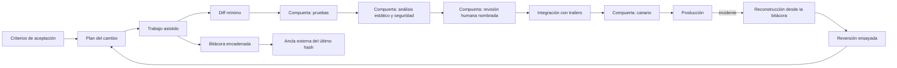
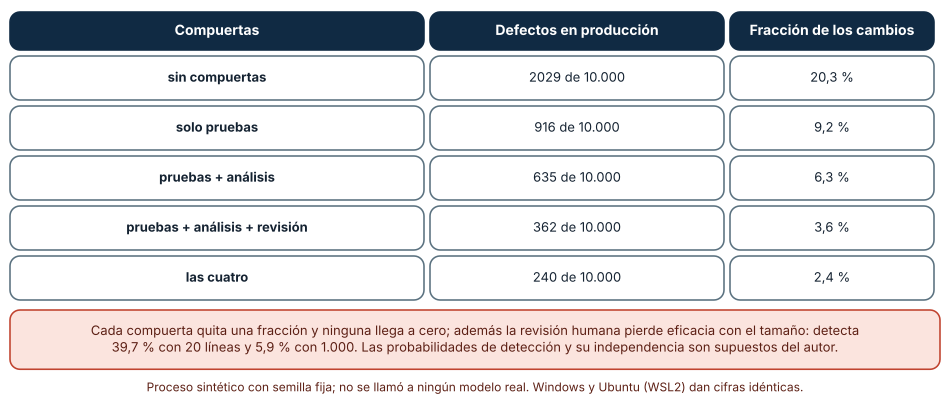
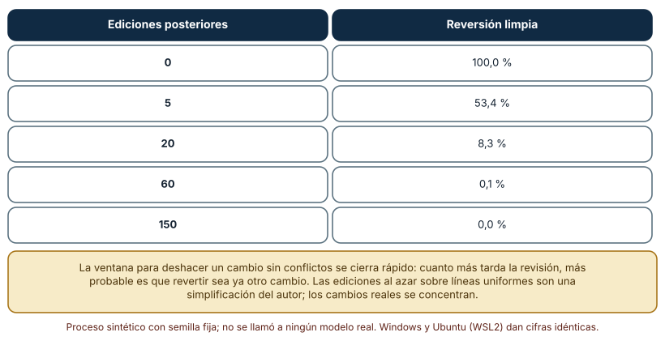

# SE-468 — Proyecto: cambio real con trazabilidad y revisión humana

[← SE-467 — Taller: comparar flujos manual, asistido y automatizado](../../classes/part-38-desarrollo-de-software-asistido-por-ia/se-467-taller-comparar-flujos-manual-asistido-y-automatizado/README.md) · [↑ Parte 38](../../classes/part-38-desarrollo-de-software-asistido-por-ia/README.md) · [📚 Índice completo](../../classes/README.md) · [🌐 Portal](../../site/classes/SE-468.html) · [SE-469 — De la intención a la especificación durable →](../../classes/part-39-spec-agentes-y-ciclo-de-vida-agentic/se-469-de-la-intencion-a-la-especificacion-durable/README.md)

## Punto profesional y fundamento pedagógico

**Punto profesional.** El proyecto cierra la Parte 38 con el ejercicio que la justifica: llevar un cambio real, hecho con ayuda de un asistente, desde el criterio de aceptación hasta la integración, de modo que cualquier persona pueda reconstruir quién decidió qué, qué propuso la herramienta, qué se rechazó, qué se comprobó y cómo se deshace. Un cambio asistido sin trazabilidad deja un código cuya autoría de decisiones nadie puede reconstruir; uno sin revisión humana nombrada deja una responsabilidad sin dueño. La habilidad es componer lo aprendido (modos de uso, contexto, evals, controles de seguridad, comparación de flujos) en un paquete que se pueda auditar y revertir.

**Por qué aparece aquí.** Cierra la Parte 38 después de **Taller: comparar flujos manual, asistido y automatizado**: `SE-467` produjo una decisión sobre qué flujo usar para qué tareas; ahora esa decisión se aplica a un cambio real. Retoma el caso conductor de la parte, el **módulo de calificaciones de la plataforma educativa**, con un cambio concreto. Es un caso sintético; el proyecto se puede ejecutar sobre un repositorio propio, pero los experimentos de la clase no tocan ningún sistema real ni usan ningún asistente.

**Error conceptual que debe corregir.** Creer que la trazabilidad es guardar la conversación con el asistente. La conversación no dice qué se aceptó, qué se ejecutó, qué se verificó ni quién aprobó; lo que hace trazable un cambio es un registro de decisiones y comprobaciones, enlazado con el cambio, protegido contra alteraciones y acompañado de un ancla fuera del propio registro. Y la revisión humana no es un sello final: es una compuerta cuya eficacia depende del tamaño y la claridad del cambio que recibe.

**Secuencia de aprendizaje.** Antes de ver los resultados, predices qué manipulaciones de una bitácora encadenada por hash detecta su verificación y cuál no; después construyes la bitácora de seis pasos y la atacas de cinco maneras, calculas cuántos defectos llegan a producción con distintos conjuntos de compuertas, y mides la probabilidad de poder revertir un cambio sin conflictos según cuántas ediciones lo siguen. La secuencia usa predicción, explicación propia, contraste y recuperación. [ICAP](https://icap.education.asu.edu/research) distingue participación de construcción de conocimiento; [How People Learn II](https://nap.nationalacademies.org/catalog/24783/how-people-learn-ii-learners-contexts-and-cultures) respalda diseñar la práctica con contextos reales y retroalimentación.

**Evidencia de aprendizaje.** El paquete de proyecto: `PLAN.md` (cambio, criterios de aceptación, flujo elegido y por qué), `bitacora.jsonl` encadenada con su verificador, el diff mínimo, las pruebas derivadas de la especificación, el resultado de las compuertas, el registro de revisión humana con nombre, el ensayo de reversión y `LIMITES.md` que separe qué es medido, inferido y supuesto.

**Límite de la conclusión.** Las seis entradas de la bitácora, las probabilidades de detección de cada compuerta, su independencia, la fracción de cambios defectuosos (20 %) y la curva de fatiga son construcciones del autor con semilla fija. El encadenado por hash y su verificación son código real que se ejecuta de verdad; las probabilidades de las compuertas y las ediciones al azar de la reversión son modelos. No se integró ningún cambio en ningún repositorio real ni se usó ningún asistente.

### Trazabilidad fuente → afirmación

| Fuente primaria u oficial | Afirmación que respalda | Lo que no prueba |
|---|---|---|
| [Haber y Stornetta, «How to time-stamp a digital document»](https://doi.org/10.1007/BF00196791) | Propone encadenar registros mediante resúmenes criptográficos para que alterar uno invalide los siguientes y para fijar su orden en el tiempo. | No impide que quien controla toda la cadena la reescriba entera sin un ancla externa. |
| [SLSA: provenance](https://slsa.dev/spec/v1.0/provenance) | Especifica un formato de declaración de procedencia: qué se construyó, a partir de qué y por qué proceso. | No cubre la decisión humana de aceptar un cambio ni sustituye la revisión. |
| [NIST SP 800-218A](https://csrc.nist.gov/pubs/sp/800/218/a/final) | Extiende el marco SSDF con prácticas de desarrollo seguro relacionadas con IA generativa, incluido el registro y la revisión del código producido. | No es una certificación ni fija umbrales. |
| [Reglamento (UE) 2024/1689 (Ley de IA)](https://eur-lex.europa.eu/eli/reg/2024/1689/oj) | Establece, para sistemas de alto riesgo, requisitos de supervisión humana, registro de eventos y documentación técnica. | No clasifica tu herramienta ni determina qué obligaciones te alcanzan. |
| [Git: git-revert](https://git-scm.com/docs/git-revert) | Documenta cómo revertir un cambio creando uno nuevo que lo deshace, y los conflictos que pueden aparecer. | No garantiza que la reversión sea limpia cuando hubo ediciones posteriores. |
| [Git: git-interpret-trailers](https://git-scm.com/docs/git-interpret-trailers) | Documenta los trailers de mensajes de commit, líneas clave-valor que permiten registrar metadatos como quién revisó o con qué ayuda. | No define qué claves usar ni verifica su veracidad. |
| [Bacchelli y Bird](https://doi.org/10.1109/ICSE.2013.6606617) | Muestra que la revisión de código exige entender el cambio y su contexto. | No mide el efecto del tamaño del cambio con la curva usada en la simulación. |
| [Python: hashlib](https://docs.python.org/3/library/hashlib.html) | Documenta los resúmenes criptográficos usados para encadenar las entradas. | No evalúa la política de custodia del último resumen. |

## Antes de empezar

Recupera lo aprendido en `SE-467`: una decisión sobre flujos se toma con tareas pareadas, intervalos y sensibilidad. La pregunta activa es: **dentro de seis meses, ¿qué podría contestar una persona ajena al equipo sobre quién decidió qué en tu último cambio asistido, y con qué evidencia?**

## Prerrequisitos

- Haber completado `SE-467` o poder explicar el diseño pareado y el punto de equilibrio de un flujo asistido.
- Haber trabajado las clases de la parte o poder explicar el control que aporta cada una: contexto (`SE-459`/`SE-464`), pruebas (`SE-462`), revisión (`SE-463`), eval (`SE-465`) y seguridad (`SE-466`).
- Python 3.11 o posterior; los experimentos usan solo la biblioteca estándar (`hashlib`, `json`, `tempfile`, `random`).
- Saber usar `git` a nivel básico: confirmar, ver un diff y revertir.

## Problema auténtico

El módulo de calificaciones necesitaba cambiar el tratamiento de las notas ausentes: de convertirlas en cero a rechazar el cálculo con un error claro. Una persona lo hizo con un asistente en una tarde. El cambio pasó las pruebas y se integró con un mensaje de commit que decía «arreglo de notas». Tres semanas después, un informe del ministerio salió con ceros en actas de un curso y el equipo tuvo que reconstruir qué había ocurrido: no había constancia de qué criterio de aceptación se usó, qué propuso el asistente y qué rechazó la persona, qué pruebas se ejecutaron ni quién revisó. Cuando se quiso revertir el cambio, otras cuatro ediciones tocaban las mismas funciones y la reversión ya no era limpia. Cada elemento que faltaba existía en algún momento de la tarde y no se conservó. El proyecto consiste en hacer el mismo cambio dejando el rastro necesario para que ese informe del ministerio se resuelva en una hora y no en una semana.

## Objetivos observables

Al terminar podrás:

1. definir un cambio con criterios de aceptación verificables y elegir el flujo y los controles según las clases anteriores;
2. mantener una bitácora de decisiones encadenada por hash y verificar su integridad, sabiendo qué manipulaciones detecta y cuáles no;
3. combinar compuertas (pruebas, análisis, revisión humana, canario) y estimar los defectos que llegan a producción con cada conjunto;
4. diseñar el cambio para que se revise (diff mínimo, separación de cambios) y para que se pueda revertir sin conflictos;
5. entregar un paquete auditable con sus límites declarados.

## Mapa conceptual



El mapa une el **trabajo** (arriba), el **rastro** (la bitácora y su ancla) y las **compuertas** (pruebas, análisis, revisión, canario). La flecha de vuelta indica que un incidente reabre el plan con la reconstrucción y la reversión ensayada.

## Temas y por qué importan

| Tema | Por qué cambia una decisión profesional | Evidencia mínima |
|---|---|---|
| Criterios de aceptación | Fijan cuándo el cambio está bien antes de ver la solución | `PLAN.md` con criterios y pruebas |
| Bitácora de decisiones | Permite reconstruir quién decidió qué y con qué evidencia | `bitacora.jsonl` con verificador |
| Integridad y ancla | Distingue alteración torpe de reescritura completa | tabla de manipulaciones detectadas |
| Compuertas combinadas | Ninguna compuerta basta; cada una quita una fracción | tabla de defectos que llegan a producción |
| Revisión humana nombrada | Convierte la aprobación en responsabilidad | registro con nombre y alcance |
| Reversibilidad | Define el plazo en que deshacer es barato | ensayo de reversión y plazo declarado |

## Conceptos y decisiones

### 1. El plan: criterios antes de la solución

Un cambio asistido empieza antes del asistente. El plan fija el comportamiento deseado en términos verificables (la nota ausente produce `ValueError` con un mensaje que nombra al alumno y la evaluación), los casos que lo comprueban (derivados de la especificación, no del código: `SE-462`), las restricciones (no tocar otros módulos, sin dependencias nuevas) y el flujo elegido con su razón (`SE-467`: el asistido, con revisión, para esta clase de tarea). Los criterios se escriben antes de pedir nada para que no se adapten a la solución. Y se define el **alcance máximo del diff**: un cambio de comportamiento de una condición no debería ocupar más de unas decenas de líneas; si el asistente propone mucho más, se rechaza o se divide (`SE-460`). El plan es el documento al que una auditoría posterior vuelve primero.

### 2. La bitácora: qué se registra y cómo se protege

Una bitácora útil registra decisiones, no charla: cada entrada tiene un número de paso, un actor (persona o asistente), una acción, el artefacto asociado (parche, informe de revisión, resultado de pruebas) y, para el asistente, el identificador del modelo y la versión. Debe poder verificarse sin confiar en quien la guarda. Haber y Stornetta proponen encadenar los registros mediante resúmenes criptográficos: cada entrada incluye el resumen de la anterior, de modo que modificar, borrar o reordenar una entrada rompe la cadena desde ese punto. Eso detecta alteraciones accidentales y manipulaciones torpes. No impide que alguien con acceso a todo el archivo recalcule la cola desde el punto alterado y produzca una cadena internamente válida. Para eso hace falta un **ancla externa**: guardar el último resumen fuera de la bitácora (en el sistema de revisión, firmado, en otro servicio), de modo que una reescritura completa no coincida con el ancla.

### 3. Qué es evidencia y qué no lo es

El registro es evidencia de integridad y de proceso, no de que el contenido sea verdadero. Una entrada que dice «se ejecutaron las pruebas» solo vale si apunta al resultado de las pruebas, con su salida, su fecha y la versión del código que se ejecutó. SLSA define un formato de procedencia para las construcciones (qué se construyó, a partir de qué, con qué proceso) y sirve de modelo: la afirmación va acompañada de lo necesario para comprobarla. Lo que no puede registrarse con un script es la parte humana más importante, qué leyó y qué entendió la persona que aprobó. Por eso la aprobación se registra con nombre, alcance (qué archivos y qué comprobaciones revisó) y fecha, y la herramienta no puede aprobar su propio trabajo. La Ley de IA de la Unión Europea exige, para sistemas de alto riesgo, supervisión humana y registro de eventos, y aunque no sea aplicable a tu caso es un buen modelo de qué se espera de un proceso auditable.

### 4. Compuertas: cada una quita una fracción

Ninguna comprobación detecta todo. Las pruebas detectan los defectos que sus casos cubren; el análisis estático y de seguridad, los patrones que conoce; la revisión humana, lo que una persona atenta entiende en el tiempo disponible; el despliegue gradual o canario, lo que se manifiesta con tráfico real y se puede revertir antes de afectar a todos. Si se suponen independientes, los defectos que llegan a producción se reducen multiplicando por la fracción que cada compuerta deja pasar. La independencia es optimista: las compuertas fallan con frecuencia en lo mismo (el caso que nadie pensó). Pero el razonamiento da el orden de magnitud y la lección práctica: el valor de añadir una compuerta decrece, y la eficacia de la revisión humana depende del tamaño del cambio, de modo que mantener el diff pequeño aumenta la de todas las demás compuertas.

### 5. Reversibilidad: la ventana se cierra

Revertir un cambio con `git revert` crea un cambio nuevo que lo deshace, y funciona sin conflictos mientras nadie haya editado las mismas líneas o sus vecinas. Cuanto más tiempo pasa y más ediciones se acumulan, más probable es que la reversión exija resolver conflictos, es decir, que sea otro cambio con su propio riesgo. Por eso la reversibilidad se diseña (cambios pequeños, aislados, con una bandera que apague el comportamiento nuevo) y se **ensaya** en una copia, con un plazo declarado: «este cambio se puede revertir limpiamente durante dos semanas». Un plan de reversión que nunca se ejecutó es una hipótesis. Y si el cambio tiene efectos sobre datos (migraciones, escrituras), revertir el código no revierte los datos: esa parte necesita su propio plan (`SE-439`, `SE-444`).

### Una bitácora de seis pasos y cinco manipulaciones

Se construye una bitácora con seis entradas: criterios de aceptación definidos por una persona, parche propuesto por el asistente (con un marcador `<MODELO_EJEMPLO>` en lugar de un identificador real), rechazo parcial con petición de prueba, segundo parche con prueba, ejecución de pruebas y aprobación, e integración. Cada línea JSON guarda la entrada y su resumen SHA-256, calculado sobre el resumen anterior y el contenido de la entrada. Se escribe en un archivo temporal y se aplica un verificador que recorre la cadena. Después se manipula de cinco maneras.

```python
def enlaza(anterior, entrada):
    cuerpo = json.dumps(entrada, sort_keys=True, ensure_ascii=False)
    return hashlib.sha256((anterior + cuerpo).encode("utf-8")).hexdigest()
```

| Manipulación | Resultado de la verificación |
|---|---|
| Editar el texto de la entrada 3 | detectada en la entrada 3 |
| Borrar la entrada 3 | detectada en la entrada 3 |
| Intercambiar las entradas 2 y 3 | detectada en la entrada 2 |
| Editar la 3 y recalcular todos los resúmenes siguientes | no se detecta (la cadena verifica sin error) |
| Lo mismo, con el último resumen guardado fuera de la bitácora | se detecta: el último resumen no coincide con el ancla |

La bitácora sin alterar verifica sin error. Las tres primeras manipulaciones se detectan en el punto exacto en que rompen la cadena (3, 3 y 2). La cuarta es la lección central: quien edita la entrada 3 y recalcula los resúmenes siguientes produce una cadena internamente válida, y el verificador no puede distinguirla de la original. Con el último resumen anclado en otro sitio, esa reescritura se detecta, porque su último resumen difiere del guardado. El encadenado protege contra errores y alteraciones torpes; contra una persona con acceso total, protege el ancla.


**Cómo leer la figura.** Cada fila es un ataque y la columna derecha dice si la verificación lo detecta y dónde; la cuarta fila es el límite del encadenado y la quinta, lo que lo corrige. **Dónde deja de valer:** la bitácora es de seis entradas escritas por el autor, no hay firma digital ni sello de tiempo, y el verificador supone que el atacante no conoce ni controla el ancla. Es evidencia de integridad, no de que el contenido de las entradas sea cierto.

### Cuatro compuertas: cuántos defectos llegan

El 20 % de los cambios asistidos trae un defecto. Cada compuerta lo detecta con una probabilidad independiente: pruebas 0,55, análisis estático 0,25, revisión humana 0,45 y canario 0,35. Se simulan 10 000 cambios con cinco conjuntos de compuertas y se cuentan los defectos que llegan a producción. Además se modela la fatiga de la revisión humana con una detección que decrece con el tamaño del diff.

```python
if rng.random() < 0.20:                       # el cambio trae un defecto
    if all(rng.random() > compuertas[c] for c in cs):
        llegan += 1                            # ninguna compuerta lo detectó
p_detectar = 0.45 / (1 + lineas / 150)        # revisión humana según líneas del diff
```

| Compuertas | Defectos en producción | Fracción de los cambios |
|---|---:|---:|
| Sin compuertas | 2.029 de 10.000 | 20,3 % |
| Solo pruebas | 916 de 10.000 | 9,2 % |
| Pruebas + análisis | 635 de 10.000 | 6,4 % |
| Pruebas + análisis + revisión | 362 de 10.000 | 3,6 % |
| Las cuatro | 240 de 10.000 | 2,4 % |

Sin compuertas llegan 2.029 defectos de 10.000 cambios (20,3 %); solo con pruebas, 916; con las cuatro, 240 (2,4 %). Cada compuerta quita una fracción y ninguna llega a cero. La contribución marginal decrece: las pruebas quitan 1.113 defectos, el análisis 281 más, la revisión 273 más y el canario 122 más. Además la eficacia de la revisión humana cae con el tamaño del cambio: con la curva del autor detecta el 39,7 % de los defectos en un diff de 20 líneas, el 27,0 % en uno de 100, el 12,3 % en uno de 400 y el 5,9 % en uno de 1.000. El diff mínimo es, por tanto, una forma de mejorar una compuerta sin añadir otra.



**Cómo leer la figura.** Cada fila añade una compuerta; la segunda columna es el número de defectos que llegan a producción de cada 10.000 cambios. **Dónde deja de valer:** las probabilidades de detección y su independencia son supuestos del autor; en la práctica las compuertas comparten ángulos ciegos y la independencia sobreestima la mejora. La curva de fatiga es un modelo, no una medición de personas.

### Revertir: cuánto dura la ventana

Un cambio de 40 líneas (cuatro bloques de 10 consecutivas) se aplica a un archivo de 400 líneas. Se simulan k ediciones posteriores en líneas al azar y se cuenta cómo de a menudo ninguna cae en las líneas del cambio ni en sus vecinas inmediatas, que es la condición para que la reversión sea limpia. Se hacen 4 000 repeticiones por valor de k.

| Ediciones posteriores | Reversión limpia |
|---:|---:|
| 0 | 100,0 % |
| 5 | 53,4 % |
| 20 | 8,3 % |
| 60 | 0,1 % |
| 150 | 0,0 % |

Con cinco ediciones posteriores repartidas al azar, la reversión es limpia solo en la mitad de los casos (53,4 %); con veinte, en el 8,3 %; con sesenta es casi imposible. La ventana se cierra rápido porque cada edición tiene probabilidad de caer cerca del cambio, y esa probabilidad se acumula. La consecuencia es de proceso: la revisión y la integración deben ser rápidas, la reversión se ensaya mientras la ventana está abierta y el plazo de reversibilidad limpia se declara en el paquete. Cuando se cierra, revertir deja de ser una operación mecánica y pasa a ser un cambio nuevo que necesita su propio plan.



**Cómo leer la figura.** Cada fila es un número de ediciones posteriores; la segunda columna es la fracción de repeticiones en que la reversión habría sido limpia. **Dónde deja de valer:** las ediciones caen al azar con probabilidad uniforme sobre 400 líneas, y los cambios reales se concentran en ciertas zonas (que aumentan o reducen el riesgo según donde caiga tu cambio); la condición de «reversión limpia» considera solo las líneas vecinas y no las dependencias semánticas.

## Definiciones de trabajo

- **trazabilidad:** capacidad de reconstruir qué se decidió, quién, con qué evidencia y con qué resultado.
- **bitácora encadenada:** registro en que cada entrada incluye el resumen criptográfico de la anterior.
- **ancla externa:** copia del último resumen de una bitácora guardada fuera de ella.
- **compuerta:** comprobación que un cambio debe pasar antes de avanzar de etapa.
- **ventana de reversión limpia:** periodo en que un cambio puede deshacerse sin conflictos.

Las definiciones son operativas para el módulo de calificaciones. No convierten términos con una historia más amplia en sinónimos y deben contrastarse con la documentación primaria enlazada al final.

## Ejemplo mínimo

El fragmento encadena dos entradas y detecta una edición. Antes de ejecutarlo, predice qué devuelve la verificación tras modificar la primera.

```python
import hashlib, json
def enlaza(ant, e):
    return hashlib.sha256((ant + json.dumps(e, sort_keys=True)).encode()).hexdigest()
e1, e2 = {"paso": 1, "accion": "criterios"}, {"paso": 2, "accion": "parche"}
h1 = enlaza("0" * 64, e1); h2 = enlaza(h1, e2)
e1["accion"] = "criterios editados"
print(enlaza("0" * 64, e1) == h1, enlaza(h1, e2) == h2)
```

La primera comparación da `False` (la entrada editada ya no coincide con su resumen) y la segunda `True` si solo se mira la entrada 2 con el resumen antiguo, de modo que la verificación detecta la edición en el punto exacto. Registra versión de Python, comando y salida; después recalcula h1 y h2 y comprueba que la cadena vuelve a verificar, que es el ataque que solo un ancla externo detecta.

## Ejemplo profesional

Escenario hipotético, construido para la clase y sin datos reales. El equipo del módulo de calificaciones ejecuta el proyecto sobre el cambio de las notas ausentes. El `PLAN.md` fija el criterio («una nota ausente lanza `ValueError` con el nombre del alumno y la evaluación; ninguna otra función cambia»), cinco casos derivados del reglamento y el límite de 40 líneas de diff; el flujo es el asistido, con las compuertas de pruebas, análisis y revisión nombrada. La persona trabaja con el asistente y registra en la bitácora cada decisión: el parche 1 del asistente, el rechazo de la parte que además reformateaba el archivo, la petición de una prueba y el parche 2. Las pruebas pasan y el análisis estático no encuentra patrones; una segunda persona revisa el diff de 28 líneas, anota qué leyó y qué comprobó y aprueba con nombre y fecha. El mensaje de integración lleva trailers (`Revisado-por`, `Plan`, `Bitacora-hash`) y el último resumen de la bitácora se guarda además en el sistema de revisión. El cambio sale con una bandera apagable y se ensaya su reversión en una copia, con un plazo declarado de dos semanas. Cuando semanas después aparece el informe con ceros, el equipo lee el plan, verifica la bitácora y encuentra que el curso afectado usa un camino que el cambio no tocaba; la conclusión se alcanza en una hora y queda registrada. Compara con el estado inicial: antes se reconstruía por memoria y por la conversación.

## Práctica guiada

1. Predice qué manipulaciones de una bitácora encadenada detecta el verificador y cuál no, y anota tus respuestas.
2. Escribe el `PLAN.md` de un cambio real de tu proyecto con criterios verificables, casos derivados de la especificación y límite de diff.
3. Implementa la bitácora encadenada y su verificador, y reproduce la tabla de las cinco manipulaciones.
4. Guarda el último resumen en un sistema externo y demuestra que la reescritura de la cola se detecta.
5. Hazlo con el flujo que elegiste en `SE-467`, registrando cada decisión, y mantén el diff por debajo del límite.
6. Pasa el cambio por las compuertas, registra la revisión humana con nombre y alcance, y ensaya la reversión en una copia.
7. Escribe `LIMITES.md` y pide a otra persona que reconstruya, solo con el paquete, quién decidió qué y que intente una manipulación que no detectes.

## Ejercicios

1. **Cadena:** explica por qué borrar la última entrada de una bitácora encadenada no rompe la cadena y cómo lo detectarías.
2. **Compuertas:** con detecciones de 0,5 y 0,3 independientes y una tasa de defecto del 10 %, calcula los defectos que llegan por cada 1.000 cambios con las dos compuertas.
3. **Revisión:** un asistente propone un diff de 300 líneas. Describe cómo lo reducirías y qué le pedirías.
4. **Reversión:** el plazo de reversión limpia declarado es de dos semanas y el cambio lleva cuatro. ¿Qué haces si hay que deshacerlo?

## Reto verificable

Entrega el paquete: `PLAN.md`, `bitacora.jsonl` con su verificador y el último resumen anclado fuera, el diff mínimo con sus pruebas derivadas de la especificación, el resultado de las compuertas, el registro de revisión humana con nombre y alcance, el ensayo de reversión con su plazo, y `LIMITES.md`. Se aprueba si otra persona, con solo el paquete, reconstruye en menos de una hora qué se decidió, quién lo hizo, qué se comprobó y cómo se deshace, verifica la bitácora y no logra alterarla sin que el ancla lo delate. No se aprueba por guardar la conversación como si fuera la bitácora, por una revisión sin nombre ni alcance, ni por una reversión que nunca se ensayó.

## Caso conductor

El módulo de calificaciones es el caso conductor de la Parte 38. Este proyecto deja el duodécimo y último artefacto: un cambio real, hecho con ayuda de un asistente, con su plan, su bitácora, sus compuertas, su revisión nombrada y su reversión ensayada. Recoge los de las clases anteriores: la política de verificación (`SE-457`), el encargo (`SE-458`), el contexto (`SE-459`, `SE-464`), los modos de uso (`SE-460`), la exploración (`SE-461`), las pruebas y migraciones (`SE-462`), la revisión (`SE-463`), la eval (`SE-465`), los controles de datos y código (`SE-466`) y la comparación de flujos (`SE-467`). La Parte 39 pasa de ayudar a una persona a gobernar agentes con especificaciones durables. Cambia después un solo dato, el tamaño del diff, y observa cómo cambia la eficacia de la revisión y, con ella, la de todas las compuertas.

## Preguntas frecuentes

### ¿Debo guardar la conversación completa con el asistente?

Puede ser útil como material de apoyo, pero no sustituye la bitácora: contiene mucho ruido y datos que quizá no deban conservarse (`SE-466`). Registra las decisiones y las comprobaciones, y enlaza solo lo imprescindible.

### ¿Quién responde si el cambio asistido falla?

Quien lo aprobó. El asistente no tiene responsabilidad; la persona que revisó y aprobó, y la que decidió usar el flujo, sí. Por eso la aprobación lleva nombre y alcance.

### ¿El encadenado por hash es una firma digital?

No. Detecta alteraciones y fija el orden, pero no prueba quién escribió las entradas ni cuándo. Para eso se añaden firmas y sellos de tiempo, y el ancla externa.

### ¿Cuánto debe durar la ventana de reversión?

Lo que tarde en manifestarse el tipo de defecto esperado y en cerrarse con la actividad del equipo. Se mide con el ritmo real de ediciones sobre esa zona del código y se declara; no hay un valor universal.

## Fallo controlado y diagnóstico

Reproduce el fallo clásico del proyecto: **una bitácora reescrita con la cola recalculada que verifica sin error**. Edita la entrada 3, recalcula todos los resúmenes siguientes y ejecuta el verificador.

Registra síntoma, entrada mínima, hipótesis, observación que descarta cada hipótesis, causa, corrección y prueba de regresión. **Síntoma:** el registro dice que la aprobación fue de otra persona y la cadena verifica sin error. **Hipótesis rivales:** (a) el verificador está mal implementado; (b) el algoritmo de resumen es débil; (c) la cadena no incluye un ancla fuera de la bitácora. **Prueba:** compara el último resumen con el guardado en el sistema de revisión; si difieren, la reescritura es real y la cadena no la detecta por sí sola. **Conclusión:** una cadena de resúmenes sin ancla externa solo da integridad frente a quien no controla todo el archivo. **Regresión:** añade al proceso la publicación del último resumen en un sistema independiente tras cada integración y una prueba que falle si no coincide. No cambies a la vez el verificador y el ancla.

## Errores comunes y cómo corregirlos

| Síntoma | Causa probable | Corrección |
|---|---|---|
| No se sabe qué criterio se usó | El plan se escribió después de la solución | Criterios por escrito antes de pedir nada |
| «Se revisó» sin saber quién ni qué | Aprobación sin nombre ni alcance | Registro con persona, archivos y comprobaciones |
| La cadena verifica pero el contenido fue alterado | Sin ancla externa | Guardar el último resumen fuera de la bitácora |
| Defectos que llegan pese a cuatro compuertas | Compuertas con los mismos ángulos ciegos | Variar el tipo de comprobación y reducir el diff |
| La reversión ya no es limpia | La ventana se cerró | Ensayo temprano, bandera apagable y plazo declarado |

## Entorno y archivos clave

```text
work/SE-468/
├── README.md
├── PLAN.md
├── LIMITES.md
├── trazabilidad/
│   ├── bitacora.jsonl
│   ├── verificar.py
│   └── ancla.txt
├── cambio/
│   ├── parche-final.diff
│   └── pruebas_especificacion.py
├── compuertas/resultado.md
├── revision/aprobacion.md
├── reversion/ensayo.md
└── tests/test_trazabilidad.py
```

El `README` declara plataforma, versión de Python, semillas y comandos. Los experimentos usan solo la biblioteca estándar (`hashlib`, `json`, `tempfile`, `random`) y se ejecutaron con CPython 3.12.9 en Windows 11 y 3.12.3 en Ubuntu bajo WSL2: las salidas fueron idénticas. Los experimentos están en `scripts/experiments_part38_b.py`; la bitácora de la clase se escribe en un directorio temporal y se elimina al terminar. Si aplicas el proyecto a un repositorio real, haz el ensayo de reversión sobre una copia. Si añades una dependencia, fija procedencia y versión.

## Seguridad, ética y accesibilidad

- la bitácora no debe contener datos personales, secretos ni fragmentos de conversación con datos reales; registra referencias y resúmenes, no el contenido sensible (`SE-466`);
- el identificador del modelo y su versión se registran para poder reproducir o auditar, sin incluir claves de acceso;
- una aprobación humana sin tiempo ni contexto para entender el cambio es una formalidad que traslada la responsabilidad a quien no pudo ejercerla; garantiza condiciones reales para revisar;
- la documentación del paquete debe ser legible con lectores de pantalla y las tablas, con texto alternativo y sin depender del color;
- las normas citadas (incluida la Ley de IA) pueden o no aplicar a tu caso y esta clase no es asesoría legal;
- las guías y estándares citados tienen derechos de autor: cita su estructura y vincula la fuente, no copies su texto.

## Puente hacia el trabajo con agentes

Un agente produce muchas acciones por tarea, de modo que la bitácora y las compuertas dejan de ser opcionales: sin un registro automático de cada paso (archivo leído, comando ejecutado, parche generado, resultado de las pruebas), reconstruir lo ocurrido es imposible. Configura el entorno del agente para que escriba la bitácora en un canal que no controle (no puede editarla ni borrarla), limita sus permisos, exige que el parche final sea mínimo y que las pruebas vengan de la especificación, y reserva la aprobación a una persona con nombre. Revisa especialmente las acciones que el agente no registró y compara su bitácora con los efectos reales en el repositorio: la diferencia es lo que dejaste sin auditar.

## Transferencia

Traslada el proyecto a otro dominio (por ejemplo, el módulo de presupuestos de un taller mecánico): cambia el cambio, las compuertas y el sistema de revisión y conserva el procedimiento de criterios previos, diff mínimo, bitácora encadenada con ancla, compuertas combinadas, revisión nombrada y reversión ensayada. La transferencia está lograda cuando puedes decir qué parte del rastro no podría reconstruirse en tu proceso actual y qué cambiarías para conservarla, no cuando el paquete se parece al del módulo de calificaciones.

## Evaluación y evidencia

| Criterio | Evidencia para aprobar |
|---|---|
| comprensión | explicación de qué protege el encadenado y qué el ancla, y de por qué la revisión humana depende del tamaño del cambio |
| corrección | bitácora verificable, tablas de manipulaciones, compuertas y reversión reproducibles con las mismas semillas |
| diseño | paquete con plan, diff mínimo, bitácora anclada, compuertas, revisión nombrada y reversión ensayada |
| diagnóstico | reproducción del fallo «cola recalculada que verifica sin error» con regresión |
| incertidumbre | declaración de que probabilidades, independencia y curvas son del autor y de que el rastro no prueba la verdad del contenido |
| reproducibilidad | versiones, comandos, salida y límites declarados |

## Fuentes

- [Haber y Stornetta, «How to time-stamp a digital document»](https://doi.org/10.1007/BF00196791) — encadenado de registros con resúmenes criptográficos; autoridad: Journal of Cryptology.
- [SLSA: provenance](https://slsa.dev/spec/v1.0/provenance) — formato de declaración de procedencia; autoridad: especificación del proyecto SLSA.
- [NIST SP 800-218A](https://csrc.nist.gov/pubs/sp/800/218/a/final) — prácticas de desarrollo seguro para IA generativa; autoridad: NIST.
- [Reglamento (UE) 2024/1689](https://eur-lex.europa.eu/eli/reg/2024/1689/oj) — supervisión humana y registro de eventos en sistemas de alto riesgo; autoridad: Unión Europea.
- [Git: git-revert](https://git-scm.com/docs/git-revert) — reversión de cambios; autoridad: documentación de Git.
- [Git: git-interpret-trailers](https://git-scm.com/docs/git-interpret-trailers) — metadatos en mensajes de commit; autoridad: documentación de Git.
- [Bacchelli y Bird](https://doi.org/10.1109/ICSE.2013.6606617) — revisión de código moderna; autoridad: ICSE 2013.
- [Python: hashlib](https://docs.python.org/3/library/hashlib.html) — resúmenes criptográficos; autoridad: documentación de Python.

Cada fuente respalda el mecanismo indicado; ninguna demuestra que los 240 defectos con cuatro compuertas, el 53,4 % de reversión limpia con cinco ediciones o el 5,9 % de detección de la revisión en 1.000 líneas se observen en un proceso real. Esa afirmación depende del equipo, del código y de cómo se mida.

## Límites y siguiente paso

Se ejecutaron tres experimentos en Windows y Ubuntu (WSL2) con resultados idénticos: una bitácora encadenada real escrita en un directorio temporal y atacada de cinco maneras, una simulación de compuertas independientes con una curva de fatiga y una simulación de reversión con ediciones al azar. No se integró ningún cambio en ningún repositorio real ni se usó ningún asistente o agente; las seis entradas, las probabilidades de cada compuerta y su independencia, la tasa de defecto del 20 %, la curva de fatiga y las ediciones uniformes son construcciones del autor. Esto cierra la Parte 38: el contenido sigue pendiente de revisión humana independiente. La Parte 39 pasa de ayudar a una persona a gobernar agentes con especificaciones durables.

## Glosario

- **trazabilidad:** capacidad de reconstruir qué se decidió, quién, con qué evidencia y con qué resultado.
- **bitácora encadenada:** registro en que cada entrada incluye el resumen criptográfico de la anterior.
- **ancla externa:** copia del último resumen de una bitácora guardada fuera de ella.
- **compuerta:** comprobación que un cambio debe pasar antes de avanzar de etapa.
- **ventana de reversión limpia:** periodo en que un cambio puede deshacerse sin conflictos.

---

[← SE-467 — Taller: comparar flujos manual, asistido y automatizado](../../classes/part-38-desarrollo-de-software-asistido-por-ia/se-467-taller-comparar-flujos-manual-asistido-y-automatizado/README.md) · [↑ Parte 38](../../classes/part-38-desarrollo-de-software-asistido-por-ia/README.md) · [📚 Índice completo](../../classes/README.md) · [🌐 Portal](../../site/classes/SE-468.html) · [SE-469 — De la intención a la especificación durable →](../../classes/part-39-spec-agentes-y-ciclo-de-vida-agentic/se-469-de-la-intencion-a-la-especificacion-durable/README.md)
