# Parte 39 — Build, release y cadena de suministro

La Parte 38 decidió qué amenazas, datos y obligaciones importan. La pregunta cambia de «¿qué puede salir mal con el sistema?» a «¿cómo llega el código desde quien lo revisó hasta quien lo ejecuta, y qué evidencia permite a otra persona comprobar que no cambió por el camino?». Esta parte trabaja sobre **el canal de release de la API de entregas de la plataforma educativa y de su cliente de línea de órdenes**, un caso sintético: un árbol de código que se empaqueta, se almacena, se firma, se verifica, se versiona, se expone gradualmente y se actualiza en equipos ajenos.

## Pregunta rectora

> ¿Qué evidencia reproducible permite a otra persona comprobar que un release procede de la fuente revisada, qué ataques detecta esa comprobación y cuáles no, y cómo se recupera el canal cuando algo se pierde?

## Antes del recorrido clase por clase

Esta parte no enseña una herramienta de CI ni un producto de firma. Enseña a construir un artefacto que otra persona pueda reconstruir bit a bit, a identificarlo por contenido y promoverlo sin reconstruirlo, a inventariar y fijar lo que contiene, a describirlo con un SBOM y una procedencia, a protegerlo con firmas con raíz de confianza fijada y secuencia, a decir qué promete un número de versión, a exponer cambios de forma gradual y reversible, a actualizar un cliente de forma atómica, a reconocer que el CI es un objetivo, y a verificar un release separando lo comprobado de lo no verificable.

```mermaid
flowchart LR
    A[Build reproducible y hermético] --> B[Artefactos, repositorios y promoción]
    B --> C[Dependencias y vendorización]
    C --> D[SBOM, procedencia y atestaciones]
    D --> E[Firmas, checksums y verificación]
    E --> F[Versionado y changelog]
    F --> G[Feature flags]
    G --> H[Canary, blue-green y rollback]
    H --> I[Instaladores y actualizaciones]
    I --> J[Riesgos de CI]
    J --> K[Taller: verificar procedencia]
    K --> L[Proyecto: release firmado y recuperable]
    L -->|incidente o hallazgo| A
```

El diagrama se lee de izquierda a derecha y no es un proceso obligatorio. El retorno indica que un incidente o un hallazgo del taller reabre el build; un expediente aprobado no cierra la cadena, la fecha.

## Resultados acumulativos

Podrás construir un empaquetado reproducible entre sistemas y localizar con una comparación por archivo la entrada que lo rompe; explicar por qué una etiqueta no identifica un contenido y calcular el coste de reconstruir en lugar de promover y de una retención mal calibrada; medir la clausura transitiva de lo instalado, la deriva de una resolución sin bloqueo y el tiempo de parche de una copia vendorizada; validar la forma de un SBOM y saber qué mutaciones no ve, comparar métodos de inventario y razonar qué ataques contradice cada campo de una procedencia; firmar con Ed25519, evaluar seis estrategias de verificación frente a nueve ataques y planificar rotación y revocación.

Además podrás comparar firmas de API con `ast` y combinar un control automático con revisión humana; segmentar por huella con sal, medir uniformidad y consistencia, cubrir pares de banderas y medir la deuda; simular un canario, sus falsas alarmas y el tamaño mínimo de defecto detectable, y decidir cuándo es posible el retroceso; inyectar fallos en cada paso de una actualización y estimar los saltos de versión; escanear flujos de CI reales, evaluar el escáner con mutaciones y razonar el alcance de un paso comprometido; y defender un expediente de release con sus verificaciones en dos sistemas, sus simulacros de recuperación y una lista de lo que ningún control ve.

## Prerrequisitos enlazados

- [Parte 4 — Pensamiento computacional](../../classes/part-04-pensamiento-computacional-y-resolucion-de-problemas/): modelado y razonamiento sobre evidencia.
- [Parte 13 — Especificaciones, contratos y modelos](../../classes/part-13-especificaciones-contratos-y-modelos/): contratos y compatibilidad entre versiones.
- [Parte 35 — Estrategia y técnicas de prueba](../../classes/part-35-estrategia-y-tecnicas-de-prueba/): pruebas de contrato y capacidad de detección.
- [Parte 36 — Calidad, rendimiento y resiliencia](../../classes/part-36-calidad-rendimiento-y-resiliencia/): protocolos de medición, reintentos y recuperación.
- [Parte 38 — Seguridad, privacidad y cumplimiento](../../classes/part-38-seguridad-privacidad-y-cumplimiento/): amenazas y obligaciones que esta parte convierte en controles de la cadena.
- Python 3.11+, terminal y `openssl` 3.x; los experimentos usan la biblioteca estándar y datos sintéticos, salvo las mediciones de reloj, las lecturas de los metadatos del entorno y el escaneo de los flujos reales del repositorio.

## Bloques y progresión

1. **Construir y guardar:** `SE-469` y `SE-470` hacen reproducible el artefacto y lo identifican y promueven por huella.
2. **Saber qué contiene y de dónde viene:** `SE-471` y `SE-472` inventarían la clausura y la describen con SBOM y procedencia.
3. **Proteger y versionar:** `SE-473` y `SE-474` firman y verifican, y definen qué promete una versión.
4. **Entregar con control:** `SE-475` a `SE-477` exponen gradualmente con banderas y canarios y actualizan clientes de forma atómica.
5. **Defender y demostrar:** `SE-478` a `SE-480` analizan el CI, verifican un release en un taller y entregan un expediente recuperable.

## Evidencia medida y límites

Los experimentos se ejecutaron con CPython 3.12.9 en Windows 11 y se repitieron con CPython 3.12.3 en Ubuntu bajo WSL2. Los datos son **sintéticos**, las semillas están fijadas y las simulaciones corren en **tiempo virtual**: sus cifras fueron idénticas en ambos sistemas. Hay excepciones intencionales: la **lectura de los metadatos de las distribuciones instaladas** de `SE-471` (349 en Windows y 63 en Ubuntu) depende del equipo; las **mediciones de reloj** de `SE-473` y `SE-480` son una lectura por celda y cambian en cada ejecución; y el **campo `create_system` de zip** de `SE-469` produce un hash distinto en cada sistema hasta que se fija, que es el hallazgo. Las firmas son reales (Ed25519 con `openssl` 3.5.7 en Windows y 3.0.13 en Ubuntu); las matrices de ataques y los rechazos son idénticos. El escaneo de `SE-478` lee los tres flujos reales del repositorio.

El código está en `scripts/experiments_part39/` (un archivo `eNNN.py` por clase, más `common.py` y `release.py`). Los parámetros (la deriva del 1, 5 y 15 %, el repush de etiquetas, la cola de profundidad de retroceso, la composición de los 100 proyectos de SBOM, la probabilidad diaria de publicación de 0,03, las tasas de error del etiquetado manual, las 3 banderas nuevas al mes, las 400 solicitudes por segundo del canario, las frecuencias de apertura de los clientes y los 18 casos del taller) son **supuestos del autor**, no mediciones.

Lo que **no se hizo**: no se usó ningún registro de artefactos, resolvedor, herramienta de SBOM, de firma o de verificación de terceros (cosign, Sigstore, slsa-verifier, in-toto, zizmor), ni plataforma de banderas, balanceador o instalador real; no se ejecutó ningún flujo de CI; no se cortó la energía en ninguna actualización; no se probó macOS; los validadores, el comparador y el escáner se afinaron con los mismos casos que los evalúan, de modo que sus porcentajes muestran una frontera y no una tasa. La parte no tiene laboratorio en `labs/` y su contenido sigue pendiente de revisión humana independiente.

## Guía razonada clase por clase

El caso conductor es el canal de release de la API de entregas. Cada clase explica qué incertidumbre reduce, qué experimento la muestra y qué no demuestra.

### Bloque 1 — Construir y guardar

#### SE-469 — Build reproducible y hermético

Dos builds del mismo commit con hashes distintos no permiten distinguir manipulación de ruido. La clase aísla ocho fuentes de variación en veinte entornos, descubre que el mismo árbol normalizado da hashes distintos en Windows y Ubuntu por un campo del formato y localiza la entrada que difiere. El estudiante entrega un script normalizado y una lista de entradas. `SE-470` decide dónde vive ese artefacto.

#### SE-470 — Artefactos, repositorios y promoción

Lo probado y lo desplegado deben ser lo mismo. Se compara reconstruir con promover por huella, el efecto de etiquetas que se vuelven a publicar y la retención necesaria para retroceder. Se entrega una política de promoción y de retención. `SE-471` abre el contenido del artefacto.

### Bloque 2 — Saber qué contiene y de dónde viene

#### SE-471 — Dependencias directas, transitivas y vendorización

El manifiesto no es el inventario. Se mide la clausura de lo instalado en dos equipos, la deriva de resolver sin bloqueo durante 60 días y el tiempo de parche de una copia vendorizada. Se entrega un inventario fijado con dueños. `SE-472` lo documenta.

#### SE-472 — SBOM, procedencia y atestaciones

Un documento bien formado puede ser falso. Un validador ve 120 de 240 mutaciones, cuatro métodos de inventario ven de 63 a 98 % de los componentes y una verificación de campos deja pasar tres de ocho ataques. Se entrega un SBOM y una procedencia ligados por huella. `SE-473` los protege.

### Bloque 3 — Proteger y versionar

#### SE-473 — Firmas, checksums y verificación

Seis estrategias frente a nueve ataques con firmas Ed25519 reales: ninguna cubre un CI comprometido que firma con la clave real. Se entrega una política de verificación con raíz fijada, secuencia y rotación. `SE-474` define qué firma el número de versión.

#### SE-474 — Versionado, compatibilidad y changelog

Un comparador de firmas acierta 10 de 14 cambios y no ve tres que rompen sin tocar la firma; combinado con revisión baja los cambios subestimados del 22,1 al 0,8 % en el modelo. Se entrega una política de versionado y un registro de cambios.

### Bloque 4 — Entregar con control

#### SE-475 — Feature flags y entrega progresiva

Segmentación por huella con sal, consistencia al ampliar, cubrimiento de pares y deuda de banderas. Se entrega una política de banderas con dueño y caducidad.

#### SE-476 — Canary, blue-green y rollback

Tiempo de detección según el tamaño del canario, falsas alarmas por umbral, defecto mínimo detectable y reversibilidad de los datos. Se entrega una política de despliegue progresivo y migraciones expandir-contraer.

#### SE-477 — Instaladores, paquetes y actualizaciones

Inyección de fallos en cada paso de cuatro estrategias de actualización con archivos reales y sesgo de versiones de 20 000 clientes. Se entrega un procedimiento atómico y una tabla de rutas.

### Bloque 5 — Defender y demostrar

#### SE-478 — Riesgos de CI y dependencias comprometidas

Escaneo real de los tres flujos del repositorio, un escáner que ve 110 de 155 mutaciones y el alcance de un paso comprometido. Se entrega un modelo de amenazas del CI.

#### SE-479 — Taller: verificar la procedencia de un release

Un verificador de doce comprobaciones rechaza 12 de 12 manipulaciones y 0 de 6 casos coherentes; la reconstrucción independiente convierte el primero en una discrepancia. Se entrega un informe con tres estados.

#### SE-480 — Proyecto: release firmado y recuperable

Verificación cruzada entre Windows y Ubuntu con la misma huella 802052279bf24eb8 y cuatro simulacros de recuperación. Se entrega un expediente con `LIMITES.md`. La Parte 40 lleva la cadena a CI/CD, infraestructura como código y plataforma.

## Resumen operativo del recorrido

| Clase | Núcleo profesional | Aporte acumulativo |
|---|---|---|
| [SE-469](../../classes/part-39-build-release-y-cadena-de-suministro/se-469-build-reproducible-y-hermetico/) | Build reproducible y hermético | Entrega un script normalizado y una lista de entradas |
| [SE-470](../../classes/part-39-build-release-y-cadena-de-suministro/se-470-artefactos-repositorios-y-promocion/) | Artefactos, repositorios y promoción | Entrega una política de promoción y de retención |
| [SE-471](../../classes/part-39-build-release-y-cadena-de-suministro/se-471-dependencias-directas-transitivas-y-vendorizacion/) | Dependencias directas, transitivas y vendorización | Entrega un inventario fijado con dueños |
| [SE-472](../../classes/part-39-build-release-y-cadena-de-suministro/se-472-sbom-procedencia-y-atestaciones/) | SBOM, procedencia y atestaciones | Entrega un SBOM y una procedencia ligados por huella |
| [SE-473](../../classes/part-39-build-release-y-cadena-de-suministro/se-473-firmas-checksums-y-verificacion/) | Firmas, checksums y verificación | Entrega una política de verificación con raíz fijada, secuencia y rotación |
| [SE-474](../../classes/part-39-build-release-y-cadena-de-suministro/se-474-versionado-compatibilidad-y-changelog/) | Versionado, compatibilidad y changelog | Entrega una política de versionado y un registro de cambios |
| [SE-475](../../classes/part-39-build-release-y-cadena-de-suministro/se-475-feature-flags-y-entrega-progresiva/) | Feature flags y entrega progresiva | Entrega una política de banderas con dueño y caducidad |
| [SE-476](../../classes/part-39-build-release-y-cadena-de-suministro/se-476-canary-blue-green-y-rollback/) | Canary, blue-green y rollback | Entrega una política de despliegue progresivo y migraciones expandir-contraer |
| [SE-477](../../classes/part-39-build-release-y-cadena-de-suministro/se-477-instaladores-paquetes-y-actualizaciones/) | Instaladores, paquetes y actualizaciones | Entrega un procedimiento atómico y una tabla de rutas |
| [SE-478](../../classes/part-39-build-release-y-cadena-de-suministro/se-478-riesgos-de-ci-y-dependencias-comprometidas/) | Riesgos de CI y dependencias comprometidas | Entrega un modelo de amenazas del CI |
| [SE-479](../../classes/part-39-build-release-y-cadena-de-suministro/se-479-taller-verificar-la-procedencia-de-un-release/) | Taller: verificar la procedencia de un release | Entrega un informe con tres estados |
| [SE-480](../../classes/part-39-build-release-y-cadena-de-suministro/se-480-proyecto-release-firmado-y-recuperable/) | Proyecto: release firmado y recuperable | Entrega un expediente con `LIMITES.md` |

## Fuentes

- [Reproducible Builds](https://reproducible-builds.org/docs/definition/), [Lamb y Zacchiroli](https://doi.org/10.1109/MS.2021.3073045) y [Thompson](https://doi.org/10.1145/358198.358210) — reproducibilidad y confianza en la construcción.
- [SLSA v1.0](https://slsa.dev/spec/v1.0/), [in-toto](https://github.com/in-toto/attestation), [CycloneDX](https://cyclonedx.org/specification/overview/), [SPDX](https://spdx.github.io/spdx-spec/v2.3/) y [NTIA](https://www.ntia.gov/report/2021/minimum-elements-software-bill-materials-sbom) — procedencia y SBOM.
- [RFC 8032](https://www.rfc-editor.org/rfc/rfc8032), [TUF](https://theupdateframework.io/specification/) y [Samuel et al.](https://doi.org/10.1145/1866307.1866315) — firmas y actualizaciones seguras.
- [Semantic Versioning](https://semver.org/lang/es/), [Keep a Changelog](https://keepachangelog.com/es-ES/1.1.0/) y [Fowler: Feature Toggles](https://martinfowler.com/articles/feature-toggles.html) — versionado y banderas.
- [Fowler: CanaryRelease](https://martinfowler.com/bliki/CanaryRelease.html) y [Google SRE Workbook](https://sre.google/workbook/canarying-releases/) — despliegue progresivo.
- [GitHub Actions: endurecimiento](https://docs.github.com/en/actions/security-for-github-actions/security-guides/security-hardening-for-github-actions), [OWASP CI/CD](https://owasp.org/www-project-top-10-ci-cd-security-risks/) y [Ohm et al.](https://doi.org/10.1007/978-3-030-52683-2_2) — riesgos del CI y de la cadena.
- [NIST SP 800-218](https://csrc.nist.gov/pubs/sp/800/218/final) — prácticas de desarrollo seguro.

Las fuentes se vinculan también dentro de cada clase. Definen vocabulario y mecanismos; la adecuación de las decisiones se demuestra con el caso, la evidencia trazable y la revisión de otra persona.

## Criterios de aceptación de la parte

- cada clase conecta mecanismo, medida y límite en una conclusión revisable;
- cada medida puede reproducirse desde un checkout limpio con las mismas semillas, salvo las lecturas de reloj y de entorno, que declaran por qué no;
- ninguna afirmación sobre una herramienta, un servicio o un sistema real se apoya en una simulación;
- los límites declarados permiten a otra persona decidir qué comprobar antes de confiar.

[Volver al índice de clases](../../classes/README.md)
