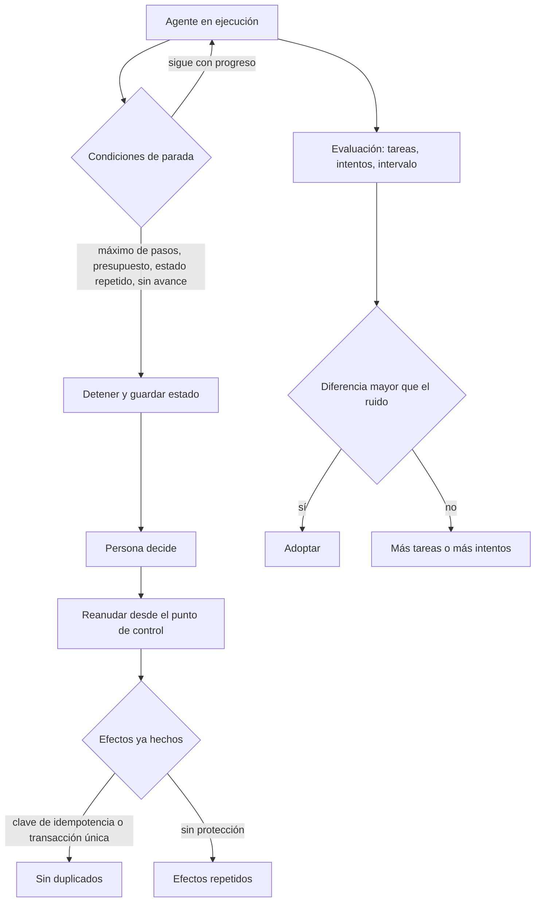

# SE-479 — Taller: detener, recuperar y evaluar un agente

[← SE-478 — Seguridad agentic, prompt injection y auditoría](../../classes/part-39-spec-agentes-y-ciclo-de-vida-agentic/se-478-seguridad-agentic-prompt-injection-y-auditoria/README.md) · [↑ Parte 39](../../classes/part-39-spec-agentes-y-ciclo-de-vida-agentic/README.md) · [📚 Índice completo](../../classes/README.md) · [🌐 Portal](../../site/classes/SE-479.html) · [SE-480 — Proyecto final: producto operable construido desde SPEC →](../../classes/part-39-spec-agentes-y-ciclo-de-vida-agentic/se-480-proyecto-final-producto-operable-construido-desde-spec/README.md)

## Punto profesional y fundamento pedagógico

**Punto profesional.** El taller existe para que reúnas en una sola práctica tres capacidades que se enseñaron por separado y que se necesitan juntas en cuanto un agente trabaja sin que nadie lo mire: detenerlo cuando se descontrola, recuperarlo cuando se cae sin duplicar lo que ya hizo y evaluarlo con una vara que no se deje engañar por el ruido. Un agente que no se puede parar es un gasto sin tope; uno que no se puede reanudar repite sus efectos o pierde su trabajo; uno que no se puede evaluar solo tiene la palabra de quien lo construyó. La habilidad es diseñar las tres cosas antes de que hagan falta y probarlas provocando el fallo.

**Por qué aparece aquí.** Es la undécima clase de la **Parte 39** y su taller, después de **Seguridad agentic, prompt injection y auditoría**: `SE-473` a `SE-478` diseñaron la autoridad, los controles, la confianza, la delegación, la aprobación y el registro; ahora se ensayan juntos sobre un agente que falla. El caso conductor sigue siendo el **servicio de recordatorios de entrega** (*Avisos*). Es un caso sintético: los «agentes» del taller son máquinas de estados deterministas y simulaciones con semilla fija, no se invocó ningún modelo y los efectos son filas de una base SQLite en memoria.

**Error conceptual que debe corregir.** Creer que un agente que falla se arregla reiniciándolo y que uno que acierta en una prueba está evaluado. Reiniciar sin punto de control repite los efectos que ya ocurrieron (los avisos se envían dos veces); evaluar con pocas tareas y un solo intento confunde diferencias reales con azar, y con tareas difíciles que a veces se resuelven y a veces no, el mismo agente da resultados distintos cada vez.

**Secuencia de aprendizaje.** Antes de ver los resultados, predices cuántos pasos desperdicia un agente que oscila entre dos estados con una regla de «máximo de 50 pasos» y cuántos con una regla de «mismo estado tres veces»; después ejecutas cinco comportamientos con cuatro condiciones de parada, simulas 500 caídas sobre una tarea de 30 pasos con cuatro formas de reanudar y calculas cuántas tareas hacen falta para distinguir a dos agentes que difieren en seis puntos. La secuencia usa predicción, contraste, explicación propia y recuperación. [ICAP](https://icap.education.asu.edu/research) distingue participación de construcción de conocimiento; [How People Learn II](https://nap.nationalacademies.org/catalog/24783/how-people-learn-ii-learners-contexts-and-cultures) respalda diseñar la práctica con contextos reales y retroalimentación.

**Evidencia de aprendizaje.** `taller-agente-log.md` con la predicción, las tres figuras reproducidas, las condiciones de parada de un agente de tu proyecto con la acción de cada una, un plan de recuperación con su punto de control y su protección contra duplicados, un protocolo de evaluación con el número de tareas y de intentos justificado y una nota que separe qué parte de cada conclusión es medida, cuál inferida y cuál supuesta.

**Límite de la conclusión.** Los cinco comportamientos, los parámetros de los controles (50 pasos, 30 000 tokens, tres repeticiones, ocho pasos sin avance), la distribución de dificultad de las tareas y las diferencias entre agentes son construcciones del autor con semilla fija. No se evaluó ningún modelo ni ningún agente real. Los resultados muestran la mecánica de las defensas y de la estadística, no el rendimiento de nadie.

### Trazabilidad fuente → afirmación

| Fuente primaria u oficial | Afirmación que respalda | Lo que no prueba |
|---|---|---|
| [Anthropic: «Building effective agents»](https://www.anthropic.com/engineering/building-effective-agents) | Indica que los agentes obtienen verdad del entorno en cada paso, pueden pausar para pedir ayuda humana en puntos de control o ante bloqueos y que es habitual incluir condiciones de parada, como un máximo de iteraciones, para mantener el control. | No fija los valores de esas condiciones. |
| [Anthropic: «How we built our multi-agent research system»](https://www.anthropic.com/engineering/multi-agent-research-system) | Informa de que ante errores no pueden reiniciar desde el principio (es caro) y construyeron sistemas que reanudan desde donde estaba el agente, combinando la adaptabilidad del modelo con salvaguardas deterministas como reintentos y puntos de control; recomienda empezar a evaluar enseguida con muestras pequeñas (unas 20 consultas) cuando los efectos son grandes y evaluar el estado final y no cada giro. | Sus cifras son de un sistema y un momento; con efectos pequeños hacen falta muestras mayores. |
| [Richardson: patrón de bandeja de salida transaccional](https://microservices.io/patterns/data/transactional-outbox.html) | Describe cómo guardar un efecto y su registro en la misma transacción para que no se pierda ni se duplique. | No cubre efectos fuera de la base de datos sin mecanismo de deduplicación. |
| [SQLite: transacciones](https://www.sqlite.org/lang_transaction.html) y [Python: sqlite3](https://docs.python.org/3/library/sqlite3.html) | Documentan las transacciones atómicas y el módulo usado para reanudar sin duplicados. | No garantizan la atomicidad entre la base y un servicio externo. |
| [Wilson, «Probable inference, the law of succession, and statistical inference»](https://doi.org/10.1080/01621459.1927.10502953) | Fundamenta el intervalo de confianza para una proporción usado en la evaluación. | No decide el tamaño de muestra necesario para tu agente. |
| [Python: statistics](https://docs.python.org/3/library/statistics.html), [random](https://docs.python.org/3/library/random.html) y [hashlib](https://docs.python.org/3/library/hashlib.html) | Documentan los módulos usados en las simulaciones. | No validan los parámetros elegidos. |

## Antes de empezar

Recupera lo aprendido en `SE-478`: el registro con huellas y la referencia externa permiten reconstruir lo ocurrido. La pregunta activa es: **¿qué has hecho la última vez que un proceso automático se quedó en un bucle o se cayó a mitad de camino: lo reiniciaste, y qué efecto se repitió?**

## Prerrequisitos

- Haber completado `SE-478` o poder describir un registro de auditoría y las tres capacidades de un agente.
- Python 3.11 o posterior; los experimentos usan solo la biblioteca estándar (`sqlite3`, `random`, `statistics`, `math`).
- Saber leer una proporción con su intervalo de confianza y la idea de transacción atómica.

## Problema auténtico

El agente de *Avisos* que prepara los envíos de la semana entra un viernes en un bucle: repite la misma consulta a la base cada pocos segundos porque una herramienta devuelve un error que él interpreta como «reintentar». Nadie lo ve hasta el lunes, cuando llega la factura del consumo y el servicio de correo ha bloqueado la cuenta por exceso de intentos. El equipo lo reinicia sin entender qué hizo; al arrancar, el agente empieza la tarea desde el principio y envía por segunda vez los treinta avisos de la tarde del viernes. En la reunión del lunes, alguien propone «evaluar al agente para ver si mejora» y compara dos versiones con veinte tareas cada una: la nueva acierta 14 y la antigua 12, y se decide adoptar la nueva. Tres semanas después, en una repetición de la misma evaluación, la antigua acierta 15. El taller reproduce los tres errores, el bucle sin tope, la reanudación que duplica y la evaluación que no distingue, y los corrige con condiciones de parada, puntos de control con deduplicación y una evaluación con tamaño de muestra.

## Objetivos observables

Al terminar podrás:

1. definir condiciones de parada de un agente (máximo de pasos, presupuesto, estado repetido, falta de avance) y medir cuánto tarda cada una en detener cada comportamiento defectuoso y cuál detiene por error una tarea legítima;
2. diseñar una reanudación que no repita efectos, comparando reinicio, punto de control tras el efecto, clave de idempotencia y transacción única;
3. calcular el tamaño de muestra y el número de intentos necesarios para distinguir dos agentes con una diferencia dada;
4. explicar por qué un agente puede acertar una tarea en un intento y fallarla en otro y qué mide acertar tres de tres intentos;
5. entregar un paquete de detención, recuperación y evaluación probado provocando cada fallo.

## Mapa conceptual



El agente se vigila con condiciones de parada que observan su historial, no su opinión; al detenerse deja un estado desde el que se reanuda sin repetir efectos; y cualquier cambio se evalúa con una muestra que distingue la diferencia del ruido.

## Temas y por qué importan

| Tema | Por qué cambia una decisión profesional | Evidencia mínima |
|---|---|---|
| Condiciones de parada | Un bucle sin tope solo se detiene cuando se acaba el presupuesto. | Pasos hasta la parada por comportamiento y regla |
| Falsos paros | Una regla demasiado estricta mata el trabajo legítimo. | Tarea larga legítima que detiene cada regla |
| Puntos de control | Reiniciar desde cero repite lo hecho y lo cuesta de nuevo. | Pasos recalculados tras una caída |
| Efectos duplicados | Reanudar sin protección envía dos veces lo ya enviado. | Duplicados por variante de reanudación |
| Tamaño de muestra | Con pocas tareas, una diferencia real es indistinguible del azar. | Intervalos y potencia por tamaño |
| Repetibilidad | El mismo agente no acierta siempre las mismas tareas. | Discrepancia entre intentos y acierto en tres de tres |

## Conceptos y decisiones

### 1. Condiciones de parada: observar el historial, no la opinión

Un agente en un bucle no sabe que está en uno: cada paso le parece razonable. Las condiciones de parada observan desde fuera. El **máximo de pasos** limita la longitud de cualquier ejecución. El **presupuesto** limita el consumo de tokens, tiempo o dinero. El **estado repetido** detecta que el agente vuelve a un estado que ya visitó (se calcula una huella del estado y se cuenta cuántas veces aparece). La **falta de avance** detecta que una medida de progreso (criterios cumplidos, archivos migrados) no mejora durante cierto número de pasos. Cada regla detecta un tipo de defecto y falla en otro: la del estado repetido ve un bucle idéntico o una oscilación pero no un agente que cambia de estado cada vez sin avanzar; la del avance lo ve, pero necesita una medida de progreso que no siempre existe; el máximo de pasos y el presupuesto lo detienen todo, también lo bueno. Combinadas, la primera que se activa detiene la ejecución. Detener significa guardar el estado y llamar a una persona, no descartar el trabajo.

### 2. Falsos paros

Toda regla de parada tiene un precio: detiene a veces algo que iba bien. Una tarea larga legítima, por ejemplo una migración de 60 pasos en la que el progreso se ve cada cinco, se detiene con un máximo de 50 pasos y con un presupuesto de 25 pasos, mientras que la regla de falta de avance con una ventana de ocho pasos y la del estado repetido la dejan seguir. El diseño responde con parámetros por clase de tarea (un máximo mayor para migraciones), con reglas basadas en progreso (que no castigan la longitud) y con una acción de parada que no destruye: al detener, se ofrece a la persona la opción de ampliar el presupuesto. Una regla desactivada porque estorbaba es peor que una regla mal calibrada.

### 3. Puntos de control y reanudación

Reiniciar desde el principio es caro y, además, repite los efectos. Un **punto de control** es el estado mínimo que permite continuar: en qué paso va el agente, qué ha hecho y qué le falta. Se guarda en un almacenamiento que sobrevive a la caída (una base de datos, un archivo) y se escribe en puntos conocidos. Anthropic informa de que en su sistema de investigación no pueden reiniciar desde el principio por el costo y han construido un sistema que reanuda desde donde estaba el agente, combinando el modelo con reintentos y puntos de control deterministas. Con un punto de control se recalcula como mucho el paso en curso, no todo.

### 4. Reanudar sin duplicar efectos

El punto delicado es el instante entre ejecutar un efecto y registrar que se ejecutó. Si el agente envía un aviso y se cae antes de anotar que lo hizo, al reanudar volverá a enviarlo. Hay tres soluciones, por orden creciente de fiabilidad. Una **clave de idempotencia** por paso: el efecto lleva un identificador (tarea, paso) y el receptor ignora los repetidos, de modo que repetir es seguro. Una **transacción única** que incluye el efecto y el punto de control: ocurren los dos o ninguno, lo que solo es posible cuando el efecto es una escritura en la misma base de datos, como en el patrón de la bandeja de salida (se escribe el mensaje en una tabla dentro de la transacción y otro proceso lo entrega con deduplicación). Y, cuando el efecto sale del sistema, una combinación de ambas: la bandeja de salida con clave de idempotencia en el receptor. Sin ninguna de ellas, reanudar es repetir.

### 5. Evaluar: tareas, intentos y ruido

Evaluar un agente es medir una proporción, y una proporción medida sobre pocas tareas es imprecisa. Con 20 tareas, el intervalo de confianza del 95 % de un acierto del 70 % abarca unos 36 puntos; con 100, unos 18; con 1 000, unos 6. Distinguir dos agentes que difieren en 6 puntos exige muestras grandes: con 100 tareas, la prueba habitual detecta la diferencia en el 15 % de los casos; con 1 000, en el 90 %. Hay una excepción que Anthropic documenta: cuando el efecto de un cambio es grande —un ajuste que sube el acierto del 30 % al 80 %— unas veinte tareas bastan para verlo, y conviene empezar a evaluar pronto con muestras pequeñas. La regla es que el tamaño de muestra depende del tamaño del efecto que se quiere detectar, y que la evaluación debe decir el intervalo, no solo el porcentaje.

### 6. Repetibilidad y qué mide acertar en tres de tres

Un agente basado en un modelo no es determinista: la misma tarea puede resolverse en un intento y fallar en el siguiente. Si las tareas tienen una dificultad variable —algunas casi siempre se resuelven, otras a veces—, el acierto en un intento mide una cosa y el acierto en los tres intentos de la misma tarea mide otra, más exigente, que se parece a la fiabilidad: ¿puedo confiar en que lo haga cada vez? Una diferencia de 70 % en un intento frente a 45 % en tres de tres no es una contradicción, es la medida de cuántas tareas el agente resuelve «a veces». La evaluación debe fijar qué mide y publicarla junto al número: «acierto en un intento» o «acierto en tres de tres» son preguntas distintas.

## Cinco comportamientos y cuatro reglas de parada

Se programaron cinco comportamientos de agente como máquinas de estados: repite siempre el mismo paso; oscila entre dos estados; cambia de estado en cada paso sin avanzar; avanza durante 12 pasos y se estanca (con estados distintos cada vez); y una tarea larga legítima que avanza una unidad cada cinco pasos hasta 60. Se aplican cuatro reglas: máximo de 50 pasos; presupuesto de 30 000 tokens con 1 200 por paso (25 pasos); el mismo estado tres veces; y ocho pasos sin avance de una medida de progreso. Se cuenta cuántos pasos ejecuta cada comportamiento antes de que cada regla lo detenga (tope de la simulación: 200).

| Comportamiento | Máximo de 50 pasos | Presupuesto de 30 000 tokens | Mismo estado 3 veces | Sin avance en 8 pasos | Combinadas |
|---|---:|---:|---:|---:|---:|
| Repite el mismo paso | 50 | 25 | 3 | 9 | 3 |
| Oscila entre dos estados | 50 | 25 | 5 | 9 | 5 |
| Cambia de estado sin avanzar | 50 | 25 | no para | 9 | 9 |
| Avanza 12 pasos y se estanca | 50 | 25 | no para | 21 | 21 |
| Tarea larga legítima (60 pasos) | 50 | 25 | no para | no para | 25 |

La regla del estado repetido detiene el bucle idéntico en 3 pasos y la oscilación en 5, y no detiene los otros dos comportamientos defectuosos. La de falta de avance detiene los cuatro defectuosos (en 9 o 21 pasos) y deja terminar la tarea legítima. El máximo de pasos y el presupuesto detienen todo, pero tarde (50 y 25 pasos) y también detienen la tarea legítima, que necesita 60 pasos: el presupuesto la corta en el paso 25, sin motivo. Combinadas, el agente defectuoso se detiene en 3 a 21 pasos, y la combinación detiene por error la tarea legítima a los 25, porque incluye el presupuesto sin ajustar a esa clase de tarea.


**Cómo leer la figura.** Cada fila es un comportamiento y cada columna una regla; la celda dice cuántos pasos pasan antes de parar y queda vacía si la regla nunca lo detiene. Mira primero las celdas vacías, los atascos que escapan, y la última fila, donde parar es un error. **Dónde deja de valer:** los comportamientos son máquinas de estados que el autor escribió y los parámetros (50, 30 000, 3, 8) son valores arbitrarios; un agente real puede tener estados que casi se repiten sin ser idénticos y una medida de progreso difícil de definir, de modo que la regla del estado repetido y la del avance serían más difíciles de calibrar.

## Reanudar tras una caída

Se simula una tarea de 30 pasos en la que cada paso envía un aviso registrado en una tabla de SQLite en memoria. En cada una de 500 ejecuciones por variante, el agente se cae en un paso al azar y en una de tres fases: antes del efecto, entre el efecto y el punto de control, o después del punto de control. Al reanudar, se cuenta cuántos avisos están duplicados en la tabla. Se comparan cuatro variantes de reanudación.

| Variante | Avisos duplicados al reanudar (media) | Caídas con algún duplicado | Pasos recalculados (media) |
|---|---:|---:|---:|
| Sin punto de control (reiniciar) | 20,90 | 99 % | 20,9 |
| Punto de control tras el efecto, en otra transacción | 0,31 | 31 % | 0,3 |
| Clave de idempotencia por paso | 0,00 | 0 % | 0,3 |
| Efecto y punto de control en una transacción | 0,00 | 0 % | 0,3 |

Reiniciar desde cero duplica en promedio 20,9 avisos de 30 y el 99 % de las caídas deja algún duplicado. Guardar un punto de control tras el efecto, pero en otra transacción, deja un duplicado en el 31 % de las caídas (cuando el agente cae entre el efecto y el punto de control, que es una de las tres fases). La clave de idempotencia y la transacción única no duplican ninguno. En las tres variantes con punto de control se recalcula de media 0,3 pasos: el paso en curso, que se repite sin repetir su efecto.


**Cómo leer la figura.** Cada grupo es una variante de reanudación, con el porcentaje de caídas con algún duplicado entre paréntesis; la barra roja son los duplicados de media y la azul oscura los pasos recalculados. Mira primero la barra roja de la primera variante y su ausencia en las dos últimas, que recalculan lo mismo. **Dónde deja de valer:** la caída se modela en un paso y una fase al azar, los efectos son filas de una base en memoria y la transacción única supone que el efecto y el punto de control comparten almacén; un efecto externo (un correo real) necesita la clave de idempotencia en el receptor, que aquí se representa con una comprobación en la misma tabla.

## Dos agentes que difieren en seis puntos

Se simulan dos agentes: A acierta en promedio el 70 % de las tareas y B el 76 %. La dificultad de las tareas varía (distribución beta con media 0,7) y la probabilidad de que cada agente la resuelva en un intento depende de ella. Para conjuntos de 20 a 1 000 tareas, y 2 000 repeticiones del experimento por fila, se mide la anchura del intervalo de confianza del 95 % (Wilson) para A, la fracción de repeticiones en que los intervalos de A y B no se solapan con B arriba, la fracción en que una prueba z de dos proporciones declara a B mejor al 5 % y la fracción en que declara a B peor.

| Tareas en el conjunto | Anchura del intervalo de A | Intervalos separados (B mejor) | Prueba z: B mejor | Prueba z: B peor |
|---:|---:|---:|---:|---:|
| 20 | 36,5 puntos | 0,4 % | 4,3 % | 0,45 % |
| 50 | 24,4 puntos | 1,1 % | 8,3 % | 0,10 % |
| 100 | 17,6 puntos | 2,2 % | 15,2 % | 0,00 % |
| 300 | 10,3 puntos | 10,2 % | 38,1 % | 0,00 % |
| 1 000 | 5,7 puntos | 60,7 % | 89,5 % | 0,00 % |

Con 20 tareas el intervalo de un solo agente mide 36 puntos y la prueba declara a B mejor en el 4,3 % de las repeticiones: casi nunca se ve la diferencia real. Con 100 tareas la detecta el 15,2 %; con 300, el 38,1 %; con 1 000, el 89,5 %. Los intervalos separados son aún más exigentes (60,7 % con 1 000). A la pregunta «¿cuántas tareas hacen falta?» la tabla responde que, para ver una mejora de seis puntos con una potencia razonable, del orden de mil. Los casos de la derecha de la tabla son raros pero no nulos: con 20 tareas, B parece peor en el 0,45 % de las repeticiones, aunque es mejor.

Con la misma distribución de dificultad se midió la repetibilidad en 5 000 tareas: el acierto en un intento es del 70,1 %; el acierto en los tres intentos de la misma tarea es del 44,7 %, y dos intentos de la misma tarea discrepan en el 31,4 % de las tareas.


**Cómo leer la figura.** El eje horizontal son las tareas de la evaluación, en escala logarítmica, y el vertical el porcentaje de repeticiones que detectan la diferencia; la línea verde es la prueba z y la roja la separación de los intervalos. Mira primero cuántas tareas hacen falta para que la verde pase del 80 %: del orden de mil. **Dónde deja de valer:** las medias de 70 y 76 %, la distribución beta de dificultad, el reparto de la mejora de B en proporción al margen de cada tarea y un solo intento por tarea son supuestos del autor; con efectos grandes, como menciona Anthropic, veinte tareas bastan, y con un agente real la dificultad y la correlación entre tareas son otras.

## Definiciones de trabajo

- **condición de parada:** regla explícita que detiene a un agente y define qué se hace después.
- **punto de control:** estado mínimo guardado en almacenamiento duradero que permite reanudar una tarea sin repetirla entera.
- **clave de idempotencia:** identificador de un efecto que permite al receptor ignorar los repetidos.
- **transacción única:** operación atómica que incluye el efecto y el registro de que ocurrió.
- **intervalo de confianza de Wilson:** rango plausible de una proporción verdadera dada una proporción observada y un tamaño de muestra.
- **acierto en tres de tres:** proporción de tareas que el agente resuelve en todos sus intentos; mide fiabilidad, no capacidad media.

Las definiciones son operativas para el servicio *Avisos*. No convierten términos con una historia más amplia en sinónimos y deben contrastarse con la documentación primaria enlazada al final.

## Ejemplo mínimo

El fragmento muestra una regla de falta de avance. Antes de ejecutarlo, predice en qué paso se detiene.

```python
progreso = [0, 1, 2, 3, 3, 3, 3, 3, 3, 3, 3, 3, 4]
mejor, desde = -1, 0
for i, p in enumerate(progreso):
    if p > mejor:
        mejor, desde = p, i
    if i - desde >= 8:
        print("detener en el paso", i + 1); break
```

Imprime `detener en el paso 12`: el último avance fue en el paso 4 (índice 3) y desde entonces pasaron ocho pasos. Cambia la ventana a 10 y observa que el avance del paso 13 llega a tiempo. Registra versión de Python, comando y salida.

## Ejemplo profesional

Escenario hipotético, construido para la clase y sin datos reales. El equipo de *Avisos* instala tres reglas para su agente de envíos: máximo de 80 pasos por tarea (calibrado con la cola de la distribución de las tareas buenas), cinco repeticiones del mismo estado y diez pasos sin avance del número de avisos preparados. El presupuesto se fija por tarea según su clase, no global. Al detenerse, el agente guarda su estado y notifica a una persona con la última acción, el número de pasos y el motivo. Para recuperar, cada paso de envío escribe el aviso en una bandeja de salida dentro de la misma transacción que el punto de control, con una clave de idempotencia (tarea, paso) que el servicio de correo respeta, y la prueba de regresión mata el proceso en cada fase y exige cero duplicados. Para evaluar, el equipo define cuarenta tareas representativas con un criterio comprobable de estado final, ejecuta cada una tres veces y publica dos números con su intervalo: el acierto en un intento y el acierto en tres de tres. Una mejora de dos puntos no se adopta, porque queda dentro del ruido. Compara con el estado inicial: antes un bucle de un fin de semana, un reinicio que duplicaba y una decisión basada en veinte tareas y un intento; ahora hay una parada en minutos, una reanudación sin efectos repetidos y una evaluación que dice lo que sabe y lo que no.

## Práctica guiada

1. Escribe cinco comportamientos defectuosos de un agente de tu proyecto como secuencias de estados y progreso, y añade una tarea larga legítima.
2. Predice en cuántos pasos detienen un bucle idéntico el máximo de pasos y la regla de estado repetido; escribe los números antes de ejecutar.
3. Ejecuta `python scripts/experiments_part39_b.py 479` y reproduce las tres tablas; cambia la ventana de falta de avance a 12 pasos y observa qué comportamiento deja de detenerse a tiempo.
4. Implementa la reanudación con las cuatro variantes sobre SQLite y comprueba los duplicados provocando una caída en cada fase.
5. Calcula el tamaño de muestra que necesitas para detectar una diferencia de cuatro puntos con tu acierto actual y decide si puedes costearlo.
6. Evalúa un agente simulado con tareas de dificultad variable y compara el acierto en un intento con el acierto en tres de tres.
7. Entrega `taller-agente-log.md` y pide a otra persona que proponga un comportamiento defectuoso que tus reglas no detecten.

## Ejercicios

1. **Parada:** diseña una regla que detecte a un agente que alterna entre tres estados sin avanzar y calcula en cuántos pasos se detiene con tu ventana.
2. **Falso paro:** para una migración de 200 pasos con avance cada 10, elige parámetros de máximo de pasos y de falta de avance que no la detengan y que sigan deteniendo un bucle idéntico en menos de 10 pasos.
3. **Reanudación:** explica por qué un punto de control guardado en otra transacción duplica un efecto en una de las tres fases de caída y cómo lo evitaría una clave de idempotencia.
4. **Evaluación:** con un acierto del 60 %, ¿cuántas tareas necesitas para que el intervalo de confianza del 95 % mida menos de 10 puntos? Compruébalo con la fórmula de Wilson.

## Reto verificable

Entrega `taller-agente-log.md` con la predicción, las tres tablas, las condiciones de parada de un agente de tu proyecto con su acción, un plan de recuperación con la prueba de caída en cada fase y cero duplicados, y un protocolo de evaluación con tamaño de muestra, número de intentos, intervalo y regla de adopción. Se aprueba si otra persona ejecuta el código desde un checkout limpio, obtiene los mismos números con las mismas semillas y no consigue provocar un duplicado ni un bucle sin parada con los comportamientos de tu lista. No se aprueba por una regla de parada que detenga una tarea legítima sin ajuste ni por adoptar una versión con una diferencia dentro del ruido.

## Caso conductor

El servicio *Avisos* es el caso conductor de la Parte 39. Esta clase deja el undécimo artefacto: las reglas de parada calibradas, el plan de recuperación probado con caídas y el protocolo de evaluación con intervalos. `SE-480` los integra en el proyecto final: un producto operable construido desde una especificación, validado por el sistema y no por autodeclaración. Cambia después un solo dato, la diferencia entre agentes, y observa cuántas tareas necesitas para ver una mejora de tres puntos.

## Preguntas frecuentes

### ¿Cuántos pasos debo permitir como máximo?

Los que necesita la cola de tus ejecuciones buenas, con un margen. Si no los conoces, mídelos: ejecuta tareas representativas y fija el máximo en el percentil 99 más un margen. Un máximo calibrado se revisa con los datos; uno copiado de otro proyecto detiene el trabajo legítimo o no detiene nada.

### ¿La clave de idempotencia exige que el receptor la soporte?

Para efectos fuera de tu sistema, sí: el receptor debe ignorar las claves repetidas. Si no lo hace, necesitas guardar tú un registro de lo ya enviado y comprobarlo antes de enviar, y aun así queda una ventana entre enviar y anotar. Por eso conviene un sistema que acepte claves.

### ¿Por qué no basta con que el agente tenga éxito en una tarea para adoptarlo?

Porque un éxito es una observación entre muchas posibles. Con tareas de dificultad variable, el mismo agente acierta unas veces y falla otras; la evaluación debe dar el acierto con su intervalo y, si importa la fiabilidad, el acierto en varios intentos.

### ¿Veinte tareas no bastan?

Bastan si la diferencia es grande, como documenta Anthropic al empezar a evaluar con unas veinte consultas cuando un cambio sube el acierto del 30 % al 80 %. No bastan para distinguir diferencias de unos pocos puntos; ahí el intervalo de la tabla manda.

## Fallo controlado y diagnóstico

Reproduce el fallo clásico del taller: **una reanudación que duplica los efectos**. Mata el proceso entre el envío y el punto de control en la variante de otra transacción.

Registra síntoma, entrada mínima, hipótesis, observación que descarta cada hipótesis, causa, corrección y prueba de regresión. **Síntoma:** tras reiniciar el agente, un estudiante recibió dos veces el mismo aviso. **Hipótesis rivales:** (a) el agente decidió enviar dos veces; (b) el servicio de correo duplicó el mensaje; (c) el agente se cayó tras enviar y antes de anotar, y al reanudar volvió a enviar. **Prueba:** compara el registro de envíos con el punto de control; si el último paso enviado es posterior al último paso anotado, la causa es (c). **Conclusión:** el efecto y su registro no son atómicos. **Regresión:** añade una prueba que mate el proceso en cada fase y exija cero duplicados con la clave de idempotencia o la transacción única. No cambies a la vez la reanudación y la tarea.

## Errores comunes y cómo corregirlos

| Síntoma | Causa probable | Corrección |
|---|---|---|
| Un agente trabaja toda la noche sin avanzar | Sin condiciones de parada o solo con un máximo enorme | Añadir estado repetido y falta de avance con presupuesto por tarea |
| La regla de parada detiene tareas buenas | Parámetros globales | Calibrar por clase de tarea y basar la regla en progreso |
| Tras reiniciar hay avisos duplicados | Efecto y punto de control no atómicos | Clave de idempotencia o transacción única |
| Se adopta una versión que no es mejor | Evaluación con pocas tareas y un intento | Calcular el tamaño de muestra y publicar el intervalo |
| El agente «acierta» una tarea y la falla al repetirla | Dificultad variable y no determinismo | Medir el acierto en varios intentos |

## Entorno y archivos clave

```text
work/SE-479/
├── README.md
├── parada/
│   ├── reglas.py
│   └── test_reglas.py
├── recuperacion/
│   ├── reanudar.py
│   └── test_caidas.py
├── evaluacion/
│   ├── muestra.py
│   └── repetibilidad.py
└── evidence/taller-agente-log.md
```

El `README` declara plataforma, versión de Python, semillas y comandos. Los experimentos usan solo la biblioteca estándar, con SQLite en memoria. Se ejecutaron con CPython 3.12.9 en Windows 11 y 3.12.3 en Ubuntu bajo WSL2: las salidas fueron idénticas. Si pruebas con un agente real, usa un entorno desechable y un presupuesto máximo explícito.

## Seguridad, ética y accesibilidad

- una regla de parada protege también el presupuesto y las cuentas de terceros: un bucle contra un servicio externo puede causar bloqueos o costos a otros; fija límites de tasa;
- un punto de control guarda estado que puede contener datos de personas: protégelo y define su retención como el resto de los registros;
- evaluar con tareas que reflejan solo a un tipo de usuario oculta fallos en los demás: incluye casos de accesibilidad y de personas con menos representación;
- los resultados de una evaluación se publican con su intervalo y sus límites; una mejora no demostrada no se anuncia como mejora;
- las tablas y figuras deben tener texto alternativo y no depender del color; los resultados se distinguen por texto.

## Puente hacia el trabajo con agentes

Pedirle a un agente «avísame si te atascas» le deja decidir cuándo está atascado. Pídele en cambio que registre una huella de su estado y una medida de progreso en cada paso, que se detenga solo si lo dicen las reglas definidas por ti y que guarde el estado antes de detenerse. Para reanudar, exige que cada efecto lleve una clave de idempotencia y que la prueba de regresión lo mate en cada fase. Para evaluarlo, no aceptes su propio informe: ejecuta tú las tareas con el criterio de estado final, varias veces, y compara con el intervalo. Si el agente propone relajar una condición de parada porque «casi termina», es la señal para mirar el registro de progreso antes de ampliar nada.

## Transferencia

Traslada el análisis a otro dominio (por ejemplo, un agente que migra una colección de documentos a otro formato): cambia los comportamientos, los efectos y las tareas y conserva el procedimiento de definir reglas de parada con falsos paros medidos, un punto de control con deduplicación y una evaluación con tamaño de muestra e intentos. La transferencia está lograda cuando puedes decir qué comportamiento defectuoso de ese dominio no detendrían tus reglas, no cuando la tabla se parece a la de *Avisos*.

## Evaluación y evidencia

| Criterio | Evidencia para aprobar |
|---|---|
| comprensión | explicación de las cuatro reglas de parada, de la atomicidad del efecto y del punto de control y del intervalo de una proporción |
| corrección | tablas de parada, reanudación y evaluación reproducibles con las mismas semillas |
| diseño | reglas calibradas, plan de recuperación con prueba de caídas y protocolo de evaluación con regla de adopción |
| diagnóstico | reproducción del fallo «reanudación que duplica» con regresión |
| incertidumbre | declaración de que los comportamientos, los parámetros y la dificultad son construcciones del autor |
| reproducibilidad | versiones, comandos, salida y límites declarados |

## Fuentes

- [Anthropic: «Building effective agents»](https://www.anthropic.com/engineering/building-effective-agents) — verdad del entorno, puntos de control humanos y condiciones de parada; autoridad: Anthropic.
- [Anthropic: «How we built our multi-agent research system»](https://www.anthropic.com/engineering/multi-agent-research-system) — reanudar desde el punto del error, muestras pequeñas con efectos grandes y evaluación del estado final; autoridad: Anthropic.
- [Patrón de bandeja de salida transaccional](https://microservices.io/patterns/data/transactional-outbox.html) — efecto y registro en una transacción; autoridad: catálogo de patrones de microservicios.
- [SQLite: transacciones](https://www.sqlite.org/lang_transaction.html) y [Python: sqlite3](https://docs.python.org/3/library/sqlite3.html) — transacciones y módulo del experimento; autoridad: documentación de SQLite y de Python.
- [Wilson (1927)](https://doi.org/10.1080/01621459.1927.10502953) — intervalo de una proporción; autoridad: Journal of the American Statistical Association.
- [Python: statistics](https://docs.python.org/3/library/statistics.html), [random](https://docs.python.org/3/library/random.html) y [hashlib](https://docs.python.org/3/library/hashlib.html) — módulos usados en las simulaciones; autoridad: documentación de Python.

Cada fuente respalda el mecanismo indicado; ninguna demuestra que un máximo de 50 pasos desperdicie 47 pasos de un bucle idéntico, que el 31 % de las caídas duplique con un punto de control en otra transacción o que 1 000 tareas bastarán en tu proyecto para detectar seis puntos. Esa afirmación depende del agente, de los efectos y de las tareas.

## Límites y siguiente paso

Se ejecutaron tres experimentos en Windows y Ubuntu (WSL2) con resultados idénticos: las reglas de parada y la reanudación son código real sobre máquinas de estados y SQLite en memoria, y la evaluación es una simulación con semilla fija. No se invocó ningún modelo, no se evaluó ningún agente real y los efectos no salen de la base. Los comportamientos, los parámetros de las reglas, las caídas, la distribución de dificultad y la diferencia entre agentes son construcciones del autor, y las reglas se evaluaron con comportamientos escritos sabiendo qué buscan. La siguiente clase integra todo en el proyecto final: un producto operable construido desde una especificación y validado por el sistema.

## Glosario

- **condición de parada:** regla explícita que detiene a un agente y define qué se hace después.
- **punto de control:** estado mínimo guardado en almacenamiento duradero que permite reanudar una tarea sin repetirla entera.
- **clave de idempotencia:** identificador de un efecto que permite al receptor ignorar los repetidos.
- **transacción única:** operación atómica que incluye el efecto y el registro de que ocurrió.
- **intervalo de confianza de Wilson:** rango plausible de una proporción verdadera dada una proporción observada y un tamaño de muestra.
- **acierto en tres de tres:** proporción de tareas que el agente resuelve en todos sus intentos; mide fiabilidad, no capacidad media.

---

[← SE-478 — Seguridad agentic, prompt injection y auditoría](../../classes/part-39-spec-agentes-y-ciclo-de-vida-agentic/se-478-seguridad-agentic-prompt-injection-y-auditoria/README.md) · [↑ Parte 39](../../classes/part-39-spec-agentes-y-ciclo-de-vida-agentic/README.md) · [📚 Índice completo](../../classes/README.md) · [🌐 Portal](../../site/classes/SE-479.html) · [SE-480 — Proyecto final: producto operable construido desde SPEC →](../../classes/part-39-spec-agentes-y-ciclo-de-vida-agentic/se-480-proyecto-final-producto-operable-construido-desde-spec/README.md)
