# Parte 40 — CI/CD, IaC y platform engineering

La Parte 39 dejó un artefacto que se construye de forma reproducible, se firma y se recupera. La pregunta cambia a «¿cómo llega cada cambio a producción, con qué comprobaciones, con qué identidad y cómo se vuelve atrás?». Esta parte trabaja sobre **la canalización de la API de entregas de la plataforma educativa**, un caso sintético. Cada clase mide un mecanismo (choque de ramas, ruta crítica, compuertas, ventana de exposición, potencia de un canario, estado concurrente, deriva, reidentificación, adopción, ruido de métricas, inyección, retroceso) y declara qué no demuestra.

## Pregunta rectora

> ¿Qué camino a producción se puede defender con datos: qué detecta cada etapa, qué evidencia deja, cómo se vuelve atrás y qué queda sin cubrir?

## Recorrido

```mermaid
flowchart LR
    A[Integración continua] --> B[Pipelines y cachés]
    B --> C[Compuertas]
    C --> D[Credenciales efímeras]
    D --> E[Entrega y despliegue]
    E --> F[Infraestructura como código]
    F --> G[GitOps]
    G --> H[Entornos de vista previa]
    H --> I[Plataforma interna]
    I --> J[Métricas DORA]
    J --> K[Taller de endurecimiento]
    K --> L[Camino a producción con retroceso]
    L -->|incidente| A
```

## Resultados acumulativos

Podrás fijar una política de troncal con números, calcular el camino crítico de una canalización y elegir matrices y claves de caché; ordenar compuertas por razón de detección, evaluar reglas con precisión y exhaustividad y gobernar reintentos y excepciones; escribir una regla de confianza exacta para identidades federadas y calcular la ventana de exposición; elegir una estrategia de despliegue con su potencia estadística y gobernar banderas; modelar plan, estado y deriva de la infraestructura; repartir la propiedad de campos en GitOps y proteger lo que tiene estado; medir la reidentificación y fijar la vida de los entornos; evaluar adopción, catálogo y colas de una plataforma; calcular métricas DORA con definiciones e intervalos y detectar atajos; endurecer un flujo de trabajo con una prueba por hallazgo; y defender un camino a producción con retroceso ensayado y paquete de evidencia.

## Prerrequisitos enlazados

- [Parte 33 — Cloud, plataforma e infraestructura](../../classes/part-33-cloud-plataforma-e-infraestructura/): infraestructura, escalado y plataformas internas.
- [Parte 35 — Estrategia y técnicas de prueba](../../classes/part-35-estrategia-y-tecnicas-de-prueba/): pruebas, inestabilidad y detección.
- [Parte 36 — Calidad, rendimiento y resiliencia](../../classes/part-36-calidad-rendimiento-y-resiliencia/): colas, reintentos y presupuestos.
- [Parte 39 — Build, release y cadena de suministro](../../classes/part-39-build-release-y-cadena-de-suministro/): artefactos reproducibles y firmados.
- Python 3.11+ y terminal; los experimentos usan solo la biblioteca estándar.

## Bloques y progresión

1. **Integrar y verificar:** `SE-481` a `SE-483`.
2. **Identidad y entrega:** `SE-484` y `SE-485`.
3. **Infraestructura y plataforma:** `SE-486` a `SE-489`.
4. **Medir, endurecer e integrar:** `SE-490` a `SE-492`.

## Evidencia medida y límites

Las figuras y ejemplos usan experimentos ejecutados con CPython 3.12.9 en Windows 11 y repetidos con CPython 3.12.3 en Ubuntu bajo WSL2. Los datos son **sintéticos**, con semilla fija y tiempo virtual; las cifras publicadas fueron idénticas en ambos sistemas (solo difieren la versión de SQLite, 3.45.3 y 3.45.1, y la última cifra decimal de una correlación). Hay dos ejecuciones reales: la inyección de `SE-491`, con Python y una carga que solo imprime, y el retroceso de `SE-492`, con `sqlite3` en memoria.

Experimentos: ramas, lotes y cola de integración (`SE-481`); ruta crítica, matrices y cachés (`SE-482`); orden de etapas, reglas sobre 160 workflows y reintentos (`SE-483`); verificación de 12 tokens manipulados, ventana de exposición y detectores de secretos (`SE-484`); estrategias de despliegue, potencia del canario y banderas (`SE-485`); planificador de 12 recursos, intercalaciones de estado y deriva (`SE-486`); intervalo de reconciliación, disputa de controladores y poda (`SE-487`); reidentificación, enmascarado y costo de entornos (`SE-488`); adopción, catálogo y cola de aprovisionamiento (`SE-489`); definiciones, atajos y ruido de las métricas (`SE-490`); endurecimiento de un flujo, inyección y permisos (`SE-491`); retroceso, ablación de compuertas y validador de 120 paquetes (`SE-492`).

Los parámetros (tráfico, tasas de defecto, costos, duraciones, proporciones, matrices de fallos) son **supuestos del autor**, no mediciones. **No se hizo:** no se midió ninguna canalización, nube, clúster, equipo ni servicio reales; no se usó ninguna herramienta de CI, de infraestructura, de GitOps, de portal ni de análisis de seguridad; los tokens se firmaron con clave compartida; los verificadores, reglas y validadores se afinaron con los mismos casos que los evalúan, de modo que sus porcentajes son una frontera y no una tasa; la parte no es asesoría jurídica y no tiene laboratorio en `labs/`. El contenido sigue pendiente de revisión humana independiente.

## Guía razonada clase por clase

### Recorrido

#### SE-481 — Integración continua y feedback temprano

La integración es una práctica, no un servidor. Mide el choque según la vida de la rama, los lotes con bisección y la troncal rota sin cola de integración. Entrega: política de troncal. Siguiente: `SE-482`.

#### SE-482 — Pipelines, jobs, matrices y cachés

La duración mínima la fija el camino crítico. Compara ejecutores, cuatro estrategias de matriz y cuatro claves de caché. Entrega: grafo, matriz y clave. Siguiente: `SE-483`.

#### SE-483 — Tests, seguridad y políticas como gates

Una compuerta cuesta y deja pasar. Ordena etapas, evalúa reglas sobre workflows y mide qué ocultan los reintentos. Entrega: compuertas con excepciones. Siguiente: `SE-484`.

#### SE-484 — Credenciales efímeras y OIDC

La seguridad vive en la regla de confianza. Verifica tokens por niveles, calcula la ventana de exposición y compara detectores de secretos. Entrega: regla exacta con pruebas. Siguiente: `SE-485`.

#### SE-485 — Entrega y despliegue continuos

Desplegar no es exponer. Compara estrategias, calcula la potencia de un canario y el costo de las banderas. Entrega: criterio de despliegue. Siguiente: `SE-486`.

#### SE-486 — Infraestructura como código en pipeline

Tres estados pueden divergir. Modela el orden de un plan, las aplicaciones simultáneas y la frecuencia de detección de deriva. Entrega: flujo plan-revisión-aplicación. Siguiente: `SE-487`.

#### SE-487 — GitOps y reconciliación

Dos controladores sobre un campo no convergen. Mide el intervalo, la disputa de réplicas y la poda. Entrega: política de GitOps. Siguiente: `SE-488`.

#### SE-488 — Entornos preview y datos seguros

Quitar el nombre no anonimiza. Mide la reidentificación, lo que sobrevive al enmascarado y el costo de la vida de los entornos. Entrega: política de datos y de vida. Siguiente: `SE-489`.

#### SE-489 — Developer portals y capacidades de plataforma

Una plataforma se mide por lo que se adopta. Modela adopción, validez de un catálogo y esperas por ticket. Entrega: catálogo de capacidades. Siguiente: `SE-490`.

#### SE-490 — Métricas DORA y mejora sin gaming

El mismo registro da números distintos. Compara definiciones, un atajo y el ruido mensual. Entrega: panel con intervalos y contrapesos. Siguiente: `SE-491`.

#### SE-491 — Taller: endurecer un pipeline vulnerable

Un hallazgo, un cambio, una prueba. Corrige ocho defectos, ejecuta una inyección y reduce permisos. Entrega: flujo endurecido. Siguiente: `SE-492`.

#### SE-492 — Proyecto: camino a producción con retroceso

El código vuelve, los datos no. Ensaya migraciones con SQLite, hace la ablación de compuertas y valida 120 paquetes. Entrega: camino con evidencia. La Parte 41 pasa a la observabilidad.

## Resumen operativo del recorrido

| Clase | Núcleo profesional | Aporte acumulativo |
|---|---|---|
| [SE-481](../../classes/part-40-ci-cd-iac-y-platform-engineering/se-481-integracion-continua-y-feedback-temprano/) | Integración continua y feedback temprano | Entrega política de troncal |
| [SE-482](../../classes/part-40-ci-cd-iac-y-platform-engineering/se-482-pipelines-jobs-matrices-y-caches/) | Pipelines, jobs, matrices y cachés | Entrega grafo, matriz y clave |
| [SE-483](../../classes/part-40-ci-cd-iac-y-platform-engineering/se-483-tests-seguridad-y-politicas-como-gates/) | Tests, seguridad y políticas como gates | Entrega compuertas con excepciones |
| [SE-484](../../classes/part-40-ci-cd-iac-y-platform-engineering/se-484-credenciales-efimeras-y-oidc/) | Credenciales efímeras y OIDC | Entrega regla exacta con pruebas |
| [SE-485](../../classes/part-40-ci-cd-iac-y-platform-engineering/se-485-entrega-y-despliegue-continuos/) | Entrega y despliegue continuos | Entrega criterio de despliegue |
| [SE-486](../../classes/part-40-ci-cd-iac-y-platform-engineering/se-486-infraestructura-como-codigo-en-pipeline/) | Infraestructura como código en pipeline | Entrega flujo plan-revisión-aplicación |
| [SE-487](../../classes/part-40-ci-cd-iac-y-platform-engineering/se-487-gitops-y-reconciliacion/) | GitOps y reconciliación | Entrega política de GitOps |
| [SE-488](../../classes/part-40-ci-cd-iac-y-platform-engineering/se-488-entornos-preview-y-datos-seguros/) | Entornos preview y datos seguros | Entrega política de datos y de vida |
| [SE-489](../../classes/part-40-ci-cd-iac-y-platform-engineering/se-489-developer-portals-y-capacidades-de-plataforma/) | Developer portals y capacidades de plataforma | Entrega catálogo de capacidades |
| [SE-490](../../classes/part-40-ci-cd-iac-y-platform-engineering/se-490-metricas-dora-y-mejora-sin-gaming/) | Métricas DORA y mejora sin gaming | Entrega panel con intervalos y contrapesos |
| [SE-491](../../classes/part-40-ci-cd-iac-y-platform-engineering/se-491-taller-endurecer-un-pipeline-vulnerable/) | Taller: endurecer un pipeline vulnerable | Entrega flujo endurecido |
| [SE-492](../../classes/part-40-ci-cd-iac-y-platform-engineering/se-492-proyecto-camino-a-produccion-con-rollback/) | Proyecto: camino a producción con retroceso | Entrega camino con evidencia |

## Fuentes

- [Fowler: Continuous Integration](https://martinfowler.com/articles/continuousIntegration.html) y [DORA: métricas](https://dora.dev/guides/dora-metrics/) — integración y métricas; autoridad: Fowler y DORA.
- [GitHub Actions: uso seguro](https://docs.github.com/en/actions/reference/security/secure-use) y [OIDC](https://docs.github.com/en/actions/concepts/security/openid-connect) — seguridad de flujos; autoridad: GitHub.
- [OpenGitOps](https://opengitops.dev/), [Terraform: estado](https://developer.hashicorp.com/terraform/language/state) y [Argo CD](https://argo-cd.readthedocs.io/en/stable/user-guide/sync-options/) — GitOps e infraestructura; autoridad: documentación de los proyectos.
- [NIST SP 800-188](https://csrc.nist.gov/pubs/sp/800/188/final), [NIST SP 800-218](https://csrc.nist.gov/pubs/sp/800/218/final) y [RFC 8725](https://www.rfc-editor.org/rfc/rfc8725) — privacidad, desarrollo seguro y tokens; autoridad: NIST e IETF.
- [CNCF: plataformas](https://tag-app-delivery.cncf.io/whitepapers/platforms/) y [SLSA](https://slsa.dev/spec/v1.1/levels) — plataformas y procedencia; autoridad: CNCF y OpenSSF.

Las fuentes se vinculan también dentro de cada clase; definen vocabulario y mecanismos, y la adecuación de las decisiones se demuestra con el caso y la evidencia.

## Criterios de aceptación de la parte

- cada clase conecta mecanismo, medida y límite en una conclusión revisable;
- cada medida se reproduce desde un checkout limpio con las mismas semillas;
- ninguna afirmación sobre un sistema real se apoya en una simulación;
- los límites declarados permiten decidir qué comprobar antes de confiar.

[Volver al índice de clases](../../classes/README.md)
