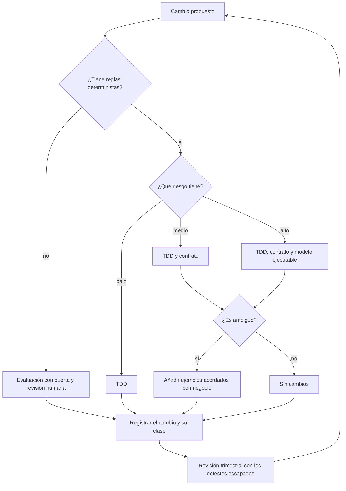

# SE-492 — Proyecto: política metodológica de equipo con evidencia

[← SE-491 — Taller: un mismo cambio con cinco metodologías](../../classes/part-40-metodologias-de-desarrollo-de-tdd-a-odd/se-491-taller-un-mismo-cambio-con-cinco-metodologias/README.md) · [↑ Parte 40](../../classes/part-40-metodologias-de-desarrollo-de-tdd-a-odd/README.md) · [📚 Índice completo](../../classes/README.md) · [🌐 Portal](../../site/classes/SE-492.html)

## Punto profesional y fundamento pedagógico

**Punto profesional.** El proyecto existe para que conviertas lo medido en las once clases anteriores en **una política de equipo**: una tabla que dice qué evidencia se exige a cada clase de cambio, quién la produce, dónde se ejecuta y cuándo se revisa la propia política. Una política así reemplaza la discusión de identidad («somos un equipo TDD») por una decisión con razones, costos y una fecha de revisión. También es el documento que se le entrega a un agente: lo que el agente debe producir y comprobar en cada cambio depende de la clase del cambio, y esa clasificación es una decisión humana.

**Por qué aparece aquí.** Cierra la Parte 40. Reúne el mapa de `SE-481`, los oráculos de `SE-482` a `SE-488`, la puerta de evaluación de `SE-489`, el flujo de `SE-490` y la comparación de `SE-491`, y los lleva al nivel en que se decide cómo trabaja un equipo. Prepara la Parte 41, donde ese mismo criterio se aplica al harness que rodea a un agente.

**Error conceptual que debe corregir.** Creer que una política metodológica es una lista de prácticas obligatorias. Una política que lo exige todo a todo es la más cara y, en la simulación de la clase, la que evita menos impacto por hora invertida. La política útil asigna **menos prácticas a los cambios de bajo riesgo y más a los de alto riesgo, y reconoce los cambios para los que una práctica no produce oráculo** (sin reglas deterministas, TDD no aplica).

**Secuencia de aprendizaje.** Antes de simular, predices qué política evita más impacto por hora entre cinco candidatas aplicadas a 300 cambios sintéticos; después ejecutas la simulación con tasas de detección medidas en `SE-481`, miras la relación costo-impacto, escribes la política de tu equipo con sus excepciones y la sometes a una revisión que busca el punto en que fallaría.

**Evidencia de aprendizaje.** `politica-metodologica.md` con la clasificación de cambios de tu equipo, la tabla de evidencia por clase (práctica, oráculo, dónde corre, quién la escribe), una excepción justificada, una métrica para revisarla y una nota que separe lo medido, lo simulado y lo supuesto.

**Límite de la conclusión.** La simulación usa 300 cambios sintéticos con una distribución de riesgos, una fracción de cambios con reglas deterministas, costos por práctica y un modelo de defectos escapados que son **supuestos del autor**. Solo las tasas de detección (de 0,39 del caso feliz a 1,00 del modelo de referencia) vienen de un experimento real, el de `SE-481`, sobre una función de veinte líneas. La simulación no demuestra que ninguna política funcione en un equipo; muestra el mecanismo por el que la relación costo-impacto cambia con la asignación. No se invocó ningún modelo de lenguaje.

### Trazabilidad fuente → afirmación

| Fuente primaria u oficial | Afirmación que respalda | Lo que no prueba |
|---|---|---|
| [Beck, «Canon TDD»](https://tidyfirst.substack.com/p/canon-tdd) | Fundamenta TDD como práctica de construcción; Beck insiste en que cada quien se hace responsable de la calidad de su trabajo con el método que le sirva. | No prescribe una política. |
| [Cucumber, «Behaviour-Driven Development»](https://cucumber.io/docs/bdd/) | Fundamenta los ejemplos acordados con negocio como práctica. | No dice cuándo conviene. |
| [Pact, «Introduction»](https://docs.pact.io/) | Fundamenta las pruebas de contrato dirigidas por el consumidor. | No dice cuándo conviene. |
| [Böckeler, «Understanding Spec-Driven-Development»](https://martinfowler.com/articles/exploring-gen-ai/sdd-3-tools.html) | Aporta los niveles de SDD y la advertencia sobre la estrategia de mantenimiento. | No evalúa resultados. |
| [Anthropic, «Demystifying evals for AI agents»](https://www.anthropic.com/engineering/demystifying-evals-for-ai-agents) | Fundamenta las evaluaciones y su no determinismo para los cambios sin reglas deterministas. | No fija umbrales. |
| [Gentle AI, «Intended Usage»](https://github.com/Gentleman-Programming/gentle-ai/blob/main/docs/intended-usage.md) | Describe el flujo ODD con el que se contrasta el flujo de trabajo del agente. | Es documentación del propio proyecto. |
| [DeMillo, Lipton y Sayward](https://doi.org/10.1109/C-M.1978.218136) | Fundamenta medir la capacidad de detección con mutantes. | No dice que sean defectos reales. |

## Antes de empezar

Recupera lo aprendido en `SE-491`: una combinación de prácticas de naturaleza distinta cubre lo que ninguna cubre sola. La pregunta activa es: **si mañana se incorpora una persona (o un agente) a tu equipo, ¿qué documento le dice qué evidencia debe producir para un cambio pequeño, para uno que cruza un servicio y para uno de un componente con salida probabilística?**

## Prerrequisitos

- Haber completado `SE-481` a `SE-491`.
- Tener presente la clasificación de cambios de la Parte 31 (riesgo) y la de la Parte 37 (decisiones de equipo).
- Python 3.11 o posterior; la simulación usa la biblioteca estándar.

## Problema auténtico

El equipo de la plataforma educativa tiene tres antecedentes: una política escrita hace dos años que exige pruebas unitarias para todo cambio y que nadie sigue con los cambios pequeños; un grupo de personas que defiende escribir escenarios con las docentes para cualquier funcionalidad; y un agente de código que ya produce el 40 % de los cambios. El equipo decide escribir una política nueva con un criterio: que cada práctica exigida tenga una razón medible, un costo conocido y un lugar donde se ejecuta, y que la política se revise con los defectos que escapan.

El proyecto produce esa política. Se parte de la clasificación de los cambios (riesgo, existencia de reglas deterministas, ambigüedad), se asigna a cada clase un conjunto de prácticas, se estima con una simulación qué costo y qué impacto escapado produce cada candidata y se escribe la política con sus excepciones y su métrica de revisión. El resultado debe poder entregarse a una persona nueva o a un agente.

## Objetivos observables

Al terminar podrás:

1. clasificar los cambios de un equipo por riesgo, existencia de reglas deterministas y ambigüedad;
2. asignar a cada clase de cambio un conjunto de prácticas con su oráculo, su costo y su lugar de ejecución;
3. evaluar con una simulación reproducible qué política evita más impacto por hora invertida y declarar qué es supuesto;
4. escribir una política con excepciones, una métrica de revisión y una fecha;
5. defender la política ante una revisión que busca dónde falla.

## Mapa conceptual



El mapa es la política en forma de árbol. Tiene tres preguntas (reglas deterministas, riesgo, ambigüedad) y cinco prácticas. La última caja la cierra: la política se revisa con los defectos que escaparon, y lo que no se registra no puede corregirla.

## Temas y por qué importan

| Tema | Por qué cambia una decisión profesional | Evidencia mínima |
|---|---|---|
| Clasificar el cambio | De la clase depende qué evidencia se exige. | Tres preguntas y sus respuestas por cambio |
| Costo y detección por práctica | Sin ellos la política es de gusto. | Tasa de detección medida y costo estimado |
| Costo-impacto | La política más cara no es la mejor. | Impacto evitado por hora de cada política |
| Excepciones | Una política sin excepciones se incumple en silencio. | Una excepción con su dueño y su fecha |
| Dónde corre cada práctica | Una práctica que no corre no protege. | Etapa del flujo por práctica |
| Revisión con defectos escapados | Es lo que corrige la política. | Métrica y fecha de revisión |

## Conceptos y decisiones

### 1. Clasificar el cambio antes de elegir la práctica

Tres preguntas bastan para empezar. **¿Tiene reglas deterministas?** Si el resultado depende de una regla (un umbral, una condición) el cambio admite oráculos deterministas; si depende de la salida de un modelo, necesita una puerta de evaluación (`SE-489`). **¿Qué riesgo tiene?** Se mide por el impacto de un defecto: un aviso omitido pierde una entrega (medio), un cambio de color no (bajo), una regla de calificación afecta a muchas personas (alto). **¿Es ambiguo?** Si el comportamiento lo decide una persona de negocio y hay frases abiertas, hacen falta ejemplos acordados (`SE-484` y `SE-485`) antes de construir. La clasificación es humana y registrada; un agente puede proponerla, no decidirla.

### 2. Asignar prácticas por clase

La asignación del proyecto es una tabla: bajo riesgo, TDD; riesgo medio, TDD y contrato de propiedades; riesgo alto, TDD, contrato y un modelo ejecutable de la regla; cambio ambiguo y no de bajo riesgo, además ejemplos acordados con negocio; sin reglas deterministas, evaluación con puerta y revisión humana. La tabla no es universal: es la que sale de lo medido en esta parte para un equipo con estos costos. Otro equipo con otros costos produce otra.

### 3. Anclar las tasas de detección en una medida

La simulación usa las tasas que se midieron en `SE-481` sobre 18 mutantes: 0,39 el caso feliz, 0,83 las ocho pruebas de ejemplo, 0,94 los escenarios de aceptación, 0,72 el contrato y 1,00 el modelo de referencia. Es un anclaje parcial: una función de veinte líneas con defectos escritos por el autor. Una política real mide las tasas con los defectos de su propio proyecto, con mutantes sembrados en sus módulos y con los defectos que escaparon. La simulación enseña el mecanismo; los números se sustituyen.

### 4. Los costos son supuestos

Los costos por práctica (1,5 horas el TDD, 2,5 los ejemplos con negocio, 1 hora el contrato, 3 el modelo ejecutable) son supuestos del autor. El experimento no los midió. La decisión de la política es sensible a ellos: si el contrato costara 4 horas, la política «por riesgo» cambiaría. Por eso la política exige medir el costo real de cada práctica en el equipo, aunque sea con una estimación honesta registrada.

### 5. Costo-impacto: qué política paga

La simulación aplica cinco políticas a 300 cambios sintéticos con riesgos bajo, medio y alto (50 %, 35 % y 15 %), el 55 % con reglas deterministas y el 35 % ambiguos. «Nada» deja un impacto escapado de 1 157. «TDD en todo» cuesta 232 horas y deja 745. «Todo en todo» cuesta 1 240 y deja 489. «Por riesgo» cuesta 482 y deja 532. «Por riesgo y ambigüedad» cuesta 485 y deja 499. En impacto evitado por hora, TDD en todo evita 1,77; por riesgo y ambigüedad, 1,36; por riesgo, 1,29; todo en todo, 0,54.

### 6. Lo que la simulación no dice

La política «TDD en todo» gana en eficiencia por hora, pero deja 745 de impacto frente a 499 de la política por riesgo y ambigüedad. La elección depende de cuánto vale el impacto: si el impacto de un defecto alto es mucho mayor que su costo de prevención, la política por riesgo paga aunque su eficiencia por hora sea menor. Por eso el proyecto no pide elegir «la política con mejor cifra» sino explicar con qué criterio se elige. Y la simulación no considera el costo de mantener cada artefacto, la fatiga del equipo ni los defectos que ninguna práctica ve.

## La simulación de cinco políticas

Se generaron 300 cambios con semilla fija: cada uno con un riesgo (bajo, medio, alto), si tiene reglas deterministas (55 %), si es ambiguo (35 %), una probabilidad de defecto según el riesgo (0,25, 0,5 y 0,9) y un impacto (1, 4 y 20). Una práctica solo detecta defectos si el cambio tiene reglas deterministas; si es ambiguo y la política no incluye ejemplos acordados ni modelo ejecutable, la probabilidad de que el defecto escape no baja de 0,8. El costo se suma por cada práctica aplicada y el impacto escapado, por cada cambio.


**Cómo leer la figura.** Cada fila es una política; las columnas son el costo en horas, el impacto escapado y el impacto evitado por hora invertida respecto de no hacer nada. «Todo en todo» deja el menor impacto y evita menos por hora. **Dónde deja de valer:** los riesgos, la fracción con reglas, los costos y el modelo de defectos escapados son supuestos del autor, y el resultado cambia si cambian; solo las tasas de detección vienen de un experimento real. La figura muestra el mecanismo de costo-impacto, no cuál política conviene a un equipo.

El orden de las políticas por eficiencia por hora no es el orden por impacto. Una persona que decide solo por eficiencia elige TDD en todo; una que decide solo por impacto escapado elige todo en todo; la política por riesgo y ambigüedad queda entre ambas con la mitad del costo de la segunda. Esa es la naturaleza de una política: un compromiso explícito.

## La política como reglas

La política se puede escribir como un árbol de tres preguntas. Riesgo bajo, TDD; medio, TDD y contratos; alto, TDD, contratos y modelo ejecutable. Si el cambio es ambiguo y no es de bajo riesgo, se añaden ejemplos con negocio. Si no hay reglas deterministas, se usa evaluación con puerta y revisión humana.


**Cómo leer la figura.** La fila de arriba son las tres asignaciones por riesgo; la de abajo, los dos casos que se tratan aparte. **Dónde deja de valer:** el árbol supone que el riesgo, la ambigüedad y la existencia de reglas se pueden decidir con claridad; en la práctica hay cambios en el límite, y la política debe decir quién decide y qué se hace si hay duda. También supone que el equipo tiene capacidad para producir todos los artefactos que asigna.

## Las tasas de detección que alimentan la política

Las tasas de la simulación son las que midió `SE-481`: la fracción de mutantes no equivalentes que mata cada oráculo. Son 0,39 el caso feliz, 0,83 las ocho pruebas, 0,94 los escenarios, 0,72 el contrato y 1,00 el modelo.


**Cómo leer la figura.** Cada barra es la tasa de detección de un oráculo del laboratorio sobre 18 mutantes. **Dónde deja de valer:** son tasas de una función de veinte líneas con defectos del autor; sirven para anclar la simulación, no para predecir la detección en un sistema real. La política cambia mucho si se supone otra tasa, y por eso el proyecto exige medirlas con los defectos del propio equipo.

## Definiciones de trabajo

- **Política metodológica:** tabla que asigna prácticas a clases de cambio, con excepciones y revisión.
- **Clase de cambio:** combinación de riesgo, existencia de reglas deterministas y ambigüedad.
- **Impacto escapado:** suma de la probabilidad de defecto por el impacto de los cambios que ninguna práctica detectó.
- **Impacto evitado por hora:** impacto que se evita respecto de no hacer nada, dividido por el costo.
- **Excepción:** cambio que no sigue la política, con dueño, razón y fecha.
- **Revisión de la política:** reunión periódica con los defectos escapados y los costos reales.

## Ejemplo mínimo

La política más pequeña que sirve, en tres líneas:

```text
Riesgo bajo, con reglas: TDD.
Riesgo medio o alto, con reglas: TDD y contrato (alto: más modelo ejecutable).
Sin reglas deterministas: evaluación con puerta y revisión humana.
```

Con una cuarta línea para la ambigüedad («si hay frases abiertas, ejemplos acordados con negocio antes de construir») cubre los casos de la simulación. Su valor es que cualquier persona puede aplicarla a un cambio nuevo sin preguntar.

## Ejemplo profesional

*Escenario ilustrativo: las cifras y los resultados que aparecen en este ejemplo son supuestos de la narración, no mediciones.*

El equipo escribe su política en una página. La clasificación la hace quien abre el cambio y la revisa quien lo aprueba. Para riesgo bajo exige TDD con el ciclo registrado en la descripción del pull request. Para riesgo medio añade un contrato de propiedades que corre en la integración continua. Para riesgo alto añade un modelo ejecutable escrito por una persona distinta de quien implementa. Para cambios ambiguos añade tres escenarios acordados con una docente antes de empezar. Para el asistente de redacción de avisos exige una puerta de evaluación con la variación de la línea base y tres salidas (publicar, retener, medir más). Las excepciones se registran con dueño y fecha. Una vez por trimestre, el equipo revisa los defectos escapados, clasifica cuáles habría evitado una práctica de la política y ajusta. En el primer trimestre descubre que tres defectos escaparon por una dimensión que ningún ejemplo variaba y añade esa pregunta a la clasificación. Las cifras de este ejemplo son ilustrativas y no mediciones.

## Práctica guiada

1. Clasifica tus últimos diez cambios con las tres preguntas.
2. Escribe tu predicción de la política con mejor impacto evitado por hora.
3. Ejecuta `python scripts/experiments_part40_b.py 492` y compara.
4. Cambia un supuesto (el costo del contrato, la fracción con reglas) y mira cuánto cambia el orden.
5. Escribe tu política en una página con una excepción y una métrica de revisión.

## Ejercicios

1. **Básico.** Explica por qué «todo en todo» evita menos impacto por hora que «TDD en todo».
2. **Intermedio.** Calcula cuánto debería costar el contrato para que «por riesgo» supere a «TDD en todo» en impacto evitado por hora.
3. **Avanzado.** Añade una clase de cambio («seguridad») con su práctica y sus tasas de detección, y reevalúa las cinco políticas.

## Reto verificable

Entrega `politica-metodologica.md`: la clasificación de tus cambios, la tabla de evidencia por clase (práctica, oráculo, dónde corre, quién la escribe), una excepción con dueño y fecha, la métrica de revisión y la simulación reproducible con tus supuestos declarados. Es válido si otra persona puede aplicar la política a un cambio que no vio y llegar a la misma evidencia exigida.

## Caso conductor

*Avisos* pasa de ser el sujeto de los experimentos a ser el sistema para el que se escribe la política. Cada fila de la política remite a una clase de la parte: el contrato, a `SE-487`; la puerta de evaluación, a `SE-489`; el modelo ejecutable, a `SE-488`; los ejemplos con negocio, a `SE-484` y `SE-485`; el flujo con el agente, a `SE-490`.

## Preguntas frecuentes

### ¿Hay una política correcta?

No. La correcta es la que el equipo puede cumplir, cuyo costo conoce y cuyos defectos escapados revisa. La simulación muestra un mecanismo, no una receta.

### ¿Cómo evito que la política se incumpla en silencio?

Con comprobaciones mecánicas donde se pueda (el comprobador de forma de `SE-490`, el contrato en integración continua) y con una revisión periódica de las excepciones. Una política que nadie comprueba es una intención.

### ¿Quién decide la clase de un cambio?

Una persona del equipo, registrada. Un agente puede proponerla; no la decide, porque clasificar un cambio como de bajo riesgo reduce la evidencia que se le exigirá.

### ¿La política vale para el agente?

Sí, y conviene que esté escrita como instrucción de repositorio: para cada clase de cambio, qué debe producir y qué comprobaciones debe ejecutar. El agente no debe poder editar la política en el mismo cambio que valida.

## Fallo controlado y diagnóstico

**Fallo.** La política exige un modelo ejecutable para los cambios de alto riesgo. Una persona escribe el modelo y la implementación a partir de la misma lectura de la regla; ambos están equivocados de la misma manera. El cambio pasa y el defecto llega a producción.

**Diagnóstico paso a paso.** (1) Se reproduce el defecto con un ejemplo acordado con la docente y falla. (2) Se comprueba que el modelo y el código coinciden. (3) Se constata que los escribió la misma persona. (4) Se clasifica el fallo: oráculo no independiente.

**Corrección.** La política añade que el modelo ejecutable lo escribe una persona distinta y que los ejemplos acordados con negocio son obligatorios en alto riesgo. Se registra el defecto como caso de la revisión trimestral.

## Errores comunes y cómo corregirlos

- **Política que lo exige todo.** Corrige asignando por clase.
- **Costos que nadie midió.** Corrige midiendo o declarando que son estimaciones.
- **Tasas de detección de otro proyecto.** Corrige midiendo con mutantes propios.
- **Excepciones sin dueño.** Corrige con dueño y fecha.
- **Clasificación hecha por quien implementa sin revisión.** Corrige con una segunda persona.
- **Política que no se revisa.** Corrige con una métrica y una fecha.

## Entorno y archivos clave

- `scripts/experiments_part40_b.py`: simulación de las cinco políticas; `python scripts/experiments_part40_b.py 492`.
- `scripts/experiments_part40_lab.py`: de donde salen las tasas de detección.
- `content/part-40/figures/`: figuras.

## Seguridad, ética y accesibilidad

Una política que reduce la evidencia para los cambios de bajo riesgo debe tener una salvaguarda contra la mala clasificación: la clasificación de un cambio que toca datos personales o permisos nunca es «bajo». Un agente no debe poder rebajar la clase de un cambio. Ética: una política que decide cuánto se verifica según el riesgo decide también a quién se expone al defecto; el riesgo debe medirse sobre las personas afectadas, incluidas las que no están en la reunión. Accesibilidad: la política debe ser un documento corto, escrito en un formato legible con tecnologías de apoyo, y las figuras de la clase tienen texto alternativo completo.

## Puente hacia el trabajo con agentes

La política es el documento que convierte esta parte en instrucciones para un agente. Por cada clase de cambio dice qué artefactos debe producir, qué comprobaciones debe ejecutar y qué no puede tocar (los contratos, los casos de evaluación, la propia política). La clasificación la propone el agente y la confirma una persona. El resultado es una instrucción de repositorio que se verifica en la integración continua. La Parte 41 la usa como entrada: un harness es, en buena medida, la forma de hacer cumplir una política como esta, de modo determinista, a un agente que no la recuerda.

## Transferencia

Escribe la política de tu equipo con tres clases de cambio y cinco prácticas. Clasifica con ella tus cinco últimos cambios y mira qué evidencia habrías exigido. Compara con lo que se hizo y anota la mayor diferencia. Ese es el primer punto de la revisión.

## Evaluación y evidencia

| Criterio | Evidencia aceptable | Rechazo |
|---|---|---|
| Clasificación | Tres preguntas aplicadas a cambios reales | Lista de prácticas sin clases |
| Tasas y costos | Medidos o declarados como supuestos | Cifras sin origen |
| Simulación reproducible | Semilla, supuestos y comando | Resultados sin supuestos |
| Excepciones y revisión | Dueño, fecha y métrica | Sin mecanismo de revisión |
| Límites | Separa lo medido, lo simulado y lo supuesto | Presenta la simulación como evidencia |

## Fuentes

- Beck, K. [«Canon TDD»](https://tidyfirst.substack.com/p/canon-tdd).
- Cucumber. [«Behaviour-Driven Development»](https://cucumber.io/docs/bdd/).
- Pact. [«Introduction»](https://docs.pact.io/).
- Böckeler, B. [«Understanding Spec-Driven-Development»](https://martinfowler.com/articles/exploring-gen-ai/sdd-3-tools.html).
- Anthropic. [«Demystifying evals for AI agents»](https://www.anthropic.com/engineering/demystifying-evals-for-ai-agents).
- Gentle AI. [«Intended Usage»](https://github.com/Gentleman-Programming/gentle-ai/blob/main/docs/intended-usage.md).
- DeMillo, R., Lipton, R. y Sayward, F. [«Hints on Test Data Selection»](https://doi.org/10.1109/C-M.1978.218136).

## Límites y siguiente paso

La simulación usa supuestos del autor salvo las tasas de detección, y estas salen de una función pequeña con defectos sembrados; no se midió ningún equipo. La Parte 41 (`SE-493` en adelante) estudia el harness que hace cumplir políticas como esta a un agente: instrucciones de repositorio, herramientas, permisos, contexto y bucles.

## Glosario

| Término | Definición breve |
|---|---|
| Política metodológica | Tabla que asigna prácticas a clases de cambio |
| Clase de cambio | Riesgo, existencia de reglas y ambigüedad |
| Impacto escapado | Impacto esperado de los defectos que ninguna práctica detecta |
| Impacto evitado por hora | Impacto evitado dividido por el costo |
| Excepción | Cambio fuera de la política, con dueño y fecha |
| Revisión de la política | Revisión periódica con defectos escapados |
