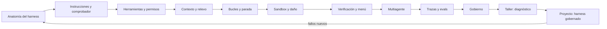

# Parte 41 — Harness y agentic engineering

La Parte 40 comparó metodologías como oráculos: qué evidencia produce cada una y qué defectos deja pasar. La pregunta cambia de «¿qué práctica ordena el desarrollo?» a «¿qué entorno hace que un agente de código cumpla lo que esas prácticas exigen?». Esta parte estudia el **harness**, todo lo que rodea al modelo en un agente: instrucciones del repositorio, contexto, herramientas, permisos, bucle, parada, aislamiento, verificación, coordinación, observabilidad y gobierno. Lo hace con un único caso, **el arnés del equipo de *Avisos***: un entorno mínimo en Python con seis tareas de mantenimiento, una política guionizada que hace de «modelo» y controles que se quitan, se ponen y se miden uno por uno.

## Pregunta rectora

> Para este agente y este repositorio, ¿qué puede tocar, cuándo se detiene, qué debe demostrar antes de dar algo por terminado, qué queda registrado y qué parte de lo que pasó se debe al modelo y qué parte al entorno?

## Antes del recorrido clase por clase

Esta parte no enseña un producto de agentes ni defiende uno. Enseña a leer un agente como **un modelo dentro de una arquitectura de control** y a diagnosticar y mejorar esa arquitectura con evidencia. La primera clase quita piezas a un harness mínimo y muestra que cada ausencia deja un patrón de fallo distinto (`SE-493`); la segunda reparte las reglas del repositorio entre prosa, hook y compuerta según se puedan mecanizar (`SE-494`); la tercera compara dos políticas de permisos sobre treinta comandos (`SE-495`); la cuarta modela qué sobrevive en el contexto de una sesión larga (`SE-496`); la quinta compara reglas de parada sobre miles de tareas simuladas (`SE-497`); la sexta mide qué recuperan el confinamiento, la copia y Git tras acciones destructivas (`SE-498`); la séptima ejecuta cinco compuertas sobre doce cambios (`SE-499`); la octava fusiona ramas reales de Git (`SE-500`); la novena calcula métricas de trazas y simula comparaciones con ruido (`SE-501`); la décima clasifica cambios por riesgo y modela tres modos de gobierno (`SE-502`); el taller diagnostica seis fallos inyectados (`SE-503`) y el proyecto ensambla y evalúa un harness mínimo gobernado (`SE-504`).

El diagrama se lee de izquierda a derecha y no es un proceso obligatorio: cada clase puede aplicarse a un harness existente. El retorno indica que los fallos nuevos vuelven a la anatomía: un harness se corrige con la evidencia de lo que falló.

## Resultados acumulativos

Podrás identificar las piezas de un harness y medir qué falla cuando falta cada una, distinguiendo una falla del modelo de una del entorno; clasificar las reglas de un archivo de instrucciones en mecanizables y semánticas, escribir un comprobador y medir sus aciertos, falsas alarmas y omisiones; comparar una lista de permisos por prefijo con un análisis del comando y decidir qué herramientas ofrecer.

Podrás explicar por qué una ventana de contexto más grande no sustituye al relevo en disco y comparar truncar, resumir y anotar; diseñar reglas de parada con tres salidas (éxito verificado, cambio de plan, escalada con evidencia) y compararlas por simulación; separar impedir de deshacer y comprobar una restauración real.

Podrás escribir un menú único de validación con compuertas ordenadas por costo y una compuerta contra la manipulación de las pruebas; coordinar más de un agente con propiedad de archivos, aislamiento por rama e integrador, y reconocer un conflicto semántico que Git no ve; diseñar trazas y comparar dos versiones de un harness decidiendo con una regla que considera el ruido y la potencia.

Podrás escribir una política de gobierno proporcional al riesgo, distinguir *vibe coding* de ingeniería agéntica con un criterio verificable, diagnosticar fallos de un harness desde su traza y entregar un harness mínimo gobernado con su evaluación y su informe de límites.

## Prerrequisitos enlazados

- [Parte 24 — Diseño, patrones y refactorización](../../classes/part-24-diseno-patrones-y-refactorizacion/): seguridad para cambiar código mediante pruebas.
- [Parte 30 — Estrategia y técnicas de prueba](../../classes/part-30-estrategia-y-tecnicas-de-prueba/): diseño de pruebas, dobles y mutación.
- [Parte 31 — Calidad, rendimiento y resiliencia](../../classes/part-31-calidad-rendimiento-y-resiliencia/): riesgo y escenarios de calidad.
- [Parte 38 — Desarrollo de software asistido por IA](../../classes/part-38-desarrollo-de-software-asistido-por-ia/): uso de asistentes y sus riesgos.
- [Parte 39 — SPEC, agentes y ciclo de vida agentic](../../classes/part-39-spec-agentes-y-ciclo-de-vida-agentic/): especificación durable, delegación y detención de agentes.
- [Parte 40 — Metodologías de desarrollo: de TDD a ODD](../../classes/part-40-metodologias-de-desarrollo-de-tdd-a-odd/): oráculos, evaluaciones con ruido y política metodológica.
- Python 3.11+ y terminal; los experimentos usan solo la biblioteca estándar, y las clases `SE-498` y `SE-500` además requieren Git instalado.

## Bloques y progresión

1. **Anatomía, instrucciones y herramientas:** las clases 493 a 495 definen las piezas del harness, reparten las reglas entre prosa y mecanismo y acotan lo que el agente puede hacer.
2. **Contexto, bucles y control de daño:** las clases 496 a 498 tratan lo que el agente recuerda, cuándo debe detenerse y hasta dónde puede llegar el daño.
3. **Verificar, coordinar y medir:** las clases 499 a 501 construyen el menú de validación, coordinan varios agentes y miden el harness con trazas y evaluaciones.
4. **Gobernar, diagnosticar e integrar:** las clases 502 a 504 escriben la política de gobierno, diagnostican fallos desde la traza y ensamblan el harness del proyecto.

## Evidencia medida y límites

Las figuras y los ejemplos de esta parte usan experimentos ejecutados con CPython 3.12.9 y Git 2.55 en Windows 11; las simulaciones usan semilla fija y reproducen sus resultados, y los tiempos de reloj varían entre equipos. **No se invocó ningún modelo de lenguaje, no se ejecutó ningún producto de agentes de terceros y no se evaluó ninguna herramienta comercial.** El «modelo» de todos los laboratorios es una política guionizada y determinista (`scripts/experiments_part41_lab.py`): los experimentos miden el efecto del entorno sobre esa política, no el comportamiento de un modelo real. Los experimentos no se repitieron en otro sistema operativo.

Los experimentos son: siete configuraciones de un harness mínimo sobre seis tareas, de las que el harness completo resuelve 6 de 6 con 5 pasos, tres configuraciones resuelven 0 y dos terminan tres tareas en falso (`SE-493`); un comprobador de seis reglas sobre diecisiete casos con 9 aciertos, 1 falsa alarma y 4 omisiones (`SE-494`); treinta comandos analizados sin ejecutar, de los que una lista de prefijos deja pasar 13 de 18 inseguros y un análisis del comando ninguno (`SE-495`); un modelo determinista de 120 turnos de contexto con diez hechos y tres estrategias (`SE-496`); una simulación con semilla 497 de cinco reglas de parada sobre 4 000 tareas (`SE-497`); cinco acciones destructivas contra quince archivos en directorios temporales con cuatro configuraciones, incluido un repositorio de Git real (`SE-498`).

Siguen cinco compuertas sobre doce cambios, de las que el menú completo atrapa 9 de 11 defectos y las pruebas solas 2 (`SE-499`); cuatro fusiones con ramas reales de Git y una simulación con semilla 500 del solapamiento de dos a ocho agentes (`SE-500`); métricas de trazas reales y una simulación con semilla 501 de la comparación de dos harness con 50, 200 y 800 tareas (`SE-501`); una clasificación por riesgo de doce cambios y un modelo paramétrico con semilla 502 de 20 000 cambios y tres modos de trabajo (`SE-502`); seis fallos inyectados con dos diagnosticadores, que aciertan 24 y 30 de 30 (`SE-503`); y un harness de referencia con seis controles evaluado en seis tareas normales y cuatro escenarios adversos, con y sin controles (`SE-504`).

Los parámetros (las seis tareas, los diecisiete casos del comprobador, los treinta comandos, los diez hechos de contexto, la mezcla de tareas de la simulación de parada, los quince archivos, los doce cambios y las cinco compuertas, los cuatro escenarios de fusión, las probabilidades de las simulaciones, los seis fallos y los cuatro escenarios adversos) son construcciones del autor. Ninguna cifra es una tasa real de ningún agente, equipo o producto, y las simulaciones de `SE-496`, `SE-497`, `SE-501` y `SE-502` muestran mecanismos con supuestos explícitos.

Lo que **no se hizo**: no se midió ningún modelo de lenguaje, ningún producto de agentes (Claude Code, Codex, Cursor, Copilot u otros) ni ningún sandbox del sistema operativo; no se probó un adversario adaptativo; no se midió productividad, costo en dinero ni esfuerzo humano; no se evaluó la eficacia de AI-DLC ni del marco de NIST más allá de describir lo que sus fuentes dicen; y las afirmaciones sobre productos documentan lo que su documentación declara, no su comportamiento. No hay revisión editorial humana independiente de esta parte.

## Guía razonada clase por clase

*Avisos* mantiene su servicio de recordatorios mientras un asistente de código lo mantiene a él. Cada clase explica qué pieza del harness estudia, qué experimento la mide, qué no demuestra y qué evidencia permitiría abandonar la conclusión.

### Bloque 1 — Anatomía, instrucciones y herramientas

#### SE-493 — Anatomía de un harness: modelo, contexto, herramientas y bucles

Un agente es un modelo más todo lo que lo rodea. La clase quita una pieza por vez a un harness mínimo (contexto, escritura, bucle, parada, verificación, instrucciones) y mide cómo falla cada configuración: resolver con 12 pasos en vez de 5 y terminar en falso son fallos distintos.

El estudiante entrega la anatomía de un harness real y su tabla de ablación con la predicción previa. `SE-494` trata la pieza más frágil, las instrucciones.

#### SE-494 — Instrucciones de repositorio y cumplimiento determinista

Una regla en prosa es una petición; una regla mecanizada es una garantía. La clase escribe un comprobador de seis reglas, lo mide sobre diecisiete casos (9 aciertos, 1 falsa alarma, 4 omisiones) y reparte cada regla entre prosa, hook y compuerta.

El estudiante entrega la clasificación de las reglas de su repositorio con sus casos. `SE-495` acota lo que el agente puede hacer.

#### SE-495 — Herramientas, permisos y superficies de acción

Un permiso por prefijo describe cómo empieza un comando, no qué hace. La clase compara una lista de prefijos con un análisis del comando sobre treinta casos: los prefijos dejan pasar 13 de 18 comandos inseguros y el análisis, ninguno, a costa de denegar uno seguro.

El estudiante entrega su política de permisos con treinta comandos de prueba. `SE-496` trata lo que el agente recuerda mientras trabaja bajo esos permisos.

### Bloque 2 — Contexto, bucles y control de daño

#### SE-496 — Gestión de contexto, resets y handoffs

El contexto es un recurso escaso, no una memoria. La clase modela 120 turnos con diez hechos y compara truncar, resumir y escribir notas; el relevo en disco conserva 8 de 10 con una ventana de 12 000 fichas frente a 1 de truncar.

El estudiante entrega un archivo de relevo verificable por otra persona. `SE-497` trata el bucle que llena el contexto.

#### SE-497 — Loops de agentes y criterios de parada

Un tope de pasos limita el daño y no distingue casi resuelto de inviable. La clase simula cinco reglas de parada sobre 4 000 tareas: la regla de falta de progreso con cambio de plan resuelve 77,0 % con 3,5 iteraciones medias y escala con evidencia.

El estudiante entrega las reglas de parada de su harness con sus tres salidas. `SE-498` trata qué pasa cuando, pese a todo, el agente daña.

#### SE-498 — Sandboxes, reversibilidad y control de daño

Impedir y deshacer son controles distintos. La clase ejecuta cinco acciones destructivas contra quince archivos con cuatro configuraciones: el confinamiento deja 2 intactos, Git recupera 10 y confinamiento más copia previa recupera los 15.

El estudiante entrega el inventario de efectos de su agente con el control de cada uno. `SE-499` decide qué cambios se aceptan.

### Bloque 3 — Verificar, coordinar y medir

#### SE-499 — Verificación, gates y menú único de validación

«Las pruebas pasan» es una compuerta, no la compuerta. La clase ejecuta cinco compuertas sobre doce cambios: las pruebas solas atrapan 2 de 11 defectos y el menú único 9; los dos restantes marcan el límite.

El estudiante entrega el comando único de validación con sus compuertas ordenadas por costo. `SE-500` trata más de un agente.

#### SE-500 — Multiagente y coordinación dentro del harness

Una fusión limpia no es una integración correcta. La clase fusiona ramas reales de Git en cuatro escenarios, muestra un conflicto semántico que Git no ve y simula cuántas veces coinciden de dos a ocho agentes en algún archivo.

El estudiante entrega la decisión de coordinación con propiedad de archivos e integrador. `SE-501` trata cómo saber qué hace el harness.

#### SE-501 — Observabilidad y evals del propio harness

Sin traza no hay diagnóstico y sin comparación honesta no hay mejora. La clase calcula métricas de trazas reales y simula la comparación de dos harness: la regla «tiene más aciertos» declara mejor a uno idéntico entre 45 % y 49 % de las veces.

El estudiante entrega el esquema de traza y un protocolo de evaluación con su potencia. `SE-502` sube un nivel: el gobierno.

### Bloque 4 — Gobernar, diagnosticar e integrar

#### SE-502 — AI-DLC, gobierno y vibe coding frente a agentic engineering

Gobernar es proporcionalidad: más control donde el daño potencial es mayor. La clase clasifica doce cambios con reglas, modela tres modos de trabajo y distingue *vibe coding* de ingeniería agéntica con AI-DLC y NIST como ejemplos descritos, no como resultados medidos.

El estudiante entrega la política de gobierno de una página con su registro y su métrica. `SE-503` pone el harness a prueba.

#### SE-503 — Taller: diagnosticar el fallo de un harness

El diagnóstico se entrena desde la traza. La clase inyecta seis fallos y compara un diagnosticador con traza mínima (24 de 30) y enriquecida (30 de 30): el campo que faltaba decidía entre dos fallos con síntomas idénticos.

El estudiante entrega el diagnóstico de los seis fallos con una tarea de regresión por cada uno. `SE-504` integra todo.

#### SE-504 — Proyecto: harness mínimo gobernado y evaluado

Un control sin escenario que lo ejerza es una creencia. El proyecto ensambla un harness mínimo con seis controles y lo evalúa con seis tareas normales y cuatro escenarios adversos: sin controles se contiene 1 de 4 comportamientos descuidados y con ellos 4 de 4, sin costo en las tareas normales.

El estudiante entrega el harness, su menú, las trazas, la tabla de escenarios y un informe con tres respuestas y cuatro límites. La Parte 42 usa un harness como este para estudiar patrones agénticos.

## Resumen operativo del recorrido

| Clase | Núcleo profesional | Aporte acumulativo |
|---|---|---|
| [SE-493](../../classes/part-41-harness-y-agentic-engineering/se-493-anatomia-de-un-harness-modelo-contexto-herramientas-y-bucles/) | Anatomía de un harness: modelo, contexto, herramientas y bucles | Entrega la anatomía de un harness real y su tabla de ablación con la predicción previa |
| [SE-494](../../classes/part-41-harness-y-agentic-engineering/se-494-instrucciones-de-repositorio-y-cumplimiento-determinista/) | Instrucciones de repositorio y cumplimiento determinista | Entrega la clasificación de las reglas de su repositorio con sus casos |
| [SE-495](../../classes/part-41-harness-y-agentic-engineering/se-495-herramientas-permisos-y-superficies-de-accion/) | Herramientas, permisos y superficies de acción | Entrega su política de permisos con treinta comandos de prueba |
| [SE-496](../../classes/part-41-harness-y-agentic-engineering/se-496-gestion-de-contexto-resets-y-handoffs/) | Gestión de contexto, resets y handoffs | Entrega un archivo de relevo verificable por otra persona |
| [SE-497](../../classes/part-41-harness-y-agentic-engineering/se-497-loops-de-agentes-y-criterios-de-parada/) | Loops de agentes y criterios de parada | Entrega las reglas de parada de su harness con sus tres salidas |
| [SE-498](../../classes/part-41-harness-y-agentic-engineering/se-498-sandboxes-reversibilidad-y-control-de-dano/) | Sandboxes, reversibilidad y control de daño | Entrega el inventario de efectos de su agente con el control de cada uno |
| [SE-499](../../classes/part-41-harness-y-agentic-engineering/se-499-verificacion-gates-y-menu-unico-de-validacion/) | Verificación, gates y menú único de validación | Entrega el comando único de validación con sus compuertas ordenadas por costo |
| [SE-500](../../classes/part-41-harness-y-agentic-engineering/se-500-multiagente-y-coordinacion-dentro-del-harness/) | Multiagente y coordinación dentro del harness | Entrega la decisión de coordinación con propiedad de archivos e integrador |
| [SE-501](../../classes/part-41-harness-y-agentic-engineering/se-501-observabilidad-y-evals-del-propio-harness/) | Observabilidad y evals del propio harness | Entrega el esquema de traza y un protocolo de evaluación con su potencia |
| [SE-502](../../classes/part-41-harness-y-agentic-engineering/se-502-ai-dlc-gobierno-y-vibe-coding-frente-a-agentic-engineering/) | AI-DLC, gobierno y vibe coding frente a agentic engineering | Entrega la política de gobierno de una página con su registro y su métrica |
| [SE-503](../../classes/part-41-harness-y-agentic-engineering/se-503-taller-diagnosticar-el-fallo-de-un-harness/) | Taller: diagnosticar el fallo de un harness | Entrega el diagnóstico de los seis fallos con una tarea de regresión por cada uno |
| [SE-504](../../classes/part-41-harness-y-agentic-engineering/se-504-proyecto-harness-minimo-gobernado-y-evaluado/) | Proyecto: harness mínimo gobernado y evaluado | Entrega el harness, su menú, las trazas, la tabla de escenarios y un informe con tres respuestas y cuatro límites |

## Fuentes

- [Böckeler, «Harness engineering for coding agent users»](https://martinfowler.com/articles/exploring-gen-ai/harness-engineering.html), [Anthropic, «Building effective agents»](https://www.anthropic.com/engineering/building-effective-agents) y [Yao et al., «ReAct»](https://arxiv.org/abs/2210.03629) — definición de harness, bucle del agente y recomendación de simplicidad; autoridad: Thoughtworks / martinfowler.com, Anthropic y arXiv; usadas en `SE-493`.
- [AGENTS.md](https://agents.md/) y [Claude Code: hooks](https://code.claude.com/docs/en/hooks) — archivo de instrucciones para agentes y hooks que bloquean acciones; autoridad: proyecto AGENTS.md y Anthropic; usadas en `SE-494`.
- [OWASP, «LLM06:2025 Excessive Agency»](https://genai.owasp.org/llmrisk/llm062025-excessive-agency/), [Claude Code: permisos](https://code.claude.com/docs/en/permissions), [Anthropic, «Writing effective tools for agents»](https://www.anthropic.com/engineering/writing-tools-for-agents) y [Model Context Protocol](https://modelcontextprotocol.io/specification/latest) — agencia excesiva, permisos y diseño de herramientas; usadas en `SE-495`.
- [Anthropic, «Effective context engineering for AI agents»](https://www.anthropic.com/engineering/effective-context-engineering-for-ai-agents), [Anthropic, «Effective harnesses for long-running agents»](https://www.anthropic.com/engineering/effective-harnesses-for-long-running-agents) y [Liu et al., «Lost in the Middle»](https://aclanthology.org/2024.tacl-1.9/) — contexto, relevo y uso desigual de contextos largos; usadas en `SE-496`.
- [Jimenez et al., «SWE-bench»](https://arxiv.org/abs/2310.06770) y [Anthropic, «Demystifying evals for AI agents»](https://www.anthropic.com/engineering/demystifying-evals-for-ai-agents) — evaluación de agentes sobre tareas reales; usadas en `SE-497`, `SE-501` y `SE-503`.
- [Anthropic, «Making Claude Code more secure and autonomous with sandboxing»](https://www.anthropic.com/engineering/claude-code-sandboxing) y [`git-worktree`](https://git-scm.com/docs/git-worktree) — aislamiento y árboles de trabajo; usadas en `SE-498` y `SE-500`.
- [Anthropic, «How we built our multi-agent research system»](https://www.anthropic.com/engineering/multi-agent-research-system) y [Cognition, «Don't Build Multi-Agents»](https://cognition.ai/blog/dont-build-multi-agents) — dos posturas sobre sistemas multiagente; usadas en `SE-500`.
- [AWS, AI-DLC](https://aws.amazon.com/blogs/devops/open-sourcing-adaptive-workflows-for-ai-driven-development-life-cycle-ai-dlc/), [Willison, «Not all AI-assisted programming is vibe coding»](https://simonwillison.net/2025/Mar/19/vibe-coding/) y [NIST AI RMF](https://www.nist.gov/itl/ai-risk-management-framework) — flujo gobernado, definición de *vibe coding* y gestión de riesgos de IA; usadas en `SE-502`.
- Documentación de Python: [`subprocess`](https://docs.python.org/3/library/subprocess.html), [`tempfile`](https://docs.python.org/3/library/tempfile.html), [`pathlib`](https://docs.python.org/3/library/pathlib.html) y [`unittest`](https://docs.python.org/3/library/unittest.html) — herramientas de los laboratorios.

Las fuentes se vinculan también dentro de cada clase. Definen vocabulario y describen prácticas; que una práctica convenga a un equipo se demuestra con el caso, la evidencia medida y la revisión de otra persona, no con la autoridad de la fuente.

## Criterios de aceptación de la parte

- cada clase conecta mecanismo, medida y límite en una conclusión revisable;
- cada medida puede reproducirse desde un checkout limpio con las mismas semillas, salvo las lecturas de reloj, que declaran por qué no;
- ninguna afirmación sobre un modelo, un producto de agentes, un equipo o un marco de gobierno se apoya en una simulación o en una política guionizada;
- el harness del proyecto se evalúa con escenarios que ejercen cada control y declara lo que no contiene.

[Volver al índice de clases](../../classes/README.md)
