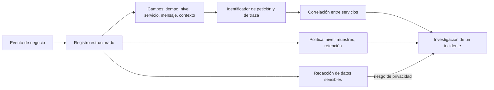
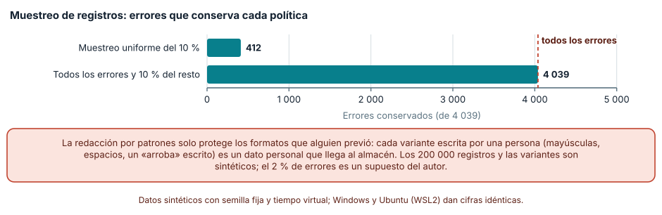

# SE-494 — Logs estructurados y correlación

[← SE-493 — Señales, eventos y observabilidad útil](../../classes/part-41-observabilidad-sre-e-incidentes/se-493-senales-eventos-y-observabilidad-util/README.md) · [↑ Parte 41](../../classes/part-41-observabilidad-sre-e-incidentes/README.md) · [📚 Índice completo](../../classes/README.md) · [🌐 Portal](../../site/classes/SE-494.html) · [SE-495 — Métricas, dimensiones y cardinalidad →](../../classes/part-41-observabilidad-sre-e-incidentes/se-495-metricas-dimensiones-y-cardinalidad/README.md)

## Punto profesional y fundamento pedagógico

**Punto profesional.** La clase existe para que escribas registros que una máquina pueda consultar sin adivinar el formato, para que correlaciones las líneas de una misma petición a través de varios servicios y para que decidas cuánto registrar, cuánto conservar y qué datos no escribir nunca. Un registro es una interfaz con quien investigará el incidente, y como toda interfaz se diseña, se versiona y se prueba.

**Por qué aparece aquí.** Sigue a **Señales, eventos y observabilidad útil**: allí se decidió qué preguntas hacen falta; aquí se decide cómo se escribe el evento que las responde. El caso conductor sigue siendo la API de entregas, ahora con cinco servicios que cooperan para aceptar una entrega.

**Error conceptual que debe corregir.** Creer que registrar en JSON basta para tener registros útiles, o que un identificador de petición «se propaga solo». La estructura mueve la fragilidad del texto al contrato de los campos, y la correlación falla de forma multiplicativa en cada frontera.

**Secuencia de aprendizaje.** Antes de ver los resultados predices cuántas líneas extrae aún una expresión regular tras tres cambios de redacción, qué fracción de peticiones queda completa con un 95 % de propagación por salto y qué porcentaje de los errores conserva un muestreo uniforme del 10 %. Después contrastas con tres experimentos y escribes tu esquema de campos. La secuencia usa predicción, explicación propia, contraste y recuperación. [ICAP](https://icap.education.asu.edu/research) distingue participación de construcción de conocimiento; [How People Learn II](https://nap.nationalacademies.org/catalog/24783/how-people-learn-ii-learners-contexts-and-cultures) respalda diseñar la práctica con contextos reales y retroalimentación.

**Evidencia de aprendizaje.** `registros-log.md` con la predicción, las tres figuras reproducidas, un esquema de campos obligatorios para la API de entregas con su política de redacción y retención y una nota que separe lo medido de lo supuesto.

**Límite de la conclusión.** Las líneas, las cadenas de servicios y los datos personales son sintéticos. No se usó ninguna plataforma de registros ni se midió volumen real; la redacción por patrones se probó con quince variantes escritas por el autor, que no representan lo que escribe una persona usuaria.

### Trazabilidad fuente → afirmación

| Fuente primaria u oficial | Afirmación que respalda | Lo que no prueba |
|---|---|---|
| [OpenTelemetry: modelo de datos de registros](https://opentelemetry.io/docs/specs/otel/logs/data-model/) | Define los campos de un registro (marca de tiempo, severidad, cuerpo, atributos, identificadores de traza y de span) para correlacionarlo con trazas. | No dice qué atributos necesita tu servicio. |
| [W3C Trace Context](https://www.w3.org/TR/trace-context/) | Fija el formato de la cabecera `traceparent` que transporta el identificador de traza entre servicios. | No obliga a que cada servicio la propague. |
| [RFC 3339: fecha y hora en Internet](https://www.rfc-editor.org/rfc/rfc3339) | Define un perfil de ISO 8601 para marcas de tiempo con zona horaria, apto para ordenar y comparar. | No resuelve la deriva de relojes entre máquinas. |
| [OWASP Logging Cheat Sheet](https://cheatsheetseries.owasp.org/cheatsheets/Logging_Cheat_Sheet.html) | Lista datos que no deben registrarse (contraseñas, tokens, datos personales) y propone proteger los registros. | No ofrece una lista cerrada de patrones. |

## Antes de empezar

Recupera lo aprendido en `SE-493`: una señal es útil si responde una pregunta que se hará durante un incidente. La pregunta activa es: **¿qué campos debe llevar cada línea de registro para que, a las 14:03, alguien pueda unir las cinco líneas de una entrega lenta sin leerlas una a una?**

## Prerrequisitos

- Haber completado `SE-493` o poder explicar qué es un evento ancho.
- Python 3.11 o posterior; los experimentos usan solo la biblioteca estándar (`random`, `json`, `re`).
- Nociones de expresión regular y del módulo `logging`.

## Problema auténtico

La API de entregas escribe «Entrega 123 aceptada para curso 45 en 83 ms». Un dashboard cuenta esas líneas con una expresión regular y calcula la duración media. Un martes un desarrollador mejora el mensaje («Entrega aceptada: id=123 curso=45 duración=83ms») y el panel de duración queda en blanco sin que nada falle: nadie lo nota hasta el cierre del plazo. En la misma semana, una entrega lenta atraviesa cinco servicios y la guardia debe reconstruir qué pasó; dos de los servicios no copian el identificador de petición al llamar a la cola, de modo que sus líneas no se pueden unir. Alguien propone «unir por hora», y a 20 peticiones por segundo cada línea tiene varias candidatas. Por último, un registro de depuración contiene el correo de una estudiante y el token de una sesión. La clase enseña a diseñar los registros para que ninguno de los tres accidentes ocurra.

## Objetivos observables

Al terminar podrás:

1. diseñar un esquema de registro con campos obligatorios, tipos y nombres versionados;
2. medir cuánto sobrevive una extracción por expresión regular y cuánto una lectura por campos a cambios de redacción y de nombres;
3. calcular la fracción de peticiones completas según la probabilidad de propagar el identificador y explicar por qué el reloj no sustituye a un identificador;
4. comparar políticas de muestreo según los errores que conservan y su coste en volumen;
5. escribir y probar una política de redacción y reconocer sus formatos ciegos.

## Mapa conceptual



El mapa separa **forma** (campos y tipos), **correlación** (identificadores que unen líneas), y **política** (cuánto, cuánto tiempo y qué no). Un fallo en cualquiera se descubre durante el incidente, que es cuando peor viene.

## Temas y por qué importan

| Tema | Por qué cambia una decisión profesional | Evidencia mínima |
|---|---|---|
| Registro como interfaz | Un mensaje de texto libre es una interfaz sin contrato. | Predicción, traza causal y contraejemplo de **Registro como interfaz** en `registros-log.md` |
| Esquema y niveles | Los campos fijos y la severidad permiten consultar y filtrar. | Predicción, traza causal y contraejemplo de **Esquema y niveles** en `registros-log.md` |
| Correlación | Un identificador propagado une líneas de servicios distintos. | Predicción, traza causal y contraejemplo de **Correlación** en `registros-log.md` |
| Volumen y muestreo | El registro cuesta dinero y el muestreo puede perder justo lo importante. | Predicción, traza causal y contraejemplo de **Volumen y muestreo** en `registros-log.md` |
| Datos sensibles | Lo que se escribe en un registro se conserva, se copia y se filtra. | Predicción, traza causal y contraejemplo de **Datos sensibles** en `registros-log.md` |

## Conceptos y decisiones

### 1. Registro como interfaz

Un registro tiene dos lectores: la persona que lo lee durante un incidente y los programas que lo agregan, filtran y alertan. El texto libre sirve al primero y rompe al segundo, porque una expresión regular depende de la redacción exacta y la redacción es un detalle que cambia en cualquier refactorización. Un **registro estructurado** separa el mensaje (para personas) de los campos (para máquinas): `{"ts": ..., "level": "INFO", "msg": "entrega aceptada", "submission_id": 123, "course_id": 45, "duration_ms": 83}`. La separación no elimina la fragilidad, la traslada: los nombres de los campos pasan a ser un contrato. Si alguien renombra `duration_ms` a `duration`, todas las consultas, paneles y alertas que lo usaban dejan de ver datos sin error. Por eso el esquema se documenta, se versiona y se prueba como cualquier API.

### Cuatro versiones de la misma línea

Se escribe la misma información en cuatro versiones del código: la redacción original, un cambio de formato (`id=` y `curso=`), un cambio de idioma y de orden con un campo extra, y un renombrado de campo. Se evalúan 1 500 líneas por versión con una expresión regular escrita para la versión 1 y con una lectura de registro JSON por nombre de campo.

```python
pattern = re.compile(r"Entrega (\d+) aceptada para curso (\d+) en (\d+) ms")
parsed = json.loads(json.dumps(record))
ok = {"id", "curso", "ms"} <= parsed.keys()
```

| Versión | Redacción | Regex v1 | JSON por nombre |
|---|---|---:|---:|
| v1 | Entrega 123 aceptada para curso 45 en 83 ms | 100 % | 100 % |
| v2 | Entrega aceptada: id=123 curso=45 duración=83ms | 0 % | 100 % |
| v3 | api: entrega id=123 (curso 45) OK tiempo=83 milisegundos, y un campo `region` | 0 % | 100 % |
| v4 | Submission 123 accepted…, y `ms` renombrado a `duration_ms` | 0 % | 0 % |


**Cómo leer la figura.** Cada grupo de barras es una versión del código que redacta la misma línea de otra forma; la barra coral es el porcentaje de líneas que extrae una expresión regular escrita para la versión 1 y la teal el de líneas que extrae la lectura de campos por nombre de un registro JSON. La regex deja de funcionar apenas cambia la redacción; el JSON por nombre sobrevive a los cambios de redacción y solo falla cuando se renombra un campo (versión 4). **Dónde deja de valer:** las cuatro versiones y la regex son construcciones del autor; una regex tolerante (`id=?\s*(\d+)`) aguantaría más, a costa de interpretar mal otros formatos. La conclusión no es que JSON sea inmune: es que el punto frágil se mueve a un contrato que se puede probar.

### 2. Esquema y niveles

Un esquema mínimo para la API de entregas lleva: `ts` (RFC 3339 con zona), `level`, `service`, `version`, `msg` (corto y estable, sin datos variables), `request_id` y `trace_id`, y los campos de negocio propios del evento (`course_id`, `duration_ms`, `status`). Los datos variables van en campos y no dentro del mensaje, porque así `msg` se puede agrupar («entrega aceptada») y contar. La **severidad** (nivel) sirve para filtrar y decidir qué se conserva: `ERROR` para lo que requiere atención de una persona, `WARNING` para lo anómalo recuperable, `INFO` para el hilo de la operación normal, `DEBUG` para detalle que no se conserva en producción. El error más caro es el opuesto al silencio: `ERROR` para todo. Cuando un registro de error aparece por cada petición de un cliente que envía un archivo vacío, la guardia aprende a ignorarlo y el siguiente error real se pierde entre ellos.

### 3. Correlación

Una petición de entrega atraviesa la pasarela, la API, la cola, un trabajador y el almacenamiento, y cada uno escribe sus propias líneas. Para unirlas se necesita un identificador común que cada servicio **reciba** en la petición entrante, **incluya** en todas las líneas que escriba y **copie** a toda llamada saliente (cabecera HTTP, propiedad del mensaje en la cola). El estándar `traceparent` de W3C Trace Context fija un formato para esto y las bibliotecas de trazado lo hacen automáticamente en HTTP; en una cola o un grupo de hilos hay que hacerlo explícitamente, y es donde se rompe. Como la propagación falla en cada frontera de forma independiente, la fracción de peticiones con la cadena completa es el producto de las probabilidades de cada salto: con cuatro saltos al 95 %, queda el 81,5 %.

### 4. Cuando falta el identificador

Sin identificador, queda la hora. Una línea huérfana (la del trabajador que procesa un archivo) se podría atribuir a la petición que estaba en vuelo en ese instante. Eso solo es unívoco si en ese intervalo había una sola petición en el sistema. Con una petición que dura hasta 250 ms, la probabilidad de que no haya otra en vuelo cae rápido con el tráfico: a una petición por segundo sigue habiendo un 58,6 % de líneas atribuibles de forma única; a cinco por segundo, un 7,4 %; a 20, ninguna. El reloj no sustituye al identificador, y además los relojes de máquinas distintas no coinciden (desfases de decenas de milisegundos son normales).

### Cadenas completas y líneas huérfanas

Se simula una cadena de cinco servicios (cuatro saltos). Para cada probabilidad de conservar el identificador por salto se generan 20 000 peticiones y se cuenta cuántas quedan completas. Aparte, para cinco tasas de llegada se generan 3 000 peticiones de Poisson, cada una en vuelo 250 ms, y se cuenta cuántas líneas huérfanas tendrían una sola petición candidata.

```python
complete = sum(all(rng.random() < p for _ in range(hops - 1)) for _ in range(20000)) / 20000
unique += (right - left + 1) == 1          # solo la propia petición está dentro de la ventana
```

| Condición | Resultado |
|---|---:|
| Conservar el identificador con probabilidad 0,99 por salto | 95,9 % completas (fórmula p⁴ = 96,1 %) |
| Probabilidad 0,95 por salto | 81,4 % (81,5 %) |
| Probabilidad 0,90 por salto | 66,3 % (65,6 %) |
| Probabilidad 0,80 por salto | 40,8 % (41,0 %) |
| Línea huérfana a 1 petición por segundo | 58,6 % atribuible |
| Línea huérfana a 5 peticiones por segundo | 7,4 % |
| Línea huérfana a 20 peticiones por segundo | 0 % |


**Cómo leer la figura.** El eje horizontal es la probabilidad de conservar el identificador en cada salto y el vertical el porcentaje de peticiones que llegan completas a lo largo de los cuatro saltos; la línea teal es la simulación y la dorada la fórmula p⁴, y coinciden. Pequeñas pérdidas por salto se multiplican: con 0,99 llegan completas 95,9 por ciento y con 0,90 solo 66,3. Las líneas huérfanas atribuibles solo por el reloj, según el ritmo de peticiones, quedan en la tabla. **Dónde deja de valer:** las pérdidas por salto son independientes en el modelo y en la práctica se concentran en las fronteras que no son HTTP; las peticiones de 250 ms de duración y la llegada de Poisson son supuestos del autor. La tabla no dice cuál es tu probabilidad de propagación: eso se mide contando cuántas trazas tienen todos sus servicios.

### 5. Volumen, muestreo y retención

El registro cuesta almacenamiento y consulta, y la estructura lo encarece (la misma línea pasa de 117 bytes en texto a 166 en JSON, porque las claves se repiten en cada línea). Cuando el volumen es demasiado, se **muestrea**. Un muestreo uniforme del 10 % reduce el volumen al 10 % y reduce igual los errores: deja 412 de 4 039. Es la peor política para el incidente, que está hecho de las líneas raras. Una política mejor decide por contenido: se conservan todos los registros de nivel `WARNING` y superior y una fracción de los `INFO`; con esa política se guardan los 4 039 errores y se paga el 11,8 % del volumen. La **retención** es la segunda palanca: un registro de depuración se conserva horas; uno de auditoría, años; entre ambos hay niveles por tipo de dato.

### 6. Datos sensibles

Un registro es un lugar frecuente de fugas: se escribe sin pensar, se copia a varios sistemas y se conserva más de lo previsto. La primera defensa es **no escribir** lo que no hace falta (el cuerpo de la entrega, el correo). La segunda es **redactar** lo que se pueda colar mediante patrones: reemplazar correos, tokens y documentos de identidad por una marca antes de que la línea salga del proceso. Los patrones solo ven los formatos que alguien previó, y las personas escriben variantes. La tercera es controlar el acceso y la retención de los propios registros.

### Volumen, muestreo y redacción

Se mide la misma línea en texto y en JSON, se simulan 200 000 líneas con un 2 % de errores y se comparan tres políticas de conservación. Además se prueban tres patrones de redacción sobre quince variantes de datos personales repetidas 20 veces.

```python
kept_head += take; kept_err_head += take and is_err      # uniforme del 10 %
kept_smart += is_err or take                              # errores siempre, 10 % del resto
```

| Política | Resultado |
|---|---|
| Tamaño de la misma línea | 117 bytes de texto, 166 bytes de JSON |
| Muestreo uniforme del 10 % | 19 876 de 200 000 líneas; 412 de 4 039 errores |
| Todos los errores y 10 % del resto | 23 503 líneas (11,8 %); 4 039 de 4 039 errores |
| Redacción de correos con una expresión regular | 40 de 100 |
| Redacción de tokens con prefijo fijo | 100 de 100 |
| Redacción de documentos de identidad | 20 de 100 |



**Cómo leer la figura.** Cada barra es una política de muestreo de registros y su largo, los errores que conserva de los que hubo; la línea discontinua es el total de errores. El muestreo uniforme del 10 por ciento pierde 9 de cada 10 errores, justo los que se buscarán después; conservar todos los errores y el 10 por ciento del resto los guarda todos con una fracción del volumen. El tamaño de una línea en texto y en JSON y la redacción de datos personales quedan en la tabla. **Dónde deja de valer:** las quince variantes son del autor, no lo que escribe quien entrega; el 2 % de errores es un supuesto. Una política por contenido necesita que el error esté marcado como tal en el origen: un fallo registrado como `INFO` desaparece con el muestreo.

## Definiciones de trabajo

- **registro estructurado:** línea de registro con campos nombrados y tipados, legible por máquinas sin interpretar el mensaje.
- **identificador de correlación:** valor que se propaga entre servicios para unir las líneas y los spans de una misma petición.
- **muestreo:** conservar solo una parte de los registros para limitar el volumen.
- **redacción:** sustitución de datos sensibles por una marca antes de almacenar el registro.
- **retención:** tiempo durante el cual se conserva un registro antes de borrarlo.

Las definiciones son operativas para la API de entregas. No convierten términos con una historia más amplia en sinónimos y deben contrastarse con la documentación primaria enlazada al final.

## Ejemplo mínimo

El fragmento escribe una línea JSON con el módulo `logging`. Antes de ejecutarlo, predice el campo `msg`.

```python
import json, logging, sys

class JsonFormatter(logging.Formatter):
    def format(self, record):
        data = {"ts": self.formatTime(record, "%Y-%m-%dT%H:%M:%S%z"), "level": record.levelname,
                "msg": record.getMessage(), **getattr(record, "ctx", {})}
        return json.dumps(data, ensure_ascii=False, separators=(",", ":"))

handler = logging.StreamHandler(sys.stdout); handler.setFormatter(JsonFormatter())
log = logging.getLogger("api"); log.addHandler(handler); log.setLevel(logging.INFO)
log.info("entrega aceptada", extra={"ctx": {"submission_id": 123, "course_id": 45, "duration_ms": 83, "request_id": "9f1c2a7e4b8d4c0e"}})
```

El resultado es una línea con `msg` estable y los datos variables en campos. Registra versión de Python, comando y salida; después renombra `duration_ms` y escribe una prueba que detecte el cambio.

## Ejemplo profesional

Supón, como caso hipotético de la plataforma y no como medición, que el equipo define el contrato de registros de la API de entregas: siete campos obligatorios (`ts`, `level`, `service`, `version`, `msg`, `request_id`, `trace_id`), un catálogo de mensajes (`entrega aceptada`, `entrega rechazada`, `almacenamiento lento`) y una prueba en la integración continua que ejecuta cada servicio, captura su salida y verifica que cada línea cumple el esquema. Cada frontera asíncrona (la cola y el grupo de hilos) tiene una prueba que envía un mensaje con un identificador y comprueba que el trabajador lo escribe. La política de conservación guarda todo lo de nivel `WARNING` o superior durante 90 días y una de cada diez líneas `INFO` durante 14. Una regla de redacción elimina correos, tokens y documentos con patrones y una prueba contiene los formatos que se han visto. La auditoría de la semana encuentra que 12 % de las peticiones llegan al trabajador sin identificador, porque el cliente de la cola no copia las propiedades: se corrige el cliente y se añade la prueba. El equipo no concluye que la correlación ya funciona, sino que ahora tiene una prueba que la rompe cuando falle.

## Práctica guiada

1. Predice cuántas de las 1 500 líneas extrae la expresión regular de la versión 1 en cada versión y escribe el número.
2. Ejecuta `python scripts/experiments_part41_a.py e422` y compara; anota la mayor diferencia con tu predicción.
3. Cambia la probabilidad de propagación de 0,95 a 0,98 y calcula cuántos saltos admite la cadena antes de bajar del 90 %.
4. Aumenta la duración en vuelo de una petición (de 250 a 1 000 ms) y mide cómo cambia la atribución por tiempo.
5. Escribe un formateador JSON con los siete campos obligatorios y una prueba que falle si falta alguno.
6. Añade a la redacción un patrón de correos que contemple mayúsculas y otro de documentos con espacios, y mide cuántos falsos positivos introduces.
7. Entrega `registros-log.md` y pide a otra persona que escriba una línea que tu redacción deje pasar.

## Ejercicios

1. **Esquema:** diseña los campos de un registro de «cambio de nota» sin incluir datos personales y justifica cada uno con una pregunta de incidente.
2. **Propagación:** en una cadena de seis saltos con probabilidad 0,97 por salto, calcula la fracción completa y decide cuántos saltos asíncronos justifican una prueba específica.
3. **Muestreo:** un servicio produce 50 millones de líneas al día con 0,5 % de errores; compara el volumen y los errores conservados con un muestreo del 5 % uniforme y con una política que guarda todos los errores y el 2 % del resto.
4. **Redacción:** escribe un patrón para tarjetas de 16 dígitos con separadores y di qué falsos positivos y falsos negativos tendrá.

## Reto verificable

Entrega `registros-log.md` con la predicción, las tres tablas de resultados reproducidas con las mismas semillas, el esquema de campos obligatorios, una prueba que lo verifica en un servicio propio y una política de muestreo y redacción justificada con los números del experimento. Se aprueba si otra persona ejecuta el código desde un checkout limpio, obtiene los mismos números y no logra colar un dato personal por la política de redacción en cinco intentos. No se aprueba por afirmar que «JSON ya es estructurado» ni por muestrear sin medir qué se pierde.

## Caso conductor

La API de entregas es el caso conductor de la Parte 41. Esta clase deja el segundo artefacto: un esquema de registros con identificadores de correlación y políticas. `SE-495` pregunta cómo resumir esos eventos como métricas sin que el número de series se dispare, y `SE-496` cómo propagar el contexto con trazas. Cambia después un solo parámetro, la probabilidad de propagación, y observa cuántos saltos admite la cadena.

## Preguntas frecuentes

### ¿Hay que registrar en JSON siempre?

No siempre. Para registros que leen programas, sí: los campos nombrados son consultables. Para un programa de línea de comandos que lee una persona, el texto es más cómodo. Lo importante es que el destino de producción sea estructurado y que exista un contrato de campos. El formato exacto (JSON, logfmt) es secundario.

### ¿Un identificador de petición es lo mismo que un identificador de traza?

No. El de petición suele generarlo el borde y vive en los registros; el de traza (W3C `trace-id`) une spans y se propaga por estándar. Conviene escribir ambos o usar el de traza como identificador de petición, de modo que un registro enlace con la traza correspondiente.

### ¿Cuánto cuesta registrar de más?

Cuesta almacenamiento, ancho de banda, tiempo de consulta y riesgo. Además, un registro con ruido tiene un coste de atención: quien investiga lee más líneas para encontrar la que importa. La medida honesta es el volumen por petición y el porcentaje de líneas que alguien llegó a consultar.

### ¿La redacción por patrones es suficiente para cumplir la protección de datos?

No por sí sola. Es una capa, no un control completo. Hay que evitar escribir el dato, limitar el acceso a los registros, fijar su retención y poder borrarlos. Un patrón no detecta lo que no previó.

## Fallo controlado y diagnóstico

Reproduce el fallo clásico de la clase: **un cambio de redacción que vacía un panel sin ningún error**. Ejecuta la extracción de la versión 1 sobre las líneas de la versión 2.

Registra síntoma, entrada mínima, hipótesis, observación que descarta cada hipótesis, causa, corrección y prueba de regresión. **Síntoma:** el panel de duración media queda en blanco el martes siguiente a un despliegue y ninguna alerta salta. **Hipótesis rivales:** (a) el servicio dejó de escribir registros; (b) el almacén de registros perdió datos; (c) cambió el formato de las líneas. **Prueba:** cuenta las líneas escritas por minuto y las que cumplen el patrón; si las primeras no cambian y las segundas caen a cero, la hipótesis (c) explica la señal. **Conclusión:** el panel dependía de una redacción que nadie había declarado como interfaz. **Regresión:** añade una prueba que ejecute el servicio, capture sus líneas y verifique el esquema, y una alerta que avise cuando la fracción de líneas con el campo `duration_ms` caiga. No cambies a la vez el mensaje y el panel.

## Errores comunes y cómo corregirlos

| Síntoma | Causa probable | Corrección |
|---|---|---|
| Un panel queda vacío tras un despliegue | La consulta dependía de la redacción del mensaje | Consultar campos, no texto, y probar el esquema |
| Las trazas de algunas peticiones están incompletas | El identificador no se copia en colas o hilos | Propagar explícitamente y probar cada frontera asíncrona |
| El muestreo borra el incidente | Muestreo uniforme sobre eventos raros | Conservar por contenido (nivel, estado) |
| Aparecen datos personales en los registros | Se escribió el objeto entero o el cuerpo de la petición | Registrar solo los campos necesarios y redactar |
| Todo es `ERROR` y nadie lo lee | Severidad usada como énfasis | Definir qué niveles piden acción humana |

## Entorno y archivos clave

```text
work/SE-494/
├── README.md
├── registros/
│   ├── formato.py
│   ├── correlacion.py
│   └── politicas.py
├── tests/test_registros.py
└── evidence/registros-log.md
```

El `README` declara plataforma, versión de Python, semillas y comandos. Los experimentos usan solo la biblioteca estándar y se ejecutaron con CPython 3.12.9 en Windows 11 y 3.12.3 en Ubuntu bajo WSL2 con cifras idénticas. Escribe siempre con `encoding="utf-8"`: el valor por defecto de Windows no lo es. Para recuperar el estado, borra `work/SE-494/` y repite los scripts. Si añades una dependencia, fija procedencia y versión.

## Seguridad, ética y accesibilidad

- no registres contraseñas, tokens, cuerpos de entregas ni correos; si debes identificar a una persona, usa un identificador pseudónimo con rotación;
- los registros son datos personales cuando contienen identificadores: aplica retención mínima, control de acceso y capacidad de borrado;
- no uses líneas de registro reales en los ejemplos del curso: genera datos sintéticos;
- documenta las tablas y las figuras con texto alternativo y en un formato que un lector de pantalla pueda recorrer;
- respeta las licencias de los libros y artículos y atribuye lo adaptado.

## Puente hacia el trabajo con agentes

Un agente al que se le pide «mejora los logs» suele convertir cada `print` en `logger.info(f"...{variable}...")`, con los datos pegados al mensaje, a veces con el objeto completo de la petición. Pídele en cambio que respete el esquema de campos, que mantenga `msg` constante, que no registre cuerpos ni identificadores de persona, que copie el identificador en cada llamada saliente y que escriba una prueba por frontera asíncrona. Revisa especialmente si interpola datos en el mensaje, si registra excepciones con el contenido de la entrega y si el nivel de cada línea corresponde a una decisión humana.

## Transferencia

Traslada el esquema a otro componente (una tarea programada o un trabajador de cola): define sus campos, el identificador que recibe y la política de conservación. La transferencia está lograda cuando puedes decir qué frontera perdería el identificador y cómo lo detectarías, no cuando el formato es JSON.

## Evaluación y evidencia

| Criterio | Evidencia para aprobar |
|---|---|
| comprensión | explicación de por qué la estructura traslada la fragilidad al contrato de campos |
| corrección | tablas de formato, de propagación y de políticas reproducibles con las mismas semillas |
| diseño | esquema de campos, política de muestreo y de redacción con sus formatos ciegos |
| diagnóstico | reproducción del fallo «cambio de redacción que vacía un panel» con regresión |
| incertidumbre | declaración de que las líneas, las cadenas y los datos personales son sintéticos |
| reproducibilidad | versiones, comandos, salida y límites declarados |

## Fuentes

- [OpenTelemetry: modelo de datos de registros](https://opentelemetry.io/docs/specs/otel/logs/data-model/) — campos de un registro y su relación con trazas; autoridad: especificación de OpenTelemetry.
- [W3C Trace Context](https://www.w3.org/TR/trace-context/) — formato de `traceparent`; autoridad: Recomendación del W3C.
- [RFC 3339](https://www.rfc-editor.org/rfc/rfc3339) — formato de fecha y hora; autoridad: IETF.
- [OWASP Logging Cheat Sheet](https://cheatsheetseries.owasp.org/cheatsheets/Logging_Cheat_Sheet.html) — qué registrar y qué no; autoridad: proyecto OWASP.
- [Python: logging](https://docs.python.org/3/library/logging.html) — módulo usado en el ejemplo mínimo; autoridad: documentación de Python.

Cada fuente respalda el mecanismo indicado; ninguna demuestra que 81,4 % de cadenas completas, 412 errores conservados de 4 039 o 40 de 100 correos redactados se observen en un sistema real. Esa afirmación depende del código, del tráfico y de lo que escriban las personas.

## Límites y siguiente paso

Se ejecutaron tres experimentos con tiempo virtual y semillas fijas en Windows y Ubuntu (WSL2) con resultados idénticos. No se usó ninguna plataforma de registros; las cuatro versiones del mensaje, las cadenas de cinco servicios, las peticiones de 250 ms, el 2 % de errores y las quince variantes de datos personales son construcciones del autor, y la regex y los patrones se afinaron con los mismos casos que los evalúan. La siguiente clase pregunta cómo resumir esos eventos como métricas sin que el número de series se dispare.

## Glosario

- **registro estructurado:** línea de registro con campos nombrados y tipados, legible por máquinas sin interpretar el mensaje.
- **identificador de correlación:** valor que se propaga entre servicios para unir las líneas y los spans de una misma petición.
- **muestreo:** conservar solo una parte de los registros para limitar el volumen.
- **redacción:** sustitución de datos sensibles por una marca antes de almacenar el registro.
- **retención:** tiempo durante el cual se conserva un registro antes de borrarlo.

---

[← SE-493 — Señales, eventos y observabilidad útil](../../classes/part-41-observabilidad-sre-e-incidentes/se-493-senales-eventos-y-observabilidad-util/README.md) · [↑ Parte 41](../../classes/part-41-observabilidad-sre-e-incidentes/README.md) · [📚 Índice completo](../../classes/README.md) · [🌐 Portal](../../site/classes/SE-494.html) · [SE-495 — Métricas, dimensiones y cardinalidad →](../../classes/part-41-observabilidad-sre-e-incidentes/se-495-metricas-dimensiones-y-cardinalidad/README.md)
