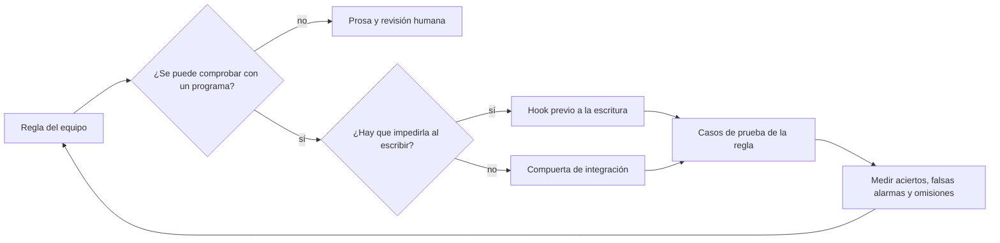
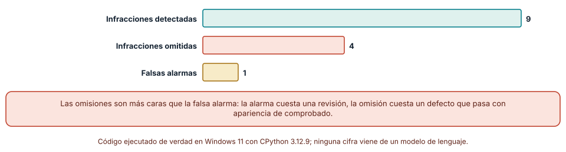

# SE-494 — Instrucciones de repositorio y cumplimiento determinista

[← SE-493 — Anatomía de un harness: modelo, contexto, herramientas y bucles](../../classes/part-41-harness-y-agentic-engineering/se-493-anatomia-de-un-harness-modelo-contexto-herramientas-y-bucles/README.md) · [↑ Parte 41](../../classes/part-41-harness-y-agentic-engineering/README.md) · [📚 Índice completo](../../classes/README.md) · [🌐 Portal](../../site/classes/SE-494.html) · [SE-495 — Herramientas, permisos y superficies de acción →](../../classes/part-41-harness-y-agentic-engineering/se-495-herramientas-permisos-y-superficies-de-accion/README.md)

## Punto profesional y fundamento pedagógico

**Punto profesional.** La clase existe para que escribas las instrucciones de un repositorio sabiendo qué parte de ellas es una petición y qué parte es una garantía. Un archivo como `AGENTS.md` o `CLAUDE.md` entra al contexto del modelo; el modelo decide si lo sigue. Todo lo que dependa de esa decisión es probabilístico. Pero buena parte de lo que un equipo pone en esos archivos («no uses rutas temporales fijas», «cada cambio de código lleva su prueba», «no dejes TODO sin ticket») se puede comprobar mecánicamente en el momento de escribir o de integrar. Convertir esas reglas en comprobaciones es la diferencia entre confiar en que el agente las lea y saber que se cumplen.

**Por qué aparece aquí.** Sigue a la anatomía (`SE-493`) porque las instrucciones fueron la pieza más frágil: la única que dependía de ser leída. Antes de añadir permisos y compuertas conviene aprender a repartir las reglas entre tres lugares: prosa, hook y compuerta de integración.

**Error conceptual que debe corregir.** Creer que un archivo de instrucciones más largo y más enfático produce más cumplimiento. La extensión consume el contexto de todos los pasos, y el énfasis no cambia que la regla sea una petición. Lo que sí cambia el cumplimiento es mover la regla a un lugar donde se ejecuta sin preguntar al modelo.

**Secuencia de aprendizaje.** Antes de ejecutar, clasificas diez reglas de ejemplo en mecanizables y semánticas; después ejecutas un comprobador sobre diecisiete cambios con infracciones conocidas, cuentas aciertos, falsas alarmas y omisiones, y decides dónde vive cada regla.

**Evidencia de aprendizaje.** `reglas-del-repositorio.md` con cada regla clasificada, el lugar donde se aplica (prosa, hook, compuerta), el caso de prueba que la ejerce y la forma en que podría eludirse.

**Límite de la conclusión.** El comprobador y los diecisiete casos son del autor. Las cifras (9 aciertos, 1 falsa alarma, 4 omisiones) describen este conjunto, no la cobertura de un comprobador real. No se midió cuánto más cumple un modelo real una regla en prosa que otra; no se invocó ningún modelo.

### Trazabilidad fuente → afirmación

| Fuente primaria u oficial | Afirmación que respalda | Lo que no prueba |
|---|---|---|
| [AGENTS.md](https://agents.md/) | Propone un archivo de formato abierto, «un README para agentes», con comandos de preparación, pruebas y convenciones. | No dice cuánto se cumple lo que contiene. |
| [Claude Code: hooks](https://code.claude.com/docs/en/hooks) | Documenta que un hook es un comando que el harness ejecuta en puntos del ciclo (antes y después de usar una herramienta) y puede bloquear la acción. | Es la documentación de un producto, no de todos. |
| [Böckeler, «Harness engineering»](https://martinfowler.com/articles/exploring-gen-ai/harness-engineering.html) | Distingue controles computacionales (deterministas, rápidos) de inferenciales (con un modelo) y guías previas de sensores posteriores. | No cuantifica la diferencia de cumplimiento. |
| [Python: `ast`](https://docs.python.org/3/library/ast.html) | Documenta el análisis sintáctico usado por el comprobador. | No valida la elección de reglas. |

## Antes de empezar

Recupera lo aprendido en `SE-493`: sin la línea que pedía ejecutar las pruebas, tres tareas quedaron terminadas en falso. La pregunta activa es: **de las reglas que hoy le pides a un agente en prosa, ¿cuántas podría comprobar un script de diez líneas y por qué todavía no lo hace?**

## Prerrequisitos

- Haber completado `SE-493` o poder explicar qué es un harness y la diferencia entre instrucción y verificación.
- Conocer expresiones regulares básicas y haber leído un árbol sintáctico en Python.
- Python 3.11 o posterior; la clase usa solo la biblioteca estándar.

## Problema auténtico

El repositorio de la plataforma tiene un archivo de instrucciones de cuarenta líneas. Un asistente de código lo lee en cada sesión y, aun así, un viernes introduce una ruta temporal fija de Unix en una función, deja un `except:` sin tipo y modifica el código sin añadir una prueba. Cuando alguien le pregunta por qué ignoró las reglas, el agente responde que las leyó. Probablemente es cierto: las leyó, pero cada regla compitió por atención con las demás instrucciones, con la tarea y con la historia de la sesión, y ninguna comprobación le avisó de la infracción.

La clase propone otra pregunta: no «cómo redacto mejor la regla», sino «¿quién la comprueba?». Se escribe un comprobador de seis reglas, se mide sobre diecisiete cambios con infracciones y evasiones conocidas, y se examina qué enseña cada acierto y cada error del comprobador sobre el reparto de reglas entre prosa y mecanismo.

## Objetivos observables

Al terminar podrás:

1. clasificar las reglas de un archivo de instrucciones en mecanizables y semánticas, y justificar la clasificación;
2. escribir un comprobador determinista (expresión regular o árbol sintáctico) para una regla y medir sus aciertos, falsas alarmas y omisiones;
3. elegir el lugar de aplicación de cada regla: prosa, hook previo a la escritura o compuerta de integración;
4. explicar por qué una regla mecánica puede ser exacta en lo que escribe y ciega a lo que se escribe de otra forma;
5. recortar un archivo de instrucciones dejando solo lo que debe ser prosa.

## Mapa conceptual



El mapa sitúa la decisión en la primera pregunta. Todo lo que pasa «sí» recibe una regla ejecutable y casos de prueba; todo lo que pasa «no» se queda donde estaba, pero ahora se sabe que es una petición.

## Temas y por qué importan

| Tema | Por qué cambia una decisión profesional | Evidencia mínima |
|---|---|---|
| Qué es el archivo de instrucciones | Es contexto, no ley; se compite por atención con todo lo demás. | Número de palabras y de reglas |
| Reglas mecanizables y semánticas | Decide dónde vive cada regla. | Clasificación de diez reglas |
| Expresiones regulares frente a árbol sintáctico | Una regex confunde un comentario con código; un árbol, no. | Casos con falsa alarma |
| Hook previo a la escritura | Impide la acción en vez de reprobarla después. | Un hook que devuelve bloqueo |
| Compuerta de integración | Rechaza lo que el hook no vio. | La misma regla en la integración continua |
| Evasión y falsos positivos | Una regla mecánica puede ser eludida o molestar sin motivo. | Casos de evasión y de falsa alarma |

## Conceptos y decisiones

### 1. Qué es, de verdad, un archivo de instrucciones

El archivo de instrucciones del repositorio se carga en el contexto de cada sesión. Es una pieza valiosa porque transmite lo que el agente no puede inferir (comandos de preparación, convenciones, trampas del repositorio) y porque está versionado con el código. Y es una petición: no hay nada que ejecute la regla si el modelo la omite. El proyecto AGENTS.md lo define como un lugar predecible para «el contexto y las instrucciones» que ayudan a los agentes, separado del README para humanos. Dos consecuencias: cada línea que añades ocupa contexto en todos los pasos de todas las sesiones, y cada línea compite con la tarea del momento. Un archivo de cuarenta reglas no tiene cuarenta veces más cumplimiento; tiene cuarenta peticiones que se reparten la misma atención.

### 2. Dos clases de regla

Una regla es **mecanizable** si existe un programa que, dado el cambio, decide si la infringe: «no hay una ruta temporal fija en el código», «el cambio de `src/` toca también `tests/`», «no hay `except` sin tipo», «los `TODO` llevan número de ticket». Es **semántica** si decidirla exige juicio: «explica con claridad los compromisos de diseño», «no inventes fuentes», «mantén el estilo del proyecto». En el ejemplo de la clase, seis de diez reglas son mecanizables y cuatro son semánticas. Las semánticas no se pueden comprobar con un programa; se aplican con revisión humana o con evaluaciones por modelo (con sus propias limitaciones, `SE-501`).

### 3. Expresión regular o árbol sintáctico

Una expresión regular sobre el texto es rápida de escribir y se equivoca de forma predecible: no distingue código de comentario ni de cadena. En el conjunto de la clase, un comentario que dice «no uses la ruta temporal fija» dispara la regla de rutas porque la expresión busca el texto, no el uso. Un árbol sintáctico (`ast`) distingue una llamada a `eval` de una cadena con ese nombre, y detecta un `except` sin tipo sin confundirlo con la palabra en un comentario. La regla de «sin `except` sin tipo» y la de «sin `eval`» se escribieron con el árbol; la de rutas y la de formas de token, con expresiones regulares, porque buscan contenido de cadenas. Elegir bien entre ambas evita falsas alarmas.

### 4. Hook previo a la escritura frente a compuerta de integración

Un **hook** es un comando que el harness ejecuta en un punto del ciclo (antes de usar una herramienta, después de editar) y que puede bloquear la acción. La documentación de Claude Code lo describe así y es un ejemplo: no toda herramienta de agentes ofrece lo mismo. Un hook previo impide que la regla se infrinja y muestra el motivo al agente en el mismo paso; es el control más barato en retroalimentación. Una **compuerta de integración** (`SE-499`) rechaza el cambio completo en la integración continua; no depende de que el hook exista en la máquina de cada persona. Lo robusto es poner la misma comprobación en ambos sitios: el hook para la retroalimentación temprana, la compuerta como red final.

### 5. Lo que una regla mecánica no ve

Una regla mecánica es exacta en lo que describe y ciega a lo que se escribe de otra forma. En el conjunto de la clase, la ruta armada por concatenación, el token partido en dos cadenas y la llamada a `eval` por un nombre calculado se escapan, y una prueba vacía satisface la regla «el cambio de código lleva prueba» sin protegerlo. Ninguna de esas evasiones requiere mala fe: son formas legítimas de escribir lo mismo. Hay dos respuestas. Una es ampliar la regla (cada ampliación cuesta falsas alarmas). La otra es aceptar el límite y mantener la revisión humana para lo que la regla no cubre. Lo que no vale es afirmar que «la regla se cumple» cuando solo se ha comprobado que no aparece una forma de infringirla.

## El comprobador sobre diecisiete casos

El comprobador implementa seis reglas (`R1` a `R6`) y se aplicó a diecisiete cambios construidos a mano: infracciones directas, infracciones disfrazadas, casos limpios y casos que parecen infracción sin serlo. Los literales con forma de token se construyen en tiempo de ejecución para no dejar ninguno en el código del laboratorio.


**Cómo leer la figura.** Cada fila es un cambio con infracción conocida o sin ella; la última columna compara lo esperado con lo detectado. Los casos «se escapa» son infracciones reales que el comprobador no ve; la «falsa alarma» es un cambio inocuo que bloquea. **Dónde deja de valer:** los diecisiete casos son del autor y contienen más evasiones de las que aparecerían en un repositorio real; la precisión y la cobertura de la tabla describen el conjunto, no un comprobador general.



**Cómo leer la figura.** Las tres barras suman los resultados del comprobador: 9 verdaderos positivos, 4 infracciones omitidas y 1 falsa alarma, es decir, precisión de 90 % y cobertura de 69 % sobre las 13 infracciones. **Dónde deja de valer:** esos porcentajes con 13 infracciones tienen una incertidumbre enorme; sirven para ver el compromiso entre falsas alarmas y omisiones, no para comparar comprobadores.


**Cómo leer la figura.** Una misma regla puede vivir en tres sitios con garantías crecientes: la prosa guía, el hook bloquea al instante y la compuerta rechaza al integrar. **Dónde deja de valer:** el diagrama supone que el producto de agentes ofrece hooks; si no los ofrece, la compuerta de integración queda como único control mecánico y la retroalimentación llega más tarde.

## Definiciones de trabajo

- **Regla mecanizable:** regla que un programa puede decidir sobre un cambio.
- **Regla semántica:** regla que exige juicio humano o de un modelo.
- **Hook:** comando que el harness ejecuta en un punto del ciclo y que puede bloquear una acción.
- **Compuerta (gate):** comprobación que un cambio debe pasar para integrarse.
- **Falsa alarma:** bloqueo de un cambio que no infringe la regla.
- **Omisión:** infracción real que la regla no detecta.

## Ejemplo mínimo

La regla «no hay `except` sin tipo» se comprueba con el árbol sintáctico:

```python
import ast

def tiene_except_desnudo(codigo: str) -> bool:
    return any(isinstance(n, ast.ExceptHandler) and n.type is None
               for n in ast.walk(ast.parse(codigo)))
```

Con `try: ... except: ...` devuelve `True`; con `except Exception:` devuelve `False`; con un comentario que dice «no uses except:» también devuelve `False`, que es lo correcto. Una expresión regular sobre el texto habría disparado en el comentario.

## Ejemplo profesional

*Escenario ilustrativo: las cifras y los resultados que aparecen en este ejemplo son supuestos de la narración, no mediciones.*

El equipo revisa su archivo de instrucciones de cuarenta líneas. Clasifica: veinticinco reglas son mecanizables, quince son semánticas o contextuales. Escribe comprobadores para las ocho más infringidas, los pone como hook previo a la escritura y como paso de la integración continua, y recorta el archivo a las quince reglas semánticas más los comandos de preparación. El archivo queda en tres cuartas partes de su tamaño y las infracciones mecánicas llegan a revisión muy pocas veces. El hallazgo inesperado son dos falsas alarmas semanales de la regla de rutas, causadas por comentarios; las resuelven pasando esa regla a un análisis de cadenas con el árbol. La lección es que mecanizar una regla abre un trabajo de mantenimiento: casos de prueba para la regla y revisión de sus falsas alarmas.

## Práctica guiada

1. Copia las reglas de tu archivo de instrucciones y clasifícalas en mecanizables y semánticas.
2. Elige tres mecanizables y escribe, para cada una, un caso que la infringe, un caso que la infringe de forma disfrazada y un caso inocuo que se le parece.
3. Ejecuta `python scripts/experiments_part41_a.py 494` y revisa qué casos del laboratorio caen en cada categoría.
4. Implementa tu primer comprobador con `ast` o con una expresión regular y mide aciertos, falsas alarmas y omisiones.
5. Decide el lugar de cada regla y recorta tu archivo.

## Ejercicios

1. **Básico.** Explica por qué un comentario que menciona una ruta temporal dispara una expresión regular y no un análisis de cadenas del árbol sintáctico.
2. **Intermedio.** Amplía la regla de rutas para detectar la ruta armada por concatenación sin disparar con comentarios, y mide el cambio en aciertos y falsas alarmas.
3. **Avanzado.** Diseña una comprobación para «el cambio de código lleva una prueba que lo ejerce» que no se satisfaga con una prueba vacía, y describe cómo podría eludirse.

## Reto verificable

Entrega `reglas-del-repositorio.md` con: cada regla de tu archivo de instrucciones clasificada, el lugar elegido, el comprobador (o la razón de que no exista), un conjunto de al menos doce casos (infracciones, disfrazadas, inocuas) y la tabla de aciertos, falsas alarmas y omisiones. Es válido si otra persona ejecuta tus casos y obtiene la misma tabla.

## Caso conductor

El arnés de *Avisos* ya sabe qué piezas tiene (`SE-493`). Esta clase recorta su archivo de instrucciones: las reglas mecanizables pasan a un comprobador compartido por el hook y por la integración, y el archivo conserva las reglas que solo una persona puede juzgar. El comprobador se reutiliza como compuerta en `SE-499`.

## Preguntas frecuentes

### ¿Entonces sobra el archivo de instrucciones?

No. Transmite lo que no se puede inferir y lo que no se puede mecanizar. Lo que se recorta es lo que ya hace un programa y repetirlo en prosa solo ocupa contexto.

### ¿Qué va primero, el hook o la compuerta?

La compuerta, porque es la red que no depende de la máquina de cada persona; el hook se añade para que el agente reciba el aviso en el mismo paso. Con solo el hook, una máquina sin él deja pasar la infracción.

### ¿Cuántas reglas son demasiadas?

No hay un número demostrado. El criterio es que cada regla de prosa justifique su costo de contexto y que no repita lo que un programa ya comprueba. Medir el cumplimiento por regla con trazas (`SE-501`) permite podar las que no cambian nada.

### ¿Un modelo puede revisar las reglas semánticas?

Puede ayudar como segundo lector, y es un control inferencial: variable y con sus propios fallos. Böckeler lo distingue de los controles computacionales y recomienda no confundirlos. Se decide con evaluación (`SE-501`), no por intuición.

## Fallo controlado y diagnóstico

**Fallo.** El comprobador pasa un cambio con una ruta temporal escrita como `'/' + 'tmp' + '/salida'`. El cambio llega a integración y falla en un entorno donde la ruta no existe.

**Diagnóstico paso a paso.** (1) La regla `R1` busca el texto completo de la ruta entre comillas. (2) El código arma la ruta en tres fragmentos; ninguno coincide. (3) No es un error del comprobador: la regla describía una forma de infringir, no la infracción. (4) El caso «concatenado» ya figuraba en el conjunto de casos como omisión conocida.

**Corrección.** Se decide: ampliar la regla con un análisis de constantes del árbol (más costoso, con riesgo de falsas alarmas) o aceptar la omisión y confiar en una prueba que ejecute el código en un directorio temporal. La lección es registrar la omisión como límite de la regla en vez de presentarla como cobertura total.

## Errores comunes y cómo corregirlos

- **Un archivo enorme de instrucciones.** Síntoma: reglas ignoradas al azar. Causa: competencia por atención y consumo de contexto. Corrección: recortar a lo que no se puede mecanizar.
- **Una regla mecánica sin casos de prueba.** Síntoma: nadie sabe qué cubre. Causa: se escribió sin ejemplos. Corrección: casos de infracción, de evasión y de inocencia.
- **Expresión regular para algo sintáctico.** Síntoma: falsas alarmas en comentarios y cadenas. Corrección: usar el árbol sintáctico.
- **Solo el hook, sin compuerta.** Síntoma: infracciones desde máquinas sin el hook. Corrección: la misma comprobación en la integración continua.
- **Presentar la ausencia de infracciones como cumplimiento.** Síntoma: «la regla se cumple» tras una omisión. Corrección: declarar qué formas de infracción no ve.

## Entorno y archivos clave

- `scripts/experiments_part41_a.py`: comprobador y diecisiete casos; se ejecuta con `python scripts/experiments_part41_a.py 494`.
- `AGENTS.md` de este repositorio: ejemplo de instrucciones con reglas mecánicas respaldadas por validadores en `scripts/`.
- Solo la biblioteca estándar (`ast`, `re`).

## Seguridad, ética y accesibilidad

Un hook ejecuta un comando de tu máquina con tus permisos: tratar su configuración como código revisable y no aceptar hooks de origen desconocido. Una regla que busca secretos debe evitar imprimir el secreto encontrado en el registro. Ética: usar los resultados de un comprobador para evaluar a una persona (cuántas veces «infringió») atribuye al individuo lo que mide al entorno. Las figuras son tablas, barras y diagramas con texto alternativo completo; ninguna información depende solo del color.

## Puente hacia el trabajo con agentes

El patrón que funciona es dar al agente la regla y la comprobación: la regla en el archivo de instrucciones y el comando que la verifica en un lugar que el agente pueda ejecutar (el menú de `SE-499`). Pídele que ejecute la comprobación antes de entregar y que informe cuáles reglas no puede comprobar. Si el producto ofrece hooks, usa uno para bloquear lo que debe ser imposible. El patrón que falla es creer que una regla enfática en el archivo es una garantía: un agente que la omite no recibirá ninguna señal, y tú tampoco.

## Transferencia

Aplica el procedimiento al archivo de instrucciones de otro proyecto: clasifica, mecaniza dos reglas, escribe sus casos y mide. Compara cuántas líneas ahorras y qué fracción de las reglas son realmente semánticas. Si descubres que casi todas lo son, el equipo tiene un problema de revisión, no de comprobación.

## Evaluación y evidencia

| Criterio | Evidencia aceptable | Rechazo |
|---|---|---|
| Clasificación | Cada regla con su justificación | «Todas son mecanizables» |
| Casos | Infracciones, evasiones y casos inocuos | Solo casos felices |
| Medición | Aciertos, falsas alarmas y omisiones contados | Un porcentaje sin conteo |
| Lugar de aplicación | Prosa, hook o compuerta con la razón | Todo en prosa |
| Límites | Evasiones conocidas declaradas | «Cumple todas las reglas» |

## Fuentes

- AGENTS.md. [«A simple, open format for guiding coding agents»](https://agents.md/).
- Anthropic. [Claude Code: hooks](https://code.claude.com/docs/en/hooks).
- Böckeler, B. [«Harness engineering for coding agent users»](https://martinfowler.com/articles/exploring-gen-ai/harness-engineering.html).
- Python Software Foundation. [`ast`](https://docs.python.org/3/library/ast.html).
- Anthropic. [«Effective context engineering for AI agents»](https://www.anthropic.com/engineering/effective-context-engineering-for-ai-agents).

## Límites y siguiente paso

Se midió un comprobador de seis reglas sobre diecisiete casos del autor, en Windows 11 con CPython 3.12.9. No se midió el cumplimiento de ningún modelo con reglas en prosa ni el efecto del tamaño del archivo de instrucciones en el comportamiento de un agente real. El siguiente paso, `SE-495`, trata la otra cara del control: qué herramientas y permisos se conceden, y por qué un permiso por prefijo de comando deja pasar casi todo lo peligroso.

## Glosario

| Término | Definición breve |
|---|---|
| Regla mecanizable | Regla que un programa decide sobre un cambio |
| Regla semántica | Regla que exige juicio |
| Hook | Comando que el harness ejecuta y puede bloquear una acción |
| Compuerta | Comprobación obligatoria antes de integrar |
| Falsa alarma | Bloqueo de un cambio que no infringe |
| Omisión | Infracción real que la regla no ve |
