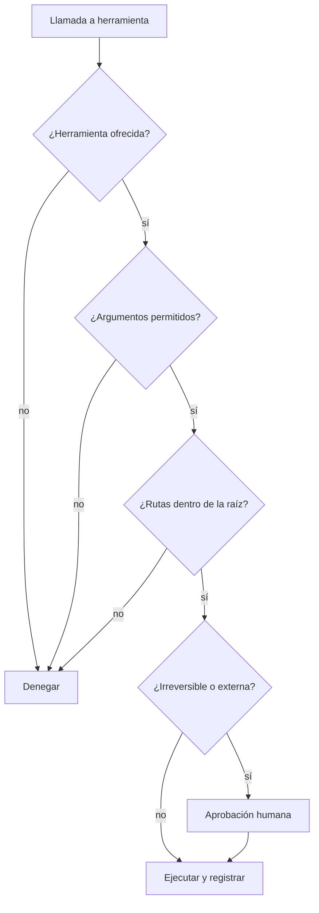
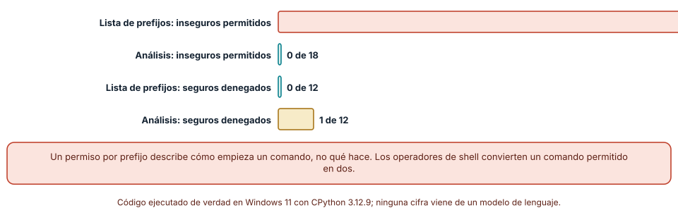
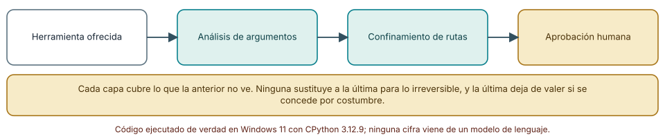

# SE-495 — Herramientas, permisos y superficies de acción

[← SE-494 — Instrucciones de repositorio y cumplimiento determinista](../../classes/part-41-harness-y-agentic-engineering/se-494-instrucciones-de-repositorio-y-cumplimiento-determinista/README.md) · [↑ Parte 41](../../classes/part-41-harness-y-agentic-engineering/README.md) · [📚 Índice completo](../../classes/README.md) · [🌐 Portal](../../site/classes/SE-495.html) · [SE-496 — Gestión de contexto, resets y handoffs →](../../classes/part-41-harness-y-agentic-engineering/se-496-gestion-de-contexto-resets-y-handoffs/README.md)

## Punto profesional y fundamento pedagógico

**Punto profesional.** La clase existe para que decidas qué puede hacer un agente en tu repositorio antes de decidir qué le pides. Las herramientas definen la **superficie de acción**: lo que el agente puede leer, escribir, ejecutar y enviar. Los permisos acotan esa superficie. Un agente con una sola herramienta bien acotada es útil y predecible; uno con una terminal abierta es tan peligroso como la persona menos cuidadosa que tenga acceso a tu máquina, sin su juicio. La decisión profesional es el **mínimo privilegio**: conceder lo necesario para la tarea, comprobar cada llamada y reservar la aprobación humana para lo irreversible.

**Por qué aparece aquí.** Sigue a las instrucciones (`SE-494`) porque ya sabes que lo que se pide en prosa no se garantiza; los permisos son el primer control que no depende de que el modelo coopere. Precede a los sandboxes (`SE-498`), que acotan el daño de lo que los permisos dejan pasar.

**Error conceptual que debe corregir.** Creer que una lista de comandos permitidos por prefijo («`git status`», «`cat`», «`ls`») es una política de seguridad. Un prefijo describe cómo *empieza* un comando, no qué *hace*: `git status; rm -rf src` empieza con un prefijo permitido y ejecuta dos comandos. En el conjunto de la clase, la lista de prefijos deja pasar 13 de 18 comandos inseguros.

**Secuencia de aprendizaje.** Antes de ejecutar, estimas cuántos de 18 comandos inseguros dejaría pasar una lista de prefijos; después ejecutas un análisis del comando (operadores, programa, argumentos, rutas), mides los dos enfoques sobre treinta comandos y dibujas las capas de control.

**Evidencia de aprendizaje.** `politica-de-permisos.md` con la superficie de acción de tu agente, la política por herramienta, treinta comandos de prueba con su veredicto esperado y la tabla de comandos inseguros permitidos y seguros denegados.

**Límite de la conclusión.** Los treinta comandos son del autor y la política analiza texto: **no se ejecutó ninguno de ellos**. No se midió ningún producto de agentes ni se evaluó una política contra un atacante adaptativo. Las cifras muestran un mecanismo (por qué fallan los prefijos), no la eficacia de una política real.

### Trazabilidad fuente → afirmación

| Fuente primaria u oficial | Afirmación que respalda | Lo que no prueba |
|---|---|---|
| [OWASP, «LLM06:2025 Excessive Agency»](https://genai.owasp.org/llmrisk/llm062025-excessive-agency/) | Identifica el exceso de agencia (funcionalidad, permisos o autonomía excesivos) como un riesgo y recomienda limitar herramientas, permisos y exigir aprobación humana. | No cuantifica la frecuencia del riesgo. |
| [Claude Code: permisos](https://code.claude.com/docs/en/permissions) | Documenta reglas de permitir, preguntar y denegar por herramienta y por patrón. | Describe un producto, no la seguridad de todos. |
| [Anthropic, «Writing effective tools for agents»](https://www.anthropic.com/engineering/writing-tools-for-agents) | Recoge criterios para diseñar herramientas que los agentes usen bien (pocas, claras, con respuestas útiles). | No mide la seguridad de una herramienta. |
| [Model Context Protocol](https://modelcontextprotocol.io/specification/latest) | Especifica cómo un servidor expone herramientas a un cliente. | No define qué herramientas son seguras. |
| [Python: `shlex`](https://docs.python.org/3/library/shlex.html) y [`pathlib`](https://docs.python.org/3/library/pathlib.html) | Documentan la separación de un comando y la resolución de rutas usadas por el laboratorio. | No sustituyen el análisis del propio intérprete de comandos. |

## Antes de empezar

Recupera lo aprendido en `SE-494`: una regla mecánica es exacta en lo que describe y ciega a lo que se escribe de otra forma. La pregunta activa es: **¿qué es lo peor que podría ejecutar hoy el agente con el permiso más amplio que le has dado, y qué comprobación lo detendría?**

## Prerrequisitos

- Haber completado `SE-493` y `SE-494`, o conocer qué es una herramienta de agente y una regla mecánica.
- Saber qué hacen `;`, `&&`, `|`, `$(...)` y la redirección en un intérprete de comandos.
- Python 3.11 o posterior; el laboratorio no ejecuta ninguno de los comandos analizados.

## Problema auténtico

El asistente del equipo tiene permiso para ejecutar comandos que empiecen por `git status`, `git diff`, `ls`, `cat` y `python -m unittest`. La persona que configuró la lista pensaba en comandos de lectura. Una tarde, el asistente, al explorar un fallo, ejecuta `cat .env` para ver una variable; otra, `git diff && curl ...` para «subir» un resultado. Ninguna infringe la lista, porque ambas empiezan por un prefijo permitido.

La clase reconstruye el problema con treinta comandos (doce seguros, dieciocho no) y dos políticas: la de prefijos y una que descompone el comando. Ninguna de las dos *ejecuta* nada: la pregunta es qué decide cada una. La comparación enseña dónde está la dificultad real, que no es el comando sino su composición.

## Objetivos observables

Al terminar podrás:

1. describir la superficie de acción de un agente: herramientas, argumentos, rutas, red y credenciales;
2. explicar por qué un permiso por prefijo no acota lo que hace un comando compuesto;
3. escribir una política que descomponga un comando (operadores, programa, subcomando, rutas) y medir inseguros permitidos y seguros denegados;
4. decidir qué se permite sin preguntar, qué requiere aprobación y qué se prohíbe, aplicando mínimo privilegio;
5. reconocer qué deja pasar una política de análisis y qué costo tiene en falsas denegaciones.

## Mapa conceptual



El diagrama es un embudo de cuatro filtros. Los dos primeros son baratos y deterministas; el tercero resuelve rutas reales; el cuarto reserva a una persona las acciones que no se pueden deshacer.

## Temas y por qué importan

| Tema | Por qué cambia una decisión profesional | Evidencia mínima |
|---|---|---|
| Superficie de acción | Lo que no está en la superficie no puede ocurrir. | Inventario de herramientas y argumentos |
| Mínimo privilegio | Reduce el daño de cualquier error, del agente o de una instrucción hostil. | Permisos por tarea |
| Comando compuesto | Un permiso sobre un prefijo se hereda por todo lo que sigue. | Lista de operadores bloqueados |
| Rutas y archivos protegidos | La raíz del proyecto no es solo un directorio: incluye secretos. | Resolución de rutas y lista de nombres protegidos |
| Falsas denegaciones | Una política demasiado estricta empuja a concederlo todo. | Comandos seguros denegados |
| Aprobación humana | Es el último control, y se degrada si se concede por costumbre. | Qué acciones piden confirmación |

## Conceptos y decisiones

### 1. La superficie de acción

La superficie de acción de un agente es el conjunto de efectos que puede producir en el mundo: archivos que lee y escribe, procesos que lanza, servicios a los que se conecta, credenciales que ve. OWASP lo trata como el riesgo de **agencia excesiva**: funcionalidad que el agente no necesita para su tarea, permisos más amplios que los necesarios y autonomía que actúa sin que nadie confirme. La respuesta tiene la misma forma que en cualquier sistema: pocas herramientas, de alcance estrecho, con los permisos mínimos y con confirmación para lo grave. La primera pregunta de diseño no es «qué permisos le doy», es «qué herramientas necesita» y, de cada una, «qué argumentos acepta».

### 2. Herramientas estrechas frente a una terminal

Una herramienta «aplicar un cambio a este archivo» tiene una superficie pequeña: una ruta y un reemplazo. Una herramienta «ejecutar un comando» tiene una superficie ilimitada: cualquier programa con cualquier argumento. Anthropic recomienda, al diseñar herramientas para agentes, pocas herramientas bien pensadas con nombres y respuestas claras. La razón de seguridad refuerza la razón de usabilidad: cada capacidad que se puede expresar como una herramienta estrecha deja de requerir la terminal. La terminal se queda para lo que de verdad no se puede estrechar, con la política más estricta.

### 3. Por qué fallan los prefijos

Un intérprete de comandos permite componer: encadenar con `;`, `&&` o `||`, canalizar con `|`, sustituir con `$(...)` o comillas inversas, redirigir con `>`. Un permiso por prefijo comprueba el comienzo del texto y no tiene en cuenta que el intérprete lo convertirá en varios comandos. En el conjunto de la clase, de los 18 comandos inseguros, la lista de prefijos deja pasar 13: los encadenados con borrado, la lectura de `.env`, la ruta que sale de la raíz con `..`, la sustitución de comandos, la redirección fuera del proyecto. Los cinco que bloquea no son mérito de la política: empiezan por programas o subcomandos que no estaban en la lista.

### 4. Descomponer antes de decidir

La política de análisis hace cuatro cosas. Rechaza cualquier operador del intérprete (`;`, `&`, `|`, `` ` ``, `<`, `>`, salto de línea, `$(`, `${`); separa el comando en programa y argumentos; comprueba que el programa y el subcomando están en la lista; y para cada argumento que parezca una ruta la resuelve contra la raíz y rechaza lo que sale de ella o toca un nombre protegido (`.env`). Sobre los treinta comandos deja pasar 0 de los 18 inseguros, a costa de denegar 1 de los 12 seguros (`git log --oneline | head -5`, que usa una tubería). Ese costo es real y es el precio de no interpretar la composición: la política prefiere denegar.

### 5. Lo que ninguna política de texto ve

La política analiza el texto, no el efecto. Un programa permitido puede hacer lo prohibido (un `python -m unittest` ejecuta código arbitrario del proyecto), un archivo permitido puede ser un enlace simbólico que apunta fuera de la raíz, y un comando seguro hoy puede dejar de serlo con otra versión del programa. Por eso la política de permisos no sustituye al aislamiento del entorno (`SE-498`): decide qué se *intenta*, no qué *puede ocurrir*.

### 6. La aprobación humana y su desgaste

Preguntar a una persona antes de cada acción es el control más fuerte contra lo irreversible y el más fácil de erosionar: cuando se pregunta por todo, se aprueba todo. El criterio es preguntar solo por lo que cumple tres condiciones: no se puede deshacer, sale del proyecto o toca algo ajeno (red, credenciales, producción). Lo demás se decide con la política y se registra.

## Treinta comandos, dos políticas

Cada comando se analizó sin ejecutarlo. El veredicto esperado (seguro o inseguro) lo fijó el autor.


**Cómo leer la figura.** Cada fila es un comando; las dos últimas columnas dicen qué decide cada política. La fila del comando benigno con tubería muestra el costo de la política estricta; la última, que ambas coinciden cuando el programa o el subcomando no figuran en la lista. **Dónde deja de valer:** los comandos son una muestra del autor y no incluyen técnicas que dependen del intérprete concreto (por ejemplo, formas de comillas o variables propias de cada plataforma); la política no se probó contra un adversario.



**Cómo leer la figura.** Las dos primeras barras son el riesgo (inseguros permitidos) y las dos últimas el costo (seguros denegados); una buena política baja las primeras sin disparar las segundas. **Dónde deja de valer:** 12 y 18 comandos son pocos; una denegación más o menos cambia mucho el porcentaje. La figura compara mecanismos, no mide una tasa.



**Cómo leer la figura.** Cuatro capas ordenadas de la más barata a la más estricta; cada una cubre lo que la anterior no ve. **Dónde deja de valer:** las capas protegen contra acciones que el harness conoce; una vulnerabilidad en una herramienta permitida o un servidor externo comprometido no pasa por ellas.

## Definiciones de trabajo

- **Superficie de acción:** conjunto de efectos que un agente puede producir.
- **Mínimo privilegio:** conceder solo los permisos necesarios para la tarea.
- **Comando compuesto:** texto que el intérprete de comandos convierte en más de una ejecución.
- **Confinamiento de rutas:** resolver una ruta y comprobar que queda dentro de la raíz permitida.
- **Aprobación humana:** confirmación explícita de una persona antes de una acción.
- **Falsa denegación:** bloqueo de una acción segura.

## Ejemplo mínimo

La política de análisis decide `git status; rm -rf src`:

```python
import shlex

def permite(comando: str) -> bool:
    if any(c in comando for c in ";&|`<>\n") or "$(" in comando:
        return False          # operador de shell: nunca se analiza, se deniega
    partes = shlex.split(comando)
    return bool(partes) and partes[0] == "git" and partes[1:2] == ["status"]
```

El punto y coma activa la primera condición y devuelve `False` sin interpretar el resto. La lista de prefijos habría evaluado solo `git status` y habría aprobado el comando entero.

## Ejemplo profesional

*Escenario ilustrativo: las cifras y los resultados que aparecen en este ejemplo son supuestos de la narración, no mediciones.*

El equipo reemplaza la terminal abierta del asistente por cuatro herramientas: leer archivo, aplicar cambio, listar directorio y ejecutar pruebas. Cada una acepta rutas relativas a la raíz y rechaza `..` y los archivos de secretos. La terminal queda disponible solo con aprobación. En el primer mes, el asistente pide la terminal en un puñado de ocasiones; en tres de ellas la persona responsable descubre que la herramienta de pruebas no aceptaba un argumento necesario, y se amplía la herramienta en vez de conceder la terminal. La política queda en cien líneas, con treinta comandos de prueba que se ejecutan en la integración continua para evitar que una edición la debilite. Lo que no resuelve: un proyecto permitido que contiene código malicioso, que ninguna lista de comandos detecta.

## Práctica guiada

1. Lista las herramientas que ofrece tu agente y, para cada una, los argumentos que acepta.
2. Escribe veinte comandos de prueba (la mitad seguros) con el veredicto esperado de cada uno.
3. Aplica tu política actual al conjunto y cuenta inseguros permitidos y seguros denegados.
4. Ejecuta `python scripts/experiments_part41_a.py 495` y compara con tus resultados.
5. Reemplaza una capacidad de la terminal por una herramienta estrecha y repite la medición.

## Ejercicios

1. **Básico.** Explica por qué `git status; rm -rf src` pasa una lista de prefijos y por qué no pasa una política que rechaza operadores.
2. **Intermedio.** Permite `git log --oneline | head -5` sin abrir la puerta a otros encadenados y justifica el cambio con los treinta comandos.
3. **Avanzado.** Describe un comando seguro que la política de análisis permita y que haga daño por un efecto que el texto no muestra (por ejemplo, el contenido de un archivo permitido).

## Reto verificable

Entrega `politica-de-permisos.md` con la superficie de acción, la política por herramienta, al menos treinta comandos de prueba con veredicto, la tabla de inseguros permitidos y seguros denegados y una lista de lo que tu política no puede ver. Es válido si otra persona reproduce la tabla ejecutando tu política sobre tus comandos.

## Caso conductor

El arnés de *Avisos* reemplaza la terminal abierta por herramientas estrechas y una política de análisis para lo que queda. Esa política es un componente del harness mínimo de `SE-504` y sus treinta comandos se ejecutan como prueba de regresión. La clase siguiente, `SE-496`, trata qué sucede con el contexto del agente mientras trabaja bajo esos permisos.

## Preguntas frecuentes

### ¿Basta con una lista de denegación (bloquear `rm`, `curl`)?

No. Una lista de denegación enumera lo que conoces y deja pasar lo que no, y hay muchas formas de borrar o enviar. Es preferible una lista de permitidos acotada, con análisis del comando.

### ¿Por qué no ejecutar los comandos en un sandbox y olvidarse de la política?

El sandbox (`SE-498`) acota el daño, y la política decide qué se intenta; son controles distintos. Con solo el sandbox, el agente puede destruir todo lo que el sandbox le deja ver. Con solo la política, un error de la política se paga entero.

### ¿Qué pasa con los servidores de herramientas externos (MCP)?

El protocolo especifica cómo se exponen herramientas, no cuáles son seguras. Cada servidor añade superficie de acción y debe tratarse como una dependencia: revisar qué expone, con qué credenciales y con qué alcance.

### ¿La aprobación humana es el control definitivo?

Es el último, y se degrada cuando se pide demasiado. Pide aprobación solo para lo irreversible, externo o ajeno, y el resto se resuelve con política.

## Fallo controlado y diagnóstico

**Fallo.** La política de análisis aprueba `python -m unittest` y el proyecto contiene, en una prueba, una llamada que lee una variable de entorno con una credencial y la imprime en el registro.

**Diagnóstico paso a paso.** (1) La política analizó el comando y decidió bien: es un uso permitido de `python -m unittest`. (2) El efecto estaba en el código ejecutado, no en el texto del comando. (3) El registro de pruebas se publicó en la integración continua. (4) La causa es que ninguna política de comandos ve el contenido de lo que ejecuta.

**Corrección.** Se limita el entorno de ejecución (sin variables de credenciales en las pruebas, `SE-498`) y se añade una compuerta de secretos al registro (`SE-499`). La lección es que la política decide el qué, no el cómo, y que la capa siguiente existe por eso.

## Errores comunes y cómo corregirlos

- **Permitir por prefijo.** Síntoma: comandos peligrosos aprobados. Causa: el prefijo no acota la composición. Corrección: rechazar operadores y analizar el programa y los argumentos.
- **Una terminal general «por comodidad».** Síntoma: superficie ilimitada. Corrección: herramientas estrechas y terminal con aprobación.
- **Lista de denegación como única defensa.** Síntoma: aparecen comandos que nadie previó. Corrección: lista de permitidos.
- **Olvidar los archivos de secretos.** Síntoma: el agente lee credenciales. Corrección: nombres protegidos y rutas confinadas.
- **Aprobar por costumbre.** Síntoma: las confirmaciones se aceptan sin leer. Corrección: pedir solo lo irreversible y registrar cada decisión.

## Entorno y archivos clave

- `scripts/experiments_part41_lab.py`: `naive_allows` y `parsed_allows`.
- `scripts/experiments_part41_a.py`: los treinta comandos; se ejecuta con `python scripts/experiments_part41_a.py 495`.
- Solo la biblioteca estándar; ningún comando analizado se ejecuta.

## Seguridad, ética y accesibilidad

Los comandos de prueba que describen acciones destructivas se analizan como texto y no se ejecutan en ningún experimento. Si adaptas el laboratorio para ejecutarlos, hazlo en un directorio temporal sin datos reales. Una política que no declara lo que no ve da una confianza falsa: documenta sus límites junto a ella. Ética: conceder acceso a datos de terceros a un agente exige la misma base legal y el mismo consentimiento que se exigiría a una persona. Las figuras son tablas, barras y diagramas con texto alternativo completo; ninguna información depende solo del color.

## Puente hacia el trabajo con agentes

La regla práctica es que el agente reciba **herramientas**, no **permisos genéricos**: pídele que describa cada acción en términos de la herramienta y revisa primero las llamadas denegadas en la traza, porque indican lo que intentó y no debía. Cuando un agente solicite ampliar un permiso, la pregunta correcta es qué herramienta estrecha resolvería la necesidad. El patrón que falla es ceder la terminal al primer estorbo y olvidar que un permiso concedido «solo esta vez» es un permiso.

## Transferencia

Escribe la política de permisos de un agente que ya uses en tu repositorio: inventario de herramientas, qué se permite, qué se pregunta, qué se prohíbe y treinta comandos de prueba. Ejecuta la política sobre una semana de comandos reales del historial (como texto) y cuenta cuántos habría denegado sin necesidad; esa es la falsa denegación real de tu entorno.

## Evaluación y evidencia

| Criterio | Evidencia aceptable | Rechazo |
|---|---|---|
| Superficie de acción | Inventario con argumentos | «Tiene acceso a la terminal» |
| Casos | Treinta comandos con veredicto | Cinco ejemplos |
| Medición | Inseguros permitidos y seguros denegados contados | «Es segura» |
| Rutas | Resolución contra la raíz con nombres protegidos | Comparación de cadenas |
| Límites | Lo que la política no ve | Silencio |

## Fuentes

- OWASP Gen AI Security Project. [«LLM06:2025 Excessive Agency»](https://genai.owasp.org/llmrisk/llm062025-excessive-agency/).
- Anthropic. [Claude Code: permisos](https://code.claude.com/docs/en/permissions).
- Anthropic. [«Writing effective tools for agents»](https://www.anthropic.com/engineering/writing-tools-for-agents).
- Model Context Protocol. [Especificación](https://modelcontextprotocol.io/specification/latest).
- Python Software Foundation. [`shlex`](https://docs.python.org/3/library/shlex.html) y [`pathlib`](https://docs.python.org/3/library/pathlib.html).

## Límites y siguiente paso

Se analizaron treinta comandos del autor con dos políticas de texto, en Windows 11 con CPython 3.12.9, sin ejecutar ninguno. No se midió una política contra un adversario, ni un producto de agentes, ni el desgaste real de la aprobación humana. El siguiente paso, `SE-496`, trata el contexto: qué recuerda el agente cuando la sesión se alarga y qué debe quedar escrito fuera de ella.

## Glosario

| Término | Definición breve |
|---|---|
| Superficie de acción | Efectos que un agente puede producir |
| Mínimo privilegio | Conceder solo lo necesario |
| Comando compuesto | Texto que el intérprete convierte en varias ejecuciones |
| Confinamiento de rutas | Comprobar que una ruta resuelta queda dentro de la raíz |
| Aprobación humana | Confirmación explícita antes de una acción |
| Falsa denegación | Bloqueo de una acción segura |
