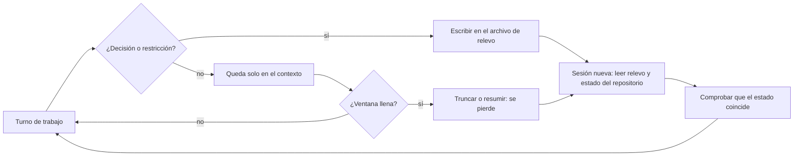
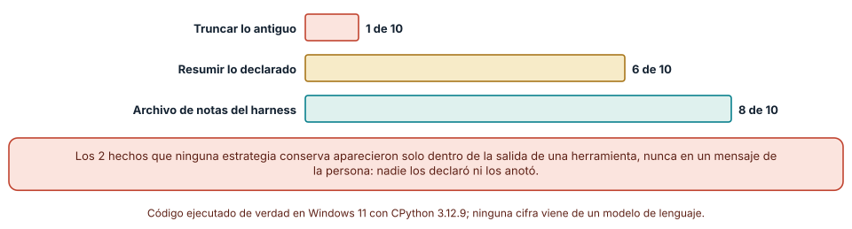

# SE-496 — Gestión de contexto, resets y handoffs

[← SE-495 — Herramientas, permisos y superficies de acción](../../classes/part-41-harness-y-agentic-engineering/se-495-herramientas-permisos-y-superficies-de-accion/README.md) · [↑ Parte 41](../../classes/part-41-harness-y-agentic-engineering/README.md) · [📚 Índice completo](../../classes/README.md) · [🌐 Portal](../../site/classes/SE-496.html) · [SE-497 — Loops de agentes y criterios de parada →](../../classes/part-41-harness-y-agentic-engineering/se-497-loops-de-agentes-y-criterios-de-parada/README.md)

## Punto profesional y fundamento pedagógico

**Punto profesional.** La clase existe para que trates el contexto de un agente como un recurso escaso que se administra, no como una memoria que se llena sola. Una sesión larga acumula decisiones, restricciones, salidas de herramientas y desvíos; la ventana de contexto es finita, y lo que no cabe se descarta, se resume o se pierde. La decisión profesional es qué debe sobrevivir a la sesión y *dónde* se escribe para que sobreviva: en el contexto (que se degrada), en un resumen (que pierde) o en un archivo del repositorio (que permanece). Quien no decide eso descubre la pérdida cuando el agente reabre una decisión que ya estaba tomada.

**Por qué aparece aquí.** Sigue a los permisos (`SE-495`) porque, acotado lo que el agente puede hacer, queda acotar lo que recuerda de lo que hizo. Precede a los bucles (`SE-497`), que son los que llenan el contexto.

**Error conceptual que debe corregir.** Creer que una ventana de contexto grande resuelve el problema. Una ventana mayor retrasa la pérdida, y la investigación sobre contextos largos muestra que el uso de la información no es uniforme: el rendimiento de los modelos suele ser mejor cuando lo relevante está al principio o al final del contexto y peor cuando está en medio. Anthropic llama a la degradación con el crecimiento del contexto *context rot*. Más espacio no es lo mismo que mejor uso.

**Secuencia de aprendizaje.** Antes de ejecutar, predices cuántos de diez hechos recordará un agente tras 120 turnos con tres estrategias y cuatro tamaños de ventana; después ejecutas el modelo, comparas, identificas los hechos que ninguna estrategia conserva y diseñas el relevo entre sesiones.

**Evidencia de aprendizaje.** `contexto-y-relevo.md` con una lista de lo que debe sobrevivir a la sesión, el lugar donde se escribe cada elemento, el formato del archivo de relevo y una verificación de que una sesión nueva puede continuar leyéndolo.

**Límite de la conclusión.** El experimento es un **modelo determinista**: 120 turnos de 400 fichas, diez hechos en turnos fijos y reglas explícitas sobre qué conserva cada estrategia. No mide la compactación de ningún producto ni el recuerdo de ningún modelo; los supuestos son del autor. No se invocó ningún modelo.

### Trazabilidad fuente → afirmación

| Fuente primaria u oficial | Afirmación que respalda | Lo que no prueba |
|---|---|---|
| [Anthropic, «Effective context engineering for AI agents»](https://www.anthropic.com/engineering/effective-context-engineering-for-ai-agents) | Define la ingeniería de contexto como gestionar qué fichas entran en la ventana y describe la degradación (*context rot*) y estrategias como la compactación y las notas externas. | No cuantifica la pérdida de un modelo concreto. |
| [Anthropic, «Effective harnesses for long-running agents»](https://www.anthropic.com/engineering/effective-harnesses-for-long-running-agents) | Describe agentes que trabajan en sesiones discretas sin memoria entre ellas y un relevo mediante artefactos en el repositorio. | Es la experiencia de un equipo con sus tareas. |
| [Liu et al., «Lost in the Middle»](https://aclanthology.org/2024.tacl-1.9/) | Muestra que los modelos de lenguaje usan peor la información situada en medio de un contexto largo. | No cubre todos los modelos ni los actuales. |
| [Python: `json`](https://docs.python.org/3/library/json.html) | Documenta el formato del estado que usa el relevo del ejemplo. | No define qué conviene guardar. |

## Antes de empezar

Recupera lo aprendido en `SE-495`: la superficie de acción de un agente se acota con herramientas y permisos. La pregunta activa es: **si cerraras hoy la sesión de tu agente en mitad de una tarea, ¿qué sabría la sesión de mañana de lo que se decidió esta tarde?**

## Prerrequisitos

- Haber completado `SE-493` a `SE-495` o conocer las piezas de un harness.
- Entender qué es una ventana de contexto y una ficha (*token*).
- Python 3.11 o posterior; el modelo de la clase usa solo la biblioteca estándar.

## Problema auténtico

Una tarea de migración dura tres horas. A la hora y media el agente y la persona deciden que la columna de fechas queda en UTC y que el servicio de envíos no se toca. A las dos horas y media, con la ventana casi llena, el producto compacta la conversación. Treinta minutos después, el agente propone cambiar el servicio de envíos «para simplificar». La decisión estaba tomada; el agente no la veía.

La clase modela ese deslizamiento con diez hechos repartidos en 120 turnos. Seis fueron decisiones declaradas por la persona; dos, restricciones dichas de pasada en un mensaje; dos aparecieron solo dentro de la salida de una herramienta. Se comparan tres estrategias: truncar lo antiguo, resumir lo declarado y escribir en un archivo de notas que mantiene el harness. El resultado muestra qué se pierde con cada una y por qué hay hechos que ninguna conserva.

## Objetivos observables

Al terminar podrás:

1. explicar por qué el contexto se degrada antes de llenarse y qué significa administrarlo;
2. comparar truncar, resumir y escribir notas externas según lo que cada una conserva y lo que cuesta;
3. diseñar un archivo de relevo con decisiones, restricciones, estado y siguiente paso, y la regla que obliga a actualizarlo;
4. verificar un relevo comprobando que una sesión nueva continúa sin reabrir lo decidido;
5. identificar qué información nunca llegó a ser explícita y por tanto no puede sobrevivir.

## Mapa conceptual



El mapa separa dos destinos para lo que ocurre en un turno: lo que se escribe fuera de la ventana sobrevive; lo que queda solo dentro se pierde cuando la ventana se llena. La verificación al reabrir (leer, comprobar el estado) evita continuar sobre un relevo desactualizado.

## Temas y por qué importan

| Tema | Por qué cambia una decisión profesional | Evidencia mínima |
|---|---|---|
| Contexto como recurso escaso | Hay que decidir qué ocupa la ventana. | Inventario de lo que entra en cada paso |
| Degradación con la longitud | Más contexto no es mejor contexto. | Referencias y una prueba propia de recuerdo |
| Truncar, resumir, anotar | Cada estrategia pierde cosas distintas. | Hechos recordados por estrategia |
| Archivo de relevo | Es lo único que una sesión nueva hereda. | Archivo con formato fijo |
| Verificación al reabrir | Un relevo viejo es peor que ninguno. | Estado comparado con el repositorio |
| Lo que nunca se dijo | Lo que no se escribe no se conserva. | Hechos solo presentes en salidas de herramientas |

## Conceptos y decisiones

### 1. Qué hay en la ventana

La ventana de contexto contiene, en cada paso, las instrucciones, las definiciones de las herramientas, el historial de mensajes y las observaciones acumuladas. Todo ocupa fichas y compite por atención. Anthropic define la ingeniería de contexto como la curaduría de ese conjunto de fichas en cada decisión de qué incluir. Una salida de herramienta de cien líneas de registro ocupa lo mismo que cien líneas de decisiones, y es mucho menos valiosa. El primer control es el más sencillo: que las herramientas devuelvan lo necesario y no más, y que el harness recorte salidas largas.

### 2. La degradación antes del límite

Hay dos efectos distintos. El primero es el límite duro: cuando la ventana se llena, algo debe salir. El segundo es la degradación gradual: incluso dentro del límite, el modelo usa peor la información a medida que el contexto crece, y peor la que está en medio que la que está al principio o al final, como mostraron Liu y colaboradores con tareas de recuperación en contextos largos. Anthropic lo llama *context rot*. Ninguno de los dos se arregla con una ventana mayor; ambos se mitigan con un contexto más corto y mejor ordenado.

### 3. Tres estrategias y lo que pierde cada una

**Truncar** descarta lo más antiguo: es lo más simple y pierde exactamente lo que se dijo primero, que suele ser el objetivo y las restricciones de la tarea. **Resumir** (compactar) sustituye lo antiguo por un texto breve: conserva lo que el resumen considera importante y pierde el resto; quien resume no sabe qué detalle será decisivo tres horas después. **Escribir notas** mueve lo importante a un archivo fuera de la ventana, que se relee cuando hace falta: conserva lo que se escribió y no depende de lo que el modelo decida resumir. El costo es disciplina: alguien (el agente, forzado por el harness) debe escribir cada decisión cuando ocurre.

### 4. El relevo entre sesiones

Anthropic describe el problema de los agentes que abarcan varias ventanas: cada sesión empieza sin memoria de la anterior, como un turno de ingenieros que llegan sin saber qué pasó en el anterior. Su solución es de entorno: un agente inicial prepara el repositorio y deja artefactos (una lista de funcionalidades con su estado, un registro de progreso, commits pequeños) y cada sesión siguiente hace un avance incremental y deja el entorno en un estado limpio. La lección transferible es que lo que sobrevive es lo que está en disco: notas, commits, pruebas.

### 5. Qué debe llevar un archivo de relevo

Un buen relevo es corto, estructurado y comprobable: objetivo vigente, decisiones tomadas con su razón, restricciones («no tocar el servicio de envíos»), estado (qué está hecho y verificado, qué no), siguiente paso concreto y cómo comprobar el estado (el comando de pruebas, el commit actual). La regla del harness que lo hace funcionar es doble: se actualiza cuando cambia una decisión y la sesión siguiente lo lee y comprueba que coincide con el repositorio antes de actuar. Un relevo que no se verifica puede estar desactualizado, y actuar sobre él es peor que empezar de cero.

### 6. Lo que nunca fue explícito

Los dos hechos que ninguna estrategia conserva en la figura siguiente aparecieron solo dentro de la salida de una herramienta: el agente los vio, nadie los declaró y nadie los anotó. Es el caso más difícil y el más común: una restricción descubierta en un mensaje de error o en un archivo de configuración. Una sola regla del harness mitiga esto: pedir al agente que anote en el relevo todo hallazgo que condicione decisiones futuras, y comprobarlo en la revisión.

## Hechos recordados según la estrategia

El modelo simula 120 turnos de 400 fichas cada uno (48 000 fichas en total) con diez hechos en los turnos 4, 14, 24, 34, 44, 54, 64, 74, 84 y 94. Seis son decisiones declaradas por la persona; dos fueron escritos en un mensaje sin declararlos y dos aparecen solo en una salida de herramienta. Truncar conserva lo que cabe en la ventana. Resumir ocupa 600 fichas y conserva los declarados. El archivo de notas ocupa 400 fichas y recoge todo lo escrito en un mensaje de la persona.


**Cómo leer la figura.** El eje horizontal es el tamaño de la ventana y el vertical, los hechos de 10 que se recuerdan tras 120 turnos; cada línea es una estrategia. Mira primero cómo truncar (coral) queda por debajo hasta que la ventana cabe toda la sesión y cómo el archivo de notas (verde) se mantiene arriba. **Dónde deja de valer:** son reglas de conservación definidas por el autor, no mediciones de un producto; un resumidor real puede conservar más o menos, y un agente real puede anotar menos de lo que la regla supone.



**Cómo leer la figura.** Es el corte de la tabla anterior en 12 000 fichas, una ventana que no cabe la sesión: las notas conservan 8 de 10, el resumen 6 y el truncado 1. Los dos que ninguna conserva son los de la salida de herramienta. **Dónde deja de valer:** la ventaja de las notas depende de que alguien las escriba en el momento; sin esa disciplina, la estrategia se reduce a truncar.


**Cómo leer la figura.** Seis cajas recorren el ciclo de una sesión con relevo: trabajar y anotar, llegar al límite, cambiar de sesión, leer, comprobar y continuar con una tarea pequeña. **Dónde deja de valer:** supone una tarea divisible en pasos pequeños; una tarea que no se puede dividir (un razonamiento largo y único) pierde más al cambiar de sesión.

## Definiciones de trabajo

- **Ventana de contexto:** conjunto de fichas que el modelo ve en una decisión.
- **Compactación:** sustituir parte del contexto por un resumen.
- **Archivo de relevo (handoff):** documento en disco con el estado necesario para continuar en otra sesión.
- **Degradación del contexto (*context rot*):** pérdida de precisión al crecer el contexto.
- **Decisión declarada:** decisión dicha de forma explícita y registrable.
- **Estado limpio:** estado del repositorio que se podría integrar sin sorpresas.

## Ejemplo mínimo

Un relevo mínimo en un archivo `RELEVO.md`:

```markdown
## Objetivo vigente
Migrar la columna de fechas del servicio Avisos a UTC.

## Decisiones (con razón)
- La columna queda en UTC: evita errores en el cambio de hora.
- No se toca el servicio de envíos: lo mantiene otro equipo.

## Estado
- Hecho y verificado: migración de la tabla (pruebas en verde).
- Pendiente: adaptar la consulta de recordatorios.

## Siguiente paso
Adaptar `consulta_recordatorios()` y ejecutar `python -m unittest`.
```

La sesión siguiente lee este archivo, ejecuta las pruebas para comprobar el estado y solo entonces empieza el siguiente paso.

## Ejemplo profesional

*Escenario ilustrativo: las cifras y los resultados que aparecen en este ejemplo son supuestos de la narración, no mediciones.*

El equipo adopta la regla de que ninguna sesión termina sin actualizar `RELEVO.md` y hacer un commit. El harness lo impone con una compuerta: el cierre se rechaza si el archivo no cambió desde el último commit con código. En las primeras semanas, las sesiones nuevas reabren menos decisiones; en una, el agente lee un relevo con un paso que ya estaba hecho y repite trabajo, porque el commit posterior no actualizó el archivo. Se añade la comprobación de estado: antes de actuar, la sesión ejecuta las pruebas y compara el estado con el declarado, y se detiene si no coinciden. La lección es que el relevo es un contrato con dos lados, escribir y verificar, y que uno sin el otro no sirve.

## Práctica guiada

1. Anota lo que debería sobrevivir al cierre de la sesión de tu agente en una tarea real de tres horas.
2. Escribe un archivo de relevo con las secciones del ejemplo y pídele a una persona que continúe la tarea solo con él.
3. Ejecuta `python scripts/experiments_part41_a.py 496` y compara las tres estrategias con tus predicciones.
4. Identifica un hecho que en tu tarea aparezca solo en la salida de una herramienta y decide cómo capturarlo.
5. Añade la comprobación de estado al inicio de la sesión.

## Ejercicios

1. **Básico.** Explica por qué con 48 000 fichas las tres estrategias conservan los diez hechos y qué cambia con 24 000.
2. **Intermedio.** Cambia en el modelo la capacidad del resumen para conservar también un hecho no declarado, y mide cuánto sube el recuerdo con 12 000 fichas.
3. **Avanzado.** Diseña una regla del harness que capture los hallazgos que aparecen solo en salidas de herramientas y describe su falso positivo principal (qué ruido añade).

## Reto verificable

Entrega `contexto-y-relevo.md` con: lo que debe sobrevivir, dónde se escribe cada elemento, un archivo de relevo real de una tarea tuya, la regla que obliga a actualizarlo y la comprobación de estado al reabrir. Es válido si otra persona continúa la tarea desde tu relevo sin reabrir ninguna decisión ya tomada.

## Caso conductor

Una migración de *Avisos* de tres horas es la tarea que dura más que una ventana. El relevo que se escribe aquí se carga como parte del contexto inicial del harness de `SE-504`, y su ausencia es uno de los fallos que se diagnostican en `SE-503`.

## Preguntas frecuentes

### ¿Una ventana de un millón de fichas elimina el problema?

Lo retrasa y no lo elimina. El costo y la latencia crecen con el contexto, y la investigación sobre contextos largos muestra un uso desigual de la información. Una ventana grande es un margen, no una política.

### ¿La compactación automática no hace esto por mí?

Hace una parte: resume lo que decide que es importante. No sabe qué restricción será decisiva más tarde, y es un resumen escrito por un modelo, con sus errores. Útil como red, insuficiente como único mecanismo.

### ¿Quién escribe las notas, el agente o la persona?

Las dos pueden. Lo importante es que el harness lo exija en puntos fijos (al tomar una decisión, al terminar una sesión) y que se verifique. Un relevo escrito solo cuando alguien se acuerda no sobrevive a la prisa.

### ¿Cuánto debe medir el archivo de relevo?

Lo suficiente para continuar y no más: cada línea se carga en cada sesión. Un relevo de dos páginas que nadie relee es peor que uno de veinte líneas verificado.

## Fallo controlado y diagnóstico

**Fallo.** Una sesión nueva lee un relevo que dice «pendiente: adaptar la consulta» y lo rehace. La consulta ya estaba adaptada y comprometida; la anterior sesión terminó sin actualizar el archivo.

**Diagnóstico paso a paso.** (1) El relevo era válido cuando se escribió y dejó de serlo al hacerse el commit. (2) Nada comparó el estado declarado con el del repositorio. (3) La sesión nueva confió en el archivo. (4) La causa es la ausencia de la verificación al reabrir.

**Corrección.** Se añade al inicio de cada sesión la comprobación de estado (ejecutar las pruebas y comparar con lo declarado) y a la compuerta de cierre la exigencia de actualizar el relevo. La lección es que un relevo es una afirmación sobre el repositorio y debe tratarse como tal: se comprueba.

## Errores comunes y cómo corregirlos

- **Confiar en la ventana grande.** Síntoma: el agente reabre decisiones. Causa: degradación y compactación. Corrección: relevo en disco.
- **Un relevo sin razón de las decisiones.** Síntoma: la sesión nueva las reabre porque no sabe por qué se tomaron. Corrección: registrar la razón.
- **Notas escritas al final.** Síntoma: se olvidan decisiones. Corrección: escribirlas cuando se toman.
- **Relevo que nadie verifica.** Síntoma: se repite trabajo. Corrección: comprobar el estado antes de actuar.
- **Salidas de herramienta sin recortar.** Síntoma: la ventana se llena de registro. Corrección: limitar lo que devuelven las herramientas.

## Entorno y archivos clave

- `scripts/experiments_part41_a.py`: modelo de contexto de la clase; se ejecuta con `python scripts/experiments_part41_a.py 496`.
- `RELEVO.md` (en el ejemplo): archivo de relevo del repositorio de trabajo.
- Solo la biblioteca estándar.

## Seguridad, ética y accesibilidad

Un archivo de relevo es contexto que se vuelve a cargar: no debe contener secretos ni datos personales, y su contenido debe tratarse como no confiable si lo puede editar alguien más (una instrucción dentro de él podría redirigir al agente). Ética: no guardes en notas de agentes datos de terceros sin base para ello. Las figuras son tablas, barras y diagramas con texto alternativo completo; ninguna información depende solo del color.

## Puente hacia el trabajo con agentes

Pide al agente que escriba el relevo, y comprueba tú que lo escribió: es una comprobación mecánica (el archivo cambió, tiene las secciones, el estado coincide con las pruebas). Al iniciar una sesión, pídele que lea el relevo, ejecute las pruebas y diga en una frase qué estado encontró antes de actuar. El patrón que falla es depender de la compactación automática: el agente continúa con la confianza de quien recuerda y con las lagunas de quien resumió.

## Transferencia

Toma una tarea tuya de más de una hora que hayas hecho con un agente y reconstruye lo que habría que escribir para que otra sesión la continuara. Cuenta cuántas decisiones solo existían en la conversación. Ese número es el riesgo que corre tu tarea cada vez que se cierra una sesión.

## Evaluación y evidencia

| Criterio | Evidencia aceptable | Rechazo |
|---|---|---|
| Inventario de lo que sobrevive | Lista con el lugar de cada elemento | «Todo queda en la conversación» |
| Relevo | Archivo con objetivo, decisiones con razón, estado y siguiente paso | Resumen libre |
| Verificación | Comprobación de estado al reabrir | «Se lee y se continúa» |
| Estrategia comparada | Hechos conservados por estrategia | Preferencia sin medida |
| Límite | Qué no captura el relevo | Silencio |

## Fuentes

- Anthropic. [«Effective context engineering for AI agents»](https://www.anthropic.com/engineering/effective-context-engineering-for-ai-agents).
- Anthropic. [«Effective harnesses for long-running agents»](https://www.anthropic.com/engineering/effective-harnesses-for-long-running-agents).
- Liu, N. F. et al. [«Lost in the Middle: How Language Models Use Long Contexts»](https://aclanthology.org/2024.tacl-1.9/).
- Python Software Foundation. [`json`](https://docs.python.org/3/library/json.html).

## Límites y siguiente paso

El modelo simula 120 turnos con diez hechos en posiciones fijas y reglas de conservación del autor, en Windows 11 con CPython 3.12.9. No se midió la compactación de ningún producto, el recuerdo de ningún modelo ni un relevo real con una persona distinta de quien lo escribió. El siguiente paso, `SE-497`, trata el bucle que llena el contexto: cuándo seguir intentando y cuándo parar.

## Glosario

| Término | Definición breve |
|---|---|
| Ventana de contexto | Fichas que el modelo ve al decidir |
| Compactación | Sustituir parte del contexto por un resumen |
| Archivo de relevo | Estado en disco para continuar en otra sesión |
| Context rot | Pérdida de precisión al crecer el contexto |
| Decisión declarada | Decisión dicha de forma explícita |
| Estado limpio | Estado integrable sin sorpresas |
