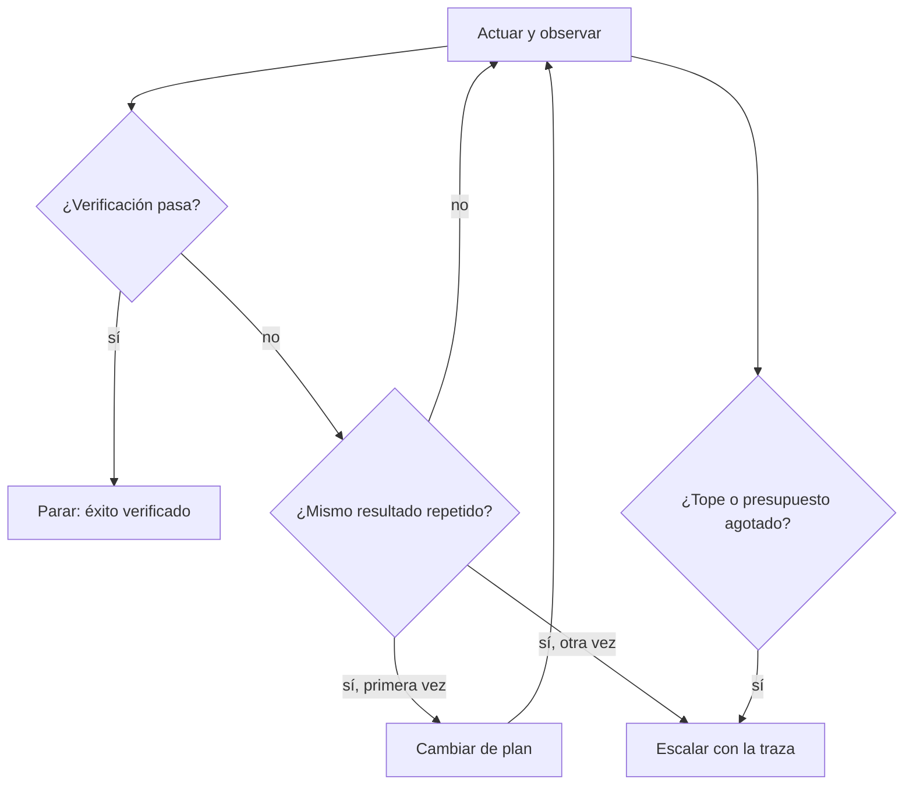
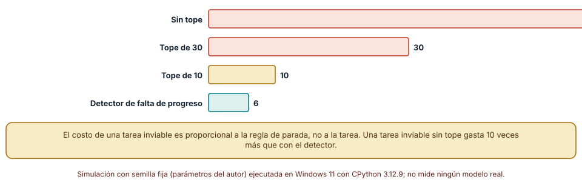
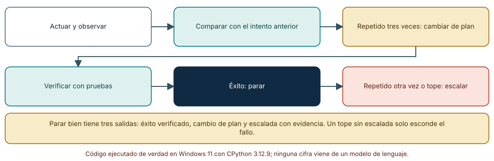

# SE-497 — Loops de agentes y criterios de parada

[← SE-496 — Gestión de contexto, resets y handoffs](../../classes/part-41-harness-y-agentic-engineering/se-496-gestion-de-contexto-resets-y-handoffs/README.md) · [↑ Parte 41](../../classes/part-41-harness-y-agentic-engineering/README.md) · [📚 Índice completo](../../classes/README.md) · [🌐 Portal](../../site/classes/SE-497.html) · [SE-498 — Sandboxes, reversibilidad y control de daño →](../../classes/part-41-harness-y-agentic-engineering/se-498-sandboxes-reversibilidad-y-control-de-dano/README.md)

## Punto profesional y fundamento pedagógico

**Punto profesional.** La clase existe para que diseñes cuándo un agente debe seguir intentando y cuándo debe detenerse. Un agente corre en un bucle y cada vuelta cuesta dinero, tiempo y riesgo. Parar demasiado pronto abandona trabajo que se habría resuelto; parar demasiado tarde gasta presupuesto en tareas inviables y, peor, deja que el agente pruebe cosas cada vez más desesperadas. La decisión profesional es una **regla de parada con tres salidas**: éxito verificado, cambio de plan cuando no hay progreso y escalada a una persona con la evidencia. Un tope de pasos solo es una de las piezas, y la más tosca.

**Por qué aparece aquí.** Sigue al contexto (`SE-496`) porque el bucle es lo que lo llena y lo que decide si la sesión se alarga. Precede a los sandboxes (`SE-498`): un bucle sin parada con permisos amplios es el escenario que los sandboxes están pensados para contener.

**Error conceptual que debe corregir.** Creer que un tope de iteraciones es una regla de parada suficiente. El tope limita el daño y no distingue una tarea que casi sale de otra que nunca saldrá: en la simulación de la clase, con un tope de 10 se resuelve prácticamente lo mismo que sin tope (68,8 % frente a 69,9 %), a una cuarta parte del costo, y un detector de falta de progreso con cambio de plan llega a 77,0 % con 3,5 iteraciones medias.

**Secuencia de aprendizaje.** Antes de ejecutar, predices qué regla de parada resuelve más tareas y cuál gasta menos en las inviables; después simulas cinco reglas sobre 4 000 tareas con semilla fija, comparas y diseñas la regla de tu harness con sus tres salidas.

**Evidencia de aprendizaje.** `reglas-de-parada.md` con las reglas de tu harness, qué señal detecta la falta de progreso, qué hace el cambio de plan, cuándo escala y qué información entrega al escalar.

**Límite de la conclusión.** La población de tareas (70 % reintentables con probabilidad 0,35 por intento, 15 % que exigen cambiar de plan, 15 % inviables) y las probabilidades son supuestos del autor. La simulación muestra el mecanismo y el orden de magnitud del compromiso, no las tasas de un agente real. No se invocó ningún modelo.

### Trazabilidad fuente → afirmación

| Fuente primaria u oficial | Afirmación que respalda | Lo que no prueba |
|---|---|---|
| [Anthropic, «Building effective agents»](https://www.anthropic.com/engineering/building-effective-agents) | Señala que la autonomía de los agentes implica costos y posibilidad de errores acumulados, y recomienda condiciones de parada y puntos de control humano. | No cuantifica un tope adecuado. |
| [Yao et al., «ReAct»](https://arxiv.org/abs/2210.03629) | Presenta el bucle de acción y observación que se detiene al resolver o agotar un límite de pasos. | No estudia la falta de progreso. |
| [Anthropic, «Effective harnesses for long-running agents»](https://www.anthropic.com/engineering/effective-harnesses-for-long-running-agents) | Describe agentes que declaran el trabajo terminado prematuramente y otros que intentan abarcar demasiado en una sesión. | No mide una regla de parada. |
| [Jimenez et al., «SWE-bench»](https://arxiv.org/abs/2310.06770) | Muestra una referencia de tareas reales de repositorios donde los agentes se evalúan por resolución, no por pasos. | No fija reglas de parada. |
| [Python: `random`](https://docs.python.org/3/library/random.html) | Documenta el generador con semilla usado por la simulación. | No valida los parámetros. |

## Antes de empezar

Recupera lo aprendido en `SE-496`: el bucle llena el contexto y lo que no está escrito se pierde. La pregunta activa es: **¿cuántas vueltas dio la última vez que un agente tuyo estuvo «atascado», y quién lo notó primero, tú o el presupuesto?**

## Prerrequisitos

- Haber completado `SE-493` a `SE-496`.
- Conocer probabilidad básica: qué es un intento independiente y qué es una media.
- Python 3.11 o posterior; la simulación usa solo la biblioteca estándar.

## Problema auténtico

Un agente intenta corregir una prueba que falla. Prueba un cambio, la prueba sigue fallando con el mismo error, prueba una variante del mismo cambio, vuelve a fallar con el mismo error. Al cuarto intento el agente reformula el comentario del código. Al décimo, desactiva la prueba. Nadie lo detuvo, y cada vuelta costó lo mismo que la primera.

La clase simula ese comportamiento con tres tipos de tareas: las que se resuelven reintentando, las que solo se resuelven si el agente cambia de enfoque y las inviables. Cinco reglas de parada se comparan sobre 4 000 tareas por la proporción resuelta y por lo que gastan. El resultado más instructivo no es el tope óptimo, sino que la regla que mira *si hay progreso* es mejor en todo que la que cuenta *cuántas vueltas*.

## Objetivos observables

Al terminar podrás:

1. distinguir los criterios de parada (tope, presupuesto, falta de progreso, éxito verificado) y lo que cada uno protege;
2. definir una señal de falta de progreso concreta y computable (por ejemplo, el mismo error tres veces seguidas);
3. diseñar la salida de «cambiar de plan» y la de «escalar con evidencia»;
4. comparar reglas con una simulación de semilla fija y leer el compromiso entre tareas resueltas y costo;
5. explicar por qué un tope sin escalada esconde el fallo.

## Mapa conceptual



El diagrama tiene tres salidas: éxito, escalada por falta de progreso persistente y escalada por tope. El cambio de plan es una vuelta del bucle, no una salida; ocurre una sola vez antes de escalar.

## Temas y por qué importan

| Tema | Por qué cambia una decisión profesional | Evidencia mínima |
|---|---|---|
| Costo de un bucle | Cada vuelta cuesta fichas, tiempo y riesgo. | Costo por tarea y por tarea inviable |
| Tope de iteraciones | Limita el daño pero no distingue casi resuelto de inviable. | Resueltas y costo con distintos topes |
| Presupuesto | Acota el costo real, no el número de vueltas. | Un presupuesto en fichas o en tiempo |
| Falta de progreso | Detecta el atasco mirando resultados, no vueltas. | Una señal computable |
| Cambio de plan | Convierte un atasco en una oportunidad. | Qué cambia el agente al cambiar |
| Escalada | El fallo llega a una persona con evidencia. | Contenido del informe de escalada |

## Conceptos y decisiones

### 1. Cada vuelta cuesta

Un agente de código que itera sobre una tarea consume fichas de entrada y salida, ejecuta herramientas y, si tiene permisos amplios, produce efectos. Anthropic señala que la autonomía de un agente implica costos más altos y la posibilidad de que los errores se acumulen, y recomienda probarlos en entornos acotados y con salvaguardas. La conclusión práctica es que el bucle debe tener límites explícitos desde el diseño y no a posteriori, cuando una factura o un incidente lo exigen.

### 2. Tope de iteraciones: protección, no inteligencia

El tope es la regla más simple y es una protección útil: garantiza que el costo máximo por tarea es finito. Su defecto es que no usa información: trata igual a la tarea que lleva nueve intentos con mejoras visibles que a la que lleva nueve intentos con el mismo error. En la simulación, pasar de sin tope (60 vueltas técnicas) a un tope de 10 baja la resolución solo de 69,9 % a 68,8 %, y el costo medio de 20,1 a 5,0 vueltas. Un tope de 30 gasta más de dos veces lo del de 10 para ganar 0,4 puntos. Es decir, en esta población la mayoría de lo que se resuelve se resuelve pronto, y el costo de insistir se va en lo inviable.

### 3. Falta de progreso: la señal que sí usa información

Un detector de falta de progreso mira si el resultado cambia. La señal más simple es repetir la misma observación (el mismo mensaje de error, la misma salida de las pruebas) varias veces seguidas. En el modelo se usa tres. No requiere entender la tarea y detecta el atasco típico del agente que reintenta lo mismo con variaciones superficiales. Sus fallos son dos: la falsa alarma (dos errores distintos con el mismo mensaje genérico) y la omisión (un agente que alterna entre dos errores y nunca repite el mismo tres veces). Se mejora con una señal más fina (por ejemplo, el conjunto de pruebas que fallan), siempre con un costo de diseño.

### 4. Cambiar de plan antes de rendirse

Cuando se detecta la falta de progreso, la primera respuesta no es escalar sino forzar un cambio de enfoque: reiniciar el contexto de la subtarea, pedir un plan alternativo, volver a leer el código desde cero. En la simulación, las tareas del segundo tipo (15 %) solo se resuelven si el agente cambia de plan. Con la regla de progreso, el cambio ocurre una vez; si tras él el resultado se repite otras tres veces, se escala. Esta secuencia explica los 7 puntos de diferencia entre 77,0 % y 69,9 %: no es que el detector sea más persistente, es que cambia lo que el agente hace cuando se atasca.

### 5. Escalar con evidencia

Escalar no es rendirse sin más: es entregar la tarea a una persona con lo necesario para decidir. Un informe útil incluye el objetivo, lo intentado (con la traza), el último resultado, la hipótesis y lo que se necesita. Un tope que simplemente corta deja al equipo con una tarea fallida y sin pistas, y el costo del siguiente intento (humano o de agente) vuelve a empezar de cero. En el ejemplo mínimo de la clase la traza completa acompaña a la salida del bucle.

### 6. Parada y verificación no son lo mismo

La parada por éxito requiere verificación (`SE-499`): un agente que declara «terminado» sin pruebas en verde ha parado mal, aunque el bucle haya terminado. Las reglas de esta clase acotan el costo; la verificación decide si el resultado cuenta. Las dos juntas definen el contrato del bucle: o termina con evidencia de éxito, o termina con evidencia de fallo.

## Cinco reglas sobre 4 000 tareas

Cada tarea es de uno de tres tipos con probabilidades fijas. Cada vuelta cuenta una iteración; la semilla es 497.


**Cómo leer la figura.** Cada fila es una regla; las columnas son el porcentaje de tareas resueltas, las iteraciones medias por tarea y las iteraciones que se gastan, en media, en las tareas inviables. La regla de progreso gana en las tres columnas. **Dónde deja de valer:** los tipos de tarea y sus probabilidades son del autor; con otra mezcla, la ventaja del detector cambia. La regla combinada con el tope de 10 coincide con la del detector solo porque, en este modelo, el detector siempre para antes de 10.



**Cómo leer la figura.** Cada barra es lo que gasta una tarea inviable bajo cada regla. Sin tope el gasto es el límite técnico; con tope, el tope; con el detector, seis vueltas (tres, cambio de plan, tres). **Dónde deja de valer:** las tareas inviables no se conocen de antemano en la práctica; la figura mide el gasto cuando ya se sabe que no hay solución, que es la única forma de ver el costo puro de insistir.



**Cómo leer la figura.** Seis cajas muestran el bucle con sus salidas: verificar y parar con éxito, cambiar de plan al detectar repetición, escalar con el rastro si persiste o si se agota el tope. **Dónde deja de valer:** supone que la repetición del resultado es observable; si las salidas varían por ruido (mensajes con marcas de tiempo), la comparación debe normalizarlas o el detector no se activa.

## Definiciones de trabajo

- **Tope de iteraciones:** número máximo de vueltas del bucle.
- **Presupuesto:** límite de costo (fichas, tiempo, dinero) del bucle.
- **Falta de progreso:** repetición del mismo resultado sin mejora observable.
- **Cambio de plan:** alteración deliberada del enfoque tras detectar falta de progreso.
- **Escalada:** entrega de la tarea a una persona con la evidencia necesaria.
- **Criterio de parada:** condición que termina el bucle.

## Ejemplo mínimo

El detector de falta de progreso en seis líneas:

```python
def sin_progreso(observaciones: list[str], n: int = 3) -> bool:
    """True si las últimas n observaciones son idénticas."""
    return len(observaciones) >= n and len(set(observaciones[-n:])) == 1
```

Con `["FAIL a", "FAIL a", "FAIL a"]` devuelve `True`; con `["FAIL a", "FAIL b", "FAIL a"]` devuelve `False`, aunque el agente esté oscilando. Ese caso es la omisión del detector y se resuelve afinando la señal, no ignorándola.

## Ejemplo profesional

*Escenario ilustrativo: las cifras y los resultados que aparecen en este ejemplo son supuestos de la narración, no mediciones.*

El equipo ejecuta el asistente sobre una lista de cuarenta tareas de mantenimiento durante la noche con un tope de 30 vueltas. Por la mañana, once tareas terminaron en el tope y el informe dice solo «tope alcanzado». Revisando las trazas, nueve de ellas repetían el mismo error desde la vuelta cinco. Se añade el detector con cambio de plan y escalada que entrega, para cada tarea que no se resuelve, el objetivo, los tres últimos intentos y el último error. En la siguiente noche, el número de tareas sin resolver es parecido, pero el gasto baja y la mañana empieza con una lista que se puede leer. La lección: la mejora no estuvo en resolver más, sino en fallar mejor.

## Práctica guiada

1. Revisa la traza de una tarea que tu agente no resolvió y marca en qué vuelta se repitió por primera vez el mismo resultado.
2. Escribe tu detector de falta de progreso con la señal que mejor se ajuste a tu harness.
3. Ejecuta `python scripts/experiments_part41_a.py 497` y modifica la mezcla de tareas para ver cómo cambia la ventaja del detector.
4. Define el contenido del informe de escalada.
5. Decide el tope y el presupuesto como protección final, no como regla principal.

## Ejercicios

1. **Básico.** Explica por qué un tope de 30 gasta 11,2 iteraciones medias y uno de 10 gasta 5,0 si resuelven casi lo mismo.
2. **Intermedio.** Cambia en la simulación el umbral de falta de progreso de 3 a 2 y de 3 a 5, y describe el efecto en resueltas y costo.
3. **Avanzado.** Diseña una señal de progreso para un agente que alterna entre dos errores distintos y justifica su falso positivo.

## Reto verificable

Entrega `reglas-de-parada.md` con: la regla de parada con sus tres salidas, la señal de falta de progreso con su umbral, el contenido del informe de escalada, el tope y el presupuesto de protección, y la tabla de una simulación propia con al menos tres reglas. Es válido si otra persona reproduce tu tabla con tu semilla.

## Caso conductor

Las tareas nocturnas de mantenimiento de *Avisos* son el caso: una lista larga ejecutada sin supervisión. La regla de parada con escalada forma parte del harness de `SE-504`, y el fallo «la parada no se respeta» es uno de los seis que se diagnostican en `SE-503`.

## Preguntas frecuentes

### ¿Por qué no simplemente un tope bajo?

Un tope bajo corta también las tareas que sí tenían solución con más intentos, y no distingue entre un agente que mejora y uno que se repite. Es una protección, no una regla.

### ¿Cómo sé que dos resultados son «el mismo»?

Hay que normalizarlos: quitar marcas de tiempo, rutas temporales y números de línea que cambian sin cambiar el error. Sin normalizar, el detector nunca se activa; con una normalización agresiva, se activa de más.

### ¿El agente puede decidir por sí mismo cuándo parar?

Puede proponerlo, y no debe ser la única condición. Un agente puede declarar terminada una tarea que no lo está o seguir intentando algo que no sale. La parada se decide en el harness con señales que no dependen de la opinión del agente.

### ¿Qué hago con la tarea inviable?

Escalarla con evidencia y, si el patrón se repite, preguntarte si la especificación es la que falla (`SE-481` a `SE-492`).

## Fallo controlado y diagnóstico

**Fallo.** El detector no se activa y un agente gasta 40 vueltas en una tarea. Las observaciones eran errores casi idénticos.

**Diagnóstico paso a paso.** (1) Las observaciones eran el mismo error con una marca de tiempo distinta. (2) El detector compara cadenas exactas. (3) Nunca vio tres iguales. (4) La causa es la falta de normalización.

**Corrección.** Se normalizan las observaciones antes de comparar (se eliminan marcas de tiempo y rutas variables) y se añade el caso a la regresión del detector. La lección es que una señal computable necesita casos de prueba como cualquier regla (`SE-494`).

## Errores comunes y cómo corregirlos

- **Solo un tope.** Síntoma: costos altos en tareas inviables. Corrección: añadir detección de falta de progreso.
- **Parar sin escalar.** Síntoma: tareas fallidas sin pistas. Corrección: entregar la traza y la hipótesis.
- **Comparar salidas sin normalizar.** Síntoma: el detector no se activa. Corrección: normalizar.
- **Dejar que el agente decida cuándo parar.** Síntoma: terminaciones en falso. Corrección: parada decidida por el harness.
- **Cambiar de plan indefinidamente.** Síntoma: bucles disfrazados. Corrección: un cambio por tarea y luego escalar.

## Entorno y archivos clave

- `scripts/experiments_part41_a.py`: simulación de reglas de parada; se ejecuta con `python scripts/experiments_part41_a.py 497`.
- Semilla fija 497; 4 000 tareas por regla.
- Solo la biblioteca estándar.

## Seguridad, ética y accesibilidad

Un bucle sin parada con permisos amplios es un riesgo de daño y de costo: la parada es un control de seguridad, no de comodidad. El informe de escalada no debe incluir secretos de las trazas. Ética: las tareas nocturnas sin supervisión trasladan la responsabilidad a quien las lanzó; documenta qué puede hacer el agente sin nadie mirando. Las figuras son tablas, barras y diagramas con texto alternativo completo; ninguna información depende solo del color.

## Puente hacia el trabajo con agentes

Pide al agente que informe, en cada vuelta, qué cambió respecto de la anterior; si responde «nada» dos veces, es la señal que el harness debería detectar sin preguntar. Al delegar una tarea larga, fija el tope y el presupuesto por escrito, define qué entrega al escalar y exige que el cierre incluya el resultado de la verificación. El patrón que falla es dejar al agente «hasta que termine»: termina cuando se acaba el presupuesto o cuando se convence de que terminó.

## Transferencia

Toma las trazas de tus últimas veinte tareas con agente, marca en cuántas hubo repetición del mismo resultado y en qué vuelta empezó, y calcula cuántas vueltas habrías ahorrado con una regla de tres repeticiones. Ese cálculo es tu estimación real, y es mejor que cualquier simulación ajena.

## Evaluación y evidencia

| Criterio | Evidencia aceptable | Rechazo |
|---|---|---|
| Tres salidas | Éxito, cambio de plan y escalada definidos | Solo un tope |
| Señal de progreso | Computable y con casos de prueba | «El agente lo nota» |
| Informe de escalada | Contenido concreto | «Falló» |
| Simulación | Tabla reproducible con semilla | Un número sin método |
| Límites | Supuestos de la mezcla declarados | Presentar tasas como reales |

## Fuentes

- Anthropic. [«Building effective agents»](https://www.anthropic.com/engineering/building-effective-agents).
- Yao, S. et al. [«ReAct: Synergizing Reasoning and Acting in Language Models»](https://arxiv.org/abs/2210.03629).
- Anthropic. [«Effective harnesses for long-running agents»](https://www.anthropic.com/engineering/effective-harnesses-for-long-running-agents).
- Jimenez, C. E. et al. [«SWE-bench»](https://arxiv.org/abs/2310.06770).
- Python Software Foundation. [`random`](https://docs.python.org/3/library/random.html).

## Límites y siguiente paso

Se simularon cinco reglas sobre 4 000 tareas sintéticas con parámetros del autor y semilla 497, en Windows 11 con CPython 3.12.9. No se midió ningún agente real, ni el costo en dinero, ni el efecto de cambiar de plan en un modelo concreto. El siguiente paso, `SE-498`, trata lo que ocurre cuando, pese a las reglas, el agente hace algo dañino: cómo se acota y se deshace.

## Glosario

| Término | Definición breve |
|---|---|
| Tope de iteraciones | Máximo de vueltas del bucle |
| Presupuesto | Límite de costo del bucle |
| Falta de progreso | Resultado repetido sin mejora |
| Cambio de plan | Alterar el enfoque tras un atasco |
| Escalada | Entregar la tarea a una persona con evidencia |
| Criterio de parada | Condición que termina el bucle |
