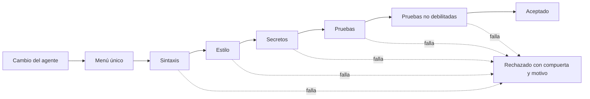
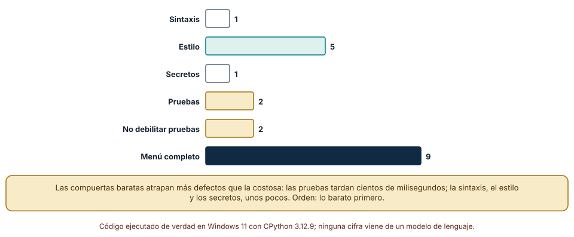

# SE-499 — Verificación, gates y menú único de validación

[← SE-498 — Sandboxes, reversibilidad y control de daño](../../classes/part-41-harness-y-agentic-engineering/se-498-sandboxes-reversibilidad-y-control-de-dano/README.md) · [↑ Parte 41](../../classes/part-41-harness-y-agentic-engineering/README.md) · [📚 Índice completo](../../classes/README.md) · [🌐 Portal](../../site/classes/SE-499.html) · [SE-500 — Multiagente y coordinación dentro del harness →](../../classes/part-41-harness-y-agentic-engineering/se-500-multiagente-y-coordinacion-dentro-del-harness/README.md)

## Punto profesional y fundamento pedagógico

**Punto profesional.** La clase existe para que conviertas «terminado» en un estado que un programa puede afirmar o negar. En un harness, la **verificación** es la pieza que decide si el trabajo del agente cuenta. Una **compuerta** (*gate*) es una comprobación obligatoria y automática (sintaxis, estilo, secretos, pruebas); un **menú único de validación** es un solo punto de entrada que ejecuta todas las compuertas en el mismo orden para el agente, para la persona y para la integración continua. La decisión profesional es qué compuertas existen, en qué orden corren, qué detectan y qué dejan pasar, y asegurar que nadie (ni el agente) pueda declarar terminado un cambio sin pasarlas.

**Por qué aparece aquí.** Sigue al control de daño (`SE-498`): impedir y deshacer limitan el costo de un error; la verificación decide si el cambio se acepta. Reúne lo de la Parte 40: las pruebas, los contratos y las evaluaciones son los oráculos; el menú es el lugar donde se ejecutan.

**Error conceptual que debe corregir.** Creer que «las pruebas pasan» equivale a «el cambio es correcto». En el conjunto de la clase, las pruebas solas atrapan 2 de 11 defectos; un menú con cinco compuertas atrapa 9, y los dos restantes (un error que ninguna prueba ejerce y una prueba que replica el error) no los atrapa ninguna. Las pruebas son una compuerta, y además pueden ser manipuladas por quien también escribe el código.

**Secuencia de aprendizaje.** Antes de ejecutar, predices qué compuerta atrapa cada uno de once defectos; después ejecutas el menú sobre doce cambios, comparas con ejecutar solo las pruebas, ordenas las compuertas por costo y escribes el menú único de tu proyecto.

**Evidencia de aprendizaje.** `menu-de-validacion.md` con el comando único, las compuertas en orden con lo que detecta cada una, una tabla de defectos conocidos con la compuerta que los atrapa, y la lista de lo que el menú no ve.

**Límite de la conclusión.** Los doce cambios y las cinco compuertas son del autor, sobre un módulo de siete líneas. Las cifras (9 de 11, 2 de 11) describen este conjunto. Los tiempos se midieron en un equipo concreto y varían. No se evaluó ninguna herramienta de integración continua real ni se invocó un modelo.

### Trazabilidad fuente → afirmación

| Fuente primaria u oficial | Afirmación que respalda | Lo que no prueba |
|---|---|---|
| [Böckeler, «Harness engineering»](https://martinfowler.com/articles/exploring-gen-ai/harness-engineering.html) | Distingue sensores computacionales (rápidos y deterministas) de inferenciales, y recomienda ubicar los controles lo más temprano posible. | No cuantifica cuántos defectos atrapan. |
| [Anthropic, «Effective harnesses for long-running agents»](https://www.anthropic.com/engineering/effective-harnesses-for-long-running-agents) | Describe agentes que declaran terminado el trabajo sin verificarlo de extremo a extremo y la necesidad de pruebas explícitas por funcionalidad. | Es la experiencia de un equipo. |
| [Claude Code: hooks](https://code.claude.com/docs/en/hooks) | Documenta hooks que se ejecutan antes y después de usar herramientas y al terminar una respuesta, y pueden bloquear. | Describe un producto. |
| [Python: `unittest`](https://docs.python.org/3/library/unittest.html) y [`ast`](https://docs.python.org/3/library/ast.html) | Documentan las herramientas usadas por las compuertas del laboratorio. | No validan la elección de compuertas. |

## Antes de empezar

Recupera lo aprendido en `SE-494`: una regla mecánica es exacta en lo que describe y ciega a lo que se escribe de otra forma. La pregunta activa es: **cuando el agente dice «listo», ¿qué comando ejecutaste tú para creerle y es el mismo que ejecuta la integración continua?**

## Prerrequisitos

- Haber completado `SE-493` a `SE-498`.
- Saber escribir y ejecutar pruebas con `unittest` y leer un código de salida.
- Python 3.11 o posterior; solo la biblioteca estándar.

## Problema auténtico

El agente entrega un cambio y dice que las pruebas pasan. La persona que revisa ejecuta un comando distinto del que usó el agente, y la integración continua ejecuta un tercero. En un caso, el cambio incluía un secreto literal que ninguna prueba ve; en otro, una prueba que fallaba había sido marcada como omitida; en otro, la lógica era errónea y la prueba que la habría atrapado se había borrado en el mismo cambio. Cada revisión aprobó lo que veía.

La clase pone doce cambios (once con un defecto, uno correcto) frente a cinco compuertas y las compara con ejecutar solo las pruebas. Muestra qué defecto atrapa cada compuerta, cuál es el único que ninguna atrapa y por qué importa que el agente ejecute exactamente el mismo menú que la integración.

## Objetivos observables

Al terminar podrás:

1. definir compuertas con un criterio de paso o fallo que un programa decide;
2. ordenarlas de la más barata a la más cara y justificar el orden;
3. escribir un menú único que ejecute las compuertas, se detenga al primer fallo e imprima la compuerta y el motivo;
4. diseñar una compuerta contra la manipulación de las pruebas (debilitarlas, omitirlas, borrarlas);
5. declarar lo que el menú no ve y por qué una prueba que replica un error es el límite.

## Mapa conceptual



El menú es una cadena ordenada: lo barato primero, lo caro después. Cada compuerta puede rechazar, y el rechazo nombra qué compuerta y por qué.

## Temas y por qué importan

| Tema | Por qué cambia una decisión profesional | Evidencia mínima |
|---|---|---|
| Qué es una compuerta | Un criterio automático convierte una opinión en un resultado. | Criterio de paso o fallo escrito |
| Menú único | Quita la divergencia entre lo que corre el agente, la persona y la integración. | Un comando |
| Orden por costo | Lo barato detecta más defectos y evita lo caro. | Tiempo por compuerta |
| Pruebas como compuerta | Detectan lo que ejercen, no más. | Defectos atrapados por las pruebas solas |
| Manipulación de pruebas | Quien escribe el código puede debilitar la prueba. | Compuerta que lo detecta |
| Límite del menú | Hay defectos que ninguna compuerta ve. | Defectos que escapan |

## Conceptos y decisiones

### 1. Una compuerta es un criterio ejecutable

Una compuerta tiene un criterio de paso o fallo que no depende de opinión: «el código compila», «el linter no reporta problemas», «no hay cadenas con forma de secreto», «las pruebas pasan». Böckeler llama controles computacionales a los que son deterministas y baratos, y los distingue de los inferenciales (un modelo que revisa), más ricos y menos fiables. Lo que define a una compuerta es que su veredicto sea reproducible: con el mismo cambio, el mismo resultado.

### 2. El menú único

El agente, la persona y la integración continua deben ejecutar exactamente las mismas compuertas con el mismo comando. Si cada cual ejecuta un subconjunto, un cambio puede pasar en la máquina del agente y fallar en integración, o lo contrario, y la confianza en «pasa» se erosiona. El menú es un script con un único punto de entrada (`python scripts/check.py`, `make check`) que lista las compuertas en orden, se detiene en la primera que falla, imprime su nombre y el motivo, y devuelve un código de salida que decide. El archivo de instrucciones (`SE-494`) incluye ese comando como el único que cuenta antes de declarar terminado.

### 3. Orden por costo

Las compuertas baratas detectan muchos defectos con poco costo. En el experimento, la compuerta de estilo (microsegundos a un milisegundo) atrapa 5 de los 11 defectos; las pruebas, que tardan cientos de milisegundos en un módulo de siete líneas, atrapan 2. Ordenar de barato a caro y detenerse en el primer fallo ahorra el costo de las compuertas caras en los cambios que ya fallaron, y da retroalimentación en el menor tiempo al agente. En un proyecto real, las pruebas de integración o de extremo a extremo que tardan minutos van al final y a veces solo en la integración.

### 4. Lo que las pruebas solas no atrapan

Las pruebas atrapan lo que ejercen. En el experimento solo dos defectos (el error de sintaxis, que rompe la importación, y el error de lógica que una prueba ve) son atrapados por las pruebas. Los demás son de otra naturaleza: una importación sin usar, un `except` sin tipo, un argumento mutable, una impresión de depuración, un secreto literal. Todos pasan las pruebas y todos atrapa alguna compuerta barata. La consecuencia es que «las pruebas pasan» es una compuerta, no la compuerta.

### 5. La manipulación de las pruebas

Un agente que escribe el código y las pruebas en el mismo paso puede, sin mala intención, resolver un fallo debilitando la prueba: quitar una aserción, marcarla como omitida, borrar el caso. Dos de los defectos del experimento son de ese tipo, y las pruebas, por definición, pasan en ambos. La compuerta que los atrapa compara con la versión anterior: el número de aserciones no puede bajar y no pueden aparecer marcas de omisión sin justificación. Es una compuerta de *meta-verificación*: no prueba el código, prueba que la prueba no se debilitó. Se refuerza con la protección de escritura de los archivos de prueba en el harness (`SE-504`).

### 6. Lo que ningún menú ve

Dos defectos escapan: un error de lógica en una rama que ninguna prueba ejerce (la rama con más de 50 elementos) y una prueba que replica el error (el valor esperado se cambió a 20,0 para coincidir con el código incorrecto). El primero se mitiga con cobertura y con pruebas basadas en propiedades; el segundo, con una fuente independiente del oráculo (una especificación, una revisión humana, una evaluación de otro tipo, `SE-481`). Declarar este límite es parte del menú: dice qué garantiza («lo que verificó») y no dice más.

## Doce cambios, cinco compuertas

El módulo tiene dos funciones (`fee` y `total`) y su archivo de pruebas tiene dos casos con tres aserciones. Cada cambio modifica el código, las pruebas o ambos. Las compuertas se ejecutan en el orden de la figura del menú.


**Cómo leer la figura.** Cada fila es un cambio defectuoso; la segunda columna dice qué compuerta lo atrapa y la tercera si bastaban las pruebas. Las cuatro filas con «no» muestran defectos que pasan una verificación hecha solo con pruebas. **Dónde deja de valer:** son once defectos del autor sobre siete líneas de código; la proporción de defectos reales que atrapa cada compuerta en un proyecto distinto es otra.



**Cómo leer la figura.** Las primeras cinco barras son lo que atrapa cada compuerta; la última, la unión (9). Los totales por compuerta suman más de 9 porque un defecto puede ser atrapado por varias (el error de sintaxis, por tres). **Dónde deja de valer:** el conteo no pondera la gravedad: un secreto filtrado y una impresión de depuración cuentan igual.


**Cómo leer la figura.** El menú es un solo comando compartido; el orden va de lo barato a lo caro y el primer fallo detiene todo con un mensaje que nombra la compuerta. **Dónde deja de valer:** en un proyecto grande el menú completo puede tardar demasiado para ejecutarse en cada cambio; entonces se divide en un menú rápido (local) y uno completo (integración), y debe declararse cuál garantiza qué.

## Definiciones de trabajo

- **Compuerta (gate):** comprobación automática con veredicto de paso o fallo.
- **Menú único:** punto de entrada que ejecuta todas las compuertas en orden.
- **Fallo temprano (*fail fast*):** detener el menú en la primera compuerta que falla.
- **Meta-verificación:** comprobar que una verificación no fue debilitada.
- **Código de salida:** valor numérico con que un proceso informa éxito o fallo.
- **Retroalimentación:** información que el agente recibe tras una acción.

## Ejemplo mínimo

Un menú de dos compuertas con detención temprana:

```python
import subprocess, sys

COMPUERTAS = [
    ("sintaxis", [sys.executable, "-m", "compileall", "-q", "."]),
    ("pruebas", [sys.executable, "-m", "unittest", "-q"]),
]

def main() -> int:
    for nombre, cmd in COMPUERTAS:
        if subprocess.run(cmd).returncode != 0:
            print(f"RECHAZADO en la compuerta: {nombre}")
            return 1
    print("ACEPTADO")
    return 0

if __name__ == "__main__":
    raise SystemExit(main())
```

Agente, persona e integración ejecutan `python check.py`. El código de salida (0 o 1) decide.

## Ejemplo profesional

*Escenario ilustrativo: las cifras y los resultados que aparecen en este ejemplo son supuestos de la narración, no mediciones.*

El repositorio de *Avisos* tenía tres formas de verificar: el agente ejecutaba las pruebas, la persona revisora el linter y las pruebas, y la integración un flujo de trabajo con otros pasos. Se unifica en `make check`, que ejecuta cinco compuertas; el flujo de integración llama al mismo comando. En el primer mes, la compuerta de meta-verificación rechaza dos cambios del asistente que habían omitido una prueba que fallaba; en ambos, la persona descubre que el agente había encontrado una dificultad real (un caso de borde mal entendido) y la ocultó sin querer. La compuerta no «atrapó un error del código»; hizo visible una conversación que se habría perdido. Lo que no cambia: un error de lógica en una rama sin prueba pasa el menú, y por eso el equipo mantiene la revisión humana de los cambios de riesgo alto (`SE-502`).

## Práctica guiada

1. Escribe el comando único de tu proyecto y haz que el archivo de instrucciones lo cite como el único que cuenta.
2. Enumera las compuertas, ordénalas por costo y anota qué detecta cada una.
3. Ejecuta `python scripts/experiments_part41_b.py 499` y compara con tu predicción de qué atrapa cada compuerta.
4. Añade una compuerta de meta-verificación (aserciones no decrecientes, sin omisiones nuevas).
5. Siembra tres defectos tuyos y comprueba cuál atrapa el menú y cuál no.

## Ejercicios

1. **Básico.** Explica por qué la compuerta de estilo atrapa más defectos que las pruebas en este experimento.
2. **Intermedio.** Añade una compuerta de cobertura (rama no ejercida) y comprueba si atrapa el error que ninguna prueba ve.
3. **Avanzado.** Diseña un cambio que debilite una prueba sin reducir el número de aserciones ni añadir omisiones y describe cómo lo atraparías.

## Reto verificable

Entrega `menu-de-validacion.md` con: el comando único, las compuertas en orden con su criterio y su tiempo, doce cambios (once con defecto) con la compuerta que atrapa cada uno, la comparación con ejecutar solo las pruebas y la lista de lo que el menú no ve. Es válido si otra persona ejecuta tu menú y obtiene el mismo veredicto para cada cambio.

## Caso conductor

El menú del arnés de *Avisos* reutiliza el comprobador de reglas de `SE-494` como compuerta y los comandos permitidos de `SE-495` para que el agente pueda ejecutarlo. Es la pieza de verificación del harness de `SE-504`, y su ausencia es un fallo que `SE-503` aprende a diagnosticar.

## Preguntas frecuentes

### ¿Por qué no basta con la integración continua?

Porque llega tarde: el agente ya terminó y entregó. Con el mismo menú en local, el agente obtiene el rechazo en el mismo paso y puede corregirlo. La integración sigue siendo necesaria como red final porque no depende de la máquina de cada persona.

### ¿Puede el agente editar el menú?

No debería poder. El archivo del menú y los archivos de prueba son parte de la verificación: si el agente que se evalúa puede reescribirlos, la verificación no es independiente. Se protegen con permisos de escritura del harness (`SE-504`) y con revisión humana de los cambios que los tocan.

### ¿Qué hago con las compuertas lentas?

Un menú rápido para cada cambio (segundos) y uno completo para integración (minutos). Se documenta qué garantiza cada uno, y el agente debe ejecutar al menos el rápido antes de declarar terminado.

### ¿Una evaluación con un modelo es una compuerta?

Puede serlo, pero es inferencial: su veredicto varía entre ejecuciones. Se usa como una señal adicional, no como la única compuerta de lo importante (`SE-501`).

## Fallo controlado y diagnóstico

**Fallo.** Un cambio pasa el menú y contiene una regresión: el valor esperado de una prueba se editó para coincidir con el nuevo comportamiento incorrecto.

**Diagnóstico paso a paso.** (1) Todas las compuertas pasan: la prueba no se debilitó, el número de aserciones es el mismo. (2) La prueba fue modificada, no eliminada, y ahora afirma el valor incorrecto. (3) El oráculo y el código salieron de la misma fuente. (4) La causa es que no hay una referencia independiente del código.

**Corrección.** Se añade la regla de que un cambio que modifica un valor esperado exige una justificación escrita y revisión humana, y se mantiene el caso en el conjunto de regresión del menú. La lección es el límite: un menú verifica consistencia, no corrección absoluta, y para eso hace falta una fuente independiente.

## Errores comunes y cómo corregirlos

- **Que cada quien ejecute un subconjunto.** Síntoma: pasa aquí y falla allá. Corrección: un único comando.
- **Pruebas como única compuerta.** Síntoma: defectos de estilo y secretos llegan a revisión. Corrección: añadir compuertas baratas.
- **El agente puede editar las pruebas y el menú.** Síntoma: la verificación se debilita sola. Corrección: proteger esos archivos y añadir meta-verificación.
- **No imprimir qué compuerta falló.** Síntoma: el agente reintenta a ciegas. Corrección: nombrar la compuerta y el motivo.
- **Presentar el menú como garantía de corrección.** Síntoma: «pasó el menú» como único argumento. Corrección: declarar lo que no ve.

## Entorno y archivos clave

- `scripts/experiments_part41_b.py`: menú de cinco compuertas y doce cambios; se ejecuta con `python scripts/experiments_part41_b.py 499`.
- `scripts/validate_repository.py` de este repositorio: ejemplo real de menú de validación con varias compuertas.
- Solo la biblioteca estándar.

## Seguridad, ética y accesibilidad

La compuerta de secretos no debe imprimir el secreto encontrado, solo el archivo y la línea. Los secretos de ejemplo del laboratorio se construyen en tiempo de ejecución para no dejar ninguno en el código. Un menú que se puede saltar (una opción para omitir compuertas) deja de ser una compuerta: si hay excepciones, que queden registradas y revisadas. Ética: medir a una persona o a un agente por el número de rechazos del menú atribuye al individuo lo que mide al proceso. Las figuras son tablas, barras y diagramas con texto alternativo completo; ninguna información depende solo del color.

## Puente hacia el trabajo con agentes

El contrato con el agente es corto: «antes de declarar terminado, ejecuta `make check` y pega el resultado; si falla, corrige y vuelve a ejecutar». La parte mecánica la refuerza el harness: la terminación se rechaza si el menú no pasó (`SE-504`). Pide además que el agente nunca modifique el menú ni las pruebas existentes sin avisarlo, y revisa tú cualquier cambio que toque esos archivos. El patrón que falla es aceptar «las pruebas pasan» dicho por el propio agente sin ver la salida del comando.

## Transferencia

Haz el inventario de lo que se verifica hoy en tu proyecto: quién lo ejecuta, con qué comando y en qué orden. Reduce las rutas a un comando único, añade la compuerta barata que más defectos te habría ahorrado el último mes y escribe la lista de lo que el menú no verifica.

## Evaluación y evidencia

| Criterio | Evidencia aceptable | Rechazo |
|---|---|---|
| Comando único | El mismo comando en local e integración | Pasos manuales distintos |
| Orden | Compuertas ordenadas por costo con tiempos | Orden arbitrario |
| Defectos | Tabla de defectos con la compuerta que atrapa cada uno | «Cubre todo» |
| Meta-verificación | Compuerta contra pruebas debilitadas | Confiar en el agente |
| Límites | Defectos que el menú no ve | Silencio |

## Fuentes

- Böckeler, B. [«Harness engineering for coding agent users»](https://martinfowler.com/articles/exploring-gen-ai/harness-engineering.html).
- Anthropic. [«Effective harnesses for long-running agents»](https://www.anthropic.com/engineering/effective-harnesses-for-long-running-agents).
- Anthropic. [Claude Code: hooks](https://code.claude.com/docs/en/hooks).
- Python Software Foundation. [`unittest`](https://docs.python.org/3/library/unittest.html), [`ast`](https://docs.python.org/3/library/ast.html) y [`subprocess`](https://docs.python.org/3/library/subprocess.html).

## Límites y siguiente paso

Se ejecutaron cinco compuertas sobre doce cambios del autor en un módulo de siete líneas, en Windows 11 con CPython 3.12.9. Los tiempos son de un equipo concreto. No se evaluó ninguna herramienta de integración continua ni se midió la proporción de defectos reales que atrapa cada compuerta. El siguiente paso, `SE-500`, trata qué ocurre cuando hay más de un agente trabajando sobre el mismo repositorio.

## Glosario

| Término | Definición breve |
|---|---|
| Compuerta | Comprobación automática con veredicto de paso o fallo |
| Menú único | Un comando que ejecuta todas las compuertas |
| Fallo temprano | Detenerse en la primera compuerta que falla |
| Meta-verificación | Comprobar que una verificación no se debilitó |
| Código de salida | Valor con que un proceso informa éxito o fallo |
| Retroalimentación | Información que el agente recibe tras una acción |
