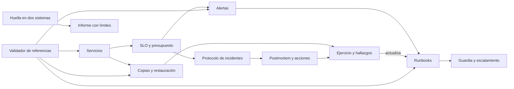

# SE-504 — Proyecto: operación observable y recuperable

[← SE-503 — Taller: diagnosticar con telemetría incompleta](../../classes/part-41-observabilidad-sre-e-incidentes/se-503-taller-diagnosticar-con-telemetria-incompleta/README.md) · [↑ Parte 41](../../classes/part-41-observabilidad-sre-e-incidentes/README.md) · [📚 Índice completo](../../classes/README.md) · [🌐 Portal](../../site/classes/SE-504.html) · [SE-517 — Mantenimiento correctivo, adaptativo y perfectivo →](../../classes/part-43-mantenimiento-y-modernizacion-legacy/se-517-mantenimiento-correctivo-adaptativo-y-perfectivo/README.md)

## Punto profesional y fundamento pedagógico

**Punto profesional.** El proyecto existe para que reúnas las piezas de la parte en un **paquete operativo** que otra persona pueda leer, validar y ejecutar: las preguntas y las señales que las responden, el objetivo de servicio y su presupuesto, las alertas derivadas, el runbook y la guardia, el protocolo de incidentes, la plantilla de postmortem, el plan de recuperación con una restauración verificada y un ejercicio con sus hallazgos. Lo valioso no es que cada pieza exista, sino que estén conectadas, se puedan comprobar y declaren lo que no cubren.

**Por qué aparece aquí.** Cierra la Parte 41: `SE-493` a `SE-496` aportaron las señales, `SE-497` y `SE-498` el objetivo y las alertas, `SE-499` y `SE-500` la respuesta, `SE-501` y `SE-502` el aprendizaje y la recuperación, y `SE-503` el diagnóstico con telemetría incompleta. Sigue el patrón del proyecto de la Parte 36 (`SE-444`): un paquete reproducible con un validador y una declaración de límites. El caso conductor es la API de entregas.

**Error conceptual que debe corregir.** Creer que un paquete operativo completo es un sistema operable, y que una cadena de prácticas buenas por separado produce una respuesta buena. Un paquete coherente consigo mismo puede ser erróneo en su significado, y la probabilidad de que toda la cadena funcione es el producto de la de cada etapa.

**Secuencia de aprendizaje.** Antes de construir el paquete predices qué fracción de las mutaciones de un paquete detectará tu validador, cuánto subirá la recuperación completa si mejoras la etapa más débil y qué parte de tus resultados se reproducirá en otro sistema. Después construyes, validas y mides, y entregas con la declaración de límites. La secuencia usa predicción, explicación propia, contraste y recuperación. [ICAP](https://icap.education.asu.edu/research) distingue participación de construcción de conocimiento; [How People Learn II](https://nap.nationalacademies.org/catalog/24783/how-people-learn-ii-learners-contexts-and-cultures) respalda diseñar la práctica con contextos reales y retroalimentación.

**Evidencia de aprendizaje.** El paquete `operacion-entregas/` con sus piezas y su validador, el informe `INFORME.md` con la predicción, las tres figuras reproducidas, la huella de los resultados en dos sistemas y la declaración de qué se probó y qué no.

**Límite de la conclusión.** Los paquetes, las mutaciones, las etapas de respuesta y sus probabilidades son sintéticos y con semilla fija; las sondas de plataforma son una medición real en dos sistemas y difieren por diseño. No se operó ningún servicio real, no se ejecutó ningún runbook contra un sistema y no hubo revisión humana independiente.

### Trazabilidad fuente → afirmación

| Fuente primaria u oficial | Afirmación que respalda | Lo que no prueba |
|---|---|---|
| [Google SRE Workbook: Implementing SLOs](https://sre.google/workbook/implementing-slos/) | Describe cómo documentar SLI, SLO, presupuesto y política y cómo revisarlos con el tiempo. | No fija los valores de tu paquete. |
| [Google SRE: Managing Incidents](https://sre.google/sre-book/managing-incidents/) | Describe roles y gestión de incidentes que un paquete debe recoger. | No ofrece una plantilla única. |
| [Google SRE: Postmortem Culture](https://sre.google/sre-book/postmortem-culture/) | Propone el postmortem sin culpa y el seguimiento de acciones. | No garantiza el aprendizaje. |
| [NIST SP 800-34 Rev. 1: Contingency Planning Guide](https://csrc.nist.gov/pubs/sp/800/34/r1/upd1/final) | Describe planes de contingencia con pruebas y ejercicios y la actualización del plan. | No evalúa tu plan. |
| [Python: hashlib](https://docs.python.org/3/library/hashlib.html) | Documenta las funciones de huella usadas para comprobar que dos ejecuciones producen el mismo resultado. | No prueba que el resultado sea correcto. |

## Antes de empezar

Recupera lo aprendido en toda la Parte 41 y el patrón del proyecto de `SE-444`: un paquete reproducible tiene un validador, una huella y una declaración de límites. La pregunta activa es: **¿qué paquete mínimo permite a alguien que no estuvo aquí entender cómo operamos la API de entregas, comprobar que sus piezas encajan y saber qué todavía no hemos probado?**

## Prerrequisitos

- Haber completado `SE-503` o poder explicar qué es una bitácora de diagnóstico y una tabla de firmas.
- Python 3.11 o posterior; el validador y los experimentos usan solo la biblioteca estándar (`json`, `hashlib`, `datetime`, `random`).
- Acceso a dos sistemas (por ejemplo, Windows y un Linux en WSL) o declaración explícita de que solo se probó en uno.

## Problema auténtico

El equipo de la plataforma hereda la API de entregas con tres cosas: un tablero con 60 paneles, un documento «Runbooks.docx» de hace dos años y la memoria de dos personas que ya no están. En una revisión, la dirección pregunta si el servicio puede sostener el próximo cierre de plazo. Nadie puede responder: hay alertas que apuntan a runbooks que ya no existen, un objetivo de disponibilidad que nadie midió, una copia de seguridad nunca restaurada y un simulacro del año anterior cuyas conclusiones no se registraron. Cada pieza existe y ninguna está conectada con otra. El proyecto consiste en construir el paquete que conecta las piezas, validar las conexiones, ensayar una vez la respuesta y declarar con honestidad lo que sigue sin cubrirse.

## Objetivos observables

Al terminar podrás:

1. construir un paquete operativo con servicios, objetivos, alertas, runbooks, copias, ejercicios y guardia, y las referencias entre ellos;
2. escribir un validador de referencias cruzadas y medir qué fracción de mutaciones detecta y qué clases se le escapan;
3. calcular la probabilidad de una respuesta completa como producto de etapas, localizar la más débil y estimar el efecto de mejorarla;
4. comprobar la reproducibilidad de los resultados en dos sistemas con una huella y distinguir lo que debe ser idéntico de lo que difiere por diseño;
5. redactar el informe con la predicción, la evidencia y la declaración de límites.

## Mapa conceptual



El mapa muestra el paquete como un grafo de **referencias**: cada alerta apunta a un objetivo y a un runbook, cada runbook a un propietario, cada copia a una restauración y un ejercicio. El validador comprueba las aristas y la huella comprueba que el resultado se reproduce.

## Temas y por qué importan

| Tema | Por qué cambia una decisión profesional | Evidencia mínima |
|---|---|---|
| Paquete operativo | Sin conexiones, las piezas no forman un sistema. | Predicción, traza causal y contraejemplo de **Paquete operativo** en `INFORME.md` |
| Validación de referencias | Lo olvidado se detecta mecánicamente; lo erróneo no. | Predicción, traza causal y contraejemplo de **Validación de referencias** en `INFORME.md` |
| Cadena de respuesta | La respuesta completa es el producto de sus etapas. | Predicción, traza causal y contraejemplo de **Cadena de respuesta** en `INFORME.md` |
| Reproducibilidad | Un resultado calculado se reproduce; el que toca el sistema difiere. | Predicción, traza causal y contraejemplo de **Reproducibilidad** en `INFORME.md` |
| Límites declarados | Lo que no se probó se declara. | Predicción, traza causal y contraejemplo de **Límites declarados** en `INFORME.md` |

## Conceptos y decisiones

### 1. El paquete operativo

Un **paquete operativo** es el conjunto versionado de documentos y datos que describen cómo se observa, se responde y se recupera un servicio. Para la API de entregas contiene: los **servicios** y sus dependencias; la **tabla de preguntas y señales** (`SE-493`); el **SLI, el SLO y el presupuesto** con su política (`SE-497`); las **alertas** derivadas del consumo (`SE-498`); los **runbooks** con propietario y fecha de verificación (`SE-499`); la **guardia** y el escalamiento; el **protocolo de incidentes** con severidades medibles y la cadencia de comunicación (`SE-500`); la plantilla de **postmortem** y la lista de acciones (`SE-501`); el **plan de recuperación** con RPO, RTO, la última restauración verificada y el mapa de dependencias (`SE-502`); y el registro de los **ejercicios** con sus hallazgos. Se guarda en el repositorio del servicio, porque cambia con él y se revisa en las mismas revisiones de código. Un extracto del formato de datos que lee el validador:

```json
{
  "servicios": ["entregas-api", "trabajadores"],
  "slos": {"entregas-api": {"sli": "peticiones buenas / válidas", "objetivo": 0.999, "ventana_dias": 28}},
  "alertas": [{"nombre": "EntregasConsumoRapido", "slo": "entregas-api", "runbook": "rb-entregas", "severidad": "página"}],
  "runbooks": {"rb-entregas": {"propietario": "equipo-api", "verificado": "2026-10-20"}},
  "copias": {"base-entregas": {"rpo_min": 15, "ultima_restauracion": "2026-11-01", "restauracion_min": 38, "rto_min": 60}},
  "ejercicios": [{"fecha": "2026-10-05", "tipo": "recuperación", "hallazgos": 3, "corregidos": 2}],
  "guardia": {"personas": 5, "escalamiento": ["primaria", "secundaria", "responsable"]}
}
```

### 2. Validación de referencias cruzadas

El validador comprueba las relaciones entre las piezas: todo servicio tiene un SLO con un objetivo en un rango razonable; toda alerta apunta a un SLO y a un runbook que existen; todo runbook tiene propietario y una verificación de hace menos de 90 días; toda copia tiene una restauración probada hace menos de 90 días con un tiempo menor que el RTO; hay al menos un ejercicio de menos de 180 días y sus hallazgos se están corrigiendo; el escalamiento tiene al menos dos niveles. Es la versión de las comprobaciones de forma de las clases anteriores aplicada al conjunto. Y arrastra su misma limitación: comprueba que existe y encaja, no que sea verdad.

### Un validador frente a 360 mutaciones

Se escribe un paquete base con dos servicios, dos alertas y dos runbooks, que el validador acepta (0 problemas en 20 paquetes base), y doce operadores de mutación aplicados 30 veces cada uno.

```python
for a in p["alertas"]:
    if a["runbook"] not in runbooks: problems.append("alerta sin runbook")
if c["restauracion_min"] > c["rto_min"]: problems.append("restauración mayor que el RTO")
```

| Mutación | Detectadas |
|---|---:|
| Servicio sin SLO | 30 de 30 |
| Alerta sin SLO existente | 30 de 30 |
| Alerta sin runbook existente | 30 de 30 |
| Restauración sin probar (200 días) | 30 de 30 |
| Restauración mayor que el RTO | 30 de 30 |
| Sin ejercicio | 30 de 30 |
| Escalamiento de un nivel | 30 de 30 |
| Objetivo SLO laxo pero en rango (95 %) | 0 de 30 |
| RPO incoherente con la copia (1 440 min) | 0 de 30 |
| Ejercicio sin hallazgos que corregir | 0 de 30 |
| Runbooks intercambiados entre alertas | 0 de 30 |
| SLI que no mide al usuario («el servidor está encendido») | 0 de 30 |


**Cómo leer la figura.** Cada barra es un tipo de mutación de un paquete operativo (30 de cada una) y el tramo teal son las que el validador de referencias cruzadas detecta y el coral las que deja pasar. Detecta las siete que rompen una referencia y ninguna de las cinco que cambian el sentido sin romperla, como un objetivo laxo pero en rango, un RPO incoherente con la copia o runbooks intercambiados. **Dónde deja de valer:** el paquete base y los doce operadores son construcciones del autor y el validador se afinó con las mismas mutaciones que lo evalúan, de modo que 58 % es una cota optimista. Las cinco clases que se escapan son errores de significado: un objetivo en rango pero demasiado laxo, un RPO que no corresponde a la copia, un ejercicio que declara no haber encontrado nada, dos runbooks cambiados de sitio y un indicador que no mide lo que siente la persona usuaria. Solo la revisión de otra persona y el ejercicio los descubren.

### 3. La cadena de respuesta

La respuesta a un incidente es una cadena de etapas, cada una de las cuales puede fallar: **detección** (la alerta salta), **llegada** (la página alcanza a una persona), **diagnóstico** (se identifica una causa o una mitigación), **mitigación** (la acción funciona) y **verificación** (se comprueba que el servicio se recuperó). La probabilidad de que toda la cadena funcione es el producto de las probabilidades, y es menor que la de la peor etapa: cinco etapas del 80 % al 95 % dan alrededor del 55 %. Además las etapas no son independientes: la caída de la telemetría (`SE-503`) afecta a la detección y al diagnóstico a la vez.

### Dónde se rompe la cadena

Se modelan cinco etapas con probabilidades de éxito de 0,95, 0,92, 0,80, 0,88 y 0,90, y un 5 % de incidentes con caída de telemetría en que la detección y el diagnóstico caen al 30 % de su valor. Se simulan 20 000 incidentes, se cuenta dónde falla cada uno y se calcula el producto si se mejora cada etapa en cinco puntos (con un tope de 0,99).

```python
if shared and name in ("detección", "diagnóstico"): p = p * 0.3       # caída de telemetría: fallo común
product = math.prod(p for _, p in stages)
```

| Etapa | Incidentes que fallan aquí | Producto al mejorarla 5 puntos |
|---|---:|---:|
| Detección | 8,2 % | 57,7 % |
| Llegada a una persona | 7,3 % | 58,4 % |
| Diagnóstico | 17,7 % | 58,8 % |
| Mitigación | 8,2 % | 58,5 % |
| Verificación de la recuperación | 5,9 % | 58,5 % |
| **Recuperación completa** | producto de etapas 55,4 % | simulada 52,8 % |


**Cómo leer la figura.** Cada grupo de barras es una etapa de la respuesta a incidentes; la barra coral es el porcentaje de incidentes que fallan en ella y la teal la recuperación completa que resultaría de mejorarla cinco puntos; la línea discontinua es la recuperación completa actual (55,4 por ciento). La etapa donde más incidentes fallan, el diagnóstico, es la que más sube la recuperación al mejorarla; las demás suben menos. **Dónde deja de valer:** las cinco probabilidades, el 5 % de caídas de telemetría y el tope de 0,99 son supuestos del autor, no mediciones. La tabla enseña que no existe una etapa «la que importa» sino una cadena, y que la mejora de una etapa con probabilidades altas tiene un techo.

### 4. Reproducibilidad entre sistemas

Un paquete es reproducible si otra persona, con otro equipo, obtiene lo mismo. Los resultados que dependen solo de un generador con semilla fija y de aritmética (los de tiempo virtual) son idénticos en cualquier sistema con la misma versión de Python, y se comprueban con una **huella** (un resumen criptográfico del resultado serializado de forma determinista, con claves ordenadas y codificación explícita). Los que tocan el sistema de archivos, la codificación local o los separadores difieren por diseño, y la tarea no es borrar la diferencia sino declararla. El caso más frecuente es leer o escribir texto sin indicar `encoding="utf-8"`: Windows usa la codificación del sistema y Linux usa UTF-8, y una «í» ocupa dos bytes en un lado y puede leerse como dos caracteres en el otro.

### Dos sistemas, una huella

Se ejecutan, en Windows 11 con CPython 3.12.9 y en Ubuntu bajo WSL2 con CPython 3.12.3, los tres experimentos de tiempo virtual del paquete (el validador, la cadena de respuesta y la carga de la guardia). Se serializa el resultado con claves ordenadas y UTF-8, se calcula su SHA-256 y se muestran los primeros 16 caracteres. Además se ejecutan sondas de plataforma.

```python
virtual = json.dumps({"validador": e432_validador(), "cadena": e432_cadena(), "guardia": e427_guardia()}, sort_keys=True, ensure_ascii=False)
digest = hashlib.sha256(virtual.encode("utf-8")).hexdigest()[:16]
```

| Sonda | Windows 11 | Ubuntu (WSL2) | Resultado |
|---|---|---|---|
| Huella de los resultados de tiempo virtual | `b3d17854ae65d56a` | `b3d17854ae65d56a` | Idénticas |
| Separador de línea del sistema | `\r\n` | `\n` | Distinto |
| Bytes de «línea» más salto escritos como texto | 8 | 7 | Distinto |
| Caracteres al leer con la codificación local | 7 | 6 | Distinto |
| Separador de rutas | `\` | `/` | Distinto |
| Mayúsculas y minúsculas distintas en una ruta | No | Sí | Distinto |
| Nombre de archivo con eñe conservado | Sí | Sí | Idéntico |


**Cómo leer la figura.** La barra son las siete sondas comparadas entre Windows 11 y Ubuntu bajo WSL2: el tramo teal son las dos idénticas y el coral las cinco que difieren. Lo que se reproduce es la huella de los resultados de tiempo virtual; lo que cambia son detalles del sistema (separador de línea, bytes escritos, codificación local, separador de rutas y mayúsculas en rutas). La tabla da el valor de cada sonda en cada sistema. **Dónde deja de valer:** es una medición real de dos sistemas con dos versiones de CPython; no prueba nada sobre un tercero, ni sobre otras versiones de Python (cambios de implementación del generador pueden cambiar la huella). La huella asegura que se calculó lo mismo, no que sea correcto. En CI, otro sistema puede dar la misma huella o fallar por una diferencia que merece investigarse.

### 5. Declarar los límites

La parte final del informe lista lo que se hizo, lo que no y lo que no se puede afirmar: qué piezas son sintéticas, qué se ejecutó y dónde (versiones, sistemas, comandos), qué se evaluó con los mismos casos con que se afinó y qué clases de error no detecta el validador. No es una disculpa: es la información que otra persona necesita para decidir cuánto confiar. Un paquete que dice «probado» sin decir cómo vale menos que uno que dice «la restauración se probó el 2 de noviembre en el entorno de pruebas, en 38 minutos; el simulacro completo no se ha hecho».

## Definiciones de trabajo

- **paquete operativo:** conjunto versionado de documentos y datos que describen cómo se observa, se responde y se recupera un servicio.
- **validador de referencias:** programa que comprueba que las piezas de un paquete se refieren entre sí de forma coherente y están al día.
- **cadena de respuesta:** secuencia de etapas (detección, llegada, diagnóstico, mitigación y verificación) cuya probabilidad conjunta es el producto de las de cada una.
- **huella:** resumen criptográfico de un resultado serializado de forma determinista, usado para comparar ejecuciones.
- **declaración de límites:** apartado que dice qué se probó, cómo y qué no se puede afirmar.

Las definiciones son operativas para la API de entregas. No convierten términos con una historia más amplia en sinónimos y deben contrastarse con la documentación primaria enlazada al final.

## Ejemplo mínimo

El fragmento busca alertas que apuntan a un runbook inexistente. Antes de ejecutarlo, predice el resultado.

```python
paquete = {"alertas": [{"nombre": "A", "runbook": "rb-a"}, {"nombre": "B", "runbook": "rb-b"}], "runbooks": {"rb-b": {}}}
print([a["nombre"] for a in paquete["alertas"] if a["runbook"] not in paquete["runbooks"]])
```

Imprime `['A']`. Registra versión de Python, comando y salida; después añade una comprobación de fecha de verificación y una mutación que no detecte.

## Ejemplo profesional

Supón, como caso hipotético de la plataforma y no como medición, que el equipo construye el paquete `operacion-entregas/` en tres sesiones. Primero migra lo que existe: convierte el documento de runbooks a archivos con la estructura de `SE-499`, define el SLO con el SLI de `SE-497` y escribe la tabla de preguntas y señales (`SE-493`). Después deriva las alertas del SLO (`SE-498`), enlaza cada una con un runbook y un propietario, y escribe el validador, que en la primera ejecución encuentra cuatro alertas sin runbook y una copia sin restauración probada. Corrige las referencias, restaura la copia en un entorno aislado (38 minutos, con la lectura completa de las tablas y la huella) y registra el resultado. En la tercera sesión ejecuta un ejercicio de mesa de dos horas con un incidente simulado y anota los hallazgos: el escalamiento tenía un solo canal y el runbook de la cola apuntaba a un espacio de nombres antiguo, un error de significado que el validador no podía ver. Ejecuta el paquete y los experimentos en Windows y Ubuntu, compara las huellas y escribe el informe con la predicción, las figuras, la declaración de límites y la lista de lo que falta: el simulacro completo y la revisión de una persona ajena. No concluyen que el servicio sea operable; concluyen que ahora saben qué piezas están conectadas, cuáles no y cuándo lo comprobaron.

## Práctica guiada

1. Predice la fracción de mutaciones que detectará tu validador y la mejora que esperas al reforzar la etapa más débil de la cadena.
2. Construye el paquete `operacion-entregas/` con las piezas de la sección «El paquete operativo» y datos sintéticos.
3. Escribe el validador de referencias y ejecútalo sobre el paquete base (debe dar 0 problemas) y sobre tres mutaciones tuyas.
4. Ejecuta `python scripts/experiments_part41_b.py e432` y compara con tu validador y con tu predicción.
5. Ejecuta los tres experimentos de tiempo virtual en dos sistemas, calcula la huella y compárala; anota las sondas que difieren.
6. Ensaya un ejercicio de mesa de una hora con un incidente simulado y registra al menos tres hallazgos con propietario y fecha.
7. Redacta `INFORME.md` con la predicción, las tablas, la huella en dos sistemas y la declaración de límites; pide a otra persona que encuentre una afirmación que no sostienen tus datos.

## Ejercicios

1. **Referencias:** escribe tres comprobaciones adicionales del validador (por ejemplo, que cada runbook cite una alerta que lo use) y una mutación que cada una detecte.
2. **Cadena:** con tus propias estimaciones para cinco etapas, calcula el producto y decide cuál mejorar primero; justifica con datos de un incidente pasado.
3. **Huella:** serializa el resultado de un experimento con y sin `sort_keys` y con distintas codificaciones, y observa cuándo cambia la huella.
4. **Límites:** escribe la declaración de límites de un paquete donde la restauración solo se probó en el entorno de pruebas y el simulacro no se ha hecho.

## Reto verificable

Entrega el repositorio `operacion-entregas/` y `INFORME.md`. Se aprueba si otra persona, desde un checkout limpio, ejecuta el validador y obtiene 0 problemas sobre el paquete base; ejecuta tus mutaciones y obtiene los mismos conteos de detección; reproduce la huella de los resultados de tiempo virtual en un sistema que no es el tuyo; encuentra la restauración registrada con su tiempo y su verificación; y puede decir, a partir de la declaración de límites, qué no se ha probado. No se aprueba por entregar un paquete cuyas referencias nunca se validaron, por declarar «operable» sin ejercicio o por esconder las mutaciones que el validador no detecta.

### Criterios de salida

| Criterio | Evidencia mínima | Señal de rechazo |
|---|---|---|
| paquete | todas las piezas con propietario, fecha y referencias | alertas sin runbook o runbooks sin dueño |
| validador | 0 problemas en el base y conteos reproducibles en las mutaciones | un validador afinado solo con los casos que lo evalúan, sin declararlo |
| recuperación | restauración probada con tiempo, consulta y huella | «la copia terminó sin error» como evidencia |
| respuesta | cadena de etapas con la más débil identificada y una mejora medida | una sola etapa «la que importa» |
| reproducibilidad | huella igual en dos sistemas y sondas que difieren explicadas | resultados que cambian sin explicación |
| límites | lista de lo no probado, de lo evaluado con los mismos casos y de lo que el validador no ve | «probado» sin decir cómo |

## Caso conductor

La API de entregas fue el caso conductor de toda la Parte 41: de la tabla de preguntas (`SE-493`) a los registros (`SE-494`), las métricas (`SE-495`), las trazas (`SE-496`), el objetivo (`SE-497`), las alertas (`SE-498`), la guardia (`SE-499`), los incidentes (`SE-500`), los postmortems (`SE-501`), la recuperación (`SE-502`) y el diagnóstico (`SE-503`). Este proyecto deja el artefacto final: un paquete operativo validado, con su huella y su declaración de límites. La Parte 43 abre otro frente, el mantenimiento y la modernización de sistemas existentes, donde lo operado debe cambiar sin romperse. Cambia, para terminar, un solo dato, la probabilidad de la etapa de diagnóstico, y observa cuánto se mueve la recuperación completa.

## Preguntas frecuentes

### ¿El validador de referencias es suficiente?

No. Detecta lo olvidado y lo roto: alertas sin runbook, fechas vencidas, restauraciones sin probar. No detecta que un runbook sea falso, que el SLO sea demasiado laxo o que el indicador no mida lo que siente quien usa el servicio. Para eso están los ejercicios, la revisión de otra persona y la comparación con incidentes reales.

### ¿Por qué comparar huellas en dos sistemas?

Porque un resultado que solo se obtiene en tu equipo puede depender de algo que no declaraste: una codificación, una versión, un orden de iteración. Si la huella coincide, el cálculo es reproducible; si no, hay una diferencia que investigar antes de afirmar nada.

### ¿Cuánto tiempo debe llevar mantener el paquete?

Lo que cuesta la revisión de cada cambio del sistema más una revisión periódica (trimestral) de fechas y ejercicios. Si el paquete vive en el repositorio y el validador corre en la integración continua, el mantenimiento cuesta lo mismo que mantener las pruebas.

### ¿Qué hago con los hallazgos de un ejercicio?

Se tratan como las acciones de un postmortem (`SE-501`): propietario, fecha y criterio de verificación, con seguimiento semanal. Un ejercicio que no produce hallazgos es sospechoso, no una buena noticia.

## Fallo controlado y diagnóstico

Reproduce el fallo clásico del proyecto: **un paquete que pasa el validador y falla en el ejercicio**. Intercambia los runbooks de dos alertas y ejecuta el validador y después el ejercicio.

Registra síntoma, entrada mínima, hipótesis, observación que descarta cada hipótesis, causa, corrección y prueba de regresión. **Síntoma:** el validador da 0 problemas y, en el ejercicio, la persona que sigue el runbook de la alerta de consumo ejecuta los pasos de la cola. **Hipótesis rivales:** (a) la persona se equivocó de documento; (b) el validador tiene un defecto; (c) las referencias están cruzadas y ambas existen. **Prueba:** comprueba que el nombre de cada runbook corresponde al disparador de su alerta; si el disparador del runbook no coincide con el de la alerta, la hipótesis (c) explica la señal. **Conclusión:** el validador comprueba que las referencias existen, no que apunten a lo correcto. **Regresión:** añade al runbook el nombre de la alerta que lo activa y una comprobación de coincidencia, y mantén el ejercicio como control del significado. No cambies a la vez el validador y los runbooks.

## Errores comunes y cómo corregirlos

| Síntoma | Causa probable | Corrección |
|---|---|---|
| El validador da 0 problemas y el ejercicio falla | Solo comprueba existencia y forma | Añadir coincidencias de significado verificables y mantener el ejercicio |
| La huella cambia entre sistemas | Codificación, orden o versión no declarados | Serializar con claves ordenadas y UTF-8, y declarar las versiones |
| El paquete envejece en seis meses | Vive fuera del repositorio del servicio | Versionarlo con el servicio y validarlo en la integración continua |
| El informe dice «probado» sin detalle | No se declararon alcance ni condiciones | Fecha, entorno, comando y resultado de cada prueba |
| Se mejora la etapa más visible | No se midió dónde se pierde la cadena | Contar fallos por etapa en incidentes y ejercicios |

## Entorno y archivos clave

```text
operacion-entregas/
├── README.md
├── paquete/
│   ├── paquete.json
│   ├── runbooks/
│   ├── slo.md
│   ├── protocolo-incidentes.md
│   ├── postmortem-plantilla.md
│   └── recuperacion.md
├── validador/validar.py
├── experimentos/
│   ├── cadena.py
│   └── huella.py
├── ejercicios/registro.md
├── tests/test_validador.py
└── INFORME.md
```

El `README` declara plataforma, versiones de Python (3.12.9 en Windows 11 y 3.12.3 en Ubuntu bajo WSL2 en las pruebas de esta clase), semillas y comandos. El paquete usa solo la biblioteca estándar; si añades una dependencia, fija procedencia y versión. Para recuperar el estado, borra `operacion-entregas/` y repite los scripts; los resultados de tiempo virtual deben dar la misma huella, y las sondas de plataforma pueden diferir.

## Seguridad, ética y accesibilidad

- el paquete no debe contener credenciales, datos reales de estudiantes ni topologías internas que faciliten un ataque; usa datos sintéticos y referencias a un gestor de secretos;
- los ejercicios que tocan producción necesitan autorización, radio acotado y criterio de aborto, y no deben exponer datos personales a más personas;
- una guardia y un incidente son cargas humanas: el paquete incluye límites de carga, relevos y un canal alternativo accesible;
- documenta las tablas y las figuras con texto alternativo y en un formato que un lector de pantalla pueda recorrer;
- respeta las licencias de los libros, artículos y plantillas, y atribuye lo adaptado.

## Puente hacia el trabajo con agentes

Un agente al que se le pide «prepara la documentación operativa del servicio» producirá archivos plausibles, completos en apariencia y con comandos genéricos, nombres de recursos inventados y cifras redondas. Pídele en cambio que parta de lo que el repositorio y la configuración realmente contienen, que marque cada dato inventado o desconocido, que no cree runbooks con comandos que no pueda justificar, que ejecute el validador y muestre su salida, que cuente cuántas referencias son suyas y cuántas verificadas por una persona y que escriba la declaración de límites con lo que no pudo comprobar. Revisa especialmente las cifras de RPO y RTO, las fechas de verificación (un agente puede poner la de hoy) y los propietarios, que una persona debe asignar.

## Transferencia

Traslada el paquete a otro servicio (un sistema de pagos o una plataforma de contenidos): reutiliza el esquema, ajusta los objetivos y las dependencias y ejecuta el validador. La transferencia está lograda cuando puedes decir qué piezas son específicas de la API de entregas y cuáles se reutilizan, y qué errores de significado tendrá el nuevo paquete que el validador no verá.

## Evaluación y evidencia

| Criterio | Evidencia para aprobar |
|---|---|
| comprensión | explicación de cómo las piezas se conectan y por qué la cadena de respuesta es un producto |
| corrección | validador con 0 problemas en el base y conteos de mutaciones reproducibles |
| diseño | paquete versionado con propietario, fecha, restauración probada y ejercicio registrado |
| diagnóstico | reproducción del fallo «pasa el validador y falla en el ejercicio» con regresión |
| incertidumbre | declaración de límites, incluida la parte evaluada con los mismos casos con que se afinó |
| reproducibilidad | huella igual en dos sistemas, versiones y comandos declarados |

## Fuentes

- [Google SRE Workbook: Implementing SLOs](https://sre.google/workbook/implementing-slos/) — documentación de SLI, SLO y política; autoridad: Google, SRE Workbook.
- [Google SRE: Managing Incidents](https://sre.google/sre-book/managing-incidents/) — roles y gestión de incidentes; autoridad: libro de ingeniería de confiabilidad de Google.
- [Google SRE: Postmortem Culture](https://sre.google/sre-book/postmortem-culture/) — postmortems sin culpa y seguimiento; autoridad: libro de ingeniería de confiabilidad de Google.
- [NIST SP 800-34 Rev. 1](https://csrc.nist.gov/pubs/sp/800/34/r1/upd1/final) — planes de contingencia, pruebas y ejercicios; autoridad: NIST.
- [Python: hashlib](https://docs.python.org/3/library/hashlib.html) — funciones de huella; autoridad: documentación de Python.

Cada fuente respalda el mecanismo indicado; ninguna demuestra que 210 de 360 mutaciones detectadas, un 52,8 % de recuperaciones completas o la huella `b3d17854ae65d56a` se observen en un sistema real. Esa afirmación depende del servicio, del paquete y de la cadena de respuesta.

## Límites y siguiente paso

Se ejecutaron tres experimentos de tiempo virtual con semillas fijas y sondas de plataforma reales en Windows (CPython 3.12.9) y Ubuntu bajo WSL2 (3.12.3): las cifras de tiempo virtual fueron idénticas y las sondas difieren por diseño. No se operó ningún servicio real, no se ejecutó ningún runbook contra un sistema y no hubo revisión humana independiente; el paquete base, los doce operadores de mutación, las cinco etapas de la cadena y sus probabilidades son construcciones del autor, y el validador se afinó con las mismas mutaciones que lo evalúan. La Parte 43 abre el mantenimiento y la modernización de sistemas existentes, donde lo operado debe cambiar sin romperse.

## Glosario

- **paquete operativo:** conjunto versionado de documentos y datos que describen cómo se observa, se responde y se recupera un servicio.
- **validador de referencias:** programa que comprueba que las piezas de un paquete se refieren entre sí de forma coherente y están al día.
- **cadena de respuesta:** secuencia de etapas (detección, llegada, diagnóstico, mitigación y verificación) cuya probabilidad conjunta es el producto de las de cada una.
- **huella:** resumen criptográfico de un resultado serializado de forma determinista, usado para comparar ejecuciones.
- **declaración de límites:** apartado que dice qué se probó, cómo y qué no se puede afirmar.

---

[← SE-503 — Taller: diagnosticar con telemetría incompleta](../../classes/part-41-observabilidad-sre-e-incidentes/se-503-taller-diagnosticar-con-telemetria-incompleta/README.md) · [↑ Parte 41](../../classes/part-41-observabilidad-sre-e-incidentes/README.md) · [📚 Índice completo](../../classes/README.md) · [🌐 Portal](../../site/classes/SE-504.html) · [SE-517 — Mantenimiento correctivo, adaptativo y perfectivo →](../../classes/part-43-mantenimiento-y-modernizacion-legacy/se-517-mantenimiento-correctivo-adaptativo-y-perfectivo/README.md)
