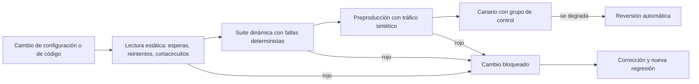

# SE-512 — Caos continuo: automatización en CI/CD y en producción

[← SE-511 — Game days y ejercicios de respuesta a incidentes](../../classes/part-42-ingenieria-del-caos/se-511-game-days-y-ejercicios-de-respuesta-a-incidentes/README.md) · [↑ Parte 42](../../classes/part-42-ingenieria-del-caos/README.md) · [📚 Índice completo](../../classes/README.md) · [🌐 Portal](../../site/classes/SE-512.html) · [SE-513 — Seguridad y gobernanza de los experimentos: abortar, autorizar y registrar →](../../classes/part-42-ingenieria-del-caos/se-513-seguridad-y-gobernanza-de-los-experimentos-abortar-autorizar-y-registrar/README.md)

## Punto profesional y fundamento pedagógico

**Punto profesional.** La clase trata el caos continuo: lo que se automatiza en el camino a producción y lo que se ejecuta de forma continua sobre el sistema en producción. Existe para que decidas qué parte de la ingeniería del caos se automatiza en el **pipeline de integración y entrega continuas** y qué parte espera a **preproducción**, para que escribas pruebas de falla deterministas que fallen cuando una regresión de configuración quita una protección y para que sepas qué regresiones ni la lectura de la configuración ni una suite de escenarios ven. Un pipeline que solo ejecuta pruebas de camino feliz aprueba el cambio que quita el cortacircuitos.

**Por qué aparece aquí.** Sigue a `SE-511`: allí el equipo ejercita los defectos humanos; aquí se automatiza lo técnico. Usa la integración y la entrega continuas de la Parte 40 (`SE-481`, `SE-483`, `SE-485`) y los entornos preview de `SE-488`. El caso conductor es la configuración del cliente de la API de entregas que cambia con cada commit.

**Error conceptual que debe corregir.** Creer que una suite de caos en el pipeline es una versión pequeña del experimento en producción. Es otra cosa: una **prueba de regresión de resiliencia** sobre un sistema controlado, determinista y barato, que no mide el comportamiento con el tráfico real sino que protege lo que ya se demostró.

**Secuencia de aprendizaje.** Antes de ver los resultados predices cuántas de siete modificaciones de configuración (seis dañinas y una inocua) detecta una lectura estática, cuántas una suite de cuatro escenarios y cuántas la combinación. Después contrastas la predicción con la simulación y escribes la etapa del pipeline donde pondrías cada defensa. [ICAP](https://icap.education.asu.edu/research) distingue participación de construcción de conocimiento; [How People Learn II](https://nap.nationalacademies.org/catalog/24783/how-people-learn-ii-learners-contexts-and-cultures) respalda diseñar la práctica con contextos reales y retroalimentación.

**Evidencia de aprendizaje.** `pipeline-caos-log.md` con la predicción, las tres figuras reproducidas, la definición de la suite de tu servicio (escenarios, criterio de paso, duración y etapa) y una nota que separe lo que la simulación muestra de lo que habría que comprobar en un pipeline real.

**Límite de la conclusión.** La configuración, las siete modificaciones, los cuatro escenarios y las ocho semillas son sintéticos y de tiempo virtual. No se ejecutó ningún pipeline real; una simulación con semilla fija es repetible por construcción, y un sistema real no lo es.

### Trazabilidad fuente → afirmación

| Fuente primaria u oficial | Afirmación que respalda | Lo que no prueba |
|---|---|---|
| [Netflix: «ChAP» (2017)](https://netflixtechblog.com/chap-chaos-automation-platform-53e6d528371f) | Cualquier cambio en el entorno de producción cambia la resiliencia del sistema, de modo que la confianza en un resultado decae con el tiempo; por eso ChAP se integró con el sistema de integración y entrega continuas (Spinnaker) para ejecutar los experimentos con frecuencia y evitar regresiones. | No dice cuántos experimentos hay que ejecutar por cambio. |
| [Principles of Chaos Engineering](https://principlesofchaos.org/) | Pide automatizar los experimentos y ejecutarlos de forma continua, porque hacerlos a mano es laborioso e insostenible. | No fija qué se automatiza primero. |
| [Google SRE: Testing for Reliability](https://sre.google/sre-book/testing-reliability/) | Advierte que técnicas estadísticas como Chaos Monkey y Jepsen no son necesariamente pruebas repetibles y que repetirlas tras un cambio no demuestra que el fallo esté corregido. | No dice cómo hacerlas deterministas. |
| [AWS Well-Architected: pruebas de resiliencia con inyección de fallas](https://docs.aws.amazon.com/wellarchitected/latest/reliability-pillar/rel_testing_resiliency_failure_injection_resiliency.html) | Recomienda usar la inyección de fallas para probar la resiliencia de la carga de trabajo e integrarla en ciclos de prueba y despliegue. | No asegura que las pruebas sean fiables. |

## Antes de empezar

Recupera lo aprendido en `SE-511`: los defectos de personas y procedimientos solo los ve un ejercicio con personas. La pregunta activa es: **si un cambio de configuración deja el reintento sin pausa y el cortacircuitos fuera, ¿qué etapa del pipeline lo detiene antes de que llegue a producción, y qué cambios parecidos pasarían?**

## Prerrequisitos

- Haber completado `SE-507` a `SE-509` o poder describir un cliente con espera, reintentos y cortacircuitos y una falla que lo pone a prueba.
- Conocer las etapas de un pipeline y sus compuertas (`SE-482`, `SE-483`).
- Python 3.11 o posterior; los experimentos usan solo la biblioteca estándar.

## Problema auténtico

Un viernes, en una limpieza de configuración, alguien retira el cortacircuitos del cliente de la API de entregas «porque nunca se activa». El pipeline pasa en verde: las pruebas unitarias cubren que el cliente reintenta tres veces y que, si el servicio responde, devuelve el resultado. Tres semanas después un respaldo hace lento al almacenamiento y las entregas caen a 0 % durante el cierre de plazo. La configuración que se aprobó era legible, coherente y estaba cubierta por pruebas; lo que le faltaba era una prueba que hiciera lo único que el cortacircuitos existe para hacer: sobrevivir a una dependencia lenta. El pipeline no tenía ninguna.

## Objetivos observables

Al terminar podrás:

1. diseñar una suite de escenarios de falla deterministas para el pipeline, con criterio de paso, duración y presupuesto;
2. distinguir qué regresiones detecta una lectura estática de la configuración y cuáles solo una suite dinámica, y por qué ninguna ve ciertas calibraciones;
3. medir la tasa de falsas alarmas de la suite sobre la configuración sana;
4. ubicar cada defensa en una etapa (commit, pipeline, preproducción, canario) según su costo y su realismo;
5. escribir lo que la suite no demuestra para que su resultado verde no se lea como garantía.

## Mapa conceptual



El mapa ordena las defensas por **costo y realismo crecientes**. Cada etapa atrapa regresiones que la anterior no ve y cuesta más; ninguna sustituye a la siguiente. Un rojo en cualquier etapa bloquea el cambio.

## Temas y por qué importan

| Tema | Por qué cambia una decisión profesional | Evidencia mínima |
|---|---|---|
| Regresión de resiliencia | Una protección que se retira sin que ninguna prueba falle no estaba protegida. | Predicción, traza causal y contraejemplo de **Regresión de resiliencia** en `pipeline-caos-log.md` |
| Lectura estática de la configuración | Barata y rápida, ve ausencias y no calibraciones. | Predicción, traza causal y contraejemplo de **Lectura estática de la configuración** en `pipeline-caos-log.md` |
| Suite dinámica determinista | Ve el comportamiento, pero solo en los escenarios que expresa. | Predicción, traza causal y contraejemplo de **Suite dinámica determinista** en `pipeline-caos-log.md` |
| Falsas alarmas y repetibilidad | Una suite que falla al azar se ignora. | Predicción, traza causal y contraejemplo de **Falsas alarmas y repetibilidad** en `pipeline-caos-log.md` |
| Preproducción | Es más realista y distinta de producción en capacidad, datos y configuración. | Predicción, traza causal y contraejemplo de **Preproducción** en `pipeline-caos-log.md` |

## Conceptos y decisiones

### 1. La regresión de resiliencia

Una **regresión de resiliencia** es un cambio que empeora la capacidad del sistema de resistir una falla sin romper ninguna prueba funcional. Ocurre porque las pruebas funcionales verifican lo que el sistema hace cuando todo va bien, y la protección solo se ejerce cuando algo va mal. [Netflix lo explica](https://netflixtechblog.com/chap-chaos-automation-platform-53e6d528371f) al motivar la automatización de ChAP: cualquier cambio en el entorno de producción cambia la resiliencia del sistema, y con cientos de despliegues diarios, la confianza en un resultado experimental disminuye pronto; antes de integrar los experimentos con el sistema de entrega, una vulnerabilidad podía identificarse, corregirse y volver a aparecer causando un incidente. La respuesta fue ejecutar los experimentos de forma continua como parte del camino hacia producción, que es la idea de esta clase: **la prueba que demostró la resiliencia debe volverse una prueba que la protege**.

### 2. Siete cambios de configuración

Se parte de la configuración sana E de `SE-507` (espera de 250 ms, 2 reintentos con pausa exponencial y azar, cortacircuitos calibrado con alternativa) y se aplican siete modificaciones que un equipo podría hacer en un commit: R1 sube la espera a 5 s; R2 deja reintentos sin pausa con espera de 1 s y sin cortacircuitos; R3 quita el cortacircuitos y la alternativa; R4 quita solo la alternativa; R5 hace sensible al cortacircuitos (50 % en 20 intentos); R6 sube a cinco reintentos; R7 baja a un reintento, un cambio inocuo que no debería fallar. Las seis primeras empeoran algo; la séptima sirve de control para las falsas alarmas.

La **suite dinámica** tiene cuatro escenarios de 60 s (la falla ocupa los segundos 10 a 30 con 90 peticiones por segundo): 30 % de errores, dependencia lenta de +100 ms, mitad de los hilos y falta de respuesta. Un escenario pasa si durante la falla al menos 99 % de las peticiones recibe respuesta (completa o alternativa) y 15 s después del final al menos 99 % es correcta y completa. Cada escenario se ejecuta con ocho semillas y falla si falla la mayoría.

```python
def _passes(policy, fault, seed):
    r = simulate(seed, policy, [fault], duration_s=60.0, rate=90.0)
    inside, after = summarize(r, fault.start + 2, fault.end), summarize(r, fault.end + 15, 60.0)
    return (inside["ok"] + inside["degraded"]) >= 0.99 and after["ok"] >= 0.99
```


**Cómo leer la figura.** Cada fila es una modificación y cada columna un escenario; el número es el porcentaje de las ocho ejecuciones en que el escenario falla. R3 (sin cortacircuitos ni alternativa) y R4 (sin alternativa) fallan casi siempre en errores, lentitud y falta de respuesta, y 62,5 % con la mitad de los hilos. R2 (reintentos sin pausa) falla en la lentitud y en la falta de respuesta y pasa los errores y la pérdida de hilos. R1 (espera de 5 s), R5 (cortacircuitos sensible) y R6 (cinco reintentos) **no fallan en ningún escenario**, y el cambio inocuo R7 tampoco: con 8 semillas por escenario, la configuración sana falla en 0 de 32 ejecuciones. **Dónde deja de valer:** las semillas fijas hacen que la suite sea repetible por construcción; con un sistema real, la variación del entorno produce falsas alarmas y falsos pasos que la simulación no tiene, y [Google SRE](https://sre.google/sre-book/testing-reliability/) advierte que técnicas como Chaos Monkey y Jepsen no son necesariamente pruebas repetibles y que repetirlas tras un cambio no demuestra que el fallo esté corregido.

Tres de las seis regresiones dañinas no las ve ninguno de los cuatro escenarios. R1 y R6 quedan **tapadas** por el cortacircuitos y la alternativa: con el circuito calibrado, una espera larga o cinco reintentos no se notan hasta que el cortacircuitos se quita o la falla es de otra forma. R5 pasa porque la prueba mide si hay respuesta (completa o alternativa), no si la calidad completa se mantiene; el cortacircuitos sensible responde siempre, y por eso `SE-507` mostró que reduce la calidad completa a 13 % con 30 % de errores.

### 3. Lectura estática: qué ve y qué no

La alternativa barata es leer la configuración con reglas: «la espera no supera 1 s», «si hay reintentos, hay pausa», «hay cortacircuitos», «hay alternativa», «no más de tres reintentos». Una regla estática es un predicado sobre el archivo, se ejecuta en milisegundos y se puede aplicar en cada commit. Su límite es que solo expresa ausencias y valores fuera de rango; no puede decidir si un umbral es sensible.


**Cómo leer la figura.** Cada barra es una defensa y su largo, las regresiones dañinas que detecta de las seis. La lectura estática detecta cinco (R1, R2, R3, R4 y R6), sin ejecutar nada; una suite de un escenario (30 % de errores) detecta dos (R3 y R4); con dos escenarios (más la lentitud) detecta tres (suma R2) y los dos escenarios siguientes no añaden ninguna; la combinación de lectura estática y suite de cuatro escenarios detecta cinco, la misma cuenta que la lectura estática sola, porque las dos defensas ven casi lo mismo. R5 escapa a las dos. **Dónde deja de valer:** las reglas estáticas se escribieron después de conocer las regresiones y la suite se afinó con las mismas, de modo que los números son una frontera y no una tasa de detección; con otras regresiones, la unión podría ser mucho mayor que cada defensa. Las dos defensas fallan en lugares distintos y por eso se combinan, aunque aquí coincidan.

La lección operativa es doble. Primero, **una defensa barata detecta más que una cara cuando la regresión es una ausencia**: la lectura estática cuesta milisegundos y ve cinco de seis. Segundo, la suite dinámica es indispensable para lo que no se lee (el comportamiento conjunto) pero solo detecta lo que sus escenarios expresan. Para cerrar el hueco de R5 hay que cambiar el criterio, no sumar escenarios: medir la calidad completa y no solo la respuesta, que es el estado estable de `SE-505`.

### 4. Falsas alarmas y repetibilidad

Una suite que falla al azar se ignora o se desactiva. Por eso, antes de conectarla al pipeline, se ejecuta sobre la configuración sana y se cuentan los fallos: aquí, 0 de 32 (4 escenarios por 8 semillas). Esa cifra es una consecuencia de la simulación determinista y no una promesa sobre un sistema real. Con un pipeline real las fuentes de variación son otras: otro hardware, otro tráfico, otra carga en el ejecutor, otra versión de dependencia. Se controlan con cuatro prácticas: escenarios con **dobles de prueba** que se comportan igual en cada ejecución (un proxy de fallas local y un servicio local en lugar de la dependencia real), **relojes simulados** para que las esperas no dependan de la máquina, **varias ejecuciones** con una regla de mayoría y **umbrales con margen** que absorban el ruido, medidos con una ejecución A/A como en `SE-505`.

### 5. Dónde cabe cada defensa: pipeline y preproducción

El costo y el realismo ordenan las etapas.


**Cómo leer la figura.** Cada columna es una etapa con lo que ejecuta y su costo en tiempo, de «segundos» a «continuo»; la flecha inferior indica que el realismo, el riesgo y el coste crecen hacia la derecha. En el commit se lee la configuración; en el pipeline se ejecutan fallas deterministas sobre un servicio local y un proxy (como el de `SE-509`) en uno a cinco minutos; en preproducción, tráfico sintético y fallas de plataforma durante diez a sesenta minutos; en el canario, un grupo experimental y uno de control con una parte pequeña del tráfico real; en producción, experimentos continuos y días de práctica. **Dónde deja de valer:** los tiempos son un orden de magnitud y no una medición; una suite de pipeline que dura más de unos minutos se deja de ejecutar en cada cambio y pasa a una ejecución nocturna.

La **preproducción** es la etapa más tentadora y la más engañosa: se parece a producción y no lo es. Difiere en capacidad (con menos nodos, los umbrales de saturación son otros), en datos (volumen y distribución), en configuración (cada diferencia es una brecha) y en tráfico (el sintético no tiene la forma de un cierre de plazo). Un experimento en preproducción valida los mecanismos y los procedimientos, y no valida los umbrales de capacidad: la utilización de 48 % del modelo de estas clases, que decide si hay metaestabilidad, solo se conoce en producción o con una réplica que reproduzca la carga. Los entornos efímeros de `SE-488` ayudan a que la configuración sea igual a la de producción, y el tráfico sintético se genera con la forma de un cierre de plazo real para no probar solo el caso medio.

Un fragmento ilustrativo de cómo se expresa en un archivo de pipeline (no es un flujo real ni se ejecutó):

```yaml
resiliencia:
  lectura-estatica: python caos/lint_config.py config/cliente.yaml
  suite-dinamica: python caos/suite.py --escenarios errores lenta hilos silencio --semillas 8
  criterio: "respuesta >= 99 % durante la falla y calidad >= 99 % a los 15 s"
  solo-si-cambia: ["config/cliente.yaml", "src/cliente/"]
```

La suite se ejecuta solo cuando cambian los archivos que importan, la lectura estática en cada commit y la completa cada noche; el escenario nuevo se añade cuando un incidente o un día de práctica encuentra una debilidad, con lo que cada hallazgo se vuelve una regresión de por vida.

**Producción: experimentos continuos.** El último eslabón del camino es ejecutar experimentos de forma recurrente sobre el sistema en producción. Los [principios](https://principlesofchaos.org/) piden automatizar los experimentos y ejecutarlos de forma continua porque hacerlos a mano es laborioso e insostenible, y [Netflix cuenta](https://netflixtechblog.com/chap-chaos-automation-platform-53e6d528371f) que, con cientos de despliegues diarios, la confianza en un resultado decae pronto, de modo que integró ChAP con su sistema de entrega para correr los experimentos con frecuencia, con un interruptor que los termina al superar un presupuesto de error; así identificó y evitó regresiones de resiliencia. Lo que se automatiza en producción es el experimento ya demostrado en las etapas anteriores, con el aborto y el presupuesto de `SE-513`; la forma de ejecutar uno acotado, con control y experimento y precondiciones, es el taller de `SE-515`, que también separa lo documentado del caso de Netflix de lo que no debe copiarse.

## Definiciones de trabajo

- **regresión de resiliencia:** cambio que empeora la capacidad de resistir una falla sin romper ninguna prueba funcional.
- **lectura estática de la configuración:** conjunto de reglas aplicadas a un archivo de configuración sin ejecutar el sistema.
- **suite dinámica de fallas:** conjunto de escenarios deterministas que inyectan fallas sobre un sistema controlado y evalúan un criterio de paso.
- **doble de prueba:** componente que reemplaza a una dependencia real con un comportamiento controlado.
- **falsa alarma:** fallo de la suite sobre una configuración sana.
- **tapado:** regresión que no se manifiesta porque otra protección la compensa.

Las definiciones son operativas para el cliente de la API de entregas. No convierten términos con una historia más amplia en sinónimos y deben contrastarse con las fuentes enlazadas.

## Ejemplo mínimo

El fragmento es una lectura estática mínima de la configuración del cliente. Antes de ejecutarlo, predice qué reglas incumple la configuración de R2.

```python
def revisar(cfg: dict) -> list[str]:
    fallos = []
    if cfg["espera_ms"] > 1000:
        fallos.append("espera mayor de 1 s")
    if cfg["reintentos"] > 0 and cfg["pausa"] == "ninguna":
        fallos.append("reintentos sin pausa")
    if not cfg["cortacircuitos"]:
        fallos.append("sin cortacircuitos")
    if cfg["reintentos"] > 3:
        fallos.append("más de tres reintentos")
    return fallos

print(revisar({"espera_ms": 1000, "reintentos": 3, "pausa": "ninguna", "cortacircuitos": False}))
```

Imprime `['reintentos sin pausa', 'sin cortacircuitos']`. Registra versión de Python, comando y salida; luego añade la regla para R5 y decide si puede expresarse como un predicado sobre el archivo.

## Ejemplo profesional

Supón, como caso hipotético y no como medición, que el equipo de la API de entregas agrega a su pipeline una etapa de resiliencia con tres piezas. La lectura estática corre en cada commit y bloquea el cambio si falta alguna de cinco reglas. La suite de cuatro escenarios corre cuando cambia la configuración del cliente o su código, en un máximo de cinco minutos, con un servicio local y un proxy; el criterio de paso incluye la calidad completa y no solo la respuesta, para cerrar el hueco de R5. Y cada noche corre una versión larga en preproducción con tráfico sintético con forma de cierre de plazo. Anota qué no cubre (umbrales de capacidad, comportamiento con datos reales, defectos humanos) y a quién avisa cuando una ejecución nocturna falla, y revisa cada trimestre las falsas alarmas para decidir si la suite se ajusta o se desactiva.

## Práctica guiada

1. Predice, por escrito, cuántas de las seis regresiones dañinas detecta una lectura estática, cuántas la suite y cuántas la unión.
2. Ejecuta `python scripts/experiments_part42_b.py e512` y compara; anota la mayor diferencia con tu predicción.
3. Cambia el criterio de paso a calidad completa (solo `ok`) y observa qué regresiones adicionales detecta la suite.
4. Añade una regresión R8 propia (por ejemplo, un cortacircuitos que nunca se cierra) y decide qué defensa la vería.
5. Escribe la etapa de resiliencia de tu pipeline con lectura estática, suite y ejecución nocturna, con duración y criterio de cada una.
6. Entrega `pipeline-caos-log.md` y pide a otra persona que proponga un cambio de configuración que tu pipeline dejaría pasar.

## Ejercicios

1. **Regresión:** clasifica cinco cambios (subir una espera, quitar un reintento, añadir una dependencia sin espera, cambiar el umbral del cortacircuitos, actualizar la biblioteca de reintentos) como regresiones de resiliencia posibles y di cuáles ve una lectura estática.
2. **Tapado:** explica por qué R1 y R6 no fallan con el cortacircuitos puesto y escribe un escenario que los destaparía.
3. **Falsas alarmas:** una suite falla en 3 de 40 ejecuciones sobre la configuración sana; calcula su tasa de falsas alarmas y decide si la bloqueas por cambio o la mueves a la ejecución nocturna.
4. **Etapa:** ubica en commit, pipeline, preproducción o canario cuatro comprobaciones (reglas de configuración, falla del almacenamiento con un proxy, carga de cierre de plazo con falla de zona, comparación con un grupo de control) y justifica por costo y realismo.

## Reto verificable

Entrega `pipeline-caos-log.md` con la predicción, las tres figuras reproducidas con las mismas semillas, la etapa de resiliencia de tu servicio con lectura estática, suite y ejecución nocturna, una medición de falsas alarmas y una lista de al menos tres regresiones que tus defensas no verían. Se aprueba si otra persona ejecuta el código desde un checkout limpio, obtiene las mismas cifras y propone un cambio de configuración que tu suite deja pasar. No se aprueba por declarar «hacemos chaos en CI» sin criterio de paso ni medición de falsas alarmas.

## Caso conductor

El cliente de la API de entregas sigue siendo el caso conductor. Esta clase deja el octavo artefacto: una etapa de resiliencia en el pipeline con una lista de lo que no ve. `SE-513` gobierna la práctica con permisos, presupuesto y registro, y `SE-515` lleva la comparación entre grupos a un experimento acotado con aborto. Cambia después un solo parámetro, el criterio de paso, y observa qué regresiones nuevas detecta la suite.

## Preguntas frecuentes

### ¿Una prueba de caos en el pipeline reemplaza a los experimentos en producción?

No. Protege contra la regresión de lo que ya se demostró en un entorno controlado; no descubre debilidades que dependan del tráfico, de los datos o de la capacidad reales. Los experimentos en producción (`SE-515`) responden otra pregunta.

### ¿Por qué no bloquear el cambio con la suite completa en cada commit?

Por tiempo y por ruido. Una suite de cinco minutos en cada commit retrasa a todos y, si produce falsas alarmas, se ignora. Se ejecuta la lectura estática en cada commit, la suite dinámica cuando cambian los archivos relevantes y la completa por la noche.

### ¿Qué hago con una regresión «tapada»?

La destapas con un escenario que desactive la protección que la compensa o con una regla estática, y la corriges igual: el cambio inocuo hoy es el defecto de mañana, cuando alguien retire la protección que lo tapa.

### ¿La simulación determinista basta?

Para el pipeline sí, porque su objetivo es la repetibilidad. Pero conviene recordar que un resultado repetible no es un resultado representativo: la suite de simulación protege la configuración, y la realidad la pone a prueba la preproducción y la producción.

## Fallo controlado y diagnóstico

Reproduce el fallo clásico de la clase: **una suite de pipeline que solo comprueba que hay respuesta**. Aplica R5 (cortacircuitos sensible) con los cuatro escenarios y compara el resultado con la calidad completa.

Registra síntoma, entrada mínima, hipótesis, observación que descarta cada hipótesis, causa, corrección y prueba de regresión. **Síntoma:** el pipeline aprueba una configuración que en producción sirve la alternativa a 87 % de las personas durante una falla del 30 % de errores. **Hipótesis rivales:** (a) los escenarios no son suficientes; (b) la semilla fue benigna; (c) el criterio de paso no mide la calidad completa. **Prueba:** mide el porcentaje de peticiones correctas y completas en el escenario de 30 % de errores; si es 13 % con R5 y 97 % con la configuración sana, la hipótesis (c) explica la señal. **Conclusión:** el criterio debe exigir calidad completa para los escenarios de falla parcial. **Regresión:** añade el criterio de calidad y una prueba que compruebe que R5 lo incumple. No cambies a la vez el criterio y los escenarios.

## Errores comunes y cómo corregirlos

| Síntoma | Causa probable | Corrección |
|---|---|---|
| El pipeline aprueba un cambio que quita una protección | Solo hay pruebas de camino feliz | Añadir una suite de fallas y reglas de configuración |
| La suite falla al azar y se ignora | Sin dobles de prueba ni reloj controlado | Aislar la suite, usar semillas y mayoría de ejecuciones |
| Regresiones que no fallan nunca | Protecciones que las tapan | Escenarios que desactiven la protección compensadora |
| Cortacircuitos sensible aprobado | Criterio que mide respuesta y no calidad | Exigir calidad completa en fallas parciales |
| Confianza basada solo en preproducción | Capacidad, datos y tráfico distintos de producción | Declarar qué no valida y completar con el canario |

## Entorno y archivos clave

```text
work/SE-512/
├── README.md
├── pipeline/
│   ├── lint_config.py
│   ├── suite.py
│   └── escenarios.yaml
├── tests/test_suite.py
└── evidence/pipeline-caos-log.md
```

El `README` declara plataforma, versión de Python, semillas y comandos. Los experimentos usan solo la biblioteca estándar y se ejecutaron con CPython 3.12.9 en Windows 11 y 3.12.3 en Ubuntu bajo WSL2 con resultados idénticos. Para recuperar el estado, borra `work/SE-512/` y vuelve a ejecutar los scripts. Si añades una dependencia, fija procedencia y versión.

## Seguridad, ética y accesibilidad

- una etapa de pipeline que inyecta fallas ejecuta código con credenciales: revisa qué entorno y qué permisos usa y no la apuntes a producción desde un ejecutor compartido;
- los dobles de prueba no deben contener datos reales de estudiantes;
- una suite desactivada por ruido es peor que no tenerla, porque deja una falsa sensación de protección: documenta quién decide apagarla;
- documenta las tablas y las figuras con texto alternativo y en un formato que un lector de pantalla pueda recorrer;
- respeta las licencias de los libros y artículos y atribuye lo adaptado.

## Puente hacia el trabajo con agentes

Un agente al que se le pide «añade pruebas de resiliencia al pipeline» tenderá a ejecutar un solo escenario de latencia y a ajustar el umbral hasta que pase. Pídele en cambio que parta de la lista de regresiones posibles, que escriba la lectura estática y los escenarios que las detectan, que mida las falsas alarmas sobre la configuración sana y que no modifique el criterio de paso después de ver el resultado. Revisa especialmente si el criterio mide calidad completa, si la suite depende del reloj de la máquina y si el agente elimina una regresión que no entiende en lugar de explicarla.

## Transferencia

Traslada el análisis a otro servicio (un buscador, un procesador de pagos): lista las regresiones de configuración posibles, escribe la lectura estática y los escenarios que las detectan y busca las que ninguna ve. La transferencia está lograda cuando puedes decir qué cambio dejaría pasar tu pipeline, no cuando está en verde.

## Evaluación y evidencia

| Criterio | Evidencia para aprobar |
|---|---|
| comprensión | explicación de la regresión de resiliencia, el tapado y la diferencia entre pipeline y producción |
| corrección | matriz, cobertura y falsas alarmas reproducibles con las mismas semillas |
| diseño | etapa de resiliencia con lectura estática, suite, criterio y ejecución nocturna |
| diagnóstico | reproducción del fallo «solo comprobar que hay respuesta» con regresión |
| incertidumbre | declaración de que la configuración, las regresiones y los escenarios son sintéticos |
| reproducibilidad | versiones, comandos, salida y límites declarados |

## Fuentes

- [Netflix: ChAP: Chaos Automation Platform](https://netflixtechblog.com/chap-chaos-automation-platform-53e6d528371f) — integración con el sistema de entrega continua y regresiones de resiliencia; autoridad: blog de ingeniería de Netflix.
- [Principles of Chaos Engineering](https://principlesofchaos.org/) — automatizar y ejecutar de forma continua; autoridad: documento vivo de la comunidad de ingeniería del caos.
- [Google SRE: Testing for Reliability](https://sre.google/sre-book/testing-reliability/) — límites de repetibilidad de las pruebas estadísticas; autoridad: libro de ingeniería de confiabilidad de Google.
- [AWS Well-Architected: Use failure injection to test resiliency](https://docs.aws.amazon.com/wellarchitected/latest/reliability-pillar/rel_testing_resiliency_failure_injection_resiliency.html) — inyección de fallas en las pruebas; autoridad: documentación de Amazon Web Services.
- [Martin Fowler: Circuit Breaker](https://martinfowler.com/bliki/CircuitBreaker.html) — patrón del cortacircuitos; autoridad: boletín de ingeniería de software de Martin Fowler.

Cada fuente respalda el mecanismo indicado; ninguna demuestra que 5 de 6 regresiones detectadas, 0 de 32 falsas alarmas o 3 regresiones invisibles se observen en un pipeline real. Esa afirmación depende de la configuración, de los escenarios y del entorno.

## Límites y siguiente paso

Se ejecutaron tres experimentos con tiempo virtual y semillas fijas en Windows y Ubuntu (WSL2) con resultados idénticos. No se ejecutó ningún pipeline real; la configuración, las siete modificaciones, los cuatro escenarios, las ocho semillas y las reglas estáticas son construcciones del autor, las reglas se escribieron conociendo las regresiones y la suite se afinó con ellas, y la repetibilidad de la simulación no se traslada a un sistema real. La siguiente clase fija quién autoriza un experimento, cuánto presupuesto consume y cómo se registra, que es lo que permite automatizarlo sin que se vuelva un riesgo.

## Glosario

- **regresión de resiliencia:** cambio que empeora la capacidad de resistir una falla sin romper ninguna prueba funcional.
- **lectura estática de la configuración:** conjunto de reglas aplicadas a un archivo sin ejecutar el sistema.
- **suite dinámica de fallas:** conjunto de escenarios deterministas que inyectan fallas sobre un sistema controlado.
- **doble de prueba:** componente que reemplaza a una dependencia real con un comportamiento controlado.
- **falsa alarma:** fallo de la suite sobre una configuración sana.
- **tapado:** regresión que no se manifiesta porque otra protección la compensa.

---

[← SE-511 — Game days y ejercicios de respuesta a incidentes](../../classes/part-42-ingenieria-del-caos/se-511-game-days-y-ejercicios-de-respuesta-a-incidentes/README.md) · [↑ Parte 42](../../classes/part-42-ingenieria-del-caos/README.md) · [📚 Índice completo](../../classes/README.md) · [🌐 Portal](../../site/classes/SE-512.html) · [SE-513 — Seguridad y gobernanza de los experimentos: abortar, autorizar y registrar →](../../classes/part-42-ingenieria-del-caos/se-513-seguridad-y-gobernanza-de-los-experimentos-abortar-autorizar-y-registrar/README.md)
