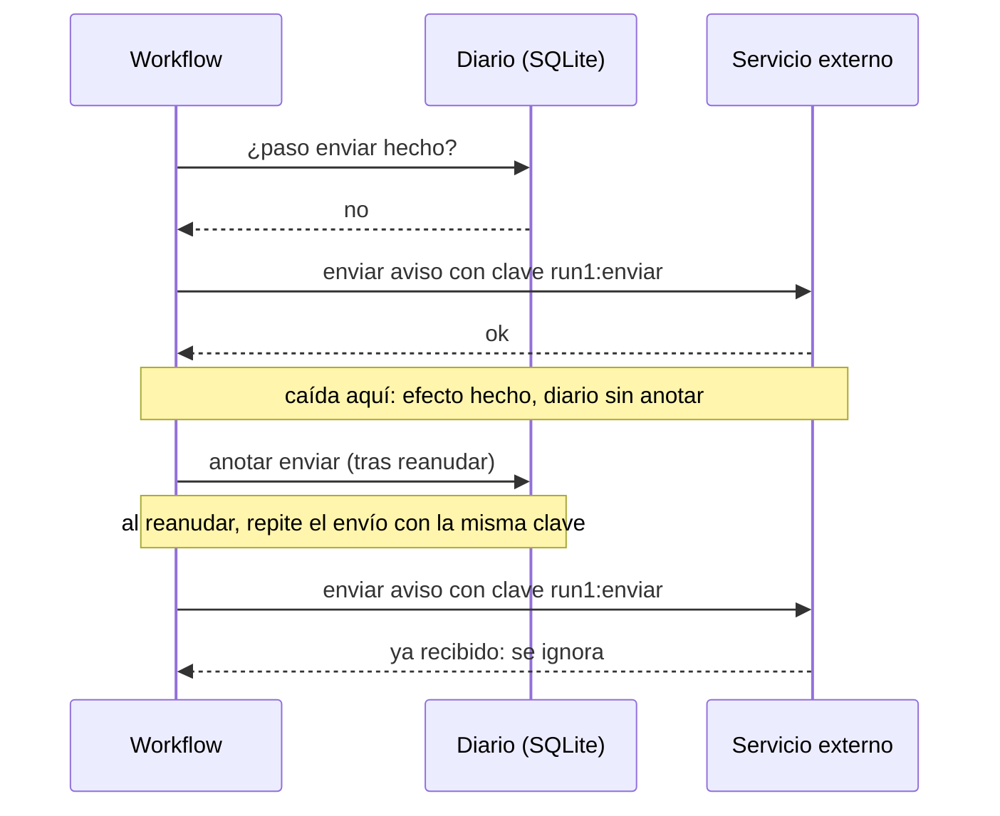
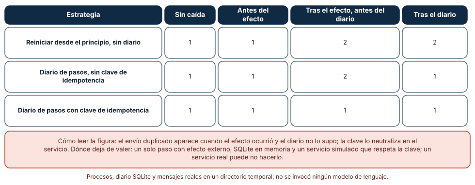
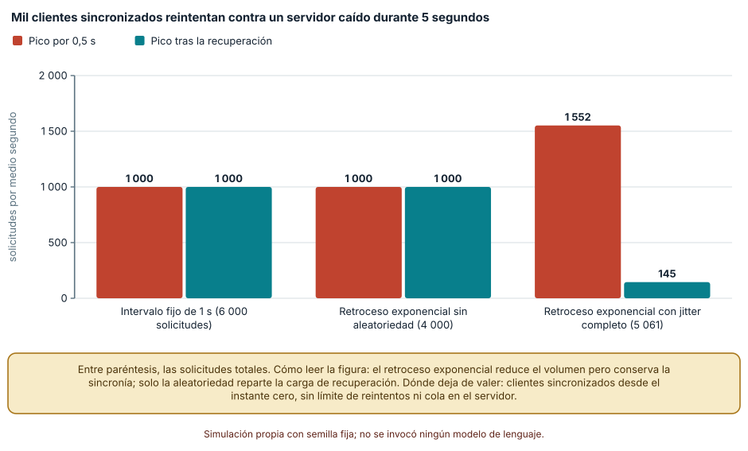

# SE-512 — Ejecución durable, reintentos e idempotencia

[← SE-511 — Interoperabilidad entre agentes: MCP y A2A](../../classes/part-42-patrones-agenticos-y-sistemas-con-llm/se-511-interoperabilidad-entre-agentes-mcp-y-a2a/README.md) · [↑ Parte 42](../../classes/part-42-patrones-agenticos-y-sistemas-con-llm/README.md) · [📚 Índice completo](../../classes/README.md) · [🌐 Portal](../../site/classes/SE-512.html) · [SE-513 — Evals y LLMOps de sistemas con LLM →](../../classes/part-42-patrones-agenticos-y-sistemas-con-llm/se-513-evals-y-llmops-de-sistemas-con-llm/README.md)

## Punto profesional y fundamento pedagógico

**Punto profesional.** La clase existe para que un sistema con LLM **sobreviva a sus propias interrupciones sin repetir ni perder efectos**. Un agente o un workflow con modelos tarda segundos o minutos, llama a servicios externos que fallan y corre en procesos que se reinician. Si se cae a mitad de camino, hay tres preguntas: ¿qué pasos ya se hicieron?, ¿cómo se reanuda sin rehacerlos? y, sobre todo, ¿qué pasa con el paso que **sí ocurrió fuera pero no se anotó dentro**? La respuesta de ingeniería es un **diario** de pasos más **claves de idempotencia** en los efectos, y reintentos con retroceso aleatorio para no convertir una caída en una tormenta.

**Por qué aparece aquí.** Sigue a `SE-511`, donde las herramientas viven en otros procesos y las tareas de otros agentes pueden durar. Aplica de la Parte 27 (mensajería y entrega al menos una vez), de la Parte 28 (fallos parciales en sistemas distribuidos) y de la Parte 31 (resiliencia) un caso específico: los efectos de un agente no se pueden «deshacer leyendo otra vez».

**Error conceptual que debe corregir.** Creer que reintentar es seguro porque «si falló, no pasó nada». El fallo que importa no es el que ocurre **antes** del efecto sino el que ocurre **después** del efecto y **antes** de que el sistema lo registre: el aviso salió, el proceso murió, al reanudar el sistema no sabe que salió y lo envía otra vez. La segunda creencia equivocada es que reintentar más rápido es reintentar mejor: mil clientes que reintentan al mismo ritmo convierten un servidor que se recupera en un servidor que se vuelve a caer.

**Secuencia de aprendizaje.** Antes de ejecutar predices cuántas veces sale un aviso que debe salir una vez bajo tres estrategias (reiniciar, diario sin clave, diario con clave) y cuatro puntos de caída, y qué política de reintento evita el pico tras la recuperación de un servidor. Después ejecutas, con un diario SQLite real y caídas inyectadas.

**Evidencia de aprendizaje.** `durable-log.md` con tu predicción, la tabla de envíos por estrategia y punto de caída, la tabla de reintentos, la clave de idempotencia que usarías en tu efecto más peligroso y la prueba que inyecta una caída entre el efecto y el diario.

**Límite de la conclusión.** El diario es una tabla SQLite en memoria con un solo paso con efecto externo; el servicio externo es simulado y **respeta la clave** de idempotencia; la tormenta de reintentos usa mil clientes sincronizados en el instante cero, sin cola ni límite de tasa en el servidor. No se probó un motor de ejecución durable real ni un servicio externo real.

### Trazabilidad fuente → afirmación

| Fuente primaria u oficial | Afirmación que respalda | Lo que no prueba |
|---|---|---|
| [Temporal, «Workflows»](https://docs.temporal.io/workflows) | Describe la ejecución durable: un historial de eventos persistido permite reanudar un workflow tras una caída reproduciendo su código de forma determinista. | No valida tu implementación ni tu diario. |
| [IETF, «The Idempotency-Key HTTP Header Field»](https://datatracker.ietf.org/doc/draft-ietf-httpapi-idempotency-key-header/) | Propone una cabecera para que un servidor reconozca repeticiones de una petición no idempotente; es un borrador de Internet, no un estándar publicado. | No garantiza que un servicio la implemente. |
| [RFC 9110, semántica HTTP](https://www.rfc-editor.org/rfc/rfc9110) | Define qué métodos son idempotentes (repetirlos tiene el mismo efecto que hacerlo una vez) y cuáles no. | No cubre efectos de aplicación como enviar un correo. |
| [AWS, «Exponential Backoff and Jitter»](https://aws.amazon.com/blogs/architecture/exponential-backoff-and-jitter/) | Explica por qué el retroceso exponencial sin aleatoriedad mantiene la sincronía de los clientes y cómo el jitter la rompe. | Sus mediciones son de un sistema concreto. |
| [SQLite, transacciones](https://www.sqlite.org/lang_transaction.html) | Documenta que una transacción confirmada es atómica y durable, base de un diario de pasos. | No dice cómo diseñar el diario. |

## Antes de empezar

Recupera `SE-508` y `SE-511`: un plan con pasos con efectos puede interrumpirse y una tarea remota es un proceso con estado. La pregunta activa es: **si el proceso que envía avisos se apagara justo después de enviar uno, ¿qué sabría el sistema al volver a arrancar y qué haría?**

## Prerrequisitos

- Haber completado `SE-511` o poder explicar el ciclo de una tarea con estados y tiempo máximo.
- Conocer de las Partes 27 y 28 la entrega al menos una vez y los fallos parciales.
- Python 3.11 o posterior con `sqlite3` de la biblioteca estándar.

## Problema auténtico

El asistente de *Avisos* ejecuta un workflow de cinco pasos para cada aviso: leer los datos, calcular el umbral, **enviar el aviso**, registrar el envío y cerrar. El envío es un efecto sobre el mundo: un estudiante recibe un mensaje. El proceso se reinicia por un despliegue mientras ejecuta el workflow. Dependiendo de **dónde** estaba ocurren cuatro cosas distintas. Si cayó antes de enviar, al reanudar hay que enviar. Si cayó después de enviar pero antes de anotarlo, el aviso salió y el sistema no lo sabe. Si cayó después de anotarlo, hay que seguir con lo que falte. Y si se reinicia desde el principio sin diario, repite todo lo que ya hizo.

Además, un servicio externo se cae cinco segundos y mil ejecuciones reintentan. Con un intervalo fijo de un segundo vuelven todas a la vez cada segundo, y si el servicio se recupera, recibe mil solicitudes de golpe. La clase mide cada caso con un diario SQLite real y un servicio simulado.

## Objetivos observables

Al terminar podrás:

1. diseñar un diario de pasos que permita reanudar un workflow sin repetir los pasos hechos;
2. identificar el único punto de caída donde el diario no basta y explicar por qué;
3. elegir y escribir una clave de idempotencia que haga seguro repetir un efecto;
4. comparar tres políticas de reintento por el pico de carga que producen;
5. decidir qué pasos de un agente son idempotentes por naturaleza y cuáles necesitan clave.

## Mapa conceptual



El diagrama muestra el caso difícil: el efecto ocurrió y el diario no lo sabe. Al reanudar, el sistema repite el envío con la **misma** clave y el servicio lo reconoce y lo ignora.

## Temas y por qué importan

| Tema | Por qué cambia una decisión profesional | Evidencia mínima |
|---|---|---|
| Diario de pasos | Permite reanudar sin rehacer lo hecho. | Envíos con y sin diario |
| Ventana efecto-diario | Es el único punto donde el diario no basta. | Envíos con caída entre ambos |
| Clave de idempotencia | Hace seguro repetir el efecto. | Envíos con clave |
| Reintentos | Un reintento sin retroceso aleatorio daña al servicio. | Pico de carga por política |
| Idempotencia natural | No todos los pasos necesitan clave. | Clasificación de pasos |
| Reconciliación | Detecta lo que el diario no pudo saber. | Una consulta de conciliación |

## Conceptos y decisiones

### 1. Por qué un agente necesita ejecución durable

Un workflow con modelos dura segundos o minutos y depende de procesos que se reinician (despliegues, escalado, fallos) y de servicios que fallan. Sin persistencia del progreso, cada interrupción obliga a empezar de cero: se pierde el tiempo, se vuelve a pagar el modelo y, peor, se repiten efectos. Los motores de **ejecución durable** (Temporal es un ejemplo documentado) resuelven esto persistiendo un historial de eventos y reanudando tras una caída reproduciendo el código hasta el punto donde se quedó. No hace falta un motor para entender el principio: un diario de pasos en una base transaccional ya lo ilustra.

### 2. El diario de pasos

El diario es una tabla `(ejecución, paso)` donde se anota cada paso al completarse. Al reanudar, el workflow lee el diario y **salta** los pasos anotados. SQLite ofrece transacciones atómicas y durables, de modo que «anotar» es una operación todo o nada. En el experimento, el workflow de cinco pasos con diario resuelve bien dos de los tres puntos de caída problemáticos: tras una caída antes del efecto, al reanudar el envío ocurre una vez; tras una caída después de anotar el envío, al reanudar el paso se salta y el aviso sale **una sola vez**. El diario evita la repetición de lo ya anotado y es barato: una escritura por paso.

### 3. La ventana entre el efecto y el diario

El diario no puede cubrir un caso: el efecto externo **ocurrió** y la anotación **no**. Entre ambos hay un instante, y si el proceso muere ahí, al reanudar el diario dice «no enviado» cuando sí se envió. En el experimento: con el diario y **sin clave**, una caída entre el efecto y la anotación produce **2 envíos**; reiniciar desde el principio sin diario produce 2 tanto en esa caída como en la posterior. No hay forma de cerrar esa ventana con un diario local, porque el efecto y la anotación son dos sistemas distintos y no hay una transacción que los abarque. Esto es una forma del problema de las dos generales: se elige entre «al menos una vez» (puede duplicar) y «como máximo una vez» (puede perder), y la idempotencia permite convertir «al menos una vez» en «exactamente una vez en efecto».

### 4. La clave de idempotencia

Una operación es **idempotente** si repetirla produce el mismo efecto que hacerla una vez. HTTP lo define para ciertos métodos (`GET`, `PUT`, `DELETE`); enviar un correo o cobrar una tarjeta no lo son por naturaleza. La técnica estándar para volver idempotente una operación es la **clave de idempotencia**: el cliente genera una clave estable para la intención («ejecución run1, paso enviar»), la envía con la petición y el servidor guarda las claves ya vistas y **ignora** una petición repetida con la misma clave devolviendo el resultado original. Un borrador del IETF propone una cabecera para esto. Con diario y clave, el experimento da **1 envío** en los cuatro puntos de caída. La clave debe derivarse de la **intención** (qué ejecución, qué paso, qué destinatario) y no de algo que cambia entre reintentos, como el instante: una clave basada en el reloj convierte cada reintento en una petición nueva (el experimento lo ilustra con la estrategia «diario sin clave», que usa un valor distinto cada vez).



**Cómo leer la figura.** Cada fila es una estrategia y cada columna un punto de caída; el color intenso y el contorno marcan los envíos duplicados. Mira que la fila de la clave no tiene ninguno y que la del diario sin clave solo falla cuando el efecto ocurrió y el diario no lo supo. **Dónde deja de valer:** hay un solo paso con efecto, el diario es SQLite en memoria y el servicio simulado **respeta la clave**; un servicio real puede no ofrecerla (entonces hay que consultar su estado antes de repetir) o implementarla con una ventana de retención limitada.

### 5. Reintentos: cuántos, cuándo y con qué retroceso

Cuando una llamada falla de forma transitoria (tiempo de espera, error 503), reintentar es razonable; pero **cuándo** reintentar importa tanto como cuántas veces. Con mil clientes sincronizados y un servicio caído cinco segundos, tres políticas dan resultados distintos. Con intervalo fijo de un segundo: 6 000 solicitudes, picos de 1 000 por medio segundo, y mil clientes golpean a la vez tras la recuperación. Con retroceso exponencial **sin aleatoriedad**: 4 000 solicitudes, pero los clientes siguen sincronizados y el pico tras la recuperación vuelve a ser de 1 000. Con retroceso exponencial y **jitter completo** (esperar un valor aleatorio entre 0 y el tope): 5 061 solicitudes y un pico tras la recuperación de 145. El retroceso exponencial reduce el volumen pero conserva la sincronía; solo la aleatoriedad reparte la carga. El pico máximo de 1 552 del jitter ocurre en los primeros instantes, donde se suman los mil primeros intentos y los reintentos más tempranos, y no pertenece a la fase de recuperación.



**Cómo leer la figura.** Cada grupo es una política de reintento con sus solicitudes totales en la etiqueta; la barra coral es el pico por medio segundo y la verde azulada, el pico tras la recuperación. Mira que solo el jitter baja la barra verde azulada: las otras dos conservan la sincronía aunque reduzcan el volumen. **Dónde deja de valer:** los clientes están sincronizados desde el instante cero, no hay límite de reintentos, ni cola ni limitación de tasa en el servidor, y cada cliente reintenta hasta tener éxito; con tráfico real, cola y límites, las cifras cambian, pero el mecanismo (la sincronía persiste sin aleatoriedad) se mantiene.

### 6. Qué pasos necesitan clave y qué pasos no

No todos los pasos de un agente son peligrosos de repetir. Leer es idempotente. Calcular, también, si es determinista. Escribir un registro con una clave natural (insertar si no existe, sobrescribir con un valor) puede serlo. Enviar un mensaje, cobrar, crear un recurso sin clave natural o disparar un proceso no lo son. La lista de pasos con efecto es corta y se anota: para cada uno, la clave que lo vuelve idempotente, el sistema que la comprueba y qué ocurre cuando ese sistema no la soporta (consultar antes, o aceptar un duplicado ocasional y mitigarlo). Cuando ni la clave ni la consulta son posibles, el paso debe ser de «como máximo una vez» con revisión humana de las dudas.


**Cómo leer la figura.** La primera fila decide si ejecutar y la segunda, qué ocurre después; el diario resuelve qué pasos faltan y la clave resuelve el único caso que el diario no puede. **Dónde deja de valer:** si el servicio externo no acepta claves, hay que consultar su estado antes de repetir; y si la consulta tampoco existe, queda la reconciliación periódica entre el diario y el servicio para detectar duplicados.

## Reconciliar: la red de seguridad

Aun con diario y claves, conviene una **reconciliación** periódica: una consulta que compara lo que el diario dice con lo que el servicio externo tiene (envíos del día frente a pasos «enviar» anotados) y señala discrepancias. No sustituye a la idempotencia: la detecta cuando falla, por ejemplo porque el servicio externo retuvo las claves solo 24 horas y la reanudación ocurrió después. Es el mismo principio que la conciliación contable: dos registros independientes de un mismo hecho.

## Definiciones de trabajo

- **Ejecución durable:** ejecución cuyo progreso se persiste para poder reanudarla tras una interrupción.
- **Diario de pasos:** registro transaccional de los pasos completados de una ejecución.
- **Idempotencia:** propiedad de una operación cuya repetición no cambia el resultado respecto a hacerla una vez.
- **Clave de idempotencia:** identificador estable de una intención que permite al servidor ignorar repeticiones.
- **Retroceso exponencial:** espera que crece de forma exponencial entre reintentos.
- **Jitter:** componente aleatorio de la espera para desincronizar a los clientes.
- **Reconciliación:** comparación periódica de dos registros independientes del mismo hecho.

## Ejemplo mínimo

Un paso con efecto que consulta el diario y usa una clave estable:

```python
import sqlite3

def ejecutar_paso(db: sqlite3.Connection, ejecucion: str, paso: str, efecto, clave: str):
    hecho = db.execute("select 1 from diario where ejecucion=? and paso=?", (ejecucion, paso)).fetchone()
    if hecho:
        return "saltado"
    efecto(clave)                       # el servicio ignora repeticiones de la misma clave
    with db:                            # transacción: o se anota o no
        db.execute("insert or ignore into diario values (?, ?)", (ejecucion, paso))
    return "hecho"
```

La clave sale de `ejecucion` y `paso`, no del reloj. Si el proceso muere entre `efecto` y la anotación, al reanudar vuelve a llamar a `efecto` con la misma clave y el servicio lo ignora.

## Ejemplo profesional

*Escenario ilustrativo: las cifras de este ejemplo son supuestos de la narración, no mediciones.*

El equipo de *Avisos* revisa su flujo de aviso masivo. Lista los pasos: leer pendientes (idempotente), calcular umbrales (determinista), enviar por correo (efecto), registrar el envío (efecto interno con clave natural) y notificar a coordinación (efecto). Para el envío, la clave es `aviso:{curso}:{estudiante}:{umbral}` y el proveedor de correo la acepta en una cabecera con retención de 24 horas; para la notificación a coordinación, que no admite claves, el diario guarda el identificador devuelto y, antes de repetir, consulta si el mensaje existe. Los reintentos usan retroceso exponencial con jitter completo, un máximo de cinco intentos y un tiempo total de dos minutos; pasado ese límite, la ejecución se marca «pendiente de revisión» y aparece en la cola humana. Cada noche una conciliación compara los envíos del proveedor con los pasos «enviar» del diario y avisa si hay duplicados o ausentes.

## Práctica guiada

1. Predice los envíos de cada estrategia en cada punto de caída.
2. Ejecuta `python scripts/experiments_part42_b.py 512` y compara con tu predicción.
3. Añade un segundo paso con efecto al workflow y vuelve a medir: ¿qué claves necesitas?
4. Cambia la política de reintento a «exponencial con jitter» y a «fijo 0,2 s» y compara el pico tras la recuperación.
5. Lista los pasos con efecto de tu sistema y escribe, para cada uno, su clave o su alternativa.

## Ejercicios

1. **Básico.** Explica por qué una clave basada en la hora actual no hace idempotente a un reintento.
2. **Intermedio.** Diseña la clave de idempotencia de «silenciar el curso 7 hasta el día 20» y di qué ocurre si dos personas la envían a la vez con fechas distintas.
3. **Avanzado.** Define una consulta de conciliación entre el diario y el proveedor de correo y cuántas discrepancias toleras antes de abrir un incidente.

## Reto verificable

Entrega `durable-log.md` con tu predicción, las dos tablas medidas, la lista de pasos con efecto de tu sistema con su clave o alternativa, la política de reintento con máximo y tiempo total, y una prueba que inyecte una caída entre el efecto y el diario y compruebe que el efecto ocurre una sola vez. Es válido si otra persona ejecuta tu prueba y obtiene el mismo resultado.

## Caso conductor

El aviso del estudiante es el efecto central de *Avisos*. Aquí se vuelve duradero y seguro de repetir. En `SE-513` se medirá cuántas ejecuciones terminan en «pendiente de revisión» como señal de operación y en `SE-516` el diario y las claves forman parte del sistema que debe superar la puerta de entrada.

## Preguntas frecuentes

### ¿Necesito un motor de ejecución durable?

No para empezar. Un diario transaccional y claves de idempotencia cubren muchos casos. Un motor aporta reanudación general, temporizadores y visibilidad, a cambio de adoptar su modelo de programación (por ejemplo, código determinista).

### ¿Puede el modelo decidir si reintentar?

Puede proponerlo, pero la política de reintentos (cuántos, cuándo, con qué retroceso) debe vivir en código, con tope. Un reintento decidido por el modelo es un bucle sin presupuesto.

### ¿Y si el servicio externo no admite claves?

Consulta su estado antes de repetir, usa un identificador que tú generes y puedas buscar después, o trata el paso como «como máximo una vez» y reconcilia. Y documenta el riesgo de duplicado.

### ¿Exactamente una vez existe?

Como entrega, no entre sistemas independientes. Como **efecto**, sí: al menos una vez más idempotencia da el mismo resultado que exactamente una vez.

## Fallo controlado y diagnóstico

**Fallo.** Tras un despliegue en horas punta, 37 estudiantes reciben el mismo aviso dos veces y el proveedor de correo muestra picos de errores de límite de tasa.

**Diagnóstico paso a paso.** (1) La traza muestra reinicios de 12 procesos en el despliegue. (2) El diario tiene los pasos de «enviar» anotados para los avisos que no se duplicaron, y no anotados para los 37. (3) El proveedor confirma que recibió los 37 envíos dos veces con claves distintas. (4) Se descubre que la clave incluía la hora de la solicitud. (5) Los límites de tasa vienen de reintentos con intervalo fijo desde los procesos reiniciados.

**Corrección.** La clave pasa a derivarse de curso, estudiante y umbral. Los reintentos usan retroceso exponencial con jitter y un máximo de intentos. Se añade la prueba de caída entre el efecto y el diario y la conciliación nocturna. Se envía una disculpa a los 37 y se registra el incidente con su causa.

## Errores comunes y cómo corregirlos

- **Clave dependiente del tiempo.** Síntoma: duplicados tras reintentos. Causa: cada intento genera otra clave. Solución: deriva la clave de la intención.
- **Reintentar sin tope ni jitter.** Síntoma: picos que tumban el servicio. Causa: clientes sincronizados. Solución: exponencial con jitter, máximo de intentos y tiempo total.
- **Anotar el diario antes del efecto.** Síntoma: avisos perdidos tras una caída. Causa: el diario dice «hecho» sin que el efecto ocurriera. Solución: anota después del efecto y apóyate en la clave.
- **Diario sin transacción.** Síntoma: anotaciones parciales. Causa: escrituras sueltas. Solución: transacción por paso.
- **Sin reconciliación.** Síntoma: duplicados descubiertos por usuarios. Causa: se confía solo en la idempotencia. Solución: conciliación periódica con alarma.

## Entorno y archivos clave

- `scripts/experiments_part42_b.py`: función `exp512` con el diario SQLite en memoria, el servicio simulado con claves y la simulación de reintentos; `python scripts/experiments_part42_b.py 512`.
- `content/part-42/figures/`: figuras de la clase.
- Entorno: CPython 3.11 o posterior con `sqlite3`; no escribe archivos, el diario es una base en memoria; semilla 4.

## Seguridad, ética y accesibilidad

Las claves de idempotencia no deben ser adivinables si dan acceso al resultado de una operación, y el diario contiene qué se hizo a quién: debe protegerse como dato personal. Una reanudación automática tras una caída ejecuta de nuevo la lógica del agente: si el plan lo escribió un modelo con contexto hostil, reanudar repite la acción hostil, de modo que los permisos se revisan también al reanudar. Ética: un duplicado de aviso a un estudiante es una molestia; un duplicado de un cobro o de una sanción es un daño, y esos pasos exigen la mayor garantía y revisión humana. Accesibilidad: las figuras son tablas y un diagrama con texto alternativo.

## Puente hacia el trabajo con agentes

Un agente de programación que implementa un reintento escribe un bucle con espera fija y reinicia el workflow desde el principio, sin diario ni claves, porque es lo más corto. La instrucción de repositorio es: «para cada paso con efecto externo escribe su clave de idempotencia y una prueba que inyecte una caída entre el efecto y el diario; los reintentos usan retroceso exponencial con jitter, máximo de intentos y tiempo total». La comprobación mecánica: la prueba de caída debe producir exactamente un efecto y la conciliación nocturna debe poder ejecutarse sobre datos de prueba.

## Transferencia

Haz la lista de pasos con efecto de un workflow tuyo. Para cada uno decide si es idempotente por naturaleza, si admite clave o si hay que consultar su estado. Escribe el diario mínimo y la prueba de caída entre efecto y diario. Fija la política de reintento y su tope, y diseña la conciliación que descubriría un duplicado.

## Evaluación y evidencia

| Criterio | Evidencia aceptable | Rechazo |
|---|---|---|
| Diario | Tabla transaccional y reanudación probada | «Reiniciamos y listo» |
| Caída entre efecto y diario | Prueba que inyecta la caída y mide el efecto | Solo la caída antes o después |
| Clave | Derivada de la intención, con quién la verifica | Basada en el tiempo |
| Reintentos | Exponencial con jitter, máximo y tiempo total | Intervalo fijo sin tope |
| Reconciliación | Consulta definida con umbral de alarma | «Lo revisamos a mano» |
| Límite | Dice que el servicio simulado respeta la clave | Afirma exactamente una vez universal |

## Fuentes

- Temporal Technologies. [«Workflows»](https://docs.temporal.io/workflows).
- IETF HTTPAPI Working Group. [«The Idempotency-Key HTTP Header Field»](https://datatracker.ietf.org/doc/draft-ietf-httpapi-idempotency-key-header/) (borrador de Internet).
- IETF. [RFC 9110, «HTTP Semantics»](https://www.rfc-editor.org/rfc/rfc9110).
- Brooker, M. [«Exponential Backoff And Jitter»](https://aws.amazon.com/blogs/architecture/exponential-backoff-and-jitter/), AWS Architecture Blog.
- SQLite. [«Transaction»](https://www.sqlite.org/lang_transaction.html).

## Límites y siguiente paso

El diario es una base SQLite en memoria con un solo paso con efecto; el servicio externo es simulado y respeta la clave; la tormenta de reintentos usa clientes sincronizados sin cola ni limitación de tasa; no se probó ningún motor de ejecución durable ni ningún proveedor real. El siguiente paso, `SE-513`, trata cómo se mide un sistema con LLM: evaluaciones, ruido, jueces, trazas y puertas de release.

## Glosario

| Término | Definición breve |
|---|---|
| Ejecución durable | Ejecución cuyo progreso se persiste para reanudarla |
| Diario de pasos | Registro transaccional de pasos completados |
| Idempotencia | Repetir equivale a hacerlo una vez |
| Clave de idempotencia | Identificador estable de una intención |
| Retroceso exponencial | Espera que crece entre reintentos |
| Jitter | Aleatoriedad en la espera para desincronizar |
| Reconciliación | Comparación de dos registros del mismo hecho |
