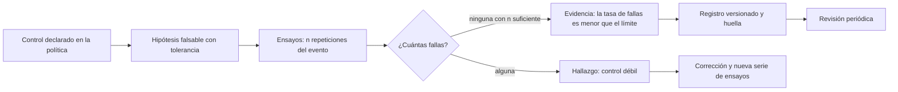
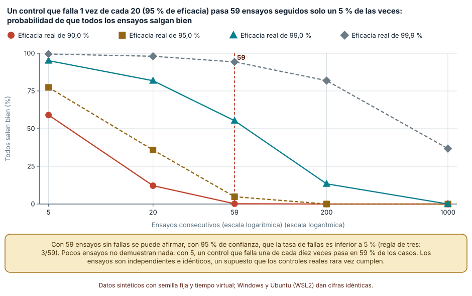
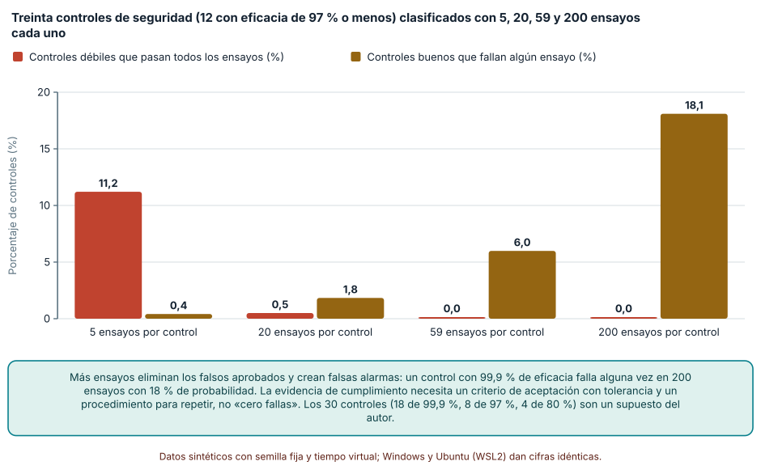
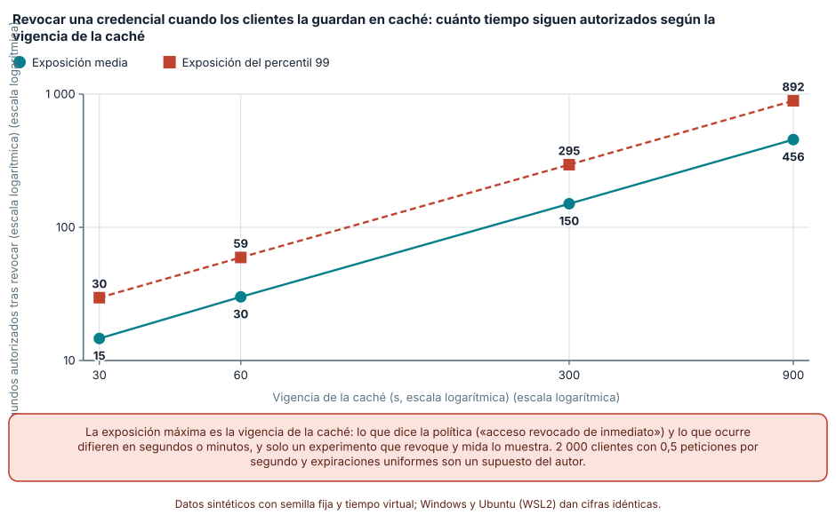

# SE-514 — Aprender de los experimentos: hallazgos, métricas y mejora

[← SE-513 — Seguridad y gobernanza de los experimentos: abortar, autorizar y registrar](../../classes/part-42-ingenieria-del-caos/se-513-seguridad-y-gobernanza-de-los-experimentos-abortar-autorizar-y-registrar/README.md) · [↑ Parte 42](../../classes/part-42-ingenieria-del-caos/README.md) · [📚 Índice completo](../../classes/README.md) · [🌐 Portal](../../site/classes/SE-514.html) · [SE-515 — Taller: ejecutar un experimento de caos acotado con criterio de aborto →](../../classes/part-42-ingenieria-del-caos/se-515-taller-ejecutar-un-experimento-de-caos-acotado-con-criterio-de-aborto/README.md)

## Punto profesional y fundamento pedagógico

**Punto profesional.** La clase trata el aprendizaje que deja un experimento (cuántos ensayos sostienen una conclusión, cómo se clasifican los hallazgos y qué evidencia queda), usando como dominio los controles de seguridad y de cumplimiento. Existe para que apliques el método a los **controles de seguridad y de cumplimiento**: comprobar con un experimento que una credencial revocada deja de funcionar, que un certificado vencido se detecta, que un registro de auditoría sigue escribiéndose cuando su almacén falla, y producir con ello la **evidencia** que un auditor pide en lugar de una declaración. Un control que existe en una política no es un control que funciona, y la diferencia se mide con ensayos.

**Por qué aparece aquí.** Sigue a `SE-513`: allí se fijó quién autoriza y registra un experimento; aquí se pregunta qué se aprende de él y con qué solidez. Usa las credenciales y los gates de seguridad de la Parte 40 (`SE-483`, `SE-484`) y la continuidad de la Parte 41 (`SE-502`). El caso conductor es el acceso de los estudiantes y del personal a la API de entregas.

**Error conceptual que debe corregir.** Creer que «cero fallas en los ensayos» demuestra que un control funciona, o que cualquier número de ensayos es suficiente. Con pocos ensayos un control débil pasa; con muchos, uno bueno falla alguna vez; la evidencia exige un criterio de aceptación con tolerancia y un número de ensayos acorde.

**Secuencia de aprendizaje.** Antes de ver los resultados predices con qué probabilidad un control que falla 1 de cada 20 veces pasa 59 ensayos seguidos, cuántos controles débiles aprueba una auditoría de 5, 20, 59 o 200 ensayos por control y cuánto tiempo siguen autorizados los clientes tras revocar una credencial según la vigencia de su caché. Después contrastas la predicción con tres experimentos y redactas el criterio de aceptación de un control propio. [ICAP](https://icap.education.asu.edu/research) distingue participación de construcción de conocimiento; [How People Learn II](https://nap.nationalacademies.org/catalog/24783/how-people-learn-ii-learners-contexts-and-cultures) respalda diseñar la práctica con contextos reales y retroalimentación.

**Evidencia de aprendizaje.** `seguridad-caos-log.md` con la predicción, las tres figuras reproducidas, la lista de controles de tu servicio con el experimento que cada uno tendría y su criterio de aceptación (ensayos y tolerancia), y una nota que separe lo que el modelo muestra de lo que habría que comprobar con un auditor real.

**Límite de la conclusión.** Los controles, sus eficacias, los 2 000 clientes y las vigencias de caché son sintéticos, con semilla fija. No se atacó, auditó ni revocó nada real; las cifras muestran un mecanismo estadístico y de diseño, no el estado de seguridad de tu sistema, y la clase no sustituye una auditoría ni una prueba de intrusión.

### Trazabilidad fuente → afirmación

| Fuente primaria u oficial | Afirmación que respalda | Lo que no prueba |
|---|---|---|
| [Netflix: «The Netflix Simian Army» (2011)](https://netflixtechblog.com/the-netflix-simian-army-16e57fbab116) | Presenta Security Monkey, extensión de Conformity Monkey, que busca violaciones de seguridad o vulnerabilidades, como grupos de seguridad mal configurados, y comprueba que los certificados SSL y DRM sean válidos y no estén por vencer. | No dice cuántas violaciones encontró ni que sustituya una auditoría. |
| [Reglamento (UE) 2022/2554 (DORA)](https://eur-lex.europa.eu/eli/reg/2022/2554/oj) | Es el reglamento de la Unión Europea sobre resiliencia operativa digital del sector financiero, que incluye requisitos de gestión del riesgo de TIC y de pruebas de resiliencia. | No se aplica a la plataforma educativa del caso; se cita como ejemplo de regulación que exige evidencia de pruebas. |
| [NIST SP 800-34 Rev. 1: Contingency Planning Guide](https://csrc.nist.gov/pubs/sp/800/34/r1/upd1/final) | Guía de planificación de contingencias para sistemas de información que trata la elaboración, la prueba y el mantenimiento de los planes. | No fija cuántos ensayos hacen falta. |
| [Principles of Chaos Engineering](https://principlesofchaos.org/) | Incluye entre los eventos a variar los fallos de hardware y de software y pide centrarse en la salida medible. | No se refiere a la seguridad ofensiva. |
| [IETF RFC 5280](https://www.rfc-editor.org/rfc/rfc5280) | Define el perfil de los certificados X.509, incluida su validez temporal. | No describe cómo se renuevan en tu entorno. |

## Antes de empezar

Recupera lo aprendido en `SE-513`: un experimento se autoriza, se acota y se registra. La pregunta activa es: **cuando la política dice «el acceso de una persona que deja el equipo se revoca de inmediato», ¿cuánto tarda de verdad, cuántas peticiones siguen autorizadas durante ese tiempo y qué ensayos le darías a un auditor como prueba?**

## Prerrequisitos

- Haber completado `SE-506` y `SE-513` o poder escribir un experimento con radio, aborto y reversión.
- Conocer las credenciales de corta vida y la verificación de identidad en el pipeline (`SE-484`) y la idea de caché con vigencia.
- Python 3.11 o posterior; los experimentos usan solo la biblioteca estándar.

## Problema auténtico

La plataforma educativa revisa su acceso para una auditoría. La política dice: «una cuenta desactivada pierde acceso de inmediato». La auditoría pide evidencia, y el equipo muestra la política y una captura del botón «desactivar». El auditor pregunta: ¿alguna vez se comprobó que una sesión abierta deja de funcionar? Nadie lo había hecho. Al medirlo se descubre que la API guarda en caché la autorización de cada cliente durante quince minutos: una cuenta desactivada sigue entregando archivos hasta 15 minutos, 450 peticiones adicionales por cliente con 0,5 peticiones por segundo, y el certificado de uno de los servicios internos vence en 9 días sin alerta. Ninguno de los dos defectos violaba una afirmación escrita; violaban la que nadie había comprobado.

## Objetivos observables

Al terminar podrás:

1. escribir una hipótesis de seguridad o de cumplimiento con un criterio de aceptación en ensayos y tolerancia;
2. calcular la probabilidad de que un control débil pase una serie de ensayos y cuántos ensayos hacen falta para sostener una tasa de éxito con una confianza;
3. medir la exposición tras una revocación según la vigencia de la caché y compararla con la afirmación de la política;
4. distinguir un experimento de caos de seguridad de una prueba de intrusión y de una auditoría;
5. diseñar la evidencia (qué se ejecuta, qué se registra y cómo se conserva) para que un tercero la compruebe.

## Mapa conceptual



El mapa separa la **hipótesis** de la **evidencia**. Una afirmación de cumplimiento queda sostenida solo por un número de ensayos y una tolerancia que se declaran, no por la ausencia de hallazgos en una prueba.

## Temas y por qué importan

| Tema | Por qué cambia una decisión profesional | Evidencia mínima |
|---|---|---|
| Control declarado frente a comprobado | Lo que la política dice y lo que el sistema hace difieren. | Predicción, traza causal y contraejemplo de **Control declarado frente a comprobado** en `seguridad-caos-log.md` |
| Número de ensayos | Pocos ensayos aprueban controles débiles; muchos fallan a los buenos. | Predicción, traza causal y contraejemplo de **Número de ensayos** en `seguridad-caos-log.md` |
| Exposición tras una revocación | La caché convierte «de inmediato» en minutos. | Predicción, traza causal y contraejemplo de **Exposición tras una revocación** en `seguridad-caos-log.md` |
| Caos de seguridad frente a intrusión | Una prueba pregunta si el control funciona; la otra, si alguien puede entrar. | Predicción, traza causal y contraejemplo de **Caos de seguridad frente a intrusión** en `seguridad-caos-log.md` |
| Evidencia de cumplimiento | Un tercero debe poder comprobar el resultado. | Predicción, traza causal y contraejemplo de **Evidencia de cumplimiento** en `seguridad-caos-log.md` |

## Conceptos y decisiones

### 1. Qué es el caos de seguridad y qué no es

El **caos de seguridad** aplica el método (estado estable, hipótesis, falla inyectada, comparación) a los controles de seguridad: la pregunta es «¿el control sigue funcionando cuando algo falla o cambia?». Los ejemplos son concretos: ¿una credencial revocada deja de funcionar?, ¿una regla de red mal puesta se detecta?, ¿el registro de auditoría sigue escribiéndose si su almacén se llena?, ¿qué ocurre si un certificado vence?, ¿el sistema falla cerrado (niega acceso) o abierto (lo permite) cuando el servicio de autorización no responde? [Netflix incluyó](https://netflixtechblog.com/the-netflix-simian-army-16e57fbab116) esa idea desde 2011 con Security Monkey, extensión de Conformity Monkey: busca violaciones de seguridad o vulnerabilidades, como grupos de seguridad mal configurados, termina las instancias que las presentan y comprueba que los certificados SSL y DRM sean válidos y no estén por vencer.

Se distingue de dos prácticas vecinas. La **prueba de intrusión** (y el ejercicio de equipo rojo) pregunta si una persona atacante puede entrar y se conduce como un adversario; el caos de seguridad pregunta si un control concreto funciona cuando las cosas cambian y se conduce como un experimento con hipótesis, radio y aborto. Y la **auditoría** revisa documentación, entrevistas y muestras; el experimento produce una de las muestras. Las tres se complementan y ninguna sustituye a las otras. Esta clase no enseña a atacar: enseña a comprobar que lo que se declaró protege, con las mismas reglas de autorización, alcance y aborto de `SE-506` y `SE-513`.

### 2. Cuántos ensayos hacen falta: la aritmética de la evidencia

Un ensayo es una repetición del evento (revocar una credencial y comprobar que deja de funcionar). Si el control tiene eficacia real p, la probabilidad de que n ensayos independientes salgan todos bien es `p^n`. Un control con eficacia de 95 % (falla una vez de cada veinte) pasa 5 ensayos con probabilidad 77 %, 20 ensayos con 36 % y 59 ensayos con solo 4,8 %. Eso fija la **regla de tres**: si n ensayos salen bien, con 95 % de confianza la tasa de fallas es menor que 3/n; con 59 ensayos, menor que 5 %. No es una peculiaridad: es la forma de pasar de «no vimos fallas» a «la tasa de fallas es menor que el límite con tal confianza».

```python
tabla = {(p, n): p ** n for p in (0.9, 0.95, 0.99, 0.999) for n in (5, 20, 59, 200, 1000)}
# cobertura de la regla de tres: de los controles que pasan 59 ensayos sin fallas, ¿cuántos eran débiles (p < 0,95)?
```



**Cómo leer la figura.** El eje horizontal es el número de ensayos (escala logarítmica) y el vertical la probabilidad de que todos salgan bien; cada línea es una eficacia real. Con 5 ensayos, un control de 90 % pasa 59 % de las veces: una prueba corta lo aprueba. Con 59 ensayos, pasa 0,2 %; uno de 95 % pasa 4,8 %; uno de 99 %, 55 %; uno de 99,9 %, 94 %. **Dónde deja de valer:** la fórmula supone ensayos independientes y de eficacia constante; un control cuyo comportamiento depende de la hora, del volumen o de un estado acumulado (una caché que se llena) no cumple eso, y los ensayos repetidos de un día no representan los de otro. Se simulan 20 000 controles con eficacias de 90 a 99 % elegidas al azar: 3 174 pasan 59 ensayos sin fallas y de esos 2,4 % eran débiles (eficacia menor que 95 %), cota que la regla garantiza como máximo 5 %.

### 3. Clasificar controles: falsos aprobados y falsas alarmas

Una auditoría revisa muchos controles, cada uno con pocos ensayos. Se modelan 30 controles: 18 con eficacia de 99,9 %, 8 de 97 % y 4 de 80 %. Se les aplican 5, 20, 59 o 200 ensayos con el criterio «cero fallas» y se cuentan dos errores: el **débil que pasa** (eficacia menor que 95 %, que debía fallar) y el **bueno que falla** (eficacia de 99 % o más, que debía pasar).



**Cómo leer la figura.** Cada grupo es un número de ensayos por control; la barra roja es el porcentaje de controles débiles que pasan todos los ensayos y la dorada el de controles buenos que fallan alguno. Con 5 ensayos, 11 % de los controles débiles pasan y casi ningún bueno falla; con 20, los débiles que pasan son 0,5 % y los buenos que fallan, 1,8 %; con 59, ya no pasa ningún débil pero fallan 6 % de los buenos; con 200, fallan 18 % de los buenos. **Dónde deja de valer:** los 30 controles y sus eficacias son un supuesto del autor, y «cero fallas» es un criterio que penaliza ensayos largos; con una tolerancia (por ejemplo, hasta una falla en 200) la tabla cambia, y la elección del criterio es una decisión que se documenta.

La consecuencia es que el criterio de aceptación es parte de la evidencia: «59 ensayos, cero fallas» sostiene «tasa de fallas menor que 5 %»; «200 ensayos, hasta 2 fallas» sostiene otra cosa. Se escribe antes del experimento, se aplica sin cambiarlo tras ver el resultado y se registra con él. El caso opuesto, ejecutar hasta que pase, destruye el sentido de la evidencia.

### 4. Exposición tras una revocación

Una afirmación clásica de política es «el acceso se revoca de inmediato». Se mide con un experimento: se revoca una credencial y se comprueba cuánto tiempo y cuántas peticiones siguen siendo autorizadas. El mecanismo que lo alarga es la **caché de autorización**: cada cliente guarda la decisión durante una vigencia (TTL) y la revisa al expirar. Si la revocación ocurre en un instante cualquiera, cada cliente conserva el acceso hasta que expire su entrada, que está a una distancia uniforme entre 0 y TTL; la exposición media es TTL/2 y la máxima, TTL. Con 2 000 clientes que hacen 0,5 peticiones por segundo, se calculan las exposiciones y las peticiones autorizadas para cinco vigencias.



**Cómo leer la figura.** El eje horizontal es la vigencia de la caché en escala logarítmica y el vertical la exposición en segundos (también logarítmico); la línea inferior es la media y la superior el percentil 99. Con 30 s, la exposición media es de 15 s y el percentil 99, 30; con 300 s, 150 y 295 s; con 900 s, 456 y 892 s, es decir, casi 15 minutos: unas 456 000 peticiones autorizadas tras revocar entre los 2 000 clientes. Sin caché la exposición es 0. **Dónde deja de valer:** el modelo supone que todos los clientes comparten la misma vigencia y que la revocación solo se aprende al expirar; con un canal de invalidación (el servidor avisa) la exposición baja, y con cachés anidadas (cliente, balanceador, servicio) se suman. El experimento verdadero revoca y mide en tu sistema.

La conclusión práctica es doble. La afirmación «de inmediato» se reemplaza por una medida («en un máximo de 30 segundos, comprobado con 59 ensayos»), y el diseño se ajusta a ella: vigencias cortas para las decisiones sensibles, un canal de invalidación para las revocaciones o una lista de revocación consultada en cada petición cuando el costo lo permite. Y la prueba se repite cada vez que el diseño de la caché cambia, porque es una regresión de seguridad como las de `SE-512`.

### 5. Evidencia de cumplimiento

Una norma o un auditor no pide que el sistema sea seguro: pide **evidencia** de que los controles funcionan. [El reglamento europeo DORA](https://eur-lex.europa.eu/eli/reg/2022/2554/oj) sobre resiliencia operativa digital del sector financiero, por ejemplo, incluye requisitos de gestión del riesgo de TIC y de pruebas de resiliencia, y la [guía de planificación de contingencias del NIST](https://csrc.nist.gov/pubs/sp/800/34/r1/upd1/final) trata la elaboración, la prueba y el mantenimiento de los planes. No se aplican a la plataforma educativa del caso, pero ilustran la forma: lo que se exige es un procedimiento de prueba repetible y un registro. La evidencia de un experimento de seguridad contiene la hipótesis y el criterio de aceptación escritos de antemano, el entorno y la versión probados, el número de ensayos y el resultado de cada uno, la fecha y quién lo ejecutó, y una huella del conjunto (`SE-516`) para que nadie pueda cambiarlo sin que se note. Guardar datos personales como parte de la evidencia es un riesgo propio: se usan cuentas de prueba.

## Definiciones de trabajo

- **caos de seguridad:** aplicación del método de la ingeniería del caos a los controles de seguridad.
- **ensayo:** una repetición del evento con el que se comprueba un control.
- **criterio de aceptación:** número de ensayos y tolerancia de fallas escritos antes del experimento.
- **regla de tres:** con n ensayos sin fallas, la tasa de fallas es menor que 3/n con 95 % de confianza.
- **vigencia de la caché (TTL):** tiempo durante el cual un cliente reutiliza una decisión de autorización sin consultarla.
- **evidencia de cumplimiento:** registro verificable de un procedimiento de prueba, su criterio y su resultado.

Las definiciones son operativas para la API de entregas. No convierten términos con una historia más amplia en sinónimos y deben contrastarse con las fuentes enlazadas.

## Ejemplo mínimo

El fragmento calcula la probabilidad de que un control de eficacia p pase n ensayos y el número de ensayos que sostienen una cota. Antes de ejecutarlo, predice cuántos ensayos hacen falta para sostener una tasa de fallas menor que 1 %.

```python
import math
def pasa(p: float, n: int) -> float:
    return p ** n

def ensayos_para(cota: float, confianza: float = 0.95) -> int:
    return math.ceil(math.log(1 - confianza) / math.log(1 - cota))

print(round(pasa(0.95, 59), 3), ensayos_para(0.05), ensayos_para(0.01))
```

Imprime `0.048 59 299`. Sostener una tasa de fallas menor que 5 % exige 59 ensayos sin fallas y menor que 1 %, 299. Registra versión de Python, comando y salida; luego calcula cuántos ensayos hacen falta si se aceptan hasta dos fallas.

## Ejemplo profesional

Supón, como caso hipotético y no como medición, que el equipo de la API de entregas escribe para cada control un criterio de aceptación. Para la revocación: «con 59 ensayos con cuentas de prueba, el acceso termina en menos de 30 s en todos»; para los certificados internos: «una prueba mensual con un certificado de prueba vencido comprueba que salta la alerta con 30 días de antelación»; para el registro de auditoría: «con el almacén lleno, la API deja de aceptar escrituras sensibles (falla cerrada) y emite una alerta en menos de 60 s». Cada experimento tiene radio de una cuenta de prueba, aborto, reversión y un responsable, y conserva su evidencia con huella. Registra qué no verifica (que un atacante no pueda evadir el control con otra vía) y a quién avisa si un ensayo falla.

## Práctica guiada

1. Predice, por escrito, la probabilidad de que un control de 99 % pase 59 ensayos y cuántos controles débiles aprobarían 20 ensayos.
2. Ejecuta `python scripts/experiments_part42_b.py e514` y compara; anota la mayor diferencia con tu predicción.
3. Cambia el criterio a «hasta 1 falla» y recalcula los débiles que pasan y los buenos que fallan con 200 ensayos.
4. Cambia la vigencia de la caché de 300 s a 60 s y calcula la reducción de peticiones autorizadas tras revocar.
5. Escribe el criterio de aceptación de tres controles de tu servicio con ensayos, tolerancia y entorno de prueba.
6. Entrega `seguridad-caos-log.md` y pide a otra persona que identifique un control cuyo ensayo no pueda hacerse con cuentas de prueba.

## Ejercicios

1. **Probabilidad:** un control de 98 % de eficacia: calcula la probabilidad de que pase 10, 30 y 100 ensayos.
2. **Ensayos:** calcula cuántos ensayos hacen falta para sostener «menos de 2 % de fallas» con 95 % de confianza si no se toleran fallas.
3. **Exposición:** con vigencia de 120 s, 800 clientes y 1 petición cada 4 s, calcula la exposición media y las peticiones autorizadas tras revocar.
4. **Clasificación:** di si un experimento de revocación, uno de un intento de acceso con una credencial robada y una auditoría de documentos son caos de seguridad, prueba de intrusión o auditoría.

## Reto verificable

Entrega `seguridad-caos-log.md` con la predicción, las tres tablas de resultados reproducidas con las mismas semillas, el criterio de aceptación de al menos tres controles de tu servicio con su entorno de prueba y una medición de exposición tras una revocación en tu sistema (con cuentas de prueba). Se aprueba si otra persona ejecuta el código desde un checkout limpio, obtiene las mismas cifras y encuentra un control cuyo criterio de aceptación no sostiene lo que la política afirma. No se aprueba por mostrar capturas de configuración como evidencia ni por ejecutar el ensayo hasta que pase.

## Caso conductor

El acceso a la API de entregas sigue siendo el caso conductor. Esta clase deja el décimo artefacto: criterios de aceptación de controles con su evidencia. `SE-515` ejecuta un experimento acotado con criterio de aborto y `SE-516` reúne todo en un programa con validador y huella. Cambia después un solo dato, la vigencia de la caché, y observa cuántas peticiones siguen autorizadas tras una revocación.

## Preguntas frecuentes

### ¿Esto reemplaza una prueba de intrusión?

No. Una prueba de intrusión explora si alguien puede entrar por caminos que nadie previó; el caos de seguridad comprueba que los controles previstos funcionan cuando cambian las condiciones. Responden preguntas distintas y se complementan.

### ¿Se pueden hacer estos experimentos en producción?

Con cuentas de prueba, un radio mínimo, aborto y autorización explícita de quien responde por el control. Los que afectan a credenciales o a registros de auditoría de personas reales se hacen en un entorno aislado.

### ¿Qué número de ensayos debo usar?

El que sostenga la cota que quieres afirmar con la confianza que aceptas: 59 para menos de 5 %, 299 para menos de 1 % con cero fallas. Si el ensayo es caro, la cota afirmada será más modesta, y se escribe así.

### ¿Un registro de ensayos basta para una auditoría?

Un buen registro con criterio previo, entorno, resultados y huella es la evidencia más fuerte que un experimento puede dar; pero la auditoría revisa también el diseño, las excepciones y el alcance, y no la sustituye.

## Fallo controlado y diagnóstico

Reproduce el fallo clásico de la clase: **repetir el ensayo hasta que pase**. Aplica la revocación a un control con eficacia de 95 % y ejecútalo en series de 5 ensayos hasta que una serie salga sin fallas.

Registra síntoma, entrada mínima, hipótesis, observación que descarta cada hipótesis, causa, corrección y prueba de regresión. **Síntoma:** el informe declara el control «verificado» con una serie de 5 ensayos sin fallas, tras tres series que tuvieron fallas. **Hipótesis rivales:** (a) el control mejoró entre series; (b) las series tuvieron mala suerte; (c) el criterio se aplicó solo a la serie favorable. **Prueba:** calcula la probabilidad de obtener alguna serie limpia de 5 ensayos en 5 intentos con p = 95 %: es 1 − (1 − 0,774)⁵ = 99,9 %. **Conclusión:** repetir hasta que pase hace que casi cualquier control apruebe. **Regresión:** añade una regla que registre todas las series y fije el número de ensayos y el criterio de antemano. No cambies a la vez el control y el criterio.

## Errores comunes y cómo corregirlos

| Síntoma | Causa probable | Corrección |
|---|---|---|
| «Revocación inmediata» no lo es | Caché de autorización sin invalidación | Medir la exposición y ajustar la vigencia o invalidar |
| Un control débil aprueba la auditoría | Pocos ensayos | Fijar ensayos acordes a la cota que se afirma |
| Un control bueno falla alguna vez | Criterio «cero fallas» con muchos ensayos | Declarar tolerancia y repetición antes del experimento |
| Evidencia que no se puede comprobar | Capturas sin versión ni huella | Registro versionado con criterio, entorno y huella |
| Datos personales en la evidencia | Pruebas con cuentas reales | Usar cuentas de prueba y revisar el registro |

## Entorno y archivos clave

```text
work/SE-514/
├── README.md
├── seguridad/
│   ├── ensayos.py
│   ├── revocacion.py
│   └── criterios.yaml
├── tests/test_ensayos.py
└── evidence/seguridad-caos-log.md
```

El `README` declara plataforma, versión de Python, semillas y comandos. Los experimentos usan solo la biblioteca estándar y se ejecutaron con CPython 3.12.9 en Windows 11 y 3.12.3 en Ubuntu bajo WSL2 con resultados idénticos. Para recuperar el estado, borra `work/SE-514/` y vuelve a ejecutar los scripts. Si añades una dependencia, fija procedencia y versión.

## Seguridad, ética y accesibilidad

- un experimento de seguridad exige autorización escrita de quien responde por el sistema, un alcance definido y un aborto probado; sin ellas es una intrusión;
- usa solo cuentas, credenciales y certificados de prueba, y no pongas secretos reales en los registros ni en la evidencia;
- no pruebes controles de terceros ni sistemas compartidos sin su acuerdo;
- documenta las tablas y las figuras con texto alternativo y en un formato que un lector de pantalla pueda recorrer;
- respeta las licencias de los libros y artículos y atribuye lo adaptado.

## Puente hacia el trabajo con agentes

Un agente al que se le pide «verifica que el acceso se revoca» tenderá a ejecutar una sola vez el caso favorable y a declarar el control verificado. Pídele en cambio que fije antes el número de ensayos y el criterio, que use solo cuentas de prueba, que registre todas las series y que reporte la cota que sostiene la evidencia. Revisa especialmente si guarda secretos en los registros, si ejecuta contra una cuenta real y si cambia el criterio después de ver los resultados.

## Transferencia

Traslada el análisis a otro control (el cifrado de las copias, el aislamiento entre clientes, la rotación de claves): escribe su hipótesis, el criterio de aceptación y el experimento con cuentas de prueba. La transferencia está lograda cuando puedes decir qué cota sostiene la evidencia y qué no, no cuando el control tiene un ensayo.

## Evaluación y evidencia

| Criterio | Evidencia para aprobar |
|---|---|
| comprensión | explicación de ensayos, regla de tres y exposición por caché |
| corrección | probabilidades, clasificación y exposición reproducibles con las mismas semillas |
| diseño | criterio de aceptación escrito antes con ensayos, tolerancia y entorno |
| diagnóstico | reproducción del fallo «repetir hasta que pase» con regresión |
| incertidumbre | declaración de que los controles y sus eficacias son sintéticos |
| reproducibilidad | versiones, comandos, salida y límites declarados |

## Fuentes

- [Netflix: The Netflix Simian Army](https://netflixtechblog.com/the-netflix-simian-army-16e57fbab116) — Security Monkey y verificación de certificados; autoridad: blog de ingeniería de Netflix.
- [Reglamento (UE) 2022/2554 sobre resiliencia operativa digital del sector financiero](https://eur-lex.europa.eu/eli/reg/2022/2554/oj) — pruebas de resiliencia como requisito regulatorio; autoridad: Diario Oficial de la Unión Europea.
- [NIST SP 800-34 Rev. 1: Contingency Planning Guide for Federal Information Systems](https://csrc.nist.gov/pubs/sp/800/34/r1/upd1/final) — planificación, prueba y mantenimiento de contingencias; autoridad: National Institute of Standards and Technology.
- [Principles of Chaos Engineering](https://principlesofchaos.org/) — variar eventos reales y medir la salida; autoridad: documento vivo de la comunidad de ingeniería del caos.
- [IETF RFC 5280](https://www.rfc-editor.org/rfc/rfc5280) — validez temporal de los certificados X.509; autoridad: Internet Engineering Task Force.

Cada fuente respalda el mecanismo indicado; ninguna demuestra que 4,8 % de probabilidad de pasar, 456 s de exposición media o 6 % de controles buenos que fallan se observen en un sistema real. Esa afirmación depende de los controles, de la caché y de los ensayos.

## Límites y siguiente paso

Se ejecutaron tres experimentos con semilla fija en Windows y Ubuntu (WSL2) con resultados idénticos. No se atacó, auditó ni revocó nada real; los 30 controles, sus eficacias, los 2 000 clientes, las vigencias de caché y el criterio «cero fallas» son construcciones del autor, y la clase no sustituye una auditoría ni una prueba de intrusión. La siguiente clase es un taller: ejecutar, en simulación, un experimento acotado con grupo de control y criterio de aborto.

## Glosario

- **caos de seguridad:** aplicación del método de la ingeniería del caos a los controles de seguridad.
- **ensayo:** una repetición del evento con el que se comprueba un control.
- **criterio de aceptación:** número de ensayos y tolerancia de fallas escritos antes del experimento.
- **regla de tres:** con n ensayos sin fallas, la tasa de fallas es menor que 3/n con 95 % de confianza.
- **vigencia de la caché (TTL):** tiempo durante el cual un cliente reutiliza una decisión de autorización.
- **evidencia de cumplimiento:** registro verificable de un procedimiento de prueba, su criterio y su resultado.

---

[← SE-513 — Seguridad y gobernanza de los experimentos: abortar, autorizar y registrar](../../classes/part-42-ingenieria-del-caos/se-513-seguridad-y-gobernanza-de-los-experimentos-abortar-autorizar-y-registrar/README.md) · [↑ Parte 42](../../classes/part-42-ingenieria-del-caos/README.md) · [📚 Índice completo](../../classes/README.md) · [🌐 Portal](../../site/classes/SE-514.html) · [SE-515 — Taller: ejecutar un experimento de caos acotado con criterio de aborto →](../../classes/part-42-ingenieria-del-caos/se-515-taller-ejecutar-un-experimento-de-caos-acotado-con-criterio-de-aborto/README.md)
