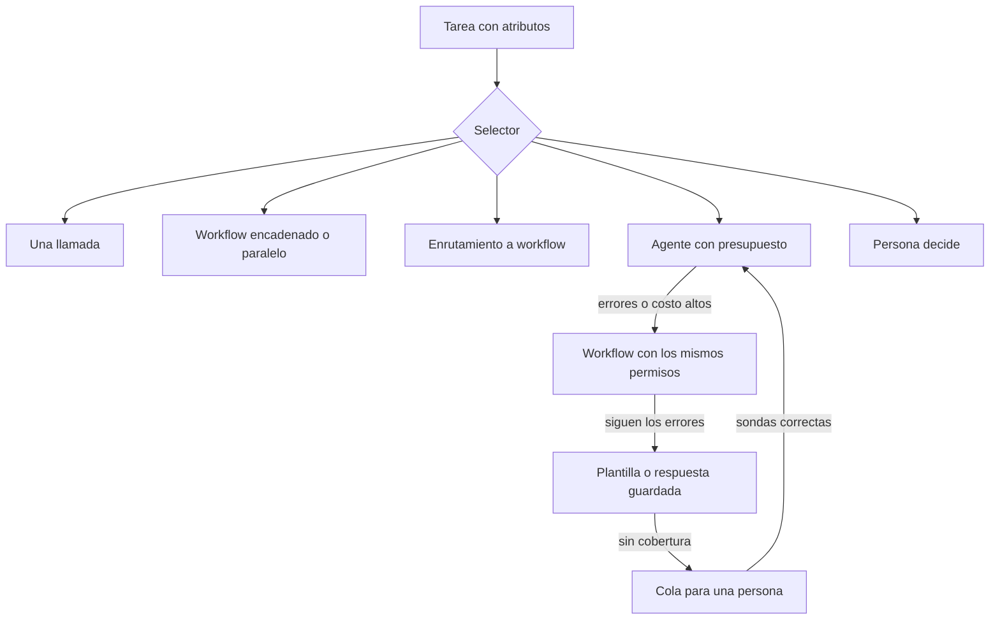

# SE-515 — Taller: elegir y degradar un patrón agéntico

[← SE-514 — Costo, latencia y seguridad en sistemas con LLM](../../classes/part-42-patrones-agenticos-y-sistemas-con-llm/se-514-costo-latencia-y-seguridad-en-sistemas-con-llm/README.md) · [↑ Parte 42](../../classes/part-42-patrones-agenticos-y-sistemas-con-llm/README.md) · [📚 Índice completo](../../classes/README.md) · [🌐 Portal](../../site/classes/SE-515.html) · [SE-516 — Proyecto: sistema con LLM evaluado y operable →](../../classes/part-42-patrones-agenticos-y-sistemas-con-llm/se-516-proyecto-sistema-con-llm-evaluado-y-operable/README.md)

## Punto profesional y fundamento pedagógico

**Punto profesional.** El taller existe para que practiques dos decisiones que en un sistema real se toman bajo presión: **elegir** el patrón agéntico más simple que resuelve una tarea y **degradarlo** de forma ordenada cuando el entorno falla (el proveedor del modelo se cae, el costo se dispara, la latencia se vuelve inaceptable). Elegir se vuelve una función con reglas escritas y probadas, no una conversación. Degradar se vuelve un mecanismo con disparadores, escalones y vuelta atrás, que se ensaya antes del incidente. Quien lo ha hecho una vez sabe que el mejor sistema no es el que nunca falla sino el que falla hacia un comportamiento seguro y conocido.

**Por qué aparece aquí.** Es la clase práctica de la parte: reúne la elección de `SE-505` a `SE-508`, la memoria y la recuperación de `SE-509` y `SE-510`, la durabilidad de `SE-512` y las restricciones de `SE-513` y `SE-514`. Aplica a un sistema con LLM la idea de degradación elegante de la Parte 31 y el interruptor de circuito de la Parte 28, y deja preparado el proyecto de `SE-516`.

**Error conceptual que debe corregir.** Creer que degradar es «tener un plan B» escrito en un documento. Un plan que no se ejecuta con frecuencia falla cuando hace falta: el nivel inferior no está desplegado, no tiene los permisos, nadie sabe cómo activarlo, o su calidad no se midió. Una degradación es **un camino de código con disparadores medibles y pruebas**, y se ensaya con incidentes simulados. Y la creencia gemela: que degradar es una pérdida; en la simulación, el sistema que degrada resuelve más solicitudes durante el incidente que el que insiste en el agente, y responde en la mitad de tiempo.

**Secuencia de aprendizaje.** Antes de ejecutar predices qué patrón elige el selector para ocho tareas escritas a mano y cuánto mejora la política con degradación frente a la fija durante un incidente con 40 % de errores del proveedor. Después ejecutas, comparas y adaptas el selector a tres tareas de tu sistema.

**Evidencia de aprendizaje.** `taller-log.md` con tus predicciones, el selector adaptado con tus tres tareas y su decisión justificada, la escalera de degradación de tu sistema con sus disparadores y la tabla del incidente con tus parámetros.

**Límite de la conclusión.** El selector se verifica sobre ocho tareas que el propio autor escribió junto con la regla (la coincidencia 8 de 8 prueba consistencia, no corrección); el incidente es una simulación de 1 000 solicitudes con una tasa de error del 40 % entre la 300 y la 600, un interruptor que abre con 6 fallos de las últimas 20 y una sonda cada 20 solicitudes. Son umbrales del autor. No se invocó ningún modelo.

### Trazabilidad fuente → afirmación

| Fuente primaria u oficial | Afirmación que respalda | Lo que no prueba |
|---|---|---|
| [Anthropic, «Building effective agents»](https://www.anthropic.com/engineering/building-effective-agents) | Recomienda la solución más simple que funcione y aumentar la complejidad solo cuando está justificada; sirve de base al selector. | No decide tus casos. |
| [Fowler, «Circuit Breaker»](https://martinfowler.com/bliki/CircuitBreaker.html) | Describe el patrón que deja de llamar a un servicio que falla, con estados cerrado, abierto y semiabierto. | No define umbrales. |
| [Google SRE, «Handling Overload»](https://sre.google/sre-book/handling-overload/) | Trata cómo un servicio sobrecargado debe rechazar o degradar de forma controlada en lugar de colapsar. | No habla de modelos de lenguaje. |
| [AWS, «Timeouts, retries, and backoff with jitter»](https://aws.amazon.com/builders-library/timeouts-retries-and-backoff-with-jitter/) | Explica por qué los reintentos sin control amplifican los incidentes. | Las cifras son de su propia plataforma. |

## Antes de empezar

Recupera `SE-505` y `SE-514`: se elige el patrón más simple que cubre la variabilidad real y el presupuesto limita llamadas, tokens y tiempo. La pregunta activa es: **si tu proveedor de modelos estuviera caído una hora, ¿qué parte de tu sistema seguiría atendiendo a alguien y con qué calidad?**

## Prerrequisitos

- Haber completado `SE-505` a `SE-514`, en particular el árbol de decisión, el presupuesto y la regla de las tres condiciones.
- Conocer de las Partes 28 y 31 el interruptor de circuito y la degradación elegante.
- Python 3.11 o posterior.

## Problema auténtico

El asistente de *Avisos* ya tiene un diseño: enrutador, workflows, un agente para incidencias, memoria, recuperación, diario y puerta de evaluación. Dos preguntas quedan abiertas. La primera: llega una tarea nueva («revisar las excepciones de plazo de un curso y proponer cambios»); ¿qué patrón le corresponde? Si la decisión depende de quién esté de turno, el sistema no es repetible. La segunda: el proveedor del modelo tiene un incidente de media hora con 40 % de errores. El agente tarda diez segundos en fallar, reintenta, consume presupuesto y, aun así, resuelve poco. Las solicitudes que solo necesitaban un workflow pagan el incidente igual.

El taller convierte ambas preguntas en código: un **selector** que decide el patrón a partir de atributos de la tarea y un **controlador de degradación** que baja a un workflow, luego a una plantilla y luego a una persona cuando los errores suben, y que sondea periódicamente para volver.

## Objetivos observables

Al terminar podrás:

1. escribir un selector de patrón con reglas explícitas y pruebas sobre tareas conocidas;
2. definir los atributos de una tarea que alimentan el selector y medirlos;
3. diseñar una escalera de degradación con disparadores medibles;
4. simular un incidente del proveedor y comparar política fija y política con degradación;
5. fijar los umbrales de apertura y cierre del interruptor y justificar sus costos.

## Mapa conceptual



El mapa tiene dos mitades: arriba, la selección por atributos; abajo, la escalera por la que un agente baja cuando el entorno falla y por la que sube cuando las sondas tienen éxito.

## Temas y por qué importan

| Tema | Por qué cambia una decisión profesional | Evidencia mínima |
|---|---|---|
| Atributos de la tarea | Convierten una opinión en una función. | Los atributos medidos de tus tareas |
| Selector | Hace la decisión repetible y revisable. | Pruebas sobre tareas conocidas |
| Escalera de degradación | Define a qué se baja y en qué orden. | Escalones con permisos y calidad medida |
| Interruptor | Evita insistir contra un proveedor caído. | Umbral de apertura y sonda |
| Incidente simulado | Ensaya antes de que ocurra. | Éxito, costo y p95 con y sin degradación |
| Vuelta atrás | Sin ella la degradación es permanente. | Condición de cierre |

## Conceptos y decisiones

### 1. Los atributos de una tarea

Un selector necesita entradas medibles. Las que usa el taller son siete: si la acción es **irreversible**, si hay **aprobación** humana, si el camino es **predecible**, si necesita **herramientas**, si tiene **partes paralelizables**, el **presupuesto de llamadas** y la **latencia aceptable**. Cada una tiene una pregunta concreta y una forma de medirla: la reversibilidad se lee en la lista de acciones; la predictibilidad, de una muestra de ejecuciones manuales (`SE-505`, `SE-508`); el presupuesto, de los costos (`SE-514`). Escribir los atributos de cada tarea nueva ya es parte de la decisión: una tarea que nadie sabe describir con estos atributos no está lista para automatizarse.

### 2. El selector como código

El selector del taller es una función con un orden de prioridades. Primero, la seguridad: una acción irreversible sin aprobación se asigna a una **persona**. Después, la necesidad de autonomía: camino impredecible, con herramientas, con presupuesto de al menos seis llamadas y más de veinte segundos permitidos, es un **agente**. Si el camino es predecible y hay partes independientes, un **workflow paralelo**; si es predecible y usa herramientas, un **workflow encadenado**; si usa herramientas pero no hay presupuesto para un agente, **enrutamiento a un workflow**; si no, **una llamada**. En las ocho tareas del taller, el selector coincide con la decisión escrita a mano en las ocho. Eso prueba que la regla es **consistente** con quien la escribió; no prueba que sea correcta para tareas que nadie escribió, y por eso se le añaden las tareas de tu sistema y se revisan los desacuerdos.


**Cómo leer la figura.** Cada fila es una situación de tarea y la segunda columna, el patrón que elige el código; se lee de arriba abajo como un orden de prioridades. **Dónde deja de valer:** la coincidencia de 8 de 8 se midió sobre tareas escritas por el mismo autor y con la misma regla, así que la figura muestra seis de las ocho situaciones y no mide la corrección del selector en un sistema real; un selector real se ajusta con casos de producción.

### 3. La escalera de degradación

Cuando algo falla, el sistema baja por una escalera de niveles con menos capacidad y más previsibilidad. **Agente** con presupuesto de pasos. **Workflow** fijo con los mismos permisos y herramientas, que resuelve lo conocido (en `SE-505`, el 85 % del tráfico). **Plantilla o respuesta guardada** para consultas frecuentes (el plazo de un curso desde una tabla, sin modelo). **Cola para una persona** con el contexto reunido. Cada escalón debe estar **desplegado, probado y medido**: su cobertura (qué fracción de solicitudes puede atender) y su calidad. Y debe tener los mismos controles de seguridad que el superior: un workflow que degrada del agente no puede ganar permisos por el camino.

### 4. Disparadores: cuándo bajar

Los disparadores son señales medibles con umbral: la **tasa de errores** del proveedor en una ventana reciente, el **costo** acumulado frente al presupuesto, la **latencia** p95 frente al objetivo y la **confianza** del enrutador. En la simulación, el interruptor se abre cuando hay 6 o más fallos en las últimas 20 solicitudes y se cierra cuando, con sondas del agente cada 20 solicitudes, hay menos de 2 fallos en la ventana. Es el patrón de **interruptor de circuito** descrito por Fowler: dejar de llamar a un servicio que está fallando, darle tiempo y probar con una llamada de vez en cuando. Los umbrales son una decisión de costo: abrir pronto degrada calidad por falsas alarmas; abrir tarde gasta presupuesto y tiempo del usuario contra un proveedor caído.

### 5. El incidente simulado

El experimento ejecuta 1 000 solicitudes. Entre la 300 y la 600 el proveedor falla el 40 % de las llamadas; fuera de ese tramo, el 3 %. El agente hace seis llamadas por solicitud y el workflow, dos; un fallo cuesta un tiempo de espera de diez segundos (veinte si la política reintenta hasta rendirse). La **política fija** (siempre agente) resuelve el 60,4 % de las solicitudes, hace 5,42 llamadas por solicitud y tiene un p95 de latencia de 24,9 segundos. La **política con degradación** resuelve el 70,7 %, hace 3,67 llamadas y tiene un p95 de 13,7 segundos; 420 solicitudes se atendieron con el workflow. Degradar mejora todo a la vez porque el workflow necesita menos llamadas y cada llamada es una oportunidad de fallo del proveedor: con dos llamadas la probabilidad de fallar es mucho menor que con seis.


**Cómo leer la figura.** La primera fila es insistir con el agente y la segunda degradar; las columnas son el éxito, el costo en llamadas, la latencia en la cola y cuántas solicitudes se degradaron. Se busca mejorar las tres primeras. **Dónde deja de valer:** el interruptor abre con 6 fallos de las últimas 20 y se sondea cada 20 solicitudes (umbrales del autor); el costo de la **calidad perdida** de las 420 solicitudes degradadas (incidencias que el workflow no resuelve) no está en la tabla, y habría que medirlo para decidir si el trato compensa.

### 6. Lo que la degradación no arregla

La degradación protege contra fallos **del entorno**; no corrige un defecto del propio agente ni un ataque. Si el agente tiene un error de lógica, degradar a un workflow lo oculta pero no lo repara. Y no cubre los efectos ya producidos: un envío duplicado antes del incidente sigue duplicado (`SE-512`). Además, la degradación tiene un riesgo propio: si el nivel inferior se usa poco, acumula defectos silenciosos. Por eso se **ensaya**: una vez al mes se fuerza el interruptor en un entorno de pruebas (o en una fracción del tráfico) y se mide la cobertura y la calidad del nivel inferior.


**Cómo leer la figura.** La primera fila es el orden de los niveles y la segunda, qué los mueve; cada escalón pierde capacidad y gana previsibilidad. **Dónde deja de valer:** la escalera exige que cada nivel inferior exista y se pruebe antes del incidente; si el workflow de respaldo no está desplegado, el primer escalón es la cola humana y la capacidad de esa cola es la que manda.

## Definiciones de trabajo

- **Selector de patrón:** función que asigna un patrón agéntico a una tarea a partir de sus atributos.
- **Degradación:** paso controlado a un nivel con menos capacidad y más previsibilidad.
- **Escalera de degradación:** secuencia ordenada de niveles de servicio.
- **Interruptor de circuito:** mecanismo que deja de llamar a un servicio que falla y prueba su recuperación.
- **Sonda:** llamada ocasional al nivel superior para saber si ya se recuperó.
- **Cobertura de un nivel:** fracción de solicitudes que puede atender.

## Ejemplo mínimo

El selector, con su orden de prioridades:

```python
def elegir_patron(t: dict) -> str:
    if t["irreversible"] and not t["aprobacion"]:
        return "persona decide"
    if not t["predecible"] and t["herramientas"] and t["presupuesto_llamadas"] >= 6 and t["latencia_s"] >= 20:
        return "agente"
    if t["predecible"] and t["partes_paralelas"]:
        return "workflow paralelo"
    if t["predecible"] and t["herramientas"]:
        return "workflow encadenado"
    if t["herramientas"]:
        return "enrutamiento a workflow"
    return "una llamada"
```

Y el interruptor, reducido a su regla:

```python
def interruptor(recientes: list[bool], abierto: bool) -> bool:
    fallos = sum(recientes[-20:])
    return fallos >= 6 if not abierto else fallos >= 2   # abierto se mantiene hasta que las sondas bajen los fallos
```

## Ejemplo profesional

*Escenario ilustrativo: las cifras de este ejemplo son supuestos de la narración, no mediciones.*

El equipo de *Avisos* registra durante un mes los atributos de las tareas nuevas que le piden y pasa cada una por el selector; los desacuerdos entre el selector y la decisión del equipo (el 15 %) se revisan en una reunión mensual y producen casos nuevos o cambios de regla. La escalera tiene cuatro escalones con responsables: el agente (equipo de producto), el workflow de respaldo (el mismo equipo, desplegado siempre), las plantillas del 40 % de consultas más frecuentes (coordinación) y la cola humana con un servicio de guardia de horario laboral. El interruptor se evalúa por proveedor y por herramienta. Una vez al mes se fuerza el nivel 2 durante 15 minutos con el 5 % del tráfico y se mide cuántas solicitudes resuelve y cuántas escala; el resultado va a un panel que el equipo revisa.

## Práctica guiada

1. Predice qué patrón elige el selector para tus tres tareas y cuánto mejora la degradación.
2. Ejecuta `python scripts/experiments_part42_b.py 515` y compara con tu predicción.
3. Añade al selector una novena tarea de tu sistema y su decisión esperada; si no coinciden, decide si cambia la tarea o la regla.
4. Cambia el umbral de apertura del interruptor de 6 a 3 y a 10 y mira éxito y solicitudes degradadas.
5. Escribe tu escalera de degradación: niveles, cobertura estimada, disparadores y quién ensaya cada uno.

## Ejercicios

1. **Básico.** Explica por qué el selector pone la reversibilidad antes que la autonomía.
2. **Intermedio.** Diseña los atributos de una tarea nueva («clasificar correos de estudiantes por urgencia») y di qué patrón elegiría el selector y por qué.
3. **Avanzado.** Calcula con la simulación a partir de qué tasa de error del proveedor la política con degradación deja de mejorar a la fija, y explica por qué.

## Reto verificable

Entrega `taller-log.md` con tus predicciones, el selector con tus tres tareas añadidas y sus pruebas, la escalera con cobertura y disparadores, la tabla del incidente con tus umbrales y una nota sobre qué calidad se pierde al degradar. Es válido si otra persona ejecuta tus pruebas del selector, reproduce la tabla con la misma semilla y puede decir qué escalón atendería cada una de tus tareas durante el incidente.

## Caso conductor

El asistente de *Avisos* tiene un selector para las tareas nuevas y una escalera para los incidentes del proveedor. Es el último paso antes de `SE-516`, donde el sistema completo se mide frente a una puerta con calidad, costo, latencia, seguridad y durabilidad.

## Preguntas frecuentes

### ¿Para qué un selector si el equipo ya sabe decidir?

Para que la decisión sea repetible, revisable y mejorable. Cuando el selector y el equipo discrepan, hay algo que aprender: o la regla es incompleta o la decisión del equipo fue una preferencia.

### ¿Cuánto debe degradar un sistema antes de pedir ayuda?

Hasta donde la calidad del nivel inferior esté medida y sea aceptable. Un nivel inferior sin calidad conocida es una apuesta.

### ¿La sonda no gasta?

Gasta una llamada cada cierto número de solicitudes: es el precio de saber cuándo volver. Sin sonda, el sistema se queda degradado después de la recuperación.

### ¿Qué pasa con las solicitudes en vuelo al abrir el interruptor?

Se terminan o se reanudan desde el diario (`SE-512`) en el nivel inferior si pueden; las que no pueden se escalan con su contexto. Hay que definirlo antes.

## Fallo controlado y diagnóstico

**Fallo.** Durante un incidente del proveedor, el sistema degrada al workflow, pero las incidencias abiertas empiezan a llegar como «respuesta guardada» con información que no corresponde.

**Diagnóstico paso a paso.** (1) La traza muestra que las incidencias llegaron al nivel de plantillas. (2) El enrutador del nivel inferior clasificó mal porque las incidencias no tienen plantilla. (3) La cobertura del nivel no estaba medida: se supuso que cubría todo. (4) Se concluye que el escalón existía pero no tenía vía de escape hacia la persona.

**Corrección.** Se mide la cobertura de cada escalón y se añade una regla: lo que no clasifica con confianza va a la cola humana, y las incidencias abiertas van siempre a la cola cuando el agente no está disponible. Se agrega una prueba que fuerza el interruptor y comprueba que las incidencias terminan en la cola con su contexto.

## Errores comunes y cómo corregirlos

- **Plan B solo documentado.** Síntoma: no funciona en el incidente. Causa: nunca se ejecutó. Solución: ensayo periódico con tráfico real o simulado.
- **Escalón sin cobertura medida.** Síntoma: respuestas equivocadas al degradar. Causa: se asume que cubre todo. Solución: cobertura y calidad por nivel.
- **Interruptor sin sonda.** Síntoma: el sistema se queda degradado. Causa: no se prueba la recuperación. Solución: sondas con condición de cierre.
- **Degradar ganando permisos.** Síntoma: el nivel inferior hace algo que el superior no podía. Causa: permisos distintos por nivel. Solución: los mismos controles o menos.
- **Selector sin pruebas.** Síntoma: decisiones que cambian sin aviso. Causa: reglas editadas sin casos. Solución: tareas conocidas como pruebas de regresión.

## Entorno y archivos clave

- `scripts/experiments_part42_b.py`: función `exp515` con `choose_pattern`, las ocho tareas y la simulación del incidente; `python scripts/experiments_part42_b.py 515`.
- `content/part-42/figures/`: figuras de la clase.
- Entorno: CPython 3.11 o posterior; semilla 15; 1 000 solicitudes.

## Seguridad, ética y accesibilidad

Cada escalón de degradación es una superficie con sus permisos: ninguno debe tener más que el superior, y la cola humana debe poder ver el contexto sin que se amplíe el acceso a datos. Un interruptor puede ser abusado: un atacante que provoque errores induce la degradación a un nivel menos protegido; los controles de seguridad no deben depender del nivel. Ética: degradar significa servir peor a algunas personas (las que tenían incidencias abiertas); hay que decidir y comunicar a quién se sirve peor y con qué plazo de recuperación. Accesibilidad: las figuras son tablas y un diagrama con texto alternativo; la cola humana debe poder atender a quien no pueda usar el canal automático.

## Puente hacia el trabajo con agentes

Un agente de programación al que se le pide «añade tolerancia a fallos» suele envolver la llamada al modelo en un reintento con espera fija. La instrucción de repositorio es: «define los escalones de degradación con su cobertura medida, el interruptor con umbrales y sonda, y una prueba que fuerce el interruptor y verifique que ningún nivel tiene más permisos que el superior». La comprobación mecánica: la prueba del incidente simulado debe producir un resultado con degradación mejor que el de la política fija en éxito y latencia, y las incidencias abiertas deben terminar en la cola humana.

## Transferencia

Toma tres tareas de tu sistema y descríbelas con los siete atributos. Pásalas por el selector y compara con lo que haría tu equipo. Para la tarea más crítica, escribe su escalera de degradación con cobertura estimada, disparadores y responsable, y simula un incidente con tu tasa de error esperada.

## Evaluación y evidencia

| Criterio | Evidencia aceptable | Rechazo |
|---|---|---|
| Atributos | Medidos de muestras reales | Opinión |
| Selector | Código con pruebas sobre tareas conocidas | Decisión informal |
| Escalera | Niveles con cobertura, calidad y permisos | «Hay un plan B» |
| Interruptor | Umbrales, sonda y condición de cierre | Reintentos sin límite |
| Incidente | Éxito, costo y p95 con y sin degradación | Solo el éxito |
| Límite | Declara que los umbrales son del autor | Presenta cifras como medidas reales |

## Fuentes

- Anthropic. [«Building effective agents»](https://www.anthropic.com/engineering/building-effective-agents).
- Fowler, M. [«Circuit Breaker»](https://martinfowler.com/bliki/CircuitBreaker.html).
- Forero Cuervo, A. [«Handling Overload»](https://sre.google/sre-book/handling-overload/), en Site Reliability Engineering, Google.
- Amazon Web Services. [«Timeouts, retries, and backoff with jitter»](https://aws.amazon.com/builders-library/timeouts-retries-and-backoff-with-jitter/).

## Límites y siguiente paso

El selector se probó con ocho tareas escritas por el autor, y la simulación usa umbrales y una tasa de error elegidos por él; no se midió ningún proveedor ni ningún incidente real, ni el costo de la calidad perdida por degradar. El siguiente paso, `SE-516`, es el proyecto integrador: un sistema con LLM evaluado y operable que se somete a una puerta de entrada con las medidas de toda la parte.

## Glosario

| Término | Definición breve |
|---|---|
| Selector de patrón | Función que asigna un patrón a una tarea por sus atributos |
| Degradación | Paso controlado a un nivel con menos capacidad |
| Escalera de degradación | Niveles de servicio ordenados |
| Interruptor de circuito | Deja de llamar a un servicio que falla y prueba su recuperación |
| Sonda | Llamada ocasional para saber si el servicio se recuperó |
| Cobertura de un nivel | Fracción de solicitudes que puede atender |
