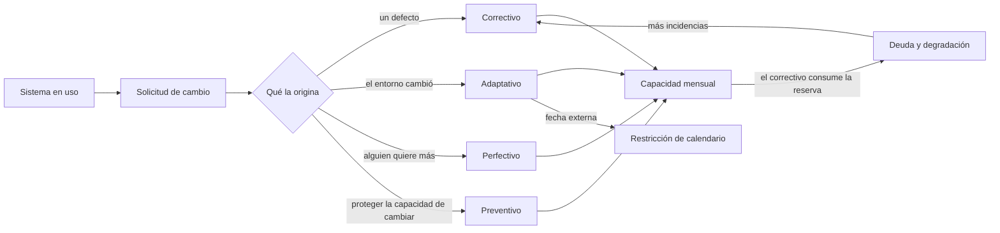
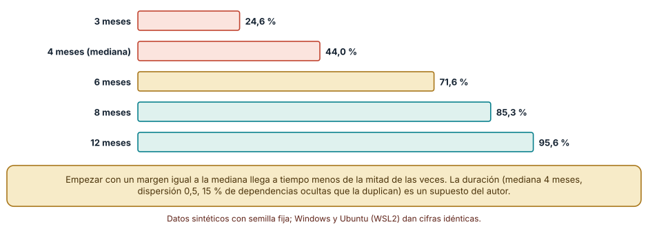

# SE-517 — Mantenimiento correctivo, adaptativo y perfectivo

[← SE-504 — Proyecto: operación observable y recuperable](../../classes/part-41-observabilidad-sre-e-incidentes/se-504-proyecto-operacion-observable-y-recuperable/README.md) · [↑ Parte 43](../../classes/part-43-mantenimiento-y-modernizacion-legacy/README.md) · [📚 Índice completo](../../classes/README.md) · [🌐 Portal](../../site/classes/SE-517.html) · [SE-518 — Arqueología de código y recuperación de conocimiento →](../../classes/part-43-mantenimiento-y-modernizacion-legacy/se-518-arqueologia-de-codigo-y-recuperacion-de-conocimiento/README.md)

## Punto profesional y fundamento pedagógico

**Punto profesional.** La clase existe para que dejes de tratar el mantenimiento como «lo que queda después de construir» y lo trates como el modo de vida normal de un sistema que sigue en uso. Un equipo que recibe un módulo con doce años de historia necesita decidir cada semana si lo que tiene delante es una corrección, una adaptación impuesta por el entorno, una mejora pedida por alguien o trabajo para que el sistema siga siendo cambiable. La habilidad es clasificar con honestidad, repartir la capacidad entre esas cuatro clases de trabajo sin que una devore a las otras y saber cuándo una fecha impuesta desde fuera convierte un trabajo cómodo en una emergencia.

**Por qué aparece aquí.** Abre la **Parte 43** después de **Proyecto: operación observable y recuperable**: la Parte 41 dejó un sistema que se puede ver y recuperar mientras opera; ahora la pregunta es cómo se sostiene y se cambia ese sistema durante años. El caso conductor de la parte es el **módulo legado de calificaciones de la plataforma educativa**: un monolito de doce años con una función que calcula la nota final, un archivo de intercambio con el ministerio, una base de datos con textos como «5,5» y reglas de redondeo que nadie escribió. Es un caso sintético; ninguna institución ni sistema reales fueron analizados.

**Error conceptual que debe corregir.** Creer que el mantenimiento es corregir errores. En la tipología del mantenimiento la corrección es solo una de cuatro categorías y nada obliga a que sea la mayor: el sistema también debe adaptarse a un entorno que cambia y ampliarse con lo que alguien pidió, y por debajo de todo hay un trabajo invisible, el que mantiene la capacidad de cambiar, que si no se protege deja de hacerse.

**Secuencia de aprendizaje.** Antes de ver los resultados, predices qué fracción de la capacidad de un equipo se va en corrección dentro de dos años si cada corrección apresurada deja un poco de deuda y nadie reserva tiempo para el trabajo preventivo; después simulas veinticuatro meses con y sin reserva, clasificas 600 solicitudes con un clasificador de palabras clave y comparas el acuerdo entre dos revisoras, y calculas la probabilidad de llegar a una fecha impuesta según el margen con que se empieza. La secuencia usa predicción, explicación propia, contraste y recuperación. [ICAP](https://icap.education.asu.edu/research) distingue participación de construcción de conocimiento; [How People Learn II](https://nap.nationalacademies.org/catalog/24783/how-people-learn-ii-learners-contexts-and-cultures) respalda diseñar la práctica con contextos reales y retroalimentación.

**Evidencia de aprendizaje.** `mantenimiento-log.md` con la predicción, las tres figuras reproducidas, la clasificación de diez solicitudes reales o realistas de tu proyecto con su justificación, la política de reparto de capacidad y una nota que separe qué parte de cada conclusión es medida, cuál inferida y cuál supuesta.

**Límite de la conclusión.** El reparto de capacidad, la retroalimentación entre deuda e incidencias, los textos de las solicitudes y la distribución de duraciones son construcciones del autor con semilla fija. No se observó ningún equipo, ningún sistema ni ninguna institución real, y los coeficientes de la simulación no son estimaciones empíricas: demuestran un mecanismo, no una magnitud.

### Trazabilidad fuente → afirmación

| Fuente primaria u oficial | Afirmación que respalda | Lo que no prueba |
|---|---|---|
| [SWEBOK Guide v4.0a — mantenimiento del software](https://www.computer.org/education/bodies-of-knowledge/software-engineering) | Trata el mantenimiento como actividad del ciclo de vida con categorías de cambio (correctivo, adaptativo, perfectivo y preventivo) y como parte planificada de la ingeniería, no como fracaso del diseño. | No fija qué porcentaje de capacidad debe dedicarse a cada categoría. |
| [Lehman, «Programs, life cycles, and laws of software evolution»](https://doi.org/10.1109/PROC.1980.11805) | Formula leyes de evolución: un sistema usado debe cambiar continuamente y su complejidad crece si no hay trabajo que la reduzca. | Se basa en sistemas concretos de su época; no demuestra el ritmo de crecimiento en tu sistema. |
| [Fowler, «TechnicalDebt»](https://martinfowler.com/bliki/TechnicalDebt.html) | Ofrece la metáfora de la deuda: un atajo ahorra tiempo hoy y cobra intereses en cada cambio posterior. | Es una metáfora; no define una unidad medible de deuda. |
| [Python: random](https://docs.python.org/3/library/random.html) | Documenta el generador con semilla que hace reproducibles las simulaciones. | No valida los coeficientes elegidos. |
| [Python: statistics](https://docs.python.org/3/library/statistics.html) | Documenta la mediana y los cuantiles usados en los resultados. | No decide qué estadístico es el adecuado para tu pregunta. |

## Antes de empezar

Recupera lo aprendido en la Parte 41 sobre operar un sistema: una señal solo vale si cambia una decisión. La pregunta activa es: **¿cuántas de las solicitudes de cambio que recibió tu último proyecto eran correcciones, cuántas eran imposiciones del entorno y cuántas eran peticiones de mejora, y quién decidió esa clasificación?**

## Prerrequisitos

- Haber completado `SE-504` o poder explicar qué señales permiten operar un sistema y recuperarlo.
- Python 3.11 o posterior; los experimentos usan solo la biblioteca estándar (`random`, `statistics`, `math`).
- Saber leer una mediana y un percentil en una tabla y qué significa una semilla fija.

## Problema auténtico

El módulo de calificaciones llevaba doce años en producción. En una reunión de planificación el equipo tenía treinta y ocho solicitudes abiertas y una capacidad de cien unidades al mes. Quien dirigía el área pidió «solo lo urgente», y lo urgente eran las incidencias; durante dos trimestres el equipo corrigió, y las incidencias aumentaron en vez de disminuir. Al mismo tiempo, el ministerio había anunciado un formato nuevo de exportación con fecha de entrada en vigor, y esa solicitud llevaba cuatro meses clasificada como «mejora» porque nadie la había mirado como lo que era: un cambio que el entorno impone y que tiene fecha. La clase enseña a mirar la cartera de solicitudes con la tipología de mantenimiento, a ver cómo un sistema degradado consume la capacidad que necesitaba para dejar de degradarse y a tratar una fecha impuesta como una restricción de planificación.

## Objetivos observables

Al terminar podrás:

1. distinguir las cuatro categorías de mantenimiento y decir, para una solicitud dada, qué evidencia la sitúa en una u otra;
2. explicar por qué el mantenimiento sostenido de un sistema vivo no es un fracaso del diseño sino una propiedad de los sistemas que se usan;
3. simular el reparto mensual de capacidad entre trabajo correctivo, adaptativo, perfectivo y preventivo y mostrar cómo la ausencia de una reserva preventiva hace crecer la carga correctiva;
4. medir el acuerdo entre dos personas que clasifican las mismas solicitudes y reconocer qué solicitudes son ambiguas por naturaleza;
5. calcular la probabilidad de cumplir una fecha impuesta según el margen con el que se empieza y decidir cuándo una adaptación debe iniciarse.

## Mapa conceptual



El mapa separa el **origen** del cambio (un defecto, el entorno, un deseo, la salud del sistema) de su **efecto** sobre la capacidad. El bucle de la derecha es el punto central: el trabajo correctivo no solo cuesta, también alimenta, a través de la degradación, las incidencias que lo hacen necesario.

## Temas y por qué importan

| Tema | Por qué cambia una decisión profesional | Evidencia mínima |
|---|---|---|
| Las cuatro categorías de mantenimiento | Sin tipología, todo se llama «urgente» y la cartera se ordena por quién grita más. | Diez solicitudes clasificadas con su justificación |
| Por qué los sistemas vivos exigen cambio continuo | Si el cambio se considera un fracaso, nadie lo planifica ni lo presupuesta. | Explicación con una ley de evolución citada |
| Reparto de capacidad y deuda | Un equipo que solo corrige se queda sin tiempo para evitar que haya más correcciones. | Resultado de la simulación con y sin reserva |
| Clasificar es un juicio | Una misma solicitud puede ser correctiva o perfectiva según quién la lea. | Acuerdo entre dos revisoras y lista de ambiguas |
| El mantenimiento adaptativo tiene fecha | Una fecha impuesta convierte un trabajo diferible en una restricción. | Probabilidad de llegar a tiempo según el margen |

## Conceptos y decisiones

### 1. Las cuatro categorías de mantenimiento

Mantener un sistema es modificarlo después de su entrega para corregirlo, adaptarlo, mejorarlo o protegerlo. La tipología usual distingue cuatro categorías según el origen del cambio. El mantenimiento **correctivo** repara un comportamiento que contradice lo que el sistema debía hacer: la nota final sale un décimo por debajo de lo esperado. El **adaptativo** modifica el sistema porque algo de su entorno cambió y el sistema, sin ser defectuoso, dejó de encajar: el ministerio cambia el formato del archivo, el proveedor retira una versión del runtime, una autoridad de certificación sustituye un certificado, el calendario cambia la zona horaria. El **perfectivo** amplía o mejora el sistema porque alguien quiere más: un filtro nuevo, un informe más rápido, una exportación a hoja de cálculo. El **preventivo** modifica el sistema para que siga siendo cambiable: extraer la regla de redondeo a un módulo con pruebas, eliminar código muerto, documentar un formato.

La clasificación no es una etiqueta decorativa: indica quién tiene la iniciativa y cuánto margen hay. En el correctivo la iniciativa es del defecto y el margen depende de su gravedad; en el adaptativo es del entorno y el margen lo fija una fecha ajena; en el perfectivo es de quien pide y el margen es negociable; en el preventivo es del propio equipo, y por eso es el que se aplaza sin que nadie proteste. La palabra «urgente» no pertenece a una categoría: se aplica a un correctivo grave, a un adaptativo con la fecha encima o a un perfectivo que alguien con poder quiere, y confundirlas es la causa de que la cartera se ordene por presión y no por consecuencia.

### 2. Por qué los sistemas vivos exigen cambio continuo

Un sistema que se usa está acoplado a un mundo que cambia: leyes, formatos, volúmenes, proveedores, expectativas. Lehman describió, a partir de la observación de sistemas grandes, que un programa que se usa en el mundo real debe cambiar continuamente o se vuelve progresivamente menos útil, y que al cambiar su estructura tiende a hacerse más compleja a menos que se dedique trabajo explícito a reducirla. Dos consecuencias prácticas se desprenden. La primera es que un presupuesto de mantenimiento igual a cero no existe: o se financia el cambio planificado o se paga el cambio forzado por la degradación. La segunda es que el esfuerzo por cambio no es constante: cada cambio hecho sin atender a la estructura encarece el siguiente, que es lo que la metáfora de la deuda técnica expresa con la idea de intereses. Ninguna de las dos afirmaciones da una cifra; la magnitud depende de cada sistema y se mide, no se supone.

### 3. Reparto de capacidad y deuda

La capacidad de un equipo es finita y se reparte, de forma explícita o por defecto, entre las categorías. El reparto por defecto es por presión: primero lo correctivo, luego lo adaptativo con fecha, después lo perfectivo que alguien reclama, y al final lo preventivo, que nadie reclama. El problema es que el trabajo correctivo no es independiente del preventivo: un sistema con estructura degradada genera más incidencias, y las correcciones hechas con prisa dejan más degradación. Es un bucle de refuerzo, y como todo bucle de refuerzo tiene un régimen en el que se estabiliza y otro en el que se desboca. La decisión que rompe el bucle es una **reserva protegida** de capacidad para el trabajo preventivo, fijada antes de que llegue la presión y defendida como un compromiso, no como una sobra. La reserva no es gratis: se paga con perfectivo diferido, y esa es una decisión de producto que alguien debe tomar a la vista.

### 4. Clasificar es un juicio, no una búsqueda de palabras

«Ajustar el cálculo del promedio» puede ser una corrección (el cálculo está mal), una mejora (se quiere otro cálculo) o una adaptación (cambió la normativa). El texto no decide: decide la intención y el contexto. Un clasificador por palabras clave acierta lo que el vocabulario revela y falla en lo ambiguo, y dos personas razonables discrepan justo ahí. Esto no es un defecto del procedimiento sino información: las solicitudes en las que dos revisoras discrepan son las que necesitan una conversación con quien pidió el cambio, y una cartera con muchas solicitudes ambiguas dice que el equipo no sabe todavía qué le piden. El **kappa de Cohen** mide el acuerdo entre dos clasificadoras descontando el que habría por azar; un valor cercano a 0,7 se suele leer como acuerdo sustancial, pero el número agregado oculta que el acuerdo en las solicitudes ambiguas puede ser casi el del azar.

### 5. El mantenimiento adaptativo tiene fecha

Los demás tipos admiten negociar cuándo; el adaptativo, no: la fecha la pone otro. Una versión del runtime que deja de recibir soporte, un formato que entra en vigor, un certificado que caduca. Cuando el trabajo tiene una duración incierta y una fecha fija, la pregunta correcta no es «¿cuánto tardaremos?» sino «¿con qué probabilidad llegamos si empezamos hoy?». La duración tiene cola: casi siempre hay una dependencia oculta que duplica el trabajo en una fracción de los casos. Planificar con la mediana equivale a aceptar que se falla en la mitad de las ocasiones; planificar con un margen sobre el percentil que se desea cubrir convierte la fecha en una decisión explícita. Y como el margen se consume desde el primer día, la decisión importante es cuándo empezar.

### La capacidad que se come el trabajo correctivo

Se simulan veinticuatro meses de un equipo con cien unidades de capacidad mensual. Las incidencias que llegan cada mes son 15 más el 12 % de la deuda acumulada, con ruido; se añaden 5 unidades de trabajo adaptativo (15 cada seis meses) y 30 de trabajo perfectivo pedido. La deuda crece con el trabajo correctivo apresurado, con el perfectivo y con las incidencias que quedan sin atender, y baja con el trabajo preventivo. Se comparan dos políticas: sin reserva y con el 20 % de la capacidad reservado a trabajo preventivo.

```python
corr = min(llegan_corr, cap_libre); cap_libre -= corr
adap = min(adaptativo, cap_libre);  cap_libre -= adap
perf = min(perf_pedido, cap_libre); prev = cap_reserva
deuda += 0.25*corr + 0.2*perf + 0.3*max(0, llegan_corr - corr) - 1.3*prev
```

| Mes | Sin reserva: correctivo · perfectivo | Sin reserva: deuda | Reserva del 20 %: correctivo · perfectivo | Reserva del 20 %: deuda |
|---|---|---:|---|---:|
| 1 | 19,7 · 30,0 | 40,9 | 19,7 · 30,0 | 14,9 |
| 12 | 33,0 · 30,0 | 184,0 | 12,6 · 30,0 | 0,0 |
| 24 | 59,7 · 25,3 | 401,2 | 14,0 · 30,0 | 0,0 |

Sin reserva, la carga correctiva pasa de 19,7 a 59,7 unidades al mes y expulsa al perfectivo, que cae de 30,0 a 25,3 en el mes 24; la deuda se multiplica por diez. Con la reserva del 20 %, el equipo entrega el perfectivo completo y la carga correctiva baja de 19,7 a 14,0. La reserva cuesta 20 unidades al mes y evita que el correctivo crezca 40 unidades. La conclusión depende del acoplamiento entre trabajo preventivo y deuda: si ese acoplamiento fuera débil, la reserva sería un desperdicio.


**Cómo leer la figura.** El eje horizontal son los meses y el vertical, el trabajo correctivo mensual del equipo; la línea coral no tiene reserva y la verde reserva el 20 % para trabajo preventivo. Mira primero cómo la coral sube de 19,7 a 59,7 unidades mientras la verde baja y se queda cerca de 14. **Dónde deja de valer:** los coeficientes (0,12 de realimentación, 0,25 y 0,2 de generación de deuda, 1,3 de reducción) son del autor; un sistema real puede tener un bucle más débil o más fuerte, y la deuda no tiene una unidad medible. Sirve para ver el mecanismo, no para decidir que la reserva correcta es el 20 %.

### Clasificar 600 solicitudes: lo claro y lo ambiguo

Se generan 600 solicitudes: el 75 % con textos claros de las cuatro categorías y el 25 % con textos ambiguos («ajustar el cálculo del promedio», «actualizar la librería de fechas») cuya etiqueta verdadera no se deduce del texto. Un clasificador por palabras clave (error, falla y corregir para correctivo; adaptar, nuevo, certificado y actualizar para adaptativo; añadir, mejorar y permitir para perfectivo; extraer, eliminar y documentar para preventivo) se compara con la etiqueta verdadera. Después dos revisoras simuladas acuerdan una etiqueta: cada una acierta el 95 % de las claras y el 55 % de las ambiguas.

| Conjunto | Solicitudes | Aciertos del clasificador | Acuerdo entre dos revisoras |
|---|---:|---:|---:|
| Claras | 456 | 456 (100 %) | — |
| Ambiguas | 144 | 74 (51 %) | 34 % |
| Todas | 600 | 530 (88,3 %) | 76,8 % (kappa 0,69) |

El clasificador acierta todas las solicitudes claras y poco más de la mitad de las ambiguas: un 88 % global que esconde que el 24 % de la cartera es una moneda al aire. El acuerdo entre dos personas es del 76,8 % (kappa 0,69), «sustancial» según la convención, y cae al 34 % en las ambiguas. El número agregado informa de la calidad media del proceso; la lista de solicitudes con discrepancia informa de dónde falta una conversación.


**Cómo leer la figura.** Cada barra son las solicitudes de un tipo y se parte en verde (las que acierta el clasificador) y coral (las que falla). Mira primero que la barra de claras es toda verde y que en la de ambiguas casi la mitad es coral. **Dónde deja de valer:** el 25 % de ambiguas, los textos plantilla y las tasas de acierto de las revisoras son supuestos del autor; con solicitudes reales la proporción de ambiguas es una medida por obtener, y un clasificador entrenado con ejemplos reales se comportaría de otra forma.

### Una fecha impuesta: la probabilidad de llegar según el margen

Una adaptación obligatoria tiene una duración con mediana de cuatro meses, dispersión lognormal de 0,5 y una probabilidad del 15 % de descubrir una dependencia oculta que la duplica. Se simulan 20 000 trabajos y se cuenta cuántos terminan dentro de cada margen.

| Margen disponible | Llega a tiempo |
|---|---:|
| 3 meses | 24,6 % |
| 4 meses (la mediana) | 44,0 % |
| 6 meses | 71,6 % |
| 8 meses | 85,3 % |
| 12 meses | 95,6 % |

Empezar con un margen igual a la mediana llega a tiempo menos de la mitad de las veces (44,0 %): la mediana ya incluye el 15 % de duplicaciones solo en parte, y la cola larga hace que el margen necesario para el 95 % sea el triple de la mediana. La decisión útil es cuándo empezar: cada mes de retraso en iniciar la adaptación reduce la probabilidad de cumplir, y esa reducción no es lineal.



**Cómo leer la figura.** Cada barra es la fracción de 20 000 trabajos que terminan dentro del margen; la distancia entre 44 % y 95 % es el precio de querer certeza. **Dónde deja de valer:** la mediana, la dispersión y el 15 % de dependencias ocultas son supuestos del autor; con un equipo que ha hecho tres veces la misma migración la dispersión es menor y con un sistema desconocido es mayor. La simulación muestra la forma, no la duración de tu proyecto.

## Definiciones de trabajo

- **mantenimiento correctivo:** modificación para eliminar un comportamiento que contradice lo que el sistema debía hacer.
- **mantenimiento adaptativo:** modificación para que el sistema siga funcionando cuando cambia su entorno, sin que el sistema sea defectuoso.
- **mantenimiento perfectivo:** modificación para añadir capacidades o mejorar atributos como el rendimiento a petición de alguien.
- **mantenimiento preventivo:** modificación para que el sistema conserve la capacidad de cambiar, sin cambiar su comportamiento visible.
- **kappa de Cohen:** medida del acuerdo entre dos clasificadoras que descuenta el acuerdo esperado por azar.

Las definiciones son operativas para el módulo de calificaciones. No convierten términos con una historia más amplia en sinónimos y deben contrastarse con la documentación primaria enlazada al final.

## Ejemplo mínimo

El fragmento muestra que el mismo texto admite dos categorías. Antes de ejecutarlo, predice qué categoría devuelve cada solicitud.

```python
CLAVES = {"correctivo": ("error", "falla", "corregir"), "perfectivo": ("añadir", "mejorar")}
def clasifica(t):
    for cat, palabras in CLAVES.items():
        if any(p in t for p in palabras): return cat
    return "sin clasificar"
print(clasifica("corregir el formato de exportación nuevo"), clasifica("ajustar el cálculo del promedio"))
```

La primera solicitud devuelve «correctivo» aunque puede ser adaptativa (el formato nuevo es del ministerio) y la segunda devuelve «sin clasificar» porque no contiene palabras clave. Registra versión de Python, comando y salida; después clasifica a mano las dos y escribe qué pregunta le harías a quien las pidió.

## Ejemplo profesional

Escenario hipotético, construido para la clase y sin datos reales. El equipo del módulo de calificaciones ordena su cartera de treinta y ocho solicitudes con la tipología. Resultan 9 correctivas (de las cuales 2 graves), 6 adaptativas, 17 perfectivas y 6 preventivas; 5 solicitudes quedan «ambiguas» y se resuelven preguntando a quien las pidió. Entre las adaptativas hay una con fecha: la exportación al formato del ministerio entra en vigor en nueve meses, y con una mediana estimada de cuatro meses y una probabilidad del 15 % de dependencia oculta, empezar dentro de dos meses deja un margen de siete meses que cubre el 79,7 % de los casos simulados. El equipo decide empezar ya, reserva el 20 % de la capacidad para trabajo preventivo (empezando por extraer la regla de redondeo a un módulo con pruebas) y comunica a producto que durante un trimestre se entregarán dos mejoras menos. Escribe la decisión con su fecha, su dueño y la condición que la revisaría: si la carga correctiva no baja del 25 % en seis meses, la reserva se revisa. Compárala con el estado inicial: antes la cartera estaba ordenada por quién reclamaba; ahora está ordenada por origen, fecha y consecuencia.

## Práctica guiada

1. Toma diez solicitudes de un proyecto propio o de la cartera sintética y clasifícalas por categoría escribiendo la evidencia que las sitúa.
2. Predice qué fracción de la capacidad será correctiva en el mes 24 sin reserva y escribe el número antes de simular.
3. Ejecuta la simulación con las semillas fijadas en el código y reproduce la tabla; cambia el coeficiente de realimentación de 0,12 a 0,05 y observa si la reserva sigue siendo necesaria.
4. Genera las 600 solicitudes, ejecuta el clasificador y calcula el acuerdo y el kappa de dos revisoras; anota qué solicitudes ambiguas elegirías para conversar con quien las pidió.
5. Calcula la probabilidad de llegar a tiempo con tu margen real y decide cuándo empezar para cubrir el 85 %.
6. Redacta una política de reparto de capacidad con la reserva, su dueño y la condición que la revisa.
7. Entrega `mantenimiento-log.md` y pide a otra persona que clasifique tus diez solicitudes sin ver tu justificación.

## Ejercicios

1. **Clasificar:** una solicitud dice «el informe debe incluir la nota ponderada». Escribe una situación en la que sea perfectiva y otra en la que sea adaptativa y di qué dato las distingue.
2. **Reserva:** si la reserva preventiva fuera del 5 % en vez del 20 %, ¿qué mes esperarías que la deuda empiece a crecer? Justifica con la ecuación de la deuda y comprueba ejecutando la simulación.
3. **Fecha:** calcula el margen necesario para el 90 % de probabilidad con la duración simulada y explica por qué la mediana no sirve para comprometer una fecha externa.
4. **Acuerdo:** dos personas coinciden en el 90 % de 100 solicitudes pero el 85 % de las solicitudes son de una sola categoría. Explica por qué el kappa puede ser bajo aunque el acuerdo sea alto.

## Reto verificable

Entrega `mantenimiento-log.md` con la predicción, las tres tablas, la clasificación de diez solicitudes con justificación, la política de reserva con su condición de revisión y la declaración del tipo de evidencia de cada afirmación. Se aprueba si otra persona ejecuta el código desde un checkout limpio, obtiene los mismos números con las mismas semillas y puede decir cuándo empezarías la adaptación con fecha y por qué. No se aprueba por clasificar todas las solicitudes como «urgentes» ni por afirmar que una reserva del 20 % es correcta para cualquier sistema.

## Caso conductor

El módulo de calificaciones de la plataforma educativa es el caso conductor de la Parte 43. Esta clase deja el primer artefacto: la cartera clasificada y la política de capacidad. `SE-518` preguntará cómo se recupera el conocimiento que el equipo perdió sobre el módulo, y `SE-519` cómo se protegen sus comportamientos antes de tocarlos. Cambia después un solo dato, la realimentación entre deuda e incidencias, y observa a partir de qué valor la reserva deja de compensar.

## Preguntas frecuentes

### ¿El mantenimiento preventivo no es refactorizar?

Refactorizar es una técnica; el mantenimiento preventivo es la categoría de trabajo que la usa. Puede incluir refactorizar, pero también documentar un formato, eliminar dependencias sin uso o añadir pruebas, todo lo que protege la capacidad de cambiar sin cambiar el comportamiento visible.

### ¿Una mejora de rendimiento es perfectiva o correctiva?

Depende del origen. Si el rendimiento incumple un objetivo declarado (por ejemplo un escenario de calidad de la Parte 36), es correctiva; si nadie lo había exigido y se quiere mejorar, es perfectiva. La clasificación se apoya en lo que el sistema prometía, no en el tipo de trabajo técnico.

### ¿Hay un porcentaje correcto de capacidad para cada categoría?

No hay una cifra universal. La simulación de la clase muestra un mecanismo con coeficientes inventados; el porcentaje adecuado se calibra observando cuánto del trabajo correctivo proviene de causas estructurales, y se revisa con datos del propio sistema.

### ¿Qué hago si todo el equipo coincide en que una solicitud es correctiva y quien la pidió dice que es una mejora?

Esa discrepancia es la información. Anota ambas lecturas, pregunta qué comportamiento esperaba la persona y contrástalo con la especificación o los contratos existentes; si no hay nada escrito, la solicitud revela un requisito implícito que conviene dejar por escrito.

## Fallo controlado y diagnóstico

Reproduce el fallo clásico de la clase: **un equipo que solo corrige lo urgente y ve crecer lo urgente**. Simula los veinticuatro meses sin reserva y observa la carga correctiva.

Registra síntoma, entrada mínima, hipótesis, observación que descarta cada hipótesis, causa, corrección y prueba de regresión. **Síntoma:** cada trimestre hay más incidencias a pesar de que el equipo trabaja más horas en corregir. **Hipótesis rivales:** (a) el equipo es menos competente; (b) el volumen de uso ha crecido; (c) el trabajo correctivo apresurado alimenta la degradación que genera las incidencias. **Prueba:** reproduce la simulación con una reserva del 0 % y del 20 % y mantén todo lo demás; si el correctivo del mes 24 baja de 59,7 a 14,0 unidades solo por la reserva, la causa es el reparto. **Conclusión:** el trabajo preventivo no es un lujo, es lo que mantiene estable el régimen. **Regresión:** añade una prueba que simule 24 meses y exija que, con la política elegida, la carga correctiva del último mes no supere la del primero más un margen. No cambies a la vez la reserva y la tasa de llegada.

## Errores comunes y cómo corregirlos

| Síntoma | Causa probable | Corrección |
|---|---|---|
| Todo se llama «urgente» | No se distingue origen y consecuencia | Clasificar por tipología y fecha, y ordenar por consecuencia |
| Las incidencias aumentan aunque se corrige más | El correctivo apresurado alimenta la degradación | Reservar capacidad protegida para trabajo preventivo |
| Una adaptación con fecha se descubre tarde | Se clasificó como mejora | Revisar la cartera buscando fechas externas |
| Dos personas clasifican distinto y se discute | Falta información sobre la intención | Convertir las discrepancias en preguntas a quien pidió el cambio |
| La reserva preventiva desaparece al primer incidente | No tiene dueño ni condición de revisión | Fijarla como compromiso con una condición que la revisa |

## Entorno y archivos clave

```text
work/SE-517/
├── README.md
├── mantenimiento/
│   ├── capacidad.py
│   ├── clasificacion.py
│   └── fecha.py
├── tests/test_mantenimiento.py
└── evidence/mantenimiento-log.md
```

El `README` declara plataforma, versión de Python, semillas y comandos. Los experimentos usan solo la biblioteca estándar (`random`, `statistics`, `math`) y se ejecutaron con CPython 3.12.9 en Windows 11 y 3.12.3 en Ubuntu bajo WSL2: las salidas fueron idénticas. Si añades una dependencia, fija procedencia y versión.

## Seguridad, ética y accesibilidad

- la cartera de solicitudes puede contener datos personales de quienes las pidieron o de las personas afectadas por un defecto: anonimízala antes de compartirla o usarla como ejemplo;
- un reparto de capacidad que sacrifica el trabajo preventivo traslada el costo a quien mantiene el sistema después y a las personas que sufren sus fallos; documenta quién decide ese traslado;
- clasificar con equidad significa no dejar sin atender los defectos que afectan a pocas personas por considerarlos de baja prioridad: añade el alcance de las personas afectadas a la clasificación;
- las tablas y figuras deben tener texto alternativo y no depender del color; las categorías se distinguen por texto;
- los estándares citados tienen derechos de autor: cita su estructura y vincula la fuente, no copies su texto.

## Puente hacia el trabajo con agentes

Un agente al que se le pide «ordena el backlog» producirá una lista priorizada con etiquetas plausibles y sin indicar qué solicitudes son ambiguas. Pídele en cambio que clasifique cada solicitud en las cuatro categorías, que cite la evidencia textual en que se apoya, que marque explícitamente las que no puede decidir y que busque fechas externas en las adaptativas. Revisa especialmente las etiquetas «correctivo» que esconden una mejora (el agente tiende a leer «error» donde hay un deseo) y compara su clasificación con la de una persona: el acuerdo en las ambiguas es la medida de cuánto puedes confiar en el resto.

## Transferencia

Traslada el análisis a otro dominio (por ejemplo, el software de un taller mecánico con facturación y calendario): cambia las solicitudes y las fechas externas y conserva el procedimiento de clasificar por origen, reservar capacidad preventiva, tratar las ambiguas como preguntas y calcular la probabilidad de llegar a una fecha impuesta. La transferencia está lograda cuando puedes decir qué solicitudes de ese dominio son adaptativas con fecha y con qué margen empezarías, no cuando la tabla se parece a la del módulo de calificaciones.

## Evaluación y evidencia

| Criterio | Evidencia para aprobar |
|---|---|
| comprensión | explicación de las cuatro categorías y de por qué un sistema en uso exige cambio continuo |
| corrección | tablas de capacidad, de clasificación y de fecha reproducibles con las mismas semillas |
| diseño | política de reserva con dueño, condición de revisión y consecuencia aceptada |
| diagnóstico | reproducción del fallo «solo se corrige lo urgente» con regresión |
| incertidumbre | declaración de que los coeficientes, los textos y las duraciones son del autor |
| reproducibilidad | versiones, comandos, salida y límites declarados |

## Fuentes

- [SWEBOK Guide v4.0a](https://www.computer.org/education/bodies-of-knowledge/software-engineering) — mantenimiento del software y sus categorías; autoridad: IEEE Computer Society.
- [Lehman, «Programs, life cycles, and laws of software evolution»](https://doi.org/10.1109/PROC.1980.11805) — leyes de evolución del software; autoridad: Proceedings of the IEEE, 1980.
- [Fowler, «TechnicalDebt»](https://martinfowler.com/bliki/TechnicalDebt.html) — la metáfora de la deuda y sus intereses; autoridad: autor del texto.
- [Python: random](https://docs.python.org/3/library/random.html) — generador con semilla para reproducir las simulaciones; autoridad: documentación de Python.
- [Python: statistics](https://docs.python.org/3/library/statistics.html) — mediana y cuantiles usados en los resultados; autoridad: documentación de Python.

Cada fuente respalda el mecanismo indicado; ninguna demuestra que la reserva del 20 %, el 59,7 de carga correctiva o el 44,0 % de llegada a tiempo se observen en un equipo real. Esa afirmación depende del sistema, del equipo y de la distribución de las duraciones.

## Límites y siguiente paso

Se ejecutaron tres experimentos con datos sintéticos en Windows y Ubuntu (WSL2) con resultados idénticos. No se observó ningún equipo, sistema ni institución real; los coeficientes de la simulación de capacidad, los textos de las solicitudes, la proporción de ambiguas, las tasas de acierto de las revisoras y la distribución de duraciones son construcciones del autor, y el clasificador por palabras clave se escribió conociendo los textos que lo evalúan. La siguiente clase pregunta cómo se recupera el conocimiento sobre un sistema cuando quienes lo escribieron ya no están.

## Glosario

- **mantenimiento correctivo:** modificación para eliminar un comportamiento que contradice lo que el sistema debía hacer.
- **mantenimiento adaptativo:** modificación para que el sistema siga funcionando cuando cambia su entorno, sin que el sistema sea defectuoso.
- **mantenimiento perfectivo:** modificación para añadir capacidades o mejorar atributos como el rendimiento a petición de alguien.
- **mantenimiento preventivo:** modificación para que el sistema conserve la capacidad de cambiar, sin cambiar su comportamiento visible.
- **kappa de Cohen:** medida del acuerdo entre dos clasificadoras que descuenta el acuerdo esperado por azar.

---

[← SE-504 — Proyecto: operación observable y recuperable](../../classes/part-41-observabilidad-sre-e-incidentes/se-504-proyecto-operacion-observable-y-recuperable/README.md) · [↑ Parte 43](../../classes/part-43-mantenimiento-y-modernizacion-legacy/README.md) · [📚 Índice completo](../../classes/README.md) · [🌐 Portal](../../site/classes/SE-517.html) · [SE-518 — Arqueología de código y recuperación de conocimiento →](../../classes/part-43-mantenimiento-y-modernizacion-legacy/se-518-arqueologia-de-codigo-y-recuperacion-de-conocimiento/README.md)
