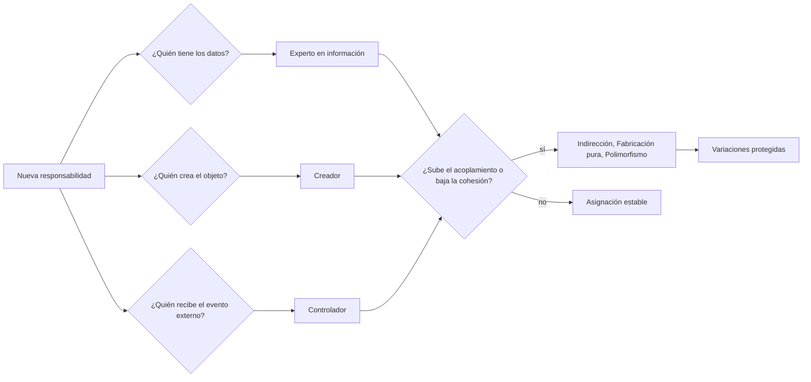

# SE-521 — GRASP y asignación de responsabilidades

[← SE-520 — GoF conductuales: Strategy, Observer, Command, State y Template Method](../../classes/part-43-patrones-de-diseno-empresariales-y-de-resiliencia/se-520-gof-conductuales-strategy-observer-command-state-y-template-method/README.md) · [↑ Parte 43](../../classes/part-43-patrones-de-diseno-empresariales-y-de-resiliencia/README.md) · [📚 Índice completo](../../classes/README.md) · [🌐 Portal](../../site/classes/SE-521.html) · [SE-522 — Repository, Unit of Work y Active Record →](../../classes/part-43-patrones-de-diseno-empresariales-y-de-resiliencia/se-522-repository-unit-of-work-y-active-record/README.md)

## Punto profesional y fundamento pedagógico

**Punto profesional.** La clase existe para que, ante una función o un dato nuevo, puedas responder con un criterio y no con un gusto a la pregunta **«¿a quién le toca esto?»**. Los patrones de las clases anteriores son consecuencias de asignar bien las responsabilidades: un Strategy aparece cuando la variación pertenece a un objeto propio; un Repository, cuando la persistencia pertenece a otra capa. GRASP (*General Responsibility Assignment Software Patterns*) reúne nueve criterios para decidir esa asignación, y su valor profesional es que dan nombre a conversaciones de diseño que de otro modo se repiten sin cerrarse: «esto lo debería saber el pedido», «esto crea demasiadas dependencias», «esto necesita un intermediario».

**Por qué aparece aquí.** Sigue a los patrones de la Gang of Four porque pasa de «qué forma tiene la solución» a «dónde vive la responsabilidad», y precede a Repository y Unit of Work (`SE-522`), que son asignaciones concretas: quién sabe guardar, quién abre la transacción.

**Error conceptual que debe corregir.** Creer que GRASP es una lista de nueve reglas que se cumplen todas a la vez. Los criterios **tiran en direcciones opuestas**: el bajo acoplamiento empuja a repartir y la alta cohesión empuja a agrupar; la indirección reduce una dependencia directa y añade una pieza más. GRASP no resuelve el conflicto: lo nombra para que se discuta con un dato.

**Secuencia de aprendizaje.** Antes de ejecutar, predices qué pasa cuando se aplica un descuento del 10 % en un solo lugar en dos diseños: uno donde tres clases calculan el total por su cuenta y otro donde la línea de pedido calcula su subtotal. Después ejecutas el experimento, mides con `ast` qué clases leen datos de los colaboradores de sus colaboradores y cuántos pares de métodos de una clase no comparten ningún atributo, y asignas responsabilidades de una funcionalidad propia.

**Evidencia de aprendizaje.** Un `responsabilidades.md` con una tabla de responsabilidades de una funcionalidad (qué, a quién, con qué criterio de GRASP, qué alternativa se descartó) y una medida de cohesión y de acoplamiento antes y después.

**Límite de la conclusión.** Los dos diseños, las dos clases y las métricas son del autor y el descuento es una regla de ejemplo. La clase **mide** consecuencias concretas de dos asignaciones en un caso pequeño; **no mide** que GRASP produzca mejores diseños en general, ni valida las métricas de cohesión como indicadores de calidad. No se invocó ningún modelo de lenguaje.

### Trazabilidad fuente → afirmación

| Fuente primaria u oficial | Afirmación que respalda | Lo que no prueba |
|---|---|---|
| [Wikipedia, «GRASP (object-oriented design)»](https://en.wikipedia.org/wiki/GRASP_(object-oriented_design)) | Resume los nueve patrones GRASP (Creador, Experto en información, Controlador, Bajo acoplamiento, Alta cohesión, Polimorfismo, Fabricación pura, Indirección y Variaciones protegidas), que Craig Larman popularizó. | Es una fuente secundaria: describe los criterios, no los valida. |
| [Fowler, «Move Function»](https://refactoring.com/catalog/moveFunction.html) | Describe el refactor que mueve una función a la clase cuyos datos usa más. | No dice cuándo hacerlo ni mide su efecto. |
| [Fowler, «Code Smell»](https://martinfowler.com/bliki/CodeSmell.html) | Define un olor de código como una señal superficial que puede indicar un problema más profundo. | No convierte a un olor en un defecto. |
| [Python, módulo `ast`](https://docs.python.org/3/library/ast.html) | Documenta el árbol de sintaxis con el que se miden accesos y atributos. | No define cohesión ni acoplamiento. |

## Antes de empezar

Recupera lo aprendido en `SE-520`: un estado imposible se evita haciéndolo irrepresentable. La pregunta activa es: **si cambia una regla de negocio (cómo se calcula un total, a quién se avisa), ¿en cuántos lugares de tu código tienes que tocar y cuántos podrías haber olvidado?**

## Prerrequisitos

- Haber completado `SE-517` a `SE-520`.
- Conocer las ideas de cohesión y acoplamiento de la Parte 24.
- Python 3.11 o posterior con `ast` y `textwrap`.

## Problema auténtico

En *Avisos* la lógica del precio de una entrega se calculó tres veces: en el cobro de la inscripción, en la factura de la institución y en el informe mensual. Las tres leen `linea.producto.precio * linea.cantidad`. El requisito nuevo es «10 % de descuento a partir de tres unidades». Quien lo implementa cambia el cobro, que es lo que el ticket menciona; el informe muestra un total y la factura otro, y se descubre un trimestre después al conciliar. Nadie escribió mal el código: la responsabilidad de calcular un subtotal estaba repartida en tres lugares, y un cambio de regla debía tocarlos todos.

La clase asigna esa responsabilidad con un criterio (**Experto en información**: quien tiene los datos hace el cálculo) y mide qué pasa con el mismo cambio en los dos diseños.

## Objetivos observables

Al terminar podrás:

1. enumerar los nueve criterios de GRASP y la pregunta que responde cada uno;
2. asignar una responsabilidad con Experto en información y comprobar con un cambio de regla que el diseño resultante lo absorbe en un lugar;
3. medir con `ast` la «cadena de acceso» y la cohesión aproximada de una clase;
4. identificar cuándo dos criterios tiran en direcciones opuestas y decidir con una medida;
5. escribir una tabla de responsabilidades con la alternativa descartada y la razón.

## Mapa conceptual



El mapa tiene un bucle de control: después de asignar con los tres primeros criterios se comprueba el acoplamiento y la cohesión, y solo entonces se recurre a los criterios de indirección y polimorfismo. Los últimos cuatro criterios corrigen los costos de los primeros.

## Temas y por qué importan

| Tema | Por qué cambia una decisión profesional | Evidencia mínima |
|---|---|---|
| Experto en información | Un cambio de regla se hace donde viven los datos | Un cambio aplicado en un lugar con totales consistentes |
| Creador y Controlador | Deciden quién instancia y quién recibe eventos | Una tabla de quién crea qué |
| Bajo acoplamiento | Menos dependencias, menos cambios en cascada | Dependencias por clase |
| Alta cohesión | Una clase con una razón de cambio | Pares de métodos que no comparten estado |
| Polimorfismo e Indirección | Sustituyen condicionales y aíslan cambios | Dónde se evita un `if` o una dependencia directa |
| Fabricación pura | Una pieza sin correspondencia con el dominio, creada para bajar el acoplamiento | Una función pura probada sin dobles |
| Variaciones protegidas | Envuelve un punto de cambio con una interfaz estable | Un cambio que no cruza la interfaz |

## Conceptos y decisiones

### 1. Experto en información: el cálculo vive con los datos

El criterio dice que la responsabilidad de hacer algo debe asignarse a la clase que tiene la información necesaria para hacerlo. En el diseño A del experimento, tres clases (`Checkout`, `Factura`, `Informe`) calculan el subtotal leyendo `l.producto.precio * l.cantidad`: las tres «llegan» al precio del producto a través de la línea, y las tres repiten la fórmula (tres copias). En el diseño B, `Linea.subtotal()` calcula el subtotal con sus propios datos y `Pedido.total()` suma subtotales; las tres clases clientes llaman a `pedido.total()` y solo hay dos lecturas del precio del producto, ambas dentro de `Linea`. El análisis con `ast` cuenta **tres clases** en el diseño A que leen el dato de un colaborador de su colaborador y **cero** en el diseño B.

### 2. El cambio de regla como prueba del diseño

La prueba del criterio es un cambio. Se aplica la misma regla («10 % de descuento a partir de tres unidades») en **un solo lugar**, el más obvio, en cada diseño. En el diseño A, el lugar obvio es el `Checkout`; después del cambio `Checkout.total` da 33,5 y `Factura.total` sigue dando 35: **dos totales distintos para el mismo pedido**. En el diseño B, el cambio se hace en `Linea.subtotal` y los dos totales dan 33,5: **consistentes**. La diferencia no depende de la regla elegida; depende de que en un diseño la fórmula está en tres lugares y en el otro en uno.


**Cómo leer la figura.** Cada grupo es un diseño con dos barras: las clases que leen el precio ajeno (coral) y las copias de la fórmula (dorada). Mira el diseño A, con las tres clases leyendo el precio ajeno y los totales inconsistentes (33,5 y 35), frente al B, que deja los totales iguales. **Dónde deja de valer:** los dos diseños son pequeños y escritos por el autor, la regla es sencilla y el experimento aplica el cambio en el lugar más obvio; un equipo atento habría buscado las tres copias. La figura muestra un mecanismo (la fórmula repetida se desincroniza), no que el diseño A sea siempre peor.

### 3. Creador y Controlador

El **Creador** asigna la creación de un objeto a quien lo contiene, lo registra, lo usa mucho o tiene los datos para inicializarlo; un `Pedido` crea sus `Linea`. El **Controlador** asigna la recepción de un evento externo (una petición, un mensaje) a un objeto que representa el caso de uso o el sistema, y no a la interfaz. Los dos criterios son los que menos a menudo se discuten y más a menudo se violan: la creación repartida en veinte lugares es el origen de la fábrica de `SE-518`, y un controlador que contiene reglas de negocio es la clase de dios de `SE-526`.

### 4. Bajo acoplamiento y alta cohesión: los dos criterios que tiran en direcciones opuestas

El **bajo acoplamiento** pide pocas dependencias entre clases; la **alta cohesión** pide que lo que una clase hace tenga un propósito común. Una clase con diez métodos y ocho dependencias en el constructor es el síntoma clásico de baja cohesión. El experimento mide una aproximación: para cada par de métodos, ¿comparten algún atributo de la instancia? La clase `Servicio` del experimento tiene **10 métodos y 8 dependencias**, y **37 de los 45 pares** de métodos no comparten ningún atributo. Al separarla en tres clases (`Registro`, `Notificador`, `Migracion`), ningún par queda sin estado compartido. La separación bajó la baja cohesión y **subió** el número de clases: es la tensión que GRASP nombra.


**Cómo leer la figura.** Cada grupo es una clase y tiene tres barras: los métodos (gris), las dependencias (dorada) y los pares de métodos sin estado compartido (coral). Mira cómo la barra coral, de 37, desaparece al separar el servicio en tres clases pequeñas. **Dónde deja de valer:** «no comparten atributos» es una aproximación a la falta de cohesión (una familia de métricas conocida como LCOM); dos métodos pueden estar cohesionados por el dominio sin tocar el mismo atributo, y un atributo compartido puede ser accidental. Es una señal para revisar, no una sentencia.

### 5. Polimorfismo, Indirección, Fabricación pura y Variaciones protegidas

Los cuatro criterios restantes corrigen costos. El **Polimorfismo** reemplaza condicionales sobre el tipo con métodos del tipo (el Strategy de `SE-517`). La **Indirección** introduce un intermediario para bajar el acoplamiento directo (el Adapter de `SE-519`, el Repository de `SE-522`). La **Fabricación pura** crea una pieza sin correspondencia con el dominio para sostener alta cohesión: en el experimento, `total_puro(lineas)` calcula el total sin base de datos, sin reloj y sin dobles, y se prueba con una llamada. Las **Variaciones protegidas** envuelven un punto de cambio probable con una interfaz estable. Los cuatro tienen un costo común (una pieza más) y se justifican con la misma pregunta de `SE-517`: ¿qué dolor resuelven hoy?


**Cómo leer la figura.** Las cuatro cajas agrupan los nueve criterios por la pregunta que responden; no es un orden de aplicación. **Dónde deja de valer:** la agrupación es una elección didáctica del curso; los criterios se solapan (la Indirección puede servir al bajo acoplamiento y a las variaciones protegidas) y dos autores pueden agruparlos distinto.

### 6. La tabla de responsabilidades

La herramienta de trabajo es una tabla: una fila por responsabilidad, con tres columnas más: a quién se asignó, con qué criterio y qué alternativa se descartó. Escribir la alternativa descartada es la parte que obliga a pensar: si no hay alternativa, probablemente no hubo decisión. La tabla de una funcionalidad de *Avisos* («calcular y enviar un recordatorio») tiene entre seis y diez filas y se revisa como cualquier otro diseño.

## Definiciones de trabajo

- **Responsabilidad:** algo que un objeto sabe o hace.
- **Experto en información:** asignar a quien tiene los datos necesarios.
- **Creador:** asignar la creación a quien contiene o usa el objeto.
- **Controlador:** objeto que recibe y coordina un evento externo.
- **Acoplamiento:** grado en que una clase depende de otras.
- **Cohesión:** grado en que lo que hace una clase tiene un propósito común.
- **Fabricación pura:** pieza sin correspondencia con el dominio creada para sostener cohesión o bajo acoplamiento.

## Ejemplo mínimo

```python
class Linea:
    def __init__(self, producto, cantidad): self.producto, self.cantidad = producto, cantidad
    def subtotal(self): return self.producto.precio * self.cantidad

class Pedido:
    def __init__(self, lineas): self.lineas = lineas
    def total(self): return sum(l.subtotal() for l in self.lineas)
```

`Linea` conoce su precio y su cantidad y por eso calcula su subtotal; `Pedido` conoce sus líneas y por eso calcula el total. Quien necesite un total pide `pedido.total()` y no vuelve a escribir la fórmula.

## Ejemplo profesional

*Escenario ilustrativo: las cifras de este ejemplo son supuestos de la narración, no mediciones.*

El equipo de *Avisos* aplica la tabla de responsabilidades a «enviar el recordatorio de una entrega». Descubre que la regla «no avisar si ya se entregó» está en el controlador de la interfaz, en el servicio de envío y en un trabajo nocturno. Asigna la regla al objeto `Entrega` (Experto: tiene la fecha y el estado), mueve las otras dos copias con el refactor `Move Function`, añade una prueba que cubre los tres caminos y mide con `ast` que las tres clases ya no leen el estado de la entrega a través de otros objetos. Anota la alternativa descartada: dejar la regla en el servicio de envío, por ser lo que cambió más a menudo; se descartó porque el trabajo nocturno no pasa por el servicio.

## Práctica guiada

1. Escribe tu predicción: tras el cambio en un lugar, ¿qué totales difieren y en qué diseño?
2. Ejecuta `python scripts/experiments_part43_a.py 521` y compara.
3. Añade al diseño B una regla de «cupón» y comprueba en cuántos lugares cambia el código.
4. Mide la cohesión de una clase de tu código con la misma aproximación y revisa los tres pares que menos comparten.
5. Completa la tabla de responsabilidades de una funcionalidad con la alternativa descartada.

## Ejercicios

1. **Básico.** Nombra el criterio GRASP que justifica cada una de tres asignaciones de tu código.
2. **Intermedio.** Encuentra en tu proyecto una fórmula repetida en tres lugares y muévela con el refactor `Move Function`.
3. **Avanzado.** Diseña un caso donde el bajo acoplamiento y la alta cohesión pidan cosas opuestas y decide con una medida.

## Reto verificable

Entrega `responsabilidades.md` con la tabla de una funcionalidad, el cambio de regla aplicado en un lugar con los totales antes y después, y la medida de cohesión y acoplamiento. Es válido si otra persona repite la medida y obtiene los mismos números, y si cada fila nombra la alternativa descartada.

## Caso conductor

*Avisos* sigue siendo el servicio de recordatorios. Aquí se reparte el cálculo del precio y la regla «no avisar si ya entregó»; en `SE-522` esa misma entidad se persiste con un repositorio y en `SE-526` la clase de dios se mide y se separa.

## Preguntas frecuentes

### ¿GRASP es lo mismo que SOLID?

No. Son colecciones de criterios de diseño con solapes (alta cohesión y responsabilidad única se parecen), pero GRASP se centra en cómo asignar responsabilidades y SOLID en propiedades de las clases y sus dependencias. Se pueden usar juntas.

### ¿El Experto en información no crea objetos de dominio con demasiados métodos?

Puede, y por eso hay un límite: cuando una clase acumula razones de cambio ajenas (persistencia, presentación), la alta cohesión pide separarla. El Experto asigna el cálculo; no obliga a que una clase lo contenga todo.

### ¿Qué hago cuando dos criterios se contradicen?

Nombra la contradicción, elige con una medida o con un cambio de regla y registra la decisión con su alternativa. No hay un criterio que gane siempre.

### ¿Puede un agente asignar las responsabilidades?

Puede proponer una tabla y escribir el refactor, pero el criterio de qué es un cambio probable viene del negocio. La petición útil incluye un cambio de regla y pide que se compruebe en un solo lugar.

## Fallo controlado y diagnóstico

**Fallo.** Tras implementar el descuento, el informe mensual y la factura difieren en cientos de pesos para el mismo periodo.

**Diagnóstico paso a paso.** (1) Se reproduce con un pedido de tres unidades: el cobro da 33,5 y la factura 35. (2) Se busca la fórmula: aparece en tres clases. (3) La causa no es el descuento sino la responsabilidad repartida: el cambio se hizo donde el ticket lo mencionaba.

**Corrección.** Se mueve el cálculo a `Linea.subtotal`, se sustituyen las tres copias por llamadas a `Pedido.total()`, se añade una prueba que compara los tres informes con el mismo pedido y se escribe la asignación en la tabla de responsabilidades.

## Errores comunes y cómo corregirlos

- **Síntoma: la misma fórmula en varios lugares.** Causa: el cálculo no se asignó a quien tiene los datos. Solución: Experto en información y `Move Function`.
- **Síntoma: clases clientes que encadenan `a.b.c.d`.** Causa: acceso a datos de colaboradores de colaboradores. Solución: pedir al colaborador inmediato que ofrezca la operación.
- **Síntoma: una clase con diez razones para cambiar.** Causa: baja cohesión. Solución: separarla por razón de cambio.
- **Síntoma: una capa de indirección sin propósito.** Causa: se aplicó el criterio sin fuerza. Solución: retirarla y medir.
- **Síntoma: controlador con reglas de negocio.** Causa: el Controlador asumió la lógica. Solución: delegar al objeto de dominio.

## Entorno y archivos clave

- `scripts/experiments_part43_a.py`: los dos diseños como texto, las métricas con `ast` y el cambio de regla ejecutado; `python scripts/experiments_part43_a.py 521`.
- `content/part-43/figures/`: figuras.
- Sin dependencias fuera de la biblioteca estándar.

## Seguridad, ética y accesibilidad

La asignación de responsabilidades decide dónde se comprueban los permisos: si la regla «quién puede cancelar un aviso» está repartida en tres lugares, un cuarto camino puede olvidarla. Asignar la comprobación al objeto que posee el dato la hace imposible de evitar. Ética: un descuento mal propagado afecta a las personas que pagan; la consistencia entre factura e informe es una obligación hacia ellas. Accesibilidad: las figuras tienen texto alternativo completo y no dependen del color.

## Puente hacia el trabajo con agentes

Un agente que implementa «añade un descuento del 10 % a partir de tres unidades» cambia el lugar que el ticket menciona; si hay tres copias, cambia una. La petición útil incluye: «busca todos los lugares que calculan este subtotal, propón dónde debe vivir la responsabilidad y añade una prueba que compare los tres totales». La medida con `ast` de accesos encadenados es una comprobación que el agente puede ejecutar y que el humano puede revisar.

## Transferencia

Aplica la tabla de responsabilidades a una funcionalidad de un proyecto propio y busca tres fórmulas o reglas repetidas. La habilidad se transfiere a cualquier cambio de regla: antes de editar, pregunta cuántos lugares conocen la regla.

## Evaluación y evidencia

- Cada responsabilidad tiene un criterio de GRASP y una alternativa descartada.
- El cambio de regla se hace en un solo lugar y las salidas son consistentes.
- La medida de cohesión se informa con su limitación.
- La afirmación final distingue lo medido (copias de la fórmula, pares de métodos) de lo no medido (calidad general del diseño).

## Fuentes

- Wikipedia. [«GRASP (object-oriented design)»](https://en.wikipedia.org/wiki/GRASP_(object-oriented_design)).
- Fowler, M. [«Move Function»](https://refactoring.com/catalog/moveFunction.html).
- Fowler, M. [«Code Smell»](https://martinfowler.com/bliki/CodeSmell.html).
- Python Software Foundation. [«ast — Abstract Syntax Trees»](https://docs.python.org/3/library/ast.html).

## Límites y siguiente paso

Los diseños y las métricas son del autor, la cohesión se aproxima con atributos compartidos y la fuente de GRASP es secundaria; no se validó el efecto de GRASP en proyectos reales. El siguiente paso, `SE-522`, aplica la pregunta «¿a quién le toca?» a la persistencia: quién guarda, quién abre la transacción y quién sabe qué consultas se ejecutan.

## Glosario

| Término | Definición breve |
|---|---|
| GRASP | Nueve criterios para asignar responsabilidades |
| Experto en información | Asignar a quien tiene los datos |
| Cohesión | Propósito común de lo que hace una clase |
| Acoplamiento | Dependencia entre clases |
| Fabricación pura | Pieza artificial que baja el acoplamiento |
| Move Function | Refactor que mueve una función a su clase natural |
