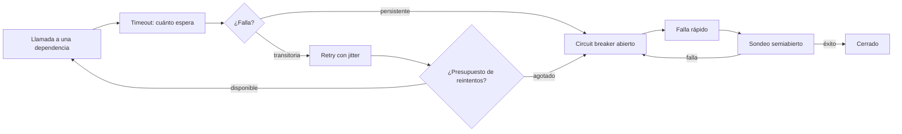
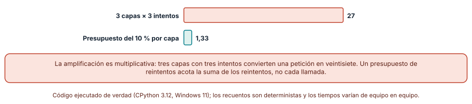

# SE-524 — Resiliencia: timeout, retry con jitter y circuit breaker

[← SE-523 — Enterprise Integration Patterns como lenguaje común](../../classes/part-43-patrones-de-diseno-empresariales-y-de-resiliencia/se-523-enterprise-integration-patterns-como-lenguaje-comun/README.md) · [↑ Parte 43](../../classes/part-43-patrones-de-diseno-empresariales-y-de-resiliencia/README.md) · [📚 Índice completo](../../classes/README.md) · [🌐 Portal](../../site/classes/SE-524.html) · [SE-525 — Resiliencia: bulkhead, sidecar, ambassador y degradación →](../../classes/part-43-patrones-de-diseno-empresariales-y-de-resiliencia/se-525-resiliencia-bulkhead-sidecar-ambassador-y-degradacion/README.md)

## Punto profesional y fundamento pedagógico

**Punto profesional.** La clase existe para que configures **tres controles de una llamada a una dependencia** (cuánto espera, cuántas veces reintenta, cuándo deja de intentar) sabiendo que cada uno puede ayudar o empeorar un incidente según cómo interactúe con los otros y con las demás capas del sistema. Un timeout demasiado corto convierte la latencia normal en fallos; un reintento sin espera aleatoria sincroniza a los clientes y repite el pico que tumbó el servicio; un interruptor mal calibrado deja de proteger o corta el tráfico sano. La habilidad profesional es explicar con números por qué una configuración es razonable y qué señal dirá que dejó de serlo.

**Por qué aparece aquí.** Sigue a los patrones de integración (`SE-523`) y reutiliza los decoradores de `SE-519`: plazo, reintento e interruptor son envolturas apiladas alrededor de una llamada, y su orden es una política. Precede a bulkhead y degradación (`SE-525`), que tratan lo que ocurre cuando ni los plazos bastan.

**Error conceptual que debe corregir.** Creer que «reintentar» es siempre una mejora de fiabilidad. Un reintento mejora la tasa de éxito de una falla **transitoria y no correlacionada**; ante una caída o una sobrecarga, **añade carga** a un servicio que ya no puede con la que tiene, y la añade a la vez desde todos los clientes. La amplificación es además **multiplicativa** entre capas: tres capas con tres intentos cada una convierten una petición en veintisiete.

**Secuencia de aprendizaje.** Antes de ejecutar, predices cuál de cuatro políticas de espera (intervalo fijo, exponencial sin aleatoriedad, jitter completo y jitter equilibrado) deja el menor pico de peticiones cuando 1000 clientes reintentan tras una caída de un segundo, y cuántas llamadas ahorra un circuit breaker durante una caída de siete segundos. Después ejecutas las simulaciones con semilla fija y calculas la amplificación entre capas.

**Evidencia de aprendizaje.** Un `resiliencia-llamadas.md` con la configuración de timeout, reintentos y breaker de una llamada propia, la justificación numérica (percentiles de latencia, presupuesto de reintentos, umbrales) y la señal que dirá que la configuración dejó de valer.

**Límite de la conclusión.** El servicio simulado falla durante un segundo y luego admite 60 peticiones por cada 100 ms; las latencias son lognormales con una mediana de unos 49 ms; la caída del breaker es de siete segundos con 100 peticiones por segundo. Todo es elegido por el autor y el reloj es virtual. La clase **mide** el comportamiento de cuatro políticas y de un breaker en un modelo; **no mide** una dependencia real, fallos correlacionados con la carga ni la interacción con balanceadores. No se invocó ningún modelo de lenguaje.

### Trazabilidad fuente → afirmación

| Fuente primaria u oficial | Afirmación que respalda | Lo que no prueba |
|---|---|---|
| [AWS, «Exponential Backoff And Jitter»](https://aws.amazon.com/blogs/architecture/exponential-backoff-and-jitter/) | Compara reintentos sin jitter, con jitter completo, equilibrado y decorrelacionado sobre un recurso contendido. | No dice qué variante conviene a un servicio concreto. |
| [AWS, «Timeouts, retries and backoff with jitter»](https://aws.amazon.com/builders-library/timeouts-retries-and-backoff-with-jitter/) | Trata los plazos, los reintentos y el jitter como decisiones que interactúan y advierte de la amplificación. | No mide ninguna configuración. |
| [Fowler, «Circuit Breaker»](https://martinfowler.com/bliki/CircuitBreaker.html) | Describe el interruptor con sus estados cerrado, abierto y semiabierto. | No fija los umbrales. |
| [Nygard, «Release It!»](https://pragprog.com/titles/mnee2/release-it-second-edition/) | Presenta el circuit breaker y los plazos como patrones de estabilidad. | No es una medición. |
| [Google, «Addressing Cascading Failures»](https://sre.google/sre-book/addressing-cascading-failures/) | Describe cómo los reintentos y la sobrecarga propagan fallos entre capas. | No da un presupuesto universal. |
| [Google, «Handling Overload»](https://sre.google/sre-book/handling-overload/) | Recomienda limitar los reintentos por petición y por cliente. | No fija un valor para todos los sistemas. |
| [Microsoft, «Circuit Breaker pattern»](https://learn.microsoft.com/azure/architecture/patterns/circuit-breaker) | Describe el patrón y cuándo no usarlo. | No mide su efecto. |

## Antes de empezar

Recupera lo aprendido en `SE-523`: una garantía débil traslada una obligación a quien consume. La pregunta activa es: **¿cuál es el timeout de tu llamada más importante, de dónde salió ese número y qué porcentaje de llamadas sanas corta?**

## Prerrequisitos

- Haber completado `SE-519` (orden de decoradores) y `SE-523` (idempotencia).
- Conocer percentiles de latencia (Parte 31) y la idea de saturación (Parte 35).
- Python 3.11 o posterior con `random` y `heapq`.

## Problema auténtico

*Avisos* llama a un proveedor de mensajería con un timeout de 30 s (el valor por defecto de la biblioteca) y tres reintentos sin espera. Un martes el proveedor se cae un minuto. Al volver, recibe en pocos segundos la carga de todos los clientes que esperaban y reintentaban a la vez, se cae de nuevo y repite el ciclo cuatro veces. Cada llamada ocupa un hilo 30 segundos, el grupo de hilos de *Avisos* se agota y la aplicación deja de responder incluso a las peticiones que no tocan al proveedor. Los tres controles estaban «activados» y ninguno se había calculado.

La clase calcula los tres con números: qué fracción de llamadas sanas corta un timeout, cómo se reparten los reintentos en el tiempo con y sin aleatoriedad y cuánto ahorra un interruptor.

## Objetivos observables

Al terminar podrás:

1. elegir un timeout a partir de un percentil de la latencia de la dependencia y calcular qué fracción de llamadas sanas corta;
2. comparar políticas de espera entre reintentos por el pico de carga, el tiempo hasta terminar y los abandonos;
3. calcular la amplificación de reintentos entre capas y acotarla con un presupuesto;
4. configurar un circuit breaker con umbral de fallos, tiempo abierto y sondeo, y medir las llamadas ahorradas;
5. combinar los tres controles y explicar la política resultante con un orden de envolturas.

## Mapa conceptual



El mapa cierra dos bucles: el de los reintentos, limitado por un presupuesto, y el del interruptor, que sondea para recuperarse. Ambos existen para impedir que una falla se convierta en carga.

## Temas y por qué importan

| Tema | Por qué cambia una decisión profesional | Evidencia mínima |
|---|---|---|
| Timeout desde el percentil | Un número arbitrario corta llamadas sanas o espera de más | Fracción de llamadas sanas que corta |
| Reintento sin aleatoriedad | Sincroniza clientes y repite el pico | Pico por intervalo con cada política |
| Jitter | Reparte los reintentos en el tiempo | Pico y tiempo hasta terminar |
| Amplificación entre capas | Los reintentos se multiplican | Intentos por petición en el peor caso |
| Presupuesto de reintentos | Acota la carga extra | Factor de amplificación con presupuesto |
| Circuit breaker | Evita llamar a lo que no puede contestar | Llamadas ahorradas y éxitos perdidos |

## Conceptos y decisiones

### 1. El timeout sale de la distribución, no de la costumbre

Un timeout dice cuánto vale la pena esperar. Se elige mirando la **distribución de latencias** de la dependencia sana. En el experimento, 20.000 latencias lognormales con semilla fija dan p50 = 49 ms, p99 = 391 ms y p99,9 = 723 ms. Un timeout de 80 ms corta el **29,4 %** de las llamadas **sanas**: es un fallo que el propio timeout fabrica. Un timeout cercano al p99 corta una de cada cien. La decisión mezcla tres cosas: el costo de esperar (un hilo ocupado, un usuario esperando), el valor de la respuesta tardía y cuánta falla está dispuesto a introducir el propio control. Un plazo por llamada también debe caber en el plazo del llamante: si la petición del usuario vence a los 2 s, la suma de todos los intentos no puede superar eso.

### 2. Reintentar: cuándo ayuda y cuándo empeora

Un reintento ayuda cuando la falla es **transitoria** y la próxima llamada tiene una probabilidad independiente de éxito; no ayuda si la dependencia está caída o saturada, y entonces suma carga. Además solo es seguro si la operación es **idempotente** (`SE-523`): reintentar un cobro sin clave puede cobrar dos veces. La decisión se acompaña de una clasificación de errores: reintentar un timeout o un 503, no un 400 ni un 404. HTTP define un `Retry-After` para que el servidor indique cuánto esperar, y respetarlo es parte de reintentar bien.

### 3. Sin aleatoriedad, los clientes se sincronizan

El experimento simula 1000 clientes cuyo primer intento ocurre en el instante 0 y que reintentan hasta 12 veces; el servicio falla hasta 1000 ms y luego acepta 60 peticiones por cada 100 ms. Con **intervalo fijo de 100 ms**, los 1000 clientes siguen sincronizados: el pico es de **1000 peticiones por 100 ms** en cada ronda, se hacen 11.940 intentos y **880 clientes se rinden** tras 12 intentos. Con **exponencial sin aleatoriedad**, siguen sincronizados pero cada vez más espaciados: pico de **1000**, 10.320 intentos, último éxito a los **38.300 ms** y 520 abandonados. Con **jitter completo** (espera uniforme entre 0 y el valor exponencial), el pico tras el arranque baja a **537**, se hacen 6230 intentos, el último éxito llega a los 7179 ms y **nadie** se rinde. Con **jitter equilibrado** (la mitad fija y la mitad aleatoria): pico de 759, 5949 intentos, último éxito a los 5668 ms y nadie se rinde.

![Tabla con cuatro políticas de espera entre reintentos de mil clientes tras una caída de un segundo en un servicio que luego acepta 60 peticiones cada 100 milisegundos: intervalo fijo, 11940 intentos, pico de 1000 peticiones por 100 milisegundos, último éxito a 1100 milisegundos y 880 clientes abandonados; exponencial sin jitter, 10320 intentos, pico de 1000, último éxito a 38300 milisegundos y 520 abandonados; jitter completo, 6230 intentos, pico de 537, último éxito a 7179 milisegundos y ningún abandonado; y jitter equilibrado, 5949 intentos, pico de 759, último éxito a 5668 milisegundos y ningún abandonado.](figures/se-524-reintentos.svg)

**Cómo leer la figura.** Las columnas del medio muestran la carga que recibe el servicio; las de la derecha, cuánto tarda todo el mundo en terminar y cuántos se rinden. **Dónde deja de valer:** los 1000 clientes empiezan en el mismo instante (el peor caso), el servicio tiene una capacidad fija y el tope de 12 intentos es igual para todas las políticas; la política de intervalo fijo parece terminar pronto (1100 ms) porque los que no entran en las primeras rondas **abandonan**, no porque se atienda a más gente. La magnitud depende de esos supuestos; el mecanismo (la sincronización repite el pico y la aleatoriedad la deshace) no.

### 4. La amplificación es multiplicativa

Si el cliente web reintenta 3 veces, el servicio de aplicación que lo atiende reintenta 3 veces y el cliente del proveedor reintenta 3 veces, una sola petición del usuario puede producir 3 × 3 × 3 = **27** intentos sobre el proveedor cuando este falla. Un **presupuesto de reintentos** acota el total: cada capa puede reintentar como máximo una fracción de sus peticiones (el ejemplo del experimento usa el 10 %), de modo que el factor de amplificación de las tres capas es 1,1³ ≈ **1,33**. El valor del presupuesto es una decisión; lo que el cálculo muestra es la forma de la amenaza (multiplicativa) y de su solución (acotar globalmente, no por llamada).



**Cómo leer la figura.** La barra larga es el peor caso sin presupuesto; la corta, el peor caso con un presupuesto del 10 % por capa. **Dónde deja de valer:** el 27 supone que las tres capas agotan todos sus intentos, lo que sucede en una caída total, no en fallos aislados; el 10 % es el valor de ejemplo del autor y no una recomendación general. El presupuesto acota la suma, no el tiempo.

### 5. Circuit breaker: dejar de llamar a quien no puede contestar

El interruptor tiene tres estados: **cerrado** (las llamadas pasan), **abierto** (se rechazan al instante) y **semiabierto** (se deja pasar una llamada de sondeo). Se abre cuando los fallos consecutivos superan un umbral y se cierra cuando un sondeo tiene éxito. En el experimento, una dependencia está caída entre los 5 y los 12 segundos de una ventana de 20 s, con 100 peticiones por segundo. **Sin** interruptor se hacen 2000 llamadas, todas al servicio, con 1300 éxitos. **Con** interruptor (umbral de 5 fallos, 1 s abierto), se hacen **1307** llamadas, **693** se rechazan al instante y hay **1296** éxitos. El interruptor ahorra 693 llamadas a una dependencia que no podía contestarlas, y a cambio pierde 4 éxitos en la recuperación (las llamadas que habrían salido bien mientras estaba abierto). Protege al llamante (no gasta hilos esperando) y a la dependencia (no recibe carga mientras se recupera); no repara nada.


**Cómo leer la figura.** La segunda columna cuenta las llamadas que llegaron a la dependencia; la tercera, las que el interruptor rechazó sin llamar. **Dónde deja de valer:** la dependencia cae de golpe y se recupera de golpe, el tráfico es constante y el umbral es el del autor; con fallos parciales, latencia creciente o varias instancias, calibrar un interruptor es mucho más delicado y exige medir la tasa de error y la latencia reales. Un interruptor mal calibrado corta tráfico sano.

### 6. Combinar los tres

La política resultante es una pila (`SE-519`): por fuera, un plazo total que cabe en el del llamante; después, un interruptor; dentro, reintentos con jitter limitados por un presupuesto, cada uno con su plazo por intento. Cada elemento tiene una razón y una señal: la tasa de timeouts dice si el plazo está bien calibrado; la tasa de reintentos, si el presupuesto basta; el estado del interruptor, si la dependencia está sana. Sin métricas de esos tres números, la configuración es una promesa sin evidencia.

## Definiciones de trabajo

- **Timeout:** tiempo máximo que se espera una respuesta.
- **Reintento:** repetir una llamada fallida con la esperanza de que una falla transitoria no se repita.
- **Backoff exponencial:** espera entre reintentos que crece geométricamente.
- **Jitter:** componente aleatorio de la espera que desincroniza a los clientes.
- **Presupuesto de reintentos:** límite global de reintentos como fracción de las peticiones.
- **Circuit breaker:** control que rechaza llamadas a una dependencia con fallos persistentes.
- **Semiabierto:** estado del interruptor en que pasa una llamada de sondeo.

## Ejemplo mínimo

```python
import random

def espera(k, base=0.1, tope=6.4):
    tecnica = min(tope, base * 2 ** k)
    return random.uniform(0, tecnica)      # jitter completo
```

Con `k` = 0, 1, 2… la espera máxima es 0,1, 0,2, 0,4… hasta el tope, y cada cliente elige un valor distinto. Dos clientes que fallaron a la vez ya no reintentan a la vez.

## Ejemplo profesional

*Escenario ilustrativo: las cifras de este ejemplo son supuestos de la narración, no mediciones.*

El equipo de *Avisos* mide durante una semana la latencia del proveedor: p50 de 60 ms, p99 de 410 ms. Fija un timeout por intento de 500 ms (cerca del p99,5, corta menos de una llamada sana en doscientas), un plazo total de 1,5 s (menos que el de la petición del usuario), dos reintentos con jitter completo y un presupuesto del 10 % por instancia, y un interruptor que se abre con cinco fallos consecutivos durante 10 s. Documenta la pila (plazo total, interruptor, reintento, plazo por intento) y la prueba que simula un proveedor lento y comprueba que la duración máxima de una petición no supera 1,5 s. Registra tres métricas con alarma: tasa de timeouts, tasa de reintentos y estado del interruptor.

## Práctica guiada

1. Escribe tu predicción: ¿cuál de las cuatro políticas deja el menor pico?
2. Ejecuta `python scripts/experiments_part43_b.py 524` y compara.
3. Cambia la capacidad del servicio simulado a 30 y a 120 y observa qué política cambia más.
4. Cambia el umbral del interruptor de 5 a 2 y a 20 fallos y mide las llamadas ahorradas y los éxitos perdidos.
5. Calcula el timeout de una llamada propia a partir de un percentil y qué fracción de llamadas sanas corta.

## Ejercicios

1. **Básico.** Explica por qué un reintento puede empeorar una caída.
2. **Intermedio.** Calcula la amplificación de una cadena de cuatro capas con dos reintentos cada una y define un presupuesto que la acote.
3. **Avanzado.** Diseña la calibración de un interruptor para una dependencia con latencia creciente en lugar de errores: qué señal usarías y por qué.

## Reto verificable

Entrega `resiliencia-llamadas.md` con la configuración de una llamada propia, los percentiles que la justifican, la simulación de dos políticas con semilla y la alarma de cada control. Es válido si otra persona repite la simulación con la misma semilla y obtiene los mismos picos, y si la configuración declara qué señal indica que dejó de valer.

## Caso conductor

*Avisos* llama a un proveedor de mensajería y a uno de pagos. Esta clase calcula la configuración de la primera llamada; `SE-525` aísla ambas con compartimentos para que una dependencia lenta no agote los hilos de la otra.

## Preguntas frecuentes

### ¿Cuál es el mejor tipo de jitter?

Depende del contexto; en la comparación del experimento, el jitter completo da el menor pico y el equilibrado termina antes. La fuente de AWS recomienda variantes con aleatoriedad por la misma razón. Mide con tu carga si importa.

### ¿Cuántos reintentos son razonables?

Pocos (uno o dos) con jitter y un presupuesto. Más reintentos aumentan la amplificación y rara vez la tasa de éxito, porque las fallas que sobreviven a dos intentos suelen ser persistentes.

### ¿El circuit breaker sustituye al timeout?

No. El timeout acota cada llamada; el interruptor decide si se intenta. Sin timeout, el interruptor tarda en enterarse de que algo falla.

### ¿Puede un agente configurar estos valores?

Puede proponer una configuración típica; los números deben salir de las latencias reales de tu dependencia. La petición útil adjunta los percentiles y pide la justificación y la prueba de duración máxima.

## Fallo controlado y diagnóstico

**Fallo.** Tras una caída de un minuto del proveedor, *Avisos* tarda quince en recuperarse y el proveedor vuelve a caerse dos veces.

**Diagnóstico paso a paso.** (1) Se grafican las peticiones por segundo al proveedor: picos regulares cada 100 ms, lo que indica reintentos sincronizados. (2) Se revisa la configuración: intervalo fijo, sin jitter, tres capas con tres intentos. (3) La causa es una política de espera sincronizada y una amplificación de 27 sin presupuesto.

**Corrección.** Se añade jitter completo, se acota con un presupuesto de reintentos, se añade el interruptor y se prueba con una simulación que reproduce la caída y comprueba el pico.

## Errores comunes y cómo corregirlos

- **Síntoma: picos regulares de peticiones tras una caída.** Causa: reintentos sincronizados. Solución: jitter.
- **Síntoma: cientos de intentos por petición en una caída.** Causa: reintentos en cada capa. Solución: reintentar en una sola capa o presupuesto.
- **Síntoma: fallos de timeout con la dependencia sana.** Causa: timeout menor que el p99. Solución: calibrar con la distribución.
- **Síntoma: el interruptor nunca se cierra.** Causa: sondeo con la misma carga que el tráfico o umbral demasiado sensible. Solución: sondeo de una llamada y revisar el umbral.
- **Síntoma: cobros duplicados.** Causa: reintento de una operación no idempotente. Solución: clave de idempotencia.

## Entorno y archivos clave

- `scripts/experiments_part43_b.py`: simulación de reintentos con semilla 524, amplificación, interruptor con reloj virtual y distribución de latencias; `python scripts/experiments_part43_b.py 524`.
- `content/part-43/figures/`: figuras.
- Sin dependencias fuera de la biblioteca estándar.

## Seguridad, ética y accesibilidad

Un reintento sin límite contra un servicio externo puede constituir un ataque de denegación de servicio involuntario contra un tercero; respeta `Retry-After` y los límites de uso. Un interruptor abierto que devuelve un error genérico puede ocultar la causa; registra el motivo. Reintentar una operación con efectos (un cobro, un envío) sin idempotencia daña a personas reales. Ética: elegir qué se sacrifica cuando una dependencia cae (la espera, el dato, el envío) es una decisión sobre las personas usuarias. Accesibilidad: las figuras tienen texto alternativo completo y las tablas se leen sin color.

## Puente hacia el trabajo con agentes

Un agente que añade «resiliencia» a una llamada suele envolverla en un reintento con tres intentos y un plazo de 30 s, el valor típico de los ejemplos. La petición útil adjunta los percentiles de latencia, el plazo del llamante y la política de reintentos del resto de las capas, y pide: timeout calculado, jitter completo, presupuesto, interruptor y una prueba con un proveedor simulado lento que compruebe la duración máxima y el número de llamadas. El agente propone; el cálculo y la prueba deciden.

## Transferencia

Calcula el timeout de una llamada propia a partir de su p99 y estima la amplificación máxima de tu cadena de capas. La habilidad se transfiere a cualquier cliente de cualquier servicio: bases de datos, colas, APIs de terceros, otros equipos.

## Evaluación y evidencia

- El timeout se justifica con un percentil y se informa qué fracción de llamadas sanas corta.
- La política de espera tiene aleatoriedad y se compara con otra por pico y por abandonos.
- La amplificación entre capas se calcula y se acota con un presupuesto.
- El interruptor se mide por llamadas ahorradas y éxitos perdidos.
- La afirmación final distingue lo simulado de lo medido en una dependencia real.

## Fuentes

- Amazon Web Services. [«Exponential Backoff And Jitter»](https://aws.amazon.com/blogs/architecture/exponential-backoff-and-jitter/).
- Amazon Web Services. [«Timeouts, retries and backoff with jitter»](https://aws.amazon.com/builders-library/timeouts-retries-and-backoff-with-jitter/).
- Fowler, M. [«Circuit Breaker»](https://martinfowler.com/bliki/CircuitBreaker.html).
- Nygard, M. [«Release It!, 2.ª edición»](https://pragprog.com/titles/mnee2/release-it-second-edition/).
- Google. [«Addressing Cascading Failures»](https://sre.google/sre-book/addressing-cascading-failures/).
- Google. [«Handling Overload»](https://sre.google/sre-book/handling-overload/).
- Microsoft. [«Circuit Breaker pattern»](https://learn.microsoft.com/azure/architecture/patterns/circuit-breaker).
- IETF. [«RFC 9110: HTTP Semantics»](https://www.rfc-editor.org/rfc/rfc9110).

## Límites y siguiente paso

La simulación usa un servicio con capacidad fija y una caída total, latencias lognormales elegidas por el autor y un reloj virtual; no se midió una dependencia real ni fallos correlacionados con la carga. El siguiente paso, `SE-525`, pregunta qué ocurre cuando los plazos no bastan y una dependencia lenta agota los recursos que comparte con las sanas.

## Glosario

| Término | Definición breve |
|---|---|
| Timeout | Tiempo máximo de espera |
| Jitter | Aleatoriedad en la espera entre reintentos |
| Presupuesto de reintentos | Límite global de reintentos |
| Amplificación | Intentos al servicio por petición del usuario |
| Circuit breaker | Interruptor que corta llamadas a una dependencia con fallos |
| Semiabierto | Estado de sondeo del interruptor |
