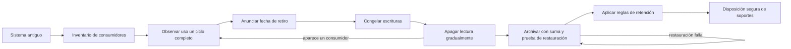
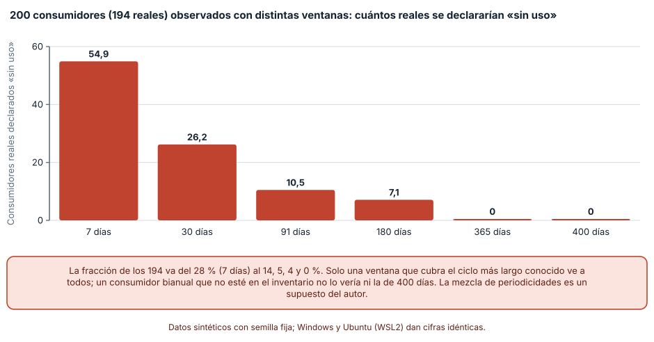

# SE-525 — Retiro, archivado y disposición de sistemas

[← SE-524 — Compatibilidad, coexistencia y doble escritura](../../classes/part-43-mantenimiento-y-modernizacion-legacy/se-524-compatibilidad-coexistencia-y-doble-escritura/README.md) · [↑ Parte 43](../../classes/part-43-mantenimiento-y-modernizacion-legacy/README.md) · [📚 Índice completo](../../classes/README.md) · [🌐 Portal](../../site/classes/SE-525.html) · [SE-526 — Economía de reescribir frente a evolucionar →](../../classes/part-43-mantenimiento-y-modernizacion-legacy/se-526-economia-de-reescribir-frente-a-evolucionar/README.md)

## Punto profesional y fundamento pedagógico

**Punto profesional.** La clase existe para que retires un sistema sin romper a quien aún lo usa, sin guardar datos que ya no deberías tener y sin perder los que debes conservar. Apagar un sistema parece la parte fácil de una modernización y es la que se hace peor: se declara «sin uso» por una observación demasiado corta, se borra con un criterio único, y se archiva en un formato que nadie podrá leer. La habilidad es planificar el retiro como una secuencia de decisiones reversibles hasta el último paso, apoyada en mediciones de uso, reglas de retención y archivos que se puedan verificar y restaurar.

**Por qué aparece aquí.** Sigue a **Compatibilidad, coexistencia y doble escritura**: la coexistencia termina cuando el sistema antiguo deja de ser necesario, y este es el paso que la cierra. El caso conductor es el **módulo legado de calificaciones**: cuando todas las rutas estén migradas, quedará su base de datos con doce años de actas, registros de acceso, adjuntos y datos personales, y habrá que decidir qué se conserva, qué se borra y qué se apaga.

**Error conceptual que debe corregir.** Creer que, si nadie usa un sistema durante un mes, se puede apagar. Hay consumidores que lo usan una vez al trimestre o una vez al año, y una ventana de observación más corta que su ciclo los declara inexistentes. Tampoco es cierto que borrar sea la opción segura: conservar datos personales sin necesidad es un riesgo y borrarlos antes de la obligación legal de conservarlos es otro.

**Secuencia de aprendizaje.** Antes de mirar los resultados, predices qué fracción de los consumidores reales rompería un retiro decidido tras 30 días sin tráfico, si el 12 % de ellos usa el sistema una vez al año; después simulas siete ventanas de observación con 500 repeticiones, comparas un corte único de retención a cinco años con reglas por tipo de dato sobre 50 000 registros, y escribes 100 000 filas en tres formatos para ver cuáles vuelven idénticas, qué detecta una suma de verificación y qué no detecta un lector. La secuencia usa predicción, explicación propia, contraste y recuperación. [ICAP](https://icap.education.asu.edu/research) distingue participación de construcción de conocimiento; [How People Learn II](https://nap.nationalacademies.org/catalog/24783/how-people-learn-ii-learners-contexts-and-cultures) respalda diseñar la práctica con contextos reales y retroalimentación.

**Evidencia de aprendizaje.** `retiro-log.md` con la predicción, las tres figuras reproducidas, un inventario de consumidores con su periodicidad conocida, la tabla de retención por tipo de dato con su fundamento, el procedimiento de archivo con su suma de verificación y su restauración probada, y la secuencia de retiro con el punto de no retorno señalado.

**Límite de la conclusión.** Los 200 consumidores, sus periodicidades, los tipos de registro, los plazos de conservación y las anomalías de los datos son sintéticos y escritos por el autor; los plazos de retención del ejemplo no son los de ninguna ley ni institución y **no constituyen asesoría legal**. Los formatos se escriben y se leen de verdad con la biblioteca estándar en dos sistemas, pero con datos inventados y sin un archivo real a largo plazo.

### Trazabilidad fuente → afirmación

| Fuente primaria u oficial | Afirmación que respalda | Lo que no prueba |
|---|---|---|
| [NIST SP 800-88 Rev. 1, Guidelines for Media Sanitization](https://csrc.nist.gov/pubs/sp/800/88/r1/final) | Define niveles de saneamiento de medios (borrado lógico, purga, destrucción) para que los datos no sean recuperables al disponer de un soporte. | No fija qué datos hay que conservar ni por cuánto tiempo. |
| [Reglamento (UE) 2016/679, artículo 5.1.e (limitación del plazo de conservación)](https://eur-lex.europa.eu/eli/reg/2016/679/oj) | Establece que los datos personales se conserven de forma que permita identificar a las personas solo durante el tiempo necesario para los fines del tratamiento. | No es asesoría legal ni aplica a todo contexto o jurisdicción; los plazos concretos dependen de cada caso. |
| [CCSDS 650.0-B-2, modelo de referencia OAIS](https://public.ccsds.org/Pubs/650x0m2.pdf) | Describe un modelo de referencia para sistemas de archivo a largo plazo, con la información de representación necesaria para interpretar los datos en el futuro. | No indica qué formato elegir para un sistema concreto. |
| [Library of Congress: Recommended Formats Statement](https://www.loc.gov/preservation/resources/rfs/) | Recoge criterios de formatos favorables a la preservación (apertura, documentación, adopción). | Son recomendaciones para un tipo de colecciones, no un requisito. |
| [Python: csv](https://docs.python.org/3/library/csv.html) y [hashlib](https://docs.python.org/3/library/hashlib.html) | Documentan la lectura y escritura de CSV (todo texto) y las sumas de verificación. | No definen la política de archivo de tu organización. |
| [Fowler, «TechnicalDebt»](https://martinfowler.com/bliki/TechnicalDebt.html) | Ofrece la metáfora de que los atajos tienen intereses; un sistema sin retirar es deuda que se sigue pagando. | No cuantifica el costo de mantener un sistema sin uso. |

## Antes de empezar

Recupera lo aprendido en `SE-524`: la coexistencia termina cuando una sola fuente de verdad queda en pie. La pregunta activa es: **¿qué proceso de tu organización usa el sistema antiguo una sola vez al año y quién lo conoce?**

## Prerrequisitos

- Haber completado `SE-524` o poder explicar qué es una fuente de verdad durante una coexistencia.
- Python 3.11 o posterior; los experimentos usan solo la biblioteca estándar (`csv`, `json`, `sqlite3`, `hashlib`, `gzip`, `random`).
- Saber qué es una suma de verificación y qué diferencia hay entre texto y bytes.

## Problema auténtico

Seis meses después de migrar la última ruta, el equipo decidió apagar el servidor del sistema antiguo. Había observado el tráfico durante treinta días y no vio ninguna petición. A las tres semanas del apagado, el área de finanzas pidió un informe anual de actas que se generaba cada enero desde una consulta directa al sistema viejo, nunca registrada porque no pasaba por la aplicación. El servidor se reinstaló de una copia y llevó dos días. En paralelo, la auditoría descubrió que la base conservaba los datos personales de estudiantes que habían terminado hacía diez años, sin base para tenerlos. El borrado masivo anterior, con un corte único a cinco años, había eliminado antes de tiempo actas que debían guardarse más. La clase enseña a medir el uso con una ventana que cubra los ciclos, a decidir la retención por tipo de dato y a archivar de manera que la información se pueda leer y verificar.

## Objetivos observables

Al terminar podrás:

1. elegir una ventana de observación de uso que cubra los ciclos de los consumidores conocidos y estimar el riesgo de las ventanas más cortas;
2. definir reglas de retención por tipo de dato y retención legal, y comparar sus errores con los de un corte único;
3. elegir un formato de archivo que conserve tipos y contenido y mida qué altera cada formato;
4. verificar la integridad de un archivo con una suma y reconocer lo que el lector no detecta;
5. escribir la secuencia de retiro con sus puntos reversibles y su punto de no retorno.

## Mapa conceptual



El mapa separa los pasos **reversibles** (observar, anunciar, congelar, apagar la lectura) del **irreversible** (la disposición segura de los soportes y el borrado). La flecha desde «apagar» hacia «observar» expresa que un consumidor inesperado reabre la medición.

## Temas y por qué importan

| Tema | Por qué cambia una decisión profesional | Evidencia mínima |
|---|---|---|
| Medir el uso de lo que se va a retirar | Una observación corta declara inexistentes a los consumidores raros. | Inventario con periodicidad y ventana justificada |
| Retención y disposición | Conservar demasiado y borrar demasiado pronto son riesgos opuestos. | Tabla de reglas con fundamento |
| Archivar para poder leer | Un archivo ilegible equivale a datos perdidos con falsa seguridad. | Formato elegido con recuento de filas alteradas |
| Integridad y restauración | Una copia no restaurada es una suposición. | Suma de verificación y prueba de restauración |
| Secuencia y punto de no retorno | Cada paso debe poder deshacerse hasta que no pueda. | Plan con paso reversible e irreversible marcados |

## Conceptos y decisiones

### 1. Medir el uso de lo que se va a retirar

Para saber si un sistema se puede apagar hace falta saber quién lo usa, y de ese conocimiento solo se observa una parte. Los consumidores se agrupan por **periodicidad**: diarios, semanales, mensuales, trimestrales, anuales y los que nunca llaman. Si se observa durante una ventana de W días, el consumidor con periodo P deja de verse con probabilidad (P − W)/P cuando W < P y se ve con certeza cuando W ≥ P. La conclusión práctica es que la ventana debe ser **al menos tan larga como el ciclo más largo que se conoce**, y la dificultad es que los ciclos más largos son los que menos se conocen. Se compensa con tres prácticas: preguntar a las áreas por sus procesos periódicos, observar un ciclo completo del negocio (un año, si hay procesos anuales) y aplicar el **apagado gradual** (la prueba del grito): desactivar la lectura por etapas, con aviso, y esperar a quien se queje antes de borrar nada.

### 2. Retención y disposición

La retención responde cuánto tiempo se guarda cada tipo de dato y por qué. Hay obligaciones de **conservar** (actas académicas, registros contables) y de **no conservar más de lo necesario** (datos personales sin finalidad vigente), y ambas pueden aplicarse a la misma base. Una regla única («borrar lo que tenga más de cinco años») viola alguna de las dos para casi todos los tipos. La regla correcta es **por tipo de dato**, con un plazo y un fundamento, y con una excepción para la **retención legal** (un registro bajo litigio o auditoría no se borra aunque venza su plazo). La **disposición** es lo que se hace al final: borrar de los sistemas, destruir copias y sanear los soportes de forma que los datos no se puedan recuperar, según un nivel proporcional a la sensibilidad. El borrado lógico (marcar como eliminado) no es disposición.

### 3. Archivar para poder leer

Archivar es guardar datos para que se puedan leer mucho después, cuando ya no exista el sistema que los produjo. Un archivo útil conserva tres cosas: el **contenido**, los **tipos** (un código con ceros a la izquierda sigue siendo texto, un vacío sigue distinto de un cero) y la **información de representación** (qué significa cada campo y cómo se leyó). Los formatos difieren. Un CSV es de texto, abierto y legible a simple vista, pero **solo guarda cadenas**: al leerlo, quien infiere los tipos convierte «0042» en 42 y un texto vacío en un nulo. Un archivo de líneas JSON conserva números, nulos y cadenas, y es legible sin el sistema original. Una base de datos embebida conserva tipos y permite consultas, pero depende de un lector concreto. Los criterios de los formatos favorables a la preservación (abiertos, documentados, de amplia adopción) ayudan a elegir, y la elección se comprueba leyendo el archivo de vuelta.

### 4. Integridad y restauración

Un archivo almacenado durante años puede alterarse por un fallo de soporte, un error de copia o un cambio malintencionado. Una **suma de verificación** (una huella criptográfica del contenido) permite detectar cualquier alteración: se calcula al archivar, se guarda aparte y se recalcula al leer. Dos precisiones. Un lector que interpreta el archivo no es un verificador de integridad: un bit cambiado dentro de un número deja un archivo válido con otro valor, y el lector lo acepta sin queja. Y una suma no sirve si se guarda junto al archivo y puede alterarse a la vez. Además de la huella, hace falta una **prueba de restauración**: restaurar el archivo en un entorno limpio, leerlo con las instrucciones documentadas y comparar contenido. Una copia que nunca se restauró es una hipótesis.

### 5. Secuencia y punto de no retorno

El retiro es una secuencia con un punto después del cual no hay vuelta, y el objetivo es retrasarlo. Los pasos reversibles son: inventariar consumidores, observar un ciclo completo, anunciar una fecha, congelar las escrituras, apagar la lectura por etapas (primero la que menos se usa), conservar el sistema apagado pero restaurable durante un periodo de reposo. El paso irreversible es la disposición: borrar datos, destruir copias y sanear soportes. Antes de darlo hay que tener el archivo verificado y restaurado, las reglas de retención aplicadas y firmadas por quien responde por ellas, y un registro de qué se hizo, cuándo y con qué autorización. Retirar un sistema sin ese registro deja la pregunta «¿dónde están esos datos?» sin respuesta cuando alguien la haga.

### Cuántos consumidores rompe una ventana corta

Se simulan 200 consumidores del sistema antiguo: 80 diarios, 50 semanales, 30 mensuales, 20 trimestrales, 14 anuales y 6 que nunca llaman (194 reales). El primer uso de cada consumidor ocurre en un instante al azar dentro de su ciclo. Se declara «sin uso» a quien no aparece durante una ventana de W días y se cuenta cuántos consumidores reales serían declarados así. Cada valor es la media de 500 repeticiones.

| Ventana de observación | Consumidores reales declarados «sin uso» | Fracción de los 194 |
|---|---:|---:|
| 7 días | 54,9 | 28 % |
| 30 días | 26,2 | 14 % |
| 91 días | 10,5 | 5 % |
| 180 días | 7,1 | 4 % |
| 365 días | 0,0 | 0 % |
| 400 días | 0,0 | 0 % |

Tras un mes de observación, el retiro rompería a 26 consumidores reales de 194 (14 %): unos 12,8 de los 14 anuales y unos 13,4 de los 20 trimestrales; los mensuales, cuyo ciclo cabe en la ventana, se ven todos. Solo una ventana que cubra el ciclo más largo, aquí 365 días, ve a todos. Si existiera un consumidor bianual que no figura en el inventario, ni siquiera 400 días lo vería: la ventana solo vale para los ciclos que se conocen.



**Cómo leer la figura.** Cada barra es una ventana de observación y su altura, los consumidores reales que se declararían «sin uso». Mira primero cómo la altura cae al ampliar la ventana y llega a cero solo con 365 días o más. **Dónde deja de valer:** la mezcla de periodicidades, el instante aleatorio del primer uso y los ciclos exactos (7, 30, 91 y 365 días) son supuestos del autor; en la práctica los ciclos son irregulares y existen procesos con ciclo mayor que un año. La simulación no incluye consumidores que no llaman por la aplicación (consultas directas a la base).

### Retención: un corte único frente a reglas por tipo

Se generan 50 000 registros de cuatro tipos: actas (conservar 10 años), registros de acceso (1 año), adjuntos (5 años) y datos personales sueltos (2 años), con una edad entre 0 y 12 años y un 1 % bajo retención legal. Se comparan un corte único (borrar lo que tenga más de 5 años) y las reglas por tipo con la excepción de retención legal. Los plazos son ilustrativos del autor y no representan ninguna norma.

| Política | Borrados antes de tiempo o en litigio | Conservados más de lo permitido |
|---|---:|---:|
| Corte único a 5 años | 5 479 | 7 368 |
| Reglas por tipo con retención legal | 0 | 0 |

El corte único borra 5 479 registros que debían conservarse (actas de entre 5 y 10 años, o registros en litigio) y conserva 7 368 que ya debían haberse eliminado (registros de acceso y datos personales de más de 1 o 2 años). Que las reglas por tipo den cero es una consecuencia de que **definen** la verdad de este experimento: no demuestran que los plazos sean correctos, solo que una política que los aplica no produce errores de aplicación. La decisión difícil (qué plazo y por qué) está fuera del cálculo.


**Cómo leer la figura.** Cada grupo es una política de retención y sus dos barras son los registros borrados antes de tiempo (coral) y los conservados de más (dorado). Mira primero que el corte único comete los dos errores y que las reglas por tipo dan cero por construcción. **Dónde deja de valer:** los plazos de 10, 1, 5 y 2 años y el 1 % de litigio son ilustrativos; la política de reglas obtiene cero porque se usa como criterio de verdad. En una organización real los plazos los fija la normativa aplicable y la asesoría jurídica, y hay registros que no encajan en ninguna categoría.

### Tres formatos de archivo

Se escriben 100 000 filas (identificador, un código de cuatro dígitos con ceros a la izquierda, una nota con un 10 % de nulos y un texto que incluye vacío, comas, comillas y saltos de línea) en CSV, en líneas JSON y en SQLite, y se leen de vuelta. Se compara cada fila leída con la original.

| Formato | Tamaño | Filas que no vuelven idénticas |
|---|---:|---:|
| CSV (tipos inferidos al leer) | 2,68 MB | 100 000 de 100 000 |
| Líneas JSON | 3,42 MB | 0 |
| SQLite | 3,31 MB | 0 |

El CSV no devuelve ninguna fila idéntica: todos los códigos pasan de texto a número y, de ellos, 10 080 pierden los ceros a la izquierda; además 19 851 textos vacíos se convierten en nulos. Las líneas JSON y SQLite devuelven todas las filas iguales. El CSV es 22 % más pequeño que el JSON, y la diferencia es su pérdida de información de tipos. Esto no descalifica el CSV: se puede usar si se archiva junto con un esquema que diga el tipo de cada columna y se lee con ese esquema.


**Cómo leer la figura.** Cada barra son las 100 000 filas de un formato partidas en verde (vuelven idénticas) y coral (no vuelven idénticas); la etiqueta añade el tamaño. Mira primero que el CSV es todo coral y que los otros dos formatos son todo verde. **Dónde deja de valer:** el CSV se leyó con una inferencia de tipos simple, y con un esquema que declare los tipos el resultado sería otro; los datos son sintéticos y los tamaños dependen de ellos. Ninguno de los tres formatos se probó con lectura a décadas, con otro programa ni con otro sistema operativo distinto de los dos usados.

### Lo que detecta una suma y lo que no detecta un lector

Sobre el archivo de líneas JSON se cambia un solo bit de un dígito cerca de la mitad del archivo (un `5` pasa a `4`, por ejemplo), de modo que el JSON sigue siendo válido. Se compara la suma SHA-256 con la original y se intenta leer el archivo con un lector JSON.

| Comprobación | Resultado |
|---|---|
| Suma SHA-256 coincide con la original | No |
| El lector JSON lee el archivo | Sí, sin error (100 000 líneas) |
| Compresión gzip del archivo | 3,42 MB a 0,76 MB (22 %) |

La suma delata la alteración; el lector no. Un archivo con un valor cambiado en silencio es el resultado esperable del deterioro de un soporte, y solo una huella calculada al archivar y guardada aparte lo revela. La compresión reduce el archivo al 22 % y no sustituye ni la suma ni la restauración.

## Definiciones de trabajo

- **periodicidad:** intervalo habitual entre dos usos de un sistema por un mismo consumidor.
- **retención:** tiempo durante el que se conserva un tipo de dato y fundamento de ese plazo.
- **retención legal:** suspensión de la eliminación de ciertos registros por un litigio, una auditoría o una obligación.
- **suma de verificación:** huella criptográfica del contenido de un archivo, usada para detectar alteraciones.
- **disposición:** conjunto de acciones finales sobre datos y soportes (borrado, destrucción, saneamiento) cuando ya no se necesitan.

Las definiciones son operativas para el módulo de calificaciones. No convierten términos con una historia más amplia en sinónimos y deben contrastarse con la documentación primaria enlazada al final.

## Ejemplo mínimo

El fragmento muestra que una huella detecta lo que un lector acepta. Antes de ejecutarlo, predice si las dos sumas coinciden.

```python
import hashlib, json
a = b'{"nota": 5.5}\n'
b = b'{"nota": 4.5}\n'                     # un solo carácter distinto
print(hashlib.sha256(a).hexdigest()[:12] == hashlib.sha256(b).hexdigest()[:12], json.loads(b))
```

Imprime `False {'nota': 4.5}`: la huella difiere y el JSON alterado se lee sin error. Registra versión de Python, comando y salida; después cambia un byte de un archivo de tu repositorio y comprueba lo que dice cada comprobación.

## Ejemplo profesional

Escenario hipotético, construido para la clase y sin datos reales. El equipo hace el inventario de consumidores del módulo: 11 aplicaciones, 3 informes programados y, tras preguntar a las áreas, dos consultas manuales (una anual de finanzas y otra trimestral de la coordinación académica). Fija una ventana de observación de 400 días, desactiva la lectura por etapas con aviso y mantiene el sistema apagado pero restaurable durante noventa días. Define las reglas de retención con el área jurídica: actas conservadas con el plazo que ella indique, registros de acceso por el plazo mínimo, adjuntos por el plazo de las actas a las que pertenecen y datos personales sueltos solo mientras haya finalidad. Archiva en líneas JSON con un esquema de columnas, calcula la suma de cada archivo y la guarda en un registro aparte, restaura el archivo en un entorno limpio y compara el contenido. El saneamiento de los soportes sigue el nivel que corresponda a la sensibilidad. Cada paso queda registrado con fecha y responsable. Compara con el apagado inicial: ahora el paso irreversible llega después de un ciclo completo, una restauración probada y una autorización.

## Práctica guiada

1. Haz el inventario de consumidores de un sistema propio (incluidas consultas directas) con su periodicidad conocida.
2. Predice cuántos consumidores rompería una ventana de 30 días y escribe el número antes de simular.
3. Reproduce la tabla de ventanas con las semillas fijadas en el código; añade un consumidor bianual y observa qué ventana lo ve.
4. Escribe la tabla de retención de tu sistema con el fundamento de cada plazo y marca la excepción de retención legal.
5. Archiva 100 000 filas sintéticas en tres formatos, léelas de vuelta y cuenta las filas que no vuelven idénticas.
6. Calcula la suma del archivo, cambia un byte y comprueba qué detectan la suma y el lector.
7. Entrega `retiro-log.md` y pide a otra persona que encuentre un consumidor que tu inventario no incluya.

## Ejercicios

1. **Ventana:** un proceso se ejecuta cada 18 meses. ¿Qué ventana lo ve con certeza? ¿Qué harías si no sabes que existe?
2. **Retención:** una misma base contiene un tipo de registro con obligación de conservar siete años y otro con finalidad vencida a los dos. Explica por qué un corte único incumple una de las dos obligaciones.
3. **Formato:** propón un esquema que acompañe un CSV de archivo para que se lea sin perder los códigos con ceros ni los vacíos.
4. **Restauración:** escribe el procedimiento de una prueba de restauración trimestral: entorno, pasos, comparación y criterio de aprobación.

## Reto verificable

Entrega `retiro-log.md` con la predicción, las tres tablas, el inventario de consumidores con su ventana justificada, la tabla de retención con fundamento y retención legal, el procedimiento de archivo con suma y restauración, y la secuencia de retiro con el punto de no retorno. Se aprueba si otra persona ejecuta el código desde un checkout limpio, obtiene los mismos números con las mismas semillas y puede decir qué consumidor rompería una ventana de 30 días y qué suma delataría una alteración. No se aprueba por declarar un sistema «sin uso» sin decir la ventana ni por archivar sin restaurar.

## Caso conductor

El módulo de calificaciones es el caso conductor de la Parte 43. Esta clase deja el noveno artefacto: la secuencia de retiro con su inventario, sus reglas de retención y su archivo verificado. `SE-526` preguntará cuándo conviene reescribir en vez de seguir evolucionando, la decisión que antecede a todo el proceso, y `SE-527` lo aplicará a un taller de estabilización. Cambia después un solo dato, la mezcla de consumidores (más anuales y menos diarios), y observa qué ventana deja de ser suficiente.

## Preguntas frecuentes

### ¿Es mejor archivar todo por si acaso?

No. Conservar datos personales sin finalidad es un riesgo legal y de seguridad, y cada dato conservado tiene un costo de mantenimiento y de custodia. La decisión se toma por tipo de dato, con fundamento y con revisión periódica.

### ¿Cómo sé que no hay consumidores que no figuran en el inventario?

No lo sabes con certeza. Se reduce el riesgo con observación de un ciclo completo, entrevistas, revisión de accesos a la base de datos y apagado gradual con aviso. El periodo de reposo con el sistema restaurable es la última red.

### ¿El borrado lógico cumple la obligación de eliminar?

No siempre. Marcar un registro como eliminado deja el dato recuperable. Cuando la obligación es eliminar, hay que borrar de los sistemas, de las copias y de los soportes según un nivel de saneamiento proporcional a la sensibilidad.

### ¿Qué formato elijo para archivar a largo plazo?

Uno abierto, documentado y que conserve los tipos, acompañado de un esquema y de las instrucciones de lectura. El que elijas, léelo de vuelta con otro programa distinto del que lo escribió antes de darlo por bueno.

## Fallo controlado y diagnóstico

Reproduce el fallo clásico de la clase: **apagar un sistema «sin uso» que tenía un consumidor anual**. Simula la observación de 30 días y cuenta los consumidores reales no vistos.

Registra síntoma, entrada mínima, hipótesis, observación que descarta cada hipótesis, causa, corrección y prueba de regresión. **Síntoma:** semanas después del apagado, un área pide un informe que ya no se puede generar. **Hipótesis rivales:** (a) el área hizo una petición nueva; (b) la observación falló; (c) el consumidor tiene un ciclo más largo que la ventana. **Prueba:** busca en el historial de accesos a la base del año anterior y comprueba si hay una consulta en la misma fecha del año pasado; si existe, la causa es la ventana. **Conclusión:** una ventana de 30 días rompe al 14 % de los consumidores reales de la mezcla. **Regresión:** añade al plan de retiro la exigencia de una ventana de al menos 365 días o una lista firmada de ciclos conocidos, y el apagado gradual con aviso. No cambies a la vez la ventana y el inventario.

## Errores comunes y cómo corregirlos

| Síntoma | Causa probable | Corrección |
|---|---|---|
| Un proceso periódico falla tras el apagado | Ventana más corta que su ciclo | Ventana de un ciclo completo y apagado gradual |
| Se borran actas que debían conservarse | Corte único de retención | Reglas por tipo con fundamento y retención legal |
| Se guardan datos personales de hace diez años | No hay retención ni disposición | Tabla de retención y proceso de borrado verificado |
| El archivo no se puede interpretar | Formato sin tipos ni esquema | Formato que conserve tipos o esquema acompañante, y restauración probada |
| Un valor cambió y nadie lo vio | Solo se comprobó que el lector leía | Suma de verificación guardada aparte y recalculada |

## Entorno y archivos clave

```text
work/SE-525/
├── README.md
├── retiro/
│   ├── ventanas.py
│   ├── retencion.py
│   └── archivo.py
├── INVENTARIO-CONSUMIDORES.csv
├── POLITICA-RETENCION.md
├── tests/test_retiro.py
└── evidence/retiro-log.md
```

El `README` declara plataforma, versión de Python, semillas y comandos. Los experimentos usan solo la biblioteca estándar (`csv`, `json`, `sqlite3`, `hashlib`, `gzip`, `random`) y se ejecutaron con CPython 3.12.9 en Windows 11 y 3.12.3 en Ubuntu bajo WSL2: las cifras de recuentos y de filas alteradas fueron idénticas; los tamaños de archivo coinciden porque los saltos de línea se escriben de forma explícita.

## Seguridad, ética y accesibilidad

- un archivo con datos personales debe protegerse como la base original: cifrado, control de acceso, registro de lecturas y retención propia;
- la disposición debe ser verificable y proporcional a la sensibilidad (saneamiento de soportes), y no basta con borrar archivos del sistema operativo;
- retirar un servicio puede dejar sin acceso a personas que lo usaban con poca frecuencia: avisa por los medios que ellas usan y ofrece un camino alternativo accesible;
- las tablas y figuras deben tener texto alternativo y no depender del color;
- los plazos de este material son ilustrativos y no son asesoría legal: consulta la normativa y a quien corresponda en tu organización.

## Puente hacia el trabajo con agentes

Un agente al que se le pide «limpia el sistema antiguo» puede borrar tablas que no ve referenciadas o archivos viejos con un criterio único de edad. Pídele en cambio que inventarie consumidores con la fuente de cada uno, que proponga la ventana y declare qué ciclos no puede ver, que redacte la tabla de retención marcando lo que requiere decisión jurídica y que no ejecute ninguna eliminación: debe limitarse a proponer un plan con los pasos reversibles y el irreversible señalados. Revisa especialmente cualquier comando de borrado masivo y cualquier afirmación de que «nadie lo usa» sin una ventana.

## Transferencia

Traslada el análisis a otro dominio (por ejemplo, un sistema de historias clínicas de una clínica pequeña, con datos sintéticos): cambia los consumidores, los plazos y los formatos y conserva el procedimiento de medir con una ventana que cubra los ciclos, aplicar retención por tipo, archivar con tipos y esquema, verificar con suma y restaurar. La transferencia está lograda cuando puedes decir qué consumidor de ese dominio tiene el ciclo más largo y qué dato tiene la obligación de conservación más larga, no cuando la tabla se parece a la del módulo de calificaciones.

## Evaluación y evidencia

| Criterio | Evidencia para aprobar |
|---|---|
| comprensión | explicación de por qué la ventana debe cubrir el ciclo y de la diferencia entre conservar y no conservar de más |
| corrección | tablas de ventanas, de retención y de formatos reproducibles con las mismas semillas |
| diseño | inventario, tabla de retención con fundamento, archivo con suma y restauración, secuencia con punto de no retorno |
| diagnóstico | reproducción del fallo «apagado con un consumidor anual» con regresión |
| incertidumbre | declaración de que consumidores, plazos y datos son del autor y de que no es asesoría legal |
| reproducibilidad | versiones, comandos, salida y límites declarados |

## Fuentes

- [NIST SP 800-88 Rev. 1](https://csrc.nist.gov/pubs/sp/800/88/r1/final) — saneamiento de medios; autoridad: NIST.
- [Reglamento (UE) 2016/679](https://eur-lex.europa.eu/eli/reg/2016/679/oj) — limitación del plazo de conservación; autoridad: Unión Europea (no es asesoría legal).
- [CCSDS 650.0-B-2, OAIS](https://public.ccsds.org/Pubs/650x0m2.pdf) — modelo de referencia de archivo a largo plazo; autoridad: CCSDS.
- [Library of Congress: Recommended Formats Statement](https://www.loc.gov/preservation/resources/rfs/) — criterios de formatos para preservación; autoridad: Library of Congress.
- [Python: csv](https://docs.python.org/3/library/csv.html), [json](https://docs.python.org/3/library/json.html) y [hashlib](https://docs.python.org/3/library/hashlib.html) — lectura, escritura y sumas; autoridad: documentación de Python.
- [Python: sqlite3](https://docs.python.org/3/library/sqlite3.html) — base embebida usada como formato de archivo; autoridad: documentación de Python.

Cada fuente respalda el mecanismo indicado; ninguna demuestra que el 14 % de consumidores rotos, las 5 479 eliminaciones indebidas o las 10 080 pérdidas de ceros se observen en tu sistema. Esa afirmación depende de tus consumidores, de tus obligaciones y de tus datos.

## Límites y siguiente paso

Se ejecutaron tres experimentos en Windows y Ubuntu (WSL2) con cifras idénticas. Los consumidores, sus periodicidades, los tipos de registro, los plazos de retención, el 1 % de litigio y los datos de 100 000 filas son construcciones del autor; la política por reglas obtiene cero errores por construcción, la ventana ve solo los ciclos que se conocen, los formatos se probaron con las bibliotecas estándar y sin lectura a largo plazo, y ningún plazo es asesoría legal. La siguiente clase pregunta si conviene reescribir el sistema o seguir evolucionándolo, la decisión que determina todo lo anterior.

## Glosario

- **periodicidad:** intervalo habitual entre dos usos de un sistema por un mismo consumidor.
- **retención:** tiempo durante el que se conserva un tipo de dato y fundamento de ese plazo.
- **retención legal:** suspensión de la eliminación de ciertos registros por un litigio, una auditoría o una obligación.
- **suma de verificación:** huella criptográfica del contenido de un archivo, usada para detectar alteraciones.
- **disposición:** conjunto de acciones finales sobre datos y soportes (borrado, destrucción, saneamiento) cuando ya no se necesitan.

---

[← SE-524 — Compatibilidad, coexistencia y doble escritura](../../classes/part-43-mantenimiento-y-modernizacion-legacy/se-524-compatibilidad-coexistencia-y-doble-escritura/README.md) · [↑ Parte 43](../../classes/part-43-mantenimiento-y-modernizacion-legacy/README.md) · [📚 Índice completo](../../classes/README.md) · [🌐 Portal](../../site/classes/SE-525.html) · [SE-526 — Economía de reescribir frente a evolucionar →](../../classes/part-43-mantenimiento-y-modernizacion-legacy/se-526-economia-de-reescribir-frente-a-evolucionar/README.md)
