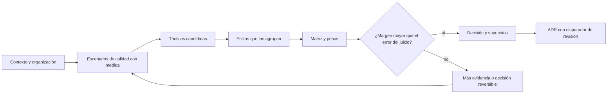
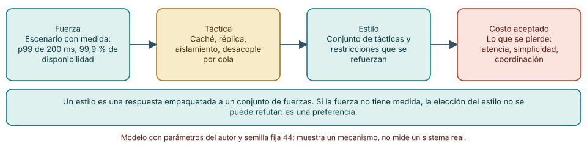
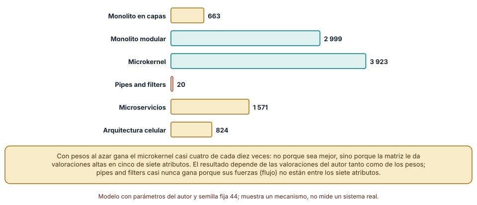

# SE-529 — Estilos como respuestas a fuerzas de calidad

[← SE-528 — Proyecto: catálogo de patrones de un sistema real](../../classes/part-43-patrones-de-diseno-empresariales-y-de-resiliencia/se-528-proyecto-catalogo-de-patrones-de-un-sistema-real/README.md) · [↑ Parte 44](../../classes/part-44-estilos-arquitectonicos/README.md) · [📚 Índice completo](../../classes/README.md) · [🌐 Portal](../../site/classes/SE-529.html) · [SE-530 — Microkernel y arquitecturas de plugins →](../../classes/part-44-estilos-arquitectonicos/se-530-microkernel-y-arquitecturas-de-plugins/README.md)

## Punto profesional y fundamento pedagógico

**Punto profesional.** La clase existe para que dejes de elegir una arquitectura por su nombre y empieces a elegirla por las fuerzas que debe resistir. «Microservicios», «monolito», «celdas» o «eventos» circulan como símbolos de madurez técnica, y un símbolo no se puede discutir con evidencia. Lo que sí se puede discutir es qué atributo de calidad exige el sistema (una latencia, una disponibilidad, una forma de cambiar), qué tácticas lo atienden y qué se pierde al adoptarlas. Un ingeniero que sabe hacerlo puede explicar a quien paga por qué un monolito modular es la respuesta correcta hoy y qué número haría cambiar esa respuesta mañana. Quien solo conoce los nombres repite la moda del año.

**Por qué aparece aquí.** Abre la **Parte 44** después de la Parte 43, que enseñó patrones de diseño a escala de clases y módulos. Un estilo arquitectónico opera una escala por encima: no decide cómo se escribe una clase sino qué unidades se despliegan, cómo se comunican y qué fallo puede cruzar entre ellas. La Parte 25 presentó los drivers y atributos de arquitectura (`SE-301`), las vistas, el monolito frente a los servicios (`SE-303`), el trade-off y el ADR (`SE-309`) y la dimensión socio-técnica (`SE-310`); esta parte toma esas ideas y compara once estilos y técnicas con costos medidos en código. Esta primera clase fija el método con el que se juzgarán los once estilos y técnicas siguientes.

**Error conceptual que debe corregir.** Creer que existe un estilo mejor que los demás y que elegirlo es una cuestión de conocimiento técnico. Un estilo es un conjunto de restricciones que favorece unos atributos de calidad a costa de otros. Con la misma matriz de valoraciones, en esta clase ganan cuatro estilos distintos según el contexto; ninguno gana en los cuatro. Lo que cambia entre un contexto y otro no es la tecnología, son los pesos: cuánto importa desplegar de forma independiente frente a cuánto importa operar sin esfuerzo.

**Secuencia de aprendizaje.** Antes de ejecutar, escribes tu predicción: con la matriz de seis estilos y siete atributos, ¿qué estilo gana para un equipo de seis personas con un producto nuevo y cuál para doce equipos? Después ejecutas la matriz con cuatro perfiles de pesos, la repites con diez mil juegos de pesos al azar y con perturbaciones de las valoraciones, y lees qué parte del resultado depende de los números del autor y qué parte de la estructura del problema.

**Evidencia de aprendizaje.** `matriz-de-fuerzas.md` con tus escenarios de calidad (con medida), la matriz de estilos candidatos, tus pesos para tu contexto, el ganador, el margen sobre el segundo y una prueba de sensibilidad que diga qué valoración, de cambiar en un punto, invierte la decisión.

**Límite de la conclusión.** Las valoraciones de 1 a 5 son un juicio del autor sobre seis estilos genéricos, no mediciones, y los cuatro contextos son construidos. El experimento demuestra el mecanismo de decisión (que el ganador depende del contexto y que el margen puede ser menor que el error del juicio), no cuál estilo conviene a ningún sistema real. No se evaluó ningún producto ni se invocó ningún modelo de lenguaje.

### Trazabilidad fuente → afirmación

| Fuente primaria u oficial | Afirmación que respalda | Lo que no prueba |
|---|---|---|
| [ISO/IEC 25010:2023](https://www.iso.org/standard/78176.html) | Ofrece un vocabulario estándar de características de calidad del producto (por ejemplo, eficiencia de desempeño, fiabilidad, mantenibilidad) con el que nombrar las fuerzas. | No dice qué estilo satisface cada característica. |
| [SEI, «ATAM: Method for Architecture Evaluation»](https://www.sei.cmu.edu/library/atam-method-for-architecture-evaluation/) | Describe una evaluación de arquitectura basada en escenarios de calidad que expone puntos de sensibilidad y de compromiso entre atributos. | No es una medición del sistema evaluado. |
| [SEI, «Quality Attribute Workshops»](https://www.sei.cmu.edu/library/quality-attribute-workshops-qaws-third-edition/) | Propone reunir a las partes interesadas para producir escenarios de calidad priorizados antes de decidir la arquitectura. | No garantiza que los escenarios sean completos. |
| [Fowler, «MonolithFirst»](https://martinfowler.com/bliki/MonolithFirst.html) y [«Microservice Premium»](https://martinfowler.com/bliki/MicroservicePremium.html) | Defienden, como opinión argumentada de su autor, que el costo de los microservicios solo se paga cuando la complejidad del sistema lo justifica. | No son estudios empíricos. |
| [Conway, «How Do Committees Invent?»](https://www.melconway.com/Home/Conways_Law.html) | Plantea que la estructura de un sistema copia la de la organización que lo diseña. | No mide el efecto en ningún proyecto concreto. |

## Antes de empezar

Recupera lo aprendido en la Parte 43: un patrón de diseño es una solución con una fuerza que lo motiva y un costo que lo acompaña. La pregunta activa es: **¿cuándo fue la última vez que viste elegir una tecnología de arquitectura sin que nadie escribiera qué medida debía mejorar, y cómo habrías sabido si la elección funcionó?**

## Prerrequisitos

- Haber visto `SE-301` (drivers, restricciones y atributos de arquitectura) o poder explicar qué es un atributo de calidad.
- Saber leer una tabla de valoraciones y calcular una media ponderada.
- Python 3.11 o posterior; el laboratorio no usa dependencias externas.
- Conocer de `SE-373` (modelos de calidad y atributos medibles) qué es un escenario de calidad y qué lo hace medible.

## Problema auténtico

*Avisos* es el servicio que decide qué recordatorio de entrega se envía a cada estudiante. Nació como un módulo dentro de la plataforma, escrito por seis personas. Hoy recibe una propuesta de tres personas distintas: separarlo en un microservicio «porque escala mejor», convertirlo en un sistema de complementos «porque cada universidad quiere su canal» y repartirlo en celdas «porque el cliente grande tumbó todo la semana pasada». Cada propuesta es razonable y ninguna lleva una medida. Sin ella, la reunión se decide por quién habla con más autoridad.

La clase construye el método que sustituye la autoridad por evidencia. Se escriben las fuerzas como escenarios con una medida, se valoran seis estilos contra siete atributos, se pesan según el contexto, se mira el margen del ganador y se prueba cuánto aguanta ese resultado si las valoraciones o los pesos cambian. El resultado más útil no es el ganador sino la sensibilidad: qué supuesto, de ser falso, cambia la decisión.

## Objetivos observables

Al terminar podrás:

1. convertir una preferencia arquitectónica en un escenario de calidad con una medida que se pueda comprobar;
2. distinguir una táctica (una técnica concreta como una caché o una réplica) de un estilo (un conjunto de restricciones que agrupa tácticas);
3. construir una matriz de decisión, calcular el ganador y el margen, y explicar por qué una diferencia menor que el error del juicio no decide nada;
4. ejecutar un análisis de sensibilidad y nombrar el supuesto que invierte la decisión;
5. reconocer en una propuesta qué fuerza responde, qué costo no declara y qué evidencia la sostendría.

## Mapa conceptual



El mapa muestra que la decisión no termina en la matriz: si el margen es menor que el error del juicio, el camino vuelve a los escenarios para obtener más evidencia o para elegir una opción que se pueda deshacer. Solo una decisión con margen y supuestos explícitos llega al registro.

## Temas y por qué importan

| Tema | Por qué cambia una decisión profesional | Evidencia mínima |
|---|---|---|
| Fuerzas como escenarios | Una fuerza sin medida no se puede comprobar ni refutar. | Escenarios con estímulo, respuesta y medida |
| Táctica y estilo | Confundirlos lleva a adoptar un estilo entero para obtener una táctica. | Una lista de tácticas por estilo |
| Matriz de decisión | Ordena el debate, pero codifica las opiniones de quien la llena. | Valoraciones con su justificación |
| Pesos y contexto | Con los mismos estilos, otro contexto da otro ganador. | Ganador por perfil de pesos |
| Margen y ruido | Una diferencia pequeña no decide. | Margen frente a perturbación de valoraciones |
| Sensibilidad | Señala qué supuesto vigilar en producción. | El supuesto que invierte el resultado |
| Organización | La estructura de equipos es una fuerza más. | Número de equipos y vínculos entre ellos |

## Conceptos y decisiones

### 1. Un estilo es un paquete de restricciones

Un estilo arquitectónico dice qué tipos de unidades existen, cómo se comunican y qué está prohibido. Un monolito en capas prohíbe que una capa inferior llame a una superior; un sistema de pipes and filters prohíbe que un filtro conozca a los demás; una arquitectura de microservicios prohíbe compartir la base de datos entre servicios. Cada restricción compra una propiedad: la prohibición de compartir la base de datos permite desplegar un servicio sin coordinar con otros, y a cambio obliga a que los datos viajen por la red y a que las transacciones se repartan. Elegir un estilo es aceptar el paquete entero; por eso no se puede tomar solo «la parte buena».

### 2. Las fuerzas son escenarios, no adjetivos

«Escalable» y «mantenible» son adjetivos; no se puede decir si un diseño los cumple. Un escenario de calidad los reemplaza por una situación con medida: «con 500 solicitudes por segundo, el percentil 99 de calcular los avisos de un estudiante es de 200 milisegundos o menos» o «un equipo añade un canal nuevo en dos días sin que otro equipo despliegue». Un escenario tiene una fuente del estímulo, un estímulo, el artefacto afectado, el entorno, la respuesta esperada y la medida de esa respuesta, que es lo que permite aceptarlo o rechazarlo. El vocabulario de ISO/IEC 25010 sirve para nombrar a qué característica pertenece cada escenario; las reuniones de los talleres de atributos de calidad del SEI sirven para obtenerlos de las personas que conocen el negocio.

### 3. Tácticas y estilos

Una táctica es una técnica puntual que mueve un atributo: una caché baja la latencia, una réplica sube la disponibilidad, una cola desacopla en el tiempo. Un estilo agrupa tácticas que se refuerzan y deja fuera las que lo contradicen. La confusión frecuente es adoptar un estilo completo por una táctica: se separa el sistema en servicios para poder escalar un módulo, cuando bastaba con ejecutar varias copias del monolito detrás de un balanceador. La pregunta de control es: ¿qué táctica específica necesito y qué estilo mínimo la hace posible?

### 4. La matriz y su trampa

La matriz de decisión pone estilos en las filas, atributos en las columnas y un puntaje de 1 a 5 en cada celda. El ganador es la fila con mayor suma ponderada. Su valor es hacer visible el razonamiento; su riesgo es que las valoraciones sean la conclusión disfrazada de dato. Quien llena la matriz con la solución que ya prefiere obtiene un resultado que la confirma. Por eso la matriz se acompaña de una justificación por celda y de una revisión por alguien que no la llenó.

Matriz usada en el laboratorio (valoraciones del autor):

| Estilo | Despliegue independiente | Cambio localizado | Latencia interna | Simplicidad operativa | Aislamiento de fallos | Extensión por terceros | Costo a pequeña escala |
|---|---|---|---|---|---|---|---|
| Monolito en capas | 1 | 2 | 5 | 5 | 1 | 1 | 5 |
| Monolito modular | 2 | 4 | 5 | 4 | 1 | 2 | 5 |
| Microkernel | 2 | 3 | 5 | 3 | 2 | 5 | 4 |
| Pipes and filters | 3 | 3 | 2 | 3 | 3 | 3 | 3 |
| Microservicios | 5 | 4 | 2 | 1 | 4 | 3 | 1 |
| Arquitectura celular | 4 | 3 | 3 | 1 | 5 | 2 | 1 |

### 5. El contexto cambia los pesos, no los estilos

Se definen cuatro perfiles con pesos que suman 1: un equipo de seis personas con un producto nuevo (pesa más la simplicidad operativa y el costo), doce equipos y ciento veinte personas (pesa el despliegue independiente), una plataforma con extensiones de terceros (pesa la extensión) y un sistema crítico y multi-inquilino (pesa el aislamiento de fallos). Con la misma matriz ganan el monolito modular (4,00), los microservicios (3,45), el microkernel (3,75) y la arquitectura celular (3,50). El primer resultado que conviene mirar es que ningún estilo gana en todos los contextos.

### 6. Margen, ruido y sensibilidad

El segundo resultado es el margen: en el sistema crítico la arquitectura celular gana por 0,20 puntos sobre los microservicios, y en el equipo de seis el monolito modular gana por 0,35 sobre el monolito en capas. Una valoración de 1 a 5 tiene un error de al menos un punto en alguna celda, y un punto en una celda con peso 0,25 mueve el total en 0,25. Para cuantificarlo se perturbó cada celda en más o menos un punto con probabilidad 0,2 y se repitió 2 000 veces: el ganador del equipo de seis se mantuvo en el 92,7 % de las repeticiones, el de doce equipos en el 84,8 %, el de la plataforma en el 98,3 % y el del sistema crítico en el 77,2 %. Un 77 % significa que casi una de cada cuatro perturbaciones razonables cambia el ganador.

También se sortearon 10 000 juegos de pesos al azar (distribución uniforme sobre los pesos que suman 1, semilla 44): el microkernel ganó 3 923 veces, el monolito modular 2 999, los microservicios 1 571, la arquitectura celular 824, el monolito en capas 663 y pipes and filters solo 20. El microkernel gana con frecuencia porque la matriz le da valoraciones altas en cinco de siete atributos, no porque sea mejor: el experimento mide la estructura de la matriz tanto como la del problema.

### 7. La organización también es una fuerza

Conway planteó que los sistemas copian la estructura de comunicación de quienes los construyen. Un equipo de seis personas no necesita desplegar de forma independiente porque no hay con quién coordinarse; doce equipos sí. Por eso el atributo «despliegue independiente» pesa 0,05 en el primer perfil y 0,30 en el segundo. Esta fuerza no se mide con un benchmark: se mide contando equipos y dependencias entre ellos, y se revisa cuando la organización cambia.

## De una fuerza a un estilo

El camino que recorre una decisión sana empieza en una fuerza con medida, pasa por las tácticas que la atienden, llega a los estilos que las agrupan y termina en un costo aceptado explícitamente. Si falta el primer eslabón, la elección del estilo es una preferencia.



**Cómo leer la figura.** De izquierda a derecha: el escenario con medida justifica una táctica, la táctica sugiere los estilos que la agrupan y cada estilo trae un costo que el equipo acepta por escrito. Si el costo de la cuarta caja no se puede nombrar, la decisión no está terminada. **Dónde deja de valer:** el camino es lineal por claridad; en la práctica, el costo que aparece al final obliga a volver a los escenarios y a reescribirlos.

## Cuatro contextos, cuatro ganadores

La misma matriz con cuatro perfiles de pesos produce cuatro ganadores distintos. La tabla muestra el ganador, su puntaje, el segundo y el margen.


**Cómo leer la figura.** Cada fila es un contexto; la columna «Diferencia» es el margen sobre el segundo. Los márgenes de 0,20 y 0,30 son los que quedan dentro del ruido de un juicio de 1 a 5. **Dónde deja de valer:** los pesos de cada contexto son del autor; otro equipo con el mismo contexto puede pesar distinto y llegar a otro ganador. La figura muestra que el contexto decide, no qué estilo conviene a un sistema real.

## Qué ocurre con pesos al azar

Para saber cuánto del resultado viene de la matriz y cuánto de los pesos, se sortearon 10 000 juegos de pesos.



**Cómo leer la figura.** La longitud de cada barra es el número de veces que ese estilo ganó. Un estilo que casi nunca gana (pipes and filters, 20) no es inútil: sus fuerzas, como el procesamiento de flujo, no están entre los siete atributos de la matriz. **Dónde deja de valer:** el reparto depende de la matriz del autor; con otras valoraciones, otro estilo dominaría. Sirve para detectar si un estilo domina a otro en todas las columnas (en cuyo caso la elección no es un compromiso) y para no confiar en un ganador que solo gana con un peso muy concreto.

## Definiciones de trabajo

- **Estilo arquitectónico:** conjunto de restricciones sobre las unidades, sus conexiones y su despliegue que favorece unos atributos de calidad.
- **Táctica:** técnica puntual que mueve un atributo, independiente del estilo.
- **Escenario de calidad:** situación con fuente, estímulo, artefacto, entorno, respuesta y medida de la respuesta.
- **Matriz de decisión:** tabla de estilos por atributos con valoraciones y pesos.
- **Margen:** diferencia de puntaje entre el primero y el segundo.
- **Punto de sensibilidad:** parámetro cuyo cambio pequeño invierte la decisión.
- **Punto de compromiso:** decisión que mejora un atributo empeorando otro.

## Ejemplo mínimo

Dos estilos, dos atributos y un peso:

```python
ratings = {"modular": (5, 2), "servicios": (2, 5)}  # (simplicidad, despliegue independiente)
def score(w_simple, style):
    s, d = ratings[style]
    return w_simple * s + (1 - w_simple) * d

for w in (0.8, 0.5, 0.2):
    print(w, {k: round(score(w, k), 2) for k in ratings})
```

Con peso 0,8 en la simplicidad gana el monolito modular (4,4 contra 2,6); con 0,5 empatan en 3,5; con 0,2 ganan los servicios (4,4 contra 2,6). El empate en 0,5 es el hallazgo: existe un peso en el que la matriz no decide, y ese peso es la pregunta que hay que hacerle al negocio.

## Ejemplo profesional

*Escenario ilustrativo: las cifras y los resultados que aparecen en este ejemplo son supuestos de la narración, no mediciones.*

El equipo de *Avisos* recibe las tres propuestas del problema auténtico. En lugar de votar, la líder pide un escenario por propuesta. La del microservicio queda como «el cálculo de avisos escala a 2 000 solicitudes por segundo sin degradar el resto de la plataforma»; la de complementos, como «una universidad añade su canal en una semana sin tocar el núcleo»; la de celdas, como «un cliente defectuoso afecta como máximo al 15 % de los inquilinos». Con los escenarios escritos aparece algo que no se veía: hoy el tráfico es de 80 solicitudes por segundo, de modo que el primer escenario no está en riesgo; el segundo ya ocurrió dos veces; el tercero ocurrió la semana pasada. El equipo valora, pesa, mira el margen y comprueba que dos de las tres propuestas no tienen evidencia de necesidad. Deja la decisión de escala para cuando una medida lo indique y escribe el disparador. La reunión pasó de tres opiniones a un orden de evidencia.

## Práctica guiada

1. Escribe cinco escenarios de calidad de un sistema tuyo, cada uno con medida y contexto.
2. Elige tres estilos candidatos y valora cada uno contra tus atributos, con una frase de justificación por celda.
3. Ejecuta `python scripts/experiments_part44_a.py 529` y compara tu predicción con los ganadores de los cuatro perfiles.
4. Asigna tus pesos, calcula el ganador y el margen, y perturba tus valoraciones un punto: anota si el ganador cambia.
5. Escribe el supuesto que invertiría tu decisión y qué medida lo vigilaría.

## Ejercicios

1. **Básico.** Reescribe «el sistema debe ser escalable» como un escenario con las seis partes y una medida.
2. **Intermedio.** En el perfil del equipo de seis el microkernel puntúa 3,50 y el monolito modular 4,00. Averigua cuántas valoraciones de un punto hay que cambiar (y en qué celdas) para que gane el microkernel, y explica por qué una sola celda no basta aunque pese 0,25.
3. **Avanzado.** Añade un séptimo estilo («arquitectura orientada a eventos») y justifica sus siete valoraciones con una fuente; mide con los 10 000 juegos de pesos si domina a algún estilo existente.

## Reto verificable

Entrega `matriz-de-fuerzas.md` con tus escenarios, la matriz con justificaciones, tus pesos, el ganador, el margen y la estabilidad del ganador bajo 2 000 perturbaciones de las valoraciones. Es válido si otra persona reproduce el cálculo con tus números y puede señalar la celda cuyo cambio invierte la decisión.

## Caso conductor

*Avisos* sirve de hilo para toda la parte: la regla de recordatorios de entregas que ya conoces de la Parte 40 crece hasta necesitar decisiones de arquitectura. Esta clase fija el método de decisión; `SE-530` y las siguientes lo aplican a un estilo cada vez, y `SE-539` y `SE-540` lo aplican al caso entero con una decisión defendida.

## Preguntas frecuentes

### ¿Hay que elegir siempre un estilo?

No. Todo sistema tiene una estructura, la elijas o no. Elegir es hacerla explícita: qué restricciones aceptas y cuáles no. Un sistema sin estilo declarado suele tener el del primer programador que lo escribió.

### ¿Puedo combinar estilos?

Sí, y es lo común: un monolito modular con una cola para el procesamiento asíncrono, o microservicios cuyo interior es un flujo de filtros. La pregunta es qué restricciones se mantienen en cada nivel y quién vigila la frontera entre ellos.

### ¿La matriz con números no es falsa precisión?

Lo es si se lee como medición. Se usa para hacer visible el razonamiento, medir el margen y probar la sensibilidad; no para producir un número que decida solo. Por eso se acompaña del análisis de perturbación y de la justificación por celda.

### ¿Cuándo es mejor empezar con un monolito?

Cuando el equipo es pequeño, el dominio aún se descubre y los costos de operar muchos servicios no tienen quien los pague. Fowler lo defiende como opinión argumentada; esta clase lo reproduce en el perfil del equipo de seis, donde la simplicidad operativa y el costo pesan 0,45 entre los dos.

## Fallo controlado y diagnóstico

**Fallo.** Una matriz con cinco estilos y sin escenarios da como ganador los microservicios. Se presenta a la dirección, que aprueba la migración. A los cuatro meses la latencia empeoró y el equipo no puede explicar por qué.

**Diagnóstico paso a paso.** (1) Se revisa la matriz: ninguna celda cita una medida. (2) Se repite el cálculo con un peso de latencia de 0,25 en lugar de 0,10: gana el monolito modular. (3) El peso de la latencia lo había fijado quien proponía los microservicios. (4) Nadie había escrito el escenario «p99 de 200 ms».

**Corrección.** Se escribe el escenario, se mide la latencia actual y se repite la decisión con los pesos acordados con el negocio y revisados por alguien que no los propuso. El resultado puede seguir siendo microservicios, pero ahora con una medida que lo confirme o lo refute.

## Errores comunes y cómo corregirlos

- **Elegir por tecnología.** Un nombre no es una fuerza. Corrige escribiendo el escenario primero.
- **Llenar la matriz con la conclusión.** Las valoraciones confirman lo que ya se quería. Corrige pidiendo justificación por celda y revisión externa.
- **Leer un margen pequeño como decisión.** Una diferencia de 0,20 está dentro del ruido. Corrige midiendo la estabilidad bajo perturbación.
- **Ignorar el contexto organizativo.** Los equipos son una fuerza. Corrige contando equipos y dependencias.
- **Adoptar el estilo entero por una táctica.** Corrige nombrando la táctica y buscando el estilo mínimo que la permite.
- **No registrar el supuesto que invierte la decisión.** Corrige escribiéndolo en el ADR con su medida.

## Entorno y archivos clave

- `scripts/experiments_part44_a.py`: función `e529` con la matriz, los cuatro perfiles y los análisis de sensibilidad; se ejecuta con `python scripts/experiments_part44_a.py 529`.
- `scripts/figures_part44_a.py`: las tres figuras de la clase.
- `content/part-44/figures/`: figuras generadas.
- Solo la biblioteca estándar de Python 3.11 o posterior. Los números del autor están al inicio de `experiments_part44_a.py` (`RATINGS` y `PROFILES`) y se pueden cambiar.

## Seguridad, ética y accesibilidad

Los cálculos no tocan datos reales ni red. La ética de una matriz es la de quien la llena: usarla para dar apariencia de objetividad a una decisión ya tomada es un mal uso, y compartirla sin sus justificaciones es engañoso. Si la decisión afecta a personas (un equipo que se disuelve, un servicio que se apaga), declararlo entre las consecuencias. Las figuras son tablas, un diagrama y un gráfico con texto alternativo completo; ninguna información depende solo del color.

## Puente hacia el trabajo con agentes

Un agente de código puede producir una matriz de estilos convincente en segundos, y ese es el riesgo: las valoraciones salen del conjunto de textos con el que se entrenó el modelo, que sobrerrepresenta las modas. El uso sano es pedirle escenarios de calidad a partir de tus requisitos, pedirle que liste las celdas donde su valoración depende de un supuesto, y ejecutar tú el análisis de perturbación. La verificación que no se delega es la medida de cada escenario: el agente puede proponer que el p99 sea de 200 ms, pero quien sabe cuánto tolera el negocio eres tú. Si el agente justifica una celda con una cita, abre la fuente.

## Transferencia

Toma una decisión arquitectónica reciente de tu equipo (un servicio nuevo, una cola, una base de datos aparte) y reconstruye la matriz que debería haberla sustentado. Escribe los escenarios, valora la decisión que se tomó y una alternativa, pesa según el contexto de entonces y mira el margen. Si el margen fue menor que el ruido, la decisión se tomó por otra razón; averigua cuál.

## Evaluación y evidencia

| Criterio | Evidencia aceptable | Rechazo |
|---|---|---|
| Escenarios con medida | Seis partes y una medida comprobable | «Debe ser escalable» |
| Matriz justificada | Una frase por celda | Números sin justificación |
| Pesos del contexto | Acordados con quien conoce el negocio | Pesos de quien propone |
| Margen y ruido | Estabilidad bajo perturbación | Ganador sin margen |
| Supuesto que invierte | Escrito con su medida | No identificado |

## Fuentes

- Organización Internacional de Normalización. [ISO/IEC 25010:2023](https://www.iso.org/standard/78176.html).
- Software Engineering Institute. [«ATAM: Method for Architecture Evaluation»](https://www.sei.cmu.edu/library/atam-method-for-architecture-evaluation/).
- Software Engineering Institute. [«Quality Attribute Workshops (QAWs), Third Edition»](https://www.sei.cmu.edu/library/quality-attribute-workshops-qaws-third-edition/).
- Fowler, M. [«MonolithFirst»](https://martinfowler.com/bliki/MonolithFirst.html) y [«Microservice Premium»](https://martinfowler.com/bliki/MicroservicePremium.html).
- Conway, M. E. [«How Do Committees Invent?»](https://www.melconway.com/Home/Conways_Law.html).

## Límites y siguiente paso

La matriz, los pesos y los cuatro contextos son construcciones del autor; los resultados muestran el mecanismo de decisión y no recomiendan ningún estilo para un sistema real. No se midió ningún sistema, equipo ni producto. El siguiente paso, `SE-530`, estudia el primer estilo concreto: el microkernel, que compra extensión por terceros y paga con un contrato que hay que mantener.

## Glosario

| Término | Definición breve |
|---|---|
| Estilo arquitectónico | Conjunto de restricciones que favorece ciertos atributos |
| Táctica | Técnica puntual que mueve un atributo de calidad |
| Escenario de calidad | Situación con medida que concreta un atributo |
| Margen | Diferencia de puntaje entre el primero y el segundo |
| Punto de sensibilidad | Parámetro cuyo cambio pequeño invierte la decisión |
| Punto de compromiso | Decisión que mejora un atributo y empeora otro |
