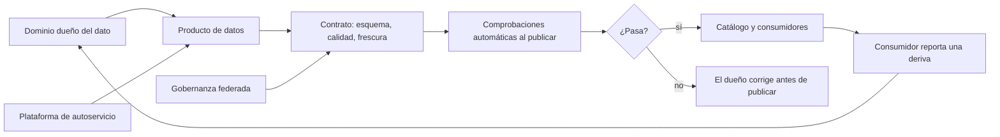

# SE-535 — Data mesh y propiedad de los datos

[← SE-534 — Multi-tenancy y aislamiento](../../classes/part-44-estilos-arquitectonicos/se-534-multi-tenancy-y-aislamiento/README.md) · [↑ Parte 44](../../classes/part-44-estilos-arquitectonicos/README.md) · [📚 Índice completo](../../classes/README.md) · [🌐 Portal](../../site/classes/SE-535.html) · [SE-536 — Arquitectura celular y radio de impacto →](../../classes/part-44-estilos-arquitectonicos/se-536-arquitectura-celular-y-radio-de-impacto/README.md)

## Punto profesional y fundamento pedagógico

**Punto profesional.** La clase existe para que evalúes el data mesh como lo que es, una decisión sobre quién es dueño de los datos y quién responde por su calidad, y no como una arquitectura de herramientas. Cuando una organización crece, el equipo central de datos suele convertirse en cuello de botella y en un grupo que conoce la tecnología pero no el dominio de cada fuente. El data mesh propone devolver la propiedad de los datos a los dominios que los producen y tratar cada conjunto como un producto con un dueño, un contrato y una calidad medida. La propuesta tiene un costo, y la clase lo pone en números: dónde la cola del equipo central deja de ser tolerable, cuántas personas necesita cada modelo y qué defectos de un producto de datos detecta un contrato.

**Por qué aparece aquí.** Sigue a `SE-534` porque trata una variante de la misma pregunta de propiedad: allí, quién ve los datos de un inquilino; aquí, quién responde por un conjunto de datos y por su calidad. Reutiliza dos ideas ya vistas: el contrato compatible de `SE-532` (un producto de datos es un servicio cuyo contrato son filas y columnas) y las pruebas de contrato de `SE-487` aplicadas a datos. Prepara `SE-536`, donde la propiedad se convierte en frontera de fallo.

**Error conceptual que debe corregir.** Creer que el data mesh es una tecnología (un catálogo, una plataforma, un formato). Sus propuestas originales son organizativas: propiedad orientada al dominio, datos como producto, una plataforma de autoservicio y una gobernanza federada y computacional. La tecnología es la plataforma; sin la propiedad no hay malla, hay un lago de datos con más herramientas. La segunda corrección: no ahorra personas. En el modelo de esta clase, repartir la propiedad por dominios necesita más personas en total que un equipo central, y lo que cambia es dónde está el conocimiento y quién responde.

**Secuencia de aprendizaje.** Antes de ejecutar, predices con cuántos dominios un equipo central de cuatro personas empieza a hacer esperar semanas a quienes piden un conjunto de datos, y cuántas de ocho derivas de un producto de datos detecta solo el esquema. Después ejecutas una cola con la fórmula analítica como control, calculas las personas necesarias por modelo y pasas ocho derivas y un cambio legítimo por cinco comprobaciones.

**Evidencia de aprendizaje.** `contrato-de-producto-de-datos.md` con el esquema, las comprobaciones de calidad con su umbral, el acuerdo de frescura, el dueño y la política de cambios de un producto de datos tuyo, más la tabla de qué deriva detecta cada comprobación y cuál queda sin detectar.

**Límite de la conclusión.** La cola es un modelo de colas con tasas de llegada y de servicio inventadas por el autor y una «penalización de contexto» que es un supuesto, no una medición; el producto de datos tiene 1 000 filas sintéticas y las derivas son ocho cambios escritos a mano. Nada de esto mide a ningún equipo de datos ni la calidad de ningún lago. No se evaluó ninguna plataforma de datos ni se invocó ningún modelo de lenguaje.

### Trazabilidad fuente → afirmación

| Fuente primaria u oficial | Afirmación que respalda | Lo que no prueba |
|---|---|---|
| [Dehghani, «Data Mesh Principles and Logical Architecture»](https://martinfowler.com/articles/data-mesh-principles.html) | Formula los cuatro principios (propiedad orientada al dominio, datos como producto, plataforma de datos de autoservicio, gobernanza federada y computacional). | Es una propuesta de su autora, no un estudio de resultados. |
| [Dehghani, «How to Move Beyond a Monolithic Data Lake to a Distributed Data Mesh»](https://martinfowler.com/articles/data-monolith-to-mesh.html) | Presenta los problemas del modelo centralizado (un equipo y una arquitectura monolítica entre fuentes y consumidores) que motivan la propuesta. | No mide cuántas organizaciones los sufren. |
| [Conway, «How Do Committees Invent?»](https://www.melconway.com/Home/Conways_Law.html) | Respalda que la estructura de los datos y de los sistemas refleja la de los equipos que los producen. | No cuantifica el efecto. |
| [ISO/IEC 25010:2023](https://www.iso.org/standard/78176.html) | Nombra características de calidad (corrección funcional, fiabilidad) con las que describir la calidad de un producto. | No define criterios de calidad de datos para una organización. |
| [Python: `statistics`](https://docs.python.org/3/library/statistics.html) y [`random`](https://docs.python.org/3/library/random.html) | Documentan las funciones de media y de muestreo con semilla del laboratorio. | No validan el modelo de colas. |

## Antes de empezar

Recupera lo aprendido en `SE-534`: el aislamiento se prueba y no se supone. La pregunta activa es: **¿cuánto tarda hoy en tu organización que alguien consiga un conjunto de datos nuevo, de quién depende y quién responde si los números salen mal?**

## Prerrequisitos

- Haber completado `SE-532` y `SE-534`.
- Saber qué es una tasa de llegada y qué es una utilización en una cola; no se exige la teoría de colas.
- Conocer la idea de contrato de `SE-487` y de lector tolerante de `SE-532`.
- Python 3.11 o posterior; el laboratorio usa solo la biblioteca estándar.

## Problema auténtico

*Avisos* genera datos que otros quieren: el equipo de producto, el de finanzas y las universidades que piden estadísticas de cuántos avisos se enviaron y se leyeron. Un equipo central de datos de cuatro personas los atiende. Al principio había cinco peticiones al mes y un día de espera. Hoy hay veinte dominios, cada uno con cada vez más peticiones, y la espera media ronda las semanas. Un analista del equipo central, además, no sabe qué significa «entregada» para el equipo de notificaciones, de modo que cada petición incluye una ronda de preguntas.

Alguien propone el data mesh: que cada dominio publique sus datos como un producto con un dueño y un contrato. La propuesta es atractiva y plantea dos preguntas que la presentación no responde. La primera: ¿cuánto es «demasiado» para el equipo central, y es verdad que el problema es de personas? La segunda: si cada dominio publica sus propios datos, ¿cómo se evita que un cambio de columna o de significado rompa en silencio a quienes los consumen?

## Objetivos observables

Al terminar podrás:

1. explicar los cuatro principios del data mesh y cuál de ellos es organizativo, cuál técnico y cuál de gobierno;
2. calcular con un modelo de colas cuándo un equipo central deja de ser tolerable y por qué la espera crece de forma no lineal;
3. comparar el número de personas necesarias en un modelo central y en uno por dominio con supuestos explícitos;
4. escribir un contrato de producto de datos (esquema, completitud, unicidad, frescura y distribución) y ejecutar sus comprobaciones;
5. distinguir las derivas que detecta cada comprobación, las que no detecta ninguna y las falsas alarmas.

## Mapa conceptual



El mapa pone la plataforma y la gobernanza como servicios hacia el producto y el dueño como responsable de lo que publica. La flecha de retorno es la parte menos tecnológica: un consumidor que detecta una deriva sabe a quién reclamar.

## Temas y por qué importan

| Tema | Por qué cambia una decisión profesional | Evidencia mínima |
|---|---|---|
| Propiedad por dominio | Pone el conocimiento del dominio y la responsabilidad en el mismo lugar. | Dueño de cada producto |
| Cola del equipo central | La espera explota cerca de la saturación. | Utilización y espera por número de dominios |
| Costo en personas | La malla no necesariamente ahorra. | Personas por modelo con supuestos |
| Producto de datos | Un conjunto de datos con contrato y nivel de servicio. | Contrato escrito |
| Comprobaciones | Detectan unas derivas y no otras. | Matriz deriva por comprobación |
| Gobernanza federada | Reglas globales aplicadas por código. | Reglas automatizadas frente a manuales |
| Cuándo no | Con pocos dominios o equipo central ocioso no compensa. | Utilización actual |

## Conceptos y decisiones

### 1. Cuatro principios, tres naturalezas

Los cuatro principios del data mesh son de naturaleza distinta. La propiedad orientada al dominio es una decisión de organización: quién posee y responde. Los datos como producto es una decisión de práctica: cada conjunto tiene un dueño, una interfaz, un contrato y consumidores a quienes servir. La plataforma de autoservicio es técnica: reducir el costo de publicar un producto. La gobernanza federada y computacional es de gobierno: reglas globales (formatos, identificadores, políticas de privacidad) que se aplican como código en la plataforma y no como una reunión. Adoptar la plataforma sin la propiedad deja a un equipo central con mejores herramientas; adoptar la propiedad sin la plataforma pide a cada dominio construir su propia infraestructura de datos.

### 2. El problema que motiva: una cola con conocimiento ajeno

El modelo central tiene un equipo entre las fuentes y los consumidores. Cada petición entra a una cola y la atiende una persona del equipo. La teoría de colas dice algo incómodo: si cada persona atiende una solicitud por semana y los dominios piden 0,15 por semana cada uno, el equipo de cuatro personas está al 19 % con 5 dominios y al 75 % con 20. En la simulación, la espera media por solicitud pasó de 0,00 semanas con 5 dominios a 0,03, 0,14, 0,53 y 2,17 con 10, 15, 20 y 24, y el percentil 90 llegó a 5,65 semanas con 24. La fórmula analítica de Erlang C da 0,00, 0,03, 0,14, 0,51 y 1,97, que coincide con la simulación hasta el 75 % de utilización y se separa un poco a partir del 90 %, donde la simulación converge más despacio. Pasar de 20 a 24 dominios, un 20 % más de demanda, multiplica por cuatro la espera: es la no linealidad que hace que un equipo parezca bien durante años y de pronto sea un cuello de botella.

### 3. La penalización de contexto

La cola no cuenta que el analista central no conoce el dominio. Se modeló como una penalización multiplicativa del tiempo de servicio: con penalización 0,5, cada solicitud tarda un 50 % más porque hay que averiguar qué significa cada campo; con 1,0, el doble. Con 20 dominios, el equipo central necesita 5 personas para que la espera media no pase de 0,5 semanas sin penalización, 6 con 0,5 y 8 con 1,0. La penalización es un supuesto del autor y no se mide aquí; lo que enseña es la estructura: el conocimiento del dominio es capacidad perdida, y cuanto mayor sea, más crece el equipo necesario.

### 4. Por dominio no ahorra personas en este modelo

Si cada dominio atiende sus propias solicitudes con una fracción de persona, una fracción de 0,5 da una utilización del 30 %, pero la espera media simulada sigue siendo 0,87 semanas porque con una sola persona por dominio la cola no tiene el efecto de agrupamiento que tiene un equipo de varias; con 0,65 persona por dominio la espera baja a 0,47 semanas y con 0,70 a 0,40. Con 20 dominios son 13 y 14 personas en total, contra 5 a 8 del equipo central. El modelo no incluye lo que el mesh promete (que la penalización de contexto desaparece dentro del dominio y que el dueño del dato lo conoce) ni lo que cuesta (la duplicación de capacidades entre dominios). La lectura honesta es que el data mesh no es una reducción de costo; es una redistribución que se justifica si el conocimiento del dominio es el cuello de botella y no la capacidad técnica.

### 5. Un producto de datos es un servicio con contrato

El producto tiene un dueño, un esquema (columnas, tipos), un nivel de calidad (valores nulos, duplicados), un nivel de frescura (qué tan atrasado puede estar) y un historial de cambios. Se modeló uno con 1 000 filas de entregas, con cuatro columnas (`id`, `student`, `due_hours`, `submitted`) y una edad de los datos. Se definieron cinco comprobaciones: esquema (nombres y tipos, y que un booleano no pase por entero), completitud (menos del 1 % de estudiantes nulos), unicidad (identificadores distintos), frescura (ninguna fila con más de 24 horas) y distribución (la media de horas y la proporción de entregadas dentro de una banda de la línea base: más o menos 25 % en la media y 0,15 en la proporción). La línea base tuvo una media de 203,1 horas y un 72,1 % de entregadas.

### 6. Ocho derivas, cinco comprobaciones

Se introdujeron ocho derivas. D1, D2 y D3 (columna renombrada, tipo cambiado a texto y columna eliminada) las detecta el esquema. D4 (12,5 % de estudiantes nulos) las detectan la completitud y el esquema (el nulo no es un texto). D5 (identificadores duplicados) la unicidad. D6 (datos con 30 horas de atraso) la frescura. D7 (la unidad de plazo cambió de horas a minutos) y D8 (el significado de «entregada» se invirtió) las detecta la distribución: los valores siguen siendo enteros y booleanos válidos para el esquema, pero la media y la proporción se salen de la banda. En total se detectan 8 de 8, y con solo el esquema se detectarían 4. La lección es que las derivas más peligrosas, las semánticas, son válidas para el esquema.

### 7. La falsa alarma y la intención

Se probó además un cambio legítimo: a fin de semestre las fechas están más cerca y la media de horas baja a la mitad. La comprobación de distribución lo marcó como deriva. Ninguna comprobación estadística distingue un defecto de un cambio real del negocio; lo que los distingue es la intención declarada. Por eso el contrato incluye un registro de cambios: el dueño anuncia «a partir de hoy el plazo es en minutos» o «este mes las fechas están más cerca» antes de publicar, y la comprobación se ajusta o se silencia con una anotación. Una comprobación de distribución sin un registro de cambios genera alertas que se aprenden a ignorar.

### 8. Gobernanza federada: lo global como código

Las reglas que valen para todos (nombres de identificadores, formato de fechas, tratamiento de datos personales) no pueden depender de que cada dominio las recuerde ni de una reunión mensual. La propuesta es que la plataforma las aplique como comprobaciones: un producto que publica una columna con datos personales sin la marca correspondiente no se publica. Lo que queda federado es la decisión de qué reglas existen y quién las cambia. El costo es que esas reglas se escriben, se prueban y se mantienen, un trabajo que el equipo central hacía de forma implícita.

### 9. Cuándo no

Con pocos dominios (cinco en el modelo, 19 % de utilización) el equipo central no es un cuello de botella y la reorganización cuesta más de lo que compra. Cuando la capacidad técnica y no el conocimiento es lo que falta, repartirla agrava el problema. Y si los dominios no tienen ingenieros de datos ni deseo de poseer sus datos, la propiedad por decreto produce productos abandonados con un dueño de nombre.

## La cola del equipo central

La primera medida simula un equipo de cuatro personas con una demanda creciente.


**Cómo leer la figura.** El eje horizontal son los dominios y el vertical las semanas de espera; la línea verde es la espera media simulada, la azul oscura la analítica de Erlang C y la roja el percentil 90. Mira primero cómo las tres se curvan hacia arriba entre 20 y 24 dominios; la utilización de cada punto está en la nota. **Dónde deja de valer:** el modelo supone llegadas independientes, un solo tipo de solicitud y tiempos de servicio exponenciales; las peticiones de datos reales llegan en ráfagas y varían mucho en tamaño. Lo que sí se traslada es la forma: la espera explota cerca del 100 % de utilización.

## Personas necesarias por modelo

La segunda medida pregunta cuántas personas hacen falta para que la espera media sea de media semana.


**Cómo leer la figura.** Cada barra es un modelo de propiedad, con la espera media entre paréntesis, y su longitud las personas en total. Mira primero que las dos últimas barras, la propiedad por dominio, son más largas que las del equipo central: no ahorra personas, y la de 10 ni siquiera cumple la espera. **Dónde deja de valer:** el modelo no cuenta lo que el mesh promete (conocimiento en el dominio, un dueño por producto) ni lo que cuesta (duplicación). La figura no dice que el mesh sea malo; dice que no se justifica por ahorro de personas.

## Derivas y comprobaciones

La tercera medida pasa ocho derivas y un cambio legítimo por las cinco comprobaciones.


**Cómo leer la figura.** Cada fila es un cambio y cada columna una comprobación del contrato; una celda oscura dice que esa comprobación falla. Mira primero la columna del esquema, que solo ve cuatro derivas, y la celda resaltada, la falsa alarma de la distribución con un cambio legítimo. **Dónde deja de valer:** las derivas son ocho cambios inventados y los umbrales (1 %, 24 horas, 25 % y 0,15) los fijó el autor; un cambio semántico sutil que mantiene la distribución, como intercambiar dos estados que se reparten por igual, no se detectaría. Las comprobaciones no prueban que los datos sean correctos, solo que no se parecen a ciertos fallos.

## Definiciones de trabajo

- **Data mesh:** enfoque organizativo y técnico que reparte la propiedad de los datos entre los dominios que los producen.
- **Producto de datos:** conjunto de datos con dueño, contrato, calidad y nivel de servicio.
- **Dominio:** área de negocio con su propio lenguaje y equipo.
- **Contrato de datos:** esquema y garantías de calidad y frescura que el productor ofrece.
- **Utilización:** fracción de la capacidad de servicio que ocupa la demanda.
- **Gobernanza federada y computacional:** reglas globales decididas en conjunto y aplicadas como código.
- **Deriva semántica:** cambio de significado que conserva el esquema.

## Ejemplo mínimo

La cola de una persona en seis líneas:

```python
import random
rng = random.Random(44)
t, libre, esperas = 0.0, 0.0, []
for _ in range(20000):
    t += rng.expovariate(0.15)          # llegadas: 0,15 por semana
    inicio = max(t, libre)
    esperas.append(inicio - t)
    libre = inicio + rng.expovariate(0.5)   # servicio: 0,5 personas por semana
print(round(sum(esperas) / len(esperas), 2))   # alrededor de 0,86 semanas
```

La utilización es 30 % y la espera media supera ocho décimas de semana: con una sola persona servir una solicitud tarda en promedio dos semanas, y el hueco entre llegadas no basta para vaciar la cola con regularidad. Es la razón de que las colas pequeñas se comporten peor que una cola grande con la misma utilización.

## Ejemplo profesional

*Escenario ilustrativo: las cifras y los resultados que aparecen en este ejemplo son supuestos de la narración, no mediciones.*

El equipo de datos de *Avisos* mide el tiempo que tardan en entregarse las solicitudes del último trimestre: la mediana es de tres días y el percentil 90, de cinco semanas, con cola creciente. La dirección propone un data mesh. El equipo evita la discusión de principios y propone un piloto con un solo dominio: el equipo de notificaciones publicará su producto «avisos enviados» con un contrato de seis campos, una comprobación de esquema, otra de frescura (24 horas) y una de distribución, y un dueño nombrado. Se fija una métrica (tiempo desde la solicitud hasta el acceso) y un criterio de salida (si en seis semanas el percentil 90 baja de dos semanas a cinco días y no hay incidentes de calidad sin dueño, se amplía a tres dominios). Al cuarto mes la comprobación de distribución detecta que un cambio de unidades duplicó la media; el dueño lo corrige antes de que lo vea ningún consumidor. El piloto no demostró que el mesh sirva en general; demostró que este dominio, con este contrato, mejoraba lo que se midió.

## Práctica guiada

1. Mide el tiempo de espera de las últimas solicitudes de datos en tu organización y calcula la utilización de quien las atiende.
2. Ejecuta `python scripts/experiments_part44_b.py 535` y reproduce la tabla de la cola; cambia el número de personas y de dominios.
3. Escribe el contrato de un producto de datos tuyo con las cinco comprobaciones y sus umbrales.
4. Inyecta tres derivas (una de esquema, una de unidad y una de significado) y anota qué comprobación las detecta.
5. Escribe cómo se anuncia un cambio legítimo para que la comprobación no genere falsas alarmas.

## Ejercicios

1. **Básico.** Explica por qué pasar de 20 a 24 dominios multiplica la espera por cuatro y por qué un equipo de cuatro personas al 75 % parece estar bien.
2. **Intermedio.** Cambia en el experimento la penalización de contexto a 2,0 y calcula cuántas personas necesita el equipo central con 20 dominios; compara con la propiedad por dominio.
3. **Avanzado.** Diseña una novena deriva que ninguna de las cinco comprobaciones detecte y propón la comprobación que la vería; explica cuánto costaría mantenerla.

## Reto verificable

Entrega `contrato-de-producto-de-datos.md` con el esquema, las comprobaciones con umbral, la frescura, el dueño y la política de cambios de un producto tuyo, y la matriz de derivas inyectadas con su detección. Es válido si otra persona reproduce la matriz con tus datos y puede señalar la deriva que tu contrato no ve.

## Caso conductor

*Avisos* publica «avisos enviados» como un producto de datos con dueño y contrato, y mide si baja el tiempo de acceso. `SE-536` toma la propiedad y la convierte en frontera de fallo: qué ocurre cuando uno de esos dominios, o un inquilino, falla y cuánto del sistema se lleva con él.

## Preguntas frecuentes

### ¿El data mesh reemplaza al equipo central?

No necesariamente. La propuesta mantiene un equipo de plataforma que ofrece el autoservicio y la gobernanza. Lo que deja de hacer es la intermediación de cada petición.

### ¿Necesito un lago o un almacén en una malla?

Los productos viven en la tecnología que cada dominio elija dentro de la plataforma; la malla es agnóstica. Lo que importa es que cada producto se descubra, se acceda de forma uniforme y cumpla su contrato.

### ¿Quién paga la calidad?

El dominio que produce los datos. Esa es la parte organizativa de la propuesta y la más difícil: si el dominio no tiene incentivo para mantener la calidad, la malla no la crea.

### ¿Cómo evito que cada dominio invente su propio formato?

Con la gobernanza computacional: las reglas globales mínimas (identificadores, formatos de fecha, marcas de datos personales) se aplican en la plataforma. El resto queda a elección del dominio.

## Fallo controlado y diagnóstico

**Fallo.** Un dominio publica un nuevo producto de datos. Dos semanas después, el equipo de finanzas descubre que sus informes de avisos leídos están mal desde hace diez días. El producto pasó todas las comprobaciones.

**Diagnóstico paso a paso.** (1) Se compara la distribución de «leído» contra la línea base: la proporción pasó de 0,72 a 0,70, dentro de la banda. (2) Se revisa el cambio: «leído» pasó a contar también los avisos abiertos en una vista previa de la aplicación. (3) El cambio fue un ajuste de producto sin intención de cambiar el contrato. (4) La comprobación no podía verlo: la semántica cambió y la distribución no.

**Corrección.** Se añade al contrato una definición escrita de cada campo con una prueba de ejemplos (un caso concreto de aviso en vista previa debe contar como no leído), se exige que todo cambio de definición pase por el registro de cambios y se acuerda con finanzas un número de control semanal (cuántos avisos leídos según cada fuente). La lección es que las comprobaciones estadísticas no sustituyen a una definición con ejemplos.

## Errores comunes y cómo corregirlos

- **Tratar el data mesh como una herramienta.** Sin propiedad no hay malla. Corrige empezando por el dueño y el contrato.
- **Medir solo el esquema.** Las derivas semánticas lo cruzan. Corrige con distribución y definiciones con ejemplos.
- **Alertas sin registro de cambios.** Los cambios legítimos generan falsas alarmas. Corrige con anuncios de cambio.
- **Dimensionar el equipo central al promedio.** La espera explota cerca de la saturación. Corrige midiendo utilización y percentiles.
- **Propiedad por decreto.** Un dueño sin capacidad abandona el producto. Corrige con una plataforma de autoservicio y con capacidad asignada.
- **Esperar ahorro de personas.** Corrige justificando el cambio por conocimiento y propiedad.

## Entorno y archivos clave

- `scripts/experiments_part44_b.py`: función `e535` con la simulación de colas con la fórmula de Erlang C como control, el cálculo de personas y las cinco comprobaciones; se ejecuta con `python scripts/experiments_part44_b.py 535`.
- `scripts/figures_part44_b.py`: las tres figuras de la clase.
- Solo la biblioteca estándar de Python 3.11 o posterior. Las simulaciones usan semilla 44 y tardan unos segundos.

## Seguridad, ética y accesibilidad

Los datos del laboratorio son sintéticos. Un producto de datos real puede contener datos personales: el contrato debe declarar qué columnas los contienen, su base legal, su retención y quién puede acceder, y la plataforma debe aplicarlo. Descentralizar la propiedad descentraliza también la responsabilidad ante un incidente de privacidad; el dueño del dominio debe saberlo. Ética: medir la calidad de un producto por dominio no debe usarse para señalar a las personas del equipo sino para decidir apoyo. Las figuras son tablas con texto alternativo completo y no dependen solo del color.

## Puente hacia el trabajo con agentes

Un agente que consulta datos para responder una pregunta de negocio depende de que el producto sea lo que dice ser. Cuando el producto tiene un contrato con definiciones, el agente puede citar la definición y ejecutar las comprobaciones; cuando no lo tiene, el agente inventa una interpretación plausible. Exige que el agente, antes de calcular, lea el contrato del producto y declare qué definición usó. Cuando un agente publique o transforme un producto de datos, aplica las mismas comprobaciones que a cualquier productor humano, y no le permitas modificar las comprobaciones que lo evalúan.

## Transferencia

Elige un conjunto de datos que tu organización consume y escribe su contrato: dueño, esquema, definición de cada campo con un ejemplo, frescura y tres comprobaciones. Inyecta una deriva de unidad, una de significado y una de esquema, y mira cuál detecta cada comprobación. Después calcula la utilización del equipo que hoy atiende las solicitudes y decide con ese número si un piloto por dominio tiene sentido.

## Evaluación y evidencia

| Criterio | Evidencia aceptable | Rechazo |
|---|---|---|
| Propiedad | Dueño nombrado y con capacidad | «El equipo central» |
| Cola | Utilización y percentiles de espera | Promedio sin dispersión |
| Contrato | Esquema, calidad, frescura y definiciones | Solo el esquema |
| Matriz de derivas | Detección por comprobación y derivas sin detectar | «Validamos los datos» |
| Cambios | Registro de cambios y anuncio previo | Alertas ignoradas |

## Fuentes

- Dehghani, Z. [«Data Mesh Principles and Logical Architecture»](https://martinfowler.com/articles/data-mesh-principles.html) y [«How to Move Beyond a Monolithic Data Lake to a Distributed Data Mesh»](https://martinfowler.com/articles/data-monolith-to-mesh.html).
- Conway, M. E. [«How Do Committees Invent?»](https://www.melconway.com/Home/Conways_Law.html).
- Organización Internacional de Normalización. [ISO/IEC 25010:2023](https://www.iso.org/standard/78176.html).
- Python Software Foundation. [`statistics`](https://docs.python.org/3/library/statistics.html) y [`random`](https://docs.python.org/3/library/random.html).

## Límites y siguiente paso

La cola, la penalización de contexto, las derivas y los umbrales son construcciones del autor; la fórmula de Erlang C se usó solo como control de la simulación. No se midió ningún equipo de datos, ninguna plataforma ni la calidad de ningún lago, y el resultado «no ahorra personas» es del modelo, no de la práctica. El siguiente paso, `SE-536`, estudia la arquitectura celular: cómo repartir a los inquilinos en celdas independientes para que un fallo no cruce de una a otra.

## Glosario

| Término | Definición breve |
|---|---|
| Data mesh | Propiedad de los datos repartida por dominios |
| Producto de datos | Conjunto de datos con dueño, contrato y calidad |
| Contrato de datos | Esquema y garantías del productor |
| Utilización | Fracción de capacidad ocupada por la demanda |
| Gobernanza computacional | Reglas globales aplicadas como código |
| Deriva semántica | Cambio de significado que conserva el esquema |
