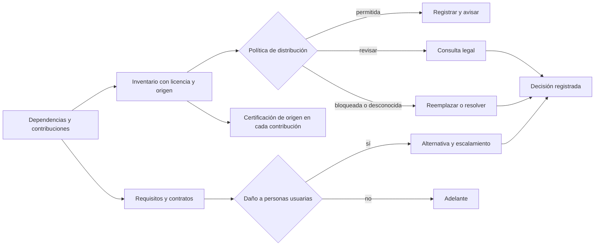
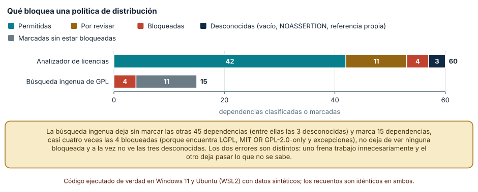
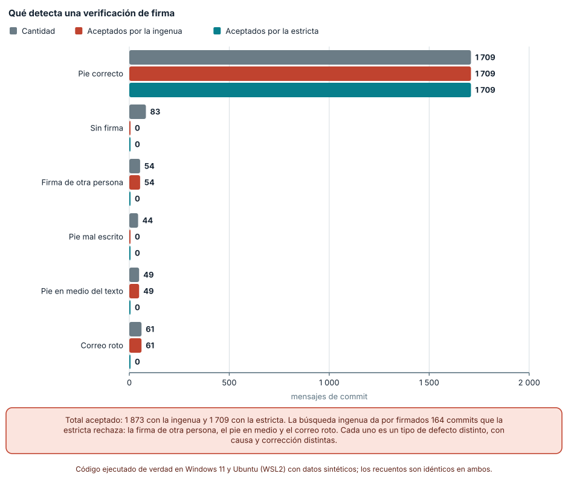
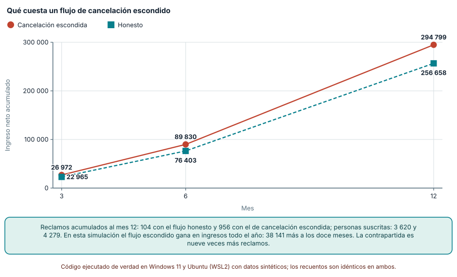

# SE-536 — Propiedad intelectual, contratos y ética

[← SE-535 — Compras, proveedores y evaluación técnica](../../classes/part-44-gestion-liderazgo-y-practica-profesional/se-535-compras-proveedores-y-evaluacion-tecnica/README.md) · [↑ Parte 44](../../classes/part-44-gestion-liderazgo-y-practica-profesional/README.md) · [📚 Índice completo](../../classes/README.md) · [🌐 Portal](../../site/classes/SE-536.html) · [SE-537 — Economía del software y costo total →](../../classes/part-44-gestion-liderazgo-y-practica-profesional/se-537-economia-del-software-y-costo-total/README.md)

## Punto profesional y fundamento pedagógico

**Punto profesional.** La clase existe para que reconozcas cuándo una decisión técnica es también una decisión legal o ética y para que la trates con procesos verificables en vez de con suposiciones. Tres hábitos concentran el valor: saber qué licencias llegan a tu producto a través de las dependencias y qué obligaciones traen, saber de dónde viene cada contribución y quién autorizó su uso, y leer un contrato o una exigencia de producto con la pregunta «¿qué responsabilidad estoy aceptando y a quién perjudica lo que construyo?». Esta clase no es asesoría legal: enseña a detectar los puntos en que se necesita una abogada o un abogado y a llegar a esa conversación con los hechos ordenados.

**Por qué aparece aquí.** Sigue a **Compras, proveedores y evaluación técnica** (`SE-535`): contratar un proveedor y distribuir software con componentes de terceros crea obligaciones. El caso conductor es **el equipo de plataforma educativa**, que debe revisar las licencias de sus sesenta dependencias antes de ofrecer la plataforma a otra institución, aceptar contribuciones externas al módulo de exportación y responder a una solicitud de producto de «hacer más difícil cancelar el servicio».

**Error conceptual que debe corregir.** Creer que «código abierto» significa «sin condiciones» y que una búsqueda de la palabra GPL detecta el riesgo. Las licencias de código abierto imponen condiciones distintas, algunas se combinan con reglas (elegir entre dos, aceptar ambas) y una búsqueda ingenua marca como problema lo que no lo es y deja pasar lo que sí: en la simulación de esta clase, la búsqueda ingenua marca quince dependencias y solo cuatro están realmente bloqueadas. Y creer que la ética es un tema aparte: un flujo de cancelación escondido es una decisión de diseño que mejora una métrica y daña a las personas.

**Secuencia de aprendizaje.** Antes de mirar los resultados, predices cuántas de las sesenta dependencias bloquea una política de distribución propietaria y cuántas marcaría una búsqueda de la palabra GPL; después clasificas las licencias con un analizador de expresiones, verificas el pie de firma de 2 000 commits con una búsqueda ingenua y con un análisis estricto, y simulas doce meses de un flujo de cancelación honesto frente a uno escondido. La secuencia usa predicción, explicación propia, contraste y recuperación. [ICAP](https://icap.education.asu.edu/research) distingue participación de construcción de conocimiento; [How People Learn II](https://nap.nationalacademies.org/catalog/24783/how-people-learn-ii-learners-contexts-and-cultures) respalda diseñar la práctica con contextos reales y retroalimentación.

**Evidencia de aprendizaje.** `licencias-log.md` con la predicción, las tres figuras reproducidas, el inventario de licencias de un proyecto con su clasificación y las decisiones sobre las ambiguas, una política de contribuciones (qué se exige y cómo se verifica), un análisis ético de una solicitud de producto con las alternativas y una nota que separe qué es medido, qué inferido y qué supuesto, con la advertencia de que no es asesoría legal.

**Límite de la conclusión.** Las sesenta dependencias, sus expresiones de licencia, los 2 000 commits, el flujo de suscripción y los costos de un reclamo son sintéticos, escritos por el autor con semilla fija. El analizador de licencias es una versión simplificada que no cubre todas las expresiones válidas ni interpreta el efecto jurídico de una licencia. No se revisó ningún proyecto real ni ningún contrato, y nada de esto sustituye la opinión de una profesional del derecho.

### Trazabilidad fuente → afirmación

| Fuente primaria u oficial | Afirmación que respalda | Lo que no prueba |
|---|---|---|
| [SPDX, expresiones de licencia](https://spdx.github.io/spdx-spec/v2.3/SPDX-license-expressions/) | Define la sintaxis para combinar licencias con `AND`, `OR` y `WITH` y los identificadores estándar. | No interpreta las obligaciones jurídicas de cada licencia. |
| [Open Source Initiative, licencias](https://opensource.org/licenses) | Reúne las licencias aprobadas como de código abierto con sus textos. | No dice cuál conviene a tu proyecto ni cómo se combinan en tu caso. |
| [Open Source Guides, «The Legal Side of Open Source»](https://opensource.guide/legal/) | Explica a quién pertenece el código, qué hace una licencia y por qué algunas organizaciones piden acuerdos de contribución. | Es una guía divulgativa, no asesoría legal. |
| [Developer Certificate of Origin](https://developercertificate.org/) | Define el texto que una persona certifica al firmar una contribución (`Signed-off-by`). | No verifica por sí mismo que lo certificado sea cierto. |
| [Git, `git interpret-trailers`](https://git-scm.com/docs/git-interpret-trailers) | Documenta los pies de mensaje (trailers) como líneas `clave: valor` al final del mensaje. | No dice qué política de firmas aplicar. |
| [REUSE](https://reuse.software/spec/) | Especifica cómo declarar licencia y autoría por archivo de forma legible por máquinas. | No sustituye la revisión de compatibilidad. |
| [ACM, Código de Ética y Conducta Profesional](https://www.acm.org/code-of-ethics) | Fija principios para profesionales de la computación, entre ellos evitar daño y respetar la privacidad. | No resuelve por sí solo un dilema concreto. |
| [Gray et al., «The Dark (Patterns) Side of UX Design»](https://doi.org/10.1145/3173574.3174108) | Caracteriza los patrones oscuros de diseño y sus estrategias. | No mide su frecuencia ni su efecto en un producto. |
| [Ley 17.336 sobre propiedad intelectual (Chile)](https://www.bcn.cl/leychile/navegar?idNorma=28933) y [Ley 21.719 sobre datos personales (Chile)](https://www.bcn.cl/leychile/navegar?idNorma=1209272) | Texto vigente de las normas que regulan los derechos de autor y el tratamiento de datos personales en Chile. | Su aplicación a un caso la decide una profesional del derecho. |

## Antes de empezar

Recupera lo aprendido en `SE-535`: una puerta de aprobación descarta sin ponderar. La pregunta activa es: **¿qué licencias llegan a tu producto a través de las dependencias de tus dependencias, y quién lo sabe?**

## Prerrequisitos

- Haber completado `SE-535` o poder explicar la diferencia entre puerta y preferencia.
- Python 3.11 o posterior; los experimentos usan solo la biblioteca estándar (`re`, `random`, `statistics`).
- Haber leído alguna vez el archivo de licencia de un proyecto y un mensaje de commit.

## Problema auténtico

La institución vecina pidió usar la plataforma educativa. Antes de aceptar, alguien buscó la palabra «GPL» en el archivo de dependencias: aparecieron quince coincidencias y se frenó el proyecto un mes mientras se reemplazaban tres bibliotecas que en realidad eran de licencia débil o elegible. Una de las que sí habría obligado a publicar el código no apareció, porque su campo de licencia estaba vacío. Dos semanas después, una contribución externa al módulo de exportación se integró sin verificar su procedencia; la persona que la envió había copiado una función de otro proyecto con licencia incompatible. Y en el equipo de producto, alguien propuso que el botón de cancelar el servicio quedara tres pantallas más adentro para mejorar la retención. La clase enseña a clasificar licencias con expresiones, a verificar la procedencia de las contribuciones y a analizar una solicitud con consecuencias éticas.

## Objetivos observables

Al terminar podrás:

1. leer una expresión de licencia con `AND`, `OR` y `WITH` y clasificarla según una política de distribución;
2. distinguir una búsqueda ingenua de un análisis estricto y explicar sus falsos positivos y negativos;
3. diseñar una política de contribuciones con certificación de origen y verificarla automáticamente;
4. identificar en un contrato o requisito los puntos que necesitan revisión legal;
5. analizar una solicitud con posible daño a las personas usuarias y proponer una alternativa.

## Mapa conceptual



El mapa separa tres controles: el **inventario** (qué licencia entra), la **procedencia** (quién certifica el origen) y el **análisis de daño** (a quién perjudica lo que se construye). La convergencia en la decisión registrada indica que lo importante no es tener todas las respuestas sino dejar quién decidió qué y con qué evidencia.

## Temas y por qué importan

| Tema | Por qué cambia una decisión profesional | Evidencia mínima |
|---|---|---|
| Derechos de autor y licencias | Determinan qué puedes copiar, modificar y distribuir. | Inventario con licencia por componente |
| Expresiones y políticas | Una expresión combinada se clasifica de forma distinta de sus partes. | Clasificación con casos límite |
| Procedencia de contribuciones | Protege al proyecto y a quien contribuye. | Política verificable de firma de origen |
| Contratos y responsabilidad | Fijan quién es dueño del código y quién responde de un fallo. | Lista de cláusulas a revisar |
| Ética profesional y diseño | Una decisión de diseño puede dañar a quienes usan el producto. | Análisis con alternativa y escalamiento |

## Conceptos y decisiones

### 1. Derechos de autor y licencias

El código fuente es una obra protegida por derechos de autor desde que se escribe; quien lo escribe (o su empleador, según el contrato y la ley aplicables) tiene derechos exclusivos de copia, modificación y distribución. Una **licencia** es el permiso que el titular concede con condiciones. Sin licencia, el código visible no es código que puedas usar: está disponible para leer, no autorizado para copiar. La titularidad depende de la jurisdicción y del contrato de trabajo; en Chile, por ejemplo, la [Ley 17.336](https://www.bcn.cl/leychile/navegar?idNorma=28933) regula la propiedad intelectual, y la pregunta de a quién pertenece lo escrito dentro de una relación laboral o por encargo debe contestarla el contrato y una profesional del derecho. Lo que sí puede hacer un equipo de ingeniería es no dejar ambiguo lo que controla: un archivo de licencia en cada repositorio, una declaración de autoría y un acuerdo explícito con quien contribuye. La guía [The Legal Side of Open Source](https://opensource.guide/legal/) explica estas ideas con claridad divulgativa.

### 2. Licencias de dependencias y expresiones

Las licencias de código abierto, reunidas por la [Open Source Initiative](https://opensource.org/licenses), caen en familias con obligaciones distintas. Las **permisivas** (MIT, BSD, Apache 2.0, ISC) piden conservar el aviso de derechos y, en el caso de Apache, mencionar cambios y conceder patentes. Las de **copyleft débil** (MPL 2.0, LGPL) exigen compartir las modificaciones de los archivos o la biblioteca bajo la misma licencia, sin extender la obligación al resto del producto cuando se usan como se indica. Las de **copyleft fuerte** (GPL, AGPL) extienden la obligación de ofrecer el código fuente al trabajo derivado, y la AGPL también cuando se ofrece como servicio en red. Un identificador no basta: los paquetes declaran **expresiones** [SPDX](https://spdx.github.io/spdx-spec/v2.3/SPDX-license-expressions/) como `MIT OR GPL-2.0-only` (quien usa elige una), `GPL-2.0-only AND MIT` (se cumplen ambas) o `GPL-2.0-only WITH Classpath-exception-2.0` (con una excepción que modifica las obligaciones). Un analizador debe respetar estas reglas, y debe tener una salida para lo desconocido (campo vacío, `NOASSERTION`, referencias propias), que no se asume segura.

### 3. Política de distribución y su aplicación

Una política traduce las obligaciones en acciones. Para distribuir un producto propietario, un ejemplo razonable es: **permitida** (permisivas), **revisar** (copyleft débil, excepciones, combinaciones), **bloqueada** (copyleft fuerte sin una alternativa elegible) y **desconocida** (sin información fiable), con la regla de que lo desconocido se trata como bloqueado hasta resolverlo. La política no es lo mismo que el análisis jurídico: cambia si el producto se distribuye o solo se opera como servicio, si se enlaza estática o dinámicamente, si se modifica el componente. Por eso incluye una vía de consulta y una fecha de revisión. Se automatiza con herramientas que generan el inventario (lista de materiales de software) y con declaraciones por archivo como las de [REUSE](https://reuse.software/spec/), y se verifica en cada cambio de dependencias. Lo que no se automatiza es el juicio sobre los casos que la política marca «revisar».

### 4. Procedencia de las contribuciones

El código que entra al repositorio debe tener una persona responsable de su origen. El **Developer Certificate of Origin** ([DCO](https://developercertificate.org/)) es un texto breve por el que quien contribuye certifica que escribió el cambio o tiene derecho a enviarlo bajo la licencia del proyecto; se declara con un pie `Signed-off-by: Nombre <correo>` en el mensaje del commit. Un acuerdo de licencia de contribuyente (CLA) es una alternativa más formal. La verificación automática debe ser estricta: un pie es una línea con un formato definido al final del mensaje ([`git interpret-trailers`](https://git-scm.com/docs/git-interpret-trailers)), debe coincidir con la persona que figura como autora y no vale si está a mitad del texto o mal escrito. Hay un límite que ninguna regla de formato supera: la firma certifica, no comprueba. Y hay un asunto emergente: el código generado por herramientas de inteligencia artificial puede reproducir fragmentos con licencia; la política debe decir cómo se declara su uso y quién responde de su origen.

### 5. Contratos, responsabilidad y ética profesional

Un contrato de desarrollo o de servicio fija decisiones que el equipo técnico a menudo no ve: quién es dueño del código entregado, qué garantías se dan, qué se excluye, cuánto responde cada parte de un fallo (la limitación de responsabilidad suele topar la indemnización en la cuota pagada), qué datos se tratan y quién es responsable de ellos. La [Ley 21.719](https://www.bcn.cl/leychile/navegar?idNorma=1209272) regula el tratamiento de datos personales en Chile y obliga a pensar en finalidades, bases de licitud y derechos de las personas titulares; su aplicación a un producto la determina una profesional. Para el trabajo técnico, la pauta es identificar las cláusulas que afectan lo que construyes y llevarlas a quien corresponda antes de firmar. La ética profesional añade una pregunta que el contrato no responde. El [código de la ACM](https://www.acm.org/code-of-ethics) pide, entre otros principios, evitar el daño y ser honesta con las personas usuarias. Los **patrones oscuros** ([Gray et al.](https://doi.org/10.1145/3173574.3174108)) son decisiones de diseño que empujan a las personas a actuar contra su interés (cancelar, consentir, pagar). Reconocerlos y negarse a implementarlos, o proponer una alternativa, es parte del oficio.

### Qué bloquea una política de distribución

Se generan 60 dependencias sintéticas con expresiones de licencia (permisivas, débiles, fuertes, combinadas, con excepción, vacías o propias). El analizador respeta `OR` (elige la mejor opción), `AND` (la peor) y `WITH` (una excepción de tipo Classpath rebaja una licencia fuerte a «revisar»). Se compara con una búsqueda ingenua de la cadena `GPL`.

| Resultado | Dependencias |
|---|---:|
| Permitidas | 42 |
| Por revisar | 11 |
| Bloqueadas | 4 |
| Desconocidas (vacío, `NOASSERTION`, referencia propia) | 3 |
| Marcadas por la búsqueda ingenua | 15 |
| Marcadas por la ingenua y no bloqueadas | 11 |
| Bloqueadas que la ingenua no ve | 0 |
| Desconocidas que la ingenua da por buenas | 3 |



**Cómo leer la figura.** La primera barra reparte las 60 dependencias según el analizador de licencias; la segunda muestra solo las 15 que marca la búsqueda ingenua: las 4 bloqueadas (coral) y las 11 falsas alarmas (gris). Mira la segunda: marca casi cuatro veces más de lo que debe y deja sin ver las tres desconocidas. **Dónde deja de valer:** las expresiones y sus frecuencias son una construcción del autor; el analizador solo cubre los identificadores de la tabla, trata cualquier otro como desconocido y no interpreta versiones («o posterior»), y la política es un ejemplo, no una recomendación jurídica.

### Qué detecta una verificación de firma

Se generan 2 000 mensajes de commit de cuatro autores: el 86 % con pie correcto, el 4 % sin firma, el 3 % con la firma de otra persona, el 2 % con el pie mal escrito («Signed off by»), el 2 % con el pie en medio del texto y el 3 % con un correo roto. Una verificación ingenua busca la cadena `Signed-off-by`; la estricta toma el último párrafo, exige que todas sus líneas sean pies con formato válido y que alguno coincida con el correo del autor.

| Tipo de commit | Cantidad | Aceptados por la estricta |
|---|---:|---:|
| Pie correcto | 1 709 | 1 709 |
| Sin firma | 83 | 0 |
| Firma de otra persona | 54 | 0 |
| Pie mal escrito | 44 | 0 |
| Pie en medio del texto | 49 | 0 |
| Correo roto | 61 | 0 |
| **Total aceptado** | 2 000 | ingenua: 1 873; estricta: 1 709 |



**Cómo leer la figura.** Cada grupo es un tipo de commit; la barra gris es la cantidad, la coral lo que acepta la verificación ingenua y la verde azulada, lo que acepta la estricta. Mira los tres tipos en que la coral aparece y la verde azulada no: son los 164 commits que la ingenua da por firmados. **Dónde deja de valer:** los porcentajes son del autor; la verificación solo comprueba el formato y la coincidencia del correo, no que la persona haya leído el texto del certificado ni que el contenido no copie código ajeno, y no detecta código generado sin declarar. Un pie correcto es una condición necesaria, no una prueba de procedencia.

### Qué cuesta un flujo de cancelación escondido

Se simulan 12 meses con 10 000 visitas mensuales y una suscripción de 10 por mes. El flujo honesto convierte al 4 %, pierde al 5 % mensual de las personas suscritas y genera reclamos del 0,4 % mensual; el escondido convierte al 5 %, pierde al 3,5 % y genera reclamos del 3 %. Cada reclamo cuesta 25 y la conversión baja un 0,04 % por cada reclamo acumulado (con un piso del 50 %).

| Flujo | Ingreso neto acumulado (mes 3 · 6 · 12) | Reclamos acumulados (mes 12) | Personas suscritas (mes 12) |
|---|---|---:|---:|
| Honesto | 22 965 · 76 403 · 256 658 | 104 | 3 620 |
| Cancelación escondida | 26 972 · 89 830 · 294 799 | 956 | 4 279 |



**Cómo leer la figura.** El eje horizontal es el mes y el vertical el ingreso neto acumulado; la línea verde azulada es el flujo honesto y la coral, el de cancelación escondida. Mira que la coral va por encima todo el año, con 38 141 más a los doce meses, y recuerda lo que la gráfica no muestra: nueve veces más reclamos. **Dónde deja de valer:** todos los parámetros (conversión, abandono, reclamos, costo de 25, efecto reputacional, sanción) son supuestos del autor; la simulación muestra que la métrica de ingresos no basta para detectar el daño, no que los patrones oscuros «no convengan». La decisión ética no depende de que el resultado económico sea desfavorable: dañar a las personas usuarias es una razón suficiente para no hacerlo.

## Definiciones de trabajo

- **licencia de software:** permiso que concede el titular de los derechos para usar, modificar o distribuir un programa bajo condiciones.
- **expresión de licencia:** combinación de identificadores de licencia con `AND`, `OR` y `WITH` que declara bajo qué condiciones se ofrece un componente.
- **copyleft:** familia de licencias que exigen que las obras derivadas se distribuyan bajo condiciones análogas.
- **certificación de origen (DCO):** declaración de quien contribuye de que tiene derecho a enviar el cambio bajo la licencia del proyecto, expresada con un pie `Signed-off-by`.
- **patrón oscuro:** decisión de diseño que induce a las personas usuarias a actuar contra su interés mediante engaño o fricción deliberada.

Las definiciones son operativas para el equipo de plataforma educativa. No convierten términos con una historia más amplia en sinónimos, no son asesoría legal y deben contrastarse con las fuentes primarias enlazadas al final.

## Ejemplo mínimo

El fragmento clasifica tres expresiones de licencia con una regla simple (`OR` toma la mejor, `AND` la peor). Antes de ejecutarlo, predice cuál se bloquea.

```python
nivel = {"MIT": 0, "LGPL-3.0-only": 1, "GPL-3.0-only": 2}
def evalua(expr):
    if " OR " in expr:
        return min(evalua(p) for p in expr.split(" OR "))
    if " AND " in expr:
        return max(evalua(p) for p in expr.split(" AND "))
    return nivel[expr]
print(evalua("MIT OR GPL-3.0-only"), evalua("MIT AND GPL-3.0-only"), evalua("LGPL-3.0-only"))
```

Imprime `0 2 1`: con `OR` se elige la permisiva y no hay obligación copyleft; con `AND` se deben cumplir ambas y gana la más restrictiva; la débil queda en «revisar». Observa que una búsqueda de `GPL` marcaría las tres con la misma alarma. Registra versión de Python, comando y salida.

## Ejemplo profesional

Escenario hipotético, construido para la clase y sin datos reales. El equipo genera el inventario de sesenta dependencias con licencia y versión y lo clasifica con la política. Tres quedan «desconocidas»: abre incidencias en cada proyecto y mientras tanto las trata como bloqueadas; dos responden que su licencia es MIT y se actualiza el inventario con el enlace a la respuesta. De las once por revisar, nueve son de copyleft débil usadas sin modificar y dos son combinaciones; las dos se envían a una abogada con el contexto técnico (cómo se enlazan, si se distribuyen). Para las contribuciones, exige el pie `Signed-off-by` verificado por una comprobación automática estricta en cada solicitud de integración, y una nota en la guía de contribución sobre el código generado por herramientas: se declara en la descripción y quien lo envía responde de su origen. Ante la solicitud de ocultar el botón de cancelar, el equipo escribe una nota: describe el efecto sobre las personas usuarias, propone alternativas para mejorar la retención sin fricción (recordar beneficios, ofrecer pausa), mide reclamos además de ingresos y, si la solicitud se mantiene, la escala a quien decide con el análisis. Compara con la búsqueda de la palabra GPL: la diferencia es qué se frenó y qué se dejó pasar.

## Práctica guiada

1. Genera el inventario de dependencias de un proyecto propio con sus licencias y clasifica cada una según una política que escribes.
2. Predice cuántas de las sesenta dependencias sintéticas se bloquean y cuántas marca la búsqueda ingenua, y escribe los números antes de simular.
3. Reproduce las tres tablas con las semillas fijadas en `scripts/experiments_part44_b.py`; añade una expresión `Apache-2.0 OR GPL-3.0-only` al analizador y observa su clasificación.
4. Escribe una política de contribuciones con certificación de origen, su verificación automática y qué haces con los commits ya integrados sin firma.
5. Lee una cláusula de limitación de responsabilidad de un contrato de ejemplo público y escribe qué pregunta llevarías a una abogada.
6. Analiza una solicitud de producto que podría perjudicar a las personas usuarias: describe el daño, las alternativas y a quién escalarías.
7. Entrega `licencias-log.md` y pide a otra persona que encuentre una licencia de tu inventario que tu política clasificó con demasiado optimismo.

## Ejercicios

1. **Expresiones:** clasifica `Apache-2.0 AND LGPL-3.0-only`, `(MIT OR GPL-3.0-only) AND BSD-3-Clause` y `GPL-2.0-only WITH Classpath-exception-2.0`, y explica el razonamiento.
2. **Falsos positivos:** da tres cadenas de licencia que una búsqueda de `GPL` marcaría sin que haya riesgo, y una que no marcaría con riesgo.
3. **Procedencia:** diseña una regla para tratar una contribución cuyo autor del commit y el correo del pie no coinciden porque la persona usa dos correos, sin abrir una puerta a firmas falsas.
4. **Ética:** una solicitud pide enviar notificaciones con urgencia falsa («queda 1 plaza») para aumentar inscripciones. Redacta la respuesta del equipo con el daño, una alternativa honesta y cuándo escalarías.

## Reto verificable

Entrega `licencias-log.md` con la predicción, las tres tablas, el inventario clasificado con las decisiones sobre las ambiguas, la política de contribuciones con su verificación y el análisis ético de la solicitud, con la advertencia de que no constituye asesoría legal. Se aprueba si otra persona ejecuta el código desde un checkout limpio, obtiene los mismos números con las mismas semillas y puede decir, a partir de tu inventario, qué dependencia se revisa, por qué y quién la decide. No se aprueba por afirmar «las licencias están en regla» sin decir cuántas dependencias se clasificaron, cuántas quedaron desconocidas y quién revisó las ambiguas.

## Caso conductor

El equipo de plataforma educativa es el caso conductor de la Parte 44. Esta clase deja el octavo artefacto: un inventario de licencias con política, una verificación de origen de las contribuciones y un análisis ético de una solicitud. `SE-537` preguntará cuánto cuesta todo esto en el costo total del software, y `SE-540` reunirá estos artefactos en un dossier. Cambia después un solo dato, la probabilidad de sanción por reclamo, de 0,22 % a 0,05 %, y observa si la ventaja del flujo escondido sobrevive en tu análisis.

## Preguntas frecuentes

### ¿Puedo usar código de una respuesta de un foro?

Depende de la licencia del sitio y de lo que el texto contenga; muchas plataformas licencian el contenido de las personas usuarias bajo una licencia de atribución, y eso impone condiciones. Un fragmento trivial no suele ser protegible, uno sustancial sí. En caso de duda, escríbelo tú, cita la fuente o consulta.

### ¿Un servicio en la nube evita las obligaciones de copyleft?

No siempre. Muchas licencias de copyleft se activan al distribuir el software, no al ejecutarlo como servicio; la AGPL extiende la obligación a quien ofrece el software por red. Que no distribuyas hoy no significa que no lo harás mañana, por ejemplo al ofrecerlo a otra institución como en el caso de esta clase.

### ¿Los CLA o el DCO son mejores?

El DCO es ligero y verificable por formato; el CLA es más formal, permite cambiar la licencia del proyecto y exige más trámite. La elección depende del proyecto y de su gobernanza. En ambos casos, la firma certifica y no comprueba.

### ¿Qué hago si me piden algo que considero dañino?

Escribe el daño en términos concretos, propone una alternativa que cumpla el objetivo de negocio sin ese daño y escálalo a quien decide con los hechos. Si la decisión final es dañar a las personas usuarias o infringir la ley, quizá tengas que negarte, y conviene saber de antemano qué apoyo tienes (jefatura, ética, un canal de denuncia).

## Fallo controlado y diagnóstico

Reproduce el fallo clásico de la clase: **una búsqueda de «GPL» que frena lo inofensivo y deja pasar lo desconocido**. Ejecuta la búsqueda ingenua y el analizador sobre las sesenta dependencias y compara los resultados.

Registra síntoma, entrada mínima, hipótesis, observación que descarta cada hipótesis, causa, corrección y prueba de regresión. **Síntoma:** se reemplazan tres bibliotecas que no obligaban a nada y una desconocida pasa a producción. **Hipótesis rivales:** (a) la política era demasiado estricta; (b) la búsqueda era demasiado simple; (c) el inventario estaba incompleto. **Prueba:** clasifica con un analizador de expresiones y lista cada diferencia; si las marcadas sin estar bloqueadas son `LGPL` o `OR`, la causa es la búsqueda. **Conclusión:** la búsqueda ingenua marca 15 dependencias y 11 no están bloqueadas; da por buenas 3 desconocidas. **Regresión:** añade al análisis una clase «desconocida» tratada como bloqueada y una prueba con las expresiones límite. No cambies a la vez la política y el analizador.

## Errores comunes y cómo corregirlos

| Síntoma | Causa probable | Corrección |
|---|---|---|
| Se frena trabajo por una licencia inofensiva | Búsqueda de cadena sin analizar la expresión | Analizar `AND`, `OR` y `WITH` |
| Una licencia incompatible llega a producción | Campo vacío tratado como seguro | Tratar lo desconocido como bloqueado hasta resolverlo |
| Commits integrados sin certificación | Verificación ingenua por texto | Comprobación estricta de formato y correo |
| Se hereda código con licencia ajena | Sin política sobre código generado o copiado | Declarar el origen y responsabilizar a quien lo envía |
| Una decisión dañina pasa sin discusión | Solo se mide el ingreso | Medir reclamos y escalar el análisis del daño |

## Entorno y archivos clave

```text
work/SE-536/
├── README.md
├── licencias/
│   ├── expresiones.py
│   ├── firma_de_origen.py
│   └── patron_oscuro.py
├── INVENTARIO-DE-LICENCIAS.md
├── POLITICA-DE-CONTRIBUCIONES.md
├── tests/test_licencias.py
└── evidence/licencias-log.md
```

El `README` declara plataforma, versión de Python, semillas y comandos. Los experimentos usan solo la biblioteca estándar (`re`, `random`, `statistics`) y se ejecutaron con CPython 3.12.9 en Windows 11 y 3.12.3 en Ubuntu bajo WSL2: las salidas fueron idénticas. Si añades una dependencia, fija procedencia y versión.

## Seguridad, ética y accesibilidad

- esta clase no es asesoría legal: las decisiones sobre licencias, contratos y datos personales las toma, con el contexto técnico, una profesional del derecho;
- los correos de las personas que contribuyen son datos personales: la verificación de firma debe tratarlos con la misma protección que otros datos y no publicarlos innecesariamente;
- negarse a implementar un patrón oscuro puede tener costos para la persona que se niega: conoce de antemano los canales de apoyo y documenta la decisión;
- las tablas y figuras deben tener texto alternativo y no depender del color;
- las fuentes citadas son textos de sus autores: cita las ideas y vincula la fuente, no copies sus textos ni diagramas.

## Puente hacia el trabajo con agentes

Un agente al que se le pide «revisa las licencias de estas dependencias» devolverá una lista ordenada con juicios categóricos («compatible», «sin problema»), a veces inventados cuando el dato falta, y ofrecerá interpretaciones jurídicas que no le corresponden. Pídele en cambio que extraiga el identificador exacto de cada paquete de su metadato, que marque como desconocidos los que no lo tengan, que aplique tu política y que no emita opiniones jurídicas. Revisa especialmente cualquier afirmación de compatibilidad y cualquier fragmento de código que el agente produzca: puede reproducir texto con licencia, de modo que su uso entra en la política de contribuciones. El agente puede ordenar el inventario; la decisión sobre los casos ambiguos y sobre el daño de una solicitud es de personas.

## Transferencia

Traslada el análisis a otro dominio (por ejemplo, una tienda que reutiliza una biblioteca de pagos y recibe aportes de una comunidad): cambia las dependencias, la política y la solicitud ética y conserva el procedimiento de inventariar con expresiones, tratar lo desconocido como bloqueado, verificar la procedencia de las contribuciones con una regla estricta y analizar el daño a las personas usuarias antes del beneficio. La transferencia está lograda cuando puedes decir qué licencia de tu dominio habría que revisar con una abogada y por qué, no cuando el inventario se parece al del equipo de plataforma.

## Evaluación y evidencia

| Criterio | Evidencia para aprobar |
|---|---|
| comprensión | explicación de las familias de licencias y de por qué una búsqueda de cadena no basta |
| corrección | tablas de licencias, de firma y de flujo reproducibles con las mismas semillas |
| diseño | inventario clasificado, política de contribuciones verificable y análisis ético con alternativa |
| diagnóstico | reproducción del fallo «búsqueda de GPL» con regresión |
| incertidumbre | declaración de que las expresiones, los porcentajes y los costos son del autor y de que no es asesoría legal |
| reproducibilidad | versiones, comandos, salida y límites declarados |

## Fuentes

- [SPDX, expresiones de licencia](https://spdx.github.io/spdx-spec/v2.3/SPDX-license-expressions/) — sintaxis de combinación de licencias; autoridad: proyecto SPDX (Linux Foundation).
- [Open Source Initiative, licencias](https://opensource.org/licenses) — licencias aprobadas; autoridad: Open Source Initiative.
- [Open Source Guides, «The Legal Side of Open Source»](https://opensource.guide/legal/) — introducción a propiedad y licencias; autoridad: GitHub y comunidad.
- [Developer Certificate of Origin](https://developercertificate.org/) — texto de la certificación de origen; autoridad: Linux Foundation.
- [Git, `git interpret-trailers`](https://git-scm.com/docs/git-interpret-trailers) — pies de mensaje; autoridad: documentación de Git.
- [REUSE](https://reuse.software/spec/) — declaración de licencia por archivo; autoridad: Free Software Foundation Europe.
- [ACM, Código de Ética y Conducta Profesional](https://www.acm.org/code-of-ethics) — principios profesionales; autoridad: Association for Computing Machinery.
- [Gray et al., «The Dark (Patterns) Side of UX Design»](https://doi.org/10.1145/3173574.3174108) — caracterización de patrones oscuros; autoridad: CHI 2018.
- [Ley 17.336 (Chile)](https://www.bcn.cl/leychile/navegar?idNorma=28933) y [Ley 21.719 (Chile)](https://www.bcn.cl/leychile/navegar?idNorma=1209272) — propiedad intelectual y datos personales; autoridad: Biblioteca del Congreso Nacional de Chile.

Cada fuente respalda el mecanismo indicado; ninguna demuestra que las 11 dependencias marcadas sin estar bloqueadas, las 164 firmas aceptadas por error o la ventaja de 38 141 del flujo escondido se observen en tu proyecto. Esa afirmación depende de tus dependencias, de tu historial y de tus parámetros reales, y la interpretación jurídica corresponde a una profesional del derecho.

## Límites y siguiente paso

Se ejecutaron tres experimentos con datos sintéticos en Windows y Ubuntu (WSL2) con resultados idénticos. No se revisó ningún proyecto, contrato ni historial reales; las expresiones de licencia, el reparto de tipos de commit y los parámetros del flujo de suscripción son construcciones del autor, el analizador es una versión simplificada y nada de esto es asesoría legal. La siguiente clase pregunta cuánto cuesta todo el software a lo largo de su vida y cómo se comparan inversiones con tiempos y tasas distintas.

## Glosario

- **licencia de software:** permiso que concede el titular de los derechos para usar, modificar o distribuir un programa bajo condiciones.
- **expresión de licencia:** combinación de identificadores de licencia con `AND`, `OR` y `WITH` que declara bajo qué condiciones se ofrece un componente.
- **copyleft:** familia de licencias que exigen que las obras derivadas se distribuyan bajo condiciones análogas.
- **certificación de origen (DCO):** declaración de quien contribuye de que tiene derecho a enviar el cambio bajo la licencia del proyecto, expresada con un pie `Signed-off-by`.
- **patrón oscuro:** decisión de diseño que induce a las personas usuarias a actuar contra su interés mediante engaño o fricción deliberada.

---

[← SE-535 — Compras, proveedores y evaluación técnica](../../classes/part-44-gestion-liderazgo-y-practica-profesional/se-535-compras-proveedores-y-evaluacion-tecnica/README.md) · [↑ Parte 44](../../classes/part-44-gestion-liderazgo-y-practica-profesional/README.md) · [📚 Índice completo](../../classes/README.md) · [🌐 Portal](../../site/classes/SE-536.html) · [SE-537 — Economía del software y costo total →](../../classes/part-44-gestion-liderazgo-y-practica-profesional/se-537-economia-del-software-y-costo-total/README.md)
