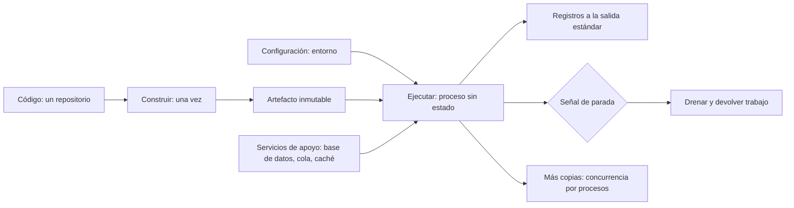
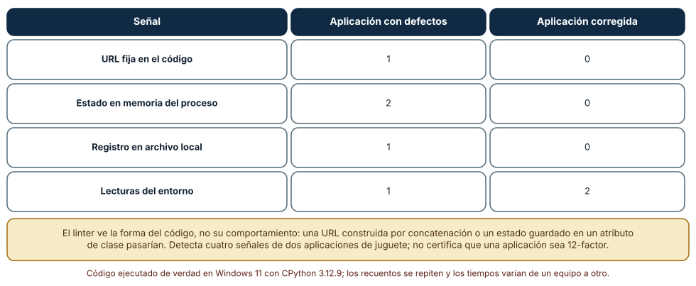
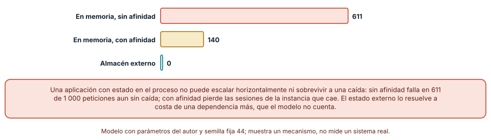

# SE-537 — 12-factor y aplicaciones nativas de la nube

[← SE-536 — Arquitectura celular y radio de impacto](../../classes/part-44-estilos-arquitectonicos/se-536-arquitectura-celular-y-radio-de-impacto/README.md) · [↑ Parte 44](../../classes/part-44-estilos-arquitectonicos/README.md) · [📚 Índice completo](../../classes/README.md) · [🌐 Portal](../../site/classes/SE-537.html) · [SE-538 — Evolución y migración entre estilos →](../../classes/part-44-estilos-arquitectonicos/se-538-evolucion-y-migracion-entre-estilos/README.md)

## Punto profesional y fundamento pedagógico

**Punto profesional.** La clase existe para que puedas leer los doce factores como un conjunto de propiedades verificables de una aplicación y no como una lista de buenas prácticas. Una aplicación que cumple ciertas propiedades (su configuración viene del entorno, no guarda estado en el proceso, se puede parar en cualquier momento, arranca rápido, escribe sus registros a la salida estándar) se puede copiar, escalar, mover y reemplazar sin ceremonia, y esa capacidad es la que las celdas, los despliegues escalonados y la recuperación rápida necesitan. Una aplicación que las incumple obliga a que cada una de esas operaciones sea un procedimiento manual con riesgo.

**Por qué aparece aquí.** Sigue a `SE-536` porque las celdas son copias de la aplicación, y copiar solo es barato si la aplicación se deja copiar. Retoma `SE-379` (degradación y recuperación) y `SE-380` (disponibilidad y recuperación) desde el lado del proceso, y prepara `SE-538`, donde migrar entre estilos depende de poder ejecutar dos versiones a la vez.

**Error conceptual que debe corregir.** Creer que «12-factor» o «cloud native» describe dónde corre la aplicación (en contenedores, en Kubernetes, en un proveedor). Describe cómo está escrita. Una aplicación en un contenedor que guarda sesiones en memoria y lee su configuración de un archivo dentro de la imagen incumple los factores aunque esté en el clúster más moderno. En esta clase se mide: con sesiones en memoria y tres instancias, 611 de 1 000 peticiones no encontraron su sesión sin que nada cayera.

**Secuencia de aprendizaje.** Antes de ejecutar, predices cuántas peticiones fallan por sesión perdida con tres instancias sin afinidad, con afinidad y con un almacén externo, y qué pierde un proceso al que se mata frente a uno al que se le pide terminar. Después analizas con un linter sintáctico una aplicación con defectos y su versión corregida, simulas las sesiones, mides el arranque de procesos Python reales y ejecutas un mismo artefacto con tres configuraciones.

**Evidencia de aprendizaje.** `auditoria-12-factor.md` con una tabla de los doce factores aplicada a una aplicación tuya (cumple, incumple, no aplica) y la evidencia de cada fila, la prueba de sesiones con varias instancias, el tiempo de arranque y la política de parada.

**Límite de la conclusión.** El linter ve cuatro señales en dos aplicaciones de juguete; las sesiones y la cola de trabajos son modelos; el arranque de un proceso Python se midió en una máquina Windows. No se auditó ninguna aplicación real, no se ejecutó ningún clúster ni contenedor ni se invocó ningún modelo de lenguaje.

### Trazabilidad fuente → afirmación

| Fuente primaria u oficial | Afirmación que respalda | Lo que no prueba |
|---|---|---|
| [Wiggins, «The Twelve-Factor App»](https://12factor.net/) | Define los doce factores: base de código, dependencias, configuración, servicios de apoyo, construir-publicar-ejecutar, procesos, vinculación de puertos, concurrencia, desechabilidad, paridad desarrollo-producción, registros y procesos administrativos. | No mide el beneficio ni fija un grado de cumplimiento. |
| [Kubernetes, «Pod Lifecycle»: terminación de Pods](https://kubernetes.io/docs/concepts/workloads/pods/pod-lifecycle/) | Describe que la terminación envía una señal de parada y espera un plazo de gracia antes de forzarla, lo que da sentido a «desechable» y al drenaje. | No define el comportamiento de tu aplicación ante la señal. |
| [Python: `ast`](https://docs.python.org/3/library/ast.html) | Documenta el árbol sintáctico con el que el linter del laboratorio busca señales. | No garantiza que el linter vea todos los patrones. |
| [Python: `subprocess`](https://docs.python.org/3/library/subprocess.html) | Documenta la ejecución de procesos con entorno propio, que usa el laboratorio. | No mide el arranque en otros sistemas. |
| [ISO/IEC 25010:2023](https://www.iso.org/standard/78176.html) | Nombra la portabilidad y la recuperabilidad como características de calidad. | No prescribe los doce factores. |

## Antes de empezar

Recupera lo aprendido en `SE-536`: una celda es una copia de la pila. La pregunta activa es: **¿qué tendrías que hacer a mano para tener una segunda copia de tu aplicación funcionando en otro lugar, y cuánto de eso es configuración escondida en el entorno o en el código?**

## Prerrequisitos

- Haber completado `SE-536`.
- Saber qué son una variable de entorno, un proceso y una señal de parada.
- Conocer de `SE-380` qué es recuperarse tras un fallo.
- Python 3.11 o posterior; el laboratorio usa solo la biblioteca estándar y lanza procesos propios.

## Problema auténtico

*Avisos* corre en tres servidores. Para crear el cuarto, alguien copia los archivos de uno de los otros, edita a mano un archivo de configuración con la dirección de la base de datos y los umbrales, y arranca el proceso. A veces olvida cambiar la dirección y el nuevo servidor escribe en la base de pruebas. El proceso guarda en memoria las sesiones de los estudiantes que están viendo sus avisos; cuando se reinicia uno para actualizarlo, las sesiones de esos estudiantes desaparecen y deben iniciar sesión otra vez. Los registros se escriben en un archivo local que se llena y que alguien debe rotar. Cada una de esas costumbres es razonable por separado y juntas impiden que el servicio se copie, escale o recupere sin ceremonia.

Los doce factores son una forma de escribir la aplicación para que esas operaciones sean triviales. La clase mide cinco de ellos de forma directa: configuración, procesos sin estado, desechabilidad, registros y paridad entre entornos, y recorre el resto para decir qué se aplica en cada caso.

## Objetivos observables

Al terminar podrás:

1. auditar una aplicación contra los doce factores con evidencia por factor y distinguir los que se verifican con código de los que se verifican con procedimientos;
2. demostrar que una aplicación con estado en el proceso falla al escalar horizontalmente o al perder una instancia, y medirlo;
3. mover el estado a un servicio de apoyo y explicar qué dependencia nueva introduce;
4. diseñar la parada ordenada (señal, drenaje, devolución del trabajo pendiente) y compararla con un corte;
5. ejecutar un mismo artefacto con configuraciones distintas y hacer que falle de inmediato cuando falta una.

## Mapa conceptual



El mapa muestra que se construye una vez y se ejecuta muchas veces con configuraciones distintas. El proceso es desechable: puede pararse en cualquier momento porque no guarda nada que no esté en un servicio de apoyo, y puede multiplicarse porque no depende de que haya una sola copia.

## Temas y por qué importan

| Tema | Por qué cambia una decisión profesional | Evidencia mínima |
|---|---|---|
| Configuración en el entorno | Permite un artefacto para todos los entornos. | El mismo artefacto con tres configuraciones |
| Procesos sin estado | Permite escalar y reemplazar copias. | Peticiones fallidas con varias instancias |
| Servicios de apoyo | El estado vive fuera y se trata como recurso adjunto. | Dirección por configuración |
| Desechabilidad | Permite parar y arrancar sin pérdida. | Trabajo perdido frente a devuelto |
| Registros como flujo | El entorno decide dónde van. | Salida estándar frente a archivo |
| Paridad | Reduce las diferencias que ocultan defectos. | Diferencias entre entornos |
| Concurrencia | Se escala con más procesos. | Modelo de procesos |

## Conceptos y decisiones

### 1. Los doce factores, agrupados por lo que protegen

Los doce factores son: una base de código con muchos despliegues; dependencias declaradas explícitamente; configuración en el entorno; servicios de apoyo tratados como recursos adjuntos; separación estricta entre construir, publicar y ejecutar; procesos sin estado; servicios exportados por vinculación de puertos; concurrencia escalando por procesos; desechabilidad (arranque rápido y parada limpia); paridad entre desarrollo y producción; registros como flujo de eventos; y procesos administrativos como tareas puntuales del mismo artefacto. Agrupados por lo que protegen, cuatro cubren la reproducibilidad (código, dependencias, construir-publicar-ejecutar, procesos administrativos), tres cubren la portabilidad entre entornos (configuración, servicios de apoyo, paridad) y cinco cubren la elasticidad y la recuperación (procesos, concurrencia, desechabilidad, vinculación de puertos, registros). La clase mide los factores de las dos últimas agrupaciones, que son los que se pueden comprobar con un experimento.

### 2. Un linter de cuatro señales

Se escribió un linter con el módulo `ast` que busca cuatro formas: URL fijas (una cadena que empieza por un esquema como `postgres://`), estado en memoria del proceso (asignaciones a nivel de módulo de un diccionario, una lista o un conjunto), registro en archivo local (una llamada a `open` en modo de escritura o adición) y lecturas del entorno (`os.environ`). La aplicación con defectos tuvo 1 URL fija, 2 estados, 1 archivo de registro y 1 lectura del entorno; la corregida, 0, 0, 0 y 2 (la configuración de la base y de los umbrales viene del entorno). El linter ve la forma del código, no su comportamiento: una URL construida por concatenación o un estado guardado como atributo de una clase pasarían sin que lo vea, y una lectura del entorno no prueba que falle cuando falta. Es una primera barrera barata, no una certificación.

### 3. Procesos sin estado: la sesión en memoria

Se simularon tres instancias detrás de un balanceador con 100 usuarios que inician sesión y luego hacen peticiones, en 1 000 peticiones, con una instancia que cae en la petición 500. Con las sesiones en la memoria de cada instancia y balanceo sin afinidad, 611 de 1 000 peticiones no encontraron su sesión: una petición que llega a una instancia distinta de la del inicio de sesión no la ve, aunque no haya caído nada. Con afinidad por usuario (cada usuario siempre a la misma instancia), fallaron 140, todas de los usuarios de la instancia caída. Con un almacén externo compartido, 0. Esos tres números ordenan las opciones: el estado en el proceso impide escalar sin afinidad y pierde a los usuarios de la instancia que cae con afinidad; el estado externo resuelve ambas cosas y añade una dependencia que hay que operar, que tiene su propia latencia y su propio modo de fallo, y que el modelo no cuenta.

### 4. Servicios de apoyo como recursos adjuntos

La base de datos, la cola y la caché se tratan como recursos que se enganchan por una dirección que viene de la configuración. Cambiar de una base local a una gestionada, o de una caché a otra, es cambiar una variable, no el código. Esto es lo que hace posible que una celda use su propia base con el mismo artefacto: la dirección es lo único que cambia entre celdas. La consecuencia de diseño es que el código no distingue entre un recurso «local» y uno «remoto», y por eso un fallo del recurso es un caso normal que el código debe manejar, no una excepción exótica.

### 5. Desechabilidad: arranque rápido y parada limpia

Un proceso desechable arranca rápido y termina bien cuando se lo piden. El arranque se midió con procesos Python reales: un intérprete vacío tardó una mediana de 116 ms y uno que importa `sqlite3`, `json`, `http.server` y `hashlib`, 249 ms (diez ejecuciones en una máquina Windows; el valor cambia con el equipo y la caché del sistema). El arranque de una aplicación real incluye conectar a servicios y calentar cachés, y el presupuesto es el que permite sustituir instancias sin que se note. La parada importa más: el orquestador envía una señal de parada y espera un plazo antes de forzarla, como describe la documentación de Kubernetes. Un proceso que termina el trabajo en curso y devuelve a la cola lo pendiente no pierde nada; uno al que se mata pierde lo que tenía en memoria. En el modelo, con 100 trabajos en una cola en memoria sin reentrega y la señal en el trabajo 40, el corte inmediato completó 40 y perdió 60, y el drenaje ordenado completó 41 y devolvió 60 a la cola sin perder ninguno. Con una cola que reentrega los trabajos no confirmados, el corte no pierde sino que repite, y entonces el requisito es que las operaciones sean idempotentes, algo que la parada ordenada también facilita.

### 6. Configuración: un artefacto, varios entornos

Se escribió una aplicación mínima que lee sus umbrales de una variable de entorno y falla con un mensaje y un código de salida 1 si falta. Se ejecutó el mismo archivo, con la misma huella (`9b29771d2b64` en los primeros caracteres del SHA-256), con tres entornos: con la configuración de desarrollo salió con código 0 y umbrales 12 y 48; con la de producción, con código 0 y umbrales 1, 24 y 72; sin configurar, con código 1 y el mensaje «falta AVISOS_UMBRALES». Esa es la paridad que pide el factor de configuración: lo que cambia entre entornos es el entorno, no el artefacto. Y es la razón de fallar de inmediato cuando falta un valor: arrancar con un valor por defecto invisible es el origen del servidor que escribe en la base de pruebas.

### 7. Registros y procesos administrativos

La aplicación escribe sus registros como un flujo de eventos a la salida estándar y es el entorno el que los recoge, los enruta y los guarda. Un archivo local lo llena y lo rota quien administra la máquina, y desaparece con el contenedor. Los procesos administrativos (una migración, un script de reparación) se ejecutan con el mismo artefacto y la misma configuración que la aplicación, no con una copia distinta del código en un servidor concreto. Ninguno de los dos se midió en el laboratorio; se mencionan porque completan el conjunto y porque un incumplimiento aquí es la causa habitual de «funciona en mi servidor».

### 8. Cuándo los doce factores no se aplican tal cual

Una aplicación con un estado local legítimo (un motor de base de datos, un sistema de archivos distribuido, una aplicación de escritorio) no puede ser un proceso sin estado, y los factores de procesos y de desechabilidad no se aplican igual. La utilidad de los factores no es obedecerlos todos, es saber cuáles de ellos protege tu sistema y cuáles incumples a sabiendas, con el costo que eso tiene.

## Una auditoría de cuatro señales

La primera medida es la salida del linter sobre dos aplicaciones.



**Cómo leer la figura.** Cada fila es una señal; la columna central es la aplicación con defectos y la derecha la corregida. Las tres primeras bajan a cero; la cuarta sube, porque ahora la configuración viene del entorno. **Dónde deja de valer:** el linter es de cuatro reglas sobre dos programas de juguete; una aplicación real tiene configuración construida con concatenación, estado en atributos y registros por bibliotecas. Ver cero señales no demuestra que la aplicación cumpla los factores.

## Sesiones con varias instancias

La segunda medida simula tres instancias y una caída.



**Cómo leer la figura.** Cada barra es el número de peticiones, de 1 000, que no hallaron la sesión de su usuario. La primera falla sin que nada se haya caído; la segunda solo a partir de la caída; la tercera nunca. **Dónde deja de valer:** el modelo ignora la latencia y la disponibilidad del almacén externo y supone que las peticiones de un usuario llegan después de su inicio de sesión; en un sistema real el almacén es otro componente que puede fallar, y un almacén caído tumba a todos los usuarios a la vez, no solo a los de una instancia.

## Parada, configuración y arranque

La tercera medida reúne la parada ordenada, un artefacto con tres configuraciones y el arranque de un proceso.


**Cómo leer la figura.** Las dos primeras filas son un modelo de parada; las tres siguientes son el mismo archivo ejecutado de verdad con tres entornos; la última es una medida de arranque. **Dónde deja de valer:** la cola es un modelo en memoria, no un orquestador; el arranque es de un intérprete sin conexiones ni calentamiento y varía entre máquinas. Las tres filas del artefacto sí son ejecuciones reales: el mismo archivo y la misma huella con resultados distintos según el entorno.

## Definiciones de trabajo

- **Doce factores:** conjunto de prácticas para escribir aplicaciones portables, escalables y fáciles de operar.
- **Proceso sin estado:** proceso que no guarda entre peticiones nada que no esté en un servicio de apoyo.
- **Servicio de apoyo:** recurso externo (base de datos, cola, caché) que se engancha por configuración.
- **Desechabilidad:** capacidad de arrancar rápido y terminar limpiamente en cualquier momento.
- **Drenaje:** terminar el trabajo en curso y devolver el pendiente antes de salir.
- **Paridad entre entornos:** diferencia mínima entre desarrollo, pruebas y producción.
- **Artefacto inmutable:** resultado de una construcción que se promueve sin modificarse entre entornos.

## Ejemplo mínimo

Configuración desde el entorno con fallo inmediato:

```python
import os, sys

raw = os.environ.get("AVISOS_UMBRALES")
if raw is None:
    sys.exit("falta AVISOS_UMBRALES")
umbrales = sorted(int(x) for x in raw.split(","))
print(umbrales)
```

Con `AVISOS_UMBRALES=72,24,1` imprime `[1, 24, 72]`; sin la variable, termina con código 1 y el mensaje. No hay un valor por defecto que esconda un entorno mal configurado, y el archivo es el mismo en cualquier entorno.

## Ejemplo profesional

*Escenario ilustrativo: las cifras y los resultados que aparecen en este ejemplo son supuestos de la narración, no mediciones.*

Antes de crear las celdas de `SE-536`, el equipo de *Avisos* audita la aplicación contra los doce factores. De las doce filas, siete cumplen, tres incumplen y dos no aplican. Los incumplimientos son los de siempre: las sesiones viven en memoria, los registros van a un archivo y los umbrales están en un archivo de configuración dentro de la imagen. Antes de crear la primera celda corrigen los tres. Mueven las sesiones a un almacén externo (y añaden a las alertas la salud de ese almacén), cambian los registros a la salida estándar y leen los umbrales de variables de entorno con fallo inmediato si faltan. Después ejecutan la prueba de sesiones con tres instancias y matan una a mitad de la prueba: cero peticiones fallidas. La primera celda nueva se crea con un comando y una lista de variables, y la cuarta copia del servicio deja de ser una tarde de edición manual.

## Práctica guiada

1. Rellena una tabla de los doce factores para una aplicación tuya con la evidencia de cada fila.
2. Ejecuta `python scripts/experiments_part44_b.py 537` y compara la salida del linter y de las sesiones con la tuya.
3. Levanta dos instancias de tu aplicación detrás de un balanceador (o simula el reparto) y comprueba qué ocurre con una sesión que inició sesión en una.
4. Envía una señal de parada a tu proceso con trabajo en curso y anota qué se pierde.
5. Ejecuta tu artefacto con una configuración distinta y con la configuración ausente.

## Ejercicios

1. **Básico.** Explica por qué con tres instancias y sesiones en memoria sin afinidad fallan unas 6 de cada 10 peticiones aunque no se caiga ninguna.
2. **Intermedio.** Extiende el linter con una quinta señal (por ejemplo, un `print` con la ruta de un archivo temporal fijo) y escribe una aplicación que la dispare y otra que no.
3. **Avanzado.** Modifica la simulación de parada para que la cola reentregue los trabajos no confirmados y cuenta cuántos se ejecutan dos veces; diseña la operación para que repetir sea inocuo.

## Reto verificable

Entrega `auditoria-12-factor.md` con la tabla de doce factores de una aplicación, la prueba de sesiones con tres instancias, la medida del arranque y la prueba del mismo artefacto con configuraciones distintas. Es válido si otra persona repite las pruebas y obtiene las mismas conclusiones por factor.

## Caso conductor

*Avisos* se prepara para multiplicarse en celdas: antes de copiar la aplicación, la hace copiable. `SE-538` plantea el último paso de la parte: cómo se pasa de un estilo a otro sin detener el servicio, algo que solo es posible si se pueden ejecutar dos versiones a la vez.

## Preguntas frecuentes

### ¿Hace falta usar contenedores para cumplir los doce factores?

No. Los factores describen la aplicación. Los contenedores facilitan el artefacto inmutable y la paridad, pero una aplicación puede cumplirlos sin ellos y puede incumplirlos dentro de uno.

### ¿Dónde guardo los secretos?

En el entorno de ejecución, inyectados por el sistema que los gestiona, nunca en el código ni en el artefacto. Los doce factores piden configuración en el entorno; el manejo de secretos añade rotación, auditoría y mínimos privilegios.

### ¿Las sesiones deben ir siempre a un almacén externo?

Hay alternativas: tokens firmados que llevan la sesión en el cliente (sin estado en el servidor, con sus límites de tamaño y revocación) o afinidad con tolerancia a perder las sesiones de una instancia. La decisión depende de lo que cueste perder una sesión.

### ¿Cuánto debe tardar el arranque?

Lo que permita sustituir instancias sin que se note. Si cada instancia tarda dos minutos, desplegar cien lleva horas y escalar ante un pico llega tarde. El número es un escenario de calidad más.

## Fallo controlado y diagnóstico

**Fallo.** Tras pasar a tres instancias, los estudiantes se quejan de que «se les cierra la sesión» de forma intermitente. Las pruebas en un servidor no lo reproducen.

**Diagnóstico paso a paso.** (1) Se revisa el balanceador: reparte las peticiones sin afinidad. (2) Se examina la aplicación: guarda la sesión en un diccionario del proceso. (3) Se calcula la probabilidad de acierto con tres instancias: una de tres, así que dos de cada tres peticiones posteriores al inicio de sesión llegan a otra instancia. (4) Las pruebas con una sola instancia no podían mostrarlo.

**Corrección.** Las sesiones pasan a un almacén externo, se añade a la lista de pruebas una ejecución con tres instancias y una caída, y se incluye en la lista de revisión de diseño la pregunta «¿qué guarda este proceso que otro no vea?». La lección es que un defecto de procesos sin estado solo aparece con más de una instancia, y por eso las pruebas deben ejecutarse con más de una.

## Errores comunes y cómo corregirlos

- **Estado en el proceso.** Impide escalar y reemplazar. Corrige con un servicio de apoyo.
- **Configuración en el artefacto.** Obliga a construir por entorno. Corrige con variables de entorno.
- **Valores por defecto que esconden un entorno mal configurado.** Corrige con fallo inmediato.
- **Registros a un archivo local.** Se llena y desaparece. Corrige con la salida estándar.
- **Parar con una señal de corte.** Pierde trabajo. Corrige con parada ordenada e idempotencia.
- **Probar solo con una instancia.** Oculta los defectos de estado. Corrige probando con varias y matando una.

## Entorno y archivos clave

- `scripts/experiments_part44_b.py`: función `e537` con el linter, las sesiones, el arranque, la parada y el artefacto con tres configuraciones; se ejecuta con `python scripts/experiments_part44_b.py 537`.
- El experimento crea el artefacto de ejemplo en un directorio temporal (`tempfile`) y lanza procesos Python propios; tarda unos segundos por los arranques.
- `scripts/figures_part44_b.py`: las tres figuras de la clase.
- Solo la biblioteca estándar de Python 3.11 o posterior.

## Seguridad, ética y accesibilidad

La configuración en el entorno es también donde viajan los secretos, que no deben escribirse en registros ni en mensajes de error: el mensaje «falta AVISOS_UMBRALES» nombra la variable y no su valor. En el laboratorio no hay credenciales; las direcciones son cadenas de ejemplo. Un almacén externo de sesiones es un objetivo de ataque y debe protegerse como una base de datos. Ética: la parada ordenada protege el trabajo de las personas que usan el sistema; matar procesos sin drenar es decidir que su trabajo en curso no importa. Las figuras son tablas y un gráfico con texto alternativo completo y no dependen solo del color.

## Puente hacia el trabajo con agentes

Un agente que trabaja sobre un repositorio puede cumplir o incumplir los factores sin darse cuenta: es muy común que añada un archivo de configuración con valores fijos, una variable global para una caché o un registro a un archivo. Pídele que ejecute el linter y la prueba con dos instancias como parte de su tarea, y no aceptes un cambio que añada una señal nueva sin justificación. Para el propio agente, el factor de desechabilidad se traduce en que la tarea se pueda retomar si se interrumpe: guardar el progreso fuera del contexto de la conversación y permitir reanudar desde un punto conocido.

## Transferencia

Audita una aplicación tuya contra los doce factores con una tabla de evidencia, y elige los tres incumplimientos que más limitan copiarla y reemplazarla. Para cada uno escribe la prueba que lo demuestra (por ejemplo, tres instancias y una caída) y el cambio mínimo que lo corrige. Mide el arranque y define el presupuesto que tu operación necesita.

## Evaluación y evidencia

| Criterio | Evidencia aceptable | Rechazo |
|---|---|---|
| Auditoría por factor | Evidencia por fila | «Cumple casi todo» |
| Procesos sin estado | Prueba con varias instancias y una caída | Prueba con una instancia |
| Desechabilidad | Parada medida y arranque | Solo la teoría |
| Configuración | Mismo artefacto con varios entornos | Archivos por entorno |
| Alcance | Factores que no aplican con motivo | Omitidos |

## Fuentes

- Wiggins, A. [«The Twelve-Factor App»](https://12factor.net/).
- Kubernetes. [«Pod Lifecycle»](https://kubernetes.io/docs/concepts/workloads/pods/pod-lifecycle/).
- Python Software Foundation. [`ast`](https://docs.python.org/3/library/ast.html) y [`subprocess`](https://docs.python.org/3/library/subprocess.html).
- Organización Internacional de Normalización. [ISO/IEC 25010:2023](https://www.iso.org/standard/78176.html).

## Límites y siguiente paso

El linter y las simulaciones son de juguete; no se auditó una aplicación real ni se ejecutó un orquestador. El arranque se midió en una máquina Windows y cambia con el sistema. El siguiente paso, `SE-538`, trata la migración de un estilo a otro: cómo se reemplaza un módulo sin detener el servicio, qué se compara mientras conviven y cómo se decide cuándo avanzar.

## Glosario

| Término | Definición breve |
|---|---|
| Doce factores | Prácticas para aplicaciones portables y fáciles de operar |
| Proceso sin estado | No guarda entre peticiones lo que no esté en un servicio de apoyo |
| Servicio de apoyo | Recurso externo enganchado por configuración |
| Desechabilidad | Arranque rápido y parada limpia |
| Drenaje | Terminar lo en curso y devolver lo pendiente |
| Artefacto inmutable | Construcción que se promueve sin cambios |
