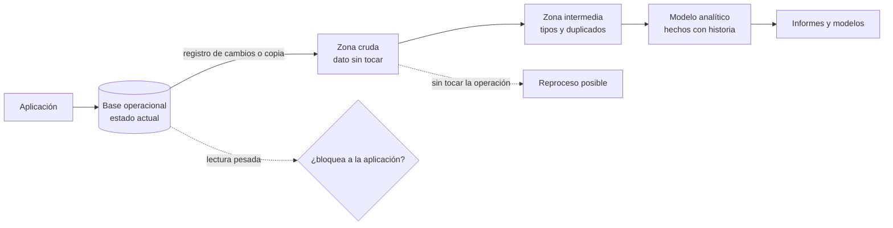

# SE-541 — Del dato operacional al analítico

## Punto profesional y fundamento pedagógico

**Punto profesional.** La clase existe para que decidas cuándo y cómo sacar datos de la base que sirve a la aplicación y llevarlos a un lugar pensado para responder preguntas, y para que sepas por qué esa decisión no es solo «copiar tablas». Un sistema operacional está optimizado para escribir y leer pocas filas con rapidez y guarda el estado presente; un sistema analítico está optimizado para recorrer muchas filas de pocas columnas y necesita la historia. Cuando se mezclan, aparecen dos fallos que se confunden con «lentitud»: un informe pesado que bloquea a la aplicación y una pregunta sobre el pasado que la base ya no puede responder porque sobrescribió la respuesta. La clase los mide sobre una base real de SQLite y muestra qué cambia cuando se separan.

**Por qué aparece aquí.** Abre la parte porque todas las clases siguientes (ingesta, modelado, calidad, contratos) suponen que ya existe una frontera entre lo operacional y lo analítico. Reutiliza lo que ya sabes de índices y patrones de acceso en [SE-317](../../classes/part-26-datos-persistencia-y-recuperacion/se-317-consultas-indices-y-patrones-de-acceso/README.md) y de ciclo de vida del dato en [SE-322](../../classes/part-26-datos-persistencia-y-recuperacion/se-322-privacidad-retencion-y-ciclo-de-vida-del-dato/README.md), y retoma la extracción por captura de cambios de [SE-330](../../classes/part-27-integracion-eventos-y-mensajeria/se-330-cdc-etl-elt-y-sincronizacion/README.md) desde la pregunta de qué se hace con lo extraído.

**Error conceptual que debe corregir.** Creer que lo analítico es «lo mismo pero más grande», de modo que basta un índice más o una réplica. Un índice acelera la agregación, pero no devuelve el estado de ayer; una réplica evita el bloqueo, pero conserva el mismo modelo de estado presente. La separación resuelve dos problemas distintos (interferencia e historia) y trae un tercero (significado: cada traspaso puede cambiar lo que una columna quiere decir).

**Secuencia de aprendizaje.** Antes de ejecutar, predices cuántas veces más datos toca una agregación por día que una búsqueda por clave y si una lectura larga puede bloquear una escritura. Después ejecutas las consultas sobre 200 000 pedidos, abres una lectura larga con dos modos de diario de SQLite y reconstruyes con un registro de eventos una pregunta que la tabla de estado no puede responder.

**Evidencia de aprendizaje.** `del-operacional-al-analitico.md` con las cinco preguntas analíticas más frecuentes de un sistema tuyo, el patrón de acceso de cada una, qué columnas necesita, si requiere historia y qué fuente de verdad la responde hoy; más la lista de lo que cambia de significado en cada traspaso.

**Límite de la conclusión.** Los 200 000 pedidos son sintéticos y viven en SQLite en memoria o en un archivo temporal; los tiempos se midieron en un equipo de escritorio y varían entre ejecuciones (la agregación tardó entre 280 y 540 ms en tres corridas). La comparación por filas y por columnas mide bytes que debe tocar cada consulta, no el rendimiento de ningún almacén analítico. No se midió ninguna base de producción ni se invocó ningún modelo de lenguaje.

### Trazabilidad fuente → afirmación

| Fuente primaria u oficial | Afirmación que respalda | Lo que no prueba |
|---|---|---|
| [Kleppmann, «Designing Data-Intensive Applications»](https://dataintensive.net/) | Distingue el procesamiento de transacciones del procesamiento analítico por su patrón de acceso y describe el almacenamiento orientado a columnas. | Es un libro de referencia; no mide tu sistema. |
| [SQLite, «Write-Ahead Logging»](https://www.sqlite.org/wal.html) | Documenta que con el registro anticipado los lectores no bloquean a los escritores y los escritores no bloquean a los lectores. | No describe otros motores. |
| [Kimball Group, «Dimensional Modeling Techniques»](https://www.kimballgroup.com/data-warehouse-business-intelligence-resources/kimball-techniques/dimensional-modeling-techniques/) | Presenta el modelado dimensional como la organización de datos para consulta analítica, con historia. | No dice cuándo conviene frente a otros modelos. |
| [Fowler, «Data Lake»](https://martinfowler.com/bliki/DataLake.html) | Describe la zona cruda que conserva el dato sin transformar y advierte de su riesgo si no tiene curaduría. | No cuantifica el riesgo. |
| [Python: `sqlite3`](https://docs.python.org/3/library/sqlite3.html) | Documenta el módulo con el que se ejecuta el laboratorio. | No valida los resultados. |

## Antes de empezar

Recupera lo aprendido en [SE-317](../../classes/part-26-datos-persistencia-y-recuperacion/se-317-consultas-indices-y-patrones-de-acceso/README.md): un índice se elige por el patrón de acceso. La pregunta activa es: **¿cuál es el informe más pesado de tu sistema, quién lo ejecuta, a qué hora y qué le ocurre a la aplicación mientras corre?**

## Prerrequisitos

- Haber completado la Parte 26, en especial [SE-313](../../classes/part-26-datos-persistencia-y-recuperacion/se-313-modelado-conceptual-logico-y-fisico/README.md) (modelado), [SE-315](../../classes/part-26-datos-persistencia-y-recuperacion/se-315-transacciones-aislamiento-y-concurrencia/README.md) (transacciones y aislamiento) y [SE-317](../../classes/part-26-datos-persistencia-y-recuperacion/se-317-consultas-indices-y-patrones-de-acceso/README.md) (índices).
- Conocer la idea de captura de cambios de [SE-330](../../classes/part-27-integracion-eventos-y-mensajeria/se-330-cdc-etl-elt-y-sincronizacion/README.md).
- Saber escribir `SELECT`, `GROUP BY` y `JOIN` en SQL.
- Python 3.11 o posterior; el laboratorio usa `sqlite3` de la biblioteca estándar.

## Problema auténtico

*Avisos* guarda cada aviso, cada entrega y cada lectura en su base operacional. Hasta ahora las preguntas eran del tipo «¿se leyó este aviso?»: una fila, por clave, en microsegundos. Un día finanzas pide «¿cuántos avisos estaban pendientes de lectura al cierre de cada mes del año pasado?» y producto pide «¿qué porcentaje de avisos se lee en la primera hora, por curso?». La primera pregunta no se puede responder: la tabla guarda el estado de hoy y cada actualización borró el anterior. La segunda sí se puede, pero el informe recorre doscientos mil registros y, mientras corre, las escrituras de la aplicación empiezan a fallar con «base de datos bloqueada».

El equipo propone «un índice y una réplica». Hace falta saber qué problema resuelve cada cosa antes de gastar: el índice acelera la segunda pregunta, la réplica evita el bloqueo, y ninguna de las dos devuelve el pasado.

## Objetivos observables

Al terminar podrás:

1. clasificar una consulta como operacional o analítica por su patrón de acceso (filas tocadas, columnas usadas, necesidad de historia) y no por su nombre;
2. medir con un plan de consulta y una cuenta de bytes cuánto más datos toca una agregación que una búsqueda por clave y cuánto de eso es lectura inútil;
3. demostrar, con una lectura larga abierta, cuándo una escritura se bloquea y cuándo no, y explicar el costo del modo que no bloquea;
4. reconstruir una pregunta sobre el pasado con un registro de cambios de estado y mostrar por qué la tabla de estado actual no puede responderla;
5. describir las capas cruda, intermedia y analítica, qué se conserva en cada una y qué puede cambiar de significado en cada traspaso.

## Mapa conceptual



El mapa separa dos caminos. La línea punteada hacia la operación es el problema de interferencia; el camino hacia la zona cruda es el que permite reprocesar cuando una transformación se equivoca, porque el dato original sigue allí.

## Temas y por qué importan

| Tema | Por qué cambia una decisión profesional | Evidencia mínima |
|---|---|---|
| Patrón de acceso | Decide qué estructura física sirve a la consulta. | Filas y columnas que toca cada consulta |
| Almacenamiento por filas y por columnas | Una agregación lee lo que no necesita si el dato está por filas. | Bytes tocados frente a bytes necesarios |
| Interferencia | Una lectura larga puede bloquear escrituras. | Prueba con una lectura abierta y una escritura |
| Estado frente a historia | Sobrescribir borra el pasado. | Pregunta sobre el pasado respondida con eventos |
| Extracción | Una copia periódica y un registro de cambios ven cosas distintas. | Qué cambios intermedios ve cada una |
| Capas | La zona cruda permite corregir lo posterior. | Reproceso desde la zona cruda |
| Cuándo no separar | Con poco volumen una réplica basta y la separación es costo puro. | Volumen, frecuencia y plazo de la pregunta |

## Conceptos y decisiones

### 1. El patrón de acceso define el tipo de carga

Una consulta operacional toca pocas filas, casi siempre por clave, con todas o casi todas sus columnas y debe responder en milisegundos: «dame el pedido 4821». Una consulta analítica toca muchas filas y pocas columnas, y su valor está en el agregado: «suma el importe por día del año». La diferencia no está en el motor de base de datos sino en cuántas filas y columnas recorre. En el laboratorio, con 200 000 pedidos, la búsqueda por clave tardó entre 12 y 18 microsegundos y tocó una página de 4 096 bytes; la agregación por día recorrió las 200 000 filas y tardó entre 280 y 540 milisegundos, es decir, miles de veces más. Esa proporción no es un defecto de SQLite: es el trabajo de recorrer dos mil veces más filas.

### 2. Filas y columnas: cuánta lectura es inútil

Un almacén por filas guarda cada pedido contiguo: identificador, cliente, día, importe, estado y nota. La agregación por día necesita solo `day` e `amount`. La tabla del laboratorio ocupó 14,1 MB en 3 433 páginas; las dos columnas que necesita la agregación, a ocho bytes por valor, suman 3,2 MB, un 22,8 % de la tabla. El resto es lectura inútil, porque para llegar a las dos columnas hay que atravesar las demás. Un índice que cubre `day` e `amount` convierte el recorrido en un recorrido del índice (el plan lo declara: `SCAN orders USING COVERING INDEX`) y bajó la consulta a unos 60 ms. Un formato por columnas lleva la misma idea más lejos al guardar cada columna aparte; la clase `SE-548` lo mide con archivos.

### 3. La interferencia es un problema de diseño del acceso, no de hardware

En SQLite, con el diario de reversión por defecto (`delete`), una lectura que sigue abierta impide que otra conexión confirme una escritura: la escritura falla con `database is locked`. Con el registro anticipado (`WAL`), la misma escritura se confirma mientras la lectura sigue abierta, porque el lector trabaja sobre una instantánea y el escritor añade al registro. El laboratorio abre un cursor sin terminar de leerlo, intenta escribir con tiempo de espera cero y registra el resultado: bloqueo en el primer modo y confirmación en el segundo. Un motor cliente-servidor tiene mecanismos distintos (versiones de filas, bloqueos de varias granularidades), pero la pregunta es la misma: ¿qué le hace una lectura de media hora a las escrituras de ese medio? El modo WAL no es gratis: añade un archivo, exige limpieza periódica y tiene límites en el acceso desde otros equipos.

### 4. Estado frente a historia

La tabla `orders` guarda el estado actual de cada pedido. Cuando un pedido pasa de `paid` a `shipped`, la fila se actualiza y `paid` desaparece. La pregunta «¿cuántos pedidos estaban pagados y sin enviar el día 100?» necesita saber qué estado tenía cada pedido ese día. Con 20 000 pedidos y 70 745 cambios de estado, la respuesta correcta, calculada sobre el registro de cambios, fue 989; la tabla de estado actual solo permite contar cuántos están en `paid` hoy, 1 486, que responde otra pregunta. La corrección no es una consulta mejor sino conservar lo que se perdió: un registro de eventos o filas con vigencia (`valid_from`, `valid_to`). Es la razón de que un modelo analítico guarde historia aunque la operación no la necesite.

### 5. Extraer: copia periódica, consulta incremental y registro de cambios

Hay tres maneras de mover datos fuera de la base operacional, con límites distintos. La copia completa periódica es simple y ve el estado en el instante de la copia: pierde cualquier cambio intermedio entre dos copias y es cara si la tabla es grande. La consulta incremental por marca de tiempo (`WHERE updated_at > <última>`) mueve solo lo que cambió, pero no ve las filas borradas y depende de que `updated_at` se actualice siempre y esté indexado. La captura de cambios desde el registro de transacciones (CDC, tratada en [SE-330](../../classes/part-27-integracion-eventos-y-mensajeria/se-330-cdc-etl-elt-y-sincronizacion/README.md)) ve inserciones, actualizaciones y borrados en orden, a costa de operar un componente más y de tratar los cambios de esquema. Esta clase no mide las tres; lo que sí mide es qué se pierde si solo se conserva el estado final, y por eso insiste en que la elección se haga por la pregunta que se quiere responder.

### 6. Capas: conservar el dato original para poder corregir

La zona cruda guarda el dato como llegó, con su fecha de carga y su origen. La zona intermedia resuelve tipos, zonas horarias, duplicados y nombres. El modelo analítico reorganiza en hechos y dimensiones con la granularidad correcta. La razón de esta cadena no es el orden estético: es que cada transformación puede equivocarse y la corrección exige volver a empezar desde algo que no se haya tocado. Quien transforma al ingerir y descarta el original pierde esa posibilidad. El costo es almacenamiento y la disciplina de tratar la zona cruda como solo de lectura para todos salvo el proceso de ingesta.

### 7. Cada traspaso puede cambiar el significado

Una columna `status = 'delivered'` puede significar «el mensajero marcó entregado» en la base operacional y «el cliente confirmó» en el informe de ventas. Las columnas conservan nombre y tipo mientras cambian de sentido. Hay tres puntos donde ocurre: la extracción (qué filas entran, cuáles se omiten), la transformación (cómo se redondea, qué zona horaria se aplica, qué se descarta) y el consumo (cuál es la definición de «activo»). La defensa es escribir la definición junto con la columna, con un ejemplo, y comprobarla; las clases siguientes dan las herramientas (`SE-545`, `SE-546`).

### 8. Cuándo no separar

Un sistema con pocos miles de filas, preguntas poco frecuentes y un equipo que responde a mano no necesita una plataforma de datos. Una réplica de lectura o una vista materializada resuelven la interferencia sin añadir procesos. La separación empieza a compensar cuando se cumplen a la vez tres cosas: el volumen hace que las preguntas analíticas compitan con la operación, la historia se necesita y se está perdiendo, y varias personas o sistemas piden los mismos números. Si solo ocurre una, suele bastar una solución local. Una plataforma que no se usa es un costo que se paga todos los meses.

## Bytes que debe tocar cada consulta

La primera medida compara lo que toca una búsqueda por clave con lo que toca una agregación sobre la misma tabla.


**Cómo leer la figura.** Cada barra es una consulta y su longitud los megabytes que debe tocar, en escala logarítmica porque entre la primera y la segunda hay cuatro órdenes de magnitud. Mira primero la distancia entre las dos últimas barras: la agregación recorre 14,1 MB para usar 3,2 MB. **Dónde deja de valer:** los tiempos son de un equipo concreto y varían de una corrida a otra; lo que se traslada es la proporción de datos tocados. Con un motor columnar, la lectura inútil de la última barra desaparece, y con muy pocas filas ninguna de las dos consultas importa.

## El camino del dato

La segunda figura sitúa las capas y los traspasos.


**Cómo leer la figura.** Cada caja es una etapa y cada flecha un traspaso donde el dato puede cambiar de significado sin cambiar de forma. Mira primero la zona cruda: es la caja que permite volver a ejecutar las siguientes. **Dónde deja de valer:** son tres capas del patrón más común; muchas organizaciones añaden otras (una capa por dominio, una capa de servicio) y algunas sistemas, como los de baja latencia, saltan capas. Que haya tres no es una regla.

## Lectores, escritores y la pregunta sobre el pasado

La tercera figura reúne los cuatro casos medidos.


**Cómo leer la figura.** Cada fila es un caso, con su resultado en la caja central y la lección a la derecha. Mira primero las filas de la misma pareja: lo único que cambia entre la primera y la segunda es el modo del diario, y entre la tercera y la cuarta, qué se conservó. **Dónde deja de valer:** la prueba de bloqueo usa un archivo temporal y un cursor sin terminar; un motor cliente-servidor bloquea de otra manera, y 989 y 1 486 son números de un modelo con estados y fechas aleatorios, no de ningún negocio.

## Definiciones de trabajo

- **Carga operacional (OLTP):** muchas transacciones cortas que leen y escriben pocas filas.
- **Carga analítica (OLAP):** pocas consultas que recorren muchas filas para agregar.
- **Patrón de acceso:** filas y columnas que toca una consulta y con qué frecuencia.
- **Estado actual:** valor presente de una entidad, sin historia.
- **Registro de eventos:** secuencia ordenada de los cambios, que permite reconstruir cualquier instante.
- **Zona cruda:** copia del dato tal como llegó, sin transformar.
- **Interferencia:** efecto de una carga sobre la latencia o el éxito de otra que comparte recursos.

## Ejemplo mínimo

Dos conexiones a la misma base: una lectura abierta y una escritura.

```python
import sqlite3, tempfile, os

with tempfile.TemporaryDirectory(ignore_cleanup_errors=True) as tmp:
    ruta = os.path.join(tmp, "o.db")
    w = sqlite3.connect(ruta, timeout=0, isolation_level=None)
    w.execute("PRAGMA journal_mode=delete")        # cambiar a «wal» y repetir
    w.execute("CREATE TABLE t(a INT)")
    w.executemany("INSERT INTO t VALUES(?)", [(i,) for i in range(1000)])
    r = sqlite3.connect(ruta, timeout=0, isolation_level=None)
    r.execute("BEGIN")
    cursor = r.execute("SELECT a FROM t")
    cursor.fetchone()                              # la lectura sigue abierta
    try:
        w.execute("BEGIN IMMEDIATE")
        w.execute("INSERT INTO t VALUES(-1)")
        w.execute("COMMIT")
        print("la escritura se confirma")
    except sqlite3.OperationalError as error:
        print("la escritura falla:", error)        # database is locked
    cursor.close()
    r.execute("COMMIT")
    r.close(); w.close()
```

En el modo `delete` imprime `la escritura falla: database is locked`; con `PRAGMA journal_mode=wal` imprime `la escritura se confirma`. Cerrar el cursor antes de salir evita que Windows retenga el archivo y el directorio temporal no se pueda borrar.

## Ejemplo profesional

*Escenario ilustrativo: las cifras y los resultados que aparecen en este ejemplo son supuestos de la narración, no mediciones.*

El equipo de *Avisos* recibe tres peticiones de datos en el mismo mes. En lugar de abrir tres informes a medida, dibuja la tabla de preguntas: cada una con las filas que toca, las columnas que usa, si necesita historia y con qué frecuencia se repite. Dos de las tres necesitan historia que la base ya perdió, y una se repite cada hora. Con esa tabla, el equipo propone un piloto acotado: conservar desde hoy los cambios de estado de avisos en una tabla de eventos, copiar cada noche a una zona cruda y construir un solo modelo analítico con granularidad de un aviso por día. No promete responder el pasado ya perdido; lo declara como pérdida irrecuperable y fija desde cuándo habrá respuesta. A las seis semanas compara el tiempo de las tres preguntas y el efecto en la latencia de la aplicación en la hora del informe; si la latencia no cambió y las preguntas se responden sin ayuda del equipo, amplía a otros dominios.

## Práctica guiada

1. Lista las cinco consultas más pesadas de un sistema que conozcas y anota para cada una filas tocadas, columnas usadas y si necesita historia.
2. Ejecuta `python scripts/experiments_part45_a.py 541` y compara el tiempo de la búsqueda por clave con el de la agregación; anota cuántos megabytes toca cada una.
3. Cambia el diario a `wal` en el ejemplo mínimo y repite la prueba de bloqueo.
4. Escribe la consulta que responde «¿qué estado tenía el pedido X el día D?» sobre una tabla de eventos con `(order_id, status, day)`.
5. Para una columna de tu sistema, escribe qué significa en la base operacional y qué le hace creer un informe que significa.

## Ejercicios

1. **Básico.** Explica por qué un índice sobre `(day, amount)` acelera la agregación y por qué no responde la pregunta sobre el pasado.
2. **Intermedio.** Añade una columna `note` de 400 bytes a la tabla del experimento y calcula de nuevo cuánto de la tabla es lectura inútil para la agregación.
3. **Avanzado.** Diseña la tabla de eventos de un dominio tuyo para que se pueda reconstruir el estado a cualquier fecha, incluyendo borrados, y di qué decisión te falta si hay datos personales que deben poder borrarse.

## Reto verificable

Entrega `del-operacional-al-analitico.md` con la tabla de cinco preguntas, el patrón de acceso de cada una, la respuesta a si necesita historia, la fuente de verdad que la responde hoy y la lista de lo que cambia de significado en cada traspaso. Es válido si otra persona clasifica las cinco preguntas igual que tú a partir de la tabla y puede reproducir una de las medidas con la consulta que anotaste.

## Caso conductor

*Avisos* decide qué preguntas son analíticas y deja de contestarlas desde su base operacional. `SE-542` trata cómo llegan los datos a la zona cruda: por lotes o en flujo, y qué se pierde con cada elección.

## Preguntas frecuentes

### ¿Una réplica de lectura reemplaza a una plataforma de datos?

Resuelve la interferencia y no la historia ni la forma. Para volúmenes pequeños y preguntas sobre el presente, basta; para preguntas sobre el pasado o agregados sobre años, la réplica sigue guardando solo el estado actual y recorriendo filas completas.

### ¿Por qué no hacer el análisis directamente en la base operacional con un índice?

A veces es correcto. Si las preguntas son pocas, la tabla pequeña y no hay historia que conservar, un índice cubierto resuelve el caso. La separación se justifica cuando las cargas compiten, cuando se pierde historia o cuando muchos consumidores necesitan lo mismo.

### ¿Cuánta historia conservar?

La que responda las preguntas que alguien va a hacer y que la regulación permita. Conservar todo siempre es un costo y un riesgo de privacidad; `SE-549` trata la retención.

### ¿Es mejor copiar todo cada noche o capturar los cambios?

Depende de lo que debas ver. La copia completa es simple y pierde lo intermedio; la captura de cambios ve todo y cuesta operar un componente. Si la pregunta es «¿cómo estaba el día D?», con una copia por día basta; si es «¿qué pasó entre las 10 y las 11?», no.

## Fallo controlado y diagnóstico

**Fallo.** Cada lunes a las 9:00 los administradores reportan que la aplicación «se pone lenta» y algunas confirmaciones de lectura fallan. Nadie despliega nada a esa hora.

**Diagnóstico paso a paso.** (1) Se alinea el horario de los errores con los registros de consultas largas: a las 9:00 arranca un informe semanal que recorre toda la tabla de entregas. (2) Se mide el informe aislado: recorre el 100 % de las filas y su plan es un recorrido completo. (3) Se prueba el efecto sobre la escritura con una lectura abierta: con el diario por defecto, las escrituras fallan con bloqueo. (4) Se descarta la hipótesis de «falta de CPU»: la CPU no pasa del 40 % mientras fallan las escrituras.

**Corrección.** Se cambia el modo de diario a WAL en la base operacional, se mueve el informe a una copia nocturna en la zona cruda y se añade al contrato del informe que no puede apuntar a la base operacional. Se verifica con la misma prueba de lectura abierta y escritura. La lección es que la lentitud tenía un mecanismo concreto (un bloqueo) que una métrica de CPU no veía.

## Errores comunes y cómo corregirlos

- **Tratar «analítico» como «grande».** Se clasifica por patrón de acceso. Corrige midiendo filas y columnas tocadas.
- **Resolver la historia con un índice.** Un índice acelera, no recuerda. Corrige conservando eventos o vigencias.
- **Ejecutar informes contra la base operacional.** Corrige con una copia, una réplica o una zona cruda, y con un contrato que lo prohíba.
- **Transformar al ingerir y descartar el original.** Corrige conservando la zona cruda como solo de lectura.
- **Copiar tablas sin su significado.** Corrige escribiendo la definición con un ejemplo junto a cada columna.
- **Crear una plataforma por si acaso.** Corrige con la tabla de preguntas y el criterio de las tres condiciones.

## Entorno y archivos clave

- `scripts/experiments_part45_a.py`: función `e541` con las consultas por clave y de agregación, el plan del índice, la reconstrucción con eventos y la prueba de bloqueo; se ejecuta con `python scripts/experiments_part45_a.py 541`.
- `scripts/experiments_part45_lab.py`: utilidades de medición y formato.
- `scripts/figures_part45_a.py`: las tres figuras de la clase.
- Solo la biblioteca estándar de Python 3.11 o posterior y SQLite incluido en ella. Los datos se generan con semilla 45; el experimento tarda unos segundos y los tiempos varían.

## Seguridad, ética y accesibilidad

Los datos del laboratorio son sintéticos. Una zona cruda real contiene todo lo que había en la base operacional, incluidos datos personales: copiar es multiplicar la superficie de acceso, y cada copia debe tener dueño, control de acceso y retención (`SE-549`). Ética: una pregunta analítica puede revelar a una persona aunque cada dato por separado sea inocuo; decide quién puede preguntar qué. Las figuras llevan texto alternativo completo y no dependen solo del color.

## Puente hacia el trabajo con agentes

Un agente que responde preguntas de negocio sobre datos necesita saber si consulta el presente o el pasado y desde qué capa. Exige que declare la tabla que usó, su capa y su fecha de corte, y que no ejecute consultas pesadas contra la base operacional. Si un agente propone «copiar la tabla de producción a un cuaderno», trátalo como una petición de acceso a datos personales y no como una consulta.

## Transferencia

Elige un informe que tu organización ejecute a mano. Mide cuántas filas y columnas toca, cuánto tarda, qué le hace a la operación mientras corre y si alguna vez necesitó un estado pasado que ya no existía. Con esos cuatro datos decide si hace falta una copia, una réplica, historia o nada.

## Evaluación y evidencia

| Criterio | Evidencia aceptable | Rechazo |
|---|---|---|
| Clasificación | Filas, columnas e historia por consulta | «Es un informe grande» |
| Medida | Plan de consulta y bytes tocados | Solo «tarda mucho» |
| Interferencia | Prueba con lectura abierta y escritura | Suponer que no hay bloqueo |
| Historia | Pregunta sobre el pasado respondida con eventos | «La base ya lo tiene» |
| Significado | Definición con ejemplo por columna | Solo nombre y tipo |

## Fuentes

- Kleppmann, M. [«Designing Data-Intensive Applications»](https://dataintensive.net/).
- SQLite. [«Write-Ahead Logging»](https://www.sqlite.org/wal.html).
- Kimball Group. [«Dimensional Modeling Techniques»](https://www.kimballgroup.com/data-warehouse-business-intelligence-resources/kimball-techniques/dimensional-modeling-techniques/).
- Fowler, M. [«Data Lake»](https://martinfowler.com/bliki/DataLake.html).
- Python Software Foundation. [`sqlite3`](https://docs.python.org/3/library/sqlite3.html).

## Límites y siguiente paso

Las 200 000 filas y los 20 000 pedidos son sintéticos, los tiempos varían entre ejecuciones y el modelo de estados con fechas aleatorias no representa ningún negocio. No se midió ningún almacén analítico, ninguna herramienta de captura de cambios ni la base de ningún equipo; el efecto de WAL se probó en SQLite, no en un motor cliente-servidor. El siguiente paso, `SE-542`, estudia cómo entran los datos a la zona cruda: por lotes o en flujo, con retrasos, duplicados y fallos a mitad.

## Glosario

| Término | Definición breve |
|---|---|
| Patrón de acceso | Filas y columnas que toca una consulta |
| OLTP y OLAP | Carga transaccional y carga analítica |
| WAL | Registro anticipado que separa lectores y escritores |
| Zona cruda | Dato como llegó, sin transformar |
| Registro de eventos | Secuencia de cambios que permite reconstruir el pasado |
| Interferencia | Una carga que degrada a otra |
