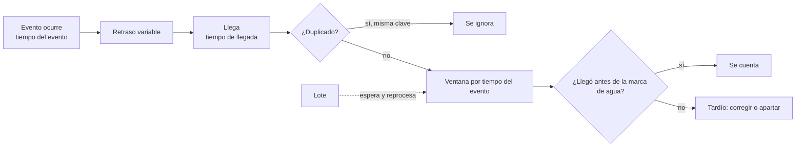

# SE-542 — Ingesta batch y streaming

## Punto profesional y fundamento pedagógico

**Punto profesional.** La clase existe para que elijas cómo entra un dato a la plataforma sabiendo qué compra y qué cuesta cada opción, y no por la moda de «tiempo real». Un lote espera, junta y procesa de una vez: da completitud y repetibilidad a cambio de latencia. Un flujo procesa cada evento al llegar: da frescura a cambio de decidir qué hacer con lo que llega tarde, desordenado o repetido. La clase pone los tres problemas que ninguna de las dos formas elimina (tiempo del evento frente a tiempo de llegada, llegadas tardías y entregas duplicadas) en un experimento con 10 000 eventos y mide cuánto resultado correcto compra cada política.

**Por qué aparece aquí.** Sigue a `SE-541` porque, una vez decidido que lo analítico vive aparte, hay que moverle los datos. Reutiliza lo que ya sabes de entrega y duplicación en [SE-328](../../classes/part-27-integracion-eventos-y-mensajeria/se-328-entrega-orden-duplicacion-y-semanticas/README.md) y de la captura de cambios en [SE-330](../../classes/part-27-integracion-eventos-y-mensajeria/se-330-cdc-etl-elt-y-sincronizacion/README.md), y prepara `SE-544`, donde el reintento seguro se vuelve la propiedad central.

**Error conceptual que debe corregir.** Creer que «streaming» es la versión rápida de «batch». Son modelos distintos de completitud: un lote sabe qué entró porque cierra una puerta; un flujo nunca sabe si ya llegó todo y debe declarar cuánto espera. La segunda corrección: el tiempo real no elimina los datos tardíos, solo obliga a decidir qué hacer con ellos en cada ventana.

**Secuencia de aprendizaje.** Antes de ejecutar, predices cuántos eventos quedan fuera de su ventana si no se tolera ningún retraso y qué espera los recoge todos. Después simulas 10 000 eventos con 3 % de llegadas tardías y 2 % de reentregas, cuentas por ventana de una hora con cinco marcas de agua y con dos lotes, y mides el error de contar entregas en vez de eventos únicos.

**Evidencia de aprendizaje.** `politica-de-ingesta.md` con el modelo de tiempo de una fuente tuya (tiempo del evento, tiempo de llegada, retraso máximo observado), la política elegida (lote, flujo o ambas) con su tolerancia, la clave de deduplicación y qué se hace con lo que llega después de la tolerancia.

**Límite de la conclusión.** Los retrasos son una mezcla inventada por el autor (exponencial de 20 s de media y 3 % entre 1 y 6 horas) y las reentregas son 2 % al azar. Los números dicen cómo se comporta cada política con esa mezcla, no cómo es ninguna fuente real. No se ejecutó ningún motor de flujo ni ningún corredor de mensajes ni se invocó ningún modelo de lenguaje.

### Trazabilidad fuente → afirmación

| Fuente primaria u oficial | Afirmación que respalda | Lo que no prueba |
|---|---|---|
| [Akidau et al., «The Dataflow Model»](https://www.vldb.org/pvldb/vol8/p1792-Akidau.pdf) | Distingue el tiempo del evento del tiempo de procesamiento y formaliza ventanas, marcas de agua y activadores para datos desordenados. | No fija umbrales para tu fuente. |
| [Apache Kafka, «Message Delivery Semantics»](https://kafka.apache.org/documentation/#semantics) | Describe las semánticas de entrega como máximo una vez, al menos una vez y exactamente una vez, y sus condiciones. | Es documentación de un producto. |
| [Kleppmann, «Designing Data-Intensive Applications»](https://dataintensive.net/) | Explica el procesamiento por lotes y por flujos, el tiempo del evento y la tolerancia a fallos. | No mide tu sistema. |
| [SQLite, «UPSERT»](https://www.sqlite.org/lang_upsert.html) | Documenta la escritura por clave con resolución de conflictos que vuelve idempotente una inserción. | No describe otros motores. |
| [Python: `random`](https://docs.python.org/3/library/random.html) | Documenta la generación con semilla del laboratorio. | No valida el modelo de retrasos. |

## Antes de empezar

Recupera lo aprendido en `SE-541`: lo analítico necesita historia y una zona cruda. La pregunta activa es: **¿cuánto tarda en llegar el 99 % de los eventos de tu fuente más importante y qué pasa con el 1 % restante?**

## Prerrequisitos

- Haber completado `SE-541`.
- Conocer las semánticas de entrega de [SE-328](../../classes/part-27-integracion-eventos-y-mensajeria/se-328-entrega-orden-duplicacion-y-semanticas/README.md) y la idea de idempotencia de [SE-329](../../classes/part-27-integracion-eventos-y-mensajeria/se-329-outbox-inbox-sagas-y-compensacion/README.md).
- Saber distinguir percentiles de promedios ([SE-376](../../classes/part-31-calidad-rendimiento-y-resiliencia/se-376-latencia-throughput-saturacion-y-capacidad/README.md)).
- Python 3.11 o posterior; solo biblioteca estándar.

## Problema auténtico

*Avisos* recibe eventos «aviso leído» desde la aplicación móvil. Producto quiere un panel con lecturas por hora «en tiempo real»; finanzas quiere el cierre diario exacto. En el móvil, un estudiante lee un aviso en un tren sin cobertura y el evento llega tres horas después. La red reintenta algunos envíos y el servidor recibe el mismo evento dos veces. El panel muestra 4 120 lecturas a las 11:00 y, al día siguiente, el cierre dice 4 387 para esa misma hora.

Nadie mintió: el panel contó lo que había llegado y el cierre contó lo que había ocurrido. La pregunta de ingeniería es cuánto retraso se tolera antes de publicar una hora, qué se hace con lo que llega después y cómo se evita contar dos veces lo que se entregó dos veces.

## Objetivos observables

Al terminar podrás:

1. distinguir tiempo del evento de tiempo de llegada y explicar por qué una ventana se define por el primero y se cierra por el segundo;
2. medir con una simulación cuántos eventos deja fuera cada marca de agua y qué retraso de publicación paga para recogerlos;
3. comparar un lote nocturno, un lote con reproceso y un flujo con tolerancia, y decir qué error y qué latencia tiene cada uno;
4. mostrar que contar entregas en vez de eventos únicos infla el resultado y que escribir por clave lo evita;
5. escribir una política de ingesta con tolerancia, clave de deduplicación y destino de lo tardío.

## Mapa conceptual



El mapa muestra que la marca de agua es el punto donde se decide entre esperar más (más completitud, más retraso) y publicar ya (menos retraso, más tardíos). El lote es la misma decisión con una espera fija y larga.

## Temas y por qué importan

| Tema | Por qué cambia una decisión profesional | Evidencia mínima |
|---|---|---|
| Tiempo del evento y de llegada | Agrupar por llegada mueve eventos a la hora equivocada. | Dos marcas de tiempo por evento |
| Marca de agua | Fija cuánto se espera y qué se declara tardío. | Eventos tardíos por tolerancia |
| Lote y flujo | Cambian latencia por completitud. | Error y retraso por política |
| Entrega al menos una vez | Duplica eventos. | Clave y conteo sin y con deduplicación |
| Escritura idempotente | Hace inofensivo el reintento. | Filas aplicadas frente a entregas |
| Lo tardío | Hay que decidir su destino. | Política escrita |
| Cuándo flujo | Solo si la decisión depende de la frescura. | Plazo de la decisión |

## Conceptos y decisiones

### 1. Dos relojes

Cada evento tiene el instante en que ocurrió (`t`) y el instante en que llegó (`arr`). Una métrica por hora «de lecturas» se refiere al primero: es la hora en que el estudiante leyó, no la hora en que el servidor se enteró. Agrupar por llegada es más fácil (basta el reloj del servidor) y es incorrecto cuando hay retraso: un evento leído a las 10:59 y recibido a las 12:30 cae en la hora equivocada. El laboratorio genera 10 000 eventos distribuidos en 24 horas; la mayoría llega con un retraso exponencial de 20 s de media y un 3 % llega entre 1 y 6 horas tarde. El retraso mediano medido entre el evento y su llegada fue de 14,3 s; el percentil 99, de 14 212 s (casi cuatro horas). El promedio de retraso no sirve para dimensionar nada: la cola decide.

### 2. La marca de agua es una apuesta declarada

Un flujo no sabe si ya llegó todo lo de una ventana. La marca de agua es el instante hasta el que se decide esperar rezagados: «la ventana de las 10:00 se cierra cuando el reloj de llegada pasa de las 11:10». Lo que llega después es tardío. En el laboratorio, un flujo sin tolerancia dejó fuera de su ventana a 315 de 10 000 eventos (3,15 % del total); con 1 minuto de tolerancia, 262; con 10 minutos, 257; con 1 hora, 229; con 6 horas, 0. La curva es plana mientras la tolerancia es menor que el retraso típico de los rezagados y cae de golpe cuando la supera: los tardíos no se reparten, están concentrados entre 1 y 6 horas. Elegir 10 minutos por «parecer razonable» no recoge casi nada; elegir 6 horas recoge todo y publica cada hora con seis horas de retraso.

### 3. El lote espera y por eso es completo

Un lote nocturno que cierra a las 02:00 del día siguiente dejó 15 eventos fuera (0,15 %): los que llegaron después de las 02:00. Un lote con reproceso tres días después dejó 0. El lote no es más inteligente: espera más. Cambia latencia por completitud con una espera larga y fija, y esa espera es una política que hay que nombrar igual que una marca de agua. Que el lote parezca «exacto» viene de que su espera supera el retraso máximo de la mezcla.

### 4. Latencia y exactitud son los dos extremos de una misma decisión

No hay política que sea a la vez inmediata y completa si hay llegadas tardías. Las salidas profesionales son tres. Publicar pronto y corregir después: el panel muestra un valor provisional y la corrección llega cuando el lote de cierre procesa lo tardío (arquitectura que combina ambos). Publicar con tolerancia: aceptar el retraso de la ventana. Declarar el error: publicar con una cota («al menos 4 120») y registrar cuánto se corrige de media. Lo que no es honesto es publicar el provisional como definitivo.

### 5. Entrega al menos una vez: duplicados garantizados

Cuando un envío no se confirma, el cliente reintenta; si la confirmación se perdió pero el mensaje llegó, el servidor lo recibe dos veces. Con el 2 % de reentregas del laboratorio, 10 221 entregas correspondían a 10 000 eventos únicos; contar entregas infló el resultado un 2,21 % del total. La entrega «exactamente una vez» que ofrecen algunos sistemas es una propiedad del procesamiento entre dos componentes concretos con condiciones, no de la red; la defensa general es que el destino sea idempotente.

### 6. Escribir por clave vuelve inofensiva la reentrega

Si cada evento lleva una clave (`id`) y el destino escribe «si no existe, inserta; si existe, ignora o reemplaza con lo mismo», aplicar el mismo evento dos veces deja el mismo resultado. En el laboratorio, 10 221 entregas produjeron 10 000 filas aplicadas: las 221 reentregas no cambiaron nada. La clave debe ser estable y única por evento (generada en el origen, no al llegar: una clave que se asigna en el servidor da identificadores distintos a las dos entregas del mismo evento). SQLite lo permite con `INSERT ... ON CONFLICT`, y la idea es general.

### 7. Qué hacer con lo tardío

Hay cuatro destinos: descartarlo (aceptable solo si se mide y se declara), asignarlo a su ventana original y corregir el resultado publicado (exige poder reescribir ventanas, lo que lleva a `SE-544`), asignarlo a la ventana de llegada con una marca (pierde exactitud por hora) o apartarlo a una cola de revisión. Elegir uno por defecto, sin decidirlo, es elegir descartar. El registro de cuántos eventos tardíos llegan por día es una métrica de salud de la fuente: si crece, algo cambió en el origen o en la red.

### 8. Elegir flujo solo cuando la decisión depende de la frescura

Un flujo cuesta operar un servicio que siempre está encendido, estado que sobrevive a reinicios, reglas de tardíos y pruebas con tiempo simulado. Se justifica cuando alguien o algo actúa sobre el dato en segundos o minutos y esa acción vale más que el costo: detección de fraude, alertas operacionales, personalización. Para el cierre contable, un lote basta y es más fácil de verificar. Muchas plataformas usan lotes frecuentes (microlotes cada 5 o 15 minutos) como punto medio: la complejidad del flujo con la simplicidad de la reejecución.

### 9. Fallos a mitad de la ingesta

Un lote puede fallar a mitad y dejar la mitad cargada; un flujo puede reiniciarse y reprocesar desde el último punto confirmado. En ambos casos, lo que decide si el resultado es correcto es la idempotencia del destino y el punto desde el que se reanuda. Lo detalla `SE-544`; aquí basta recordar que una ingesta sin clave no es reintentable con seguridad.

## Eventos fuera de su ventana por política

La primera medida cuenta, por política, cuántos eventos quedan fuera de su ventana.


**Cómo leer la figura.** Cada barra es una política y su longitud los eventos de 10 000 que no entran en la ventana que les corresponde. Mira primero que las cuatro primeras barras de flujo son casi iguales y la quinta cae a cero: la tolerancia útil es la que supera el retraso de los rezagados. **Dónde deja de valer:** la mezcla de retrasos es del autor; con otra fuente la caída ocurrirá en otro valor. Lo que se traslada es la forma: medir la distribución de retrasos antes de fijar la tolerancia.

## Tiempo del evento, llegada y marca de agua

La segunda figura muestra el mecanismo.


**Cómo leer la figura.** Cada caja es una etapa; la ventana se define con el tiempo del evento y se cierra con el tiempo de llegada. Mira primero la caja del evento tardío: es la que no tiene un destino por defecto. **Dónde deja de valer:** la figura supone ventanas fijas de una hora; existen ventanas deslizantes y por sesión con reglas de cierre propias, y los motores de flujo tienen activadores que permiten emitir resultados parciales antes de la marca de agua.

## Duplicados y escritura por clave

La tercera figura mide el efecto de las reentregas.


**Cómo leer la figura.** Cada barra es una forma de contar y su altura el error como porcentaje del total. Mira primero la barra de contar entregas: el error es exactamente la tasa de reentregas. **Dónde deja de valer:** el 2 % de reentregas es del autor y las reentregas reales vienen en ráfagas tras una caída; además, la deduplicación por clave exige recordar las claves vistas durante todo el período en que puede llegar una reentrega, lo que cuesta memoria o almacenamiento.

## Definiciones de trabajo

- **Tiempo del evento:** instante en que ocurrió lo que el dato describe.
- **Tiempo de llegada:** instante en que el sistema lo recibió.
- **Ventana:** intervalo del tiempo del evento sobre el que se agrega.
- **Marca de agua:** instante de llegada hasta el que se espera a los rezagados de una ventana.
- **Dato tardío:** evento que llega después de la marca de agua de su ventana.
- **Entrega al menos una vez:** garantía de que cada mensaje llega una o más veces.
- **Idempotencia:** aplicar la misma operación varias veces deja el mismo resultado que aplicarla una.

## Ejemplo mínimo

Contar eventos por hora, con y sin deduplicar por clave:

```python
from collections import defaultdict

entregas = [  # (id, hora del evento)
    (1, 10), (2, 10), (2, 10), (3, 11), (4, 10), (4, 10), (4, 10),
]
sin_dedup = defaultdict(int)
for _, hora in entregas:
    sin_dedup[hora] += 1

vistos, con_dedup = set(), defaultdict(int)
for id_, hora in entregas:
    if id_ in vistos:
        continue
    vistos.add(id_)
    con_dedup[hora] += 1

print(dict(sin_dedup), dict(con_dedup))   # {10: 6, 11: 1}  {10: 3, 11: 1}
```

Siete entregas son cuatro eventos. La clave de deduplicación debe venir del origen: si se generara al llegar, las tres entregas del evento 4 tendrían tres claves distintas.

## Ejemplo profesional

*Escenario ilustrativo: las cifras y los resultados que aparecen en este ejemplo son supuestos de la narración, no mediciones.*

El equipo de *Avisos* mide durante dos semanas el retraso de llegada de sus eventos de lectura y encuentra que el percentil 95 es de 40 segundos y el 99,5, de 3 horas. Descarta el flujo con tolerancia de 3 horas para el panel (publicaría con tres horas de retraso) y propone dos productos con dos promesas distintas: el panel de producto, con ventanas de 5 minutos, tolerancia de 2 minutos y la etiqueta «provisional»; y el cierre de finanzas, un lote a las 06:00 que reprocesa los tres días anteriores. Los eventos con clave `event_id` generada en el móvil se escriben con `ON CONFLICT DO NOTHING`. Fija una métrica: el porcentaje de eventos tardíos por día, con alerta cuando supere el doble de su mediana. Tras un mes, la alerta se dispara porque una versión de la aplicación guarda los eventos y los envía al reconectar: el origen cambió y la métrica lo mostró antes de que lo hiciera una queja.

## Práctica guiada

1. Mide el retraso de llegada de una fuente tuya: percentiles 50, 95, 99 y 99,9.
2. Ejecuta `python scripts/experiments_part45_a.py 542` y reproduce la tabla de políticas.
3. Cambia la fracción de llegadas tardías de 3 % a 10 % y vuelve a calcular cuántos eventos deja fuera cada marca de agua.
4. Elige una tolerancia para una fuente tuya y escribe qué se hace con lo que llegue después.
5. Escribe cómo generarías la clave de deduplicación de un evento en el origen.

## Ejercicios

1. **Básico.** Explica por qué un flujo con 10 minutos de tolerancia casi no mejora a uno sin tolerancia en el experimento.
2. **Intermedio.** Calcula, con el experimento, el error de un lote que cierra a las 00:30, a las 02:00 y a las 06:00 del día siguiente, y decide cuál conviene para un cierre contable.
3. **Avanzado.** Diseña la deduplicación de una fuente con 50 millones de eventos al día cuyas reentregas pueden llegar hasta 7 días tarde; calcula la memoria o el almacenamiento que necesita y propón una alternativa que no recuerde todas las claves.

## Reto verificable

Entrega `politica-de-ingesta.md` con los percentiles de retraso de una fuente tuya, la política elegida con su tolerancia, la clave de deduplicación y el destino de lo tardío. Es válido si otra persona reproduce tus percentiles con tus datos y puede calcular cuántos eventos deja fuera tu tolerancia.

## Caso conductor

*Avisos* publica dos productos con dos promesas distintas sobre la misma fuente: un panel provisional con tolerancia corta y un cierre diario con reproceso. `SE-543` trata cómo se organiza lo que llega para que las dos promesas se respondan con el mismo modelo.

## Preguntas frecuentes

### ¿El streaming es siempre más caro que el lote?

Casi siempre cuesta más de operar, porque un servicio permanente exige estado, reinicios y pruebas con tiempo simulado. Puede costar menos de cómputo si evita reprocesar grandes volúmenes. La respuesta honesta depende de la frescura que alguien paga.

### ¿Cómo elijo la tolerancia?

Con la distribución de retrasos y con el costo de publicar tarde. Mide el percentil que quieres cubrir, calcula cuántos eventos recoge y compara con el retraso que añade a cada ventana. Si la caída ocurre lejos de lo que el negocio tolera, usa ambos productos.

### ¿Exactamente una vez existe?

Existe como propiedad entre componentes concretos, con condiciones (por ejemplo, transacciones entre un tema y su consumidor en un mismo sistema). No existe de extremo a extremo si el destino no es idempotente. Diseña para al menos una vez con destino idempotente.

### ¿Qué pasa si cambio la tolerancia más adelante?

Los resultados ya publicados no cambian solos. Hay que decidir si se recalculan y quién se entera. Por eso la tolerancia es parte del contrato del producto y no un parámetro interno.

## Fallo controlado y diagnóstico

**Fallo.** El panel de lecturas por hora baja de golpe un 3 % cada lunes y finanzas, que cuenta lo mismo con un lote, ve el valor correcto.

**Diagnóstico paso a paso.** (1) Se compara por hora panel y cierre: la diferencia está en las horas de los domingos por la noche. (2) Se calcula el retraso de llegada de esos eventos: el percentil 99 pasa de 14 segundos a 4 horas. (3) Se revisa el cambio de la semana: una nueva versión de la aplicación guarda eventos sin conexión y los envía al reconectar. (4) Se confirma que el panel los descarta por tardíos.

**Corrección.** No se sube la tolerancia (retrasaría todo el panel). Se añade una ventana de corrección diaria que reasigna los tardíos a su hora original y se marca el panel como «provisional hasta las 06:00». Se agrega la métrica de porcentaje de tardíos por versión de la aplicación. La lección es que el síntoma (menos lecturas) venía de un cambio en el origen, y que la métrica del retraso lo habría mostrado el primer día.

## Errores comunes y cómo corregirlos

- **Agrupar por tiempo de llegada.** Mueve eventos a la hora equivocada. Corrige agrupando por tiempo del evento.
- **Fijar la tolerancia sin medir el retraso.** Corrige con percentiles de la fuente.
- **Presentar lo provisional como definitivo.** Corrige etiquetando y programando la corrección.
- **Contar entregas.** Corrige con una clave del origen y escritura idempotente.
- **Descartar lo tardío sin medirlo.** Corrige registrando cuántos y de dónde.
- **Elegir flujo por moda.** Corrige con el plazo de la decisión que usa el dato.

## Entorno y archivos clave

- `scripts/experiments_part45_a.py`: función `e542` con la generación de eventos, las políticas de flujo y de lote, y la deduplicación; se ejecuta con `python scripts/experiments_part45_a.py 542`.
- `scripts/figures_part45_a.py`: las tres figuras de la clase.
- Solo la biblioteca estándar de Python 3.11 o posterior; semilla 45; tarda unos segundos.

## Seguridad, ética y accesibilidad

Los eventos del laboratorio son sintéticos. Un evento real de lectura puede revelar hábitos de una persona; el tiempo de llegada y la clave de deduplicación son datos adicionales que también se protegen. Retener claves para deduplicar es retener identificadores: declara por cuánto tiempo y quién accede. Las figuras llevan texto alternativo completo y no dependen solo del color.

## Puente hacia el trabajo con agentes

Un agente que consulta un panel debe saber si el número es provisional y hasta cuándo. Exige que cite la ventana, la tolerancia y la hora de la última corrección, y que no use un valor provisional para una decisión definitiva. Si un agente propone reprocesar un lote «para corregir», verifica que el destino sea idempotente antes de aprobarlo.

## Transferencia

Elige una fuente de eventos de tu organización. Mide su retraso de llegada, calcula cuántos eventos deja fuera una tolerancia de 1, 10 y 60 minutos y decide, con el plazo real de quien usa el dato, si basta un lote o necesitas flujo.

## Evaluación y evidencia

| Criterio | Evidencia aceptable | Rechazo |
|---|---|---|
| Relojes | Dos marcas de tiempo y percentiles de retraso | Solo la hora del servidor |
| Tolerancia | Eventos fuera por tolerancia y retraso añadido | «Diez minutos» sin medida |
| Duplicados | Clave del origen y conteo con y sin deduplicar | Contar entregas |
| Tardíos | Destino escrito y métrica | Descarte silencioso |
| Elección | Plazo de la decisión que usa el dato | «Tiempo real» como meta |

## Fuentes

- Akidau, T. et al. [«The Dataflow Model»](https://www.vldb.org/pvldb/vol8/p1792-Akidau.pdf).
- Apache Kafka. [«Message Delivery Semantics»](https://kafka.apache.org/documentation/#semantics).
- Kleppmann, M. [«Designing Data-Intensive Applications»](https://dataintensive.net/).
- SQLite. [«UPSERT»](https://www.sqlite.org/lang_upsert.html).
- Python Software Foundation. [`random`](https://docs.python.org/3/library/random.html).

## Límites y siguiente paso

La mezcla de retrasos, el 3 % de tardíos y el 2 % de reentregas son construcciones del autor; la simulación procesa los eventos en orden de llegada con ventanas de una hora y no reproduce un motor de flujo con estado, activadores ni ventanas por sesión. No se midió ninguna fuente real ni ningún corredor de mensajes. El siguiente paso, `SE-543`, organiza lo que llegó en un modelo con hechos, dimensiones y granularidad.

## Glosario

| Término | Definición breve |
|---|---|
| Tiempo del evento | Cuándo ocurrió |
| Tiempo de llegada | Cuándo se recibió |
| Marca de agua | Hasta cuándo se espera a los rezagados |
| Dato tardío | Llega después de la marca de agua |
| Idempotencia | Repetir no cambia el resultado |
| Microlote | Lote muy frecuente que imita un flujo |
