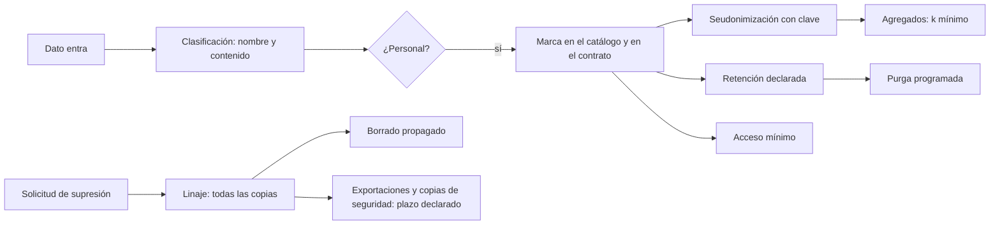
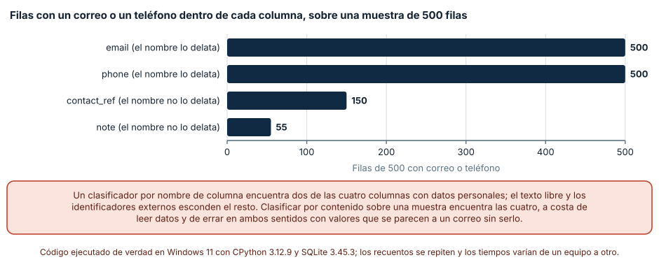
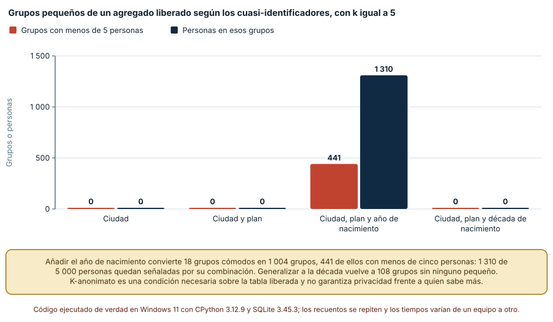

# SE-549 — Gobierno, privacidad y retención de datos

## Punto profesional y fundamento pedagógico

**Punto profesional.** La clase existe para que gobiernes los datos de una plataforma como una responsabilidad con mecanismos comprobables y no como un documento de políticas. Gobernar es saber qué datos hay, cuáles son personales, quién puede verlos, cuánto tiempo se conservan, cómo se protegen cuando se comparten y cómo se borran cuando corresponde, incluyendo todas las copias derivadas. Cada una de esas preguntas tiene una forma de fallar que la clase mide: una clasificación por nombre de columna que no ve los correos escondidos en un campo de texto, un seudónimo calculado con una función pública que un atacante revierte con una lista de candidatos, un agregado que identifica a personas por la combinación de sus atributos, un borrado que deja copias en cuatro lugares y una retención que se declara y no se ejecuta.

**Por qué aparece aquí.** Sigue a `SE-548` porque los archivos y las tablas donde viven los datos son donde se materializan las obligaciones. Reutiliza la privacidad por diseño y la minimización de [SE-391](../../classes/part-32-seguridad-privacidad-y-cumplimiento/se-391-privacidad-por-diseno-y-minimizacion/README.md), el cumplimiento y sus límites de [SE-394](../../classes/part-32-seguridad-privacidad-y-cumplimiento/se-394-cumplimiento-evidencia-y-limites-legales/README.md), la retención de [SE-322](../../classes/part-26-datos-persistencia-y-recuperacion/se-322-privacidad-retencion-y-ciclo-de-vida-del-dato/README.md) y el linaje de `SE-547`, que es lo que permite propagar un borrado. Prepara `SE-550`, porque conservar cuesta.

**Error conceptual que debe corregir.** Creer que anonimizar es quitar el nombre o aplicar un hash. Un hash sin clave de un identificador con espacio de valores pequeño se revierte probando candidatos; una tabla sin nombres sigue identificando a una persona si la combinación de ciudad, plan y año de nacimiento es única. La segunda corrección: borrar es un recorrido, no una sentencia: el dato vive en la tabla de origen, en las derivadas, en las exportaciones y en las copias de seguridad.

**Secuencia de aprendizaje.** Antes de ejecutar, predices cuántas de cuatro columnas con datos personales encuentra un clasificador por nombre, qué fracción de correos recupera un atacante con una lista de candidatos contra un hash sin clave y contra un HMAC, y cuántas personas quedan en grupos de menos de cinco al liberar un agregado. Después ejecutas esas pruebas sobre 5 000 usuarios sintéticos, propagas el borrado de un usuario por cinco ubicaciones y calculas lo que purga cada plazo de retención.

**Evidencia de aprendizaje.** `gobierno-de-datos.md` con el inventario de datos personales de un conjunto tuyo (columna, cómo se detectó, base de tratamiento, plazo de retención, quién accede), el método de seudonimización con su prueba de reversión, el umbral de agregación liberada y el recorrido de borrado con todas las ubicaciones.

**Límite de la conclusión.** Los 5 000 usuarios, los correos y los teléfonos son sintéticos, con un formato conocido para el atacante; la lista de candidatos contiene todos los correos posibles por construcción. El k-anonimato se midió sobre una tabla de cuatro atributos y un k de 5. Esta clase no es asesoría legal ni evalúa el cumplimiento de ninguna norma por una organización: nombra mecanismos técnicos y su límite. No se ejecutó ninguna herramienta de gobierno. No se invocó ningún modelo de lenguaje.

### Trazabilidad fuente → afirmación

| Fuente primaria u oficial | Afirmación que respalda | Lo que no prueba |
|---|---|---|
| [Reglamento (UE) 2016/679 (RGPD)](https://eur-lex.europa.eu/eli/reg/2016/679/oj) | Establece principios como la minimización, la limitación del plazo de conservación (art. 5) y el derecho de supresión (art. 17). | No dice cómo implementarlos técnicamente ni aplica a todas las organizaciones. |
| [NIST SP 800-188, «De-Identifying Government Datasets»](https://csrc.nist.gov/pubs/sp/800/188/final) | Describe técnicas de desidentificación (seudonimización, generalización, supresión) y el riesgo de reidentificación. | Orientado a datos del gobierno de EE. UU. |
| [DAMA International, DMBOK](https://www.dama.org/cpages/body-of-knowledge) | Sitúa el gobierno de datos, la clasificación y la gestión del ciclo de vida como funciones de la gestión de datos. | Es una guía de prácticas. |
| [Python: `hmac`](https://docs.python.org/3/library/hmac.html) y [`hashlib`](https://docs.python.org/3/library/hashlib.html) | Documentan la construcción HMAC y las funciones hash del laboratorio. | No sustituyen una revisión criptográfica. |
| [RFC 2104, «HMAC»](https://www.rfc-editor.org/rfc/rfc2104) | Especifica el código de autenticación de mensajes con clave. | No define cómo guardar la clave. |

## Antes de empezar

Recupera lo aprendido en `SE-547`: el linaje encuentra las copias derivadas. La pregunta activa es: **si una persona te pide que borres todo lo que sabes de ella, ¿puedes listar hoy dónde está su dato y cuánto tardarías?**

## Prerrequisitos

- Haber completado `SE-547` y `SE-548`.
- Conocer la privacidad por diseño ([SE-391](../../classes/part-32-seguridad-privacidad-y-cumplimiento/se-391-privacidad-por-diseno-y-minimizacion/README.md)) y la gestión de secretos ([SE-390](../../classes/part-32-seguridad-privacidad-y-cumplimiento/se-390-secretos-configuracion-y-separacion-de-ambientes/README.md)).
- Nociones de hash y de código de autenticación con clave.
- Python 3.11 o posterior; el laboratorio usa `hashlib`, `hmac`, `re` y `sqlite3`.

## Problema auténtico

*Avisos* recibe una solicitud de supresión de un estudiante. El equipo borra su fila de la tabla de usuarios y responde «hecho». Dos semanas después, el estudiante aparece en un informe de actividad con su correo en una columna `contact_ref`, y en una exportación que se mandó a una universidad. En un tercer caso, un investigador pide estadísticas por ciudad, plan y año de nacimiento «anonimizadas»; el equipo entrega una tabla sin nombres donde 441 combinaciones tienen menos de cinco personas, y 1 310 estudiantes de 5 000 quedan señalados por esa combinación.

Los tres casos tienen la misma causa: se trató la privacidad como una propiedad de una tabla en lugar de una propiedad del recorrido del dato. El gobierno de datos consiste en hacer visibles los datos personales, controlar sus copias, medir el riesgo de reidentificación y ejecutar la retención y el borrado.

## Objetivos observables

Al terminar podrás:

1. clasificar columnas con datos personales por nombre y por contenido y medir qué escapa a cada método;
2. demostrar que un hash sin clave de un identificador se revierte con candidatos y que un HMAC con clave no, y explicar qué protege la clave;
3. calcular los grupos pequeños y las personas expuestas de un agregado según sus cuasi-identificadores, y reducirlos generalizando;
4. propagar un borrado por el linaje de tablas, listar las copias que quedan fuera (exportaciones, copias de seguridad) y declarar su plazo;
5. calcular lo que purga cada plazo de retención y fijar la retención de un conjunto con su justificación.

## Mapa conceptual



El mapa une cuatro obligaciones con un mismo cimiento: saber qué datos son personales y dónde están (el catálogo y el linaje de `SE-547`). Sin ese cimiento, cada control es una promesa.

## Temas y por qué importan

| Tema | Por qué cambia una decisión profesional | Evidencia mínima |
|---|---|---|
| Clasificación | No se protege lo que no se ve. | Columnas detectadas por nombre y por contenido |
| Seudonimización | Un hash sin clave se revierte. | Recuperación con candidatos frente a HMAC |
| K-anonimato | Los atributos juntos identifican. | Grupos y personas con menos de k |
| Supresión | El dato vive en copias derivadas. | Ubicaciones que quedan tras borrar |
| Retención | Conservar es un costo y un riesgo. | Filas purgadas por plazo |
| Mínimo acceso | Menos personas con acceso, menos riesgo. | Matriz de acceso por columna |
| Alcance legal | Los mecanismos no son cumplimiento. | Límite declarado |

## Conceptos y decisiones

### 1. Clasificar por nombre y por contenido

Un clasificador por nombre de columna busca patrones como `mail`, `phone`, `rut` o `nombre`. En el laboratorio de 5 000 usuarios con ocho columnas, encontró dos (`email` y `phone`). Un clasificador por contenido ejecuta expresiones regulares sobre una muestra (500 filas): encontró cuatro. Las dos que escapaban al nombre fueron `contact_ref` (150 de 500 filas con un correo) y `note` (55 de 500 filas con un correo dentro de texto libre). Ninguno es completo: el de contenido encuentra lo que se parece a un formato conocido y falla con identificadores sin patrón (un número de cliente) o confunde un valor que se parece sin serlo. Se combinan, y el resultado se revisa por una persona antes de marcar.

### 2. Seudonimizar no es anonimizar

Reemplazar un identificador por un seudónimo permite unir tablas sin mostrar el identificador. Con SHA-256 sin clave, el seudónimo es una función pública del correo: un atacante que conozca el formato y pruebe 18 000 candidatos recuperó los 5 000 correos (100 %); contra un HMAC-SHA-256 con una clave que el atacante no tiene, recuperó 0. La clave convierte el seudónimo en algo que solo puede calcular quien la tiene, y por eso su gestión ([SE-390](../../classes/part-32-seguridad-privacidad-y-cumplimiento/se-390-secretos-configuracion-y-separacion-de-ambientes/README.md)) es parte del diseño: si la clave se filtra, se revierten todos los seudónimos. El HMAC conserva la propiedad útil: el mismo correo da siempre el mismo seudónimo, de modo que las uniones entre tablas funcionan. Los datos seudonimizados siguen siendo personales para quien tenga la clave o una tabla de correspondencia.

### 3. K-anonimato: las combinaciones identifican

Un agregado liberado con atributos que, juntos, identifican (cuasi-identificadores) puede señalar a una persona aunque cada atributo sea inocuo. La medida más simple es k: cada combinación debe repetirse en al menos k personas. Con k de 5: por ciudad hay 6 grupos y ninguno pequeño; por ciudad y plan, 18 y ninguno; por ciudad, plan y año de nacimiento, 1 004 grupos, de los cuales 441 tienen menos de 5 personas y 1 310 de 5 000 personas quedan en ellos; por ciudad, plan y década de nacimiento, 108 grupos y ninguno pequeño. La técnica que corrigió el problema fue generalizar (año a década); otras son suprimir los grupos pequeños o agregar ruido. K-anonimato es una condición necesaria y no suficiente: no protege frente a quien sabe más (todos los miembros de un grupo comparten el mismo valor sensible) ni frente a la combinación con otras tablas.

### 4. Minimizar antes de proteger

La mejor protección es no tener el dato. Antes de seudonimizar o de cifrar, se pregunta si la columna se necesita para alguna pregunta analítica. Un correo en la zona cruda se necesita para ingerir; en el mart ejecutivo no. La regla es que cada capa conserve solo lo que esa capa necesita, y que el paso de una capa a la siguiente sea la oportunidad de quitarlo o de seudonimizarlo. Es la idea de [SE-391](../../classes/part-32-seguridad-privacidad-y-cumplimiento/se-391-privacidad-por-diseno-y-minimizacion/README.md) aplicada al pipeline.

### 5. Supresión: un recorrido, no una sentencia

La solicitud de supresión de un usuario exige encontrar todas sus copias. En el laboratorio, borrar al usuario 42 solo de la tabla de origen dejó datos en la tabla intermedia (1 fila), la tabla de eventos (3 filas), el almacén de variables (1 fila) y el archivo de exportación (1 línea). Propagar el borrado por el linaje de tablas (`SE-547`) limpió las cuatro tablas, y quedó solo la copia del archivo exportado, que no es una tabla y no aparece en el grafo. Por eso el catálogo debe registrar las exportaciones como activos con dueño y plazo, y por eso el plazo de una supresión incluye las copias de seguridad, que esta prueba no modeló: suelen purgarse por el ciclo de rotación, no por borrado inmediato, y eso debe declararse.

### 6. Retención: declarar, ejecutar, verificar

La retención es un plazo por conjunto de datos y por finalidad. Declararla en el contrato no la ejecuta: hace falta un trabajo de purga y una comprobación que verifique que no hay filas más antiguas que el plazo. En el laboratorio, sobre 1 000 días de registros: un plazo de 90 días purga el 91,1 % de las filas, uno de 365 días el 63,5 % y uno de 730 días el 27,1 %. El plazo es una decisión de negocio y legal (la limitación del plazo de conservación es un principio del RGPD) con un costo medible: cuánto almacenamiento y cuánto riesgo se conservan. La purga debe ser idempotente (`SE-544`) y registrar qué se borró.

### 7. Acceso mínimo y separación de funciones

El control de acceso por columna evita que quien necesita ventas por ciudad vea correos. Un diseño habitual separa tres zonas: la cruda (acceso restringido al proceso de ingesta y a un grupo pequeño), la intermedia con seudónimos y la analítica sin datos personales directos. Cada paso de una zona a otra registra qué se quitó. El acceso se verifica con una matriz columna por rol y se revisa con una periodicidad, porque la membresía de los grupos deriva.

### 8. Qué comprobar, y con qué frecuencia

Cuatro comprobaciones automáticas dan evidencia: toda columna marcada personal tiene un dueño, un plazo y una base declarada; ninguna columna detectada por contenido como personal queda sin marcar; no hay filas más antiguas que el plazo declarado; los marts no exponen columnas marcadas personales. Son las reglas R4 y R5 del control de `SE-552` y funcionan como cualquier otra comprobación de calidad (`SE-545`). Su falla es una alerta con dueño, no una notificación genérica.

### 9. Límites: mecanismo no es cumplimiento

Que un pipeline tenga estos controles no demuestra que una organización cumpla una norma: el cumplimiento incluye bases legales, avisos, contratos con proveedores, evaluaciones de impacto y procesos de respuesta que no son técnicos ([SE-394](../../classes/part-32-seguridad-privacidad-y-cumplimiento/se-394-cumplimiento-evidencia-y-limites-legales/README.md)). La clase da mecanismos técnicos y evidencia de que funcionan; la interpretación legal corresponde a quien tenga competencia para ello.

## Qué columnas delata el nombre

La primera medida compara cuatro columnas con datos personales.



**Cómo leer la figura.** Cada barra es una columna y su longitud las filas de 500 que tienen un correo o un teléfono. Mira primero las dos barras cortas: son las columnas que un clasificador por nombre no vería. **Dónde deja de valer:** los patrones reconocen solo el formato de correo y de teléfono del laboratorio; un identificador sin formato (un número de estudiante) no se detecta por contenido, y un valor que se parece a un correo sin serlo da falsas alarmas.

## Grupos pequeños en un agregado

La segunda medida cuenta las personas expuestas según los atributos liberados.



**Cómo leer la figura.** Cada grupo de barras es un conjunto de atributos liberados; la roja cuenta los grupos con menos de cinco personas y la azul las personas en ellos. Mira primero el tercer grupo: añadir el año de nacimiento crea 441 grupos pequeños; el cuarto lo corrige generalizando. **Dónde deja de valer:** los atributos son seis ciudades, tres planes y 56 años de nacimiento uniformes; una población real tiene distribuciones sesgadas con grupos pequeños aun con pocos atributos, y k de 5 es un umbral del autor, no una regla.

## Dónde queda el usuario tras borrarlo

La tercera medida compara dos formas de borrar.


**Cómo leer la figura.** Cada pareja de barras es una ubicación; la roja es lo que queda tras borrar solo el origen y la verde tras propagar por el linaje. Mira primero la última pareja: la copia exportada sobrevive a las dos estrategias. **Dónde deja de valer:** son cinco ubicaciones de un modelo con un usuario; en una plataforma real hay copias de seguridad, cachés, registros y copias en manos de terceros, y la lista completa es parte de lo que el catálogo debe saber.

## Definiciones de trabajo

- **Dato personal:** información sobre una persona identificada o identificable.
- **Seudonimización:** sustituir un identificador por un seudónimo que solo se puede asociar con la persona con información adicional.
- **HMAC:** código de autenticación con clave construido sobre una función hash.
- **Cuasi-identificador:** atributo que, combinado con otros, puede identificar a una persona.
- **K-anonimato:** cada combinación de cuasi-identificadores aparece en al menos k personas.
- **Supresión:** borrado de los datos de una persona, incluidas sus copias derivadas.
- **Retención:** plazo máximo durante el que se conserva un dato.

## Ejemplo mínimo

Seudónimo sin clave frente a seudónimo con clave:

```python
import hashlib
import hmac

CLAVE = b"clave-del-laboratorio-no-secreta"      # en producción vendría de un gestor de secretos

def hash_simple(correo):
    return hashlib.sha256(correo.encode()).hexdigest()

def seudonimo(correo):
    return hmac.new(CLAVE, correo.encode(), hashlib.sha256).hexdigest()

correos = [f"usuario{i}@correo.example" for i in range(100)]
publicados = {hash_simple(c) for c in correos}
candidatos = [f"usuario{i}@correo.example" for i in range(200)]
print(sum(1 for c in candidatos if hash_simple(c) in publicados))    # 100: todos recuperados

publicados = {seudonimo(c) for c in correos}
print(sum(1 for c in candidatos if hash_simple(c) in publicados))    # 0: sin la clave no se recuperan
print(seudonimo(correos[0]) == seudonimo(correos[0]))                # True: sirve para unir
```

El hash sin clave se revierte con una lista de candidatos plausibles; el HMAC conserva la unión y exige la clave.

## Ejemplo profesional

*Escenario ilustrativo: las cifras y los resultados que aparecen en este ejemplo son supuestos de la narración, no mediciones.*

El equipo de *Avisos* hace el inventario de datos personales de su plataforma. Ejecuta el clasificador por contenido sobre las veinte tablas más usadas y encuentra seis columnas con correos o teléfonos que el nombre no delataba, dos de ellas en campos de texto libre. Marca cada una en el catálogo con dueño, plazo y base de tratamiento, y cambia la ingesta para seudonimizar con HMAC antes de la zona intermedia. Antes de entregar estadísticas a un investigador, calcula los grupos pequeños y generaliza el año de nacimiento a década. Para las solicitudes de supresión escribe un procedimiento que recorre el linaje de tablas, borra por seudónimo en cada una y lista las copias exportadas con su plazo de retirada. La primera prueba del procedimiento, sobre un usuario ficticio, encuentra una copia olvidada en un cuaderno de análisis, y el equipo añade al catálogo la categoría «copia de trabajo» con vencimiento automático.

## Práctica guiada

1. Ejecuta el clasificador por nombre y por contenido sobre una tabla de prueba tuya y anota qué columnas escapan al nombre.
2. Ejecuta `python scripts/experiments_part45_c.py 549` y reproduce las tablas de seudonimización, k-anonimato y borrado.
3. Cambia k a 10 y a 20 y calcula cuántas personas quedan en grupos pequeños con y sin generalizar.
4. Lista las ubicaciones donde estaría el dato de un usuario de tu sistema, incluidas copias de seguridad y exportaciones.
5. Escribe la política de retención de un conjunto tuyo con plazo, finalidad y trabajo de purga.

## Ejercicios

1. **Básico.** Explica por qué el HMAC conserva la posibilidad de unir tablas y el hash con clave desconocida impide recuperar el correo.
2. **Intermedio.** Calcula cuántos grupos pequeños aparecen al añadir un cuarto atributo (el curso) a los tres anteriores y propón la generalización mínima que lo corrige.
3. **Avanzado.** Diseña el procedimiento de supresión para una plataforma con copias de seguridad semanales conservadas ocho semanas, e indica cómo comunicarías el plazo real a la persona.

## Reto verificable

Entrega `gobierno-de-datos.md` con el inventario de columnas personales de un conjunto tuyo, el método de seudonimización y su prueba de reversión con candidatos, el k de los agregados que liberas con los grupos pequeños medidos, y el recorrido de borrado con todas las ubicaciones. Es válido si otra persona ejecuta tu prueba de reversión y tu medida de grupos pequeños y obtiene los mismos números.

## Caso conductor

*Avisos* marca sus columnas personales, seudonimiza con clave, libera agregados con un k mínimo y propaga las supresiones por su linaje. `SE-550` calcula lo que cuesta operar todo eso y la plataforma entera.

## Preguntas frecuentes

### ¿Un hash es suficiente para proteger un identificador?

No si el conjunto de valores posibles es pequeño o conocido: se revierte probando candidatos. Con clave (HMAC) o con una tabla de correspondencia protegida, sí, mientras la clave esté protegida.

### ¿Los datos seudonimizados dejan de ser personales?

No para quien pueda reidentificar, y en muchas normas siguen siendo datos personales. Reducen el riesgo, no lo eliminan. Decide el tratamiento con quien tenga competencia legal.

### ¿Qué k debo usar?

No hay un valor universal. Valores como 5, 10 o más se usan como mínimos, y dependen de la sensibilidad, de qué más sabe el receptor y de cuántos atributos liberas. Mídelo sobre tus datos y documenta la decisión.

### ¿Cómo se borra de las copias de seguridad?

Normalmente no se borra de una copia inmutable: se espera a que rote, se registra el plazo y se garantiza que una restauración vuelva a aplicar las supresiones pendientes. Esa lógica de reaplicación debe existir y probarse.

## Fallo controlado y diagnóstico

**Fallo.** Un estudiante que pidió supresión aparece, con su correo, en un informe de actividad un mes después.

**Diagnóstico paso a paso.** (1) Se localiza el correo en el informe: viene de una columna `contact_ref` de la tabla de eventos. (2) Se revisa el borrado: se ejecutó solo sobre `raw_users`. (3) Se consulta el linaje de tablas: la tabla de eventos depende de `raw_users` y no se había incluido. (4) Se comprueba que el clasificador por nombre no marcó `contact_ref` como personal.

**Corrección.** Se ejecuta el borrado en todas las tablas del linaje, se clasifica `contact_ref` por contenido y se marca en el catálogo, se cambia el procedimiento de supresión para recorrer el linaje y se añade una comprobación que busca el seudónimo de la persona borrada en todas las tablas marcadas después del borrado. La lección es que un borrado se verifica buscando lo borrado, no declarándolo hecho.

## Errores comunes y cómo corregirlos

- **Clasificar solo por nombre.** Corrige con contenido sobre una muestra y revisión humana.
- **Usar un hash sin clave.** Corrige con HMAC y gestión de la clave.
- **Liberar agregados sin medir k.** Corrige con el conteo de grupos pequeños.
- **Borrar solo la tabla de origen.** Corrige recorriendo el linaje y las exportaciones.
- **Declarar la retención y no ejecutarla.** Corrige con purga y comprobación.
- **Confundir mecanismo con cumplimiento.** Corrige declarando el alcance de cada control.

## Entorno y archivos clave

- `scripts/experiments_part45_c.py`: función `e549` con la clasificación, la reversión de seudónimos, el k-anonimato, el borrado propagado y la retención; se ejecuta con `python scripts/experiments_part45_c.py 549`.
- `scripts/figures_part45_b.py`: las tres figuras de la clase.
- Solo la biblioteca estándar de Python 3.11 o posterior; semilla 45; la clave del laboratorio es una constante pública y no sirve más que para el experimento.

## Seguridad, ética y accesibilidad

Los datos del laboratorio son sintéticos y los correos usan dominios reservados para ejemplos. La clave de seudonimización de un sistema real no va en el código ni en el repositorio: vive en un gestor de secretos con rotación y acceso mínimo. Ética: la minimización y la retención son obligaciones hacia las personas, no solo hacia un auditor; cuando el costo de conservar es bajo, la tentación es guardar siempre, y la decisión debe tomarla quien responde por el dato. Las figuras llevan texto alternativo completo y no dependen solo del color.

## Puente hacia el trabajo con agentes

Un agente con acceso a una plataforma de datos amplifica cualquier fuga de acceso: puede leer columnas personales, copiarlas a un cuaderno o enviarlas a un servicio externo. Dale acceso solo a las columnas que necesita, exige que declare qué datos personales usó y por qué, y prohíbe que los copie fuera de la plataforma. Si un agente propone «anonimizar con un hash», pídele la prueba de reversión con candidatos.

## Transferencia

Elige un conjunto con datos personales de tu organización. Ejecuta el clasificador por contenido, mide los grupos pequeños de un agregado que se libere hoy y lista las ubicaciones donde estaría el dato de una persona. Si la lista de ubicaciones no cabe en una página, ese es el primer problema.

## Evaluación y evidencia

| Criterio | Evidencia aceptable | Rechazo |
|---|---|---|
| Clasificación | Por nombre y por contenido, con revisión | Solo por nombre |
| Seudonimización | HMAC con clave y prueba de reversión | Hash sin clave |
| Agregados | Grupos pequeños medidos con k declarado | «Está anonimizado» |
| Supresión | Recorrido del linaje y verificación buscando el dato | «Se borró la fila» |
| Retención | Plazo, purga y comprobación | Plazo solo en un documento |

## Fuentes

- Parlamento Europeo y Consejo. [Reglamento (UE) 2016/679](https://eur-lex.europa.eu/eli/reg/2016/679/oj).
- NIST. [SP 800-188, «De-Identifying Government Datasets»](https://csrc.nist.gov/pubs/sp/800/188/final).
- DAMA International. [DMBOK](https://www.dama.org/cpages/body-of-knowledge).
- Krawczyk, H., Bellare, M. y Canetti, R. [RFC 2104, «HMAC»](https://www.rfc-editor.org/rfc/rfc2104).
- Python Software Foundation. [`hmac`](https://docs.python.org/3/library/hmac.html) y [`hashlib`](https://docs.python.org/3/library/hashlib.html).

## Límites y siguiente paso

Los usuarios, los correos, la lista de candidatos y los atributos son construcciones del autor; la clasificación solo reconoce dos formatos y el borrado se probó sobre cinco ubicaciones sin copias de seguridad. No se evaluó el cumplimiento de ninguna norma por ninguna organización, y esta clase no sustituye la asesoría legal. El siguiente paso, `SE-550`, pone precio a la plataforma y a sus decisiones: consultas, refrescos, almacenamiento y operación.

## Glosario

| Término | Definición breve |
|---|---|
| Dato personal | Información sobre una persona identificable |
| Seudonimización | Sustituir un identificador por un seudónimo |
| HMAC | Código con clave sobre un hash |
| K-anonimato | Cada combinación aparece en al menos k personas |
| Supresión | Borrar a una persona y sus copias |
| Retención | Plazo máximo de conservación |
