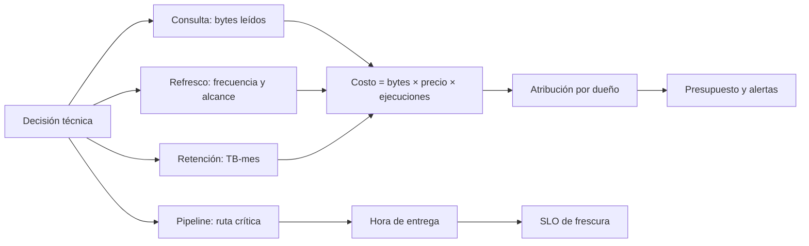
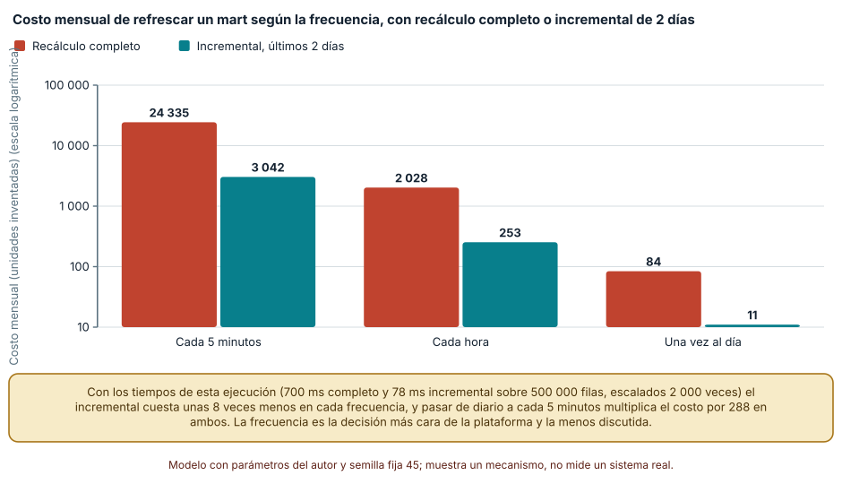

# SE-550 — Costos y operación de plataformas de datos

## Punto profesional y fundamento pedagógico

**Punto profesional.** La clase existe para que conviertas decisiones de datos en costos que puedas estimar, atribuir y discutir, y para que sepas qué se mide en la operación de una plataforma: cuánto cuesta cada consulta, cada refresco y cada día de retención, y cuánto tarda un pipeline en entregar. En una plataforma de datos casi todo el costo se decide por cuatro palancas: cuántos bytes lee cada consulta, con qué frecuencia se recalcula cada tabla, cuánto tiempo se conserva cada dato y qué tarea fija la hora de entrega. La clase mide las tres primeras sobre datos reales de SQLite y archivos propios, calcula la ruta crítica de un pipeline de ocho tareas y muestra que optimizar fuera de esa ruta no mueve la hora de entrega.

**Por qué aparece aquí.** Sigue a `SE-549` porque conservar y proteger tiene costo, y a `SE-548` porque los bytes leídos son el insumo del precio. Reutiliza la capacidad y el rendimiento de [SE-376](../../classes/part-31-calidad-rendimiento-y-resiliencia/se-376-latencia-throughput-saturacion-y-capacidad/README.md), los SLO de [SE-425](../../classes/part-35-observabilidad-sre-e-incidentes/se-425-sli-slo-sla-y-presupuestos-de-error/README.md) y las medidas de calidad de [SE-373](../../classes/part-31-calidad-rendimiento-y-resiliencia/se-373-modelos-de-calidad-y-atributos-medibles/README.md). Prepara `SE-551`, donde un pipeline roto se repara con método.

**Error conceptual que debe corregir.** Creer que el costo es una cifra de la factura que se mira a fin de mes. El costo es una propiedad de cada decisión técnica (formato, orden, frecuencia, retención) y se controla donde se decide. La segunda corrección: reducir el tiempo de cualquier tarea no reduce el tiempo de entrega; solo lo hace reducir el de las tareas de la ruta crítica.

**Secuencia de aprendizaje.** Antes de ejecutar, predices cuántas veces más cuesta una consulta de 10 días sobre CSV que sobre un archivo columnar ordenado y cuánto cuesta pasar de un refresco diario a uno cada cinco minutos. Después escalas bytes medidos a una tabla de 1 TB con un precio inventado, mides un refresco completo frente a uno incremental, calculas el costo por frecuencia y hallas la ruta crítica de ocho tareas.

**Evidencia de aprendizaje.** `costos-de-datos.md` con el costo mensual estimado de tres decisiones de una plataforma tuya (consulta más frecuente, refresco más caro, retención más larga), la fórmula con sus parámetros, la ruta crítica de tu pipeline más importante y la acción de menor costo que más reduce el gasto o el tiempo de entrega.

**Límite de la conclusión.** Los precios (5 unidades por TB escaneado, 23 por TB-mes, 0,002 por segundo de cómputo) son parámetros inventados por el autor y no corresponden a ningún proveedor; los bytes y los tiempos se midieron en un equipo de escritorio y se escalaron por factores declarados (1 TB, 2 000 veces). La ruta crítica usa duraciones fijas inventadas. No se midió ninguna factura real ni se evaluó ninguna plataforma. No se invocó ningún modelo de lenguaje.

### Trazabilidad fuente → afirmación

| Fuente primaria u oficial | Afirmación que respalda | Lo que no prueba |
|---|---|---|
| [FinOps Foundation, «FinOps Framework»](https://www.finops.org/framework/) | Describe la gestión financiera de la nube como una práctica que combina visibilidad, asignación y optimización con participación de ingeniería. | No da cifras para tu plataforma. |
| [Apache Parquet, documentación](https://parquet.apache.org/docs/) | Describe estadísticas por grupo y poda de columnas, los mecanismos que reducen bytes leídos. | No mide el ahorro en tu caso. |
| [dbt, «Incremental models»](https://docs.getdbt.com/docs/build/incremental-models) | Explica la construcción incremental que evita recalcular toda una tabla. | No garantiza que el incremental sea más barato en toda situación. |
| [Apache Airflow, «DAGs»](https://airflow.apache.org/docs/apache-airflow/stable/core-concepts/dags.html) | Describe tareas con dependencias, base del cálculo de la ruta crítica. | No calcula rutas críticas. |
| [Google SRE, «Monitoring Distributed Systems»](https://sre.google/sre-book/monitoring-distributed-systems/) | Respalda medir señales que importan a quien usa el servicio, como la latencia. | Trata servicios, no pipelines de datos. |

## Antes de empezar

Recupera lo aprendido en `SE-548`: el formato y el orden decidían cuántos bytes se leían. La pregunta activa es: **¿cuál es la consulta o el refresco más caro de tu plataforma y quién lo decidió?**

## Prerrequisitos

- Haber completado `SE-544`, `SE-548` y `SE-549`.
- Conocer capacidad y saturación ([SE-376](../../classes/part-31-calidad-rendimiento-y-resiliencia/se-376-latencia-throughput-saturacion-y-capacidad/README.md)).
- Nociones de grafo y de ruta más larga.
- Python 3.11 o posterior; el laboratorio reutiliza el formato de `SE-548` y usa `sqlite3`.

## Problema auténtico

La factura de la plataforma de *Avisos* se triplicó en un trimestre. Finanzas pregunta quién lo causó y nadie puede responder: la cuenta es una sola. Al revisar, el equipo descubre tres hechos independientes. Un panel nuevo ejecuta cada cinco minutos una consulta que lee la tabla completa. Un trabajo de refresco recalcula tres años de historia cada hora aunque solo cambia el día actual. Y el pipeline nocturno, que debía terminar a las 06:00, termina a las 08:30, y al revisar qué tarea optimizar, el equipo gasta dos semanas en acelerar una que no estaba en la ruta crítica.

El costo y el tiempo de entrega son dos caras de una operación: lo que se lee, con qué frecuencia y en qué orden se ejecuta. Para controlarlos hay que medirlos y atribuirlos.

## Objetivos observables

Al terminar podrás:

1. estimar el costo mensual de una consulta como bytes escaneados por precio por ejecuciones, con parámetros explícitos;
2. medir la diferencia entre un refresco completo y uno incremental y calcular el costo por frecuencia;
3. calcular la ruta crítica de un pipeline, el tiempo de entrega y el efecto de acelerar cada tarea;
4. atribuir costos a dueños (etiquetas por conjunto de datos, equipo y consulta) y explicar qué decisión no se puede atribuir sin ellas;
5. proponer la acción de menor costo y mayor efecto para un presupuesto o un plazo dado.

## Mapa conceptual



El mapa muestra que cada decisión tiene dos salidas posibles: dinero o tiempo. La atribución por dueño es lo que permite que alguien responda por cada una.

## Temas y por qué importan

| Tema | Por qué cambia una decisión profesional | Evidencia mínima |
|---|---|---|
| Bytes escaneados | Es el insumo del precio de una consulta. | Bytes por consulta y por formato |
| Frecuencia de refresco | Multiplica el costo de cada ejecución. | Costo mensual por frecuencia |
| Incremental frente a completo | Reduce el trabajo por ejecución con un costo fijo. | Tiempos medidos y costo fijo |
| Retención | Cada día conservado se paga cada mes. | TB-mes por plazo |
| Ruta crítica | Fija la hora de entrega. | Rutas y tiempo de cada tarea |
| Atribución | Sin dueño no hay responsabilidad. | Etiquetas por conjunto y equipo |
| Presupuestos | Hacen visible el desvío a tiempo. | Alerta con umbral y destinatario |

## Conceptos y decisiones

### 1. El costo de una consulta es bytes por precio por frecuencia

En muchos servicios, el costo de una consulta se aproxima por los bytes que lee (precio por terabyte escaneado) y el de un trabajo por el tiempo de cómputo. El laboratorio escala a una tabla de 1 TB y supone un precio inventado de 5 unidades por TB. Una consulta de 10 días sobre CSV lee todo el archivo y cuesta 5 unidades por ejecución; sobre un archivo columnar leyendo dos columnas de todo el rango, 0,404; leyendo las mismas dos columnas con estadísticas que descartan 18 de 20 grupos, 0,040. Con 100 ejecuciones al día durante 30 días, 15 000, 1 213 y 121 unidades al mes: 124 veces entre la primera y la última. Los bytes los midió el experimento sobre 200 000 filas y se escalaron; el precio es un parámetro. La proporción es lo que se traslada.

### 2. Dónde se decide el costo de la consulta

La proporción entre las tres filas se debe a tres decisiones que ocurrieron antes de que alguien ejecutara nada: el formato (columnas por separado), el orden de los datos (por fecha) y la partición. Un analista que ejecuta la consulta no las ve; quien eligió el formato y el orden las decidió sin saber qué consulta vendría. Por eso la medición útil es por consulta frecuente, no global: el costo se reduce rediseñando la tabla en función de las diez consultas que más bytes leen.

### 3. El refresco: completo, incremental y su costo fijo

Recalcular un mart completo cuesta proporcional al tamaño total; recalcular solo los últimos días cuesta proporcional a esa ventana, más un costo fijo de arranque (leer metadatos, abrir conexiones, planificar). En SQLite sobre 500 000 filas, el refresco completo del mart diario tardó unos 460 a 700 ms y el incremental de los últimos dos días 45 a 80 ms: unas nueve veces menos. Escalando 2 000 veces el tamaño y sumando un costo fijo supuesto de 20 s por ejecución incremental, con 0,002 unidades por segundo: cada 5 minutos, 24 335 unidades al mes en completo y 3 042 en incremental; cada hora, 2 028 y 253; diario, 84 y 11. Pasar de diario a cada cinco minutos multiplica por 288 el costo en las dos estrategias; el incremental lo reduce unas ocho veces en cada frecuencia, no lo elimina.

### 4. La frecuencia es la decisión más cara y la menos discutida

La frecuencia de refresco suele fijarse por costumbre («cada hora») o por lo que pidió el primer usuario. Un panel que se mira una vez por la mañana no necesita un refresco cada cinco minutos, y el costo de ese refresco se paga las 24 horas. La conversación correcta es el plazo de la decisión que usa el dato (`SE-542`): ¿qué cambia si el dato tiene una hora de retraso? Si nada, la frecuencia es un gasto. Medir quién consulta cada tabla y cuándo (el registro de consultas) da la evidencia.

### 5. Retención como costo: TB-mes

Cada día de historia conservado se paga cada mes. En el laboratorio de `SE-548`, el almacenamiento de la tabla de 1 TB equivalente costó 23 unidades por mes como CSV y 6,3 como formato columnar. Alargar la retención de 90 a 730 días sobre un conjunto de crecimiento constante multiplica el volumen conservado por unas ocho; el costo crece en la misma proporción, y el riesgo de privacidad también (`SE-549`). La decisión de retención es una pareja de decisión de negocio, de privacidad y de costo, y se toma con las tres cifras a la vista.

### 6. Tiempo de entrega: la ruta crítica

Un pipeline es un grafo de tareas con duraciones. El tiempo de entrega es el camino más largo desde una tarea sin dependencias hasta la última. En el laboratorio, las ocho tareas suman 51 minutos de trabajo, pero el pipeline termina a los 40: la ruta crítica es `ingest_orders` (12), `stg_orders` (6), `fact_sales` (15), `mart_city` (5) y `report` (2). Las otras tareas (`ingest_customers`, `dim_customer`, `mart_daily`) tienen holgura: pueden tardar más sin retrasar la entrega.

### 7. Acelerar la tarea correcta

Reducir a la mitad `fact_sales` (15 a 7,5 minutos) baja la entrega de 40 a 32,5 minutos. Reducir a la mitad `mart_city` baja de 40 a 39. Reducir a la mitad `ingest_customers` no cambia nada. Sin el cálculo, la intuición elige la tarea que parece lenta o la que molesta a alguien; el equipo del caso gastó dos semanas en una tarea sin holgura negativa. Hay una complicación: al acelerar la tarea crítica, otra ruta puede pasar a ser la crítica, y la ganancia se agota; el cálculo se repite tras cada cambio.

### 8. Atribuir: cada costo con un dueño

El costo sin atribución es un número sin responsable. Se atribuye etiquetando cada recurso (tabla, trabajo, consulta, almacenamiento) con equipo y producto, y agregando el costo por etiqueta. Las consultas ad hoc son el caso difícil: se atribuyen al usuario o al panel que las ejecutó. Una regla simple: todo trabajo y toda tabla tienen un dueño en el catálogo (`SE-547`); lo que no tiene dueño se lista cada mes y se retira o se asigna. La práctica de FinOps llama a este paso información, y es previa a optimizar.

### 9. Presupuestos y alertas: el desvío visible a tiempo

Un presupuesto por equipo y una alerta cuando el gasto proyectado supere un umbral convierten un susto trimestral en un aviso semanal. La alerta debe ser accionable ([SE-426](../../classes/part-35-observabilidad-sre-e-incidentes/se-426-alertas-accionables-y-fatiga/README.md)): decir qué consulta o trabajo causó el desvío, quién es su dueño y cuánto sube la proyección mensual. Un límite duro que corta el servicio sin aviso convierte un problema de costo en un incidente.

## Costo mensual de una consulta

La primera medida compara tres formas de leer la misma tabla escalada.


**Cómo leer la figura.** Cada barra es una forma de ejecutar la consulta de 10 días, en escala logarítmica; mira primero la distancia entre la primera y la última, de 124 veces. **Dónde deja de valer:** el precio por terabyte es un parámetro del autor, muchos servicios cobran por tiempo de cómputo o por capacidad reservada y no por bytes, y el escalado de 200 000 filas a 1 TB supone que la proporción se mantiene. Lo que se traslada es la razón entre las barras para consultas que leen un rango estrecho de datos ordenados por esa columna.

## Costo mensual de un refresco

La segunda medida cruza frecuencia con estrategia.



**Cómo leer la figura.** Cada grupo es una frecuencia con dos barras: el recálculo completo (rojo) y el incremental (verde), en escala logarítmica. Mira primero que las dos barras suben juntas de derecha a izquierda: la frecuencia pesa más que la estrategia. **Dónde deja de valer:** los tiempos (700 y 78 ms) son de una ejecución en un equipo de escritorio, el factor 2 000 y el costo fijo de 20 s son supuestos del autor, y un mart real puede no admitir un incremental simple (por ejemplo, con agregados que dependen de toda la historia).

## La ruta crítica

La tercera figura muestra cuándo termina cada tarea.


**Cómo leer la figura.** Cada fila es una tarea y su barra va de su inicio a su fin; las rojas forman la ruta que fija los 40 minutos. Mira primero que `mart_daily` termina a los 37 y `mart_city` a los 38: la segunda manda. **Dónde deja de valer:** las duraciones son fijas e inventadas; en la práctica varían de un día a otro y la ruta crítica puede cambiar. Conviene calcular la ruta con el percentil alto de cada tarea y no con su promedio.

## Definiciones de trabajo

- **Bytes escaneados:** datos que lee una consulta para responder.
- **Refresco incremental:** recalcular solo la parte que cambió.
- **Costo fijo por ejecución:** gasto que no depende del volumen (arranque, planificación).
- **Retención:** plazo de conservación, con su costo en TB-mes.
- **Ruta crítica:** camino de dependencias más largo; fija el tiempo de entrega.
- **Holgura:** tiempo que una tarea puede retrasarse sin retrasar la entrega.
- **Atribución de costos:** asignar el gasto a un equipo, producto o consulta.

## Ejemplo mínimo

La ruta crítica de un pipeline en veinte líneas:

```python
tareas = {   # nombre: (minutos, dependencias)
    "ingesta": (10, []), "limpieza": (5, ["ingesta"]),
    "dimension": (3, []), "hechos": (12, ["limpieza", "dimension"]), "informe": (2, ["hechos"]),
}
termino = {}

def fin(nombre):
    if nombre not in termino:
        duracion, deps = tareas[nombre]
        termino[nombre] = duracion + max((fin(d) for d in deps), default=0)
    return termino[nombre]

total = fin("informe")
ruta, actual = [], "informe"
while actual:
    ruta.append(actual)
    deps = tareas[actual][1]
    actual = max(deps, key=lambda d: termino[d]) if deps else None
print(total, " > ".join(reversed(ruta)))   # 29 ingesta > limpieza > hechos > informe
```

La dimensión (3 minutos) tiene 12 minutos de holgura: acelerarla no cambia el total.

## Ejemplo profesional

*Escenario ilustrativo: las cifras y los resultados que aparecen en este ejemplo son supuestos de la narración, no mediciones.*

El equipo de *Avisos* etiqueta cada tabla y cada trabajo con un equipo y un producto, y agrega el costo del último trimestre por etiqueta. Tres conjuntos explican la mayoría del aumento. Sobre el primero, un panel cada cinco minutos, mide cuántas personas lo abren y cuándo: lo abren dos veces al día; lo pasa a un refresco por hora y a una vista incremental. Sobre el segundo, un refresco de tres años cada hora, lo convierte en incremental con ventana de reproceso de tres días (`SE-544`). Para el tercero, el pipeline nocturno, calcula la ruta crítica con el percentil 90 de cada tarea y descubre que la tarea crítica no es la que estaban acelerando. Registra el costo mensual proyectado antes y después y fija una alerta cuando la proyección de un equipo supere el 120 % de su presupuesto.

## Práctica guiada

1. Lista las diez consultas que más bytes leen en una plataforma tuya y estima su costo mensual con una fórmula explícita.
2. Ejecuta `python scripts/experiments_part45_c.py 550` y reproduce las tablas de consulta, refresco y ruta crítica.
3. Cambia el costo fijo del incremental de 20 a 120 segundos y encuentra la frecuencia a la que el completo es más barato.
4. Dibuja el grafo de tu pipeline más importante con duraciones del percentil 90 y calcula su ruta crítica.
5. Escribe la regla de atribución para consultas ad hoc de tu organización.

## Ejercicios

1. **Básico.** Explica por qué el costo mensual de la última barra de la consulta (121) no es 124 veces menor por reducir bytes solamente.
2. **Intermedio.** Calcula con qué frecuencia deja de convenir el incremental si su costo fijo es de 120 segundos y el completo tarda 700 ms escalado 2 000 veces.
3. **Avanzado.** Dado un pipeline con dos rutas casi iguales, explica por qué acelerar solo la crítica da una ganancia menor que la esperada y cómo lo detectarías.

## Reto verificable

Entrega `costos-de-datos.md` con el costo mensual de tres decisiones de una plataforma tuya con su fórmula y parámetros, la ruta crítica de tu pipeline más importante con duraciones del percentil 90 y la acción de menor costo y mayor efecto con su medida antes y después. Es válido si otra persona reproduce tu cálculo con tus parámetros y obtiene los mismos números.

## Caso conductor

*Avisos* etiqueta sus recursos, mide bytes leídos y ruta crítica y alerta sobre la proyección mensual de cada equipo. `SE-551` pone a prueba todo lo aprendido sobre un pipeline que tiene ocho defectos sembrados.

## Preguntas frecuentes

### ¿Se mide el costo por consulta o por tabla?

Por ambos. La consulta explica el gasto de lectura; la tabla, el de almacenamiento y de refresco. La atribución debe permitir agregar por dueño y bajar al detalle por consulta y por tabla.

### ¿El incremental siempre es más barato?

No. Tiene un costo fijo por ejecución y exige una lógica que no todos los agregados admiten. Con muy poca frecuencia o con tablas pequeñas, un recálculo completo es más simple y puede ser más barato. Mide y decide.

### ¿Cómo estimo la ruta crítica con tareas variables?

Con el percentil alto de cada duración y, mejor, simulando la distribución de las duraciones y tomando el percentil del tiempo de entrega. El promedio subestima el riesgo de llegar tarde.

### ¿Un presupuesto no es solo burocracia?

Es una señal anticipada. Una proyección semanal con alerta permite corregir un desvío con días de margen; la factura mensual lo muestra cuando ya pasó.

## Fallo controlado y diagnóstico

**Fallo.** El costo mensual sube un 40 % sin ningún despliegue nuevo y el pipeline nocturno termina una hora más tarde.

**Diagnóstico paso a paso.** (1) Se agrega el costo por etiqueta de equipo: un solo equipo explica la subida. (2) Se baja por consulta: un panel nuevo lee la tabla completa cada cinco minutos. (3) Se calcula su costo con la fórmula: bytes leídos por el precio por 8 640 ejecuciones al mes. (4) Se revisa la ruta crítica: la consulta compite por los mismos recursos que `fact_sales`, la tarea crítica.

**Corrección.** Se mueve el panel a una tabla agregada que se refresca cada hora de forma incremental, se separan los recursos de las consultas interactivas y del pipeline y se añade una alerta de proyección por equipo. La lección es que el costo y la hora de entrega estaban ligados por un recurso compartido que ninguna de las dos métricas por separado mostraba.

## Errores comunes y cómo corregirlos

- **Mirar solo la factura total.** Corrige con etiquetas y atribución por dueño.
- **Fijar la frecuencia por costumbre.** Corrige con el plazo de la decisión que usa el dato.
- **Optimizar la tarea que parece lenta.** Corrige con la ruta crítica.
- **Suponer que el incremental siempre gana.** Corrige midiendo con el costo fijo.
- **Retener todo por si acaso.** Corrige poniendo el costo y el riesgo junto a la decisión.
- **Calcular rutas con promedios.** Corrige con percentiles.

## Entorno y archivos clave

- `scripts/experiments_part45_c.py`: función `e550` con el escalado de bytes, la comparación de refrescos y la ruta crítica; reutiliza el formato columnar de `experiments_part45_b.py`; se ejecuta con `python scripts/experiments_part45_c.py 550`.
- `scripts/figures_part45_b.py`: las tres figuras de la clase.
- Solo la biblioteca estándar de Python 3.11 o posterior; semilla 45; los precios son parámetros del autor declarados en el código.

## Seguridad, ética y accesibilidad

Los datos del laboratorio son sintéticos. Atribuir costos por persona puede usarse para vigilar el trabajo individual: atribuye por equipo y por producto y decide quién ve el detalle por usuario. Reducir costos recortando retención o comprobaciones tiene riesgos de privacidad y de calidad que deben pasar por quien responde por ellos. Las figuras llevan texto alternativo completo y no dependen solo del color.

## Puente hacia el trabajo con agentes

Un agente que ejecuta consultas o lanza refrescos gasta dinero. Fija un presupuesto por sesión, exige que estime los bytes que leerá antes de ejecutar y rechaza las consultas sin filtro de partición sobre tablas grandes. Si un agente propone aumentar la frecuencia de un refresco, pídele el costo mensual proyectado y el plazo de la decisión que lo justifica.

## Transferencia

Elige el trabajo de refresco más caro de tu organización. Calcula su costo mensual con una fórmula explícita, mide cuántas veces lo consulta alguien y decide, con esas dos cifras, si la frecuencia, el alcance o la estrategia deben cambiar.

## Evaluación y evidencia

| Criterio | Evidencia aceptable | Rechazo |
|---|---|---|
| Costo | Fórmula con parámetros por decisión | «Sale caro» |
| Refresco | Completo e incremental medidos con costo fijo | Suponer el incremental |
| Ruta crítica | Grafo con duraciones y holguras | «La tarea más lenta» |
| Atribución | Etiqueta por dueño | Cuenta única |
| Alerta | Proyección con umbral y destinatario | Revisión mensual |

## Fuentes

- FinOps Foundation. [«FinOps Framework»](https://www.finops.org/framework/).
- Apache Parquet. [Documentación](https://parquet.apache.org/docs/).
- dbt Labs. [«Incremental models»](https://docs.getdbt.com/docs/build/incremental-models).
- Apache Airflow. [«DAGs»](https://airflow.apache.org/docs/apache-airflow/stable/core-concepts/dags.html).
- Google. [«Monitoring Distributed Systems»](https://sre.google/sre-book/monitoring-distributed-systems/).

## Límites y siguiente paso

Los precios, el escalado de 1 TB y de 2 000 veces, el costo fijo de 20 segundos y las duraciones de las tareas son supuestos del autor; los bytes y los tiempos se midieron una vez en un equipo de escritorio y varían. No se midió ninguna factura ni se evaluó ninguna plataforma o proveedor. El siguiente paso, `SE-551`, aplica todo lo anterior a un pipeline con ocho defectos sembrados y pide diagnosticarlos con método.

## Glosario

| Término | Definición breve |
|---|---|
| Bytes escaneados | Datos que lee una consulta |
| Incremental | Recalcular solo lo que cambió |
| Costo fijo | Gasto por ejecución independiente del volumen |
| Ruta crítica | Camino más largo que fija la entrega |
| Holgura | Retraso tolerable sin afectar la entrega |
| Atribución | Asignar el gasto a un dueño |
