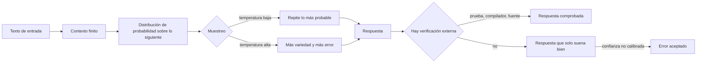
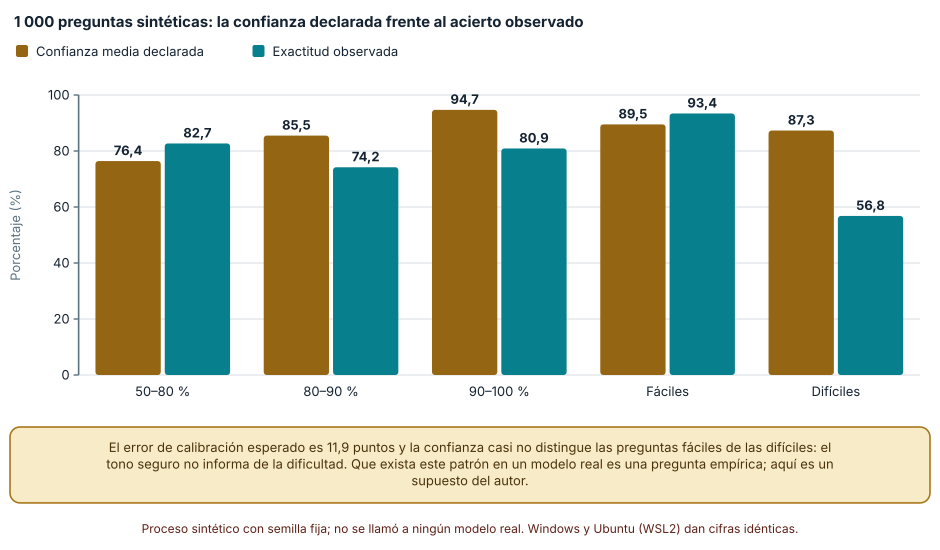
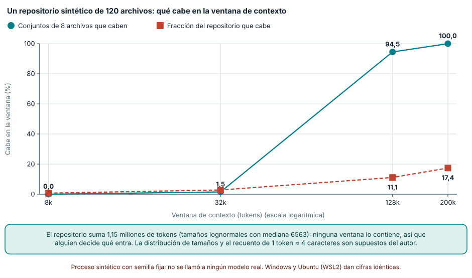

# SE-553 — Capacidades y límites de los modelos generativos

[← SE-540 — Proyecto: dossier profesional defendible](../../classes/part-44-gestion-liderazgo-y-practica-profesional/se-540-proyecto-dossier-profesional-defendible/README.md) · [↑ Parte 46](../../classes/part-46-desarrollo-de-software-asistido-por-ia/README.md) · [📚 Índice completo](../../classes/README.md) · [🌐 Portal](../../site/classes/SE-553.html) · [SE-554 — Prompting, instrucciones y criterios de salida →](../../classes/part-46-desarrollo-de-software-asistido-por-ia/se-554-prompting-instrucciones-y-criterios-de-salida/README.md)

## Punto profesional y fundamento pedagógico

**Punto profesional.** La clase existe para que dejes de tratar a un modelo generativo como un oráculo o como un compañero con criterio, y lo trates como lo que es: un generador de texto que produce continuaciones plausibles a partir de una distribución de probabilidad, con habilidades útiles y con modos de fallo que no avisan. Un equipo que incorpora un asistente al trabajo diario necesita una intuición operativa de qué puede esperar de él, qué no, y qué evidencia distingue una respuesta correcta de una respuesta que solo suena correcta. La habilidad es decidir, para cada tarea, cuánta verificación exige la respuesta antes de confiar en ella.

**Por qué aparece aquí.** Abre la **Parte 46** después de **Proyecto: dossier profesional defendible**: la Parte 44 cerró el bloque de gestión, liderazgo y práctica profesional con la exigencia de defender decisiones con evidencia; ahora la pregunta es cómo se defiende una decisión cuando parte del trabajo lo produjo un modelo. El caso conductor de la parte es **el equipo de la plataforma educativa que incorpora un asistente al trabajo sobre el módulo de calificaciones**, el mismo sistema de la Parte 43. Es un caso sintético; no se llamó a ningún modelo real, no se evaluó ninguna herramienta comercial y ninguna institución real fue analizada.

**Error conceptual que debe corregir.** Creer que la seguridad con la que el modelo responde informa de la probabilidad de que esté en lo cierto. El tono de una respuesta es un rasgo del texto generado, no una medida de su verdad; la relación entre confianza y acierto es una propiedad que se mide en cada tarea y que puede ser mala justo donde más importa, en las preguntas difíciles.

**Secuencia de aprendizaje.** Antes de ver los resultados, predices qué ocurre con el acierto cuando bajas la temperatura de muestreo y cuando pides cinco respuestas y votas; después simulas esa situación con una distribución cuya respuesta correcta no es la más probable, mides la brecha entre confianza declarada y acierto en mil preguntas y calculas cuántos conjuntos de trabajo de ocho archivos caben en cuatro tamaños de ventana de contexto. La secuencia usa predicción, explicación propia, contraste y recuperación. [ICAP](https://icap.education.asu.edu/research) distingue participación de construcción de conocimiento; [How People Learn II](https://nap.nationalacademies.org/catalog/24783/how-people-learn-ii-learners-contexts-and-cultures) respalda diseñar la práctica con contextos reales y retroalimentación.

**Evidencia de aprendizaje.** `modelo-limites.md` con la predicción, las tres figuras reproducidas, una tabla de diez tareas de tu proyecto clasificadas por la verificación que exigen, una política de «cuándo confío y cuándo compruebo» y una nota que separe qué parte de cada conclusión es medida, cuál inferida y cuál supuesta.

**Límite de la conclusión.** Los logits de las cinco respuestas candidatas, la distribución de la confianza declarada, el porcentaje de preguntas difíciles y los tamaños de archivo son construcciones del autor con semilla fija. No se consultó ningún modelo real: los experimentos demuestran mecanismos (qué hace el muestreo, qué es la calibración, qué es una ventana finita), no la magnitud de ninguno de ellos en una herramienta concreta.

### Trazabilidad fuente → afirmación

| Fuente primaria u oficial | Afirmación que respalda | Lo que no prueba |
|---|---|---|
| [Holtzman et al., «The Curious Case of Neural Text Degeneration»](https://arxiv.org/abs/1904.09751) | Describe la generación como muestreo de una distribución y muestra que elegir siempre lo más probable produce texto degenerado, mientras que muestrear de un núcleo de probabilidad produce texto más variado. | No establece qué temperatura o qué núcleo conviene a una tarea de código. |
| [Wang et al., «Self-Consistency Improves Chain of Thought Reasoning»](https://arxiv.org/abs/2203.11171) | Propone muestrear varias cadenas de razonamiento y quedarse con la respuesta más frecuente como forma de mejorar el acierto en tareas con respuesta única. | No garantiza que la respuesta más frecuente sea la correcta: depende de que los errores no estén correlacionados. |
| [Chen et al., «Evaluating Large Language Models Trained on Code»](https://arxiv.org/abs/2107.03374) | Define la métrica pass@k: la probabilidad de que al menos una de k muestras pase las pruebas, y evalúa generación de código con pruebas unitarias como criterio. | No dice cuántas muestras compensa pedir en tu proyecto ni que tus pruebas sean tan buenas como las del benchmark. |
| [Guo et al., «On Calibration of Modern Neural Networks»](https://arxiv.org/abs/1706.04599) | Muestra que redes neuronales modernas pueden estar mal calibradas: su confianza no coincide con su frecuencia de acierto, y define el error de calibración esperado. | Estudia clasificadores; no demuestra la calibración de un modelo generativo concreto sobre código. |
| [Liu et al., «Lost in the Middle»](https://arxiv.org/abs/2307.03172) | Observa que los modelos de lenguaje evaluados usan peor la información relevante cuando está en medio de un contexto largo que cuando está al principio o al final. | No generaliza a todos los modelos ni a todas las versiones; los resultados cambian con el modelo. |
| [NIST AI 600-1: Generative AI Profile](https://doi.org/10.6028/NIST.AI.600-1) | Identifica riesgos propios de la IA generativa, entre ellos la confabulación, la producción de contenido falso expresado con seguridad. | No es un método de medición; propone acciones de gestión de riesgo, no umbrales numéricos. |
| [Python: random](https://docs.python.org/3/library/random.html) | Documenta el generador con semilla que hace reproducibles las simulaciones. | No valida los parámetros elegidos. |

## Antes de empezar

Recupera lo aprendido en la Parte 44 sobre defender una decisión: una afirmación vale por la evidencia que la sostiene y por quién puede comprobarla. La pregunta activa es: **¿qué fracción de las respuestas que has aceptado de un asistente comprobaste de forma independiente antes de usarlas, y qué te hizo decidir que esas sí necesitaban comprobación?**

## Prerrequisitos

- Haber completado `SE-540` o poder explicar qué hace defendible un dossier profesional.
- Python 3.11 o posterior; los experimentos usan solo la biblioteca estándar (`random`, `math`, `statistics`, `collections`).
- Saber leer una probabilidad, una media y una tabla de frecuencias, y qué significa una semilla fija.

## Problema auténtico

El equipo del módulo de calificaciones adoptó un asistente de programación. En la primera semana, una persona le pidió que explicara la regla de redondeo del módulo y el asistente respondió con una explicación clara, completa y segura que no coincidía con el código; nadie lo notó hasta que un informe del ministerio salió con décimas distintas. Otra persona le pidió que resumiera diez archivos de una vez y obtuvo un resumen coherente en el que faltaba uno entero, sin ninguna advertencia. Una tercera pidió «la solución» a un fallo y recibió, al repetir la pregunta, tres soluciones distintas. Los tres incidentes tienen la misma raíz: el equipo esperaba de la herramienta propiedades (exactitud, memoria completa, determinismo) que el mecanismo no ofrece. La clase explica cómo genera texto un modelo, qué consecuencias prácticas tiene y cómo se decide cuánta verificación pide cada tarea.

## Objetivos observables

Al terminar podrás:

1. explicar en qué consiste generar texto como muestreo de una distribución y qué efecto tienen la temperatura y la repetición de muestras sobre el acierto;
2. distinguir confianza declarada de acierto observado, calcular un error de calibración y reconocer en qué preguntas se separa más;
3. calcular qué parte de un repositorio cabe en una ventana de contexto y por qué decidir qué entra es una decisión de ingeniería;
4. clasificar tareas por la verificación que exigen: comprobable mecánicamente, comprobable con criterio humano o no comprobable con los medios disponibles;
5. redactar una política de uso que diga cuándo se confía, cuándo se comprueba y quién responde.

## Mapa conceptual



El mapa separa lo que ocurre dentro del modelo (contexto, distribución, muestreo) de lo que ocurre fuera (verificación). La rama final es el punto central de la clase: sin un comprobador externo, la calidad de la respuesta no puede inferirse de la propia respuesta.

## Temas y por qué importan

| Tema | Por qué cambia una decisión profesional | Evidencia mínima |
|---|---|---|
| Generar es muestrear | Explica por qué la misma pregunta da respuestas distintas y por qué la respuesta más probable no es necesariamente la correcta | tabla de acierto por temperatura y por estrategia de voto |
| Qué sabe y qué no sabe | Separa el conocimiento aprendido del entrenamiento, el que se aporta en el contexto y el que no existe | lista de preguntas del módulo clasificadas por su fuente de verdad |
| Confianza y calibración | Evita usar el tono de la respuesta como señal de verdad | tabla de confianza y acierto por tramos |
| Contexto finito | Obliga a decidir qué información entra y reconoce que lo que no entra no existe para el modelo | cálculo de conjuntos que caben en cada ventana |
| Modos de fallo | Permite anticipar la confabulación, la omisión silenciosa y la inconsistencia | catálogo de fallos con una señal para cada uno |
| Verificabilidad | Determina cuánto puede delegarse: lo comprobable mecánicamente se delega mejor | clasificación de diez tareas |

## Conceptos y decisiones

### 1. Generar texto es muestrear una distribución

Un modelo de lenguaje, en el nivel de abstracción que importa para trabajar con él, recibe una secuencia de símbolos (el contexto) y calcula una distribución de probabilidad sobre cuál puede ser el siguiente; se elige uno, se añade a la secuencia y se repite. De ese mecanismo se deducen consecuencias prácticas sin necesidad de conocer la arquitectura interna. La primera es que la salida no es una consulta a una base de hechos: es la continuación probable de un texto, y una continuación probable puede ser falsa. La segunda es que hay una decisión de muestreo entre «tomar siempre lo más probable» y «tomar al azar según la distribución», y ese control, la **temperatura**, desplaza el comportamiento entre repetir con firmeza lo más probable y explorar alternativas. La tercera es que dos ejecuciones con la misma entrada pueden diferir: la variación no es un fallo sino la manifestación del muestreo, y se puede reducir (temperatura baja, semilla fija cuando la herramienta la admite) sin que desaparezca del todo en servicios cuya infraestructura introduce otras fuentes de variación. Holtzman y sus coautores documentan que elegir siempre la continuación de máxima probabilidad produce texto repetitivo y degenerado, por eso las herramientas muestrean.

### 2. Qué sabe y qué no sabe el modelo

El conocimiento de un modelo tiene tres fuentes distintas que conviene no confundir. Lo que aprendió durante el entrenamiento está comprimido, es general y tiene una fecha de corte: sabe cómo se escribe una consulta SQL, no sabe cómo redondea *tu* módulo. Lo que le aportas en el contexto (archivos, documentos, resultados de herramientas) lo puede usar de forma casi literal, pero solo mientras esté dentro de la ventana. Y hay lo que no está en ninguna de las dos: las reglas no escritas del módulo, las decisiones del equipo, el estado actual de la base de datos. Ante esto último el modelo no se detiene: produce una respuesta plausible porque su mecanismo es producir texto, no abstenerse. El NIST llama a este fenómeno confabulación y lo cuenta entre los riesgos propios de la IA generativa. La consecuencia de diseño es que una pregunta cuya respuesta vive en tu sistema debe llevar la fuente en el contexto, o su respuesta debe comprobarse contra ella.

### 3. Confianza y calibración

Un clasificador está **calibrado** si, entre las respuestas a las que asigna confianza del 80 %, acierta el 80 %. Guo y sus coautores mostraron que las redes modernas tienden a estar mal calibradas, con más confianza que acierto. En un asistente conversacional, además, el tono (la fluidez, la ausencia de dudas) es un rasgo del estilo de generación y no una medida: una respuesta correcta y una confabulada pueden estar redactadas con la misma seguridad. El **error de calibración esperado** resume la diferencia entre confianza y acierto por tramos. Para una persona que usa la herramienta, la consecuencia práctica es que no sirve preguntarle «¿estás seguro?» como única comprobación: la respuesta a esa pregunta es otra continuación del mismo mecanismo. Lo que sí sirve es medir, sobre una muestra de tareas del propio equipo, cómo se relaciona el acierto con las señales disponibles, y comprobar con un medio independiente cuando el costo del error lo exige.

### 4. El contexto es finito y alguien decide qué entra

La **ventana de contexto** es el máximo de símbolos (tokens) que el modelo puede considerar a la vez, entre instrucciones, archivos, historial y respuesta. Una ventana grande no elimina el problema: un repositorio real suele superarla por órdenes de magnitud, el costo y la latencia crecen con el contexto, y la evidencia de Liu y sus coautores indica que la información relevante situada en medio de un contexto largo se usa peor que la del principio o el final. Hay dos decisiones de ingeniería escondidas. Qué archivos entran (por una herramienta de recuperación, por una selección manual, por una convención del asistente), y en qué orden y con qué marcas. Lo que queda fuera no es «menos visible»: no existe para el modelo, y este puede, sin avisar, razonar como si no existiera, lo que explica el resumen que omitió un archivo entero.

### 5. Verificabilidad: qué se puede delegar

El criterio práctico más útil para decidir qué delegar es la verificabilidad. Una tarea cuyo resultado se comprueba de forma mecánica y barata (una función con pruebas, una transformación con un oráculo, un código que compila y pasa un analizador) tolera mucha variación en la generación porque el comprobador filtra: Chen y sus coautores evalúan el código generado precisamente ejecutando pruebas, y su métrica pass@k mide la probabilidad de que al menos una de k muestras pase. Una tarea comprobable solo con criterio humano (una decisión de diseño, un texto para estudiantes) exige que alguien lea con atención y asume el costo de esa lectura. Y una tarea no comprobable con los medios del equipo (una afirmación sobre un sistema que nadie puede inspeccionar) no debe delegarse con confianza: cualquier cosa que el modelo diga queda sin contrastar. La delegación segura no depende de lo capaz que parezca el modelo, sino de lo capaz que sea el comprobador.

### Cinco respuestas candidatas: el muestreo y el voto

Se plantea un caso mínimo: cinco respuestas posibles a una pregunta, con logits fijos (2,0; 1,6; 1,2; 0,4; 0,0) y la correcta es la segunda, no la más probable. Para cuatro temperaturas se generan 20 000 muestras en grupos de cinco; se mide el acierto de la primera muestra, el acierto del voto de mayoría de las cinco y la probabilidad de que al menos una de las cinco sea la correcta.

```python
w = [math.exp(l / temp) for l in logits]; p = [x / sum(w) for x in w]
muestras = rng.choices(range(5), weights=p, k=5)
mayoria = Counter(muestras).most_common(1)[0][0] == correcta
alguna = correcta in muestras
```

| Temperatura | Probabilidad de la correcta | Una muestra | Mayoría de 5 | Alguna de 5 correcta |
|---|---:|---:|---:|---:|
| 0,2 | 11,7 % | 11,4 % | 2,2 % | 45,8 % |
| 0,7 | 27,6 % | 27,6 % | 24,8 % | 80,4 % |
| 1,0 | 27,3 % | 28,1 % | 27,6 % | 80,2 % |
| 1,5 | 25,9 % | 25,5 % | 26,4 % | 77,6 % |

A temperatura 0,2 el modelo es casi determinista: elige casi siempre la respuesta más probable, que es incorrecta, y el voto de mayoría de cinco la confirma con firmeza, de modo que el acierto cae al 2,2 %. A temperaturas medias las muestras son más variadas, la mayoría ya no mejora una muestra sola (27,6 % frente a 28,1 % a temperatura 1,0), pero **al menos una de las cinco es correcta el 80 % de las veces**. Esa diferencia entre «alguna correcta» y «la elegida correcta» es la razón por la que generar varias respuestas solo ayuda cuando existe un comprobador (una prueba) que reconoce la correcta; sin él, el voto mide consenso del modelo consigo mismo.


**Cómo leer la figura.** El eje horizontal es la temperatura de muestreo y el vertical el acierto, en porcentaje. La línea turquesa es que alguna de las cinco muestras sea correcta, la dorada discontinua el acierto con una muestra y la coral el voto de mayoría. Mira la temperatura baja: la mayoría confirma la respuesta equivocada y solo muestrear más variado deja que aparezca la correcta. **Dónde deja de valer:** los logits son del autor y la correcta está colocada a propósito en segundo lugar; en una tarea donde la respuesta correcta sea la más probable, la temperatura baja y el voto funcionan bien. La figura demuestra un mecanismo, no el comportamiento de ninguna herramienta.

### Mil preguntas: la confianza y el acierto

Se simulan 1 000 preguntas, el 40 % difíciles. La confianza declarada sigue una normal de media 0,88 en las difíciles y 0,90 en las fáciles; el acierto real es del 55 % en las difíciles y del 93 % en las fáciles. Se agrupan por tramo de confianza y por dificultad.

| Grupo | Preguntas | Confianza media | Exactitud observada |
|---|---:|---:|---:|
| Tramo 50–80 % | 98 | 76,4 % | 82,7 % |
| Tramo 80–90 % | 472 | 85,5 % | 74,2 % |
| Tramo 90–100 % | 430 | 94,7 % | 80,9 % |
| Fáciles | 576 | 89,5 % | 93,4 % |
| Difíciles | 424 | 87,3 % | 56,8 % |

Globalmente la confianza media es del 88,6 % y el acierto del 77,9 %; el error de calibración esperado es de 11,9 puntos. Lo decisivo está en la última pareja de filas: la confianza en las preguntas difíciles (87,3 %) es casi la misma que en las fáciles (89,5 %), pero el acierto cae de 93,4 % a 56,8 %. La confianza **no distingue** lo difícil de lo fácil, y por eso no sirve como filtro. Incluso el tramo más alto (90–100 %) acierta solo el 80,9 %: una de cada cinco respuestas «seguras» está mal.



**Cómo leer la figura.** Cada grupo es un tramo de confianza o un nivel de dificultad y tiene dos barras: la confianza media declarada (dorada) y la exactitud observada (turquesa). Mira dónde las barras no coinciden: en las preguntas difíciles la confianza casi no baja y el acierto cae a 56,8 %, así que la confianza no informa de la dificultad. **Dónde deja de valer:** el reparto de dificultad, las medias y las tasas son supuestos del autor; es una pregunta empírica si un modelo y una tarea concretos se comportan así. Lo que la figura enseña es qué medir (tramos de confianza frente a acierto observado, separados por dificultad), no cuánto vale esa brecha.

### Ciento veinte archivos: qué cabe en la ventana

Se generan 120 tamaños de archivo con distribución lognormal de mediana cercana a 5 800 tokens (la mediana de la muestra es 6 563 y el mayor 72 671; el repositorio suma 1 150 403 tokens). Para cuatro ventanas se calcula la fracción del repositorio que cabría y el porcentaje de conjuntos de trabajo de ocho archivos elegidos al azar que caben juntos.

| Ventana (tokens) | Fracción del repositorio | Conjuntos de 8 archivos que caben |
|---:|---:|---:|
| 8.000 | 0,7 % | 0,0 % |
| 32.000 | 2,8 % | 1,5 % |
| 128.000 | 11,1 % | 94,5 % |
| 200.000 | 17,4 % | 100,0 % |

Ninguna ventana contiene el repositorio: la mayor cubre el 17,4 %. Pero el trabajo real no necesita el repositorio, necesita el conjunto de archivos que toca un cambio, y para un conjunto de ocho archivos el salto de 32.000 a 128.000 tokens pasa de 1,5 % a 94,5 %. La decisión útil es cuál es el conjunto de trabajo y cómo se selecciona; cuando falla la selección, el modelo razona sin los archivos que importaban.



**Cómo leer la figura.** El eje horizontal es el tamaño de la ventana de contexto, en escala logarítmica, y el vertical lo que cabe en ella. La línea coral es la fracción del repositorio y la turquesa el porcentaje de conjuntos de trabajo de 8 archivos. Mira cómo la segunda línea se despega mucho antes que la primera: para trabajar importa que quepa el conjunto, no el repositorio. **Dónde deja de valer:** la distribución de tamaños es sintética, la equivalencia de un token con cuatro caracteres es una aproximación que depende del lenguaje y del modelo, y los conjuntos se eligen al azar cuando en la práctica los archivos que tocan juntos son los más dependientes entre sí.

## Definiciones de trabajo

- **modelo generativo:** sistema que produce texto (o código) muestreando de una distribución de probabilidad aprendida sobre secuencias.
- **temperatura:** parámetro de muestreo que concentra o reparte la probabilidad entre las continuaciones posibles.
- **calibración:** relación entre la confianza declarada de una respuesta y la frecuencia con que acierta.
- **ventana de contexto:** cantidad máxima de tokens que el modelo considera en una misma interacción.
- **confabulación:** producción de contenido falso expresado con seguridad, sin señal de que lo sea.

Las definiciones son operativas para el módulo de calificaciones. No convierten términos con una historia más amplia en sinónimos y deben contrastarse con la documentación primaria enlazada al final.

## Ejemplo mínimo

El fragmento muestra qué ocurre al bajar la temperatura cuando la respuesta correcta no es la más probable. Antes de ejecutarlo, predice qué porcentaje de las veces acertará la mayoría de cinco a temperatura 0,2.

```python
import math, random
from collections import Counter
logits = [2.0, 1.6, 1.2, 0.4, 0.0]
w = [math.exp(l / 0.2) for l in logits]
p = [x / sum(w) for x in w]
rng = random.Random(457)
aciertos = sum(Counter(rng.choices(range(5), weights=p, k=5)).most_common(1)[0][0] == 1 for _ in range(4000))
print(aciertos / 4000)
```

El resultado ronda el 2 %: una temperatura baja no vuelve más correcto al modelo, lo vuelve más firme en su respuesta más probable. Registra versión de Python, comando y salida; después cambia la temperatura a 1,0 y explica por qué sube.

## Ejemplo profesional

Escenario hipotético, construido para la clase y sin datos reales. El equipo del módulo de calificaciones clasifica diez tareas que quiere hacer con el asistente según la verificabilidad. «Generar una función que convierta notas con coma a número» es comprobable mecánicamente: se escriben cinco casos con la especificación y se acepta si pasan. «Explicar la regla de redondeo del módulo» es comprobable contra el código, pero solo si el código está en el contexto; se decide aportar la función y exigir que la explicación cite líneas. «Decidir si la nota 3,95 aprueba» no es una pregunta para el asistente: la fuente es el reglamento, y se resuelve consultándolo. «Resumir los diez archivos de exportación» se deja pasar a un procedimiento: el asistente resume uno a uno y se comprueba que cada archivo aparece. Escribe la política con su dueño: las tareas comprobables mecánicamente se delegan con pruebas, las comprobables con criterio requieren lectura de otra persona, y las no comprobables no se delegan. Compárala con el estado inicial, en el que se usaba el asistente para todo con el mismo grado de confianza.

## Práctica guiada

1. Predice, antes de simular, el acierto de una muestra y de la mayoría de cinco a temperatura 0,2 y escribe los dos números.
2. Ejecuta la simulación de temperatura con la semilla fijada, reproduce la tabla y explica por qué la mayoría empeora a temperatura baja.
3. Cambia los logits para que la respuesta correcta sea la más probable y observa cómo cambia la conclusión.
4. Simula las 1 000 preguntas, calcula el error de calibración y comprueba que la confianza casi no cambia entre fáciles y difíciles.
5. Calcula cuántos conjuntos de ocho archivos de un proyecto propio (con tamaños reales en caracteres divididos por cuatro) caben en tu ventana.
6. Clasifica diez tareas de tu proyecto en las tres clases de verificabilidad y escribe para cada una cómo la comprobarías.
7. Entrega `modelo-limites.md` y pide a otra persona que clasifique tus diez tareas sin ver tu criterio.

## Ejercicios

1. **Muestreo:** explica por qué a temperatura muy alta el acierto vuelve a bajar, y qué número del experimento lo mostraría si añadieras una temperatura de 3,0.
2. **Calibración:** si un asistente declara 90 % de confianza en 100 respuestas y aciertan 72, calcula la brecha y di qué dato necesitas para saber si es peor en las difíciles.
3. **Ventana:** un cambio toca 14 archivos de 6 000 tokens cada uno. ¿Cabe en una ventana de 128.000 con 20.000 de instrucciones y respuesta reservadas? ¿Qué decisión tomas si no cabe?
4. **Verificabilidad:** da una tarea que parezca comprobable mecánicamente y no lo sea (por ejemplo, porque las pruebas son las que generó el mismo modelo) y explica qué falla.

## Reto verificable

Entrega `modelo-limites.md` con la predicción, las tres tablas, la clasificación de diez tareas con el comprobador de cada una, la política de uso con su dueño y la declaración del tipo de evidencia de cada afirmación. Se aprueba si otra persona ejecuta el código desde un checkout limpio, obtiene los mismos números con las mismas semillas y puede decir, para una tarea nueva, si se delega, se comprueba o no se delega, y por qué. No se aprueba por afirmar que el modelo «a veces se equivoca» sin decir cómo se detecta, ni por tomar la confianza declarada como criterio de aceptación.

## Caso conductor

El módulo de calificaciones de la plataforma educativa es el caso conductor de la Parte 46. Esta clase deja el primer artefacto: la política de «cuándo confío y cuándo compruebo». `SE-554` preguntará cómo se escribe lo que se le pide al modelo para que la salida sea comprobable, y `SE-555` cómo se lleva a su ventana la información del módulo. Cambia después un solo dato, la posición de la respuesta correcta en la distribución, y observa cuándo el voto de mayoría deja de perjudicar.

## Preguntas frecuentes

### ¿Si bajo la temperatura a cero obtengo siempre la respuesta correcta?

No. Obtienes la respuesta más probable según el modelo, que no es lo mismo que la correcta; y aun con temperatura cero algunos servicios devuelven variaciones por otras fuentes de no determinismo. La temperatura baja da repetibilidad, no corrección.

### ¿Un modelo con ventana más grande resuelve el problema de los archivos que faltan?

Lo reduce y no lo elimina. Más ventana cuesta más y se usa con menos fidelidad en la parte central, y un repositorio real sigue sin caber. Lo que resuelve el problema es decidir qué archivos entran y comprobar que el resultado cita los que importaban.

### ¿Puedo pedirle al modelo que me diga cuándo no está seguro?

Puedes pedirlo y recibirás una frase de duda, pero esa frase es una continuación como las demás y su relación con la verdad se mide, no se supone. Una forma más útil es pedir fuentes verificables (líneas de código, documentos) y comprobarlas.

### ¿Esto significa que no debo usar modelos para tareas serias?

No: significa que el nivel de verificación debe ser proporcional al costo del error y a la capacidad de comprobar. Mucho trabajo serio es comprobable mecánicamente y se beneficia de generar muchas alternativas filtradas por pruebas.

## Fallo controlado y diagnóstico

Reproduce el fallo clásico de la clase: **un equipo que usa el voto de mayoría como señal de corrección y confirma una respuesta equivocada**. Simula cinco muestras a temperatura 0,2 con la respuesta correcta en segundo lugar.

Registra síntoma, entrada mínima, hipótesis, observación que descarta cada hipótesis, causa, corrección y prueba de regresión. **Síntoma:** las cinco respuestas coinciden y están mal. **Hipótesis rivales:** (a) el modelo no entendió la pregunta; (b) la pregunta es ambigua; (c) el muestreo repite la respuesta más probable, que es incorrecta. **Prueba:** sube la temperatura a 1,0 y compara el porcentaje de grupos de cinco con al menos una correcta; si pasa de 45,8 % a 80,2 % sin cambiar nada más, la causa es la concentración de la distribución. **Conclusión:** la coincidencia entre muestras mide consenso interno, no verdad. **Regresión:** añade una prueba que compruebe la respuesta contra un oráculo y falle si el acierto de la mayoría baja del de una muestra más de un margen declarado. No cambies a la vez la temperatura y la distribución.

## Errores comunes y cómo corregirlos

| Síntoma | Causa probable | Corrección |
|---|---|---|
| Se acepta una respuesta porque «suena segura» | Se confunde tono con calibración | Medir acierto por tramos con tareas del propio equipo |
| Se vota entre varias respuestas y se confirma un error | Los errores están correlacionados | Añadir un comprobador externo (prueba, fuente) |
| El resumen omite un archivo | El archivo no estaba en la ventana o se usó mal | Procesar archivo por archivo y verificar la cobertura |
| La explicación del módulo no coincide con el código | La fuente no estaba en el contexto | Aportar el código y exigir citas de líneas |
| Se usa el mismo nivel de confianza para toda tarea | No se clasificó por verificabilidad | Clasificar las tareas y fijar la comprobación de cada clase |

## Entorno y archivos clave

```text
work/SE-553/
├── README.md
├── modelo/
│   ├── muestreo.py
│   ├── calibracion.py
│   └── ventana.py
├── tests/test_modelo.py
└── evidence/modelo-limites.md
```

El `README` declara plataforma, versión de Python, semillas y comandos. Los experimentos usan solo la biblioteca estándar (`random`, `math`, `statistics`, `collections`) y se ejecutaron con CPython 3.12.9 en Windows 11 y 3.12.3 en Ubuntu bajo WSL2: las salidas fueron idénticas. Si añades una dependencia, fija procedencia y versión. Los experimentos están en `scripts/experiments_part46_a.py`.

## Seguridad, ética y accesibilidad

- una respuesta confabulada sobre datos de estudiantes puede producir decisiones injustas: no uses la salida de un modelo como fuente única para decidir sobre personas;
- no pegues datos personales o secretos en un servicio externo sin haber decidido qué retiene y quién lo trata (`SE-562` lo desarrolla);
- documenta cuándo una decisión se apoyó en una respuesta generada, para que quien revise sepa qué comprobar;
- las tablas y figuras deben tener texto alternativo y no depender del color; las clases se distinguen por texto;
- los artículos y estándares citados tienen derechos de autor: cita su estructura y vincula la fuente, no copies su texto.

## Puente hacia el trabajo con agentes

Un agente que ejecuta varios pasos multiplica lo que esta clase describe: cada paso es una muestra, cada archivo leído es una decisión de contexto y cada afirmación sobre el sistema es una oportunidad de confabular. Pide al agente que cite el archivo y la línea de lo que afirma sobre el módulo, que declare qué no pudo leer y que ejecute las pruebas antes de dar una tarea por terminada. Revisa especialmente los resúmenes que cubren «todo» y comprueba la cobertura con una lista; compara la afirmación del agente con una consulta directa al código: la diferencia es la medida de cuánta autonomía puedes darle en esa clase de tarea.

## Transferencia

Traslada el análisis a otro dominio (por ejemplo, un asistente que redacta correos para un taller mecánico): cambia las tareas y conserva el procedimiento de clasificar por verificabilidad, medir la calibración con muestras propias y decidir qué entra en el contexto. La transferencia está lograda cuando puedes decir qué tareas de ese dominio se delegan con un comprobador y cuáles no se delegan, no cuando la tabla se parece a la del módulo de calificaciones.

## Evaluación y evidencia

| Criterio | Evidencia para aprobar |
|---|---|
| comprensión | explicación del muestreo, la calibración y la ventana con sus consecuencias prácticas |
| corrección | tablas de muestreo, calibración y ventana reproducibles con las mismas semillas |
| diseño | política de uso con clasificación por verificabilidad, dueño y revisión |
| diagnóstico | reproducción del fallo «el voto confirma el error» con regresión |
| incertidumbre | declaración de que logits, confianzas y tamaños son del autor |
| reproducibilidad | versiones, comandos, salida y límites declarados |

## Fuentes

- [Holtzman et al., «The Curious Case of Neural Text Degeneration»](https://arxiv.org/abs/1904.09751) — generación como muestreo y degeneración al elegir lo más probable; autoridad: ICLR 2020.
- [Wang et al., «Self-Consistency Improves Chain of Thought Reasoning»](https://arxiv.org/abs/2203.11171) — votar entre muestras de razonamiento; autoridad: ICLR 2023.
- [Chen et al., «Evaluating Large Language Models Trained on Code»](https://arxiv.org/abs/2107.03374) — pass@k y evaluación de código con pruebas; autoridad: preprint de OpenAI.
- [Guo et al., «On Calibration of Modern Neural Networks»](https://arxiv.org/abs/1706.04599) — calibración y error de calibración esperado; autoridad: ICML 2017.
- [Liu et al., «Lost in the Middle»](https://arxiv.org/abs/2307.03172) — uso de la información según su posición en el contexto; autoridad: Transactions of the ACL.
- [NIST AI 600-1: Generative AI Profile](https://doi.org/10.6028/NIST.AI.600-1) — riesgos de la IA generativa, entre ellos la confabulación; autoridad: NIST.
- [NIST AI RMF 1.0](https://www.nist.gov/itl/ai-risk-management-framework) — marco de gestión de riesgos de IA; autoridad: NIST.
- [Python: random](https://docs.python.org/3/library/random.html) — generador con semilla para reproducir las simulaciones; autoridad: documentación de Python.

Cada fuente respalda el mecanismo indicado; ninguna demuestra que el 80,2 % de «alguna correcta», la brecha de 11,9 puntos o el 94,5 % de conjuntos que caben se observen en una herramienta real. Esa afirmación depende del modelo, de la tarea y de cómo se mida.

## Límites y siguiente paso

Se ejecutaron tres experimentos con procesos sintéticos en Windows y Ubuntu (WSL2) con resultados idénticos. No se llamó a ningún modelo real, no se evaluó ninguna herramienta comercial ni se observó ningún equipo; los logits, las distribuciones de confianza, la proporción de preguntas difíciles y los tamaños de archivo son construcciones del autor, y los «modelos» fueron escritos sabiendo qué fenómeno ilustran. La siguiente clase pregunta cómo se escribe lo que se le pide al modelo para que la salida pueda comprobarse.

## Glosario

- **modelo generativo:** sistema que produce texto (o código) muestreando de una distribución de probabilidad aprendida sobre secuencias.
- **temperatura:** parámetro de muestreo que concentra o reparte la probabilidad entre las continuaciones posibles.
- **calibración:** relación entre la confianza declarada de una respuesta y la frecuencia con que acierta.
- **ventana de contexto:** cantidad máxima de tokens que el modelo considera en una misma interacción.
- **confabulación:** producción de contenido falso expresado con seguridad, sin señal de que lo sea.
- **pass@k:** probabilidad de que al menos una de k muestras pase las pruebas.

---

[← SE-540 — Proyecto: dossier profesional defendible](../../classes/part-44-gestion-liderazgo-y-practica-profesional/se-540-proyecto-dossier-profesional-defendible/README.md) · [↑ Parte 46](../../classes/part-46-desarrollo-de-software-asistido-por-ia/README.md) · [📚 Índice completo](../../classes/README.md) · [🌐 Portal](../../site/classes/SE-553.html) · [SE-554 — Prompting, instrucciones y criterios de salida →](../../classes/part-46-desarrollo-de-software-asistido-por-ia/se-554-prompting-instrucciones-y-criterios-de-salida/README.md)
