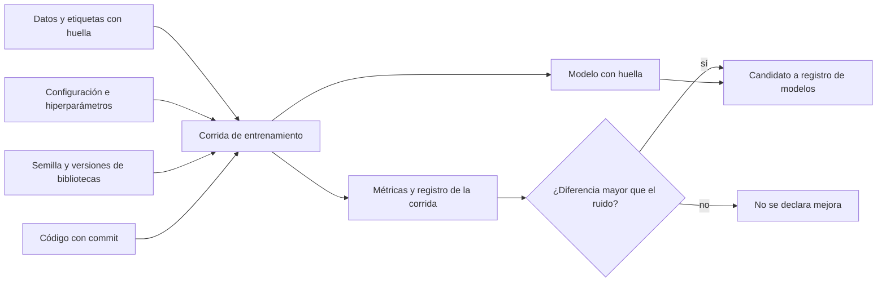
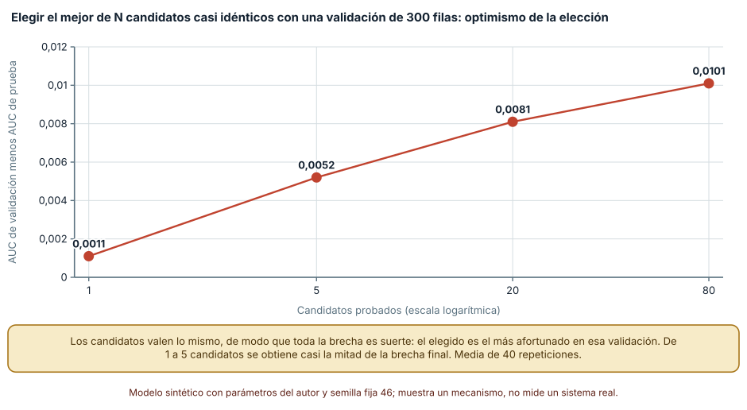
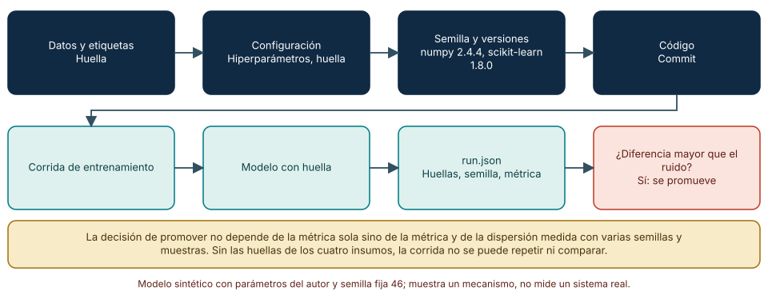

# SE-555 — Experimentos y entrenamiento reproducible

[← SE-554 — Datos de entrenamiento, etiquetas y feature stores](../../classes/part-46-machine-learning-en-produccion-y-mlops/se-554-datos-de-entrenamiento-etiquetas-y-feature-stores/README.md) · [↑ Parte 46](../../classes/part-46-machine-learning-en-produccion-y-mlops/README.md) · [📚 Índice completo](../../classes/README.md) · [🌐 Portal](../../site/classes/SE-555.html) · [SE-556 — Evaluación, sesgos y validación de modelos →](../../classes/part-46-machine-learning-en-produccion-y-mlops/se-556-evaluacion-sesgos-y-validacion-de-modelos/README.md)

## Punto profesional y fundamento pedagógico

**Punto profesional.** La clase existe para que puedas contestar con evidencia dos preguntas que un equipo de aprendizaje automático suele contestar con memoria: «¿cómo se produjo exactamente este modelo?» y «¿esta mejora es real o es azar?». Un modelo es el resultado de datos, código, configuración, semillas y versiones de bibliotecas; si alguno no está registrado, el modelo no se puede reproducir, y si el azar del entrenamiento no se mide, cualquier diferencia pequeña entre dos corridas se presenta como un hallazgo. La clase mide con 40 y 60 repeticiones cuánto varía una métrica solo por la semilla y por la muestra de entrenamiento, muestra cuántas veces gana «el mejor» modelo en una comparación de una sola ejecución cuando los dos son equivalentes y cuantifica el optimismo de elegir el mejor de muchos candidatos con una validación pequeña.

**Por qué aparece aquí.** Sigue a `SE-554`, que fijó los datos y las etiquetas; ahora hay que entrenar sobre ellos de forma que otra persona obtenga el mismo modelo. Reutiliza dos ideas de partes anteriores: la compilación reproducible de `SE-397`, la reproducibilidad del software científico de `SE-277` y las pruebas deterministas de `SE-368`. Prepara `SE-556`, que evalúa modelos y necesita saber cuánto de una diferencia es ruido.

**Error conceptual que debe corregir.** Creer que reproducibilidad es fijar una semilla. La semilla elimina una fuente de variación, la del generador aleatorio, pero no la de los datos, el código, las versiones, el orden de las filas ni el entorno; y fijarla no dice nada sobre cuánto cambiaría el resultado con otra semilla, que es la pregunta que decide si una mejora existe. La segunda corrección: una corrida mejor que otra no es un resultado hasta que se conoce la dispersión de cada una.

**Secuencia de aprendizaje.** Antes de ejecutar, predices cuánto varía el AUC entre 40 semillas del mismo modelo con 500 filas, y cuántas veces de 60 ganaría la configuración «mejor» si fuera exactamente tan buena como la otra. Después ejecutas, mides y comparas con tu predicción.

**Evidencia de aprendizaje.** `registro-de-experimento.md` y `run.json` con las huellas de datos, etiquetas y configuración, las versiones, la semilla y la métrica; la dispersión por semilla y por muestra de un modelo tuyo; y la regla de decisión con la que declaras que una configuración supera a otra.

**Límite de la conclusión.** Los modelos son bosques aleatorios y regresión logística sobre datos sintéticos de seis características, con 500 filas para las medidas de dispersión; la dispersión de un modelo grande, de una red profunda o de datos reales será otra. La cifra de optimismo depende de un tamaño de validación de 300 filas y de candidatos construidos por el autor. No se evaluó ninguna herramienta de seguimiento de experimentos ni se invocó ningún modelo de lenguaje.

### Trazabilidad fuente → afirmación

| Fuente primaria u oficial | Afirmación que respalda | Lo que no prueba |
|---|---|---|
| [Pineau et al., «Improving Reproducibility in Machine Learning Research»](https://arxiv.org/abs/2003.12206) | Propone una lista de comprobación de reproducibilidad (datos, código, configuración, resultados) para publicaciones de aprendizaje automático. | No mide cuántos trabajos la cumplen en la práctica industrial. |
| [Henderson et al., «Deep Reinforcement Learning that Matters»](https://arxiv.org/abs/1709.06560) | Muestra que la variación entre semillas y entre implementaciones puede ser comparable a las diferencias que se reportan como mejoras. | Se refiere al aprendizaje por refuerzo profundo, no a los modelos de esta clase. |
| [scikit-learn, «Controlling randomness»](https://scikit-learn.org/stable/common_pitfalls.html) | Documenta que el parámetro `random_state` controla el azar de los estimadores y de las particiones, y recomienda pasar un entero para obtener resultados repetibles. | No garantiza igualdad bit a bit entre versiones ni plataformas. |
| [NumPy, «Random Generator»](https://numpy.org/doc/stable/reference/random/generator.html) | Describe el generador `Generator` y su semilla; la secuencia puede cambiar entre versiones mayores. | No cubre otros generadores. |
| [Sculley et al., «Hidden Technical Debt in Machine Learning Systems»](https://papers.nips.cc/paper_files/paper/2015/hash/86df7dcfd896fcaf2674f757a2463eba-Abstract.html) | Señala la dificultad de reproducir y de mantener sistemas con dependencias de datos y de configuración. | No mide la reproducibilidad de ningún sistema. |
| [Kapoor y Narayanan, «Leakage and the reproducibility crisis in ML-based science»](https://arxiv.org/abs/2207.07048) | Relaciona errores de procedimiento, como la fuga, con resultados que no se reproducen. | No cuantifica la fracción de estudios afectados fuera de su muestra. |

## Antes de empezar

Recupera lo aprendido en `SE-554`: los datos se versionan y se unen en el tiempo correcto. La pregunta activa es: **si mañana te piden el modelo que decidió los recordatorios de hace dos meses, ¿qué necesitas guardar hoy para reconstruirlo y cuánto cambia la métrica si lo reentrenas con otra semilla?**

## Prerrequisitos

- Haber completado `SE-553` y `SE-554`.
- Conocer los entornos virtuales y los lockfiles (`SE-103`, `SE-111`), la compilación reproducible (`SE-397`) y los datos deterministas de `SE-368`.
- Saber calcular la media y la desviación estándar de una muestra.
- Python 3.11 o posterior, numpy 2.4.4 y scikit-learn 1.8.0; el laboratorio no necesita GPU.

## Problema auténtico

En *Avisos-ML*, dos personas del equipo proponen configuraciones distintas del bosque que estima la probabilidad de entrega tardía. Una usa árboles de profundidad 4 y otra de profundidad 5. Cada una entrena una vez, con su semilla, y compara: la de profundidad 5 obtiene 0,003 más de AUC. El equipo adopta la configuración y la reemplaza en el servicio. Tres semanas después, otra persona reentrena con los mismos datos y obtiene 0,004 menos.

No hay un error de código. Hay dos problemas de método. El primero: nadie registró qué datos, qué semilla y qué versión de las bibliotecas produjeron cada resultado, de modo que la segunda corrida no se podía comparar con la primera. El segundo: nadie sabía cuánto varía el AUC por sí mismo, y una diferencia de 0,003 se presentó como una mejora cuando la variación entre corridas del mismo modelo era mayor. Una tercera persona ha probado, mientras tanto, 80 combinaciones de hiperparámetros contra la misma validación pequeña y se queda con la mejor, sin medir cuánto de su ventaja es suerte.

## Objetivos observables

Al terminar podrás:

1. enumerar qué hay que registrar para reproducir un modelo (datos, etiquetas, configuración, semilla, versiones y código) y generar una huella por cada elemento;
2. medir la dispersión de una métrica por semilla del modelo y por muestra de entrenamiento, y dar un intervalo de lo que es ruido;
3. decidir con una regla explícita si una configuración supera a otra, en lugar de comparar una sola ejecución;
4. estimar el optimismo de elegir el mejor entre N candidatos con una validación pequeña y conocer cómo se evita;
5. escribir un registro de experimento que otra persona pueda ejecutar y comparar bit a bit o dentro de una tolerancia declarada.

## Mapa conceptual



El mapa muestra que cinco insumos distintos determinan la corrida y que la decisión de promover un modelo pasa por una comparación con el ruido y no por la diferencia de dos números. La caja del ruido es la que casi siempre falta.

## Temas y por qué importan

| Tema | Por qué cambia una decisión profesional | Evidencia mínima |
|---|---|---|
| Huellas de datos y configuración | Permiten saber si dos corridas usan lo mismo. | `run.json` con las huellas |
| Semilla y versiones | Fijan el azar y el entorno. | Semilla y versión de cada biblioteca |
| Dispersión por semilla | Da la escala de lo que es ruido. | Desviación y rango con N corridas |
| Dispersión por muestra | A menudo mayor que la de la semilla. | Desviación con submuestras |
| Comparación pareada | Reduce el ruido de la comparación. | Diferencia por pares y su desviación |
| Optimismo de la selección | Elegir el mejor entre muchos infla su validación. | Brecha validación menos prueba por N |
| Registro de experimentos | Convierte corridas en evidencia consultable. | Tabla de corridas con huellas |

## Conceptos y decisiones

### 1. Qué determina una corrida

Una corrida de entrenamiento es una función de cinco cosas: los datos (filas y orden), las etiquetas, la configuración (hiperparámetros, preprocesamiento), el generador aleatorio con su semilla y el entorno (versiones de numpy y scikit-learn, sistema operativo, hilos). Si una cambia, el modelo puede cambiar. Reproducir significa poder fijar las cinco y comprobarlo. Por eso el registro de la corrida guarda una huella (un resumen criptográfico) de los datos y de las etiquetas, una huella de la configuración serializada, la semilla, las versiones y el valor de la métrica. En el laboratorio, ese registro ocupa 209 bytes; el costo de guardarlo es despreciable frente al de no poder reconstruir un modelo.

### 2. La semilla elimina una fuente de azar, no todas

Con la semilla fija, dos ejecuciones del mismo bosque sobre los mismos datos dieron el mismo AUC, 0,847268, en las seis cifras. Eso es lo que debe pasar y es lo primero que se prueba en una tubería: entrenar dos veces y comparar. La reproducibilidad exacta tiene límites que hay que declarar: cambia con la versión de la biblioteca, con el número de hilos en algunos algoritmos, con el orden de las filas y con la plataforma. Por eso el registro incluye las versiones, y por eso la comparación entre corridas de entornos distintos se hace con una tolerancia y no con igualdad exacta.

### 3. Cuánto varía una métrica por sí sola

Con 500 filas de entrenamiento, 40 semillas distintas del mismo bosque sobre los mismos datos dieron un AUC medio de 0,8058 con desviación 0,0056 y un rango de 0,0234 entre la peor y la mejor. Con la misma semilla y 40 muestras de entrenamiento distintas de 500 filas, la media fue 0,8119 con desviación 0,0072 y un rango de 0,0392. Dos lecciones. La primera: la variación por el azar del algoritmo es del orden de medio punto de AUC y el rango entre la peor y la mejor semilla de unos 2,3 puntos, de modo que una mejora de 0,003 está dentro del ruido. La segunda: la muestra de entrenamiento aporta más variación que la semilla del modelo; una comparación que cambia los datos y la configuración a la vez mezcla las dos. Con más datos las dispersiones bajan; con 500 filas son grandes y por eso son un buen laboratorio.

### 4. La comparación de una sola ejecución

Dos configuraciones del bosque, de profundidad 4 y de profundidad 5, se compararon 60 veces, cada vez con una muestra de entrenamiento distinta y una semilla distinta, y en cada comparación se entrenaron ambas con los mismos datos. La diferencia media de AUC fue −0,0026 (la profundidad 5, en promedio, un poco peor), con una desviación de 0,0074 de la diferencia, y la configuración de profundidad 5 ganó 21 de las 60 comparaciones de una sola ejecución. La conclusión práctica es incómoda: en 21 de cada 60 comparaciones habría salido «mejor» la configuración que en promedio es peor, y la diferencia media está a un tercio de su propia desviación. Una regla de decisión honesta exige que la diferencia media pareada supere, por ejemplo, dos errores estándar de la media de las diferencias, o que el intervalo de las diferencias no incluya el cero; y que se repita con varias semillas y varias muestras antes de promover un modelo.

### 5. El optimismo de elegir el mejor entre muchos

Cuando se prueban N candidatos y se queda con el de mejor validación, la puntuación de ese candidato en la validación es optimista: se eligió por ser el más afortunado en ese conjunto. Para medirlo se construyeron N modelos casi idénticos (regresiones logísticas entrenadas con remuestreos de 800 filas y una regularización distinta), se evaluaron en una validación de 300 filas, y se midió la brecha entre el AUC de validación del elegido y su AUC en un conjunto de prueba de 20 000 filas, promediada en 40 repeticiones. Con N = 1, 5, 20 y 80 candidatos la brecha media fue 0,0011, 0,0052, 0,0081 y 0,0101. El optimismo crece con el número de candidatos incluso cuando todos valen lo mismo. Se evita con una validación más grande, con una partición de prueba que nunca se usa para elegir, con validación cruzada anidada para la selección y con el hábito de reportar cuántas configuraciones se probaron.

### 6. Registrar el experimento

Una herramienta de seguimiento de experimentos añade una tabla consultable de corridas con parámetros, métricas y artefactos, y un registro de modelos que liga cada modelo con la corrida que lo produjo. No es obligatoria para empezar: un archivo `run.json` por corrida, versionado con el código, hace lo esencial. Lo que no es negociable es que cada modelo que llega a producción tenga su corrida enlazada, y que cada corrida registre la huella de los datos. En el laboratorio, regenerar los datos con la misma semilla produjo la misma huella y con otra semilla una distinta, que es la prueba mínima de que la huella detecta el cambio.

### 7. Entornos y dependencias

La reproducibilidad depende de fijar versiones: numpy 2.4.4 y scikit-learn 1.8.0 en este laboratorio. Cambiar de versión puede cambiar el orden de los números aleatorios o la implementación de un algoritmo y alterar la última cifra de una métrica. Por eso `scripts/experiments_part46_lab.py` avisa en la salida cuando las versiones difieren de las fijadas, y por eso el registro las guarda. El mismo principio que `SE-397` aplica al código se aplica al entorno de entrenamiento.

### 8. Reproducibilidad exacta y reproducibilidad estadística

Hay dos niveles. La exacta (mismo resultado bit a bit) vale para auditorías y para depurar. La estadística (resultados dentro del ruido conocido) vale para decidir y para comparar entornos. Un equipo debería poder demostrar la primera para sus modelos en producción y apoyarse en la segunda para elegir entre alternativas. Exigir la exacta en un entrenamiento con GPU y operaciones no deterministas puede no ser razonable; en ese caso se declara la tolerancia.

### 9. Cuándo no

Con un modelo que se entrena una vez en un cuaderno y nunca se comparan alternativas, un registro completo es sobreingeniería. Si el costo de un error es bajo y el modelo se reemplaza cada semana, basta con registrar datos, semilla y versiones. La disciplina escala con el costo de equivocarse y con el número de personas que comparan resultados.

## La dispersión del azar

La primera medida compara la variación por semilla, por muestra y entre dos configuraciones.


**Cómo leer la figura.** Cada barra es una desviación estándar de una medida repetida; la línea de referencia es la diferencia media entre las dos configuraciones. Mira primero que la desviación de la diferencia (0,0074) es casi tres veces mayor que la diferencia media (0,0026). **Dónde deja de valer:** son 500 filas y bosques pequeños; con 50 000 filas las desviaciones serían mucho menores y la misma diferencia podría ser real. La figura no dice que no haya diferencia sino que, con esta cantidad de datos, una sola corrida no puede verla.

## El optimismo de elegir el mejor

La segunda medida cuenta cuánto se infla la validación del elegido.



**Cómo leer la figura.** El eje horizontal es el número de candidatos casi idénticos (escala logarítmica) y el vertical la brecha media. Mira primero que el aumento de 1 a 5 candidatos aporta casi la mitad de la brecha final. **Dónde deja de valer:** la brecha depende del tamaño de la validación (300 filas) y de cuánto se parezcan los candidatos; con una validación de 30 000 filas sería mucho menor. Con candidatos realmente distintos la selección también aporta una mejora real que la brecha no descuenta.

## El registro de la corrida

La tercera figura sitúa qué se guarda y qué se compara.



**Cómo leer la figura.** Las cajas navy son los insumos que se guardan con su huella, las verdes lo que produce la corrida y la coral la decisión que usa el ruido medido. Mira primero que la decisión no depende de la métrica sola, sino de la métrica y de la dispersión. **Dónde deja de valer:** es el registro mínimo de una corrida de un solo modelo; una tubería con varias etapas necesita un registro por etapa y un enlace entre ellos.

## Definiciones de trabajo

- **Corrida:** una ejecución de entrenamiento con datos, configuración, semilla y entorno determinados.
- **Huella:** resumen criptográfico corto de un conjunto de datos o de una configuración.
- **Semilla:** valor inicial de un generador pseudoaleatorio.
- **Dispersión:** desviación estándar o rango de una métrica en corridas repetidas.
- **Comparación pareada:** comparación de dos configuraciones sobre los mismos datos y las mismas particiones.
- **Optimismo de la selección:** diferencia entre la métrica del mejor candidato en la validación y su métrica en datos no usados.
- **Registro de modelos:** sistema que liga cada modelo con su corrida, su versión y su estado.

## Ejemplo mínimo

Una huella de datos y un registro de corrida en ocho líneas:

```python
import hashlib, json
import numpy as np

X = np.random.default_rng(46).random((1000, 6))
huella = hashlib.sha256(np.ascontiguousarray(X).tobytes()).hexdigest()[:12]
registro = {"data_sha": huella, "semilla": 46, "numpy": np.__version__, "auc": 0.847268}
print(json.dumps(registro, sort_keys=True))
```

Regenerar `X` con la misma semilla produce la misma huella, y cambiar la semilla o una sola fila la cambia. El registro cabe en unos 200 bytes y permite saber si dos corridas partieron de lo mismo.

## Ejemplo profesional

*Escenario ilustrativo: las cifras y los resultados que aparecen en este ejemplo son supuestos de la narración, no mediciones.*

El equipo de *Avisos-ML* adopta una regla de promoción. Un candidato solo pasa al registro de modelos si, sobre cinco muestras de entrenamiento y tres semillas por muestra, su AUC pareado frente al modelo actual mejora en promedio y el intervalo de las diferencias no incluye el cero; si se probaron más de diez configuraciones, la evaluación final se hace sobre una partición reservada que no se usó para elegir. La regla se escribe en un archivo del repositorio y la ejecuta una tarea de la integración continua que falla si falta el `run.json` con las huellas. Dos meses después, una persona nueva propone un cambio con un AUC un punto mayor en una sola corrida: la tarea lo rechaza porque la diferencia pareada no supera el ruido. La persona repite con más muestras, el intervalo ya no incluye el cero y el cambio se promueve. La regla no garantiza que el modelo sea mejor en producción; garantiza que la decisión no se tomó con un número que podía ser suerte.

## Práctica guiada

1. Genera el registro de una corrida de un modelo tuyo con huellas de datos, etiquetas y configuración, semilla y versiones.
2. Ejecuta `python scripts/experiments_part46_a.py 555` y reproduce las medidas; cambia las 500 filas por 5 000 y mira cómo cambia la dispersión.
3. Entrena dos configuraciones equivalentes con 30 semillas y calcula cuántas veces gana cada una.
4. Escribe la regla de promoción con la diferencia pareada y el criterio de ruido, y apícala a una comparación tuya.
5. Cuenta cuántas configuraciones se probaron antes de elegir la actual y estima el optimismo con tu tamaño de validación.

## Ejercicios

1. **Básico.** Explica por qué dos corridas con la misma semilla pueden dar resultados distintos y qué hay que registrar para detectarlo.
2. **Intermedio.** Con los datos del laboratorio, calcula el número de muestras necesarias para que una diferencia media de 0,0026 con desviación 0,0074 sea distinguible del cero con un intervalo del 95 %.
3. **Avanzado.** Diseña la validación cruzada anidada para elegir entre 20 configuraciones sin sesgo de selección y calcula su costo en entrenamientos frente a una sola partición.

## Reto verificable

Entrega `registro-de-experimento.md` con el `run.json` de una corrida tuya, la dispersión por semilla y por muestra de ese modelo con al menos 20 repeticiones, y la regla con la que declaras que una configuración es mejor. Es válido si otra persona ejecuta tu registro y obtiene la misma huella de datos y una métrica dentro de la dispersión declarada.

## Caso conductor

*Avisos-ML* registra cada corrida con sus huellas y promueve un modelo solo si supera el ruido. `SE-556` toma ese modelo promovido y pregunta si la métrica con que se compara mide lo que importa: umbral, calibración, subgrupos y qué pasa con la prevalencia baja.

## Preguntas frecuentes

### ¿Fijar la semilla no basta para reproducir?

Fijar la semilla hace repetible el generador aleatorio, no los datos, el código, la configuración ni las versiones. Dos máquinas con la misma semilla y versiones distintas pueden dar resultados distintos en la última cifra.

### ¿Cuántas repeticiones necesito?

Depende de la dispersión y de la diferencia que quieras detectar. Con 500 filas y desviación de 0,007, detectar una diferencia de 0,003 exige del orden de decenas de pares; con más datos, menos. Empieza con 20 a 30 corridas y mira el ancho del intervalo.

### ¿Es lo mismo reproducibilidad que determinismo?

No. Determinismo es obtener exactamente lo mismo; reproducibilidad estadística es obtener lo mismo dentro de un ruido conocido. En entrenamientos con GPU el determinismo exacto puede ser caro o imposible y se acepta una tolerancia declarada.

### ¿Necesito MLflow u otra herramienta?

No para empezar. Un `run.json` por corrida versionado con el código cumple lo esencial. Una herramienta se justifica cuando hay muchas corridas, varias personas y necesidad de consultar y comparar.

## Fallo controlado y diagnóstico

**Fallo.** El modelo reentrenado cada mes da un AUC de 0,862 un mes y de 0,853 el siguiente sin que cambie nada visible. El equipo no sabe si el modelo empeoró.

**Diagnóstico paso a paso.** (1) Se compara la huella de los datos de entrenamiento de ambos meses: son distintas por diseño (datos nuevos). (2) Se reentrena el modelo del mes anterior con los datos del mes anterior y la misma semilla: reproduce 0,862. (3) Se reentrena el modelo nuevo con 30 semillas: media 0,856, desviación 0,004. (4) El 0,853 queda a menos de una desviación de la media.

**Corrección.** Se acuerda registrar la dispersión por semilla junto a cada métrica, se define que una caída solo se investiga si supera dos desviaciones y se añade a la tubería la comprobación de reproducibilidad exacta de la corrida anterior. La lección es que, sin la dispersión, el equipo habría perseguido una diferencia que era ruido.

## Errores comunes y cómo corregirlos

- **Comparar dos corridas únicas.** Corrige con corridas pareadas, varias semillas y un criterio de ruido.
- **No guardar la huella de los datos.** Corrige guardando la huella con cada corrida.
- **Elegir el mejor de muchos con una validación pequeña.** Corrige con una partición de prueba reservada o con validación anidada.
- **Dejar la versión de las bibliotecas sin fijar.** Corrige con versiones exactas y una advertencia cuando difieren.
- **Reportar la mejor semilla.** Corrige reportando la media y la desviación.
- **Confiar en la memoria del equipo para saber cómo se entrenó un modelo.** Corrige con un registro enlazado al modelo.

## Entorno y archivos clave

- `scripts/experiments_part46_a.py`: función `e555` con la repetición exacta, la dispersión, la comparación pareada, el optimismo y el registro de corrida; se ejecuta con `python scripts/experiments_part46_a.py 555`.
- `scripts/experiments_part46_lab.py`: generador sintético con semilla 46, funciones de ajuste y de huella.
- `scripts/figures_part46_a.py`: las tres figuras de la clase.
- numpy 2.4.4 y scikit-learn 1.8.0 (ver `scripts/requirements-part46.txt`). Tarda del orden de uno a dos minutos en un equipo de escritorio; no usa GPU.

## Seguridad, ética y accesibilidad

El registro de una corrida puede contener datos sensibles si guarda muestras en vez de huellas; guarda huellas y no filas. La reproducibilidad es también una garantía ética: permite revisar cómo se llegó a una decisión sobre personas. Reportar solo la mejor semilla es una forma de engañar a un revisor aunque no haya intención. Las figuras tienen texto alternativo completo y no dependen solo del color.

## Puente hacia el trabajo con agentes

Un agente que ejecuta experimentos tiende a reportar la mejor de las corridas que probó, porque optimiza la métrica que se le pide. Exige que registre cuántas configuraciones y semillas probó, que reporte media y desviación, que guarde el `run.json` de cada corrida y que no elija el modelo con la partición que usó para evaluar el resultado final. Un agente puede ejecutar la regla de promoción de este curso, pero no debe poder editarla ni modificar la partición reservada. Los resultados que un agente presenta sin registro son afirmaciones, no evidencia.

## Transferencia

Toma un experimento reciente de tu equipo y estima su dispersión repitiéndolo con 20 semillas. Compara esa dispersión con la mejora que se anunció. Escribe en una línea qué número de corridas y qué criterio habrías exigido antes de adoptarla.

## Evaluación y evidencia

| Criterio | Evidencia aceptable | Rechazo |
|---|---|---|
| Registro | `run.json` con huellas, semilla y versiones | «Está en mi cuaderno» |
| Dispersión | Media y desviación con N corridas | Una sola métrica |
| Comparación | Diferencia pareada con criterio de ruido | «La nueva es mejor» |
| Selección | Número de candidatos y partición reservada | Mejor validación del lote |
| Reproducción | Huella igual y métrica dentro de la tolerancia | «Debería dar lo mismo» |

## Fuentes

- Pineau, J. et al. [«Improving Reproducibility in Machine Learning Research»](https://arxiv.org/abs/2003.12206).
- Henderson, P. et al. [«Deep Reinforcement Learning that Matters»](https://arxiv.org/abs/1709.06560).
- scikit-learn. [«Common pitfalls and recommended practices»](https://scikit-learn.org/stable/common_pitfalls.html).
- NumPy. [«Random Generator»](https://numpy.org/doc/stable/reference/random/generator.html).
- Sculley, D. et al. [«Hidden Technical Debt in Machine Learning Systems»](https://papers.nips.cc/paper_files/paper/2015/hash/86df7dcfd896fcaf2674f757a2463eba-Abstract.html).
- Kapoor, S. y Narayanan, A. [«Leakage and the reproducibility crisis in ML-based science»](https://arxiv.org/abs/2207.07048).

## Límites y siguiente paso

Las dispersiones, el optimismo y el porcentaje de victorias son resultados de bosques y regresiones pequeñas sobre datos sintéticos con 500 y 800 filas; muestran la forma del problema, no el tamaño en tu modelo. No se evaluó ninguna herramienta de seguimiento de experimentos. El siguiente paso, `SE-556`, evalúa el modelo elegido: qué métrica, qué umbral, qué calibración y qué ocurre con los subgrupos.

## Glosario

| Término | Definición breve |
|---|---|
| Corrida | Ejecución de entrenamiento con insumos determinados |
| Huella | Resumen criptográfico corto de datos o configuración |
| Dispersión | Variación de una métrica en corridas repetidas |
| Comparación pareada | Dos configuraciones sobre los mismos datos |
| Optimismo de la selección | Brecha entre la validación del elegido y datos no usados |
| Registro de modelos | Enlace entre cada modelo y su corrida |
