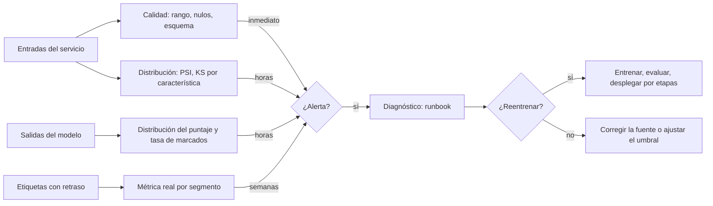

# SE-560 — Monitoreo, deriva y reentrenamiento

[← SE-559 — Despliegue seguro de modelos: shadow, canary y rollback](../../classes/part-46-machine-learning-en-produccion-y-mlops/se-559-despliegue-seguro-de-modelos-shadow-canary-y-rollback/README.md) · [↑ Parte 46](../../classes/part-46-machine-learning-en-produccion-y-mlops/README.md) · [📚 Índice completo](../../classes/README.md) · [🌐 Portal](../../site/classes/SE-560.html) · [SE-561 — Seguridad y robustez de sistemas de ML →](../../classes/part-46-machine-learning-en-produccion-y-mlops/se-561-seguridad-y-robustez-de-sistemas-de-ml/README.md)

## Punto profesional y fundamento pedagógico

**Punto profesional.** La clase existe para que vigiles un modelo en producción con las señales que de verdad lo muestran degradarse y para que decidas cuándo reentrenarlo con una política y no con una corazonada. Un modelo no falla con un error: se degrada en silencio, porque el mundo cambia, porque una fuente aguas arriba cambia o porque sus propias decisiones cambian los datos. El monitoreo de aprendizaje automático tiene tres capas con costos y retrasos distintos: la calidad de las entradas (inmediata y barata), la distribución de las entradas y de las salidas (rápida, con falsas alarmas) y la métrica con etiquetas (la que importa, y la más tardía). La clase mide la sensibilidad de un índice de estabilidad de la población y de una prueba de Kolmogorov y Smirnov según el tamaño de la ventana, muestra una deriva de concepto que ninguna señal de entrada ve y compara cuatro políticas de reentrenamiento durante 44 semanas con una deriva progresiva.

**Por qué aparece aquí.** Sigue a `SE-559`, donde las mismas señales sin etiqueta sirvieron para detener un candidato; aquí se usan sobre el modelo ya desplegado. Reutiliza las señales y las métricas de `SE-421` y `SE-423`, los SLO y las alertas de `SE-425` y `SE-426` y los runbooks de `SE-427`. Prepara `SE-561`, porque algunas señales de deriva también delatan ataques, y `SE-563`, donde el monitoreo se prueba inyectando fallas.

**Error conceptual que debe corregir.** Creer que vigilar la deriva de las entradas equivale a vigilar la calidad del modelo. En el laboratorio, una deriva de covariables grande dejó el AUC igual y una deriva de concepto lo bajó 0,044 sin mover ninguna entrada (el índice de estabilidad máximo de las entradas fue 0,002). Los dos errores son simétricos: alertar de una deriva que no daña produce fatiga, y no alertar de una que sí daña produce incidentes. La segunda corrección: reentrenar más a menudo no es siempre mejor; una política con 11 reentrenamientos obtuvo prácticamente la misma calidad que otra con 3 o con 4 disparados por una señal.

**Secuencia de aprendizaje.** Antes de ejecutar, predices con qué tamaño de ventana un índice de estabilidad detecta un aumento de una tarea de carga media, qué señal de entrada detecta una deriva de concepto y cuántos reentrenamientos al año hacen falta para mantener la calidad con una deriva progresiva. Después ejecutas y comparas.

**Evidencia de aprendizaje.** `plan-de-monitoreo.md` con las señales de cada capa (calidad de entrada, distribución, métrica con etiquetas), su umbral, su ventana, su dueño y su acción, la política de reentrenamiento con su disparador y su costo, y la prueba de cada alerta inyectando la falla que debe detectar.

**Límite de la conclusión.** Los datos son sintéticos, la deriva es lineal en el tiempo con parámetros del autor y el reentrenamiento es un boosting con ventana de siete semanas; la sensibilidad de las señales depende de la variable (la carga es un entero discreto con pocos valores, lo que afecta al índice de estabilidad por cuantiles). Los umbrales de 0,1 y 0,2 son convenciones y no se validaron contra ningún sistema real. No se evaluó ninguna herramienta de monitoreo ni se invocó ningún modelo de lenguaje.

### Trazabilidad fuente → afirmación

| Fuente primaria u oficial | Afirmación que respalda | Lo que no prueba |
|---|---|---|
| [Rabanser, Günnemann y Lipton, «Failing Loudly»](https://arxiv.org/abs/1810.11953) | Compara métodos para detectar el cambio de distribución (reducción de dimensión y pruebas estadísticas) y concluye que las pruebas univariadas sobre representaciones reducidas funcionan bien en sus datos. | No incluye los modelos ni los datos de esta clase. |
| [Breck et al., «The ML Test Score»](https://research.google/pubs/the-ml-test-score-a-rubric-for-ml-production-readiness-and-technical-debt-reduction/) | Incluye entre las comprobaciones el monitoreo de las entradas, de la antigüedad del modelo y de las métricas de predicción. | No fija umbrales. |
| [Breck et al., «Data Validation for Machine Learning»](https://mlsys.org/Conferences/2019/doc/2019/167.pdf) | Describe la validación de datos de servicio con esquemas y la detección de sesgo y de deriva entre entrenamiento y servicio. | No cubre la deriva de concepto. |
| [Google Cloud, «MLOps: continuous delivery and automation pipelines»](https://cloud.google.com/architecture/mlops-continuous-delivery-and-automation-pipelines-in-machine-learning) | Describe el monitoreo y el reentrenamiento disparado por la degradación del modelo o por el cambio de los datos como parte del ciclo. | Es una arquitectura de referencia de un proveedor. |
| [Sculley et al., «Hidden Technical Debt in Machine Learning Systems»](https://papers.nips.cc/paper_files/paper/2015/hash/86df7dcfd896fcaf2674f757a2463eba-Abstract.html) | Señala que el comportamiento de un sistema con aprendizaje cambia con sus entradas y que hace falta monitorear sus predicciones. | No mide la magnitud del problema. |
| [Google SRE Book, «Monitoring Distributed Systems»](https://sre.google/sre-book/monitoring-distributed-systems/) | Distingue síntomas de causas y recomienda alertar por síntomas que importan al usuario. | No es específico de aprendizaje automático. |

## Antes de empezar

Recupera lo aprendido en `SE-559`: la tasa de marcados por segmento es una señal sin etiqueta. La pregunta activa es: **si la relación entre el historial de un estudiante y su probabilidad de entregar tarde cambiara mañana, ¿qué panel de tu sistema lo mostraría y cuántas semanas tardaría?**

## Prerrequisitos

- Haber completado `SE-554`, `SE-556` y `SE-559`.
- Conocer las alertas accionables de `SE-426` y los SLO de `SE-425`.
- Saber qué es una distribución y un histograma por tramos; no se exige estadística avanzada.
- Python 3.11 o posterior, numpy 2.4.4 y scikit-learn 1.8.0; el laboratorio no necesita GPU.

## Problema auténtico

*Avisos-ML* lleva seis meses en producción. El tablero muestra latencia, errores y la tasa de marcados, todo estable. En el segundo semestre, la cuota de estudiantes que entregan a tiempo tras un recordatorio baja sin explicación. El equipo de datos reentrena el modelo cada mes «por si acaso», y cada reentrenamiento tarda días de revisión. Una persona propone alertar por deriva de todas las características; otra, reentrenar cada semana; otra, no reentrenar hasta que la métrica baje. Nadie ha medido qué señal detectaría cada cambio ni cuánto cuesta cada política.

Hay tres preguntas distintas en el problema. La primera: ¿cómo se entera el equipo de que algo cambió, y con cuánto retraso? La segunda: ¿qué cambió, las entradas o su relación con el resultado? La tercera: ¿reentrenar resuelve el cambio, y con qué frecuencia compensa su costo? Cada una tiene una respuesta medible.

## Objetivos observables

Al terminar podrás:

1. clasificar las señales de monitoreo en calidad de entrada, distribución y métrica con etiquetas, con su retraso y su costo, y asignar a cada una una acción;
2. calcular el índice de estabilidad de la población y el estadístico de Kolmogorov y Smirnov, y medir su tasa de falsas alarmas y su sensibilidad según el tamaño de la ventana;
3. demostrar que una deriva de concepto no se ve en las entradas y qué señal sí la ve;
4. comparar políticas de reentrenamiento (nunca, periódica, disparada) por calidad y número de reentrenamientos con una deriva dada;
5. escribir un plan de monitoreo con umbrales, dueños y la prueba de cada alerta inyectando la falla.

## Mapa conceptual



El mapa ordena las señales por su retraso: la calidad de entrada avisa de inmediato, la distribución en horas y la métrica con etiquetas en semanas. La decisión de reentrenar viene después del diagnóstico, no es la respuesta automática a una alerta.

## Temas y por qué importan

| Tema | Por qué cambia una decisión profesional | Evidencia mínima |
|---|---|---|
| Calidad de entrada | Detecta fallas de unidad, nulos y rango al primer lote. | Comprobación por característica con umbral |
| PSI y KS | Detectan cambios de distribución con falsas alarmas y huecos. | Falsas alarmas y detección por ventana |
| Ventana | Una ventana pequeña es ruidosa y una grande es lenta. | Curva de sensibilidad por tamaño |
| Deriva de concepto | No se ve en las entradas; exige etiquetas o proxies. | Métrica con etiquetas por periodo |
| Retraso de etiquetas | Fija la latencia de la señal que más importa. | Retraso declarado |
| Política de reentrenamiento | Cuesta y no siempre mejora. | Calidad y reentrenamientos por política |
| Alertas accionables | Una alerta sin acción es ruido. | Acción y dueño por alerta |

## Conceptos y decisiones

### 1. Tres capas de señales con retrasos distintos

La calidad de entrada comprueba el rango, los nulos, el esquema y las unidades de cada lote: es inmediata, barata y detecta las fallas más frecuentes (un campo en cero, una unidad cambiada). La distribución compara las entradas y las salidas de una ventana con una referencia: tarda horas o días en acumular datos y produce falsas alarmas. La métrica con etiquetas mide el desempeño real, y tarda el retraso de la etiqueta (`SE-554`), que en *Avisos-ML* es de siete días. Un plan de monitoreo debe tener las tres, porque cada una ve lo que las otras no, y debe asignar a cada una una acción: la calidad de entrada bloquea o degrada, la distribución abre un diagnóstico, la métrica con etiquetas puede disparar un reentrenamiento.

### 2. El índice de estabilidad de la población

El PSI compara dos distribuciones por tramos: suma, sobre los tramos, la diferencia entre las proporciones multiplicada por el logaritmo de su cociente. Se calcula con los tramos de la referencia (por cuantiles) y se suele leer con las convenciones de que por debajo de 0,1 el cambio es pequeño y por encima de 0,2 es grande. Son convenciones, no leyes: dependen del número de tramos, del tamaño de la ventana y de la naturaleza de la variable. Con la carga de tareas, que toma pocos valores enteros, el cuantil de la referencia deja tramos muy desiguales y el PSI es un instrumento torpe, un recordatorio de que cada característica necesita su propia calibración.

### 3. Falsas alarmas y sensibilidad según la ventana

Se midió el PSI de la carga con 300 ventanas sin deriva y 300 con una deriva de media de la carga de +0,5, +1,0 y +2,0 tareas, para ventanas de 100, 500, 2 000 y 10 000 observaciones. Con ventanas de 100, el PSI superó 0,1 en el 10,7 % de las ventanas sin deriva (una falsa alarma cada diez ventanas) y 0,2 en el 0,3 %; con 500 o más no hubo falsas alarmas a ninguno de los dos umbrales. La detección con umbral 0,2 de un aumento de +0,5 fue del 17 % con 100 observaciones y 0 % con 500, 2 000 y 10 000: ese cambio no alcanzaba el umbral con ninguna ventana, de modo que no es cuestión de más datos sino de que el PSI con cuantiles de un entero no ve cambios pequeños. Con +1,0 la detección fue 86 %, 93 %, 100 % y 100 %, y con +2,0 fue del 100 % en todas. La lección es doble: una ventana pequeña da falsas alarmas y una grande da sensibilidad solo hasta cierto punto; y un umbral único de 0,2 no ve un cambio de media de +0,5 tareas, que en este modelo no importa y en otro podría importar.

### 4. PSI por característica y la prueba KS

Con una deriva de +1,0 en la carga y una ventana de 5 000, el PSI por característica fue 0,259 para la carga y entre 0,000 y 0,004 para las otras cinco: el índice localiza la característica que cambió. La prueba de Kolmogorov y Smirnov, que mide la mayor distancia entre las funciones de distribución acumuladas, dio 0,217 para la carga. Ambas señales localizan el cambio y ninguna dice si importa: eso lo dice la métrica con etiquetas y el peso de la característica en el modelo. En una deriva de covariables con +2,5 de carga (`SE-553`), el AUC no se movió; por eso una alerta de PSI debe abrir un diagnóstico y no un reentrenamiento automático.

### 5. La deriva de concepto no se ve en las entradas

Se redujo el peso del historial de tardanzas sobre la etiqueta a 0,3 de su valor (`concept=0,3`), manteniendo las entradas con la misma distribución. El PSI máximo de las entradas fue 0,002 y el PSI de la salida 0,000; el AUC pasó de 0,846 a 0,802, una caída de 0,044. Ninguna señal de entrada ni de salida lo vio. Solo la métrica con etiquetas lo vería, con el retraso de la etiqueta: en la ejecución de `SE-563`, una deriva de este tipo se detectó con etiquetas a las 57 horas, y ninguna otra señal la detectó. Por eso el monitoreo de un modelo sin etiquetas no es un monitoreo del modelo: o se consiguen etiquetas (aunque sea de una muestra) o se declara que la deriva de concepto es un riesgo no vigilado.

### 6. Etiquetas parciales y señales sustitutas

Cuando las etiquetas tardan, se usan señales sustitutas con cuidado: la tasa de marcados, la distribución del puntaje, la confianza media, el desacuerdo con un modelo de referencia, las quejas de usuarios. Ninguna sustituye a la etiqueta, pero algunas llegan antes. Otra opción es etiquetar una muestra pequeña y aleatoria con prioridad (por ejemplo, 200 casos por semana), cuyo intervalo se calcula como en `SE-556`; con 200 casos el ancho del intervalo del AUC es de unos 0,13, de modo que solo ve caídas grandes. El costo del etiquetado entra en el presupuesto de monitoreo.

### 7. Cuatro políticas de reentrenamiento

Se simularon 44 semanas de monitoreo (de la 9 a la 52) con una deriva lineal que combina más carga, menor tasa de lectura y un peso del historial que cae de 1,0 a 0,15; cada semana llegan 3 000 observaciones. El modelo inicial se entrenó con las ocho primeras semanas, con un AUC de referencia de 0,843. Cuatro políticas, con reentrenamiento sobre las siete últimas semanas disponibles:

- **Nunca:** 0 reentrenamientos; AUC medio de 0,818, mínimo de 0,778 y de 0,795 en las últimas doce semanas.
- **Trimestral:** 3 reentrenamientos; AUC medio de 0,827, mínimo de 0,800 y de 0,820 en las últimas doce semanas.
- **Mensual:** 11 reentrenamientos; 0,828, 0,800 y 0,821.
- **Disparada por la métrica:** reentrenar cuando el AUC conocido (con dos semanas de retraso) cae más de 0,03 por debajo de la referencia; 4 reentrenamientos; 0,828, 0,802 y 0,822.

Dos lecciones. Primera: reentrenar importa (nunca perdió 0,009 de AUC medio y 0,025 en las últimas doce semanas respecto de trimestral). Segunda: reentrenar mensual, con casi cuatro veces el costo de trimestral, no mejoró nada de forma medible, y la política disparada por la métrica logró lo mismo con cuatro. La frecuencia correcta depende de la velocidad de la deriva y del retraso de las etiquetas, y se estima con una simulación como esta con los datos propios.

### 8. Reentrenar no es siempre la respuesta

Una alerta de deriva tiene varias causas posibles y cada una pide una acción. Si es un fallo aguas arriba (una columna en cero), reentrenar con esos datos empeora el modelo: hay que arreglar la fuente. Si es un cambio legítimo del mundo, reentrenar con una ventana reciente ayuda. Si es un ataque (`SE-561`), reentrenar con los datos atacados lo incorpora. Si es una deriva de concepto, hace falta además revisar si las características siguen siendo las correctas. El runbook (`SE-427`) debe empezar por el diagnóstico antes que por el reentrenamiento, y el reentrenamiento debe pasar por la misma puerta de evaluación y despliegue por etapas que cualquier modelo (`SE-559`).

### 9. Alertas accionables y fatiga

Cada alerta debe tener un dueño, una acción y un umbral con fundamento. Alertar de la distribución de las seis características con PSI 0,1 con una ventana de 100 es construir falsas alarmas (una de cada diez). La práctica de `SE-426` aplica: alertar por síntomas que importan (la métrica con etiquetas, la tasa de marcados por segmento), abrir tickets de baja urgencia por las señales de diagnóstico y reservar la página para la calidad de entrada que bloquea decisiones.

### 10. Cuándo no

Si el modelo se reentrena y se reemplaza cada semana por diseño, un monitoreo de deriva sofisticado agrega poco: basta con la calidad de entrada y la métrica con etiquetas. Si el sistema decide sobre pocas personas y cada decisión se revisa, el monitoreo es la revisión. Y si no hay forma de obtener etiquetas ni siquiera de una muestra, hay que decirlo y limitar el uso del modelo a decisiones que toleren una degradación no vigilada.

## Detección de una deriva según la ventana

La primera medida cuenta cuántas ventanas con deriva superan el umbral del PSI.


**Cómo leer la figura.** Cada fila es un tamaño de ventana y cada columna un aumento de la media de la carga; el color más oscuro es mayor porcentaje de ventanas que alertan. Mira primero la columna de +0,5: casi vacía con cualquier ventana, y la de +1,0, que se completa con 2 000 observaciones. **Dónde deja de valer:** la carga es un entero con pocos valores y el PSI usa los cuantiles de la referencia; con una variable continua, o con tramos fijos, la sensibilidad sería otra. Con ventanas de 100 observaciones hubo además un 10,7 % de falsas alarmas con umbral 0,1, que el mapa no muestra.

## Lo que ven las entradas y lo que ve la métrica

La segunda medida contrasta dos derivas con el mismo modelo.


**Cómo leer la figura.** Cada fila es una deriva; el punto hueco es el AUC antes y el lleno el AUC después, y el segmento es coral si empeora. Mira primero que la deriva que mueve las entradas no daña y la que daña no mueve ninguna. **Dónde deja de valer:** las dos derivas son construcciones del autor con magnitudes elegidas; hay derivas de covariables que sí dañan (si llevan al modelo fuera del rango visto) y derivas de concepto pequeñas que no se ven con ninguna métrica. La figura no ordena las derivas por gravedad.

## Cuatro políticas de reentrenamiento

La tercera medida compara la calidad media y la de las últimas semanas.


**Cómo leer la figura.** Cada fila es una política con su número de reentrenamientos; el punto hueco es el AUC medio de todo el periodo y el lleno el de las últimas doce semanas. Mira primero que «nunca» cae al final y que las tres políticas con reentrenamiento terminan casi juntas. **Dónde deja de valer:** es una deriva lineal, un solo modelo y una simulación de 44 semanas con una semilla; con una deriva brusca o estacional el orden de las políticas puede cambiar, y la diferencia entre trimestral, mensual y disparada es del orden de 0,001, dentro del ruido de `SE-555`.

## Definiciones de trabajo

- **PSI:** índice de estabilidad de la población, comparación de dos distribuciones por tramos.
- **KS:** distancia máxima entre dos funciones de distribución acumuladas.
- **Deriva de covariables:** cambio de la distribución de las entradas.
- **Deriva de concepto:** cambio de la relación entre entradas y etiqueta.
- **Referencia:** distribución con la que se compara, normalmente la de entrenamiento o la de un periodo sano.
- **Ventana:** conjunto de observaciones recientes que se compara con la referencia.
- **Política de reentrenamiento:** regla que decide cuándo reentrenar.

## Ejemplo mínimo

El PSI en siete líneas:

```python
import numpy as np

def psi(referencia, ventana, tramos=10):
    bordes = np.quantile(referencia, np.linspace(0, 1, tramos + 1))
    bordes[0], bordes[-1] = -np.inf, np.inf
    a = np.clip(np.histogram(referencia, bordes)[0] / len(referencia), 1e-4, None)
    b = np.clip(np.histogram(ventana, bordes)[0] / len(ventana), 1e-4, None)
    return float(np.sum((b - a) * np.log(b / a)))
```

Con una ventana de la misma distribución devuelve valores cercanos a cero y con un desplazamiento de la media, valores crecientes. El recorte de 1e-4 evita logaritmos de cero; el número de tramos y el recorte son decisiones que cambian el valor, de modo que el umbral debe calibrarse con datos propios.

## Ejemplo profesional

*Escenario ilustrativo: las cifras y los resultados que aparecen en este ejemplo son supuestos de la narración, no mediciones.*

El equipo de *Avisos-ML* redefine su monitoreo en tres capas. Calidad de entrada: comprobaciones de rango y nulos por característica con un umbral del 1 %, que bloquean el lote y degradan a la regla (`SE-553`), con dueño operaciones. Distribución: PSI por característica sobre ventanas diarias de 5 000 observaciones, con umbral de 0,2 como ticket de baja urgencia con dueño datos, y tasa de marcados por segmento con una guarda de 10 puntos. Etiquetas: AUC semanal por segmento con las etiquetas de hace siete días, y una muestra de 200 casos revisados cada semana para detectar caídas grandes antes. El reentrenamiento se dispara cuando el AUC semanal cae más de 0,03 por debajo de la referencia dos semanas seguidas, con un máximo de uno por mes, y pasa siempre por la sombra y el canary de `SE-559`. Cada alerta se probó inyectando la falla en preproducción. Seis meses después, el equipo reentrenó tres veces; una de las alertas de PSI resultó ser una migración de una fuente que se corrigió sin reentrenar. El plan no evita todas las derivas: documenta qué se vigila, con qué retraso y qué se decide con cada señal.

## Práctica guiada

1. Lista las señales de monitoreo de un modelo tuyo y clasifícalas en calidad, distribución y etiquetas, con su retraso.
2. Ejecuta `python scripts/experiments_part46_b.py 560` y reproduce las tablas; cambia el tamaño de ventana y el umbral y mira las falsas alarmas.
3. Calcula el PSI de cada característica de un modelo tuyo contra su referencia y decide qué umbral usarías con una ventana dada.
4. Simula tres políticas de reentrenamiento con una deriva de tus datos y compara calidad y reentrenamientos.
5. Escribe la prueba de cada alerta: qué falla inyectas y qué debe ocurrir.

## Ejercicios

1. **Básico.** Explica por qué la deriva de covariables del laboratorio no dañó al modelo y la de concepto sí, y qué señal vería la segunda.
2. **Intermedio.** Calcula con el experimento la ventana mínima con que el PSI detecta con un 90 % de probabilidad un cambio de +1,0 en la carga y la tasa de falsas alarmas de esa ventana.
3. **Avanzado.** Diseña una política de reentrenamiento para un modelo cuyas etiquetas tardan 30 días: señales sustitutas, muestra etiquetada, disparador y máximo de reentrenamientos, con la simulación que la apoya.

## Reto verificable

Entrega `plan-de-monitoreo.md` con las tres capas de señales (umbral, ventana, dueño y acción), las curvas de falsas alarmas y de sensibilidad de tu PSI, la política de reentrenamiento simulada con tus datos y la prueba de cada alerta inyectando la falla. Es válido si otra persona inyecta una deriva de concepto y una de covariables y obtiene las respuestas que tu plan predice.

## Caso conductor

*Avisos-ML* vigila tres capas, reentrena con un disparador y prueba sus alertas con fallas inyectadas. `SE-561` pregunta qué pasa cuando la deriva no es natural sino deliberada: seguridad y robustez de un sistema de aprendizaje automático.

## Preguntas frecuentes

### ¿Qué umbral de PSI uso?

El que calibres con tus datos: mide la tasa de falsas alarmas con ventanas sin deriva y la sensibilidad con derivas que te importen. Los valores de 0,1 y 0,2 son convenciones de punto de partida.

### ¿Hay que alertar de todas las derivas?

No. Una deriva sin efecto en la métrica es información, no una página. Alerta por síntomas y abre diagnósticos por las demás.

### ¿Cuándo reentreno?

Cuando la métrica con etiquetas, o su señal sustituta, muestra una caída que importa y el diagnóstico descarta un fallo aguas arriba. Con un máximo de frecuencia y pasando por la puerta de despliegue.

### ¿Y si no tengo etiquetas?

Entonces el monitoreo del modelo es parcial: declara que la deriva de concepto no está vigilada, etiqueta una muestra si puedes y limita el uso del modelo a decisiones que toleren esa incertidumbre.

## Fallo controlado y diagnóstico

**Fallo.** El tablero de deriva está en verde durante tres meses, pero la tasa de estudiantes que entregan a tiempo tras un recordatorio baja ocho puntos. Una auditoría del semestre descubre que el AUC semanal con etiquetas cayó 0,05.

**Diagnóstico paso a paso.** (1) Se revisan las alertas de PSI: ninguna. (2) Se calcula el AUC por semana con las etiquetas completas: baja desde hace seis semanas. (3) Se comparan las relaciones entre el historial y la etiqueta: el peso del historial cayó a la mitad desde un cambio de política de prórrogas. (4) Las entradas no cambiaron de distribución.

**Corrección.** Se añade el AUC semanal por segmento como señal principal con alerta, se reentrena con una ventana reciente y se incluye en el runbook el diagnóstico de cambios de política del negocio. La lección es que el tablero de deriva vigilaba lo que era fácil de medir, no lo que importaba, y que una deriva de concepto solo se ve con etiquetas.

## Errores comunes y cómo corregirlos

- **Vigilar solo las entradas.** Corrige añadiendo la métrica con etiquetas o una muestra etiquetada.
- **Usar un umbral de PSI sin calibrar.** Corrige midiendo falsas alarmas y sensibilidad con tus ventanas.
- **Alertar por toda deriva.** Corrige con alertas por síntomas y tickets para el diagnóstico.
- **Reentrenar automáticamente ante cualquier alerta.** Corrige con diagnóstico previo y puerta de despliegue.
- **Reentrenar con mucha frecuencia sin medir.** Corrige comparando políticas con una simulación.
- **No probar las alertas.** Corrige inyectando la falla en preproducción.

## Entorno y archivos clave

- `scripts/experiments_part46_b.py`: función `e560` con el PSI, el KS, las falsas alarmas y la sensibilidad por ventana, la deriva de concepto y la simulación de cuatro políticas; se ejecuta con `python scripts/experiments_part46_b.py 560`.
- `scripts/experiments_part46_lab.py`: generador sintético con parámetros de deriva de covariables y de concepto.
- `scripts/figures_part46_b.py`: las tres figuras de la clase.
- numpy 2.4.4 y scikit-learn 1.8.0 (ver `scripts/requirements-part46.txt`). Tarda varios minutos por los reentrenamientos y no usa GPU.

## Seguridad, ética y accesibilidad

Los datos son sintéticos. Un monitoreo por segmento exige tratar los atributos de segmentación como datos personales cuando lo son (`SE-391`), y debe tener retención y acceso definidos. La deriva puede ser una señal de ataque (`SE-561`) y de cambio injusto para un grupo: el monitoreo por grupo de `SE-556` se repite en producción. Una alerta que nadie atiende es una falsa sensación de control: asignar dueño es parte del diseño. Las figuras tienen texto alternativo completo y no dependen solo del color.

## Puente hacia el trabajo con agentes

Un agente puede vigilar paneles y proponer reentrenamientos, y es muy bueno encontrando una causa plausible para cualquier alerta. Exige que distinga síntomas de causas, que cite la señal exacta que respalda cada hipótesis, que no dispare un reentrenamiento sin pasar por el diagnóstico y la puerta de despliegue, y que no pueda modificar los umbrales ni la referencia. Un agente que ajusta un umbral hasta que la alerta se calla está ocultando la deriva, no resolviéndola; los cambios de umbral deben pasar por revisión. Las alertas que un agente configura se prueban inyectando la falla.

## Transferencia

Toma un modelo de tu organización y escribe las tres capas de monitoreo que tiene hoy y las que le faltan. Mide la tasa de falsas alarmas de tu señal de distribución con ventanas sin deriva. Decide si la señal que más te asusta, una deriva de concepto, tiene hoy una etiqueta que la vea y con cuántos días de retraso.

## Evaluación y evidencia

| Criterio | Evidencia aceptable | Rechazo |
|---|---|---|
| Capas | Calidad, distribución y etiquetas con retraso y dueño | «Monitoreamos la deriva» |
| Umbrales | Falsas alarmas y sensibilidad medidas | PSI 0,2 por defecto |
| Concepto | Señal con etiquetas o declaración de riesgo | Solo entradas |
| Reentrenamiento | Política simulada con su disparador y límite | «Cada mes» |
| Pruebas | Cada alerta probada inyectando la falla | Alertas sin ensayar |

## Fuentes

- Rabanser, S., Günnemann, S. y Lipton, Z. [«Failing Loudly: An Empirical Study of Methods for Detecting Dataset Shift»](https://arxiv.org/abs/1810.11953).
- Breck, E. et al. [«The ML Test Score»](https://research.google/pubs/the-ml-test-score-a-rubric-for-ml-production-readiness-and-technical-debt-reduction/).
- Breck, E. et al. [«Data Validation for Machine Learning»](https://mlsys.org/Conferences/2019/doc/2019/167.pdf).
- Google Cloud. [«MLOps: Continuous delivery and automation pipelines in machine learning»](https://cloud.google.com/architecture/mlops-continuous-delivery-and-automation-pipelines-in-machine-learning).
- Sculley, D. et al. [«Hidden Technical Debt in Machine Learning Systems»](https://papers.nips.cc/paper_files/paper/2015/hash/86df7dcfd896fcaf2674f757a2463eba-Abstract.html).
- Google. [«Site Reliability Engineering: Monitoring Distributed Systems»](https://sre.google/sre-book/monitoring-distributed-systems/).

## Límites y siguiente paso

La deriva, el generador, las políticas y los umbrales son construcciones del autor; la sensibilidad del PSI depende de la variable (un entero con pocos valores) y los umbrales de 0,1 y 0,2 son convenciones. La simulación de 44 semanas usa una deriva lineal y una semilla, y las diferencias entre políticas con reentrenamiento (del orden de 0,001) están dentro del ruido. No se evaluó ninguna herramienta de monitoreo. El siguiente paso, `SE-561`, trata la deriva deliberada: ataques contra un sistema de aprendizaje automático y cómo medir su robustez.

## Glosario

| Término | Definición breve |
|---|---|
| PSI | Índice de estabilidad de la población |
| KS | Distancia máxima entre dos distribuciones acumuladas |
| Deriva de covariables | Cambio de la distribución de las entradas |
| Deriva de concepto | Cambio de la relación entre entradas y etiqueta |
| Ventana | Observaciones recientes que se comparan |
| Política de reentrenamiento | Regla que decide cuándo reentrenar |
