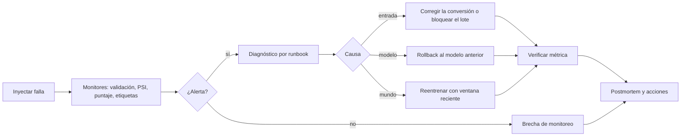
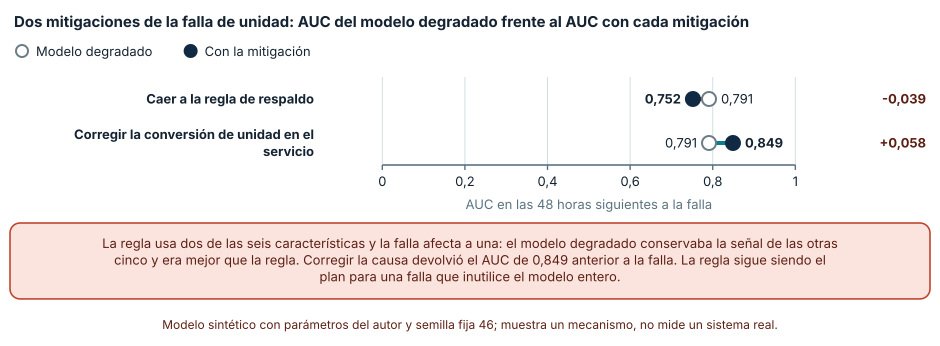

# SE-563 — Taller: degradar y recuperar un modelo

[← SE-562 — Gobierno de IA y regulación: EU AI Act, ISO 42001 y NIST AI RMF](../../classes/part-46-machine-learning-en-produccion-y-mlops/se-562-gobierno-de-ia-y-regulacion-eu-ai-act-iso-42001-y-nist-ai-rmf/README.md) · [↑ Parte 46](../../classes/part-46-machine-learning-en-produccion-y-mlops/README.md) · [📚 Índice completo](../../classes/README.md) · [🌐 Portal](../../site/classes/SE-563.html) · [SE-564 — Proyecto: sistema de ML operable con evidencia →](../../classes/part-46-machine-learning-en-produccion-y-mlops/se-564-proyecto-sistema-de-ml-operable-con-evidencia/README.md)

## Punto profesional y fundamento pedagógico

**Punto profesional.** El taller existe para que ensayes, con fallas inyectadas y mediciones, lo que la parte describió: ver una degradación a tiempo, distinguir su causa, mitigarla sin empeorar las cosas y volver a un estado sano con evidencia. Un sistema de aprendizaje automático no se opera bien porque tenga paneles, sino porque alguien comprobó que cada alerta suena cuando debe, que cada mitigación mejora lo que dice mejorar y que el equipo sabe qué hacer a las tres de la madrugada. Se simulan catorce días de tráfico (400 decisiones por hora), se inyectan cuatro fallas a los siete días (una unidad distinta, columnas nulas, una deriva de covariables y una deriva de concepto) y se miden cuatro monitores. El resultado más útil es una matriz de qué falla detecta cada monitor y con cuántas horas de retraso, y una lección incómoda: la mitigación obvia, caer a una regla, fue peor que el modelo degradado.

**Por qué aparece aquí.** Es el taller de la parte y compone las clases anteriores: la calidad de entrada y la reproducibilidad (`SE-554`, `SE-555`), la evaluación por segmento (`SE-556`), el rollback y las guardas (`SE-559`), las señales de deriva (`SE-560`) y la robustez (`SE-561`). Reutiliza los runbooks y la gestión de incidentes de `SE-427` y `SE-428`, los postmortems de `SE-429`, y el taller de diagnóstico con telemetría incompleta de `SE-431`. Prepara `SE-564`, donde esas comprobaciones se convierten en una puerta de liberación.

**Error conceptual que debe corregir.** Creer que tener monitores equivale a tener un sistema recuperable. En la simulación, una de las cuatro fallas (la deriva de concepto) solo la vio el monitor con etiquetas, 57 horas después; otra (la deriva de covariables) no la vio nunca ese monitor porque no dañaba, y cada uno de los cuatro monitores dejó sin ver al menos una de las cuatro fallas. La segunda corrección: la mitigación genérica («caer a la regla») no es automáticamente buena: ante la unidad errónea, el AUC pasó de 0,849 a 0,791 con el modelo degradado, a 0,752 con la regla y de vuelta a 0,849 al corregir la conversión.

**Secuencia de aprendizaje.** Antes de ejecutar, predices para cada falla qué monitor alerta primero y cuál nunca alertará, y si la regla de respaldo mejora o empeora el AUC durante la falla de unidad. Después ejecutas, mides y comparas. El taller termina con un postmortem sin culpa de una página.

**Evidencia de aprendizaje.** `taller-degradar-y-recuperar.md` con la matriz falla por monitor con horas de retraso, la decisión de mitigación de cada falla con su medida antes y después, las decisiones expuestas hasta mitigar y el postmortem con acciones que cierren la brecha más grande.

**Límite de la conclusión.** La simulación usa datos sintéticos, un modelo de boosting entrenado una vez, cuatro fallas inyectadas por el autor con magnitudes elegidas por él y umbrales fijos (validación de más del 5 % de filas inválidas, PSI de 0,2 con ventana de 24 horas, AUC con etiquetas inferior a 0,82). El retraso de 48 horas de las etiquetas, las 3 horas de decisión y conmutación y el respaldo por reglas son supuestos. No es una prueba de caos de un sistema real, no se evaluó ninguna herramienta de observabilidad y no se invocó ningún modelo de lenguaje.

### Trazabilidad fuente → afirmación

| Fuente primaria u oficial | Afirmación que respalda | Lo que no prueba |
|---|---|---|
| [Google SRE Book, «Monitoring Distributed Systems»](https://sre.google/sre-book/monitoring-distributed-systems/) | Distingue síntomas y causas y recomienda que las alertas sean accionables y sirvan al usuario. | No es específico de aprendizaje automático. |
| [Google SRE Book, «Postmortem Culture»](https://sre.google/sre-book/postmortem-culture/) | Describe el postmortem sin culpa como práctica de aprendizaje con acciones de seguimiento. | No evalúa la eficacia de un formato. |
| [Google SRE Workbook, «Incident Response»](https://sre.google/workbook/incident-response/) | Describe roles, comunicación y gestión de un incidente. | No cubre las particularidades de un modelo. |
| [Breck et al., «The ML Test Score»](https://research.google/pubs/the-ml-test-score-a-rubric-for-ml-production-readiness-and-technical-debt-reduction/) | Incluye pruebas de monitoreo, de datos y de infraestructura propias de sistemas de aprendizaje automático. | No cuantifica cuántas fallas evita cada una. |
| [Rabanser et al., «Failing Loudly»](https://arxiv.org/abs/1810.11953) | Compara métodos para detectar el cambio de distribución. | No incluye los datos de esta clase. |
| [Breck et al., «Data Validation for Machine Learning»](https://mlsys.org/Conferences/2019/doc/2019/167.pdf) | Describe la validación de datos de servicio y de entrenamiento como primera línea de defensa. | No garantiza detectar cambios semánticos. |

## Antes de empezar

Recupera lo aprendido en `SE-559` y `SE-560`: hay señales sin etiqueta y con etiqueta, y un rollback ensayado. La pregunta activa es: **si una columna llegara en cero desde mañana a las 9, ¿qué monitor lo diría primero, cuántas decisiones saldrían mal hasta entonces y quién estaría de guardia?**

## Prerrequisitos

- Haber completado `SE-554`, `SE-559`, `SE-560` y `SE-561`.
- Conocer los runbooks y la gestión de incidentes de `SE-427` y `SE-428`.
- Tener Python 3.11 o posterior, numpy 2.4.4 y scikit-learn 1.8.0; el taller no necesita GPU.
- Disponer de 10 a 15 minutos de cómputo para la simulación completa.

## Problema auténtico

*Avisos-ML* lleva un mes en producción con las guardas y los monitores de las clases anteriores. El equipo quiere comprobar que sirven antes de que el sistema afecte a todo un campus. Se acuerda un ensayo de incidente: un entorno que reproduce catorce días de tráfico, con una falla que se inyecta el día siete sin avisar a quien está de guardia. El ejercicio busca respuestas medibles a cuatro preguntas. ¿Qué monitor lo vio y cuándo? ¿Qué se hizo para mitigar y mejoró algo? ¿Cuántas decisiones se tomaron mal? ¿Qué cambia en el runbook?

La experiencia de equipos de operaciones es que los ensayos descubren lo que las revisiones de diseño no: umbrales que nunca se alcanzan, alertas que llegan a una persona que no puede actuar, mitigaciones que empeoran. En un modelo, además, el sistema puede «funcionar» (sin errores, latencia normal) mientras decide mal.

## Objetivos observables

Al terminar podrás:

1. inyectar cuatro fallas típicas de un sistema de aprendizaje automático en una simulación reproducible y registrar cuándo alerta cada monitor;
2. construir la matriz falla por monitor con horas de retraso y detectar las fallas que ningún monitor ve;
3. medir el efecto de cada mitigación (respaldo, corrección, rollback) sobre la métrica y decidir con datos cuál aplicar;
4. calcular las decisiones expuestas desde la falla hasta la mitigación para cada monitor;
5. escribir un postmortem sin culpa con acciones que cierren las brechas medidas.

## Mapa conceptual



El mapa tiene dos salidas hacia el postmortem: una falla que se mitigó y una que nadie vio. Esta última es la que más enseña, porque revela una brecha que los tableros no mostraban.

## Temas y por qué importan

| Tema | Por qué cambia una decisión profesional | Evidencia mínima |
|---|---|---|
| Inyección de fallas | Prueba que las alertas existen y suenan. | Falla inyectada y hora de la alerta |
| Matriz falla por monitor | Muestra cobertura y huecos. | Horas hasta la primera alerta |
| Retraso de etiquetas | El monitor más fiable es el más lento. | Horas hasta la alerta con etiquetas |
| Mitigación medida | Una mitigación puede empeorar. | Métrica antes y después |
| Exposición | Convierte retraso en decisiones erróneas. | Decisiones hasta mitigar |
| Runbook | Reduce el tiempo de decisión. | Árbol por causa y dueño |
| Postmortem sin culpa | Convierte el incidente en acciones. | Acciones con dueño y fecha |

## Conceptos y decisiones

### 1. El diseño del ensayo

El ensayo simula 14 días de tráfico con lotes de 400 decisiones por hora. Un modelo de boosting se entrena una vez con 20 000 filas de referencia. Cada hora llegan 400 entradas y, 48 horas después, sus etiquetas. A las 168 horas (el día siete) se inyecta una falla que no se anuncia. Hay cuatro monitores con sus umbrales fijados antes: la validación de entrada alerta si más del 5 % de las filas del lote tiene un valor nulo o fuera de rango; el PSI de las entradas alerta si el PSI de alguna característica en una ventana de 24 horas supera 0,2; el PSI del puntaje hace lo mismo con la distribución de las probabilidades del modelo; y el AUC con etiquetas alerta si, con las etiquetas de una ventana de 24 horas, cae por debajo de 0,82 (la referencia es 0,849). Para cada falla se registra la hora de la primera alerta de cada monitor, contada desde la falla.

### 2. Las cuatro fallas

- **Unidad distinta.** La tasa de lectura llega multiplicada por 100 (un cambio de proporción a porcentaje en una fuente aguas arriba).
- **Nulos.** La mitad de los valores del historial de tardanzas llega vacía.
- **Deriva de covariables.** La carga media sube tres tareas, un cambio de comportamiento del semestre.
- **Deriva de concepto.** El peso del historial sobre la etiqueta cae a una décima: el mundo cambia pero las entradas no.

Las dos primeras son fallas de datos (de ingeniería); las otras dos, cambios del mundo. El diagnóstico y la mitigación correctos son distintos para cada una, y esa es la razón por la que el runbook pregunta primero qué clase de falla es.

### 3. La matriz falla por monitor

Las horas hasta la primera alerta, con «nunca» donde ningún umbral se alcanzó en los siete días posteriores, están en la primera figura. Cuatro lecturas. Primera: la validación de entrada detecta de inmediato las dos fallas de datos y es ciega a las del mundo, como debe ser. Segunda: el PSI de las entradas ve la unidad (a las 4 horas, porque la ventana de 24 horas tarda en llenarse con valores distintos) y la deriva de covariables, pero no ve los nulos, porque el cálculo descarta los valores faltantes y la distribución del resto no cambia: un monitor que ignora los nulos es ciego a la falla de nulos. Tercera: el PSI del puntaje ve la unidad y la deriva de covariables más tarde que el PSI de las entradas (11 y 20 horas) y no ve los nulos ni la deriva de concepto. Cuarta: el AUC con etiquetas ve tres fallas, a las 51, 53 y 57 horas, y no ve la deriva de covariables, porque no daña; es el único monitor que ve la deriva de concepto y es el más lento. La matriz tiene huecos: cada monitor deja sin ver al menos una falla, y la de concepto solo la ve el monitor que tarda 57 horas.

### 4. Decisiones expuestas

Para la falla de unidad, con 3 horas para decidir y conmutar tras la primera alerta (un supuesto), las decisiones expuestas hasta mitigar fueron: 1 200 con la validación de entrada (alerta a las 0 horas), 2 800 con el PSI de las entradas (4 horas), 5 600 con el PSI del puntaje (11 horas) y 21 600 con el AUC con etiquetas (51 horas). Si el único monitor fuera el AUC con etiquetas, el equipo habría tomado 18 veces más decisiones con entradas erróneas que con la validación de entrada. El monitor más barato y menos sofisticado es el que más decisiones ahorra en esta falla; el más sofisticado, el que ve una falla que los demás no ven. No se sustituyen: se apilan.

### 5. Mitigar con datos

Durante la falla de unidad, medida sobre 48 horas desde la inyección, el AUC fue 0,849 antes, 0,791 con el modelo degradado, 0,752 con una regla de respaldo (el historial de tardanzas más una fracción de la carga) y 0,849 tras corregir la conversión de unidad en el servicio. La regla fue peor que el modelo degradado: porque el modelo, con una sola entrada mal escalada, conservaba la señal de las otras cinco y la regla solo usa dos características. La mitigación correcta fue corregir la causa. Lo que el ensayo enseña no es que «la regla es mala»: enseña que cada mitigación debe medirse en el ensayo antes de depender de ella y que, cuando la causa se conoce, corregirla es mejor que degradar. La regla sigue siendo la mitigación correcta para una falla que invalida el modelo entero, como un servicio de características caído.

### 6. El runbook como árbol de decisión

El runbook de *Avisos-ML* tras el taller empieza por una pregunta: ¿falla la calidad de entrada? Si sí, bloquear o corregir la fuente, sin reentrenar. Si no, ¿cambió la distribución de entradas o de puntajes? Si sí, abrir un diagnóstico (¿cambió el mundo o una fuente?) y comparar la métrica con etiquetas. Si no, ¿cae la métrica con etiquetas? Si sí, sospechar deriva de concepto: revisar cambios de política del negocio, reentrenar con ventana reciente y pasar por la puerta de despliegue. Cada rama tiene un dueño y un plazo. El árbol convierte la matriz en acción; sin él, el equipo ve una alerta y debate durante una hora qué significa.

### 7. Probar que las alertas suenan

Una alerta que nunca se ha disparado en pruebas es una hipótesis. En el ensayo, el PSI de las entradas no se disparó con los nulos, un fallo que un diseño por inspección habría pasado por alto: el cálculo quita los nulos antes de comparar. La corrección es una regla directa (la validación de entrada ya la tenía), o incluir la tasa de nulos como característica del monitor. Probar las alertas con inyección debe ser parte de la integración continua del sistema de monitoreo (`SE-560`), no un ejercicio anual.

### 8. El postmortem sin culpa

El postmortem de un ensayo tiene cinco partes: qué ocurrió (la cronología de la matriz), cómo se detectó y con qué retraso, qué se hizo y su efecto medido, qué se aprendió y qué acciones se toman, cada una con dueño y fecha. Las acciones sugeridas por el ensayo son concretas: añadir la tasa de nulos al monitor de distribución; poner una muestra etiquetada de 200 casos por semana para ver la deriva de concepto antes de las 57 horas; documentar que el respaldo por reglas solo se usa si el modelo está inutilizado; ensayar el rollback cada trimestre. Sin culpa significa que se pregunta qué permitió el hueco, no quién lo dejó (`SE-429`).

### 9. Cuándo no

Ensayar con inyección de fallas en un sistema que no tiene aún monitores ni runbook produce un incidente en lugar de un ensayo: primero el diseño y las pruebas por separado. En producción real, las fallas inyectadas necesitan límites (un segmento, una fracción, una hora acordada) y un acuerdo previo con quien está de guardia. Y el taller de esta clase usa un modelo y datos sintéticos en una máquina de escritorio: no sustituye un ensayo de recuperación completo con la infraestructura real (`SE-430`).

## Cuándo alerta cada monitor

La primera medida lista las horas hasta la primera alerta por falla y monitor.


**Cómo leer la figura.** Cada fila es una falla inyectada y cada columna un monitor; el número es la hora de la primera alerta contada desde la falla y la raya indica que el monitor nunca alertó. Mira primero las columnas: la validación de entrada ve dos fallas en la hora cero y el AUC con etiquetas ve tres, entre las 51 y las 57 horas. **Dónde deja de valer:** los umbrales (5 %, 0,2, 0,82) y las ventanas de 24 horas son del autor, y un umbral distinto cambia las horas; son 400 decisiones por hora y una sola falla de cada tipo. La figura no dice qué monitor es mejor, dice qué cubre cada uno.

## Decisiones expuestas según el monitor

La segunda medida convierte el retraso de cada monitor en decisiones tomadas con entradas erróneas.


**Cómo leer la figura.** Cada barra es un monitor y su longitud las decisiones tomadas con la unidad errónea hasta la mitigación. Mira primero que la barra del AUC con etiquetas es dieciocho veces la de la validación de entrada. **Dónde deja de valer:** supone 400 decisiones por hora, 3 horas de decisión y conmutación y que la mitigación es inmediata y perfecta una vez decidida; en la práctica la mitigación toma más y a veces solo mejora parcialmente. Es un cálculo con tráfico del ensayo, no una medición de daño.

## Mitigar la unidad errónea

La tercera medida compara las respuestas posibles a la misma falla.



**Cómo leer la figura.** Cada fila es una mitigación; el punto hueco es el AUC del modelo degradado durante la falla y el lleno el AUC con la mitigación, y el segmento es coral si empeora. Mira primero la fila del respaldo por reglas, el único segmento que baja. **Dónde deja de valer:** la regla usa dos características y el modelo seis, y la falla afecta solo a una; con una falla que invalidara al modelo entero, el orden sería otro. La figura no dice que la regla sea mala sino que debe medirse antes de usarla.

## Definiciones de trabajo

- **Inyección de fallas:** introducir a propósito una falla controlada para comprobar la detección y la recuperación.
- **Monitor:** comprobación automática con umbral que alerta.
- **Tiempo hasta detectar:** horas entre la falla y la primera alerta.
- **Mitigación:** acción que reduce el daño sin resolver todavía la causa.
- **Recuperación:** vuelta a un estado sano verificado con la métrica.
- **Postmortem sin culpa:** análisis de un incidente centrado en el sistema y no en las personas.
- **Respaldo:** alternativa simple que se usa cuando el modelo no sirve.

## Ejemplo mínimo

La validación de entrada que alertó en la hora cero, en siete líneas:

```python
import numpy as np

LO = np.array([0, 0, 0, 0, 0, 0.])
HI = np.array([2000, 1, 1, 40, 1, 1.])

def lote_invalido(X, tolerancia=0.05):
    mala = np.isnan(X).any(axis=1) | (X < LO).any(axis=1) | (X > HI).any(axis=1)
    return mala.mean() > tolerancia
```

Devuelve `True` si más del 5 % de las filas del lote tiene un nulo o un valor fuera de rango. Detecta la unidad errónea y los nulos, y no detecta la deriva de covariables ni la de concepto. Los límites vienen del contrato de datos (`SE-554`), no de la distribución observada.

## Ejemplo profesional

*Escenario ilustrativo: las cifras y los resultados que aparecen en este ejemplo son supuestos de la narración, no mediciones.*

El equipo de *Avisos-ML* ejecuta el ensayo un martes con la persona de guardia sin aviso. La falla de unidad se inyecta a las 10:00. A las 10:02 llega el aviso de la validación de entrada a la persona de guardia, que abre el runbook, ve la rama «falla de calidad de entrada» y confirma que la tasa de lectura llega en porcentaje. A las 10:20 despliega una corrección de la conversión en el servicio y verifica en el tablero que la tasa de marcados vuelve a su banda. El incidente se cierra a las 10:45. En el postmortem, el equipo anota tres hallazgos: el PSI de las entradas no vio la falla de nulos que se inyectó en la segunda ronda; la persona de guardia no sabía que el respaldo por reglas empeoraba el AUC y dudó 10 minutos antes de no usarlo; y nadie tenía una muestra etiquetada para ver la deriva de concepto antes de dos días. Tres acciones con dueño: añadir la tasa de nulos al monitor, anotar en el runbook cuándo usar el respaldo y empezar el etiquetado semanal de 200 casos. El ensayo no demuestra que el sistema sea robusto: demuestra que tres brechas existían y quedaron cerradas con acciones.

## Práctica guiada

1. Ejecuta `python scripts/experiments_part46_b.py 563` y reproduce la matriz falla por monitor; tarda unos minutos.
2. Predice, antes de mirar la matriz, qué monitor alertará primero para cada falla y compara.
3. Cambia el umbral del PSI de entradas a 0,1 y a 0,3 y observa cómo cambia la detección de la deriva de covariables.
4. Añade un quinto monitor (la tasa de nulos por característica) y comprueba que detecta la falla que el PSI no vio.
5. Redacta el postmortem de una página con las tres acciones de mayor impacto y su dueño.

## Ejercicios

1. **Básico.** Explica por qué la validación de entrada no vio nunca la deriva de covariables ni la de concepto, y por qué eso es correcto.
2. **Intermedio.** Calcula las decisiones expuestas de la falla de nulos con cada monitor, con 3 horas de decisión y conmutación, y compáralas con las de la falla de unidad.
3. **Avanzado.** Diseña la muestra etiquetada que haría ver la deriva de concepto antes de las 57 horas: tamaño semanal, intervalo de la métrica, umbral de alerta y costo de etiquetar, con la simulación que lo respalda.

## Reto verificable

Entrega `taller-degradar-y-recuperar.md` con la matriz falla por monitor de tu simulación, las decisiones expuestas por monitor, la medida de cada mitigación antes y después, el runbook como árbol de decisión y un postmortem de una página con acciones, dueños y fechas. Es válido si otra persona reproduce tu matriz con la misma semilla, y puede decir qué falla de tu matriz quedó sin cubrir.

## Caso conductor

*Avisos-ML* ejecuta el ensayo, descubre tres brechas y cierra acciones. `SE-564` recoge todo lo medido en la parte y lo convierte en una puerta de liberación con evidencia: un proyecto de sistema de aprendizaje automático operable.

## Preguntas frecuentes

### ¿Es seguro inyectar fallas en producción?

Solo con límites acordados: un segmento pequeño, una ventana horaria, quien está de guardia informado del marco del ejercicio y un interruptor para cancelarlo. Empieza en un entorno aislado y, si pasas a producción, hazlo con una fracción mínima.

### ¿Por qué el monitor con etiquetas fue el más lento?

Porque las etiquetas llegan 48 horas después y se necesitan 24 horas de ellas para calcular el AUC. Es el monitor más fiable y el más tardío; por eso se complementa con los de calidad de entrada y de distribución.

### ¿Cuándo uso la regla de respaldo?

Cuando el modelo está inutilizado (el servicio de características está caído) o cuando se ha medido que el respaldo es mejor que el modelo degradado para esa falla. Si la causa se conoce y se puede corregir rápido, corregir suele ser mejor.

### ¿Con qué frecuencia ensayar?

Con la que permita que el equipo recuerde el runbook y que los cambios del sistema no dejen alertas sin probar: trimestral como punto de partida, y tras cada cambio importante en los monitores.

## Fallo controlado y diagnóstico

**Fallo.** En el ensayo de la falla de nulos, ningún monitor de distribución alerta en 168 horas, y la validación de entrada, que sí lo hizo, se había desactivado la semana anterior por «demasiadas alertas».

**Diagnóstico paso a paso.** (1) Se consulta el historial de configuración de la validación: se bajó el umbral y se desactivó en un cambio sin revisión. (2) Se comprueba que el PSI descarta los nulos antes de comparar. (3) Se calcula la exposición: 168 horas por 400 decisiones, más de 67 000 decisiones con la mitad del historial vacío. (4) Se confirma que el AUC con etiquetas habría alertado a las 53 horas.

**Corrección.** Se restaura la validación con un umbral calibrado (en lugar de desactivarla), se añade la tasa de nulos como característica del monitor de distribución y se exige revisión para cambiar un umbral o desactivar una alerta. La lección es que la brecha no estaba en la tecnología sino en un cambio de configuración sin control, y que la matriz del ensayo la habría mostrado antes.

## Errores comunes y cómo corregirlos

- **Confiar en un monitor sin haberlo disparado.** Corrige inyectando la falla que debe detectar.
- **Tener un solo monitor, el más sofisticado.** Corrige apilando calidad de entrada, distribución y etiquetas.
- **Dar por buena una mitigación sin medirla.** Corrige midiendo la métrica antes y después en el ensayo.
- **Usar el respaldo por reflejo.** Corrige con el criterio escrito en el runbook.
- **Desactivar una alerta ruidosa.** Corrige calibrando el umbral y exigiendo revisión.
- **Postmortem con culpables.** Corrige con preguntas sobre el sistema y acciones con dueño.

## Entorno y archivos clave

- `scripts/experiments_part46_b.py`: función `e563` con el flujo de 14 días, la inyección de cuatro fallas, los cuatro monitores y las mitigaciones; se ejecuta con `python scripts/experiments_part46_b.py 563`.
- `scripts/experiments_part46_lab.py`: generador sintético y funciones de ajuste.
- `scripts/figures_part46_b.py`: las tres figuras de la clase.
- numpy 2.4.4 y scikit-learn 1.8.0 (ver `scripts/requirements-part46.txt`). Tarda de uno a varios minutos según el equipo y no usa GPU.

## Seguridad, ética y accesibilidad

Los datos son sintéticos. Un ensayo con datos reales debe respetar la privacidad y los accesos del sistema de producción (`SE-391`). Una falla inyectada en producción puede afectar a personas reales: define el alcance, una persona responsable y un interruptor de cancelación antes de empezar. Un postmortem es un documento sobre personas y decisiones; el principio sin culpa protege a quien reporta y evita esconder incidentes. Las figuras tienen texto alternativo completo y no dependen solo del color.

## Puente hacia el trabajo con agentes

Un agente de guardia puede leer alertas, consultar el runbook y proponer una mitigación, y es especialmente propenso a elegir la mitigación genérica («volver a la regla», «reentrenar») sin medirla. Exige que su propuesta cite la rama del runbook que sigue, la métrica que verificará antes y después, y que las acciones irreversibles (desplegar, reentrenar, desactivar una alerta) pasen por una persona (`SE-477`). Usa el ensayo para evaluar al agente: inyecta las cuatro fallas y mide si diagnostica la causa correcta y si su mitigación mejora la métrica. Un agente que silencia una alerta para «reducir el ruido» ha creado la brecha de esta clase.

## Transferencia

Elige un modelo de tu organización y escribe sus cuatro monitores con su umbral. Inyecta en un entorno de prueba una falla de unidad y una de nulos, y registra qué monitor alerta y cuándo. Mide si tu mitigación habitual mejora la métrica. Redacta tres acciones con dueño y fecha.

## Evaluación y evidencia

| Criterio | Evidencia aceptable | Rechazo |
|---|---|---|
| Inyección | Falla reproducible con semilla y hora | «Simulamos un problema» |
| Matriz | Horas por falla y monitor, con huecos señalados | «Todo se detecta» |
| Mitigación | Métrica antes y después de cada acción | «Revertimos y listo» |
| Exposición | Decisiones expuestas por monitor | Solo tiempo de detección |
| Runbook | Árbol por causa con dueño y plazo | Lista de pasos sin criterio |
| Postmortem | Acciones con dueño y fecha, sin culpables | Resumen sin acciones |

## Fuentes

- Google. [«Site Reliability Engineering: Monitoring Distributed Systems»](https://sre.google/sre-book/monitoring-distributed-systems/).
- Google. [«Site Reliability Engineering: Postmortem Culture: Learning from Failure»](https://sre.google/sre-book/postmortem-culture/).
- Google. [«The Site Reliability Workbook: Incident Response»](https://sre.google/workbook/incident-response/).
- Breck, E. et al. [«The ML Test Score»](https://research.google/pubs/the-ml-test-score-a-rubric-for-ml-production-readiness-and-technical-debt-reduction/).
- Rabanser, S. et al. [«Failing Loudly»](https://arxiv.org/abs/1810.11953).
- Breck, E. et al. [«Data Validation for Machine Learning»](https://mlsys.org/Conferences/2019/doc/2019/167.pdf).

## Límites y siguiente paso

Las cuatro fallas, los umbrales, las ventanas, el retraso de las etiquetas, las 3 horas de decisión y el respaldo por reglas son construcciones del autor sobre datos sintéticos; la matriz muestra la forma de un ensayo, no la cobertura de ningún sistema real. No se ensayó ninguna infraestructura ni se evaluó ninguna herramienta de observabilidad. El siguiente paso, `SE-564`, es el proyecto: reunir las evidencias de la parte en un sistema de aprendizaje automático operable, con una puerta de liberación que se ejecute.

## Glosario

| Término | Definición breve |
|---|---|
| Inyección de fallas | Falla controlada que se introduce para probar la detección |
| Monitor | Comprobación automática con umbral que alerta |
| Tiempo hasta detectar | Horas entre la falla y la primera alerta |
| Mitigación | Acción que reduce el daño antes de resolver la causa |
| Postmortem sin culpa | Análisis del sistema que lleva a acciones con dueño |
| Respaldo | Alternativa simple cuando el modelo no sirve |
