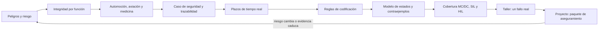

# Parte 47 — Sistemas críticos, tiempo real y normas de seguridad

Las partes anteriores trataron el fallo como un defecto que se detecta, se tolera y se corrige. En un sistema crítico, un fallo es un evento con consecuencias para personas, y la pregunta cambia a «¿qué puede salir mal, cuán grave sería, qué lo evitaría y cómo se sabrá que lo evita?». Esta parte enseña las ideas con las que las normas de seguridad de la industria organizan esa pregunta (análisis de peligros, niveles de integridad, evidencia por nivel, casos de seguridad), las técnicas con las que se verifica un controlador (planificación de tiempo real, reglas de código, verificación formal, cobertura) y una práctica de análisis de un fallo real.

## Pregunta rectora

> Para este controlador, ¿qué peligros lo hacen inseguro, qué control reduce cada uno, qué evidencia sostiene que el control funciona a tiempo y cuál es el hueco que todavía no se ha cerrado ni aceptado por escrito?

## Antes del recorrido clase por clase

Esta parte no sustituye una norma ni una certificación. Las normas de seguridad (IEC 61508, ISO 26262, DO-178C, IEC 62304 y otras) son documentos de pago y protegidos: aquí se describen sus **ideas y su estructura** desde fuentes públicas (circulares y bases de datos de las autoridades, informes de investigación, publicaciones académicas y documentación de las herramientas) y **no se reproduce su texto ni sus tablas**. Cuando un detalle no es público, se dice. Un caso conductor recorre toda la parte: el *Horno de curado*, un controlador de temperatura con un limitador independiente, cuyo análisis se refina clase a clase hasta un paquete de aseguramiento.

La primera clase enseña a distinguir peligro, riesgo y control y a usar cuatro técnicas de análisis, midiendo qué ve cada una (`SE-565`). Las cuatro siguientes toman el marco genérico de la seguridad funcional y tres adaptaciones sectoriales (automoción, aviación y dispositivos médicos) y miden lo que cada una pide con un laboratorio propio: probabilidad de fallo y causa común, cobertura de diagnóstico por inyección de fallos, cobertura estructural y clasificación por módulos (`SE-566` a `SE-569`). La sexta organiza toda esa evidencia como un caso de seguridad con trazabilidad (`SE-570`). Las cuatro siguientes verifican el controlador: los plazos y la inversión de prioridad, las reglas de codificación, el modelo de estados con contraejemplos y la cobertura MC/DC con simulación y banco (`SE-571` a `SE-574`). Las dos últimas aplican todo a un fallo real, el Therac-25, y a un paquete de aseguramiento (`SE-575` y `SE-576`).

El diagrama se lee de izquierda a derecha y no es un orden obligatorio de trabajo: es el orden en que se explican las piezas. El retorno indica que un paquete de aseguramiento se reabre cuando cambia el sistema, el uso o la evidencia.

## Resultados acumulativos

Podrás separar peligro, riesgo y control, calcular los cortes mínimos de un árbol de fallos y el efecto de una causa común, mostrar por qué el producto de gravedad, ocurrencia y detección ordena mal, y enumerar acciones de control no seguras de un controlador que cumple su especificación; calcular la probabilidad media de fallo bajo demanda de tres arquitecturas con causa común y prueba imperfecta, y distinguir los fallos aleatorios de los sistemáticos.

Podrás medir por inyección de fallos la cobertura de cuatro esquemas de diagnóstico y calcular una métrica de arquitectura con tasas declaradas; medir qué sentencias ejecutan las pruebas derivadas de requisitos y clasificar cada una no ejecutada; propagar clases de seguridad por un grafo de dependencias y evaluar controles de entrada de un error de tecleo; y construir un argumento de seguridad como datos con comprobación de huecos, evidencias únicas y enlaces sospechosos.

Podrás simular un planificador de prioridades fijas con inversión de prioridad, aplicar herencia y techo y calcular tiempos de respuesta; aplicar seis reglas de codificación comprobadas por máquina y reconocer un desbordamiento que las pruebas habituales no ven; verificar protocolos con un verificador de estados explícitos y obtener contraejemplos; comparar cobertura de decisión, de condiciones y MC/DC por mutantes; y armar y comprobar el paquete de aseguramiento de un controlador con manifiesto de evidencia.

## Prerrequisitos enlazados

- [Parte 13 — Especificaciones, contratos y modelos](../../classes/part-13-especificaciones-contratos-y-modelos/): contratos e invariantes (`SE-159`), máquinas de estado y model checking introductorio (`SE-161`) y paquetes de especificaciones trazables (`SE-168`).
- [Parte 22 — Embedded, IoT y tiempo real](../../classes/part-22-embedded-iot-y-tiempo-real/): sistemas de tiempo real y deadlines (`SE-268`), interrupciones y estado compartido (`SE-269`), safety, seguridad y vida útil (`SE-274`) y el proyecto del dispositivo simulado (`SE-276`).
- [Parte 23 — Software especializado y dominios](../../classes/part-23-software-especializado-y-dominios/): salud, datos sensibles y sistemas regulados (`SE-283`).
- [Parte 30 — Estrategia y técnicas de prueba](../../classes/part-30-estrategia-y-tecnicas-de-prueba/): pruebas basadas en propiedades y modelos (`SE-365`), mutación y fuzzing (`SE-366`) y pruebas que detectan defectos (`SE-371`).
- [Parte 31 — Calidad, rendimiento y resiliencia](../../classes/part-31-calidad-rendimiento-y-resiliencia/): análisis estático y quality gates (`SE-374`) y disponibilidad y recuperación (`SE-380`).
- [Caso Therac-25](https://github.com/vladimiracunadev-create/modern-software-engineering-program/blob/main/casos/fallo/therac-25.md): los hechos del caso que usa el taller (`SE-575`).
- Python 3.11+ y terminal; los experimentos usan solo la biblioteca estándar y no abren puertos de red.

## Bloques y progresión

1. **Analizar el riesgo:** las clases 565 y 566 fijan el vocabulario y las técnicas de análisis y el marco de integridad por función.
2. **Tres sectores, tres respuestas:** las clases 567 a 569 miden qué pide cada sector (automoción, aviación y dispositivos médicos) con un laboratorio propio sin reproducir las normas.
3. **Argumentar:** la clase 570 convierte la evidencia en un caso de seguridad con trazabilidad y detección de evidencia obsoleta.
4. **Verificar el controlador:** las clases 571 a 574 verifican plazos, código, modelo y cobertura con cuatro técnicas distintas.
5. **Aplicar y entregar:** las clases 575 y 576 analizan un fallo real y arman un paquete de aseguramiento.

## Evidencia medida y límites

Las figuras y los ejemplos de esta parte usan experimentos ejecutados con CPython 3.12.9 en Windows 11; los recuentos y los resultados de las simulaciones con semilla fija 47 se repiten idénticos. **No se invocó ningún modelo de lenguaje, no se ejecutó ninguna herramienta de terceros (TLA+, SPARK, Alloy, MISRA o CERT, un sistema operativo de tiempo real, un banco con hardware) ni se compiló ningún programa en C**: no había compilador en el entorno de medición, de modo que el desbordamiento de enteros se emula con aritmética modular en Python y la cobertura se mide con el trazador de Python.

Los experimentos son: un árbol de fallos con y sin causa común, con cortes mínimos, probabilidad exacta y comprobación Monte Carlo, un FMEA de ocho modos con RPN y perturbaciones, una enumeración de 72 acciones de control no seguras y una planta simulada (`SE-565`); fórmulas de probabilidad de fallo bajo demanda con simulación de 400 000 vidas, barrido de causa común y de cobertura de prueba (`SE-566`); una métrica de arquitectura y una inyección de 20 000 fallos de un bit con cuatro esquemas de diagnóstico (`SE-567`); un limitador de 13 sentencias con pruebas de requisitos y un medidor de cobertura propio (`SE-568`); una propagación de clases por doce módulos y 20 000 órdenes de velocidad con tres controles (`SE-569`); y un argumento de seguridad como datos con una trazabilidad de 30 requisitos y 45 pruebas (`SE-570`).

Siguen un simulador de planificación de ticks con tres protocolos de mutex, un análisis de tiempo de respuesta y una medición de pasos de un algoritmo frente a su peor caso (`SE-571`); seis reglas de codificación sobre el árbol sintáctico de Python y un promedio de enteros de 16 bits (`SE-572`); un verificador de estados explícitos con cuatro protocolos, 20 000 planificaciones al azar y un modelo del horno (`SE-573`); una decisión de cuatro condiciones con 17 mutantes, conjuntos mínimos de tres criterios y 300 escenarios de simulación con retardo de sensor (`SE-574`); dos modelos del caso Therac-25 (`SE-575`); y un paquete de aseguramiento en un directorio temporal con comprobador de huecos y manifiesto de resúmenes (`SE-576`).

Los parámetros (las tasas de fallo, las valoraciones, los pesos de esfuerzo, las tareas y sus tiempos, las reglas, los protocolos, los mutantes, la planta, la probabilidad de edición del modelo del Therac-25 y el paquete de ejemplo) los fijó el autor: son supuestos de modelo y no datos de un producto real. Los modelos del Therac-25 están **inspirados** en el mecanismo publicado por Leveson y Turner y no reconstruyen el código de la máquina.

Lo que **no se hizo**: no se reprodujo ni se citó el texto de ninguna norma de pago, no se verificó ningún valor contra una norma (los umbrales de las métricas de arquitectura que circulan en la literatura se declaran no verificados), no se afirma conformidad con ninguna norma, no se certificó ni se evaluó ningún producto, no hay revisión humana independiente de los análisis y no se afirma que el *Horno de curado* sea seguro. Dos artículos clásicos se citan por su DOI, que responde con bloqueo a clientes automáticos. Las afirmaciones sobre las normas se apoyan en fuentes públicas de las autoridades y de la bibliografía abierta.

## Guía razonada clase por clase

El *Horno de curado* crece mientras se acumulan análisis y evidencia. Cada clase explica qué idea de seguridad se estudia, qué experimento la mide, qué no demuestra y qué evidencia permitiría abandonar la conclusión.

### Bloque 1 — Analizar el riesgo

#### SE-565 — Riesgo, peligro y seguridad funcional: HARA, FMEA, FTA y STPA

Un sistema puede causar daño sin que ningún componente falle, y un análisis solo de fallos de componentes no lo ve. La clase separa peligro, riesgo y control, calcula los cortes mínimos de un árbol de fallos con y sin una causa común, muestra que el producto gravedad-ocurrencia-detección ordena mal los modos de fallo y enumera 72 acciones de control no seguras de las que 22 son peligrosas, con una planta que llega a 300,1 °C sin ningún fallo de componente.

El estudiante entrega el análisis de peligros del *Horno de curado* con el árbol de fallos, el criterio de priorización y las acciones de control no seguras con su requisito. `SE-566` convierte ese análisis en un nivel de integridad por función.

#### SE-566 — IEC 61508 y niveles de integridad de seguridad

El nivel de integridad es propiedad de una función de seguridad completa y no de un componente. La clase calcula la probabilidad media de fallo bajo demanda de tres arquitecturas con tres intervalos de prueba, barre la fracción de causa común (de 1,02 × 10⁻⁴ a 1,82 × 10⁻³ en un 1oo2) y la cobertura de la prueba periódica, y separa los fallos aleatorios, que se calculan, de los sistemáticos, que se argumentan.

El estudiante entrega la función de seguridad del horno con su arquitectura, su probabilidad de fallo con parámetros declarados y la justificación de la causa común y de la prueba. `SE-567` muestra cómo un sector, el automotor, aplica la misma lógica.

### Bloque 2 — Tres sectores, tres respuestas

#### SE-567 — Automoción: ISO 26262 y niveles ASIL

El sector automotor deriva el rigor de la gravedad, la exposición y la controlabilidad de cada peligro, y exige demostrar que los diagnósticos cubren lo que dicen cubrir. La clase calcula una métrica de arquitectura con tasas declaradas, inyecta 20 000 fallos de un bit en un cálculo de par y mide que cuatro esquemas de diagnóstico detectan entre el 0 % y el 100 %, con un tramo que el comparador no ve.

El estudiante entrega el diagnóstico de un cálculo crítico con la cobertura medida por inyección y el tramo que ningún diagnóstico vigila. `SE-568` pasa a la aviación, donde el rigor sigue a la condición de fallo y la evidencia incluye la cobertura estructural.

#### SE-568 — Aviación: DO-178C, DO-254 y ARP4754

En aviación, la evidencia de software se organiza por pruebas basadas en requisitos y una cobertura estructural que busca lo que nadie pidió. La clase mide qué sentencias de un limitador de 13 sentencias ejecutan sus pruebas (10 de 13), clasifica cada una no ejecutada (rama defensiva sin requisito, código muerto, puerta trasera) y muestra el efecto de añadir el requisito que falta.

El estudiante entrega la cobertura de una función suya con los requisitos, las pruebas y la clasificación de cada sentencia no ejecutada. `SE-569` pasa a los dispositivos médicos, donde el rigor depende de la contribución del software al daño.

#### SE-569 — Dispositivos médicos: IEC 62304

La clase de seguridad del software se asigna por elemento, según lo que su fallo puede causar y los controles externos que lo acotan. La clase propaga la clase C por las dependencias de doce módulos (de 6 a 4 módulos de clase C con segregación argumentada) y mide que un tope por perfil de fármaco detiene las 398 órdenes de velocidad peligrosas de 20 000 mientras un tope global deja pasar 266.

El estudiante entrega la clasificación de los módulos de un sistema suyo con el grafo de dependencias y el argumento de segregación de cada módulo que baja de clase. `SE-570` organiza toda esta evidencia como un caso de seguridad.

### Bloque 3 — Argumentar

#### SE-570 — Casos de seguridad y trazabilidad

Un caso de seguridad es un argumento con evidencia que otra persona puede desafiar, no una carpeta de informes. La clase construye un argumento como datos, encuentra una afirmación sin desarrollar, dos evidencias huérfanas y dos evidencias únicas, y genera una trazabilidad de 30 requisitos y 45 pruebas con 9 requisitos sin prueba, 2 pruebas sin requisito y enlaces sospechosos tras cambiar el texto de tres requisitos.

El estudiante entrega el caso de seguridad de un componente suyo con su estructura, sus supuestos con dueño y la política de enlaces sospechosos. `SE-571` verifica el compromiso de tiempo que ese caso afirma.

### Bloque 4 — Verificar el controlador

#### SE-571 — RTOS y planificación de tiempo real

Un plazo se argumenta con análisis, no con la ausencia de fallos observados. La clase reproduce una inversión de prioridad con tres tareas (la tarea de más prioridad pierde 2 plazos y se bloquea 84 ticks sin protocolo y 0 plazos con herencia o techo), calcula el tiempo de respuesta con bloqueo y lo compara con la simulación, y muestra que una marca de agua medida queda por debajo del peor caso.

El estudiante entrega la tabla de tareas del limitador con el protocolo, el análisis de respuesta y el método del WCET. `SE-572` pasa a las reglas de código que previenen defectos que el análisis de tiempo no ve.

#### SE-572 — Codificación segura: MISRA y CERT

Un estándar de codificación reduce clases de defectos con reglas que una herramienta comprueba. La clase implementa seis reglas inspiradas en las diez de Holzmann sobre el árbol sintáctico de Python, muestra un falso positivo de la regla de recursión y mide que un promedio de enteros de 16 bits falla en el 50,0 % de los pares al azar y en ninguno con valores pequeños.

El estudiante entrega una política de codificación con sus reglas, su comprobador y su procedimiento de desviaciones. `SE-573` pasa de las reglas sobre el código a la verificación de propiedades de un modelo.

#### SE-573 — Verificación formal y model checking: TLA+, SPARK y Alloy

La verificación formal razona sobre todos los estados de un modelo respecto de una propiedad y devuelve una demostración dentro del modelo o un contraejemplo. La clase construye un verificador de estados explícitos, lo aplica a cuatro protocolos de exclusión mutua (dos violan la propiedad, uno se bloquea y uno la cumple), compara con 20 000 planificaciones al azar (87 % y 9 % de detección frente a 100 %) y mide la explosión de estados.

El estudiante entrega el modelo de un protocolo suyo con su invariante, el contraejemplo de una versión rota y sus abstracciones declaradas. `SE-574` completa la verificación con la cobertura y la simulación.

#### SE-574 — Verificación y cobertura: MC/DC, HIL y SIL

MC/DC exige que cada condición muestre su influencia independiente en la decisión con un mínimo de n + 1 pruebas. La clase calcula los pares de independencia de una decisión de cuatro condiciones, compara por 17 mutantes los conjuntos mínimos de tres criterios (los de MC/DC matan los 17; los de decisión de 4 a 13) y simula 300 escenarios para mostrar que el defecto aparece solo con un sensor lento.

El estudiante entrega el conjunto mínimo de MC/DC de una decisión suya con su comparación por mutantes y el mapa de qué se verifica en simulación, banco y sistema real. `SE-575` junta todas las miradas en un taller sobre un fallo real.

### Bloque 5 — Aplicar y entregar

#### SE-575 — Taller: analizar un fallo real frente a las normas

El taller proyecta los factores documentados del Therac-25 a las ideas de las clases anteriores sin atribuir culpas y con los hechos separados de lo inferido. La clase modela la carrera de edición (5 705 inconsistencias por 100 000 tratamientos que un enclavamiento imperfecto reduce a 58 exposiciones peligrosas y versionar los parámetros lleva a 0) y el contador de un byte (390 pasadas sin comprobación de 100 000).

El estudiante entrega el análisis de un fallo real con los factores citados, la medida de control de cada uno con su verificación y los límites del análisis retrospectivo. `SE-576` cierra la parte con el paquete de aseguramiento.

#### SE-576 — Proyecto: paquete de aseguramiento de un controlador

El paquete reúne peligros, controles, requisitos, pruebas y resultados con comprobaciones automáticas y una decisión humana por hueco. La clase construye uno en un directorio temporal, encuentra 3 huecos y una cobertura de peligros con control verificado del 60 %, y muestra que tras editar un requisito solo el manifiesto de resúmenes revela que la evidencia ya no es la revisada.

El estudiante entrega el paquete de aseguramiento de un controlador con su comprobador, su manifiesto y una decisión firmada por cada hueco y por el riesgo residual. Con esta clase termina la parte.

## Resumen operativo del recorrido

| Clase | Núcleo profesional | Aporte acumulativo |
|---|---|---|
| [SE-565](../../classes/part-47-sistemas-criticos-tiempo-real-y-normas-de-seguridad/se-565-riesgo-peligro-y-seguridad-funcional-hara-fmea-fta-y-stpa/) | Riesgo, peligro y seguridad funcional: HARA, FMEA, FTA y STPA | Entrega el análisis de peligros del horno con el árbol de fallos, el criterio de priorización y las acciones de control no seguras |
| [SE-566](../../classes/part-47-sistemas-criticos-tiempo-real-y-normas-de-seguridad/se-566-iec-61508-y-niveles-de-integridad-de-seguridad/) | IEC 61508 y niveles de integridad de seguridad | Entrega la función de seguridad con su arquitectura, su probabilidad de fallo y la justificación de la causa común y de la prueba |
| [SE-567](../../classes/part-47-sistemas-criticos-tiempo-real-y-normas-de-seguridad/se-567-automocion-iso-26262-y-niveles-asil/) | Automoción: ISO 26262 y niveles ASIL | Entrega el diagnóstico de un cálculo crítico con la cobertura medida por inyección y el tramo que nadie vigila |
| [SE-568](../../classes/part-47-sistemas-criticos-tiempo-real-y-normas-de-seguridad/se-568-aviacion-do-178c-do-254-y-arp4754/) | Aviación: DO-178C, DO-254 y ARP4754 | Entrega la cobertura de una función con requisitos, pruebas y la clasificación de cada sentencia no ejecutada |
| [SE-569](../../classes/part-47-sistemas-criticos-tiempo-real-y-normas-de-seguridad/se-569-dispositivos-medicos-iec-62304/) | Dispositivos médicos: IEC 62304 | Entrega la clasificación de módulos con el grafo de dependencias y el argumento de segregación |
| [SE-570](../../classes/part-47-sistemas-criticos-tiempo-real-y-normas-de-seguridad/se-570-casos-de-seguridad-y-trazabilidad/) | Casos de seguridad y trazabilidad | Entrega el caso de seguridad de un componente con supuestos con dueño y política de enlaces sospechosos |
| [SE-571](../../classes/part-47-sistemas-criticos-tiempo-real-y-normas-de-seguridad/se-571-rtos-y-planificacion-de-tiempo-real/) | RTOS y planificación de tiempo real | Entrega la tabla de tareas con el protocolo, el análisis de respuesta y el método del WCET |
| [SE-572](../../classes/part-47-sistemas-criticos-tiempo-real-y-normas-de-seguridad/se-572-codificacion-segura-misra-y-cert/) | Codificación segura: MISRA y CERT | Entrega una política de codificación con reglas, comprobador y procedimiento de desviaciones |
| [SE-573](../../classes/part-47-sistemas-criticos-tiempo-real-y-normas-de-seguridad/se-573-verificacion-formal-y-model-checking-tla-spark-y-alloy/) | Verificación formal y model checking: TLA+, SPARK y Alloy | Entrega el modelo de un protocolo con su invariante, un contraejemplo y sus abstracciones |
| [SE-574](../../classes/part-47-sistemas-criticos-tiempo-real-y-normas-de-seguridad/se-574-verificacion-y-cobertura-mc-dc-hil-y-sil/) | Verificación y cobertura: MC/DC, HIL y SIL | Entrega el conjunto mínimo de MC/DC de una decisión con su comparación por mutantes y el mapa SIL, HIL y real |
| [SE-575](../../classes/part-47-sistemas-criticos-tiempo-real-y-normas-de-seguridad/se-575-taller-analizar-un-fallo-real-frente-a-las-normas/) | Taller: analizar un fallo real frente a las normas | Entrega el análisis de un fallo real con factores citados, medidas con su verificación y los límites |
| [SE-576](../../classes/part-47-sistemas-criticos-tiempo-real-y-normas-de-seguridad/se-576-proyecto-paquete-de-aseguramiento-de-un-controlador/) | Proyecto: paquete de aseguramiento de un controlador | Entrega el paquete de aseguramiento de un controlador con comprobador, manifiesto y decisión por hueco |

## Fuentes

- [IEC 61508-1, ficha de la norma](https://webstore.iec.ch/en/publication/5515), [FAA, Advisory Circular 20-115D](https://www.faa.gov/documentLibrary/media/Advisory_Circular/AC_20-115D.pdf), [FAA, software y hardware electrónico aerotransportado](https://www.faa.gov/aircraft/air_cert/design_approvals/air_software), [FAA, Advisory Circular 20-152A](https://www.faa.gov/documentLibrary/media/Advisory_Circular/AC_20-152A.pdf), [SAE, ARP4754A](https://www.sae.org/standards/content/arp4754a/) y [ARP4761A](https://www.sae.org/standards/content/arp4761a/) y [FDA, IEC 62304 en la base de normas reconocidas](https://www.accessdata.fda.gov/scripts/cdrh/cfdocs/cfStandards/detail.cfm?standard__identification_no=38829) — identifican las normas y su reconocimiento por las autoridades; son fichas y circulares, no el texto de las normas de pago.
- [Salay, Queiroz y Czarnecki, «An Analysis of ISO 26262»](https://arxiv.org/abs/1709.02435), [FDA, «General Principles of Software Validation»](https://www.fda.gov/regulatory-information/search-fda-guidance-documents/general-principles-software-validation) y [FDA, «Content of Premarket Submissions for Device Software Functions»](https://www.fda.gov/regulatory-information/search-fda-guidance-documents/content-premarket-submissions-device-software-functions) — estructura pública de la norma automotriz y guías de la autoridad para software de dispositivos médicos.
- [Leveson y Turner, «An Investigation of the Therac-25 Accidents»](https://doi.org/10.1109/MC.1993.274940) (copia en [Columbia](https://www.cs.columbia.edu/~junfeng/08fa-e6998/sched/readings/therac25.pdf)), el [caso Therac-25 del programa](https://github.com/vladimiracunadev-create/modern-software-engineering-program/blob/main/casos/fallo/therac-25.md), el [informe del vuelo 501 de Ariane 5](https://esamultimedia.esa.int/docs/esa-x-1819eng.pdf) y el [informe JATR sobre el Boeing 737 MAX](https://www.faa.gov/sites/faa.gov/files/2022-08/Final_JATR_Submittal_to_FAA_Oct_2019.pdf) — fuentes primarias de los casos y de los supuestos de diseño.
- [Comunidad GSN del SCSC](https://scsc.uk/gsn) y [NASA Software Engineering Handbook](https://swehb.nasa.gov/) — estructura de los casos de seguridad y prácticas de software crítico.
- [Liu y Layland, 1973](https://doi.org/10.1145/321738.321743), [Sha, Rajkumar y Lehoczky, 1990](https://doi.org/10.1109/12.57058) y [Jones, «What really happened on Mars Rover Pathfinder»](https://catless.ncl.ac.uk/Risks/19/49) — planificación de prioridades fijas, protocolos de herencia y techo, y el caso del Pathfinder (relato de segunda mano).
- [Holzmann, «The Power of 10»](https://spinroot.com/gerard/pdf/P10.pdf), [SEI CERT C](https://wiki.sei.cmu.edu/confluence/display/c/SEI+CERT+C+Coding+Standard) y [MISRA](https://misra.org.uk/) — reglas de codificación para sistemas críticos.
- [TLA+](https://lamport.azurewebsites.net/tla/tla.html), [lanzamientos de TLA+](https://github.com/tlaplus/tlaplus/releases), [Newcombe et al., CACM 2015](https://doi.org/10.1145/2699417), [SPARK 2014](https://docs.adacore.com/spark2014-docs/html/ug/) y [Alloy](https://alloytools.org/) — herramientas de verificación formal (no ejecutadas en esta parte).
- [Hayhurst et al., tutorial de MC/DC (NASA/TM-2001-210876)](https://shemesh.larc.nasa.gov/fm/papers/Hayhurst-2001-tm210876-MCDC.pdf) y la [documentación de Python](https://docs.python.org/3/) (`ast`, `collections`, `hashlib`, `itertools`, `random`, `sys.settrace` y `tempfile`) — cobertura de condición/decisión modificada y las bibliotecas de los experimentos.

Las fuentes se vinculan también dentro de cada clase. Definen vocabulario y describen prácticas; que un sistema sea seguro se demuestra con el caso, la evidencia medida y la revisión de una persona independiente, no con la autoridad de la fuente. Las fichas de las normas (IEC, SAE) no contienen el texto protegido y los enlaces a DOI de artículos de revistas responden con bloqueo a clientes automáticos.

## Criterios de aceptación de la parte

- cada clase conecta mecanismo, medida y límite en una conclusión revisable;
- cada medida puede reproducirse desde un checkout limpio con la semilla 47;
- ninguna afirmación sobre una norma reproduce su texto protegido, y lo que no es público se declara;
- el paquete de aseguramiento final se puede aplicar a un controlador nuevo por otra persona y declara sus huecos, sus supuestos y quién aceptó el riesgo residual;
- ninguna clase afirma revisión humana, certificación ni conformidad con una norma.

[Volver al índice de clases](../../classes/README.md)
