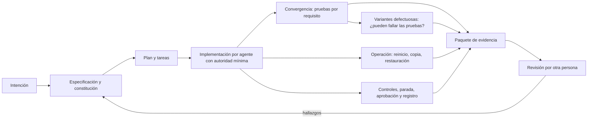
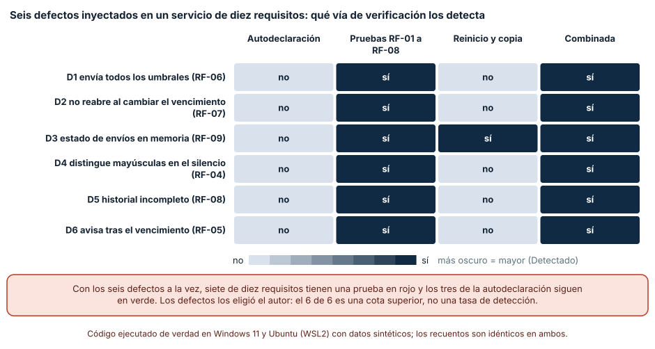
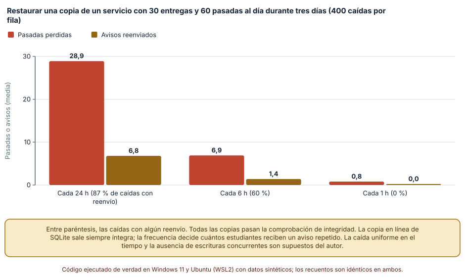

# SE-576 — Proyecto final: producto operable construido desde SPEC

[← SE-575 — Taller: detener, recuperar y evaluar un agente](../../classes/part-47-spec-agentes-y-ciclo-de-vida-agentic/se-575-taller-detener-recuperar-y-evaluar-un-agente/README.md) · [↑ Parte 47](../../classes/part-47-spec-agentes-y-ciclo-de-vida-agentic/README.md) · [📚 Índice completo](../../classes/README.md) · [🌐 Portal](../../site/classes/SE-576.html)

## Punto profesional y fundamento pedagógico

**Punto profesional.** El proyecto final existe para que demuestres, con un producto pequeño pero completo, que sabes construir con agentes desde una especificación y que sabes decir con qué evidencia el producto está terminado. «Validado por el sistema, no por autodeclaración» es la frase de la parte: el informe de un agente que dice haber cumplido todos los requisitos no vale como prueba; vale un conjunto de comprobaciones que otra persona puede ejecutar y que fallan cuando el producto falla. La habilidad es encadenar todo lo aprendido en la Parte 47 —especificación, plan, tareas, implementación, convergencia, autoridad limitada, controles, confianza en herramientas, delegación, aprobación, seguridad, parada y recuperación— en un paquete que alguien más pueda revisar y operar.

**Por qué aparece aquí.** Cierra la **Parte 47** después de **Taller: detener, recuperar y evaluar un agente**: `SE-565` a `SE-575` enseñaron cada pieza; ahora se integran sobre el caso conductor, el **servicio de recordatorios de entrega** (*Avisos*). Es un caso sintético: el producto es un servicio pequeño en Python con SQLite escrito para el experimento, las «versiones del agente» son el mismo código con defectos inyectados mediante opciones, no se invocó ningún modelo y no hubo ningún despliegue ni operación reales.

**Error conceptual que debe corregir.** Creer que un producto está terminado cuando sus pruebas pasan y el agente lo dice. Las pruebas pasan cuando comprueban lo que el agente construyó; lo que importa es que comprueben lo que la especificación pide, incluyendo lo que ocurre al reiniciar, al restaurar una copia y al detener la ejecución. Hay requisitos cuyas pruebas nunca se han visto fallar: sin una variante defectuosa que las rompa, no se sabe si podrían.

**Secuencia de aprendizaje.** Antes de ver los resultados, predices cuántos de seis defectos inyectados detecta el informe de autoprueba de un agente que comprobó los tres primeros requisitos; después ejecutas las pruebas de los diez requisitos sobre las seis variantes, mides cuántos avisos se reenviarían tras restaurar una copia de distinta antigüedad y construyes el paquete de evidencia que enlaza cada requisito con sus pruebas y con la variante que las rompe. La secuencia usa predicción, contraste, explicación propia y recuperación. [ICAP](https://icap.education.asu.edu/research) distingue participación de construcción de conocimiento; [How People Learn II](https://nap.nationalacademies.org/catalog/24783/how-people-learn-ii-learners-contexts-and-cultures) respalda diseñar la práctica con contextos reales y retroalimentación.

**Evidencia de aprendizaje.** El paquete `avisos-paquete/` descrito más abajo, con su `LIMITES.md`, y un `proyecto-log.md` con la predicción, las tres figuras reproducidas y la declaración, para cada afirmación, de si es medida, inferida o supuesta.

**Límite de la conclusión.** El servicio, los diez requisitos, las doce pruebas, los seis defectos, la frecuencia de las pasadas y las copias son construcciones del autor. Se ejecutó código real (el servicio, sus pruebas y la copia con la interfaz de respaldo de SQLite), pero no hubo agente, despliegue, usuarios ni operación. Que las pruebas detecten los seis defectos es una consecuencia de haberlos inyectado sabiendo qué detectan; no demuestra que detecten los defectos que un agente real introduciría.

### Trazabilidad fuente → afirmación

| Fuente primaria u oficial | Afirmación que respalda | Lo que no prueba |
|---|---|---|
| [Spec Kit — referencia del proceso agentic](https://github.github.io/spec-kit/reference/agentic-sdd.html) | Describe la cadena constitución, especificación, clarificación, plan, tareas, análisis, implementación y convergencia, y que la convergencia solo añade tareas y termina en «convergido» o con tareas nuevas. | No garantiza que un producto convergido cumpla sus requisitos. |
| [Spec Kit — guía de corrección de errores](https://github.github.io/spec-kit/guides/bugfix.html) | Establece que el veredicto «verificado» exige ejercitar la reproducción original y que una batería que pasa no basta sin ella. | No define cómo escribir esa reproducción. |
| [NIST AI RMF](https://www.nist.gov/itl/ai-risk-management-framework) y [NIST AI 600-1](https://nvlpubs.nist.gov/nistpubs/ai/NIST.AI.600-1.pdf) | Enmarcan la gestión de riesgos de sistemas de IA y de IA generativa (gobernar, mapear, medir, gestionar), con evaluación y documentación como parte del riesgo. | No sustituyen una evaluación específica del producto. |
| [Jia y Harman](https://doi.org/10.1109/TSE.2010.62) | Fundamenta la prueba de mutación como medida de la capacidad de detección de un conjunto de pruebas. | No dice qué variantes representan a un agente. |
| [SQLite: API de copia de seguridad en línea](https://www.sqlite.org/backup.html) y [Python: sqlite3](https://docs.python.org/3/library/sqlite3.html) | Documentan la copia consistente de una base de datos mientras se usa y el módulo empleado. | No garantizan la copia ni la restauración de tu despliegue. |
| [Google SRE: objetivos de nivel de servicio](https://sre.google/sre-book/service-level-objectives/) | Define indicadores y objetivos como forma de acordar cuánto servicio es suficiente. | No fija los objetivos de *Avisos*. |

## Antes de empezar

Recupera lo aprendido a lo largo de la parte: la especificación es la fuente, la convergencia la juzga un verificador independiente, la autoridad se limita, los controles tienen modo de fallo, lo irreversible exige una pausa y todo agente se puede detener y reanudar. La pregunta activa es: **¿qué evidencia podrías enseñar hoy a otra persona de que tu último proyecto con un asistente cumple lo que se pidió, sin que tengas que decir «el asistente dice que sí»?**

## Prerrequisitos

- Haber completado `SE-565` a `SE-575` o poder explicar la especificación con criterios, la convergencia con verificador independiente, la autoridad mínima, el modo de fallo de un control, la reversibilidad y la reanudación sin duplicados.
- Python 3.11 o posterior con `sqlite3`; los experimentos usan solo la biblioteca estándar.
- Disposición para ejecutar el paquete de otra persona desde un checkout limpio y para dejar que ejecuten el tuyo.

## Problema auténtico

Un equipo pide a un agente que construya *Avisos* desde una especificación de diez requisitos. El agente entrega el servicio, escribe cuatro pruebas del camino feliz, las ejecuta y redacta un informe: «los diez requisitos están cumplidos». La revisión independiente ejecuta pruebas por cada requisito y encuentra seis incumplimientos: avisa tras el vencimiento, envía todos los umbrales juntos tras una caída, no reabre los umbrales cuando cambia el vencimiento, no distingue «Silenciada» de «silenciada», olvida registrar en el historial el aviso de una hora y guarda su estado de avisos en memoria, de modo que al reiniciar los reenvía. Ninguno aparece en el informe del agente y solo uno aparece si se ejecuta la prueba de reinicio. Cuando el equipo decide restaurar la base desde una copia de la víspera tras una caída, descubre además que el servicio reenvía los avisos de las últimas horas, porque la copia no los contiene. El proyecto pide construir y entregar un paquete en el que esas comprobaciones existan de antemano y se ejecuten solas.

## Objetivos observables

Al terminar podrás:

1. construir un producto pequeño desde una especificación con identificadores y criterios, con plan, tareas y convergencia verificada por pruebas por requisito;
2. configurar el agente con autoridad mínima, controles con modo de fallo probado, política de confianza para sus herramientas, delegación con contratos, aprobación por reversibilidad, reglas de parada y reanudación sin duplicados;
3. demostrar con variantes defectuosas que tus pruebas pueden fallar y cuáles de tus requisitos no tienen esa demostración;
4. medir cuánto se pierde y cuánto se reenvía al restaurar copias de distinta antigüedad y decidir la frecuencia de copia en función del objetivo de servicio;
5. entregar un paquete reproducible con su `LIMITES.md` y decir qué parte de cada afirmación es medida, cuál inferida y cuál supuesta.

## Mapa conceptual



El producto no se declara terminado en el nodo de implementación: pasa por pruebas por requisito, por variantes que demuestran que esas pruebas pueden fallar, por pruebas de operación y por controles del agente, y se resume en un paquete que otra persona revisa. Los hallazgos vuelven a la especificación.

## Temas y por qué importan

| Tema | Por qué cambia una decisión profesional | Evidencia mínima |
|---|---|---|
| Del requisito a la prueba | Una prueba por requisito hace visible lo que falta. | Matriz requisito → pruebas |
| Autodeclaración frente a verificación | El informe del agente comprueba lo que él entendió. | Defectos detectados por cada vía |
| Prueba de que la prueba puede fallar | Un requisito sin variante que lo rompa no tiene evidencia de detección. | Variantes por requisito y requisitos sin ellas |
| Operación: reinicio y restauración | La persistencia y la copia son requisitos, no detalles. | Prueba de reinicio y de copia consistente |
| Objetivo de punto de recuperación | Define cuánto se puede perder y qué se reenvía. | Frecuencia de copia, pérdida y reenvíos |
| El paquete y sus límites | Es lo que otra persona revisa y opera. | `LIMITES.md` con lo no medido |

## Conceptos y decisiones

### 1. El producto: pequeño, completo y con requisitos que se pueden romper

El servicio *Avisos* del proyecto es deliberadamente pequeño: una base SQLite con entregas, envíos y un historial; una función que decide, en cada pasada, qué aviso corresponde; y las operaciones de registrar, entregar, silenciar, reactivar y cambiar el vencimiento. Diez requisitos lo especifican: umbrales de 72, 24 y 1 hora (`RF-01`), no repetir un aviso (`RF-02`), no avisar si la entrega está entregada (`RF-03`) ni silenciada (`RF-04`) ni tras el vencimiento (`RF-05`), enviar solo el umbral más cercano tras una caída (`RF-06`), reabrir los umbrales al cambiar el vencimiento (`RF-07`), registrar cada aviso en el historial (`RF-08`), no repetir tras reiniciar (`RF-09`) y que una copia restaurada sea consistente (`RF-10`). Los diez son comprobables y cada uno puede romperse de una forma concreta. Esa es la razón de elegirlos: un proyecto final con requisitos que no se pueden violar no enseña a verificar.

### 2. De los requisitos a las pruebas

Cada requisito tiene una o más pruebas ejecutables que arman el servicio, aplican el escenario y comprueban el resultado observable: el aviso enviado, la fila registrada, el estado tras reiniciar. Las doce pruebas del proyecto no son un adorno del informe: son lo que alguien más ejecutará. La matriz requisito → pruebas es el primer producto de evidencia y permite ver de un vistazo que ningún requisito se queda sin una prueba (`SE-565`). Esta matriz no demuestra por sí misma que las pruebas sean buenas; falta saber si pueden fallar.

### 3. Probar que la prueba puede fallar

La técnica de `SE-567` se aplica ahora a todo el producto. Para cada requisito se prepara una **variante defectuosa** del servicio que lo viola de una manera plausible (un agente que olvida registrar el último umbral, que guarda el estado en memoria, que compara «Silenciada» con distinción de mayúsculas) y se comprueba que la prueba del requisito falla con esa variante y pasa con el servicio correcto. Si una prueba no ha fallado nunca frente a una variante, no hay evidencia de que sea capaz de hacerlo; no se descarta que lo sea, pero la afirmación «este requisito está verificado» no está respaldada. El paquete debe decir, requisito por requisito, si hay variante y si la prueba la detecta. Los requisitos sin variante se declaran en `LIMITES.md`, y escribir una variante para cada uno es el trabajo pendiente.

### 4. Autodeclaración y verificación independiente

La autodeclaración del agente es el informe que escribe tras ejecutar sus propias pruebas. En este proyecto esas pruebas cubren los tres primeros requisitos, que son los del camino feliz: comprueban que se envían los tres avisos y que no se repiten ni se envían a entregas ya entregadas. La verificación independiente ejecuta las pruebas por requisito, incluidas las de reinicio y copia. La diferencia entre las dos es la medida del problema: lo que el agente comprobó y lo que el producto debía cumplir no coinciden, y la brecha se mide con variantes defectuosas. Para que el proceso sea honesto, la verificación independiente la escribe y la ejecuta alguien que no comparte el contexto del agente: otra persona, otra sesión o un conjunto escrito antes de implementar.

### 5. Operación: reinicio, copia y restauración

Un producto operable se reinicia sin repetir lo hecho (`RF-09`), se copia sin detenerse y se restaura a un estado consistente (`RF-10`). SQLite ofrece una interfaz de copia de seguridad en línea que produce una copia consistente de una base mientras se usa. Lo que la copia no da es continuidad: al restaurar una copia de hace seis horas se pierden las pasadas de esas seis horas, y el servicio, al reanudar, no sabe que ya envió esos avisos y los envía otra vez. La frecuencia de copia es, por lo tanto, una decisión de **objetivo de punto de recuperación**: cuánto trabajo se acepta perder, y se traduce a un número de avisos duplicados que reciben los estudiantes. La prueba de reinicio (`RF-09`) y la comprobación de integridad de una copia son parte de los criterios de aceptación, no un anexo operativo.

### 6. El paquete y `LIMITES.md`

El paquete de entrega reúne todo lo que otra persona necesita para revisar y operar: la especificación y la constitución, el plan y las tareas, el código y las pruebas, la matriz requisito → pruebas → variantes, el resultado de las pruebas de operación, las políticas del agente (autoridad, controles con modo de fallo, confianza de herramientas, aprobación, parada y reanudación), el registro de auditoría con su referencia externa y un `LIMITES.md`. Este último es la parte más exigente: dice qué no se ejecutó (no hubo despliegue ni usuarios), qué no se midió (rendimiento, concurrencia real), qué requisitos carecen de variante defectuosa, qué suposiciones son del autor y qué comprobaría una persona antes de confiar. Un paquete sin límites declarados es una autodeclaración con más páginas.

## Seis defectos y tres formas de buscarlos

Se implementó *Avisos* en Python con SQLite (unas setenta líneas), con diez requisitos y doce pruebas ejecutables, y se prepararon seis variantes que imitan defectos plausibles de una versión escrita por un agente. Las variantes son opciones del mismo servicio: envía todos los umbrales juntos tras una caída (`RF-06`), no reabre los umbrales al cambiar el vencimiento (`RF-07`), guarda el estado de los envíos en memoria en vez de en la base (`RF-09`), distingue mayúsculas en el estado silenciado (`RF-04`), omite registrar en el historial el aviso de una hora (`RF-08`) y avisa después del vencimiento (`RF-05`). Se comparan tres vías de verificación: la autodeclaración (las pruebas de `RF-01` a `RF-03`, las del camino feliz que escribió el agente), las pruebas por requisito `RF-01` a `RF-08` y las pruebas de reinicio y copia (`RF-09` y `RF-10`).

| Defecto (requisito) | La autodeclaración lo ve | Pruebas de requisitos `RF-01` a `RF-08` | Pruebas de reinicio y copia | Vista combinada |
|---|---|---|---|---|
| D1 envía todos los umbrales (`RF-06`) | no | sí | no | sí |
| D2 no reabre al cambiar el vencimiento (`RF-07`) | no | sí | no | sí |
| D3 estado de envíos en memoria (`RF-09`) | no | sí | sí | sí |
| D4 distingue mayúsculas en el silencio (`RF-04`) | no | sí | no | sí |
| D5 historial incompleto (`RF-08`) | no | sí | no | sí |
| D6 avisa tras el vencimiento (`RF-05`) | no | sí | no | sí |
| **Total de 6** | **0 de 6** | **6 de 6** | **1 de 6** | **6 de 6** |

La autodeclaración no detecta ninguno de los seis defectos: las tres pruebas del camino feliz siguen en verde con todos. Las pruebas por requisito detectan los seis, y las de reinicio y copia detectan solo uno (D3), aunque el defecto de memoria también rompe `RF-07` (los umbrales que se reabren están en la base, no en la memoria) y `RF-10` (la copia no contiene los envíos), por lo que lo ven dos pruebas de otros requisitos además de la suya. Con los seis defectos a la vez, 7 de los 10 requisitos tienen una prueba en rojo, y los tres de la autodeclaración siguen en verde: el informe del agente habría dicho «cumplidos» sobre un producto que incumple siete requisitos.



**Cómo leer la figura.** Cada fila es un defecto y cada columna una vía de verificación; la celda es oscura si la vía lo detecta. Mira primero la columna de la autodeclaración, toda clara, y la de las pruebas por requisito, toda oscura; el reinicio y la copia solo ven el defecto del estado en memoria. **Dónde deja de valer:** los seis defectos fueron elegidos y escritos por el autor, que conoce lo que las pruebas comprueban, y el servicio es mínimo; un agente real introduciría defectos de otras formas y una combinación de pruebas escrita sin conocerlos detectaría menos. El 6 de 6 es una cota superior, no una tasa de detección.

## Cuánto cuesta restaurar una copia

Se simulan 400 caídas por fila durante tres días de un servicio con 30 entregas y una pasada cada 24 minutos (60 al día). Se hace una copia con la interfaz de respaldo de SQLite cada 24, 6 o 1 hora, y en un instante al azar el servicio se cae y se restaura la última copia. Se cuenta cuántas pasadas se pierden, cuántos avisos habría que reenviar (los que consta como enviados en el servicio y no en la copia) y cuántas copias superan la comprobación de integridad de SQLite.

| Frecuencia de copia | Pasadas perdidas (media) | Avisos que se reenviarían (media) | Caídas con algún reenvío | Copias íntegras |
|---|---:|---:|---:|---:|
| Cada 24 h | 28,9 | 6,8 | 87 % | 100 % |
| Cada 6 h | 6,9 | 1,4 | 60 % | 100 % |
| Cada 1 h | 0,8 | 0,0 | 0 % | 100 % |

Con una copia diaria, una caída pierde en promedio 28,9 pasadas y deja 6,8 avisos por reenviar, y el 87 % de las caídas produce algún reenvío. Con copias cada seis horas bajan a 6,9 y 1,4 (60 %). Con copias cada hora quedan 0,8 pasadas perdidas y ningún reenvío en promedio. Todas las copias pasan la comprobación de integridad: la interfaz de copia en línea produce copias consistentes, y la frecuencia mide solo la antigüedad. La cifra de reenvíos es lo que el objetivo de recuperación significa para las personas: 6,8 estudiantes reciben un aviso que ya habían recibido.



**Cómo leer la figura.** Cada grupo es una frecuencia de copia, con el porcentaje de caídas con algún reenvío entre paréntesis; la barra roja son las pasadas perdidas y la dorada los avisos reenviados. Mira primero cómo ambas bajan al copiar más a menudo y que el reenvío desaparece con copias cada hora. **Dónde deja de valer:** las 30 entregas, los vencimientos entre 72 y 142 horas, la caída uniforme en el tiempo y la ausencia de escrituras concurrentes son supuestos del autor; la pérdida real depende de la carga, de dónde se guarda la copia (si está en el mismo disco que la base no protege de un fallo del disco) y de que la restauración se haya ensayado.

## El paquete de evidencia, requisito por requisito

Se ejecutaron las pruebas contra el servicio de referencia, que las pasa todas, y contra cada variante defectuosa, para construir la matriz del paquete.

| Requisito | Pruebas | Resultado | Defecto que lo rompe | ¿La prueba lo detecta? |
|---|---:|---|---|---|
| `RF-01` umbrales de 72, 24 y 1 hora | 2 | verde | ninguno | — |
| `RF-02` no repetir un aviso | 1 | verde | ninguno | — |
| `RF-03` no avisar si está entregada | 1 | verde | ninguno | — |
| `RF-04` no avisar si está silenciada | 1 | verde | D4 | sí |
| `RF-05` no avisar tras el vencimiento | 2 | verde | D6 | sí |
| `RF-06` tras una caída, solo el umbral más cercano | 1 | verde | D1 | sí |
| `RF-07` cambiar el vencimiento reabre umbrales | 1 | verde | D2 | sí |
| `RF-08` registrar cada aviso en el historial | 1 | verde | D5 | sí |
| `RF-09` reiniciar no repite avisos | 1 | verde | D3 | sí |
| `RF-10` una copia restaurada es consistente | 1 | verde | ninguno | — |

Seis requisitos tienen una variante que los rompe y su prueba la detecta (6 de 6). Cuatro requisitos (`RF-01`, `RF-02`, `RF-03` y `RF-10`) están en verde pero no tienen una variante que demuestre que su prueba pueda fallar. Es lo que el paquete debe declarar: no que estén incumplidos, sino que no hay evidencia de que las pruebas los detectarían. Tres de ellos son los de la autodeclaración del agente. El trabajo pendiente es obvio: escribir una variante para cada uno y comprobar que su prueba falla. Hasta entonces, «verde» significa «pasa», no «verificado».


**Cómo leer la figura.** Cada fila es un requisito y la celda es oscura si existe una variante defectuosa que su prueba detecta y clara si no hay variante. Mira primero las cuatro filas claras: están en verde sin que se haya demostrado que su prueba puede fallar. **Dónde deja de valer:** las doce pruebas y las seis variantes son del autor; con una sola variante por requisito la figura no mide la capacidad de detección de la prueba, solo que no es nula; un paquete real necesita varias variantes por requisito, como las diez de `SE-567`.

## Definiciones de trabajo

- **producto operable:** producto que se puede reiniciar, copiar, restaurar, vigilar y detener con evidencia ejecutable de que lo hace.
- **verificación independiente:** conjunto de comprobaciones escrito y ejecutado sin compartir el contexto de quien construyó el producto.
- **variante defectuosa:** versión del producto con un defecto introducido para comprobar que una prueba puede fallar.
- **objetivo de punto de recuperación:** cantidad máxima de trabajo reciente que se acepta perder tras una restauración.
- **paquete de evidencia:** conjunto de artefactos que permite a otra persona revisar y operar el producto.
- **`LIMITES.md`:** documento que declara lo no ejecutado, lo no medido y las suposiciones del autor.

Las definiciones son operativas para el servicio *Avisos*. No convierten términos con una historia más amplia en sinónimos y deben contrastarse con la documentación primaria enlazada al final.

## Ejemplo mínimo

El fragmento muestra la copia en línea de SQLite y su comprobación de integridad. Antes de ejecutarlo, predice qué imprime.

```python
import sqlite3
origen = sqlite3.connect(":memory:")
origen.execute("create table envio (entrega integer, umbral integer)")
origen.execute("insert into envio values (1, 72)")
copia = sqlite3.connect(":memory:")
origen.backup(copia)
print(copia.execute("pragma integrity_check").fetchone()[0], copia.execute("select count(*) from envio").fetchone()[0])
```

Imprime `ok 1`. Inserta un segundo envío en el origen después de la copia y observa que la copia sigue teniendo uno: ese envío es el que se reenviaría al restaurar. Registra versión de Python, comando y salida.

## Ejemplo profesional

Escenario hipotético, construido para la clase y sin datos reales. El equipo entrega el paquete de *Avisos*. La especificación tiene diez requisitos con identificador y criterio, tres principios de constitución y un registro de dos decisiones. El plan cita requisitos y el analizador de `SE-566` no encuentra incoherencias formales. El agente implementó con autoridad mínima: herramientas de lectura, escritura en el directorio del proyecto y ejecución de las pruebas, con un gancho previo que falla cerrado y un confinamiento de rutas probado con veinte intentos. Las herramientas de terceros están fijadas por huella y el agente en cuarentena es el único que lee notas de docentes. Las acciones irreversibles (enviar el primer lote real) tienen una solicitud con cinco datos y una pausa. El bucle de convergencia se detiene a las seis pasadas, a los diez pasos sin avance o ante una regresión, y reanuda con un punto de control y claves de idempotencia. La verificación independiente ejecuta las doce pruebas más las de reinicio y copia, y la matriz muestra que cuatro requisitos carecen de variante; el equipo los declara en `LIMITES.md` y fija como objetivo de recuperación una copia por hora. Una persona ajena ejecuta el paquete desde un checkout limpio, obtiene los mismos resultados, escribe una variante nueva para `RF-02` y comprueba que la prueba la detecta. Compara con el estado inicial: antes, un informe que decía «cumplido»; ahora, un paquete que dice qué se verificó, qué no y cómo comprobarlo.

## Práctica guiada

1. Escribe la especificación mínima de *Avisos* o de un producto propio con diez requisitos, identificadores y criterios, y pásale el revisor de `SE-565`.
2. Predice cuántos de seis defectos detectaría el informe de un agente que solo probó tres requisitos del camino feliz; escribe el número antes de ejecutar.
3. Ejecuta `python scripts/experiments_part47_b.py 480` y reproduce las tres tablas; añade una séptima variante defectuosa para uno de los cuatro requisitos sin variante y comprueba que su prueba falla.
4. Implementa el producto con un agente o a mano, con una prueba por requisito, y ejecútalas desde un checkout limpio.
5. Escribe las políticas del agente (autoridad, controles con modo de fallo, confianza de herramientas, aprobación, parada y reanudación) y la matriz requisito → pruebas → variantes.
6. Mide cuánto se reenvía al restaurar una copia de distinta antigüedad y decide tu frecuencia de copia.
7. Redacta `LIMITES.md` y pide a otra persona que ejecute el paquete y escriba una variante defectuosa que tus pruebas no detecten.

## Ejercicios

1. **Matriz:** para un requisito de tu producto, escribe la prueba, una variante defectuosa plausible y el resultado esperado de ejecutar la prueba contra ambas.
2. **Operación:** explica por qué una prueba de reinicio puede pasar con el estado en memoria si se ejecuta en el mismo proceso y cómo la harías detectar el defecto.
3. **Recuperación:** con 120 avisos al día y una copia cada 4 horas, estima cuántos avisos se reenviarían de media tras una caída y qué cambiarías para que sean menos de uno.
4. **Límites:** escribe cinco líneas de `LIMITES.md` para un producto que construiste con un agente y no desplegaste.

## Reto verificable

Entrega el paquete `avisos-paquete/` con: la especificación y la constitución, el plan y las tareas, el código y las doce pruebas (o las de tu producto) ejecutables, la matriz requisito → pruebas → variantes con al menos seis variantes, las pruebas de reinicio y de copia, las políticas del agente con su modo de fallo probado, un registro de auditoría con referencia externa, la medida de reenvíos por frecuencia de copia y un `LIMITES.md`. Se aprueba si otra persona ejecuta el paquete desde un checkout limpio, obtiene los mismos resultados con las mismas semillas, no consigue que el producto pase sus pruebas con una variante defectuosa que ella escriba para un requisito que declaras verificado, y puede decir qué comprobaría antes de operarlo. No se aprueba por entregar el informe de un agente como evidencia ni por afirmar que todos los requisitos están verificados sin una variante que lo demuestre.

## Caso conductor

El servicio *Avisos* es el caso conductor de la Parte 47 y este es su cierre. El proyecto final reúne todos los artefactos de la parte: la especificación (`SE-565`), la constitución, el plan y las tareas (`SE-566`), la convergencia verificada (`SE-567`), el proceso elegido por situación (`SE-568`), la autoridad mínima (`SE-569`), los controles con modo de fallo (`SE-570`), la confianza en herramientas (`SE-571`), la delegación con contratos (`SE-572`), la aprobación por reversibilidad (`SE-573`), el modelo de amenazas y el registro (`SE-574`) y las reglas de parada, la reanudación y la evaluación (`SE-575`). La Parte 47 cierra las partes del currículo vigente (00–39); lo que sigue es la aplicación a un sistema tuyo, con la disciplina de que lo que no se puede ejecutar y revisar por otra persona no está demostrado.

## Preguntas frecuentes

### ¿Hace falta usar un agente real para el proyecto?

Conviene, y el paquete debe registrar cuál (modelo, versión de la herramienta, configuración). Si no usas ninguno, el proyecto sigue siendo válido como ejercicio de especificación, verificación y operación; declara en `LIMITES.md` que la autoría fue humana.

### ¿Por qué tantas comprobaciones para un servicio tan pequeño?

Porque el tamaño del servicio no cambia la pregunta: ¿cómo sabes que cumple lo pedido? Un servicio pequeño permite practicar el procedimiento completo con un costo bajo; el procedimiento escala, el servicio no es el punto.

### ¿Qué pasa si una variante defectuosa pasa mis pruebas?

Que encontraste una prueba que no detecta ese defecto. Es el mejor resultado posible del proyecto: añade o corrige la prueba, comprueba que ahora falla con la variante y deja la variante en la matriz. Ocultarla es la manera de volver a la autodeclaración.

### ¿Cuántas variantes por requisito necesito?

Las que representen defectos plausibles: al menos una, y varias para los requisitos críticos. `SE-567` midió diez variantes sobre una sola regla; en un producto real el número lo marca el riesgo de cada requisito.

## Fallo controlado y diagnóstico

Reproduce el fallo clásico del proyecto: **un informe de cumplimiento que no coincide con la ejecución independiente**. Ejecuta las pruebas de los diez requisitos sobre la variante con los seis defectos a la vez.

Registra síntoma, entrada mínima, hipótesis, observación que descarta cada hipótesis, causa, corrección y prueba de regresión. **Síntoma:** el informe dice que los diez requisitos están cumplidos y la ejecución independiente tiene siete pruebas en rojo. **Hipótesis rivales:** (a) las pruebas independientes están mal escritas; (b) el producto cambió después del informe; (c) el informe se basó en las tres pruebas del camino feliz y nadie ejecutó el resto. **Prueba:** cuenta los requisitos cubiertos por las pruebas citadas en el informe; si son tres, la causa es (c). **Conclusión:** el informe describe lo que el agente comprobó, no lo que el producto cumple. **Regresión:** añade una puerta que falle si algún requisito no tiene prueba en el informe o si el informe cita menos pruebas de las que existen. No cambies a la vez el informe y las pruebas.

## Errores comunes y cómo corregirlos

| Síntoma | Causa probable | Corrección |
|---|---|---|
| El informe dice «cumplido» y la revisión encuentra fallos | Autodeclaración con pruebas del camino feliz | Pruebas por requisito escritas antes de implementar y ejecutadas por un tercero |
| Todas las pruebas pasan y no se sabe si valen | Ninguna variante defectuosa las ha roto | Variante por requisito y matriz con lo que falta |
| Tras restaurar, los estudiantes reciben avisos repetidos | Copia antigua y reanudación sin idempotencia | Frecuencia de copia ligada al objetivo y claves de idempotencia |
| El paquete no se puede ejecutar en otro equipo | Dependencias o rutas implícitas | Checkout limpio y comandos documentados en el `README` |
| `LIMITES.md` dice «nada que declarar» | No se pensó qué no se hizo | Listar lo no ejecutado, lo no medido y las suposiciones |

## Entorno y archivos clave

```text
avisos-paquete/
├── README.md
├── LIMITES.md
├── spec/
│   ├── constitucion.md
│   ├── spec.md
│   ├── plan.md
│   └── tareas.md
├── avisos/servicio.py
├── tests/
│   ├── test_requisitos.py
│   └── test_operacion.py
├── variantes/defectos.py
├── politicas/
│   ├── autoridad.md
│   ├── ganchos.md
│   ├── herramientas.md
│   ├── aprobacion.md
│   └── parada-y-reanudacion.md
├── auditoria/cadena.py
└── evidence/
    ├── matriz-requisitos.md
    ├── restauracion.md
    └── proyecto-log.md
```

El `README` declara plataforma, versión de Python, semillas y comandos. Los experimentos usan solo la biblioteca estándar y SQLite; las copias se hacen en memoria o en un directorio temporal que se elimina al terminar. Se ejecutaron con CPython 3.12.9 en Windows 11 y 3.12.3 en Ubuntu bajo WSL2: las salidas fueron idénticas. Si pruebas con un agente real, trabaja en un directorio desechable y registra el modelo y la versión.

## Seguridad, ética y accesibilidad

- el producto envía avisos a personas: usa datos sintéticos, no uses direcciones reales y revisa qué se registra en el historial y por cuánto tiempo;
- la verificación independiente no debe ser la misma persona o sesión que construyó el producto, y las decisiones de aprobación se registran con su autor;
- un aviso que no llega o llega repetido afecta a personas: incluye en `LIMITES.md` quién queda afectado por cada defecto no detectado y cómo se le informaría;
- los documentos del paquete deben ser accesibles (texto alternativo en las figuras, estructura clara, sin depender del color) y los mensajes de bloqueo y de error deben decir qué hacer;
- cita las fuentes y las licencias de las herramientas usadas; no copies su texto.

## Puente hacia el trabajo con agentes

Pedirle a un agente «construye el producto y dime si cumple» pide que se juzgue a sí mismo. Pídele en cambio que implemente contra la especificación, que ejecute las pruebas por requisito que escribiste tú, que liste cada requisito con la prueba que lo cubre y que declare lo que no pudo comprobar. Revisa la matriz requisito → pruebas → variantes, escribe tú una variante defectuosa que su informe no mencione y observa si sus pruebas la detectan, y pide que el paquete se pueda ejecutar desde un checkout limpio. Si el agente entrega un informe sin las pruebas ejecutadas o sin una lista de lo no comprobado, el producto no está entregado: está declarado.

## Transferencia

Traslada el proyecto a otro dominio (por ejemplo, un servicio de turnos de laboratorio con avisos de cambio): cambia los requisitos, el servicio y las variantes y conserva el procedimiento de especificar con criterios, implementar con autoridad mínima, verificar por requisito con variantes defectuosas, probar la operación (reinicio, copia, restauración), controlar al agente y declarar los límites. La transferencia está lograda cuando puedes decir qué requisito de ese dominio no tiene una variante que demuestre que su prueba puede fallar y qué harías para escribirla, no cuando la tabla se parece a la de *Avisos*.

## Evaluación y evidencia

| Criterio | Evidencia para aprobar |
|---|---|
| comprensión | explicación de por qué la autodeclaración no es evidencia y qué añade la verificación independiente |
| corrección | tablas de defectos, de restauración y de evidencia reproducibles con las mismas semillas |
| diseño | especificación, plan, tareas, autoridad mínima, controles, política de herramientas, aprobación, parada y reanudación coherentes entre sí |
| diagnóstico | reproducción del fallo «informe que no coincide con la ejecución» con regresión |
| incertidumbre | `LIMITES.md` con lo no ejecutado, lo no medido y las suposiciones |
| reproducibilidad | versiones, comandos, salida y checkout limpio ejecutado por otra persona |

## Fuentes

- [Spec Kit — referencia del proceso agentic](https://github.github.io/spec-kit/reference/agentic-sdd.html) y [guía de corrección de errores](https://github.github.io/spec-kit/guides/bugfix.html) — cadena del proceso, convergencia y veredicto verificado; autoridad: GitHub y mantenedores de la comunidad.
- [NIST AI RMF](https://www.nist.gov/itl/ai-risk-management-framework) y [NIST AI 600-1](https://nvlpubs.nist.gov/nistpubs/ai/NIST.AI.600-1.pdf) — gestión de riesgos de IA y de IA generativa; autoridad: NIST.
- [Jia y Harman](https://doi.org/10.1109/TSE.2010.62) — prueba de mutación; autoridad: IEEE Transactions on Software Engineering.
- [SQLite: copia de seguridad en línea](https://www.sqlite.org/backup.html) y [Python: sqlite3](https://docs.python.org/3/library/sqlite3.html) — copia consistente y módulo del experimento; autoridad: documentación de SQLite y de Python.
- [Google SRE: objetivos de nivel de servicio](https://sre.google/sre-book/service-level-objectives/) — indicadores y objetivos; autoridad: libro de Google SRE.
- [Python: tempfile](https://docs.python.org/3/library/tempfile.html) y [random](https://docs.python.org/3/library/random.html) — directorios temporales y semillas; autoridad: documentación de Python.

Cada fuente respalda el mecanismo indicado; ninguna demuestra que 0 de 6 defectos detecte una autodeclaración, que el 87 % de las caídas con una copia diaria reenvíe avisos o que cuatro de diez requisitos queden sin variante se observen en un producto real. Esa afirmación depende del producto, del agente y del equipo.

## Límites y siguiente paso

Se ejecutaron tres experimentos en Windows y Ubuntu (WSL2) con resultados idénticos: el servicio, sus doce pruebas, las seis variantes y la copia con la interfaz de respaldo de SQLite son código real, y la frecuencia de caídas es una simulación con semilla fija. No se invocó ningún modelo, no hubo ningún agente, despliegue, usuario ni operación reales, no se probó la concurrencia ni el rendimiento y las copias se hicieron en memoria. El servicio, los requisitos, las pruebas, los defectos y los parámetros de la restauración son construcciones del autor, y las pruebas se evaluaron con defectos escritos sabiendo qué detectan. No se asegura revisión humana independiente de esta parte: sigue pendiente. La Parte 47 cierra las partes del currículo vigente; el paso siguiente es aplicar el procedimiento a un producto tuyo y someter tu paquete a la revisión de otra persona.

## Glosario

- **producto operable:** producto que se puede reiniciar, copiar, restaurar, vigilar y detener con evidencia ejecutable de que lo hace.
- **verificación independiente:** conjunto de comprobaciones escrito y ejecutado sin compartir el contexto de quien construyó el producto.
- **variante defectuosa:** versión del producto con un defecto introducido para comprobar que una prueba puede fallar.
- **objetivo de punto de recuperación:** cantidad máxima de trabajo reciente que se acepta perder tras una restauración.
- **paquete de evidencia:** conjunto de artefactos que permite a otra persona revisar y operar el producto.
- **`LIMITES.md`:** documento que declara lo no ejecutado, lo no medido y las suposiciones del autor.

---

[← SE-575 — Taller: detener, recuperar y evaluar un agente](../../classes/part-47-spec-agentes-y-ciclo-de-vida-agentic/se-575-taller-detener-recuperar-y-evaluar-un-agente/README.md) · [↑ Parte 47](../../classes/part-47-spec-agentes-y-ciclo-de-vida-agentic/README.md) · [📚 Índice completo](../../classes/README.md) · [🌐 Portal](../../site/classes/SE-576.html)
