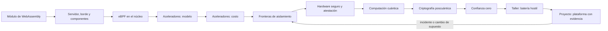

# Parte 48 — Runtimes y plataformas modernas

Las partes anteriores enseñaron a construir, probar, desplegar y operar software sobre un computador, un sistema operativo y una nube que se dan por sentados. Esta parte baja una capa y mira los runtimes y las plataformas que cambian lo que ese software puede asumir: un formato portable y validado que corre dentro de un proceso (WebAssembly y WASI), programas verificados dentro del núcleo (eBPF), aceleradores con otro modelo de ejecución y de memoria, fronteras de aislamiento de distinta fuerza y costo (procesos, contenedores, microVM, sandboxes), hardware que demuestra a distancia qué código corre, un ordenador cuántico que cambia los supuestos de la criptografía, los algoritmos que la sustituyen y una arquitectura de confianza que no depende de la red. Todo se mide sobre el caso sintético del programa, **el servicio *Avisos***, que ahora acepta código de las universidades, calcula un riesgo para cientos de miles de estudiantes y debe poder explicar qué cubre y qué no cubre su aislamiento.

## Pregunta rectora

> Para este código que no escribimos y esta plataforma que no controlamos del todo, ¿qué puede hacer, qué lo contiene, cuánto cuesta esa contención, qué evidencia la prueba y qué supuesto, si falla, la rompe?

## Antes del recorrido clase por clase

Esta parte no defiende un runtime ni una moda: enseña a leer cada uno como un **paquete de garantías con un costo medible y un límite declarado**. Las dos primeras clases estudian el módulo de WebAssembly como unidad de aislamiento dentro de un proceso: su validación, su memoria lineal, el combustible que detiene un bucle, las importaciones que son sus únicas capacidades y WASI como modelo de capacidades (`SE-577`), y después lo que cuesta ejecutarlo en un servidor y en el borde, con la separación de compilar, serializar e instanciar, la política de instancias y el papel del modelo de componentes (`SE-578`). La tercera ejecuta de verdad programas eBPF en el núcleo de Linux de WSL2: nueve programas cargados, lo que el verificador acepta o rechaza con su mensaje real y el costo por ejecución (`SE-579`). Las dos siguientes tratan los aceleradores sin hardware disponible: el modelo de ejecución y de memoria con proxies de CPU y un modelo de divergencia (`SE-580`), y el rendimiento y el costo por petición con una tabla cuyos supuestos están a la vista (`SE-581`). Después vienen las fronteras de aislamiento, con el costo de crear un hilo, una instancia y un proceso y las comprobaciones que desmontan un sandbox casero (`SE-582`), y el hardware seguro, con la lógica de medición, cita y sellado y lo que la atestación no demuestra (`SE-583`). El bloque criptográfico es la computación cuántica simulada con NumPy (`SE-584`), la criptografía poscuántica con implementaciones reales de ML-KEM y ML-DSA y el plan de migración (`SE-585`) y la confianza cero con tokens de destinatario y vida corta (`SE-586`). Cierran un taller con una batería de comportamientos hostiles contra tres candidatos (`SE-587`) y un proyecto que une todo en una plataforma con evidencia encadenada y un informe firmado con un algoritmo poscuántico (`SE-588`).

El diagrama se lee de izquierda a derecha y no es un orden obligatorio de adopción: es el orden en que se explican los mecanismos y sus costos. El retorno indica que una decisión de aislamiento se revisa cuando un incidente o un cambio de supuesto (una vulnerabilidad, un algoritmo que se deprecia, un nuevo tipo de carga) invalida la evidencia, y que se vuelve a la pregunta de qué frontera contiene qué.

## Resultados acumulativos

Podrás compilar y ejecutar un módulo de WebAssembly con `wasmtime`, provocar una trampa por acceso fuera de memoria y comprobar que el almacén sigue utilizable, detener un bucle infinito con combustible, ver que el anfitrión puede recortar el tope de memoria que declara el módulo, repetir un módulo de WASI con y sin un directorio concedido y comparar la misma suma en Wasm, Python puro y NumPy; medir los pasos del arranque (motor, compilación, deserialización, instancia), comparar una instancia reutilizada con una nueva por petición, comprobar que una importación no definida impide instanciar y explicar qué añade el modelo de componentes y qué no se ejecutó.

Podrás cargar programas eBPF reales en un núcleo de Linux, leer el mensaje del verificador de siete casos, entender que rechaza por complejidad y no «detecta bucles infinitos», ver un caso aceptado por conocimiento del análisis y ejecutar un contador cien mil veces con su costo por evento; medir la vectorización, el patrón de acceso a memoria y la intensidad aritmética con NumPy como proxy, modelar la divergencia de un grupo de 32 hilos, medir el lote y la precisión, calcular la ley de Amdahl con transferencia y construir una tabla de costo por millón de peticiones según la demanda con unidades enteras.

Podrás ejecutar cuatro comprobaciones de un sandbox casero (entorno heredado, tiempo no acotado, bucle incortable en un hilo y escape por introspección), medir el costo de crear un hilo, una instancia y un proceso y modelar capas con y sin causa común; construir una cadena de medición con extensión, una cita con desafío fresco, un sellado atado a la medición y un modelo de flota que muestra lo que la atestación de arranque no detecta; simular un estado de Bell y uno GHZ, medir el costo exponencial de simular qubits, ejecutar Grover y la búsqueda de periodo de Shor para N = 15 y medir el efecto del ruido.

Podrás ejecutar ML-KEM-768 y ML-DSA-65 reales, leer sus tamaños frente a X25519 y Ed25519 y su efecto en los segmentos de un saludo, ver el rechazo implícito, entender con una firma de Lamport por qué las claves de un solo uso no se reutilizan, aplicar la desigualdad de Mosca y comprobar un esquema híbrido; emitir y verificar tokens con audiencia y expiración, calcular el radio de daño de una credencial robada en tres arquitecturas y la ventana de uso indebido según su vida; y ejecutar una batería de seis comportamientos hostiles contra tres candidatos, construir una plataforma con validador de subida, límites, registro encadenado y un informe firmado, y escribir un expediente con su tabla amenaza-mecanismo-prueba.

## Prerrequisitos enlazados

- [Parte 01 — Computadores y representación de la información](../../classes/part-01-computadores-y-representacion-de-informacion/): CPU e instrucciones (`SE-017`), memoria y cachés (`SE-018`), procesos e interrupciones (`SE-019`), compilación y JIT (`SE-020`) y runtimes y máquinas virtuales (`SE-021`).
- [Parte 21 — Software móvil, de escritorio y multiplataforma](../../classes/part-21-software-movil-escritorio-y-multiplataforma/): firma, sandbox y seguridad del cliente (`SE-262`).
- [Parte 29 — Cloud, plataforma e infraestructura](../../classes/part-29-cloud-plataforma-e-infraestructura/): máquinas virtuales, contenedores y aislamiento (`SE-350`), orquestación (`SE-351`), serverless (`SE-352`) y redes, identidad y secretos en cloud (`SE-353`).
- [Parte 31 — Calidad, rendimiento y resiliencia](../../classes/part-31-calidad-rendimiento-y-resiliencia/): latencia, throughput y saturación (`SE-376`), perfiles y errores de medición (`SE-377`) y escalado y costos (`SE-356` en la Parte 29).
- [Parte 32 — Seguridad, privacidad y cumplimiento](../../classes/part-32-seguridad-privacidad-y-cumplimiento/): modelos de amenaza (`SE-385`), identidad y sesiones (`SE-386`), autorización y mínimo privilegio (`SE-387`), criptografía aplicada y claves (`SE-389`) y secretos (`SE-390`).
- [Parte 33 — Build, release y cadena de suministro](../../classes/part-33-build-release-y-cadena-de-suministro/): dependencias (`SE-399`), SBOM, procedencia y atestaciones (`SE-400`) y firmas y verificación (`SE-401`).
- Python 3.11+ y terminal. Los experimentos usan la biblioteca estándar y NumPy; los de WebAssembly y criptografía poscuántica usan además `wasmtime`, `kyber-py` y `dilithium-py` con versión fija (si faltan, el script lo declara y no inventa un resultado). El experimento de eBPF necesita un Linux con permisos de administrador (se ejecutó en WSL2).

## Bloques y progresión

1. **Aislar código dentro del proceso y del núcleo:** las clases 577 a 579 estudian WebAssembly, su ejecución en servidor y borde, y eBPF, con ejecuciones reales de ambos.
2. **Aceleradores y fronteras:** las clases 580 a 582 tratan el modelo y el costo de los aceleradores y las fronteras de aislamiento, con la advertencia de lo que no se pudo ejecutar.
3. **Confianza, cuántica y criptografía:** las clases 583 a 586 cubren el hardware seguro y la atestación, la computación cuántica, la criptografía poscuántica y su migración, y la confianza cero.
4. **Elegir y construir con evidencia:** las clases 587 y 588 aplican la parte con una batería hostil y una plataforma de ejecución aislada con un expediente revisable.

## Evidencia medida y límites

Las figuras y los ejemplos de esta parte usan experimentos ejecutados en Windows 11 con CPython 3.12.9, NumPy 2.5.5, `wasmtime` 50.0.1, `kyber-py` 1.2.0 y `dilithium-py` 1.5.1; el experimento de eBPF se ejecutó en WSL2 (núcleo `6.18.58.1-microsoft-standard-WSL2`, Python 3.12.3). Los recuentos, los tamaños y las simulaciones con semilla 48 se repiten idénticos; los tiempos de reloj varían entre ejecuciones y entre equipos. **No se invocó ningún modelo de lenguaje.**

Lo que se ejecutó de verdad: módulos de WebAssembly escritos a mano, compilados y ejecutados con `wasmtime` (trampas, combustible, límites de memoria, WASI con y sin directorio, pasos del arranque y aislamiento entre peticiones); nueve programas eBPF cargados en un núcleo de Linux con su veredicto y su mensaje reales y un contador ejecutado cien mil veces; mediciones de CPU con NumPy (vectorización, patrón de acceso, lote, precisión, producto de matrices); comprobaciones de un sandbox casero y costo de crear un hilo, una instancia y un proceso; simulación de circuitos cuánticos con vectores de estado y la transformada rápida de Fourier; ML-KEM-768 y ML-DSA-65 con sus tamaños; una firma de Lamport con SHA-256; tokens firmados con HMAC; una batería hostil de seis comportamientos; y una plataforma mínima con registro encadenado e informe firmado con ML-DSA-65.

Lo que **no se ejecutó** y se declara en cada clase: ningún núcleo en una GPU (el controlador de la GPU del equipo informó «GPU is lost») ni ningún acelerador alquilado; ningún entorno de ejecución confiable ni TPM (la lógica de medición, cita y sellado se simuló con SHA-256 y HMAC); ningún ordenador cuántico ni SDK de proveedor (todo se simuló de forma clásica); el modelo de componentes de WebAssembly (el paquete de Python no lo expone); ningún programa eBPF enganchado a tráfico real, rastreo o seguridad; ningún contenedor, microVM, gVisor, Firecracker ni Kata; ningún saludo TLS real ni SLH-DSA; ningún emisor de identidad, malla de servicios ni punto de decisión de política; y ningún sistema de producción. Las implementaciones de `kyber-py` y `dilithium-py` son de estudio, no de producción: sus tiempos no representan implementaciones optimizadas.

Los parámetros del autor (precios y capacidades de la tabla de costos, probabilidades por capa, porcentajes de la flota, el radio de daño de 200 servicios, la detección de media 20 minutos, los valores de la desigualdad de Mosca, las reglas de aviso del proyecto) son construcciones didácticas y no mediciones de ningún proveedor ni sistema. Las cifras de recursos para factorizar RSA-2048 vienen de un artículo citado, no de este laboratorio. Una revisión editorial humana independiente de la parte sigue pendiente.

## Guía razonada clase por clase

*Avisos* abre su plataforma a código de terceros y a cargas más pesadas mientras cambian los supuestos de la criptografía. Cada clase explica qué runtime o frontera atiende el problema, qué experimento lo mide, qué no demuestra y qué evidencia permitiría abandonar la conclusión.

### Bloque 1 — Aislar código dentro del proceso y del núcleo

#### SE-577 — WebAssembly y WASI

Un módulo de WebAssembly es un binario validado que corre en una memoria lineal propia y solo toca el mundo por las importaciones que el anfitrión define. La clase compila a mano un módulo de 236 bytes, provoca una trampa, detiene un bucle infinito con combustible, comprueba que el anfitrión recorta la memoria que declara el módulo, repite WASI con y sin un directorio concedido y mide la misma suma en Wasm, Python y NumPy.

El estudiante entrega la lista de importaciones que concedería a una regla de terceros con las tres pruebas de contención. `SE-578` pasa del módulo único al servicio con muchas peticiones.

#### SE-578 — WebAssembly en servidor y borde: component model

El arranque en frío es la suma de pasos con costos muy distintos. La clase separa motor, compilación, deserialización e instancia, compara una instancia reutilizada con una nueva por petición, enlaza un módulo que pide una capacidad no concedida y describe lo que el modelo de componentes añade, declarando que no se ejecutó.

El estudiante entrega el plan de ejecución con la tabla de costos por paso y la política de instancias. `SE-579` cambia de runtime: el núcleo de Linux.

#### SE-579 — eBPF: observabilidad, red y seguridad en el kernel

eBPF permite ejecutar programas pequeños dentro del núcleo tras un verificador que decide antes de ejecutar. La clase ensambla y carga nueve programas en un núcleo real, lee los mensajes del verificador, muestra que rechaza por complejidad y no por «detectar bucles», ejecuta un contador cien mil veces y lo compara con la misma cuenta en Python.

El estudiante entrega los veredictos con el mensaje literal y la política de quién carga. `SE-580` pasa a los aceleradores.

### Bloque 2 — Aceleradores y fronteras

#### SE-580 — GPU y aceleradores: modelo de ejecución

Un acelerador gana con mucho trabajo regular por byte movido, y la memoria suele decidir. Sin GPU utilizable, la clase mide con NumPy la vectorización, el patrón de acceso y la intensidad aritmética, y modela la divergencia de un grupo de 32 hilos con semilla fija, declarando que es un proxy.

El estudiante entrega el modelo de ejecución con tres cargas clasificadas. `SE-581` convierte el modelo en economía.

#### SE-581 — Rendimiento y costo en aceleradores

El costo por petición depende de la utilización más que del precio por hora. La clase mide el efecto del lote (con una anomalía que se deja a la vista) y de la precisión, calcula Amdahl con transferencia y construye una tabla de costo por demanda con unidades enteras y supuestos declarados.

El estudiante entrega la tabla con sus supuestos y la condición que cambiaría la decisión. `SE-582` estudia las fronteras para ejecutar código ajeno.

#### SE-582 — Contenedores, microVM y sandboxes

Las fronteras se ordenan por lo que comparten con el anfitrión. La clase mide el costo de crear un hilo, una instancia de Wasm y un proceso, ejecuta cuatro comprobaciones que desmontan un sandbox casero y calcula cuánto suman las capas según compartan o no una causa de fallo.

El estudiante entrega una matriz de decisión por confianza y por inquilino. `SE-583` baja al hardware.

### Bloque 3 — Confianza, cuántica y criptografía

#### SE-583 — Hardware seguro: TEE y atestación

Un entorno de ejecución confiable promete aislar datos en uso y la atestación demuestra qué código corre, no que sea seguro. La clase construye la lógica de medición, cita con desafío y sellado, y modela una flota para mostrar qué detecta la atestación de arranque y qué no, declarando que no se ejecutó hardware de confianza.

El estudiante entrega el protocolo de atestación de un servicio con sus amenazas fuera de alcance. `SE-584` cambia los supuestos de la criptografía.

#### SE-584 — Computación cuántica para ingenieros de software

Un ordenador cuántico no prueba todo a la vez: organiza interferencia para un problema con estructura. La clase simula circuitos con NumPy, mide el costo exponencial de simularlos, ejecuta Grover (y su caída al pasarse de iteraciones) y la búsqueda de periodo de Shor para N = 15, y mide el ruido sobre un estado GHZ.

El estudiante entrega una clasificación de afirmaciones por su respaldo y un inventario de criptografía de clave pública. `SE-585` es el plan.

#### SE-585 — Criptografía poscuántica y migración

La migración consiste en inventariar, priorizar por vida útil de los datos y probar que los nuevos tamaños no rompen nada. La clase ejecuta ML-KEM-768 y ML-DSA-65 reales, compara tamaños y segmentos de un saludo, enseña el rechazo implícito y la lección de una firma basada en resumen de un solo uso, aplica la desigualdad de Mosca y comprueba un esquema híbrido.

El estudiante entrega un plan de migración con inventario, prioridad y riesgos de tamaño. `SE-586` decide quién puede pedir qué a quién.

#### SE-586 — Confianza cero en la práctica

La confianza cero se mide en radio de daño y en minutos de uso de una credencial robada. La clase emite y verifica tokens con destinatario y expiración, calcula servicios alcanzables en tres arquitecturas y modela la ventana de uso indebido según la vida de la credencial frente al retraso de detección.

El estudiante entrega el mapa de flujos con su política y la política de fallo del punto de decisión. `SE-587` pone todo a prueba.

### Bloque 4 — Elegir y construir con evidencia

#### SE-587 — Taller: elegir y aislar un runtime para una carga no confiable

La elección de una frontera se confirma con una batería, no con una opinión. El taller ejecuta seis comportamientos hostiles contra `exec` sin funciones integradas, un proceso hijo con entorno vacío y un módulo de WebAssembly con combustible, y deriva una regla de decisión por carga.

El estudiante entrega su matriz predicha frente a la medida y la regla de decisión. `SE-588` la convierte en una plataforma.

#### SE-588 — Proyecto: plataforma de ejecución aislada con evidencia

Un mecanismo sin una prueba que falle si falta no es evidencia. El proyecto une validador de subida, límites por petición, política de falla, registro encadenado por resúmenes e informe firmado con ML-DSA-65, y exige una tabla amenaza-mecanismo-prueba y una sección «no cubierto».

El estudiante entrega el expediente de su plataforma con las pruebas que lo respaldan. Con esta clase se cierra la parte.

## Resumen operativo del recorrido

| Clase | Núcleo profesional | Aporte acumulativo |
|---|---|---|
| [SE-577](../../classes/part-48-runtimes-y-plataformas-modernas/se-577-webassembly-y-wasi/) | WebAssembly y WASI | Entrega la lista de importaciones que concedería a una regla de terceros con las tres pruebas de contención |
| [SE-578](../../classes/part-48-runtimes-y-plataformas-modernas/se-578-webassembly-en-servidor-y-borde-component-model/) | WebAssembly en servidor y borde: component model | Entrega el plan de ejecución con la tabla de costos por paso y la política de instancias |
| [SE-579](../../classes/part-48-runtimes-y-plataformas-modernas/se-579-ebpf-observabilidad-red-y-seguridad-en-el-kernel/) | eBPF: observabilidad, red y seguridad en el kernel | Entrega los veredictos del verificador con su mensaje literal y la política de quién carga |
| [SE-580](../../classes/part-48-runtimes-y-plataformas-modernas/se-580-gpu-y-aceleradores-modelo-de-ejecucion/) | GPU y aceleradores: modelo de ejecución | Entrega el modelo de ejecución con tres cargas clasificadas |
| [SE-581](../../classes/part-48-runtimes-y-plataformas-modernas/se-581-rendimiento-y-costo-en-aceleradores/) | Rendimiento y costo en aceleradores | Entrega la tabla de costo por demanda con sus supuestos y la condición de revisión |
| [SE-582](../../classes/part-48-runtimes-y-plataformas-modernas/se-582-contenedores-microvm-y-sandboxes/) | Contenedores, microVM y sandboxes | Entrega la matriz de decisión por confianza, inquilinos y frontera |
| [SE-583](../../classes/part-48-runtimes-y-plataformas-modernas/se-583-hardware-seguro-tee-y-atestacion/) | Hardware seguro: TEE y atestación | Entrega el protocolo de atestación de un servicio con sus amenazas fuera de alcance |
| [SE-584](../../classes/part-48-runtimes-y-plataformas-modernas/se-584-computacion-cuantica-para-ingenieros-de-software/) | Computación cuántica para ingenieros de software | Entrega la clasificación de afirmaciones y el inventario de criptografía de clave pública |
| [SE-585](../../classes/part-48-runtimes-y-plataformas-modernas/se-585-criptografia-poscuantica-y-migracion/) | Criptografía poscuántica y migración | Entrega el plan de migración con inventario, prioridad y riesgos de tamaño |
| [SE-586](../../classes/part-48-runtimes-y-plataformas-modernas/se-586-confianza-cero-en-la-practica/) | Confianza cero en la práctica | Entrega el mapa de flujos con su política y la política de fallo del punto de decisión |
| [SE-587](../../classes/part-48-runtimes-y-plataformas-modernas/se-587-taller-elegir-y-aislar-un-runtime-para-una-carga-no-confiable/) | Taller: elegir y aislar un runtime para una carga no confiable | Entrega la matriz predicha frente a la medida y la regla de decisión por carga |
| [SE-588](../../classes/part-48-runtimes-y-plataformas-modernas/se-588-proyecto-plataforma-de-ejecucion-aislada-con-evidencia/) | Proyecto: plataforma de ejecución aislada con evidencia | Entrega el expediente de su plataforma con la tabla amenaza-mecanismo-prueba y las pruebas que la respaldan |

## Fuentes

- [WebAssembly Core Specification](https://webassembly.github.io/spec/core/), [WebAssembly: Security](https://webassembly.org/docs/security/), [WASI](https://wasi.dev/), [Component Model](https://component-model.bytecodealliance.org/) y [Wasmtime](https://docs.wasmtime.dev/) — formato, aislamiento, capacidades, componentes y runtime; autoridad: la comunidad de WebAssembly y la Bytecode Alliance.
- [ebpf.io, «What is eBPF?»](https://ebpf.io/what-is-ebpf/), [documentación del núcleo: BPF](https://docs.kernel.org/bpf/) y [verificador](https://docs.kernel.org/bpf/verifier.html), [`bpf(2)`](https://man7.org/linux/man-pages/man2/bpf.2.html) y [seccomp](https://docs.kernel.org/userspace-api/seccomp_filter.html) — programas verificados en el núcleo y filtrado de llamadas; autoridad: el proyecto del núcleo de Linux y la eBPF Foundation.
- [NVIDIA, «CUDA Programming Guide»](https://docs.nvidia.com/cuda/cuda-programming-guide/), [Williams, Waterman y Patterson, «Roofline»](https://www2.eecs.berkeley.edu/Pubs/TechRpts/2008/EECS-2008-134.html) y [Google, «Service Level Objectives»](https://sre.google/sre-book/service-level-objectives/) — modelo de ejecución de aceleradores, rendimiento por intensidad aritmética y latencia por percentiles; autoridad: NVIDIA, UC Berkeley y Google.
- [NIST SP 800-190](https://csrc.nist.gov/pubs/sp/800/190/final), [`namespaces(7)`](https://man7.org/linux/man-pages/man7/namespaces.7.html), [cgroup v2](https://docs.kernel.org/admin-guide/cgroup-v2.html), [gVisor](https://gvisor.dev/docs/), [Firecracker](https://firecracker-microvm.github.io/), [Kata Containers](https://katacontainers.io/) y la [especificación de ejecución de OCI](https://github.com/opencontainers/runtime-spec) — contenedores, microVM y sandboxes; autoridad: NIST, el proyecto del núcleo y los proyectos citados.
- [RFC 9334 (RATS)](https://www.rfc-editor.org/info/rfc9334/), [Confidential Computing Consortium](https://confidentialcomputing.io/), [AMD SEV](https://www.amd.com/en/developer/sev.html), [Arm CCA](https://www.arm.com/architecture/security-features/arm-confidential-compute-architecture), [AWS Nitro Enclaves](https://docs.aws.amazon.com/enclaves/latest/user/nitro-enclave.html) y [TPM 2.0](https://www.trustedcomputinggroup.org/resources/documents/tpm-library-specification) — atestación y entornos de ejecución confiables; autoridad: IETF, CCC y los fabricantes citados, que describen sus propios productos.
- [Shor](https://arxiv.org/abs/quant-ph/9508027), [Grover](https://arxiv.org/abs/quant-ph/9605043), [Preskill, «NISQ»](https://arxiv.org/abs/1801.00862), [Gidney, «less than a million noisy qubits»](https://arxiv.org/abs/2505.15917) y la [documentación de IBM Quantum](https://quantum.cloud.ibm.com/docs/en/guides) — algoritmos, ruido y estimaciones de recursos; autoría de los investigadores citados.
- [NIST FIPS 203](https://csrc.nist.gov/pubs/fips/203/final), [FIPS 204](https://csrc.nist.gov/pubs/fips/204/final), [FIPS 205](https://csrc.nist.gov/pubs/fips/205/final), [NIST IR 8547](https://csrc.nist.gov/pubs/ir/8547/ipd), [RFC 10024](https://datatracker.ietf.org/doc/rfc10024/), [RFC 8446](https://www.rfc-editor.org/info/rfc8446/) y [NCSC](https://www.ncsc.gov.uk/whitepaper/preparing-for-quantum-safe-cryptography) — criptografía poscuántica, transición y TLS híbrido; autoridad: NIST, IETF y NCSC.
- [NIST SP 800-207](https://csrc.nist.gov/pubs/sp/800/207/final), [CISA, «Zero Trust Maturity Model»](https://www.cisa.gov/zero-trust-maturity-model), [SPIFFE](https://spiffe.io/docs/latest/spiffe-about/overview/), [BeyondCorp](https://cloud.google.com/beyondcorp) y [OWASP ASVS](https://owasp.org/www-project-application-security-verification-standard/) — arquitectura de confianza cero e identidad de cargas de trabajo; autoridad: NIST, CISA, SPIFFE, Google y OWASP.
- [SLSA](https://slsa.dev/), [in-toto](https://in-toto.io/), [RFC 2104](https://www.rfc-editor.org/rfc/rfc2104), [NumPy](https://numpy.org/doc/stable/) y la [documentación de Python](https://docs.python.org/3/) (`hashlib`, `hmac`, `socket`, `subprocess`, `timeit`) — procedencia, autenticación de mensajes y herramientas usadas por los experimentos; autoridad: OpenSSF, IETF, el proyecto NumPy y la Python Software Foundation.

Las fuentes se vinculan también dentro de cada clase. Definen vocabulario y describen mecanismos; que un runtime o una frontera convenga a un sistema se demuestra con el caso, la evidencia medida y la revisión de otra persona, no con la autoridad de la fuente. Varias son documentación de fabricantes sobre sus propios productos y se leen como tales.

## Criterios de aceptación de la parte

- cada clase conecta mecanismo, medida y límite en una conclusión revisable;
- cada medida puede reproducirse desde un checkout limpio con las mismas versiones y semillas, salvo las lecturas de reloj, que declaran por qué no;
- ninguna afirmación sobre un acelerador, un entorno de ejecución confiable, un ordenador cuántico, un contenedor o una microVM se apoya en una medición que no se hizo: lo no ejecutado se declara;
- el expediente final se puede aplicar a una carga nueva por otra persona y declara sus supuestos, su tabla amenaza-mecanismo-prueba y lo que su plataforma no cubre.

[Volver al índice de clases](../../classes/README.md)
