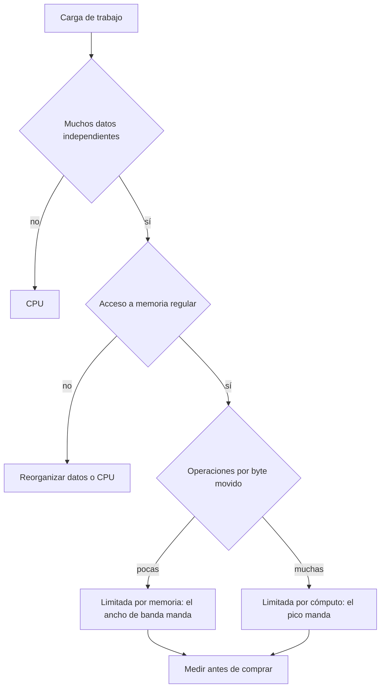
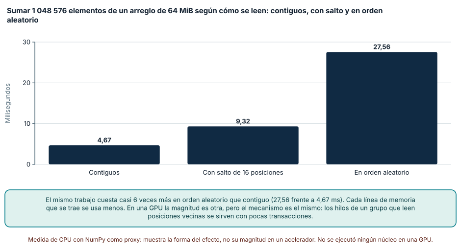
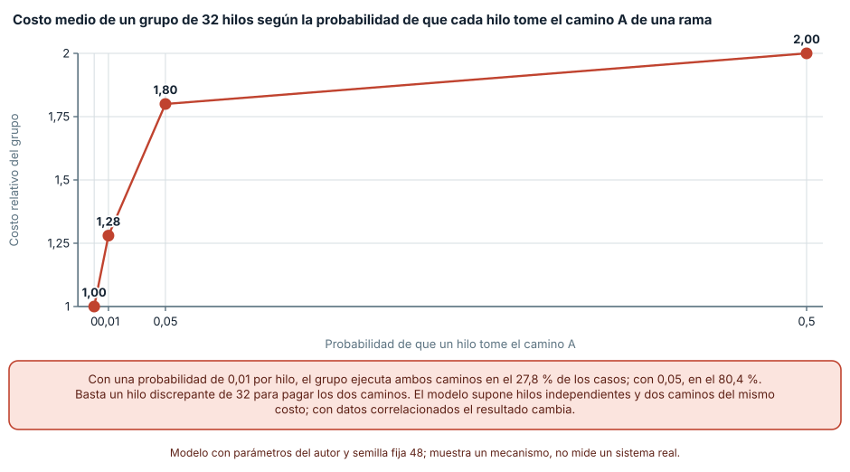
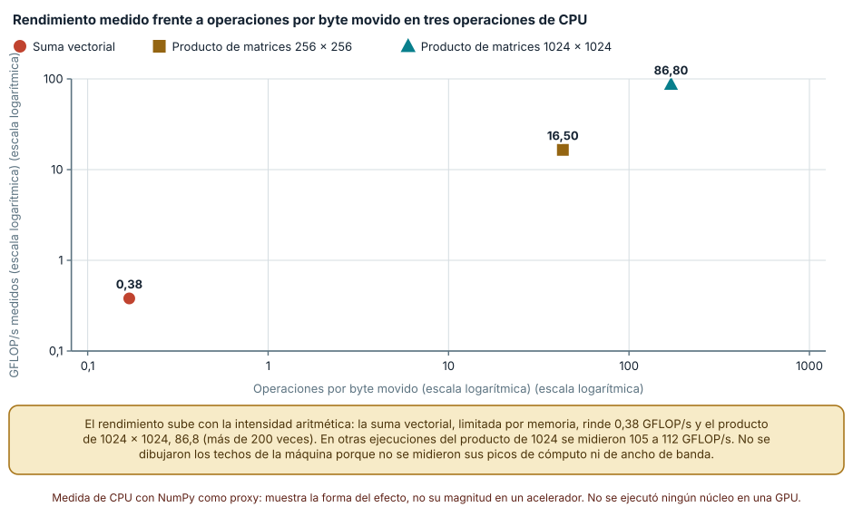

# SE-580 — GPU y aceleradores: modelo de ejecución

## Punto profesional y fundamento pedagógico

**Punto profesional.** La clase existe para que puedas razonar sobre un acelerador sin haberlo tocado y sin creer que «la GPU es una CPU más rápida». Una GPU ejecuta el mismo programa sobre miles de datos a la vez, agrupando hilos en bloques de ejecución que avanzan juntos, y su rendimiento lo decide con más frecuencia el movimiento de datos que la aritmética. Quien lo ignora porta un bucle a un acelerador y obtiene un programa más lento, o compra el hardware para una carga limitada por memoria y descubre que gastó en cómputo que no podía usar. Esta clase da el modelo mental (jerarquía de hilos, jerarquía de memoria, divergencia, intensidad aritmética) y lo comprueba en lo que sí se puede medir en CPU.

**Por qué aparece aquí.** Sigue a `SE-579` con otro dominio de cómputo especializado y prepara `SE-581` (rendimiento y costo en aceleradores). Retoma `SE-018` (memoria, cachés y jerarquías), `SE-022` (rendimiento y límites físicos) y `SE-377` (benchmarks y errores de medición).

**Error conceptual que debe corregir.** Creer que paralelizar es suficiente. Un acelerador gana cuando hay muchísimo trabajo independiente, el patrón de acceso a memoria es regular y se hacen muchas operaciones por cada byte que se mueve. Cuando falta alguna de las tres, el mismo programa en un acelerador puede ser más lento que en una CPU. En esta clase se mide el efecto de las tres con NumPy como sustituto: un bucle frente a vectorizar (25 veces), acceso contiguo frente a aleatorio (casi 6 veces) y operaciones limitadas por memoria frente a limitadas por cómputo (de 0,4 a más de 80 GFLOP/s).

**Secuencia de aprendizaje.** Antes de ejecutar, predices cuánto más rápido es sumar de forma vectorizada que con un bucle y cuánto más lento es leer en orden aleatorio que contiguo. Después mides ambas cosas, calculas la intensidad aritmética de tres operaciones, simulas la divergencia de un grupo de 32 hilos con una semilla fija y decides, con una regla escrita, qué cargas de *Avisos* podrían beneficiarse de un acelerador.

**Evidencia de aprendizaje.** `modelo-de-acelerador.md` con el modelo de ejecución en tus palabras, las medidas de vectorización, de patrón de acceso y de intensidad aritmética, la tabla de divergencia y una clasificación de tres cargas de tu sistema según si el acelerador les conviene.

**Límite de la conclusión.** **No se ejecutó ningún núcleo en una GPU**: en la máquina de desarrollo el controlador de la tarjeta informó `GPU is lost` y no hubo dispositivo utilizable. Todo lo medido es CPU con NumPy 2.5.5 en Windows 11, usado como *proxy didáctico*: muestra la forma de los efectos (vectorización, patrón de acceso, intensidad aritmética), no sus magnitudes en una GPU, donde son distintas. La divergencia es un modelo con semilla 48. Los datos de hardware citados vienen de la guía de programación de CUDA, no de una medición propia. No se invocó ningún modelo de lenguaje.

### Trazabilidad fuente → afirmación

| Fuente primaria u oficial | Afirmación que respalda | Lo que no prueba |
|---|---|---|
| [NVIDIA CUDA Programming Guide](https://docs.nvidia.com/cuda/cuda-programming-guide/) | Describe el modelo de hilos agrupados en bloques y en rejillas, la ejecución por grupos de 32 hilos (*warps*), la jerarquía de memoria y la divergencia de ramas. | No es una medición de ningún dispositivo concreto. |
| [Williams, Waterman y Patterson, «Roofline: An Insightful Visual Performance Model for Multicore Architectures»](https://www2.eecs.berkeley.edu/Pubs/TechRpts/2008/EECS-2008-134.html) | Propone acotar el rendimiento por el menor entre el pico de cómputo y el ancho de banda multiplicado por la intensidad aritmética. | No predice el rendimiento exacto de un programa. |
| [NumPy: documentación](https://numpy.org/doc/stable/) | Documenta las operaciones vectorizadas y el producto de matrices que se usan como proxy. | No equivale a un núcleo de GPU. |
| [Python: `timeit`](https://docs.python.org/3/library/timeit.html) | Documenta las precauciones de medición de tiempos pequeños. | No fija cuántas repeticiones bastan. |

## Antes de empezar

Recupera lo aprendido en `SE-018`: una lectura que acierta en caché es mucho más barata que una que va a memoria principal. La pregunta activa es: **si miles de hilos piden datos al mismo tiempo y cada uno quiere una posición distinta de memoria, ¿qué esperarías que ocurriera con el ancho de banda y con la latencia, y cómo cambiaría si pidieran posiciones consecutivas?**

## Prerrequisitos

- Haber completado `SE-577` a `SE-579` y conocer de `SE-017` y `SE-018` la jerarquía de memoria y el cómputo vectorial.
- Entender de `SE-377` por qué un benchmark necesita varias repeticiones y un entorno declarado.
- Python 3.11 o posterior con NumPy. Si hay una GPU utilizable, la clase se enriquece, pero no es necesaria: el experimento no la usa.

## Problema auténtico

*Avisos* añadió una puntuación de «riesgo de no entrega» para cada estudiante: un modelo pequeño que combina historial, carga de trabajo y proximidad del plazo, evaluado sobre 400 000 estudiantes cada noche y bajo demanda cuando un docente abre un panel. El primer prototipo es un bucle en Python: tarda más de lo que dura la noche. Alguien propone «usar una GPU». Antes de comprar o alquilar nada, el equipo necesita responder tres preguntas: ¿el trabajo es del tipo que un acelerador acelera?, ¿qué parte del tiempo se iría en mover datos?, ¿cuánto de la mejora se conseguiría simplemente con vectorizar en CPU?

La clase construye el vocabulario y las mediciones para responder sin hardware: vectoriza, cambia el patrón de acceso, calcula la intensidad aritmética y modela qué pasa cuando los hilos de un grupo toman caminos distintos.

## Objetivos observables

Al terminar podrás:

1. describir el modelo de ejecución de un acelerador (hilos, bloques, rejillas, grupos de 32 hilos que avanzan juntos) y decir qué lo distingue de una CPU;
2. describir la jerarquía de memoria (registros, memoria compartida del bloque, memoria global) y por qué el patrón de acceso importa más que la aritmética;
3. calcular la intensidad aritmética de una operación y decir si probablemente está limitada por memoria o por cómputo;
4. explicar la divergencia y estimar su costo con un modelo simple;
5. clasificar una carga de tu sistema como adecuada, dudosa o inadecuada para un acelerador, con una justificación basada en esas cuatro ideas.

## Mapa conceptual



Las tres preguntas ordenan la decisión: si no hay paralelismo de datos no hay acelerador; si hay, el acceso a memoria decide si el cómputo se puede alimentar; y la intensidad aritmética dice cuál de los dos techos se alcanzará primero.

## Temas y por qué importan

| Tema | Por qué cambia una decisión profesional | Evidencia mínima |
|---|---|---|
| Paralelismo de datos | Es la condición de entrada: un mismo programa sobre muchos datos. | Bucle frente a vectorizado |
| Jerarquía de hilos | Los hilos se ejecutan en grupos que avanzan juntos. | Descripción del modelo |
| Jerarquía de memoria | El costo de un acceso depende de dónde está el dato. | Tiempos por patrón de acceso |
| Coalescencia | Accesos contiguos de un grupo se sirven con pocas transacciones. | Contiguo frente a aleatorio |
| Divergencia | Si un grupo toma caminos distintos, ejecuta ambos. | Tabla del modelo |
| Intensidad aritmética | Predice si manda la memoria o el cómputo. | Operaciones por byte y GFLOP/s |
| Transferencia | Mover datos al acelerador y de vuelta también cuesta. | Cálculo de la clase siguiente |

## Conceptos y decisiones

### 1. Un programa, muchos datos

Una CPU moderna está diseñada para ejecutar pocos hilos muy rápido: cachés grandes, predicción de saltos, ejecución fuera de orden. Un acelerador de tipo GPU está diseñado para ejecutar *muchísimos* hilos simples a la vez y tolerar la latencia de memoria cambiando de hilo en lugar de esperarla. El modelo de programación (SIMT, un mismo programa y muchos hilos) pide escribir lo que hace *un* hilo para *un* dato; el sistema lo lanza sobre todos. Por eso el trabajo que se traslada bien es el que tiene la forma de «aplicar la misma función a cada elemento» o «combinar elementos con una operación asociativa». La medición proxy lo muestra con una operación elemental: `2·a + b` sobre 2 000 000 de valores de 32 bits tardó unos 11 ms vectorizada en NumPy y unos 280 ms con un bucle de Python (extrapolado desde 200 000 elementos), unas 25 veces más. Esa razón no es la de una GPU, pero ilustra que *expresar el trabajo como una operación sobre todos los datos* es el primer paso, y que en muchos casos vectorizar en CPU recupera gran parte de la mejora antes de comprar nada.

### 2. Hilos, bloques y grupos de 32

La guía de CUDA organiza los hilos en una jerarquía: los hilos se agrupan en *bloques*, los bloques en una *rejilla*. Dentro de un bloque los hilos pueden cooperar y compartir una memoria rápida; entre bloques no hay cooperación directa durante la ejecución. Físicamente, el hardware ejecuta los hilos de un bloque en grupos de 32 llamados *warps*, que avanzan en bloque: una sola instrucción se emite para los 32. El tamaño exacto y los detalles dependen de la arquitectura; el principio, no: la unidad de ejecución no es el hilo sino el grupo, y todo lo que haga que los hilos de un grupo se comporten distinto (ramas, accesos dispersos) cuesta.

### 3. La memoria manda

Hay tres niveles que importa distinguir: los registros de cada hilo (rápidos, pocos), una memoria compartida por bloque (rápida, pequeña, gestionada por el programador) y la memoria global (grande, con latencia de cientos de ciclos). El ancho de banda de la memoria global es muy alto, pero solo se alcanza cuando los hilos de un grupo piden direcciones contiguas, porque el hardware fusiona esas peticiones en pocas transacciones (coalescencia). El proxy en CPU reproduce la idea con la caché: sumar 1 048 576 elementos de un arreglo de 16 777 216 valores de 32 bits (64 MiB) tardó unos 4,7 ms leyendo posiciones contiguas, unos 9,3 ms con un salto de 16 posiciones y unos 27,6 ms en orden aleatorio: casi seis veces el contiguo. Los números de una GPU son otros, pero la forma es la misma: *lo que importa es cuánto de cada línea de memoria que se trae se usa*. Reorganizar los datos (por ejemplo, de un arreglo de estructuras a una estructura de arreglos) para que los hilos vecinos lean posiciones vecinas es, con frecuencia, la mejora más grande.

### 4. Divergencia: cuando el grupo no está de acuerdo

Si dentro de un grupo de 32 hilos algunos toman el camino A de una rama y otros el B, el grupo ejecuta ambos caminos en serie, con los hilos que no corresponden inactivos. El modelo de la clase (semilla 48, 20 000 repeticiones) supone que cada hilo toma el camino A con probabilidad `p` de forma independiente y cuenta con qué frecuencia el grupo necesita ejecutar ambos caminos. Con `p = 0` nunca (costo relativo 1,00); con `p = 0,01` en el 27,8 % de los grupos (1,28); con `p = 0,05` en el 80,4 % (1,80); con `p = 0,5` en todos (2,00). La lectura útil es la segunda fila: *una rama que casi nunca se toma* (1 % de los hilos) obliga a ejecutar ambos caminos en más de una cuarta parte de los grupos, porque basta que un hilo de los 32 la tome. El remedio es reorganizar los datos para que los elementos que toman el mismo camino queden juntos (ordenar o particionar por la condición) o reformular la rama como aritmética sin salto. El modelo supone hilos independientes; con datos correlacionados la divergencia es menor o mayor, y por eso se mide en el programa real.

### 5. Intensidad aritmética: quién limita

El modelo *roofline* acota el rendimiento de un programa por el menor entre el pico de cómputo del hardware y el producto del ancho de banda de memoria por la intensidad aritmética (operaciones por byte movido). Dos operaciones que se midieron en la CPU del laboratorio muestran los extremos. `v·1,5 + w` sobre 8 000 000 de valores: dos operaciones por cada 12 bytes movidos (leer dos valores de 4 bytes y escribir uno), unos 0,4 GFLOP/s y unos 2 GB/s efectivos; la operación está limitada por memoria y el cómputo está casi ocioso. La multiplicación de matrices de 1024×1024 en 32 bits: alrededor de 171 operaciones por byte mínimo movido y unos 87 GFLOP/s en la primera medición (107 a 112 GFLOP/s en las siguientes del experimento de la clase `SE-581`), más de doscientas veces más rendimiento aritmético que la suma vectorial. En 256×256 son unas 43 operaciones por byte y unos 16,5 GFLOP/s: menor tamaño, menos reutilización, menos rendimiento. La conclusión operativa no cambia con el hardware: *una operación con pocas operaciones por byte no mejora por mover a un acelerador con más cómputo; mejora si el acelerador tiene más ancho de banda, y solo si los datos ya están allí.*

### 6. Dónde viven los datos

Un acelerador discreto tiene su propia memoria. Para usarlo hay que mover datos desde la memoria del anfitrión y devolver el resultado, y ese movimiento se hace por un bus mucho más lento que la memoria del propio acelerador. La consecuencia de diseño es que conviene hacer *mucho trabajo por dato transferido* y mantener los datos en el acelerador entre operaciones. Una operación elemental sola, aunque sea 100 veces más rápida en el acelerador, puede perderse en la transferencia. `SE-581` pone números a esa pérdida con la ley de Amdahl ampliada con un término de transferencia.

### 7. Qué parte de esto es propio de las GPU

La hoja de ruta de «acelerador» incluye GPU, pero también unidades de procesamiento tensorial, FPGA y otros aceleradores de propósito específico. Comparten la idea de fondo (más cómputo y más ancho de banda para patrones regulares) y difieren en lo demás: modelo de programación, precisiones soportadas, memoria y disponibilidad. Lo que sí se mantiene entre ellos es la pregunta de la clase: ¿tu carga tiene paralelismo de datos, acceso regular y suficientes operaciones por byte? Si no lo tiene, ningún acelerador la ayuda.

## Vectorizar, acceso a memoria y límites

La primera figura muestra cuánto cambia el tiempo según el patrón de acceso a memoria.



**Cómo leer la figura.** Cada barra es el mismo trabajo (sumar el mismo número de elementos) con un patrón de lectura distinto. Mira la diferencia entre contiguo y aleatorio: es lo que se pierde por no aprovechar cada línea de memoria que se trae. **Dónde deja de valer:** es una CPU con caché, no una GPU; la forma (el patrón regular gana) se traslada y la magnitud no. El tamaño del arreglo (64 MiB) está pensado para exceder la caché de esta máquina y puede no hacerlo en otra.

## Divergencia

La segunda figura muestra el modelo de divergencia de un grupo de 32 hilos.



**Cómo leer la figura.** El eje horizontal es la probabilidad de que un hilo tome el camino A y el vertical el costo medio del grupo relativo a ejecutar un solo camino. Mira cómo la curva sube casi vertical al principio: bastan pocos hilos discrepantes para pagar ambos caminos. **Dónde deja de valer:** el modelo supone hilos independientes, dos caminos del mismo costo y ningún mecanismo del hardware que mitigue la divergencia; es una ilustración del principio, no una predicción del costo en una GPU concreta.

## Memoria o cómputo

La tercera figura sitúa tres operaciones según su intensidad aritmética y el rendimiento que se midió.



**Cómo leer la figura.** Cada punto es una operación; a la derecha hay más operaciones por byte movido y arriba más rendimiento. Mira que el rendimiento sube con la intensidad: es la parte inclinada del modelo roofline. **Dónde deja de valer:** tres puntos de una CPU y una biblioteca (BLAS) con sus propias optimizaciones; no se dibujó el techo de cómputo ni el de ancho de banda de esta máquina porque no se midieron sus picos. En una GPU los valores absolutos son muy distintos.

## Definiciones de trabajo

- **SIMT:** modelo en el que un mismo programa lo ejecutan muchos hilos sobre datos distintos.
- **Bloque y rejilla:** agrupaciones de hilos; los hilos de un bloque cooperan, los de bloques distintos no.
- **Warp:** grupo de 32 hilos que avanzan juntos en el hardware descrito por la guía de CUDA.
- **Coalescencia:** fusión de accesos contiguos de un grupo en pocas transacciones de memoria.
- **Divergencia:** situación en que los hilos de un grupo toman caminos distintos y el grupo ejecuta ambos.
- **Intensidad aritmética:** operaciones realizadas por byte movido desde memoria.
- **Roofline:** modelo que acota el rendimiento por el pico de cómputo o por ancho de banda por intensidad.
- **Proxy:** medida sobre un sustituto accesible que muestra la forma de un efecto sin su magnitud.

## Ejemplo mínimo

Medir cuánto cuesta el patrón de acceso con NumPy:

```python
import time
import numpy as np

x = np.random.default_rng(48).random(1 << 24, dtype=np.float32)
contiguo = np.arange(0, (1 << 24) // 16)
aleatorio = np.random.default_rng(48).permutation(1 << 24)[: (1 << 24) // 16]

def mediana_ms(f, n=15):
    t = []
    for _ in range(n):
        s = time.perf_counter(); f(); t.append((time.perf_counter() - s) * 1000)
    return sorted(t)[n // 2]

print(mediana_ms(lambda: x[contiguo].sum()), mediana_ms(lambda: x[aleatorio].sum()))
```

La misma cantidad de elementos, dos patrones: la diferencia es el costo de no aprovechar cada línea de memoria. Es el efecto que en una GPU decide si los hilos de un grupo se sirven con una transacción o con treinta y dos.

## Ejemplo profesional

*Escenario ilustrativo: las cifras y los resultados que aparecen en este ejemplo son supuestos de la narración, no mediciones.*

El equipo de *Avisos* revisa el cálculo de riesgo antes de pedir presupuesto para un acelerador. Primero vectoriza el bucle de Python con NumPy: el tiempo nocturno baja de forma que cabe en la ventana sin hardware nuevo. Después mide qué parte del tiempo restante corresponde a leer las tablas de historial: los datos están organizados por estudiante y cada cálculo lee campos dispersos. Reorganizan los datos por columnas y el tiempo baja de nuevo. Entonces estiman el caso del panel bajo demanda: una petición evalúa a un grupo de 40 estudiantes y necesita responder en menos de 200 ms; un acelerador requeriría mover esos 40 registros y traerlos de vuelta por cada petición, y el trabajo por petición es demasiado pequeño para amortizar la transferencia. Concluyen que el acelerador no es la herramienta para el panel; para el cálculo nocturno de 400 000 estudiantes, con trabajo suficiente por transferencia, lo evaluarán con un prototipo medido antes de comprar. La decisión se escribió con las tres mediciones y con la condición que la cambiaría.

## Práctica guiada

1. Ejecuta `python scripts/experiments_part48_a.py gpu` y anota tu predicción y lo medido en cada una de las cuatro partes.
2. Repite la medida de acceso con otro tamaño de arreglo (por ejemplo 1 MiB y 1 GiB si tienes memoria) y observa cuándo desaparece la diferencia.
3. Calcula a mano la intensidad aritmética de una suma de dos vectores de 32 bits, de un producto escalar y de una multiplicación de matrices cuadradas de lado n.
4. Cambia en el modelo de divergencia el tamaño del grupo de 32 a 16 y a 64 y anota cómo cambia el costo con `p = 0,01`.
5. Clasifica tres cargas de tu sistema como adecuadas, dudosas o inadecuadas y escribe la pregunta que haría falta medir para cada una.

## Ejercicios

1. **Básico.** Explica por qué una rama que solo toman 1 de cada 100 hilos puede duplicar casi el costo en una proporción grande de grupos.
2. **Intermedio.** Calcula la intensidad aritmética de una convolución de núcleo 3×3 sobre una imagen de 1920×1080 de un canal en 32 bits y decide si probablemente está limitada por memoria o por cómputo.
3. **Avanzado.** Diseña un experimento para decidir si un trabajo nocturno de tu sistema se beneficia de un acelerador: qué mides en CPU, qué prototipo necesitas, qué transferencia incluyes y qué resultado haría que la respuesta fuera «no».

## Reto verificable

Entrega `modelo-de-acelerador.md` con las medidas de vectorización, de patrón de acceso y de intensidad aritmética en tu máquina y la clasificación de tres cargas. Es válido si otra persona reproduce la forma de cada efecto (orden de las barras y dirección de las razones), el documento declara su hardware y dice expresamente que no se midió ninguna GPU si no la hubo.

## Caso conductor

*Avisos* quiere calcular un riesgo para cientos de miles de estudiantes. La clase da el modelo para evaluarlo con las mediciones que se pueden hacer sin hardware. `SE-581` completa la decisión con lo que falta: qué rendimiento se obtiene de verdad, cuánto cuesta cada petición y a partir de qué demanda un acelerador compensa.

## Preguntas frecuentes

### ¿Hace falta una GPU para aprender esto?

No para el modelo ni para las medidas de esta clase, pero sí para saber cuánto rinde tu carga en un acelerador. La clase declara que no ejecutó ningún núcleo en GPU y deja el modelo y las preguntas a medir.

### ¿Por qué usar NumPy como proxy?

Porque ejecuta operaciones sobre arreglos con código compilado y vectorizado, y se puede medir en cualquier máquina. Muestra la forma de los efectos; no sustituye medir en el acelerador.

### ¿Más precisión o menos precisión?

Menos bits por valor significan menos bytes que mover y, en hardware con soporte, más operaciones por segundo. En la CPU del laboratorio, una multiplicación de 256×256 en 16 bits tardó cientos de veces más que en 32 (`SE-581`) porque NumPy no tiene un camino rápido en 16 bits en esa CPU: la precisión baja ayuda solo con soporte de hardware.

### ¿Un acelerador siempre es más caro?

No necesariamente por petición, pero sí por unidad de tiempo; la relación depende de la utilización. Se calcula en `SE-581`.

## Fallo controlado y diagnóstico

**Fallo.** Un equipo porta un cálculo a una GPU y la versión nueva tarda más que la de CPU, aunque el núcleo de cálculo corre mucho más rápido.

**Diagnóstico paso a paso.** (1) Se descompone el tiempo total: el núcleo de cómputo tarda una fracción pequeña. (2) La mayor parte es la transferencia de datos de ida y de vuelta en cada llamada. (3) El trabajo por llamada es pequeño (unos pocos miles de elementos), de modo que la transferencia no se amortiza. (4) Además, los datos están en un arreglo de estructuras y los hilos leen campos dispersos. (5) La corrección es agrupar muchas llamadas en una, mantener los datos en el acelerador entre pasos y reorganizar los datos por columnas.

**Lección.** El tiempo de un cálculo en un acelerador es transferencia más acceso a memoria más cómputo; solo el último es lo que el hardware anuncia. Se descompone antes de decidir.

## Errores comunes y cómo corregirlos

- **Pensar que cualquier bucle se acelera.** Corrige comprobando paralelismo de datos y trabajo suficiente.
- **Ignorar el patrón de acceso.** Corrige reorganizando los datos para accesos contiguos.
- **Ramas dependientes del dato dentro del núcleo.** Corrige particionando por la condición o escribiendo aritmética sin salto.
- **Comparar un acelerador con un bucle de Python en lugar de con CPU vectorizada.** Corrige con la mejor línea base de CPU.
- **No contar la transferencia.** Corrige midiendo de extremo a extremo.
- **Generalizar un proxy.** Corrige declarando qué se midió y dónde.

## Entorno y archivos clave

- `scripts/experiments_part48_a.py`: función `gpu`; se ejecuta con `python scripts/experiments_part48_a.py gpu`.
- `scripts/experiments_part48_lab.py`: utilidades de medición.
- `scripts/figures_part48_a.py`: las tres figuras de la clase.
- Python 3.11 o posterior y NumPy; no requiere GPU. En la máquina de desarrollo se confirmó que no había una GPU utilizable.

## Seguridad, ética y accesibilidad

Los aceleradores compartidos entre inquilinos plantean preguntas de aislamiento (memoria que no se borra entre usos, canales laterales) que dependen del proveedor y que esta clase no mide: pregunta qué ofrece el servicio y qué garantiza. Un modelo de riesgo de «no entrega» decide sobre personas: documenta qué datos usa, por qué es proporcionado y cómo se revisa. El consumo de energía de un acelerador es un costo ambiental real; mídelo cuando decidas. Las figuras llevan texto alternativo y valores escritos.

## Puente hacia el trabajo con agentes

Un agente que propone «usar una GPU» o «paralelizar con hilos» sin medir está haciendo una recomendación por reflejo. Pídele tres cosas: la línea base de CPU vectorizada, la descomposición del tiempo (transferencia, memoria, cómputo) y la condición bajo la cual su propuesta sería peor que la actual. Si el agente genera código para un acelerador, verifica que los datos se mueven una vez y que el patrón de acceso es contiguo; el agente tiende a trasladar el bucle tal cual.

## Transferencia

Elige un cálculo de tu sistema que consideres pesado. Descompón su tiempo en lectura de datos, cálculo y escritura; mide la intensidad aritmética; vectoriza en CPU y mide de nuevo. Escribe la condición bajo la cual un acelerador valdría la pena (volumen mínimo, trabajo por transferencia, utilización) y cómo la medirías.

## Evaluación y evidencia

| Criterio | Evidencia aceptable | Rechazo |
|---|---|---|
| Modelo de ejecución | Hilos, grupos, memoria y divergencia en tus palabras | Definiciones sin aplicación |
| Línea base | CPU vectorizada medida | Bucle ingenuo como comparación |
| Patrón de acceso | Dos o más patrones medidos | «Acceder mejor es mejor» |
| Intensidad aritmética | Cálculo y medición de dos operaciones | Opinión |
| Alcance | Declaración de que no se midió GPU | Presentar el proxy como medición de GPU |

## Fuentes

- NVIDIA. [«CUDA Programming Guide»](https://docs.nvidia.com/cuda/cuda-programming-guide/).
- S. Williams, A. Waterman, D. Patterson. [«Roofline: An Insightful Visual Performance Model for Multicore Architectures»](https://www2.eecs.berkeley.edu/Pubs/TechRpts/2008/EECS-2008-134.html).
- NumPy. [Documentación](https://numpy.org/doc/stable/).
- Python Software Foundation. [`timeit`](https://docs.python.org/3/library/timeit.html).

## Límites y siguiente paso

No se ejecutó ningún núcleo en una GPU; las medidas son de CPU y NumPy y la divergencia es un modelo con semilla 48. El siguiente paso, `SE-581`, lleva el modelo al terreno económico: qué rendimiento y qué costo por petición se obtienen según el tamaño del lote, la precisión y la utilización, con parámetros del autor para los precios.

## Glosario

| Término | Definición breve |
|---|---|
| SIMT | Un programa, muchos hilos sobre datos distintos |
| Bloque y rejilla | Agrupaciones de hilos para cooperar y para lanzar |
| Warp | Grupo de 32 hilos que avanzan juntos |
| Coalescencia | Fusión de accesos contiguos en pocas transacciones |
| Divergencia | Hilos de un grupo en caminos distintos |
| Intensidad aritmética | Operaciones por byte movido |
| Roofline | Cota de rendimiento por cómputo o por ancho de banda |
| Proxy | Medida sobre un sustituto que muestra la forma de un efecto |
