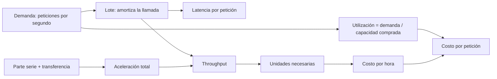
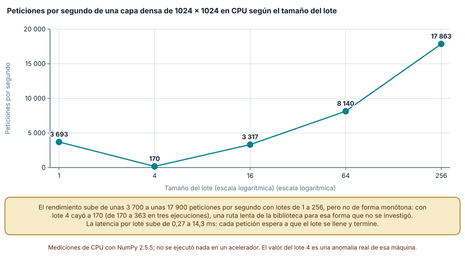
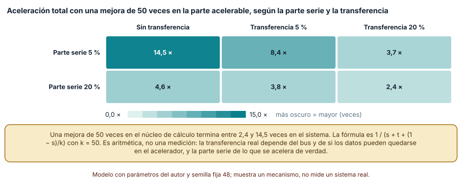
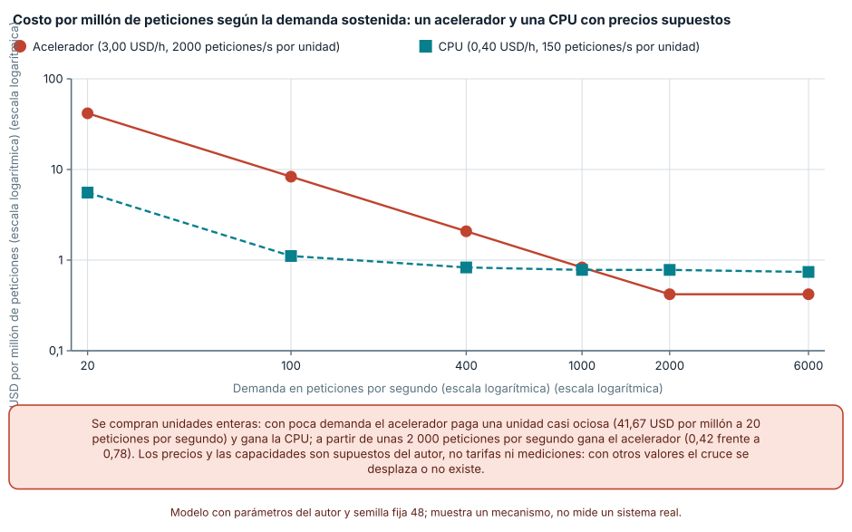

# SE-581 — Rendimiento y costo en aceleradores

## Punto profesional y fundamento pedagógico

**Punto profesional.** La clase existe para que la decisión «¿usamos un acelerador?» se tome con una cuenta y no con una impresión. Hay cuatro palancas que se pueden medir en cualquier máquina antes de pagar nada: el tamaño del lote (cuánto se amortiza cada llamada), la precisión numérica (cuántos bytes y operaciones por valor), la parte del trabajo que no se acelera y el costo de mover datos, y la utilización (cuánto del tiempo pagado se usa). Quien mide solo el pico de cómputo compra capacidad que no puede alimentar; quien no mide la utilización paga por una unidad entera para atender un puñado de peticiones.

**Por qué aparece aquí.** Cierra el par abierto por `SE-580` (modelo de ejecución y memoria) y lo convierte en economía, con `SE-356` (escalado, capacidad y costos) y `SE-376` (latencia, throughput y saturación). Prepara `SE-588` (el proyecto de plataforma), donde el costo de cada decisión entra en el expediente.

**Error conceptual que debe corregir.** Creer que el acelerador «más rápido» es el «más barato». El costo por petición es el precio de la unidad dividido entre las peticiones que atiende de verdad: depende de la utilización. En el modelo de la clase (parámetros del autor, no tarifas reales), un acelerador con capacidad para 2 000 peticiones por segundo cuesta 41,67 USD por millón de peticiones si la demanda es de 20 por segundo y 0,42 si es de 2 000: una razón de 100 entre el peor y el mejor caso para el mismo hardware, y a 1 000 peticiones por segundo la CPU sigue siendo más barata (0,78 frente a 0,83).

**Secuencia de aprendizaje.** Antes de ejecutar, predices cómo cambia la latencia por petición con el tamaño del lote, si bajar la precisión acelera y cuánto de una mejora de 50 veces en la parte acelerable se conserva si hay un 20 % de trabajo serie y un 20 % de transferencia. Después mides el lote y la precisión en CPU, calculas la ley de Amdahl con transferencia y construyes la tabla de costo por demanda con precios que tú mismo declaras.

**Evidencia de aprendizaje.** `costo-de-aceleracion.md` con la curva de lote, la tabla de Amdahl con transferencia, la tabla de costo por demanda con tus supuestos de precio y capacidad, y la demanda a partir de la cual cambiaría tu decisión.

**Límite de la conclusión.** **No se ejecutó nada en un acelerador**: no hubo GPU utilizable en la máquina de desarrollo. Los tiempos de lote y de precisión son de la CPU de esa máquina con NumPy 2.5.5; los precios (3,00 USD/h para el acelerador, 0,40 USD/h para la CPU) y las capacidades (2 000 y 150 peticiones por segundo) son **supuestos del autor, no tarifas ni mediciones**. El cruce de costos que muestra la clase es una consecuencia aritmética de esos supuestos, no un hallazgo sobre ningún proveedor. No se invocó ningún modelo de lenguaje.

### Trazabilidad fuente → afirmación

| Fuente primaria u oficial | Afirmación que respalda | Lo que no prueba |
|---|---|---|
| [NVIDIA CUDA Programming Guide](https://docs.nvidia.com/cuda/cuda-programming-guide/) | Describe la transferencia de datos entre anfitrión y dispositivo y la jerarquía de memoria que explican el costo de mover datos. | No da precios ni rendimiento de tu carga. |
| [Roofline (Williams, Waterman, Patterson)](https://www2.eecs.berkeley.edu/Pubs/TechRpts/2008/EECS-2008-134.html) | Acota el rendimiento por cómputo o por ancho de banda según la intensidad aritmética. | No incluye la transferencia entre anfitrión y dispositivo. |
| [NumPy: documentación](https://numpy.org/doc/stable/) | Documenta los tipos de datos y el producto de matrices medidos. | No cubre aceleradores. |
| [Google SRE Book: «Service Level Objectives»](https://sre.google/sre-book/service-level-objectives/) | Enmarca la latencia como percentiles frente a un objetivo y no como promedio. | No fija el objetivo de tu servicio. |

## Antes de empezar

Recupera lo aprendido en `SE-580`: un acelerador gana con mucho trabajo regular por byte movido. La pregunta activa es: **si tu servicio recibe 100 peticiones por segundo y una unidad de acelerador podría atender 2 000, ¿qué porcentaje de lo que pagas por hora estarías usando, y qué otra cosa podrías hacer con esa capacidad ociosa?**

## Prerrequisitos

- Haber completado `SE-580` y conocer de `SE-376` la diferencia entre latencia y throughput.
- Conocer de `SE-356` qué significa dimensionar la capacidad con una demanda y una utilización objetivo.
- Entender de `SE-377` por qué una medición necesita calentamiento y varias repeticiones.
- Python 3.11 o posterior con NumPy.

## Problema auténtico

El equipo de *Avisos* tiene el cálculo de riesgo vectorizado en CPU y decide evaluar un acelerador para el panel de docentes. Marketing espera 300 consultas por segundo en el primer día de clases y 20 el resto del semestre. Alguien presenta una hoja con el precio por hora del acelerador y el de una máquina de CPU y concluye que «el acelerador es 7,5 veces más caro». Otra persona presenta la capacidad por segundo de cada uno y concluye que «el acelerador es 13 veces más rápido, así que sale más barato». Las dos cuentas son correctas y las dos son incompletas: ninguna incluye cuántas unidades hay que comprar para una demanda dada, qué fracción de lo pagado se usa, qué pasa con la latencia cuando se agrupan peticiones en lotes para llenar el acelerador, ni qué parte del trabajo no se acelera.

La clase reconstruye la decisión con medidas: curva de lote, precisión, Amdahl con transferencia y una tabla de costo por demanda cuyos supuestos están a la vista.

## Objetivos observables

Al terminar podrás:

1. medir throughput y latencia por petición con distintos tamaños de lote y explicar el compromiso entre ambos;
2. explicar por qué bajar la precisión numérica solo acelera con soporte de hardware, con un contraejemplo medido;
3. calcular la aceleración total con la ley de Amdahl ampliada con un término de transferencia;
4. construir una tabla de costo por millón de peticiones según la demanda con unidades enteras y decir dónde cruzan dos opciones;
5. escribir las condiciones (volumen, utilización, latencia) bajo las cuales cambiaría una decisión de compra o de alquiler.

## Mapa conceptual



La utilización une la demanda con la capacidad comprada y es la variable que convierte un precio por hora en un costo por petición. La aceleración total, limitada por la parte serie y la transferencia, determina el throughput real que se compra.

## Temas y por qué importan

| Tema | Por qué cambia una decisión profesional | Evidencia mínima |
|---|---|---|
| Lote | Amortiza el costo fijo de cada llamada a cambio de latencia. | Curva latencia y throughput |
| Percentiles | La latencia que importa es la de la cola, no el promedio. | Objetivo en p95 o p99 |
| Precisión | Menos bits solo aceleran donde el hardware lo soporta. | float16 frente a float32 en CPU |
| Amdahl y transferencia | La parte no acelerada y el movimiento limitan la mejora. | Tabla de aceleración |
| Unidades enteras | Se paga la unidad aunque esté ociosa. | Tabla de costo por demanda |
| Utilización | Convierte precio por hora en costo por petición. | Costo a distintas demandas |
| Supuestos explícitos | Una cuenta con supuestos ocultos no se puede refutar. | Lista de parámetros |

## Conceptos y decisiones

### 1. El lote amortiza, y se paga con latencia

Una llamada a un cálculo tiene un costo fijo (lanzar, sincronizar, mover datos) y uno variable por elemento. Agrupar varias peticiones en un lote reparte el costo fijo, y el throughput sube; pero cada petición espera a que el lote se llene y a que termine. En la CPU del laboratorio, una capa densa de 1024×1024 en 32 bits con lotes de 1, 16, 64 y 256 tuvo estas latencias por lote y rendimientos: lote 1, 0,27 ms y unas 3 700 peticiones por segundo; lote 16, 4,8 ms y 3 300 (sin ganancia aún); lote 64, 7,9 ms y 8 100; lote 256, 14,3 ms y 17 900. El rendimiento por petición mejora de 0,27 ms (lote 1) a 0,056 ms (lote 256), unas cinco veces, pero la petición que espera en un lote de 256 sufre 14,3 ms más el tiempo de llenar el lote. Con una demanda de 200 peticiones por segundo, llenar un lote de 256 tardaría más de un segundo: el lote óptimo es el que cabe en el tiempo que el objetivo de latencia permite esperar, no el que maximiza el throughput.

### 2. Una anomalía honesta

El lote de 4 tuvo una latencia de unos 11 a 24 ms en tres ejecuciones, mayor que la del lote de 16 (4,8 a 7,9 ms), y por tanto un rendimiento de 170 a 360 peticiones por segundo frente a unos 3 700 a 3 800 del lote 1. No es una ley de nada: es un camino lento de la biblioteca de álgebra lineal de esa máquina para esa forma de matriz, y se repite entre ejecuciones. Se deja a la vista por una razón profesional: *el rendimiento no es monótono con el tamaño del lote*, y hay formas que caen en rutas lentas. Por eso se mide una rejilla de tamaños, con calentamiento, y se elige un valor medido, no el que «debería» ser mejor. Esta clase no explica la causa porque no se investigó; no se debe inferir una.

### 3. La latencia es una distribución

Un promedio oculta la cola. Las medianas por lote de arriba son la parte amable: la petición que llega justo después de que un lote salió espera casi un lote entero más. Una política que fija un tamaño máximo y un tiempo máximo de espera (se lanza el lote cuando se llena o cuando pasan 5 ms, lo primero que ocurra) acota esa cola, y el objetivo se escribe como percentil: «el 99 % de las peticiones responde en menos de 100 ms». Sin ese percentil, el lote que maximiza el rendimiento se elige a ciegas.

### 4. Menos bits no siempre es más rápido

Bajar la precisión (de 64 a 32 a 16 bits) reduce los bytes por valor y, con hardware que lo soporte, aumenta las operaciones por segundo. En la CPU del laboratorio, la multiplicación de 1024×1024 pasó de unos 41 ms en 64 bits (52 GFLOP/s) a unos 19 ms en 32 bits (112 GFLOP/s): casi el doble, como se espera al mover la mitad de bytes. Pero una multiplicación de 256×256 en 16 bits tardó unos 221 ms frente a 0,58 ms en 32 bits: unas 380 veces más. NumPy no dispone de un camino optimizado para 16 bits en esa CPU y convierte y multiplica con bucles generales. La lección no es «16 bits es lento» sino «la precisión baja es una ventaja del hardware y de la biblioteca, no del tipo de dato». Antes de cambiar la precisión hay que medir en el hardware destino y comprobar que el error numérico es aceptable para el uso.

### 5. Amdahl, ahora con transferencia

La ley de Amdahl acota la mejora por la parte que no se acelera. Con una parte serie `s` y una aceleración `k` del resto, la aceleración total es `1 / (s + (1 − s)/k)`. Con un acelerador discreto aparece un término más: la fracción `t` del tiempo base que se gasta en mover datos, y la fórmula es `1 / (s + t + (1 − s)/k)`. Con `k = 50`, los valores calculados son: con `s = 0,05`, sin transferencia 14,5 veces; con `t = 0,05`, 8,4; con `t = 0,20`, 3,7. Con `s = 0,20`: 4,6 sin transferencia; 3,8 con `t = 0,05`; 2,4 con `t = 0,20`. Una aceleración de 50 veces del núcleo de cálculo termina entre 2,4 y 14,5 veces en el sistema, según lo que no se acelera y lo que se transfiere. La decisión práctica: antes de comprar, medir `s` y `t` en el sistema real, porque la mejora total depende más de ellos que de `k`.

### 6. Costo por petición: unidades enteras y utilización

Se compran unidades enteras. Con los supuestos del autor (acelerador 3,00 USD/h con 2 000 peticiones/s por unidad; CPU 0,40 USD/h con 150 peticiones/s por unidad), el costo por millón de peticiones para una demanda sostenida `d` es `precio × unidades / (d × 3600) × 10⁶`, con `unidades = ⌈d / capacidad⌉`. Resultados de la tabla del experimento: demanda 20/s, acelerador 41,67 y CPU 5,56 USD por millón; 100/s, 8,33 y 1,11; 400/s, 2,08 y 0,83; 1 000/s, 0,83 y 0,78; 2 000/s, 0,42 y 0,78; 6 000/s, 0,42 y 0,74. El acelerador gana a partir de unos 1 000 a 2 000 peticiones por segundo *con estos supuestos*; por debajo, se paga una unidad entera que pasa ociosa. El cruce se mueve si cambia cualquiera de los cuatro parámetros: con una CPU que atendiera 600 peticiones por segundo en lugar de 150, la CPU sería más barata incluso a plena carga (0,19 frente a 0,42 USD por millón) y las curvas no se cruzarían nunca. Por eso el entregable no es una conclusión sino la tabla con sus supuestos y la fórmula.

### 7. Lo que no entra en la tabla

La tabla ignora al menos cinco cosas que en un caso real pesan: el costo de ingeniería de portar y mantener el código del acelerador, la disponibilidad (los aceleradores pueden no estar disponibles cuando se necesitan), el tiempo de arranque de una unidad nueva cuando sube la demanda, la energía y el compartir una unidad entre varias cargas para elevar la utilización. Cada una puede invertir una decisión; la tabla permite discutirlas porque deja claro qué se supuso. La regla de la clase es la de toda estimación: declarar los supuestos, calcular la sensibilidad (¿qué parámetro, si se equivoca un 30 %, cambia la decisión?) y fijar una condición de revisión.

## Lote, latencia y throughput

La primera figura muestra el rendimiento medido según el tamaño del lote.



**Cómo leer la figura.** El eje horizontal es el tamaño del lote y el vertical las peticiones por segundo. Mira que la curva no es monótona: el lote 4 cae por debajo del lote 1. **Dónde deja de valer:** una CPU, una biblioteca y una forma de matriz; la caída en 4 se repitió entre ejecuciones y no se investigó su causa. En un acelerador la forma de la curva dependerá del dispositivo y de la biblioteca.

## Qué queda de una mejora de 50 veces

La segunda figura es el mapa de calor de la aceleración total según la parte serie y la transferencia.



**Cómo leer la figura.** Cada fila es una parte serie y cada columna un costo de transferencia como fracción del tiempo base; la celda es la aceleración total. Mira la esquina inferior derecha: con un 20 % serie y un 20 % de transferencia, una mejora de 50 veces en el núcleo se queda en 2,4 en el sistema. **Dónde deja de valer:** es la fórmula con los dos términos, no una medición; la transferencia real depende del bus, del tamaño y de si los datos pueden quedarse en el acelerador, y la parte serie de qué se acelera de verdad.

## El costo cruza con la demanda

La tercera figura dibuja el costo por millón de peticiones de las dos opciones según la demanda sostenida.



**Cómo leer la figura.** El eje horizontal es la demanda en peticiones por segundo y el vertical el costo en escala logarítmica. Mira las dos curvas a baja demanda, donde el acelerador paga una unidad entera casi ociosa, y el punto donde se cruzan. **Dónde deja de valer:** los precios (3,00 y 0,40 USD por hora) y las capacidades (2 000 y 150 peticiones por segundo) son supuestos del autor, no tarifas ni mediciones; con otros valores el cruce se desplaza y puede no existir.

## Definiciones de trabajo

- **Lote (*batch*):** conjunto de peticiones que se procesan en una sola llamada.
- **Throughput:** peticiones atendidas por unidad de tiempo.
- **Latencia de cola:** latencia que no supera el p95 o el p99 de las peticiones.
- **Ley de Amdahl:** cota de la aceleración total por la parte no acelerada.
- **Transferencia:** movimiento de datos entre memoria del anfitrión y del acelerador.
- **Utilización:** fracción de la capacidad comprada que se usa.
- **Unidad entera:** la capacidad se compra en unidades indivisibles.
- **Sensibilidad:** cuánto cambia el resultado al variar un supuesto.

## Ejemplo mínimo

La fórmula de Amdahl con transferencia en tres líneas:

```python
def aceleracion(s, t, k):
    """s: parte serie; t: transferencia (fracción del tiempo base); k: mejora de la parte acelerable."""
    return 1 / (s + t + (1 - s) / k)

print(round(aceleracion(0.05, 0.00, 50), 1), round(aceleracion(0.20, 0.20, 50), 1))   # 14.5 y 2.4
```

Con los mismos 50 de mejora en el núcleo, el sistema va de 14,5 veces a 2,4 veces según lo que no se acelera y lo que se mueve. La fórmula es la forma más barata de evitar una compra mal dimensionada.

## Ejemplo profesional

*Escenario ilustrativo: las cifras y los resultados que aparecen en este ejemplo son supuestos de la narración, no mediciones.*

El equipo de *Avisos* presenta al comité una tabla de costo por demanda con tres escenarios: 20 peticiones por segundo (semestre normal), 300 (primer día) y 1 500 (periodo de entregas). Cada fila lleva sus supuestos y una columna «qué lo cambiaría». El comité pregunta por la unidad ociosa del semestre normal. El equipo propone dos alternativas: no usar el acelerador para el panel en línea (que tiene baja demanda) y reservarlo para el cálculo nocturno de 400 000 estudiantes, donde la utilización es alta durante unas horas, y compartir la unidad con otras cargas del mismo cliente durante el día. Se aprueba un prototipo con una condición: antes de contratar nada, el equipo medirá `s` y `t` del cálculo real en el acelerador del proveedor y repetirá la tabla con los números medidos. Dos semanas después, la medición muestra que la transferencia es del 15 % del tiempo base, bastante mayor de lo supuesto, y la aceleración total baja a 4 veces. La tabla se rehace y la decisión se mantiene para el cálculo nocturno y se descarta para el panel. El documento de decisión cita los números medidos, no los supuestos.

## Práctica guiada

1. Ejecuta `python scripts/experiments_part48_a.py cost` y repite la curva de lote tres veces: anota qué valores cambian y cuáles se mantienen.
2. Cambia los supuestos de precio y capacidad en el script por los de tu proveedor y repite la tabla de costo por demanda.
3. Calcula con la fórmula el efecto de pasar de `t = 0,20` a `t = 0,05` manteniendo los datos en el acelerador entre pasos.
4. Diseña una política de lote con tamaño máximo y espera máxima, y calcula con una llegada de 200 peticiones por segundo cuánto espera una petición en el peor caso.
5. Haz una tabla de sensibilidad: qué parámetro, si se equivoca un 30 %, cambia la decisión.

## Ejercicios

1. **Básico.** Explica por qué con 20 peticiones por segundo el acelerador del modelo cuesta 41,67 USD por millón y a 2 000 cuesta 0,42, aunque el hardware sea el mismo.
2. **Intermedio.** Calcula la demanda a partir de la cual el acelerador del modelo es más barato que 7 unidades de CPU, y explica qué supuesto la mueve más.
3. **Avanzado.** Diseña un experimento en el acelerador de un proveedor para medir `s`, `t` y la curva de lote de un cálculo propio, con los controles necesarios (calentamiento, repeticiones, percentiles) y los criterios que harían que no valiera la pena.

## Reto verificable

Entrega `costo-de-aceleracion.md` con las cuatro tablas (lote, precisión, Amdahl con transferencia, costo por demanda), los supuestos declarados y la condición de revisión. Es válido si otra persona reproduce las cuentas con tus supuestos, las mediciones de CPU tienen su entorno y no se atribuye a un acelerador ninguna medida que no se hizo en uno.

## Caso conductor

*Avisos* decide dónde ejecutar su cálculo de riesgo con una tabla que cualquiera puede refutar. `SE-582` cambia de eje: para ejecutar código de terceros o cargas de varios clientes, la pregunta pasa de cuánto cuesta calcular a qué frontera lo separa del resto y qué cuesta cruzarla.

## Preguntas frecuentes

### ¿El lote óptimo existe?

Existe para una demanda, un objetivo de latencia y un dispositivo concretos, y se mide. Cambia con cualquiera de los tres.

### ¿Por qué no simplemente comprar más capacidad?

Porque la capacidad comprada y no usada se paga igual. La utilización objetivo es una decisión: una unidad al 20 % es cara por petición y una al 95 % no deja margen para picos.

### ¿Y si el proveedor cobra por segundo de uso?

Entonces el costo se acerca al de la capacidad usada y la tabla de unidades enteras es menos pesimista; se cambia el modelo (precio por segundo × segundos usados) y se mantiene la sensibilidad. El arranque de la unidad sigue contando.

### ¿Cómo se incluye la energía?

Como otro parámetro del modelo con su fuente. Esta clase no la midió.

## Fallo controlado y diagnóstico

**Fallo.** Tras contratar el acelerador, el costo mensual de la plataforma sube y la latencia p99 empeora, aunque el núcleo de cálculo es 40 veces más rápido en el benchmark del proveedor.

**Diagnóstico paso a paso.** (1) Se mide la utilización de la unidad: promedio del 8 %, con picos cortos. (2) Se descompone el tiempo por petición: la transferencia domina porque cada petición mueve 40 registros pequeños. (3) El tamaño de lote en producción es 1, porque la política de agrupar no se configuró. (4) La latencia p99 incluye el arranque de unidades nuevas cuando la demanda sube. (5) Se corrige agrupando peticiones con un tiempo máximo de espera de 5 ms, compartiendo la unidad con la carga nocturna y manteniendo una unidad mínima caliente.

**Lección.** El benchmark del proveedor mide el núcleo; el costo y la latencia de tu servicio dependen de lote, transferencia, utilización y arranque. Se mide el sistema completo, no la pieza anunciada.

## Errores comunes y cómo corregirlos

- **Comparar solo el precio por hora o solo el rendimiento pico.** Corrige con costo por petición a la demanda real.
- **Elegir el lote que maximiza el throughput.** Corrige con el que cumple el percentil de latencia.
- **Cambiar la precisión sin medir en el hardware destino.** Corrige midiendo velocidad y error.
- **Olvidar la parte serie y la transferencia.** Corrige con la fórmula y mediciones.
- **No declarar supuestos.** Corrige con una lista que se pueda refutar.
- **Atribuir a un acelerador una medida de CPU.** Corrige etiquetando el entorno de cada número.

## Entorno y archivos clave

- `scripts/experiments_part48_a.py`: función `cost`; se ejecuta con `python scripts/experiments_part48_a.py cost`.
- `scripts/experiments_part48_lab.py`: utilidades de medición.
- `scripts/figures_part48_a.py` y `scripts/figures_part48_b.py`: figuras de la parte.
- Python 3.11 o posterior y NumPy; los precios del modelo son parámetros editables al inicio de la función.

## Seguridad, ética y accesibilidad

Una unidad compartida entre cargas de clientes distintos para subir la utilización reintroduce las preguntas de aislamiento de `SE-582`: pregunta qué se borra entre usos y qué se comparte. Un modelo de riesgo de entrega que cambia de proveedor o de precisión puede cambiar a quién se avisa: valida que los resultados no cambian de forma sistemática para un grupo. Las figuras tienen texto alternativo y valores escritos.

## Puente hacia el trabajo con agentes

Un agente que estima costos de infraestructura suele entregar un número con aspecto de certeza. Pide la lista de supuestos, la fórmula y la sensibilidad; si no puede dar el cruce de dos opciones y el parámetro que lo mueve, la estimación no sirve para decidir. Cuando proponga cambiar de precisión o de tipo de máquina para ahorrar, exige una medición en el hardware destino y una comprobación del error.

## Transferencia

Elige una decisión de capacidad de tu sistema (un tipo de máquina, un acelerador, una base de datos más grande). Escribe la tabla de costo por demanda con unidades enteras y tus precios, calcula el cruce, identifica el parámetro más sensible y escribe la condición bajo la cual revisarías la decisión.

## Evaluación y evidencia

| Criterio | Evidencia aceptable | Rechazo |
|---|---|---|
| Curva de lote | Varios tamaños con calentamiento y percentiles | Un solo tamaño |
| Precisión | Velocidad y error medidos en el hardware destino | «Menos bits, más rápido» |
| Amdahl | `s` y `t` medidos en el sistema | Aceleración del núcleo como del sistema |
| Costo | Tabla con unidades enteras y supuestos | Precio por hora sin demanda |
| Alcance | Entorno de cada medida y lo no ejecutado | Mezclar CPU y acelerador |

## Fuentes

- NVIDIA. [«CUDA Programming Guide»](https://docs.nvidia.com/cuda/cuda-programming-guide/).
- S. Williams, A. Waterman, D. Patterson. [«Roofline»](https://www2.eecs.berkeley.edu/Pubs/TechRpts/2008/EECS-2008-134.html).
- NumPy. [Documentación](https://numpy.org/doc/stable/).
- Google. [«Service Level Objectives», SRE Book](https://sre.google/sre-book/service-level-objectives/).

## Límites y siguiente paso

Las medidas son de una CPU con NumPy; el modelo de costo usa supuestos del autor; no se ejecutó nada en un acelerador ni se consultó el precio de ningún proveedor. El siguiente paso, `SE-582`, estudia las fronteras para ejecutar código ajeno o cargas de varios clientes: procesos, contenedores, microVM y sandboxes, con lo que cuesta crear cada una y lo que contiene.

## Glosario

| Término | Definición breve |
|---|---|
| Lote | Peticiones procesadas en una sola llamada |
| Throughput | Peticiones atendidas por unidad de tiempo |
| Latencia de cola | Latencia del percentil alto |
| Ley de Amdahl | Cota de la aceleración por la parte no acelerada |
| Transferencia | Movimiento de datos hacia y desde el acelerador |
| Utilización | Fracción de capacidad comprada que se usa |
| Unidad entera | Capacidad indivisible que se compra completa |
| Sensibilidad | Efecto de variar un supuesto en el resultado |
