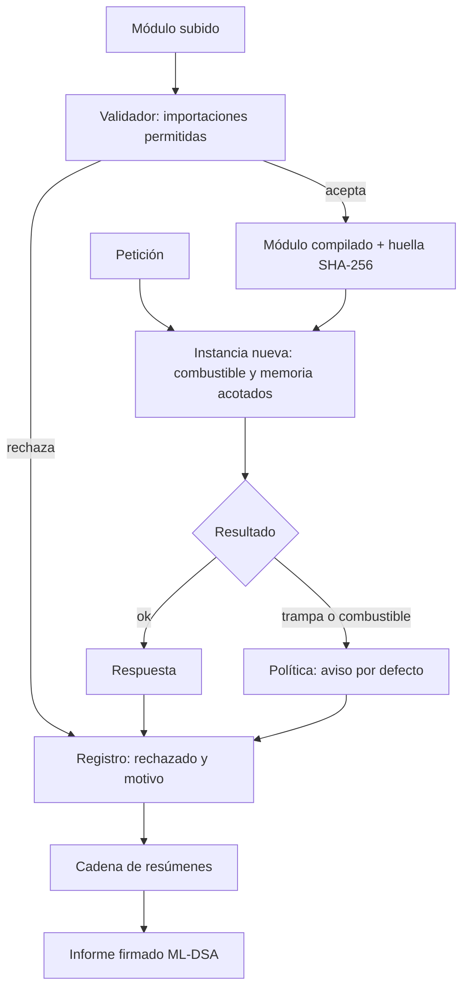
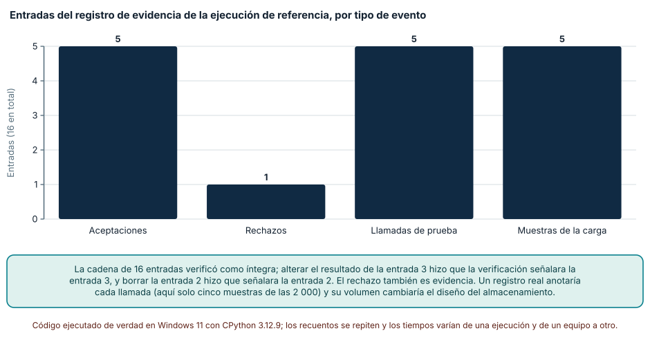
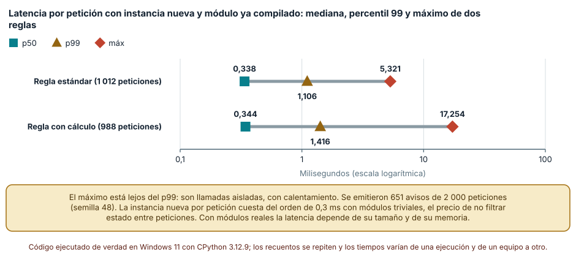

# SE-588 — Proyecto: plataforma de ejecución aislada con evidencia

## Punto profesional y fundamento pedagógico

**Punto profesional.** El proyecto existe para que entregues, como lo haría un equipo de plataforma, algo que otra persona pueda ejecutar, atacar y auditar: una plataforma mínima que acepta código ajeno, lo valida antes de ejecutarlo, lo ejecuta con límites, registra cada paso de forma que un cambio posterior se detecte y entrega un informe firmado con una firma que sobreviva a un ordenador cuántico. No es un diseño sobre el papel: la referencia que acompaña esta clase se ejecuta, rechaza módulos hostiles al subirlos, corta un bucle infinito, niega crecer la memoria, convierte una trampa en una decisión de política y detecta que se borró o se alteró una entrada del registro. El valor profesional está en la evidencia: cada afirmación de seguridad se acompaña de la prueba que la ejercita.

**Por qué aparece aquí.** Es el proyecto de la Parte 48: une WebAssembly y su arranque (`SE-577` y `SE-578`), el control de lo que corre en el núcleo (`SE-579`), el costo de decidir dónde ejecutar (`SE-580` y `SE-581`), las fronteras (`SE-582`), la evidencia de hardware (`SE-583`), la migración criptográfica (`SE-584` y `SE-585`) y la confianza cero (`SE-586`), con el taller de `SE-587` como batería de pruebas. Retoma `SE-350` a `SE-352` (aislamiento, orquestación y serverless), `SE-400` y `SE-401` (atestaciones y firmas) y `SE-389` (criptografía y claves).

**Error conceptual que debe corregir.** Creer que una plataforma segura es una colección de mecanismos. Lo que la hace revisable es la correspondencia entre una *amenaza*, un *mecanismo* y una *prueba que falla si el mecanismo falta*. En la referencia, por ejemplo, la amenaza «una regla pide acceso a archivos» tiene como mecanismo el validador de importaciones y como prueba una regla que importa `leer_archivo` y debe ser rechazada al subir; si alguien relaja el validador, esa prueba se pone en rojo. Un proyecto sin esa tabla tiene mecanismos que nadie sabe si siguen funcionando.

**Secuencia de aprendizaje.** Antes de construir, escribes tu modelo de amenazas (qué intentaría una regla hostil) y la tabla amenaza, mecanismo y prueba. Después ejecutas la plataforma de referencia, la comparas con tu diseño, construyes tu propia versión para una carga distinta (o la misma con otras decisiones), ejecutas la batería del taller sobre ella y entregas el expediente con las decisiones, los costos medidos y lo que no cubriste.

**Evidencia de aprendizaje.** Un repositorio o carpeta con `README.md`, `MODELO-DE-AMENAZAS.md`, `ADR-001.md` (la decisión de aislamiento), el código de la plataforma, la batería de pruebas, el registro de evidencia de una ejecución, el informe firmado, una tabla de costos medidos y una sección «no cubierto».

**Límite de la conclusión.** La referencia se ejecutó en Windows 11 con Python 3.12.9, `wasmtime` 50.0.1 y `dilithium-py` 1.5.1 (una implementación de estudio, no de producción). Es una plataforma mínima: **no incluye** autenticación de clientes con tokens (se ejercitó por separado en `SE-586`), contenedor ni microVM alrededor del anfitrión, ejecución en un entorno de hardware seguro, ni almacenamiento durable del registro. La firma del informe prueba que el contenido no cambió desde que se firmó, no que el anfitrión fuera honesto al registrarlo. Las latencias son de una máquina y de módulos triviales. No se invocó ningún modelo de lenguaje.

### Trazabilidad fuente → afirmación

| Fuente primaria u oficial | Afirmación que respalda | Lo que no prueba |
|---|---|---|
| [WebAssembly: Security](https://webassembly.org/docs/security/) y [Wasmtime: Security](https://docs.wasmtime.dev/security.html) | Un módulo solo alcanza lo que el anfitrión le concede, y el runtime documenta su modelo de amenazas. | No audita tu anfitrión. |
| [Wasmtime: `Config`](https://docs.wasmtime.dev/api/wasmtime/struct.Config.html) | Documenta el combustible y los límites de recursos que usa la plataforma. | No fija los valores para tu carga. |
| [NIST FIPS 204, ML-DSA](https://csrc.nist.gov/pubs/fips/204/final) | Estandariza la firma digital poscuántica usada para firmar el informe. | No certifica la biblioteca de estudio. |
| [NIST SP 800-207](https://csrc.nist.gov/pubs/sp/800/207/final) | Orienta la política de decisión por petición para los clientes de la plataforma. | No se implementó en la referencia. |
| [RFC 9334 (RATS)](https://www.rfc-editor.org/info/rfc9334/) | Describe cómo una parte que confía verifica evidencia de otra. | No se ejecutó atestación de hardware en la referencia. |
| [SLSA](https://slsa.dev/) y [in-toto](https://in-toto.io/) | Describen evidencia de procedencia de artefactos para decidir qué módulos se aceptan. | No se integraron en la referencia. |

## Antes de empezar

Recupera lo aprendido en `SE-587`: la matriz de contención dice qué cubre cada candidato. La pregunta activa es: **si mañana una universidad sube un módulo hostil, ¿qué evidencia tendrías de qué intentó, qué se lo impidió y que nadie cambió el registro después?**

## Prerrequisitos

- Haber completado `SE-577` a `SE-587`.
- Python 3.11 o posterior; `pip install wasmtime==50.0.1 dilithium-py==1.5.1` (sin la segunda, el informe se firma con HMAC y la referencia lo declara; sin la primera, la plataforma no se puede probar).
- Tiempo estimado: de seis a diez horas para un diseño propio con pruebas; la referencia se ejecuta en segundos.

## Problema auténtico

*Avisos* quiere abrir su plataforma de reglas a todas las universidades, y su comité de riesgos pide tres cosas antes de aprobarlo: saber qué reglas aceptó y con qué huella; poder demostrar, tras un incidente, qué hizo cada regla y que el registro no se alteró; y poder explicar qué cubre y qué no cubre el aislamiento en una página. El equipo tiene las piezas de la parte pero no un expediente.

El proyecto consiste en construir la plataforma mínima que las une, con una regla: *cada mecanismo tiene una prueba que falla si falta*. El resultado es un expediente que el comité pueda leer y un código que pueda ejecutar.

## Objetivos observables

Al terminar podrás:

1. definir un contrato de ejecución (qué importa un módulo, cuánto combustible y memoria recibe, qué política aplica ante una falla) y hacerlo cumplir al subir y al ejecutar;
2. construir un registro de evidencia encadenado por resúmenes y demostrar que detecta una alteración y un borrado;
3. firmar un informe con un algoritmo poscuántico y explicar qué demuestra y qué no;
4. medir latencia por petición con instancias nuevas y explicar qué parte es arranque y qué parte es ejecución;
5. entregar un expediente con modelo de amenazas, tabla amenaza-mecanismo-prueba, decisión de aislamiento, costos y límites, revisable por otra persona.

## Mapa conceptual



Hay dos caminos de entrada (subir un módulo y hacer una petición), un único registro encadenado al que todo se anota y un informe firmado que cierra la cadena. La política ante una falla es una decisión explícita, no un comportamiento accidental.

## Temas y por qué importan

| Tema | Por qué cambia una decisión profesional | Evidencia mínima |
|---|---|---|
| Contrato de ejecución | Es lo que el anfitrión puede hacer cumplir. | Cero importaciones permitidas |
| Validador de subida | Rechaza antes de ejecutar y con motivo. | Módulo rechazado con su importación |
| Límites por petición | Contienen CPU y memoria. | Combustible consumido, crecimiento negado |
| Política de falla | Decide el efecto de una trampa sobre personas. | Aviso por defecto con registro |
| Registro encadenado | Hace detectable la alteración y el borrado. | Rotura localizada |
| Informe firmado | Fija el estado del registro. | Firma verificable |
| Tabla amenaza-mecanismo-prueba | Evita mecanismos sin prueba. | Una prueba por mecanismo |
| Lo que no cubre | Evita extender la confianza. | Lista del expediente |

## Conceptos y decisiones

### 1. El contrato

La referencia fija tres reglas. Primera: las reglas de aviso no importan nada (el conjunto de importaciones permitidas está vacío); cualquier importación es motivo de rechazo y el rechazo menciona la importación. Segunda: cada llamada recibe 100 000 unidades de combustible y una memoria máxima de una página (65 536 bytes), fijadas por el anfitrión y no por el módulo. Tercera: ante una trampa o un agotamiento de combustible, la respuesta es avisar (resultado 1), con la causa registrada. Esa tercera regla es de producto y de ética, no de seguridad: se elige porque un aviso de más cuesta menos que un estudiante sin aviso, y se escribe para que quien la cambie sepa qué cambia. Para tu proyecto, el contrato debe ser equivalente: qué puede importar, cuánto recibe y qué pasa al fallar.

### 2. El validador de subida

Al subir un módulo, la plataforma lo compila y lee sus importaciones antes de aceptarlo. En la ejecución de la referencia se subieron seis reglas: la estándar, una con un bucle de 300 iteraciones, una con un bucle infinito, una que intenta crecer la memoria, una que importa `leer_archivo` y una que lee fuera de su memoria. El validador rechazó solo la que importa una función: las otras cinco no violan el contrato de importaciones, y la plataforma debe contenerlas al *ejecutarlas*. Esa distinción es importante: el validador contiene lo que se puede decidir leyendo el módulo; los límites contienen lo que solo se ve ejecutando. Un bucle infinito no se detecta al subir (es indecidible en general), se contiene con combustible.

### 3. Límites y política de falla en ejecución

Con una petición por regla aceptada (48 horas para vencer, día 3, aviso previo de 72 horas), el resultado fue: la regla estándar devolvió 1 y consumió 8 unidades de combustible; la regla con cálculo devolvió 1 con 3 604; la regla con bucle infinito agotó las 100 000 unidades, falló con `all fuel consumed` y la política devolvió 1; la regla que intenta crecer la memoria devolvió 1 (la memoria quedó en una página, con 54 unidades de combustible, sin trampa: la negativa de crecer es una respuesta del runtime, no un error); la regla que lee fuera de memoria falló con `out of bounds memory access` y la política devolvió 1 con 0 de combustible. Observa lo que el registro permite: de la regla de bucle infinito no solo queda que «dio 1» sino que *agotó el combustible*, y eso es lo que un operador necesita para investigar.

### 4. Latencia con instancia nueva

Con 2 000 peticiones sobre las dos reglas que funcionan (semilla 48, instancia nueva por petición, módulos compilados una vez), la regla estándar tuvo mediana de 0,34 ms, p99 de 1,11 ms y máximo de 5,3 ms; la regla con cálculo, mediana de 0,34 ms, p99 de 1,42 ms y máximo de 17,3 ms. Los máximos son llamadas aisladas (la primera de cada tipo, con calentamiento) y por eso el expediente reporta percentiles y máximos y no un promedio. Se emitieron 651 avisos de 2 000 peticiones. La instancia nueva por petición cuesta del orden de 0,3 ms con módulos triviales (`SE-578`), un precio que la plataforma paga por no filtrar estado entre peticiones.

### 5. El registro encadenado

Cada entrada del registro lleva el resumen SHA-256 de la anterior, y el resumen de la entrada cubre su propio contenido y ese enlace. La verificación recorre la cadena y localiza la primera entrada inconsistente. En la referencia, la cadena de 16 entradas (aceptaciones, rechazo, llamadas y muestras) verificó como íntegra. Alterar el resultado de la entrada 3 hizo que la verificación señalara la entrada 3; borrar la entrada 2 hizo que señalara la entrada 2. El diseño aplica la misma idea que la cadena de medición de `SE-583`: no se puede reescribir hacia atrás sin recalcular todo lo siguiente. Su límite es explícito: quien controla el registro *y* puede recalcular toda la cadena la reescribe entera. Por eso la cabeza (el último resumen) se fija fuera, en el informe firmado y, en un sistema real, en un almacén que el anfitrión no pueda modificar.

### 6. El informe firmado

El informe (320 bytes de JSON con la cabeza de la cadena, el número de entradas y las huellas de las reglas aceptadas) se firmó con ML-DSA-65: firma de 3 309 bytes, clave pública de 1 952 bytes, verificación correcta; con un byte distinto en el informe, la verificación falla. Qué demuestra: que el contenido del informe no cambió desde que se firmó con esa clave. Qué no demuestra: que lo que el anfitrión registró sea verdad (si el anfitrión está comprometido, firma mentiras con fidelidad), que la clave privada esté bien guardada, ni que la biblioteca de estudio sea apta para producción. El enlace con la parte es directo: una firma de 3,3 KB cabe sin problema en un informe, y no cabría en un campo de 256 bytes de un sistema antiguo (`SE-585`).

### 7. La tabla amenaza, mecanismo, prueba

La referencia se resume en siete filas. «Una regla pide acceso a archivos o red»: validador de importaciones; prueba: una regla con una importación debe ser rechazada al subir. «Una regla no termina»: combustible; prueba: la regla con bucle debe fallar con combustible agotado y recibir la política por defecto. «Una regla reserva memoria sin límite»: límite del anfitrión; prueba: la regla que intenta crecer debe devolver el tamaño inicial. «Una regla lee fuera de su memoria»: memoria lineal; prueba: debe fallar con una trampa y dejar utilizable al anfitrión. «Una regla filtra estado a la siguiente petición»: instancia por petición; prueba: dos llamadas consecutivas con un contador dan el mismo resultado. «Alguien altera o borra el registro»: cadena de resúmenes; prueba: alterar o borrar una entrada hace fallar la verificación. «Alguien altera el informe»: firma; prueba: un byte distinto hace fallar la verificación. Un mecanismo sin prueba que falle si falta es un mecanismo del que no se sabe si sigue funcionando.

### 8. Qué falta y cómo decirlo

La referencia es una pieza, no una plataforma completa. Falta la autenticación de quien sube y de quien llama (tokens con destinatario y vida corta, `SE-586`); falta el entorno donde corre el anfitrión (un contenedor reforzado o una microVM, `SE-582`, porque el anfitrión en sí no está aislado); falta la prueba de qué código corre el anfitrión (atestación, `SE-583`); falta el almacenamiento durable y la gestión de la clave de firma; falta la observabilidad en el núcleo si se desea (`SE-579`); y falta la parte de cálculo en aceleradores, que esta plataforma no usa. El expediente debe listar esas ausencias, decir cuáles son decisiones y cuáles deuda, y fijar qué evidencia haría que se incorporaran.

## El registro y sus pruebas

La primera figura muestra cuántas entradas del registro corresponden a cada tipo de evento en la ejecución de referencia.



**Cómo leer la figura.** Cada barra es un tipo de evento del registro y su longitud el número de entradas; la suma es la cadena que se verificó. Mira que el rechazo está en el registro: lo que la plataforma niega también es evidencia. **Dónde deja de valer:** es una ejecución de la referencia con seis reglas y una carga de 2 000 peticiones de las que solo se registran cinco muestras; un registro real anotaría cada llamada y su volumen cambiaría el diseño del almacenamiento.

## Latencia por petición

La segunda figura muestra la mediana, el p99 y el máximo de las dos reglas con la carga.



**Cómo leer la figura.** Cada fila es una regla; el intervalo va de la mediana al máximo y el marcador del medio es el percentil 99. Mira cuánto se aleja el máximo del p99: son llamadas aisladas por calentamiento, no la cola típica. **Dónde deja de valer:** módulos triviales, una máquina con otros procesos, instancia nueva por petición y módulos ya compilados; con módulos reales la latencia depende de su tamaño y de su memoria.

## Dónde falla la plataforma

La tercera figura es el mapa de calor de qué mecanismo contiene cada amenaza de la tabla.


**Cómo leer la figura.** Cada fila es una amenaza y cada columna un mecanismo; la celda marcada es el que la contiene. Mira que ninguna fila queda sin marca y que ninguna columna queda vacía: cada mecanismo existe porque una amenaza lo exige. **Dónde deja de valer:** representa el diseño de la referencia, no una enumeración de amenazas; las amenazas que la referencia no cubre (autenticación, entorno del anfitrión, hardware) no son filas porque no hay mecanismo que marcar.

## Definiciones de trabajo

- **Plataforma de ejecución aislada:** servicio que acepta código ajeno, lo valida, lo ejecuta con límites y registra lo ocurrido.
- **Contrato de ejecución:** lo que un módulo puede importar, consumir y hacer ante fallas.
- **Validador de subida:** comprobación de un módulo antes de aceptarlo.
- **Política de falla:** respuesta que se da cuando una ejecución no termina bien.
- **Registro encadenado:** secuencia de entradas donde cada una incluye el resumen de la anterior.
- **Cabeza de la cadena:** resumen de la última entrada, que fija toda la historia.
- **Tabla amenaza-mecanismo-prueba:** correspondencia que exige una prueba por cada mecanismo.
- **Expediente:** conjunto de documentos y evidencias que permiten revisar la plataforma.

## Ejemplo mínimo

La cadena de resúmenes en cinco líneas, con su verificación:

```python
import hashlib, json

def anotar(cadena, **datos):
    previo = cadena[-1]["resumen"] if cadena else "0" * 64
    entrada = {"seq": len(cadena), "previo": previo, **datos}
    entrada["resumen"] = hashlib.sha256(json.dumps(entrada, sort_keys=True).encode()).hexdigest()
    cadena.append(entrada)

def primera_rota(cadena):
    previo = "0" * 64
    for i, e in enumerate(cadena):
        cuerpo = {k: v for k, v in e.items() if k != "resumen"}
        if cuerpo["previo"] != previo or hashlib.sha256(json.dumps(cuerpo, sort_keys=True).encode()).hexdigest() != e["resumen"]:
            return i
        previo = e["resumen"]
    return None
```

Después de anotar tres eventos, cambiar un campo de la entrada 1 hace que `primera_rota` devuelva 1; borrar la entrada 1 devuelve 1 también, porque la entrada siguiente apunta a un resumen que ya no está.

## Ejemplo profesional

*Escenario ilustrativo: las cifras y los resultados que aparecen en este ejemplo son supuestos de la narración, no mediciones.*

El equipo de *Avisos* presenta el expediente al comité de riesgos. El comité lee la tabla amenaza, mecanismo y prueba, ejecuta la plataforma de referencia en una sesión de veinte minutos y pide tres cambios. Primero: que el rechazo de una importación incluya el nombre del módulo y de quien lo subió, porque el registro actual dice qué se rechazó pero no quién lo intentó. Segundo: que la cabeza del registro se publique cada hora en un almacén de solo escritura fuera del anfitrión, porque un anfitrión comprometido podría reescribir toda la cadena. Tercero: que la política de fallo («avisar») quede en el contrato público y no solo en el código. El equipo añade las tres cosas, y añade las pruebas correspondientes: un módulo hostil subido por una universidad aparece en el registro con su autor; una cadena reescrita por completo no coincide con la última cabeza publicada; y un cambio en la política de fallo requiere modificar un documento versionado. El comité aprueba una fase piloto con tres universidades y una revisión a los tres meses, con una condición escrita: antes de abrir a todas, el anfitrión debe ejecutarse dentro de una frontera más fuerte y con autenticación por destinatario.

## Práctica guiada

1. Ejecuta `python scripts/experiments_part48_c.py proyecto` y lee cada línea con la tabla de amenazas delante.
2. Sube a la referencia un módulo propio con una importación y otro con un bucle largo pero finito, y predice cuál se rechaza y cuál se ejecuta.
3. Cambia el combustible a 50 000 y a 5 000 y observa qué regla empieza a fallar y qué consume cada una.
4. Altera una entrada del registro a mano y comprueba que la verificación localiza el índice; después recalcula toda la cadena y observa qué ya no coincide con la cabeza publicada.
5. Escribe tu modelo de amenazas de una plataforma equivalente para otra carga y la tabla amenaza-mecanismo-prueba.

## Ejercicios

1. **Básico.** Explica por qué el validador no puede detectar un bucle infinito y qué mecanismo lo contiene.
2. **Intermedio.** Añade a la referencia la autenticación del que sube un módulo con un token con destinatario y vida corta, y registra el sujeto en cada entrada; escribe la prueba que falla si falta.
3. **Avanzado.** Diseña el anfitrión de la plataforma para un entorno de varios inquilinos: qué frontera lo rodea (`SE-582`), qué evidencia de qué ejecuta se pide (`SE-583`), cómo se gestiona la clave de firma y cómo se rota, y qué se hace con la firma si el algoritmo debe migrar (`SE-585`).

## Reto verificable

Entrega el expediente descrito en la evidencia de aprendizaje y el código de tu versión de la plataforma. Es válido si otra persona, con solo tu README, ejecuta tus pruebas y obtiene los mismos resultados (reglas rechazadas, reglas contenidas, cadena íntegra, alteración y borrado detectados, firma verificada y rechazada con un byte distinto), si cada mecanismo de tu tabla tiene una prueba que falla al quitarlo, y si la sección «no cubierto» nombra al menos cuatro ausencias reales.

## Caso conductor

*Avisos* abre su plataforma de reglas con un expediente que el comité puede ejecutar y discutir, y con una lista honesta de lo que falta. Con este proyecto se cierra la Parte 48 y con ella el recorrido de runtimes y plataformas modernas: de un módulo aislado a una plataforma con evidencia.

## Preguntas frecuentes

### ¿Por qué no usar contenedores en vez de WebAssembly?

Porque las reglas son funciones puras de pocas instrucciones, y la frontera de Wasm las contiene con un costo de arranque unas mil veces menor. Para otras cargas (scripts con bibliotecas) el contenedor o la microVM son la respuesta, como decide `SE-587`.

### ¿Por qué firmar con un algoritmo poscuántico un informe de 320 bytes?

Porque un informe que debe ser verificable durante años se firma con un algoritmo que no dependa de un problema que un ordenador cuántico pueda romper; el costo (3,3 KB de firma) es irrelevante a ese volumen.

### ¿La cadena de resúmenes sustituye a una base de datos inmutable?

No: la hace detectable. Quien controla el almacenamiento puede reescribir todo; por eso la cabeza se fija fuera. La inmutabilidad real viene del almacén, no de la cadena.

### ¿Qué falta para producción?

Lo que dice la sección «no cubierto»: autenticación, frontera del anfitrión, atestación, almacenamiento durable, gestión de claves y operación. El proyecto lo declara en lugar de ocultarlo.

## Fallo controlado y diagnóstico

**Fallo.** Una auditoría pide la historia de una regla y la verificación de la cadena falla en la entrada 412, aunque nadie recuerda haber tocado el registro.

**Diagnóstico paso a paso.** (1) Se localiza la entrada 412 y se compara con la copia de respaldo del día anterior: en el respaldo está íntegra. (2) La diferencia es un campo con una cadena de texto en la que el almacenamiento reemplazó un carácter acentuado por otra codificación al exportar a otro sistema. (3) El resumen se calculó sobre la cadena original y la verificación la calcula sobre la reescrita. (4) No hubo alteración maliciosa: hubo una conversión de codificación. (5) Se corrige serializando siempre en UTF-8 con un formato canónico antes de calcular el resumen, añadiendo una prueba que exporta y reimporta el registro con datos con acentos y documentando la diferencia entre «rota» y «alterada».

**Lección.** Una cadena de resúmenes detecta cualquier cambio, incluido el accidental. Por eso necesita una serialización canónica y una prueba de ida y vuelta: una alarma que se dispara por conversiones deja de ser creíble.

## Errores comunes y cómo corregirlos

- **Mecanismos sin prueba.** Corrige con la tabla amenaza-mecanismo-prueba.
- **Validar solo al subir.** Corrige con límites en ejecución.
- **Política de falla implícita.** Corrige escribiéndola en el contrato.
- **Cabeza de la cadena solo en el anfitrión.** Corrige fijándola fuera.
- **Serialización no canónica.** Corrige con un formato único antes de calcular resúmenes.
- **Afirmar seguridad sin lista de ausencias.** Corrige con «no cubierto».

## Entorno y archivos clave

- `scripts/experiments_part48_c.py`: función `proyecto`; se ejecuta con `python scripts/experiments_part48_c.py proyecto`.
- `scripts/experiments_part48_lab.py`: utilidades y versiones.
- `scripts/figures_part48_b.py`: las tres figuras de la clase.
- Python 3.11 o posterior; `wasmtime==50.0.1` y `dilithium-py==1.5.1`.

## Seguridad, ética y accesibilidad

La plataforma ejecuta código de terceros y decide avisos que afectan a estudiantes: documenta la política de falla, quién responde por una regla incorrecta y cómo se corrige. El registro de evidencia contiene identificadores de reglas y de peticiones, no datos personales: no los añadas sin una razón y define retención y acceso. La clave de firma es un activo crítico: no se guarda junto al registro ni en el repositorio, y las claves de ejemplo de la clase no se reutilizan. Las figuras tienen texto alternativo y valores escritos; los documentos del expediente deben ser legibles para quien no vea los colores.

## Puente hacia el trabajo con agentes

Un agente puede construir buena parte de esta plataforma, y el riesgo es el de siempre: produce mecanismos sin pruebas que fallen si faltan. Pídele primero la tabla amenaza-mecanismo-prueba y verifica que cada prueba falla cuando quitas el mecanismo (una prueba que nunca falla no prueba nada). Pídele que declare qué no cubre, y desconfía de un informe que no lo hace. Y trata a la propia plataforma como un lugar donde correrán agentes: las reglas de contrato (importaciones vacías, combustible, memoria, política de falla, evidencia) son las que querrías aplicar a cualquier herramienta que un agente ejecute en tu nombre.

## Transferencia

Elige una carga de tu sistema que hoy ejecute código de terceros o configuración de clientes. Escribe su modelo de amenazas, la tabla amenaza-mecanismo-prueba, el contrato de ejecución y la política de fallo. Implementa la mínima plataforma que haga cumplir el contrato con registro encadenado y entrega el expediente con una sección «no cubierto» que otra persona pueda discutir.

## Evaluación y evidencia

| Criterio | Evidencia aceptable | Rechazo |
|---|---|---|
| Contrato | Importaciones, límites y política de falla escritos y aplicados | Reglas implícitas |
| Pruebas | Cada mecanismo con una prueba que falla al quitarlo | Mecanismos sin prueba |
| Evidencia | Cadena verificable, alteración y borrado detectados | Registro mutable sin cadena |
| Firma | Informe firmado y rechazado con un byte distinto | «Está firmado» sin verificación |
| Alcance | Al menos cuatro ausencias reales nombradas | Afirmar plataforma completa |

## Fuentes

- WebAssembly. [«Security»](https://webassembly.org/docs/security/). Bytecode Alliance. [«Wasmtime Security»](https://docs.wasmtime.dev/security.html) y [`Config`](https://docs.wasmtime.dev/api/wasmtime/struct.Config.html).
- NIST. [FIPS 204](https://csrc.nist.gov/pubs/fips/204/final) y [SP 800-207](https://csrc.nist.gov/pubs/sp/800/207/final).
- IETF. [RFC 9334](https://www.rfc-editor.org/info/rfc9334/).
- OpenSSF. [SLSA](https://slsa.dev/). [in-toto](https://in-toto.io/).

## Límites y siguiente paso

La referencia es una plataforma mínima ejecutada en una máquina: sin autenticación de clientes, sin frontera alrededor del anfitrión, sin hardware seguro, sin almacenamiento durable y con una biblioteca de firma de estudio. Con este proyecto se cierra la Parte 48. Lo que sigue en el programa depende de lo que decida cada sesión de contenido; para esta línea, el paso natural es integrar la plataforma con las partes de operación y observabilidad (`SE-421` a `SE-432`) y con una cadena de suministro firmada (`SE-397` a `SE-408`).

## Glosario

| Término | Definición breve |
|---|---|
| Plataforma de ejecución aislada | Servicio que valida, limita, ejecuta y registra código ajeno |
| Contrato de ejecución | Qué puede importar, consumir y hacer ante fallas un módulo |
| Validador de subida | Comprobación de un módulo antes de aceptarlo |
| Política de falla | Respuesta cuando una ejecución no termina bien |
| Registro encadenado | Entradas que incluyen el resumen de la anterior |
| Cabeza de la cadena | Resumen de la última entrada |
| Tabla amenaza-mecanismo-prueba | Correspondencia que exige una prueba por mecanismo |
| Expediente | Documentos y evidencias que permiten revisar la plataforma |
