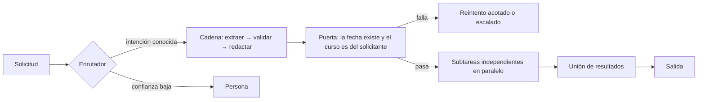
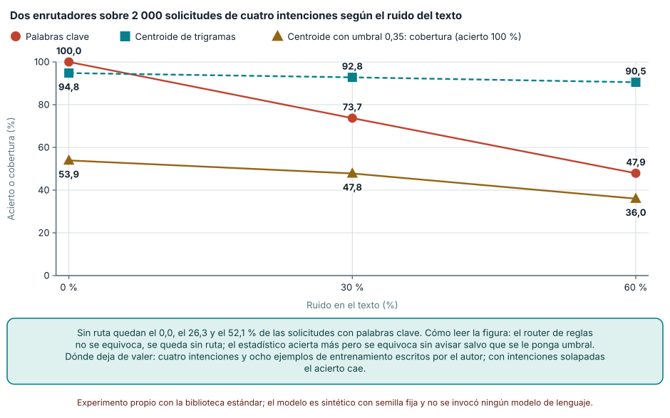
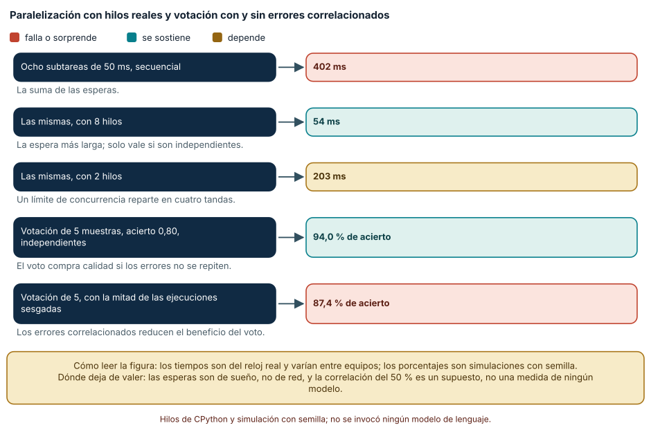

# SE-590 — Encadenado, enrutamiento y paralelización

[← SE-589 — Workflows frente a agentes: cuándo no usar un agente](../../classes/part-49-patrones-agenticos-y-sistemas-con-llm/se-589-workflows-frente-a-agentes-cuando-no-usar-un-agente/README.md) · [↑ Parte 49](../../classes/part-49-patrones-agenticos-y-sistemas-con-llm/README.md) · [📚 Índice completo](../../classes/README.md) · [🌐 Portal](../../site/classes/SE-590.html) · [SE-591 — Orquestador-trabajadores y evaluador-optimizador →](../../classes/part-49-patrones-agenticos-y-sistemas-con-llm/se-591-orquestador-trabajadores-y-evaluador-optimizador/README.md)

## Punto profesional y fundamento pedagógico

**Punto profesional.** La clase existe para que construyas workflows con modelos de lenguaje a partir de tres piezas pequeñas y medibles: **encadenar** pasos con una puerta entre ellos, **enrutar** cada solicitud al camino que le corresponde y **paralelizar** lo que es independiente. Son los patrones más baratos y los más revisables de toda la parte, y los que resuelven la mayoría de los casos de producción. Quien los domina puede decir, para cada uno, qué error multiplica, qué error corta y qué costo añade, y por eso decide con números qué patrón poner antes de recurrir a un agente.

**Por qué aparece aquí.** Sigue a `SE-589`, donde se decidió que gran parte de *Avisos* se resuelve con workflows. Esta clase construye esos workflows. Reutiliza ideas de la Parte 36 (cómo se componen las fiabilidades de pasos en serie) y de la Parte 35 (las puertas son pruebas colocadas dentro del flujo).

**Error conceptual que debe corregir.** Creer que dividir una tarea en pasos «mejora el resultado» por sí solo. Dividir en pasos reduce la dificultad de cada llamada, pero multiplica las oportunidades de error: si cada paso acierta el 95 %, tres pasos en cadena aciertan el 85,7 %. El beneficio de encadenar aparece solo si entre paso y paso hay una **puerta** que detecta el error cuando todavía es barato corregirlo. Del mismo modo, paralelizar no es siempre más rápido ni más barato, y votar no es siempre más preciso.

**Secuencia de aprendizaje.** Antes de ejecutar predices el éxito de una cadena de tres pasos con y sin puerta, el acierto de un enrutador de palabras clave y de uno estadístico cuando el texto tiene ruido, y el tiempo de ocho subtareas en secuencia y en paralelo. Después ejecutas y comparas.

**Evidencia de aprendizaje.** `workflows-log.md` con tus predicciones, las cuatro tablas medidas, una puerta programática escrita por ti para un paso de tu sistema y la regla de enrutamiento con su umbral y su destino para lo que no se clasifica.

**Límite de la conclusión.** El éxito por paso (0,95), la detección de la puerta (0,90) y el acierto por muestra de la votación (0,80) son parámetros del autor; el enrutador se prueba con cuatro intenciones y plantillas escritas a mano; y la paralelización se mide con esperas de sueño, no con llamadas de red. No se invocó ningún modelo de lenguaje.

### Trazabilidad fuente → afirmación

| Fuente primaria u oficial | Afirmación que respalda | Lo que no prueba |
|---|---|---|
| [Anthropic, «Building effective agents»](https://www.anthropic.com/engineering/building-effective-agents) | Describe el encadenado de prompts con puertas programáticas entre pasos, el enrutamiento por clasificación y la paralelización en sus dos variantes: seccionamiento y votación. | No mide la mejora en ningún caso concreto. |
| [Python, `concurrent.futures`](https://docs.python.org/3/library/concurrent.futures.html) | Documenta el `ThreadPoolExecutor` usado para medir la paralelización con hilos reales. | No dice cuándo conviene paralelizar. |
| [Dean y Barroso, «The Tail at Scale»](https://research.google/pubs/the-tail-at-scale/) | Explica por qué una operación que espera a varias respuestas hereda la cola de la más lenta. | No cubre llamadas a modelos. |
| [Zheng et al., «Judging LLM-as-a-Judge»](https://arxiv.org/abs/2306.05685) | Documenta sesgos de los jueces basados en modelos, relevantes cuando una puerta usa un modelo para revisar. | No cuantifica el sesgo de tu juez. |

## Antes de empezar

Recupera `SE-589`: el workflow decide el orden de los pasos y el agente lo decide el modelo. La pregunta activa es: **en un proceso de varios pasos que hayas automatizado, ¿en qué paso se detectó un error por primera vez y cuántos pasos más se ejecutaron sobre un resultado ya malo?**

## Prerrequisitos

- Haber completado `SE-589` o poder explicar la diferencia entre workflow y agente y el árbol de decisión.
- Conocer de la Parte 36 el producto de fiabilidades de pasos en serie.
- Python 3.11 o posterior con la biblioteca estándar.

## Problema auténtico

*Avisos* ya tiene decidido que las consultas de plazo y los silencios son workflows. Falta construirlos. Una solicitud puede decir «silencia los recordatorios del curso 5 hasta el viernes por favor». El flujo tiene tres pasos con modelo: extraer el curso y la fecha, validarlos contra los datos reales y redactar la confirmación. Un error de extracción no se ve en el siguiente paso si este confía en la salida del anterior: el sistema silencia el curso equivocado y lo confirma con una frase impecable.

Además llegan solicitudes de cuatro intenciones (plazo, silencio, baja y queja) escritas con erratas, relleno y estilos distintos. Un enrutador de palabras clave deja sin ruta la mitad de las solicitudes ruidosas; uno estadístico acierta más pero a veces se equivoca sin avisar. Y el informe semanal revisa ocho cursos: ¿se hace en secuencia o en paralelo, y cuánto se gana? La clase mide cada decisión.

## Objetivos observables

Al terminar podrás:

1. calcular el éxito de una cadena de *n* pasos y justificar dónde poner una puerta;
2. escribir una puerta programática que valide la salida de un paso contra una fuente de verdad distinta del modelo;
3. comparar un enrutador por reglas y uno estadístico y fijar un umbral de confianza con una vía de escape;
4. medir con hilos reales el beneficio de paralelizar y explicar qué lo limita;
5. decidir si una votación aporta, según si los errores de las muestras son independientes.

## Mapa conceptual



El mapa muestra los tres patrones en un mismo flujo: el enrutador decide la rama, la cadena tiene una puerta entre pasos y las subtareas independientes se paralelizan antes de unir.

## Temas y por qué importan

| Tema | Por qué cambia una decisión profesional | Evidencia mínima |
|---|---|---|
| Éxito de una cadena | Los errores se multiplican y la puerta los corta. | Éxito con y sin puerta |
| Puerta programática | Un chequeo de código no comparte el sesgo del modelo. | Una puerta escrita por ti |
| Enrutador por reglas y estadístico | Uno deja sin ruta, el otro se equivoca sin avisar. | Acierto con y sin ruido |
| Umbral y escape | Un enrutador sin vía de escape fuerza respuestas malas. | Cobertura y acierto con umbral |
| Paralelización | Reduce el tiempo de reloj, no el costo. | Tiempo con 1, 2 y 8 hilos |
| Votación | Compra calidad solo si los errores son independientes. | Acierto con errores correlacionados |

## Conceptos y decisiones

### 1. La cadena multiplica los errores

Si un paso acierta con probabilidad *p* y los fallos son independientes, una cadena de *n* pasos acierta con *pⁿ*. Con *p* = 0,95 y *n* = 3, el resultado es 0,857, y la simulación sobre 20 000 ejecuciones lo confirma (85,8 %). Dos consecuencias. Primero: acortar la cadena (menos pasos con modelo y más con código) sube la fiabilidad más que cualquier mejora marginal del prompt. Segundo: un error del primer paso se propaga con apariencia de normalidad, porque el modelo del paso siguiente trabaja con lo que recibe como si fuera verdad. La propagación silenciosa es el peligro específico de las cadenas con modelos: una función ordinaria que recibe un argumento inválido falla; un modelo que recibe un argumento inválido produce un texto plausible.

### 2. La puerta: un chequeo que no comparte el sesgo

La **puerta** es una comprobación entre dos pasos. Su valor depende de que sea independiente del paso que valida. Una puerta programática compara la salida con una fuente de verdad: ¿el curso extraído existe en la lista de cursos del solicitante?, ¿la fecha es válida y futura? No puede equivocarse del modo en que se equivoca el modelo. Una puerta que pregunta a otro modelo «¿es correcta esta extracción?» hereda gran parte del sesgo del primero y añade el suyo (`SE-591` la mide). En la simulación, una puerta que detecta el 90 % de los errores y permite un reintento sube el éxito de la cadena del 85,8 % al 97,8 % con 0,148 reintentos por ejecución: cuesta poco porque solo actúa cuando algo falla. Una puerta sin acción definida es un registro, no una puerta: debe decir qué ocurre al fallar (reintentar una vez, escalar o abortar).


**Cómo leer la figura.** La barra corta es la cadena sin puerta y la larga, la cadena con puerta y un reintento; la etiqueta de la segunda añade su costo. **Dónde deja de valer:** supone errores independientes entre pasos y una puerta que detecta el 90 %; si la puerta mira lo que el propio modelo dijo, detecta mucho menos, y si los errores están correlacionados (un mismo prompt ambiguo que falla siempre igual), un reintento repite el fallo.

### 3. Enrutar: reglas, estadística y una vía de escape

El enrutamiento clasifica la entrada y la envía a un camino especializado. Hay dos familias. El **enrutador por reglas** (palabras clave, expresiones) es transparente y tiene un modo de fallo benigno: si no reconoce la entrada, no tiene ruta y se puede escalar. El **estadístico** (un clasificador entrenado, un modelo) generaliza a frases no vistas pero siempre devuelve una respuesta, aunque sea mala. En el experimento, con solicitudes limpias las reglas aciertan el 100 % y el clasificador de trigramas el 94,8 %; con un 30 % de ruido las reglas bajan al 73,7 % (y dejan el 26,3 % sin ruta) mientras el clasificador baja al 92,8 %; con un 60 % las reglas aciertan el 47,9 % y el clasificador el 90,5 %. La pregunta de diseño es qué se prefiere entre «no sé» y «me equivoco con seguridad».

### 4. El umbral de confianza y la cobertura

El clasificador devuelve una puntuación; con un umbral (aquí 0,35) se acepta solo lo que supera la confianza y el resto va a una persona. En el experimento el clasificador acierta el 100 % de lo que acepta, pero cubre el 53,9 % de las solicitudes limpias, el 47,8 % con 30 % de ruido y el 36,0 % con 60 %. Es el compromiso clásico de la clasificación con rechazo: más umbral, más acierto y menos cobertura. El umbral no es una constante: se elige midiendo el costo de un error de enrutamiento (un silencio aplicado al curso equivocado) frente al costo de escalar (una persona, unos minutos). Un enrutador sin vía de escape convierte cada duda en una respuesta.



**Cómo leer la figura.** El eje horizontal es el ruido en el texto y el vertical el acierto o la cobertura; la línea coral son las palabras clave, la verde azulada el clasificador por trigramas y la dorada la cobertura del clasificador con umbral, que acierta el 100 % de lo que acepta. Mira cómo cae la línea coral y cómo el umbral compra acierto a costa de cobertura. Lo deseable es que la cobertura con umbral sea alta sin perder el acierto. **Dónde deja de valer:** cuatro intenciones bien separadas y ocho ejemplos de entrenamiento escritos por el autor; con intenciones que se solapan («baja» frente a «queja») o con idiomas mezclados el acierto cae, y el 100 % con umbral es una propiedad de este conjunto, no una garantía.

### 5. Paralelizar: lo que se gana y lo que no

Paralelizar es ejecutar a la vez subtareas **independientes**. Hay dos variantes: seccionar (cada subtarea es una parte distinta del trabajo) y votar (la misma tarea varias veces para comparar). Con ocho subtareas de 50 ms, la secuencia tarda 402 ms, ocho hilos 54 ms y dos hilos 203 ms (reloj real). El tiempo paralelo se acerca al de la subtarea más lenta, no a un octavo del total, y el límite de concurrencia (aquí 2) reparte el trabajo en tandas. Lo que no cambia es el costo: las ocho llamadas se pagan igual. Además hay límites externos: las cuotas de tasa del proveedor, la memoria y la cola larga de latencia (`SE-598`): una operación que espera a todas hereda la cola de la más lenta.

### 6. Votar: cuándo compra calidad

La votación ejecuta la misma tarea varias veces y toma la mayoría. Con cinco muestras que aciertan el 80 % de forma independiente, la mayoría acierta el 94,0 %. Pero si en la mitad de las ejecuciones las cinco muestras comparten el mismo sesgo (todas aciertan o todas fallan juntas, porque la entrada es ambigua o el prompt induce el mismo error), la mayoría acierta el 87,4 %. El voto reduce el ruido aleatorio y no toca el sesgo sistemático. Para que sea útil, las muestras deben variar de verdad (temperatura, redacción del prompt, modelo distinto) y hay que medir la correlación en datos reales; si no, se paga cinco veces por la misma respuesta.



**Cómo leer la figura.** Cada tarjeta es una medida con su resultado a la derecha: coral si es el caso lento o el que pierde beneficio, verde azulado si es el caso favorable y dorado si es un caso intermedio. Los tres primeros son tiempos de reloj real y los dos últimos, simulaciones con semilla; el patrón es que el paralelismo acota el tiempo y la votación acota el ruido. **Dónde deja de valer:** los tiempos varían entre equipos y las esperas son de sueño, no de red; la correlación del 50 % es un supuesto, no una medida de ningún modelo.

## Definiciones de trabajo

- **Encadenado:** secuencia de pasos donde la salida de uno es la entrada del siguiente.
- **Puerta:** comprobación entre pasos con una acción definida al fallar.
- **Enrutador:** componente que clasifica la entrada y elige el camino.
- **Cobertura con umbral:** fracción de solicitudes que el enrutador acepta por su confianza.
- **Seccionamiento:** paralelización donde cada subtarea es una parte distinta.
- **Votación:** ejecución repetida de la misma tarea y decisión por mayoría.

## Ejemplo mínimo

Una puerta programática entre extraer y confirmar un silencio:

```python
from datetime import date

def puerta_silencio(extraccion, cursos_del_usuario, hoy):
    errores = []
    if extraccion["curso"] not in cursos_del_usuario:
        errores.append("curso ajeno o inexistente")
    try:
        hasta = date.fromisoformat(extraccion["hasta"])
    except ValueError:
        errores.append("fecha no ISO")
    else:
        if hasta <= hoy:
            errores.append("la fecha ya pasó")
    return errores  # lista vacía: pasa; si no, se reintenta una vez o se escala
```

La puerta no pregunta a un modelo si la extracción es razonable: la compara con datos que el modelo no controla.

## Ejemplo profesional

*Escenario ilustrativo: las cifras de este ejemplo son supuestos de la narración, no mediciones.*

El equipo de *Avisos* implementa el silencio como una cadena de tres pasos: extracción (modelo, salida JSON), validación (código, con la puerta anterior) y confirmación (modelo, texto). Si la puerta falla, se repite la extracción una vez con el error de la puerta como contexto; si vuelve a fallar, la solicitud se escala a una persona con la extracción fallida adjunta. El enrutador es un clasificador con umbral y, bajo el umbral, la solicitud va a la cola humana. El informe semanal de ocho cursos se ejecuta en paralelo con un máximo de cuatro hilos para respetar la cuota del proveedor, y el resultado se une en un solo documento. El equipo registra, por rama, cuántas solicitudes llegan, cuántas pasan la puerta y cuántas escalan, y revisa los umbrales cada mes con esos números.

## Práctica guiada

1. Predice el éxito de la cadena de tres pasos con y sin puerta y el acierto de los dos enrutadores con 60 % de ruido.
2. Ejecuta `python scripts/experiments_part49_a.py 506` y compara.
3. Cambia el éxito por paso de 0,95 a 0,90 y a 0,99 y observa cuándo la puerta deja de compensar.
4. Cambia el umbral del clasificador de 0,35 a 0,25 y a 0,50 y anota cobertura y acierto.
5. Escribe una puerta para un paso de tu sistema y una prueba que provoque un fallo de cada tipo.

## Ejercicios

1. **Básico.** Calcula el éxito de una cadena de cinco pasos con 0,97 por paso y explica qué cambia si dos de los pasos pasan a código determinista.
2. **Intermedio.** Diseña la puerta del paso «extraer la fecha límite de un correo»: qué fuente de verdad usas y qué haces al fallar.
3. **Avanzado.** Explica por qué una votación de tres modelos distintos es distinta de tres muestras del mismo modelo y cómo medirías la correlación con 100 casos etiquetados.

## Reto verificable

Entrega `workflows-log.md` con las cuatro tablas, la puerta escrita por ti con sus pruebas, la regla de enrutamiento con umbral y destino de escape, y una nota que diga qué parte de tu sistema no puede paralelizarse y por qué. Es válido si otra persona reproduce las tablas con la misma semilla y ejecuta tus pruebas de la puerta.

## Caso conductor

El silencio del curso es la tarea de *Avisos* que ya se usó en `SE-551` con cinco metodologías. Aquí se vuelve cadena con puerta y enrutador. En `SE-591` se añadirá un evaluador, en `SE-596` se hará durable y en `SE-600` quedará integrado en el sistema completo.

## Preguntas frecuentes

### ¿Cuántos pasos debe tener una cadena?

Los que haga falta y ninguno más. Cada paso con modelo multiplica el error; cada paso en código es casi gratuito. Mueve a código todo lo que se pueda expresar con reglas.

### ¿Puedo usar un modelo como puerta?

Sí, pero medido: un modelo-juez tiene sesgos (de posición, de longitud) y errores propios. Úsalo donde no hay fuente de verdad programática, y valida su acuerdo con personas sobre casos etiquetados (`SE-597`).

### ¿El umbral lo elijo una vez?

No. Cambia con el ruido de las solicitudes y con el costo del error. Revísalo con los registros de escalado: si casi todo lo escalado era claro, el umbral es alto.

### ¿Paralelizar reduce el costo?

No: reduce el tiempo de reloj. Las llamadas se pagan igual y la votación las multiplica. El beneficio es de latencia, y a veces de calidad.

## Fallo controlado y diagnóstico

**Fallo.** Un silencio se aplica al curso 3 en vez del 5. La confirmación al usuario dice «curso 5 silenciado», con la fecha correcta.

**Diagnóstico paso a paso.** (1) Se lee la traza de la cadena: la extracción devolvió `curso: "c3"` y la confirmación se redactó con el texto de la solicitud original. (2) Se comprueba que la puerta no existía: el paso 2 reutilizaba la extracción sin validarla. (3) Se confirma que el modelo de la confirmación no veía lo que el paso 2 hizo. (4) Se concluye que la propagación silenciosa de un error de extracción produjo una confirmación plausible y falsa.

**Corrección.** Se añade la puerta que compara el curso extraído con los cursos del solicitante y con el texto de la solicitud; la confirmación se genera desde el resultado de la operación y no desde la solicitud. Se agrega una prueba con una solicitud ambigua que debe terminar en escalado.

## Errores comunes y cómo corregirlos

- **Puerta sin acción.** Síntoma: el log dice que falló y el flujo sigue. Causa: la puerta solo registra. Solución: define reintento acotado, escalado o aborto.
- **Puerta que usa el mismo modelo.** Síntoma: la puerta aprueba errores del paso anterior. Causa: comparte sesgo. Solución: usa una fuente de verdad en código; si no existe, mide el juez.
- **Enrutador forzado a responder.** Síntoma: respuestas seguras y equivocadas. Causa: sin umbral ni vía de escape. Solución: umbral y cola humana.
- **Paralelizar lo dependiente.** Síntoma: resultados distintos entre ejecuciones. Causa: subtareas que comparten estado. Solución: aísla el estado o secuencia.
- **Votar con muestras idénticas.** Síntoma: cinco veces el mismo error. Causa: temperatura 0 y mismo prompt. Solución: varía las muestras y mide la correlación.

## Entorno y archivos clave

- `scripts/experiments_part49_a.py`: función `exp506` con la cadena, los dos enrutadores, los hilos reales y la votación; `python scripts/experiments_part49_a.py 506`.
- `scripts/experiments_part49_lab.py`: utilidades de formato.
- `content/part-49/figures/`: figuras de la clase.
- Entorno: CPython 3.11 o posterior; los tiempos de reloj varían por equipo y carga.

## Seguridad, ética y accesibilidad

Una puerta que compara contra los datos del solicitante es también un control de autorización: impide silenciar un curso ajeno. Un enrutador que no escala conviene al atacante, que formula la solicitud para caer en la rama más permisiva. Ética: escalar una solicitud a una persona no es un fracaso del sistema; forzar una respuesta sobre una intención dudosa sí lo es. Privacidad: las solicitudes contienen datos de personas; el registro por rama cuenta eventos, no almacena el texto completo. Accesibilidad: las figuras son tablas y barras con etiquetas de valor, sin depender del color.

## Puente hacia el trabajo con agentes

Un agente que implementa un workflow tiende a omitir las puertas porque «el modelo ya lo valida»: pasa la salida del paso uno al paso dos sin chequeo. La instrucción de repositorio que lo corrige es breve: «entre dos pasos con modelo, escribe una puerta programática contra una fuente de verdad y define qué ocurre al fallar». La comprobación es mecánica: una prueba que inyecta una salida inválida en cada paso debe terminar en reintento o en escalado, nunca en una confirmación.

## Transferencia

Toma un proceso de tu sistema con dos o más pasos con modelo. Calcula su éxito teórico con tu estimación por paso, ubica la primera puerta que añadirías y escríbela. Si el proceso recibe solicitudes variadas, diseña el enrutador con umbral y define qué pasa con lo que no se clasifica. Anota qué subtareas son independientes y qué límite de concurrencia aceptas.

## Evaluación y evidencia

| Criterio | Evidencia aceptable | Rechazo |
|---|---|---|
| Éxito de cadena | Cálculo y medida, con y sin puerta | Solo el cálculo |
| Puerta | Programática, contra una fuente de verdad, con acción al fallar | «El modelo lo revisa» |
| Enrutador | Acierto, cobertura y vía de escape | Solo el acierto |
| Paralelización | Tiempo medido con 1, 2 y 8 hilos | «Es más rápido» |
| Votación | Correlación estimada y acierto con y sin ella | Asumir independencia |
| Límite | Declara que el modelo es sintético | Presenta una tasa real |

## Fuentes

- Anthropic. [«Building effective agents»](https://www.anthropic.com/engineering/building-effective-agents).
- Python Software Foundation. [`concurrent.futures`](https://docs.python.org/3/library/concurrent.futures.html).
- Dean, J. y Barroso, L. A. [«The Tail at Scale»](https://research.google/pubs/the-tail-at-scale/).
- Zheng, L. et al. [«Judging LLM-as-a-Judge with MT-Bench and Chatbot Arena»](https://arxiv.org/abs/2306.05685).

## Límites y siguiente paso

El éxito por paso, la detección de la puerta, el acierto por muestra y la correlación son parámetros del autor; el enrutador usa cuatro intenciones y plantillas escritas a mano; los tiempos paralelos usan esperas de sueño. No se midió ningún modelo de lenguaje ni ningún proveedor. El siguiente paso, `SE-591`, trata los dos patrones donde el trabajo no se puede fijar de antemano, el orquestador-trabajadores, y donde la calidad se consigue iterando, el evaluador-optimizador.

## Glosario

| Término | Definición breve |
|---|---|
| Encadenado | Pasos donde la salida de uno alimenta al siguiente |
| Puerta | Comprobación entre pasos con acción al fallar |
| Enrutador | Clasificador que elige el camino de una solicitud |
| Cobertura | Fracción de solicitudes que el enrutador acepta |
| Seccionamiento | Paralelización por partes distintas del trabajo |
| Votación | Mayoría sobre ejecuciones repetidas de una tarea |
