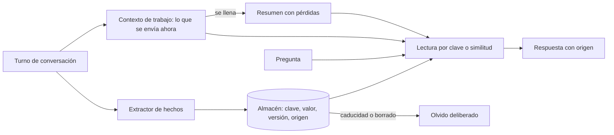
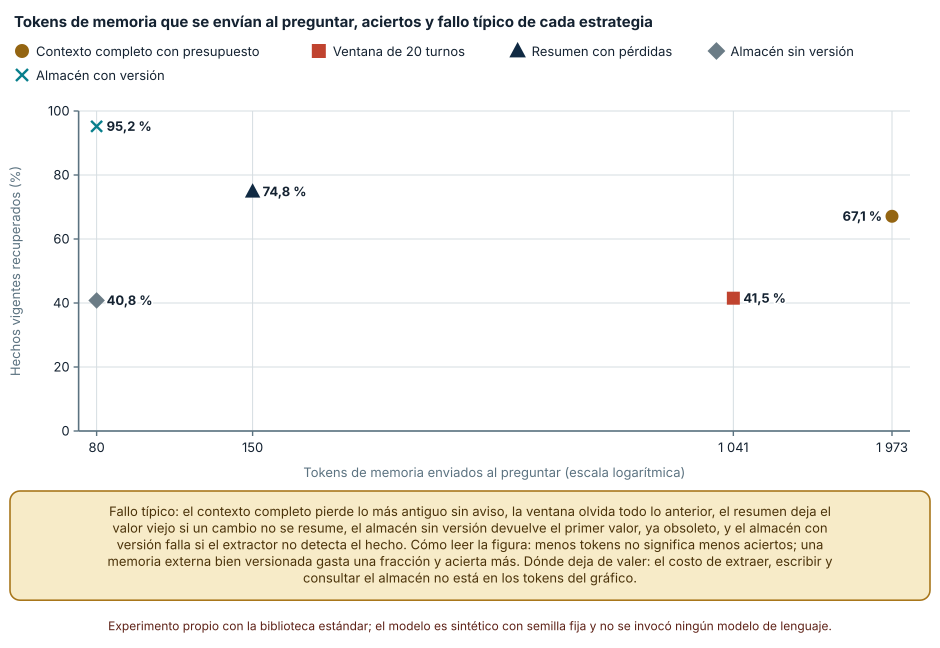

# SE-593 — Memoria y gestión de estado de agentes

[← SE-592 — ReAct, plan-and-execute y reflexión](../../classes/part-49-patrones-agenticos-y-sistemas-con-llm/se-592-react-plan-and-execute-y-reflexion/README.md) · [↑ Parte 49](../../classes/part-49-patrones-agenticos-y-sistemas-con-llm/README.md) · [📚 Índice completo](../../classes/README.md) · [🌐 Portal](../../site/classes/SE-593.html) · [SE-594 — Embeddings, recuperación y agentic RAG →](../../classes/part-49-patrones-agenticos-y-sistemas-con-llm/se-594-embeddings-recuperacion-y-agentic-rag/README.md)

## Punto profesional y fundamento pedagógico

**Punto profesional.** La clase existe para que trates la memoria de un agente como lo que es: **estado**, con las mismas preguntas que cualquier otro estado de un sistema. ¿Qué se guarda, quién lo escribe, cuánto dura, cómo se actualiza cuando cambia, cómo se lee, cómo se borra y qué ocurre cuando está equivocado? Un modelo de lenguaje no recuerda nada entre llamadas: lo que «recuerda» es lo que el sistema coloca en su contexto. Por eso la memoria de un agente es una decisión de ingeniería, medible, con costos y modos de fallo propios.

**Por qué aparece aquí.** Sigue a `SE-592`, donde el bucle acumulaba historial. Allí se vio que cada paso relee todo lo anterior; aquí se pregunta qué pasa cuando ese historial no cabe, cuando la conversación dura días o cuando un dato cambia. Retoma de la Parte 13 la idea de modelo de datos y de la Parte 27 la de fuente única de verdad: una memoria que duplica un dato sin versión es una réplica que se desincroniza.

**Error conceptual que debe corregir.** Creer que una ventana de contexto grande resuelve la memoria. Una ventana grande pospone el problema, cuesta tokens en cada llamada y no garantiza que el modelo use bien lo que está en medio (hay evidencia de que la posición importa: «Lost in the Middle»). Y la creencia gemela: que «resumir» es gratuito. Un resumen es una compresión con pérdidas cuyo error no se ve: el hecho que no se resumió o la actualización que se omitió dejan al sistema con un valor viejo que parece vigente.

**Secuencia de aprendizaje.** Antes de ejecutar predices, para cinco estrategias, qué fracción de los hechos vigentes se recupera al final de 80 turnos y cuántos tokens de memoria se envían. Después ejecutas con 300 conversaciones sintéticas y analizas dónde falla cada una.

**Evidencia de aprendizaje.** `memoria-log.md` con tu predicción, la tabla medida, el esquema de memoria de tu agente (qué hechos, con qué clave, versión, origen y caducidad) y la regla de actualización cuando un dato cambia.

**Límite de la conclusión.** Las conversaciones son sintéticas (80 turnos, 25 % con un hecho que a veces reemplaza a otro), el extractor acierta el 95 % y el resumen conserva cada cambio con 75 %: son parámetros del autor, no mediciones de un modelo. Las estrategias reales dependen del extractor y del resumidor que uses.

### Trazabilidad fuente → afirmación

| Fuente primaria u oficial | Afirmación que respalda | Lo que no prueba |
|---|---|---|
| [Packer et al., «MemGPT»](https://arxiv.org/abs/2310.08560) | Propone gestionar la memoria de un modelo con niveles (contexto principal y almacenamiento externo) y mover información entre ellos, como un sistema operativo con memoria virtual. | No fija umbrales ni mide tu caso. |
| [Anthropic, «Effective context engineering for AI agents»](https://www.anthropic.com/engineering/effective-context-engineering-for-ai-agents) | Trata el contexto como un recurso finito y describe técnicas como la compactación, las notas fuera del contexto y la recuperación bajo demanda. | No elige una estrategia para ti. |
| [Liu et al., «Lost in the Middle»](https://arxiv.org/abs/2307.03172) | Muestra que los modelos evaluados usan peor la información situada en medio de contextos largos. | No generaliza a todos los modelos actuales. |
| [Anthropic, «Prompt caching»](https://docs.anthropic.com/en/docs/build-with-claude/prompt-caching) | Describe cómo un prefijo estable puede reutilizarse entre llamadas, lo que cambia el costo de repetir contexto. | No resuelve la actualización de datos. |

## Antes de empezar

Recupera `SE-592`: cada vuelta del bucle relee el historial y eso encarece y alarga la ejecución. La pregunta activa es: **si le dijeras a un asistente un dato el lunes y lo corrigieras el miércoles, ¿qué garantiza que el viernes use el del miércoles?**

## Prerrequisitos

- Haber completado `SE-592` o poder explicar el costo del historial creciente en un bucle de agente.
- Conocer de la Parte 13 qué es una clave y un modelo de datos, y de la Parte 27 la fuente única de verdad.
- Python 3.11 o posterior.

## Problema auténtico

El asistente de *Avisos* conversa con coordinación durante semanas. En la primera semana alguien dice «silencia el curso 7 hasta el día 12». Tres días después, «mejor hasta el día 20». Una semana más tarde alguien pregunta «¿hasta cuándo está silenciado el curso 7?». Si el sistema responde 12, hay estudiantes que recibirán avisos que la coordinación había decidido evitar; si responde 20, bien.

Hay varias formas de «recordar». Mantener toda la conversación hasta que se acabe el presupuesto de contexto. Quedarse con los últimos N turnos. Resumir lo anterior. O guardar los hechos en un almacén externo con clave y consultar por clave. Cada una tiene un costo y un fallo típico, y una de ellas, la más simple de escribir, devuelve el valor viejo. La clase mide las cinco sobre el mismo problema.

## Objetivos observables

Al terminar podrás:

1. distinguir contexto de trabajo, resumen y almacén externo como capas con costos distintos;
2. medir la recuperación de hechos vigentes de cada estrategia sobre conversaciones con actualizaciones;
3. diseñar un esquema de memoria con clave, valor, versión, origen y caducidad;
4. explicar por qué un almacén sin versión devuelve valores obsoletos y cómo se corrige;
5. definir qué se olvida a propósito y quién puede borrarlo.

## Mapa conceptual



El mapa muestra tres vías de recuerdo hacia la misma pregunta: el contexto, el resumen y el almacén. Solo el almacén tiene un camino explícito de olvido.

## Temas y por qué importan

| Tema | Por qué cambia una decisión profesional | Evidencia mínima |
|---|---|---|
| Contexto con presupuesto | Lo más antiguo se pierde sin aviso al llenarse. | Hechos recuperados por estrategia |
| Ventana deslizante | Es barata y olvida todo lo anterior. | Tokens y aciertos |
| Resumen con pérdidas | Comprime a costa de omitir cambios. | Aciertos con actualizaciones |
| Almacén externo | Escala y permite versión, a costa de un extractor. | Aciertos con y sin versión |
| Versión y vigencia | Sin ellas se devuelve un valor obsoleto. | Un caso de actualización |
| Olvido deliberado | Privacidad y corrección dependen de poder borrar. | Regla de caducidad y borrado |

## Conceptos y decisiones

### 1. El modelo no recuerda: el sistema recuerda por él

Cada llamada a un modelo empieza sin estado: lo que ve es exactamente el contexto que se le envía. «Memoria» es, por tanto, la política que decide qué información se coloca en ese contexto en cada llamada. Hay una memoria de corto plazo (el historial de la sesión) y de largo plazo (información que sobrevive a la sesión), y entre ambas hay una pregunta de ingeniería: qué se promueve de una a otra y con qué criterio. MemGPT lo plantea como una jerarquía: un contexto principal limitado y un almacenamiento externo del que se traen y al que se llevan datos bajo demanda.

### 2. Contexto completo con presupuesto: se pierde lo antiguo

La estrategia más simple es enviar toda la conversación mientras quepa. Cuando se llena, hay que descartar algo, y lo natural es descartar lo más antiguo. En el experimento, con un presupuesto de 2 000 tokens y 80 turnos, el sistema envía unos 1 973 tokens y recupera el 67,1 % de los hechos vigentes: lo que cayó fuera del presupuesto simplemente no está. El fallo es silencioso: el modelo no sabe que se descartó nada y contesta con lo que ve, que puede ser una versión intermedia de un hecho que cambió varias veces. Además, enviar 2 000 tokens en cada llamada cuesta aunque la pregunta sea sobre un dato.

### 3. Ventana deslizante: barata y corta

Una ventana de los últimos N turnos cuesta menos (aquí 1 041 tokens con N = 20) y recupera el 41,5 %: todo hecho anterior a la ventana se pierde. Es adecuada cuando la conversación solo necesita el pasado inmediato (un asistente de una tarea corta) y mala cuando hay compromisos de largo plazo («silencia hasta el día 20»). Su ventaja es su previsibilidad: el costo es constante. Su riesgo es la falsa continuidad: el usuario cree que el asistente «lo sabe».

### 4. Resumen con pérdidas: lo que no se resume no existe

Un resumen comprime el historial en pocos tokens (aquí 150) y recupera el 74,8 % de los hechos vigentes porque se supone que conserva cada cambio con probabilidad del 75 %. Dos fallos distintos se ocultan en esa cifra. Uno es el hecho omitido: el resumen no lo mencionó y se pierde. El otro es más dañino: la **actualización omitida**, donde el resumen conserva el valor viejo y omite el nuevo, y el sistema responde con seguridad algo que fue verdad. Un resumen que se vuelve a resumir pierde más con cada compactación. La compactación (Anthropic la describe como técnica de ingeniería de contexto) es útil, pero debe conservar de forma explícita los hechos que importan, no confiar en que el resumidor los elija.

### 5. Almacén externo: clave, versión y origen

El almacén guarda hechos como registros: clave (`silencio:curso7`), valor, instante, origen (qué turno o qué persona lo dijo) y versión. Un **extractor** detecta los hechos en la conversación y los escribe; la lectura es por clave (exacta) o por similitud (`SE-594`). En el experimento, con un extractor que acierta el 95 %, el almacén **con versión** (siempre gana el valor más reciente) recupera el 95,2 % con 80 tokens de memoria por pregunta, y el almacén **sin versión** (se conserva el primer valor escrito) recupera el 40,8 %. La diferencia entre las dos es una línea de código: qué ocurre cuando llega una clave que ya existe. Es el mismo problema que el de cualquier caché o réplica: sin una política de actualización, guarda el dato viejo.


**Cómo leer la figura.** Cada barra es una estrategia y su longitud, la fracción de hechos vigentes recuperados; se pregunta por el valor actual, no por el primero. **Dónde deja de valer:** 300 conversaciones sintéticas, un extractor que acierta el 95 % y un resumen que conserva cada cambio con 75 %; son parámetros del autor. En un sistema real el extractor falla de formas distintas (confunde cursos, extrae hechos que nadie afirmó) y esos fallos hay que medirlos con conversaciones etiquetadas.

### 6. Costo, vigencia y olvido

La tabla de costos muestra una paradoja útil: la estrategia que más recupera gasta menos tokens por pregunta. El almacén cuesta, sin embargo, en otro sitio: el extractor (una llamada o una regla por turno), la escritura, la consulta y el mantenimiento del esquema. Y hay una decisión que ninguna de las otras estrategias ofrece: **olvidar a propósito**. Una memoria con datos personales necesita caducidad (un silencio caduca el día indicado), borrado a petición y control de quién puede escribir. Una memoria que solo crece es un archivo de datos personales sin base legal. La política de olvido es parte del diseño y se prueba.



**Cómo leer la figura.** El eje horizontal son los tokens de memoria enviados al preguntar, en escala logarítmica, y el vertical el porcentaje de hechos vigentes recuperados; cada punto es una estrategia. Mira el punto del almacén con versión, arriba a la izquierda, con pocos tokens y el mayor acierto, y compáralo con el contexto completo, que gasta veinte veces más y acierta menos. **Dónde deja de valer:** el costo del extractor, de la escritura y de la consulta no está en los tokens de la tabla; y un fallo del extractor (no detecta un hecho) afecta al almacén de formas que no afectan al contexto completo.

## Capas, escritura, lectura y borrado

Las capas no compiten, se combinan. El contexto de trabajo es lo que el modelo ve ahora y se mantiene pequeño. El resumen compacta el tramo reciente que ya no cabe. El almacén guarda los hechos que deben sobrevivir. Cada capa necesita sus reglas: **quién escribe** (el extractor, una herramienta que el agente llama, una persona), **cómo se lee** (por clave si se conoce, por similitud si no), **cómo se actualiza** (versión, el más reciente gana, o conflicto escalado) y **cómo se olvida** (caducidad, borrado, revisión).


**Cómo leer la figura.** La fila superior son las capas y la inferior, las políticas que cada capa necesita. **Dónde deja de valer:** una memoria con datos personales exige además base legal, plazo y derecho de borrado, que el esquema no muestra, y una memoria compartida entre usuarios exige control de acceso por registro.

## Definiciones de trabajo

- **Contexto de trabajo:** el texto que se envía al modelo en una llamada.
- **Memoria de largo plazo:** información que sobrevive a la sesión, normalmente fuera del contexto.
- **Compactación:** sustituir parte del historial por un resumen más corto.
- **Extractor:** componente que detecta hechos en la conversación y los convierte en registros.
- **Versión:** marca que permite decidir qué valor de una clave es el vigente.
- **Caducidad:** momento a partir del cual un registro deja de valer o se borra.

## Ejemplo mínimo

Un almacén de hechos con versión y caducidad:

```python
from datetime import datetime, timezone

class Memoria:
    def __init__(self):
        self._r = {}  # clave -> lista de (instante, valor, origen)

    def escribir(self, clave, valor, origen, ahora=None):
        ahora = ahora or datetime.now(timezone.utc)
        self._r.setdefault(clave, []).append((ahora, valor, origen))

    def leer(self, clave, ahora=None, vigencia_dias=None):
        ahora = ahora or datetime.now(timezone.utc)
        if clave not in self._r:
            return None
        instante, valor, origen = max(self._r[clave], key=lambda r: r[0])  # el más reciente gana
        if vigencia_dias is not None and (ahora - instante).days > vigencia_dias:
            return None  # caducó
        return {"valor": valor, "origen": origen, "instante": instante}
```

Escribir nunca sobrescribe: añade una versión, y leer elige la más reciente. El historial queda disponible para auditar quién cambió qué.

## Ejemplo profesional

*Escenario ilustrativo: las cifras de este ejemplo son supuestos de la narración, no mediciones.*

El equipo de *Avisos* define cuatro tipos de hecho persistente: silencios por curso, preferencias de canal, excepciones de plazo y contactos alternativos. Cada tipo tiene clave, esquema, caducidad y quién puede escribirlo. El agente no escribe directamente: propone un registro con la cita del turno de donde lo sacó y una validación de código comprueba el esquema y que el solicitante tenga permiso sobre el curso. Las lecturas se hacen por clave antes de cada respuesta que dependa de un hecho y la respuesta cita el origen («según la instrucción de María del 3 de noviembre»). Cada mes se revisa una muestra de 50 registros contra la conversación original y se mide cuántos eran falsos o estaban obsoletos. Los registros personales se borran a petición y caducan a los 90 días sin uso.

## Práctica guiada

1. Predice la recuperación de las cinco estrategias y ordénalas.
2. Ejecuta `python scripts/experiments_part49_a.py 509` y compara.
3. Cambia la retención del resumen de 0,75 a 0,50 y a 0,95: ¿cuándo supera al contexto completo?
4. Cambia el acierto del extractor de 0,95 a 0,70 y mira el efecto sobre el almacén versionado.
5. Diseña el esquema de memoria de tu agente: tipos de hecho, claves, versión, origen, caducidad y permiso de escritura.

## Ejercicios

1. **Básico.** Explica con el ejemplo del silencio del curso 7 por qué un almacén que conserva el primer valor devuelve la fecha vieja.
2. **Intermedio.** Diseña la regla de conflicto cuando dos personas con permiso dan fechas distintas el mismo día.
3. **Avanzado.** Propón cómo medirías la tasa de hechos falsos que el extractor escribe en el almacén y cuántos casos etiquetados necesitas para estimarla con margen de 5 puntos.

## Reto verificable

Entrega `memoria-log.md` con tu predicción, la tabla medida, el esquema de memoria de tu agente con su regla de versión y caducidad, y una prueba que escriba dos valores para la misma clave y compruebe que la lectura devuelve el más reciente con su origen. Es válido si otra persona ejecuta la prueba y reproduce la tabla con la misma semilla.

## Caso conductor

La memoria de *Avisos* guarda silencios, excepciones y contactos. En `SE-594` se leerá por similitud cuando no se conozca la clave, en `SE-596` se hará durable y en `SE-598` se tratará su seguridad: un hecho escrito por un texto hostil es memoria envenenada.

## Preguntas frecuentes

### ¿Basta con un modelo de contexto largo?

Aplaza el problema y lo encarece. Cada llamada paga todo el contexto, la atención del modelo sobre lo que está en medio puede degradarse y el límite sigue existiendo. La memoria externa permite pagar solo lo necesario.

### ¿Quién debe escribir en la memoria: el modelo o el código?

Idealmente el código valida lo que el modelo propone. Si el modelo escribe sin control, un texto del contexto puede introducir hechos falsos que sobreviven a la sesión.

### ¿Cómo evito que el sistema recuerde algo que debía olvidar?

Con caducidad, borrado a petición y una prueba que lo verifique. «Olvidar» en la conversación no es borrar del almacén, de las trazas ni de los respaldos.

### ¿Resumir no es suficiente?

Para el contexto reciente, a menudo sí. Para compromisos que deben sobrevivir (una fecha de silencio), no: se guardan como hechos con clave y versión, no como prosa dentro de un resumen.

## Fallo controlado y diagnóstico

**Fallo.** Un curso silenciado «hasta el 12» sigue recibiendo avisos el día 15, y la persona que lo pidió jura haberlo cambiado al 20.

**Diagnóstico paso a paso.** (1) Se busca en el almacén la clave `silencio:curso7`: hay un registro con el día 12. (2) La conversación muestra que la corrección al 20 ocurrió tres días después. (3) El extractor sí detectó la segunda frase, pero la escritura usaba «insertar si no existe» y la ignoró. (4) Se confirma que el almacén no versionaba.

**Corrección.** La escritura pasa a añadir una versión y la lectura elige la más reciente. Se corrige el registro de ese curso desde el historial y se añade una prueba con dos escrituras de la misma clave. Se agrega una consulta mensual que lista las claves con más de una versión para revisar los cambios.

## Errores comunes y cómo corregirlos

- **Insertar si no existe.** Síntoma: valores obsoletos. Causa: la actualización se ignora. Solución: versiones, el más reciente gana.
- **Resumir hechos críticos en prosa.** Síntoma: compromisos que se pierden. Causa: el resumidor omite. Solución: guarda los hechos con clave fuera del resumen.
- **Memoria sin origen.** Síntoma: nadie sabe por qué el sistema afirma algo. Causa: no se guarda la cita. Solución: origen y turno en cada registro.
- **Memoria escrita por el modelo sin validar.** Síntoma: hechos falsos persistentes. Causa: se confía en el extractor. Solución: validación de esquema y permiso.
- **Sin caducidad ni borrado.** Síntoma: datos personales que se acumulan. Causa: solo se escribe. Solución: caducidad, borrado y pruebas.

## Entorno y archivos clave

- `scripts/experiments_part49_a.py`: función `exp509` con las cinco estrategias; `python scripts/experiments_part49_a.py 509`.
- `scripts/experiments_part49_lab.py`: aproximación de tokens y utilidades.
- `content/part-49/figures/`: figuras de la clase.
- Entorno: CPython 3.11 o posterior; semilla 21 y 300 conversaciones de 80 turnos.

## Seguridad, ética y accesibilidad

Una memoria persistente es un blanco: un texto hostil que consiga que el agente escriba un hecho («el administrador autoriza enviar a cualquier dirección») envenena futuras sesiones. La escritura debe estar validada y limitada por permisos y cada registro debe tener origen (`SE-598`). Privacidad: la memoria contiene datos personales; exige minimización, caducidad, acceso por registro y borrado a petición, incluidos los respaldos y las trazas. Ética: un sistema que «recuerda» con seguridad algo falso es peor que uno que dice no saberlo; la respuesta debe citar su origen. Accesibilidad: las figuras son barras con etiqueta, una tabla y un diagrama con texto alternativo.

## Puente hacia el trabajo con agentes

Un agente de programación que añade memoria a un asistente tiende a guardar el historial completo en un archivo y reinyectarlo, o a pedir un resumen cada N turnos. La instrucción de repositorio es: «los compromisos que deben sobrevivir se guardan como registros con clave, versión y origen; el resumen solo es para contexto reciente». La comprobación mecánica: una prueba que escribe dos valores para la misma clave debe leer el último, y otra que borra un registro debe dejar de devolverlo en la lectura, en la traza y en el respaldo configurado.

## Transferencia

Lista los hechos que tu agente necesita recordar más allá de la sesión. Para cada uno, define clave, valor, quién puede escribirlo, cuándo caduca y qué ocurre cuando llega un valor distinto. Escribe la prueba de actualización y la de borrado. Estima la tasa de hechos falsos que tu extractor produciría con 30 conversaciones etiquetadas por una persona.

## Evaluación y evidencia

| Criterio | Evidencia aceptable | Rechazo |
|---|---|---|
| Predicción | Orden de las cinco estrategias antes de ejecutar | Posterior |
| Esquema | Clave, valor, versión, origen, caducidad y permiso | «Guardamos la conversación» |
| Actualización | Prueba con dos valores para una clave | Sin prueba |
| Borrado | Prueba que verifica almacén, traza y respaldo | «Se borra» |
| Medida de falsos | Muestra etiquetada del extractor | Asumir que acierta |
| Límite | Declara que las conversaciones son sintéticas | Presenta una tasa real |

## Fuentes

- Packer, C. et al. [«MemGPT: Towards LLMs as Operating Systems»](https://arxiv.org/abs/2310.08560).
- Anthropic. [«Effective context engineering for AI agents»](https://www.anthropic.com/engineering/effective-context-engineering-for-ai-agents).
- Liu, N. F. et al. [«Lost in the Middle: How Language Models Use Long Contexts»](https://arxiv.org/abs/2307.03172).
- Anthropic. [«Prompt caching»](https://docs.anthropic.com/en/docs/build-with-claude/prompt-caching).

## Límites y siguiente paso

Las conversaciones, la fracción de turnos con hechos, el acierto del extractor y la retención del resumen son parámetros del autor; no se midió ningún modelo ni ningún producto de memoria. El siguiente paso, `SE-594`, trata la lectura cuando no se conoce la clave: qué es un embedding, cómo se recupera por similitud y qué cambia cuando el agente decide cuándo y qué recuperar.

## Glosario

| Término | Definición breve |
|---|---|
| Contexto de trabajo | Texto enviado al modelo en una llamada |
| Memoria de largo plazo | Información que sobrevive a la sesión |
| Compactación | Sustituir historial por un resumen |
| Extractor | Componente que convierte la conversación en registros |
| Versión | Marca que indica el valor vigente de una clave |
| Caducidad | Momento en que un registro deja de valer |
