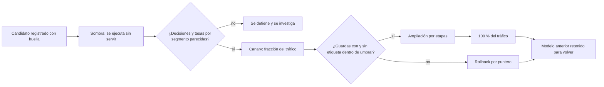
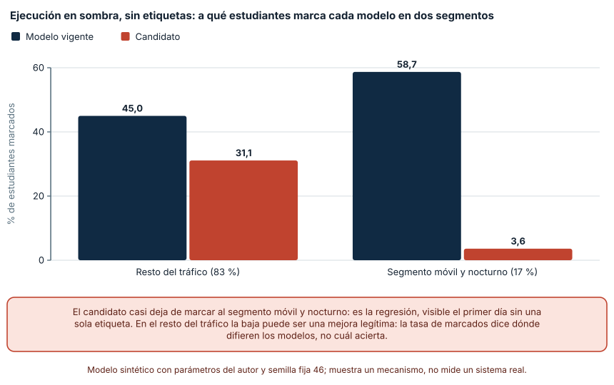
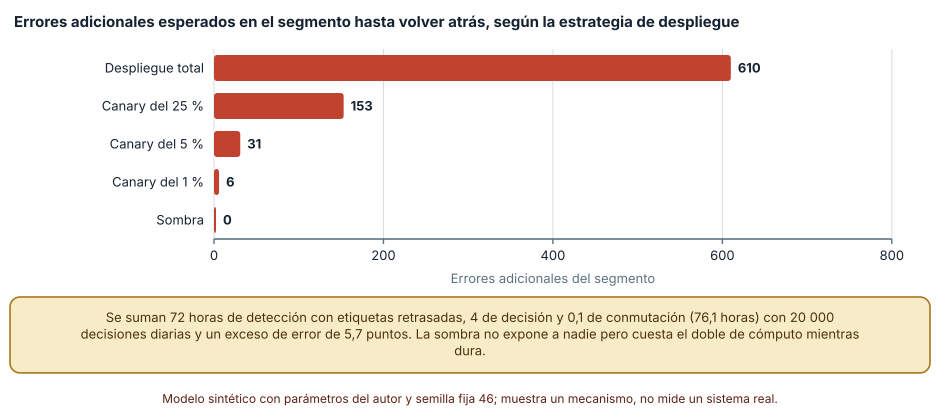

# SE-607 — Despliegue seguro de modelos: shadow, canary y rollback

[← SE-606 — Servir modelos: latencia, lotes y GPU](../../classes/part-50-machine-learning-en-produccion-y-mlops/se-606-servir-modelos-latencia-lotes-y-gpu/README.md) · [↑ Parte 50](../../classes/part-50-machine-learning-en-produccion-y-mlops/README.md) · [📚 Índice completo](../../classes/README.md) · [🌐 Portal](../../site/classes/SE-607.html) · [SE-608 — Monitoreo, deriva y reentrenamiento →](../../classes/part-50-machine-learning-en-produccion-y-mlops/se-608-monitoreo-deriva-y-reentrenamiento/README.md)

## Punto profesional y fundamento pedagógico

**Punto profesional.** La clase existe para que pongas un modelo nuevo en producción sin apostar a todos los usuarios a la vez. Un modelo candidato siempre llega con una prueba fuera de línea favorable, y esa prueba no basta: no vio el tráfico real, no vio los segmentos pequeños que el promedio oculta y no incluye el comportamiento del sistema que lo rodea. Las tres técnicas de este tema se combinan. La ejecución en sombra corre el candidato en paralelo sin que sus decisiones lleguen a nadie y compara sus salidas con las del modelo vigente. El canary lo expone a una fracción pequeña del tráfico con criterios de parada. El rollback lo retira con una operación rápida y verificada. La clase mide, con un candidato que mejora el promedio y empeora un segmento, qué ve cada técnica, con cuánto tráfico y cuántos días se detecta la regresión, cuántas decisiones erróneas se exponen según la estrategia y cuánto tarda y qué garantiza un rollback.

**Por qué aparece aquí.** Sigue a `SE-606`, que fijó cómo se sirve un modelo y qué capacidad tiene; ahora se cambia el modelo sin parar el servicio. Reutiliza la entrega y el despliegue continuos de `SE-485` y el camino a producción con rollback de `SE-492`, los SLO de `SE-497` y las migraciones sin interrupción de `SE-523` y `SE-524`. Prepara `SE-608`, donde las mismas señales sirven para vigilar el modelo ya desplegado, y `SE-611`, donde el rollback se ensaya bajo presión.

**Error conceptual que debe corregir.** Creer que, si el candidato mejora la métrica agregada, desplegarlo es seguro. En el laboratorio, el candidato mejoró el error de probabilidad del tráfico general (Brier de 0,163 a 0,159) y empeoró en un segmento que es el 17 % del tráfico (de 0,176 a 0,232), donde sus errores de decisión subieron de 29,6 % a 35,3 %. El promedio no lo habría detectado: lo detectó la ejecución en sombra, antes de que nadie recibiera una decisión, porque el candidato marcaba a ese segmento un 3,6 % de las veces frente a un 58,7 % del modelo vigente. La segunda corrección: un canary no es un experimento de producto. Un canary protege; un experimento A/B mide un efecto. Las dos cosas necesitan diseños distintos.

**Secuencia de aprendizaje.** Antes de ejecutar, predices en qué segmento falla el candidato, si la tasa de marcados lo mostraría sin etiquetas y con qué fracción de tráfico y cuántos días un canary detectaría una regresión de 5,7 puntos de error en un segmento del 17 %. Después ejecutas, mides y comparas.

**Evidencia de aprendizaje.** `plan-de-despliegue.md` con las etapas (sombra, canary por fracciones, ampliación), los criterios de parada con su umbral y su ventana, el segmento y las señales sin etiqueta que se vigilan, el tiempo de rollback medido y la prueba de que restaura las predicciones.

**Límite de la conclusión.** El candidato y el modelo vigente son una regresión logística y un boosting de gradiente sobre datos sintéticos, y la regresión del segmento se introdujo a propósito con una anomalía de etiquetado (el 60 % de las entregas tardías del segmento móvil y nocturno se registró como puntual) en los datos de entrenamiento del candidato. La potencia de detección se simuló con binomiales y un contraste de proporciones unilateral al 5 %; el tiempo de rollback se midió con archivos locales y no incluye red, balanceadores ni cachés. No se evaluó ninguna plataforma de despliegue ni se invocó ningún modelo de lenguaje.

### Trazabilidad fuente → afirmación

| Fuente primaria u oficial | Afirmación que respalda | Lo que no prueba |
|---|---|---|
| [Google SRE Workbook, «Canarying Releases»](https://sre.google/workbook/canarying-releases/) | Define el canary como el despliegue parcial y limitado en el tiempo de un cambio, evaluado frente a una población de control, y discute la selección de métricas y el tamaño de la población. | No fija fracciones ni duraciones para un modelo. |
| [KServe, «Canary Rollout»](https://kserve.github.io/website/latest/modelserving/v1beta1/rollout/canary/) | Documenta cómo repartir el tráfico entre la revisión vigente y la nueva de un modelo servido y cómo promover o volver atrás. | No recomienda ni evalúa ese producto. |
| [MLflow, «Model Registry»](https://mlflow.org/docs/latest/model-registry/) | Describe un registro con versiones de modelo, alias y etapas que liga cada versión con la corrida que la produjo. | No prueba que el registro evite despliegues erróneos. |
| [Google Cloud, «MLOps: continuous delivery and automation pipelines»](https://cloud.google.com/architecture/mlops-continuous-delivery-and-automation-pipelines-in-machine-learning) | Describe la validación del modelo y el despliegue continuo como etapas de la tubería, con pruebas antes de servir. | Es una arquitectura de referencia de un proveedor. |
| [Breck et al., «The ML Test Score»](https://research.google/pubs/the-ml-test-score-a-rubric-for-ml-production-readiness-and-technical-debt-reduction/) | Incluye entre las comprobaciones de producción la capacidad de volver a una versión anterior y de validar el modelo antes de servirlo. | No cuantifica el beneficio de cada comprobación. |

## Antes de empezar

Recupera lo aprendido en `SE-606`: un servicio tiene capacidad y política de sobrecarga. La pregunta activa es: **si el modelo nuevo tomara decisiones erróneas con un segmento de tus usuarios, ¿cuántas horas pasarían hasta que lo supieras y cuántas decisiones erróneas se habrían tomado?**

## Prerrequisitos

- Haber completado `SE-604`, `SE-605` y `SE-606`.
- Conocer la entrega continua de `SE-485`, el rollback de `SE-492` y los SLO de `SE-497`.
- Saber qué es una prueba de hipótesis sobre proporciones; no se exige la teoría.
- Python 3.11 o posterior, numpy 2.4.4 y scikit-learn 1.8.0; el laboratorio no necesita GPU.

## Problema auténtico

*Avisos-ML* tiene un modelo vigente entrenado con datos antiguos y un candidato entrenado con los datos de este semestre, donde la carga de tareas y el comportamiento cambiaron. Fuera de línea el candidato mejora el error de probabilidad global y el equipo quiere desplegarlo antes del cierre de notas. Una persona del equipo propone desplegarlo al 100 % «porque es mejor». Otra propone un canary del 1 % «por prudencia». Una tercera pregunta qué pasa si el candidato falla y cuánto tarda en volver al modelo anterior.

Las tres tienen razón a medias. La prueba fuera de línea es un promedio sobre una población y no dice nada de los segmentos pequeños. Un canary del 1 % puede ser tan pequeño que no vea nunca una regresión de un segmento minoritario con etiquetas que llegan siete días después. Y un rollback que nadie ha ensayado puede tardar mucho más de lo previsto o no restaurar lo que se creía. El equipo necesita saber qué detecta cada etapa, con qué tráfico y en cuánto tiempo.

## Objetivos observables

Al terminar podrás:

1. diseñar una ejecución en sombra que compare decisiones y tasas de marcados por segmento sin etiquetas y explicar qué regresiones detecta y cuáles no;
2. calcular con una simulación la probabilidad de que un canary detecte una regresión según la fracción de tráfico y los días de observación, y elegir la fracción con ese cálculo;
3. estimar las decisiones erróneas expuestas por cada estrategia de despliegue y comparar su costo;
4. implementar un rollback por puntero a una versión registrada con huella y demostrar que restaura las predicciones exactas;
5. escribir los criterios de parada y de promoción de un despliegue, con las señales con y sin etiqueta.

## Mapa conceptual



El mapa tiene dos salidas de seguridad, la parada tras la sombra y el rollback tras el canary, y una condición común: el modelo anterior sigue disponible, con su huella, mientras el nuevo no haya demostrado su valor.

## Temas y por qué importan

| Tema | Por qué cambia una decisión profesional | Evidencia mínima |
|---|---|---|
| Registro de versiones | Liga cada modelo con su corrida y su huella. | Versión, huella y corrida |
| Sombra | Compara sin riesgo y detecta cambios sin etiquetas. | Tasas de marcados y desacuerdo por segmento |
| Canary | Expone poco tráfico con criterios de parada. | Potencia de detección por fracción y días |
| Señales con y sin etiqueta | Las etiquetas llegan tarde; las otras, ya. | Retraso y señales sustitutas |
| Rollback | Limita el daño y debe estar ensayado. | Tiempo y prueba de restauración |
| Compatibilidad de contrato | El modelo nuevo debe aceptar lo que el servicio envía. | Rechazo de entradas incompatibles |
| Canary frente a A/B | Protegen o miden, no es lo mismo. | Objetivo declarado de cada uno |

## Conceptos y decisiones

### 1. El candidato como artefacto registrado

Un candidato solo entra en la cadena de despliegue si está registrado con una versión, la huella de su archivo, la corrida que lo produjo (`SE-603`), la evaluación por grupos (`SE-604`) y el modelo vigente con el que se compara. El registro permite dos cosas: volver a una versión anterior con exactitud y auditar de dónde viene el comportamiento. En el laboratorio, los dos modelos se serializaron con huellas distintas (la del vigente fue 02ffc885025f) y un puntero de archivo indica cuál sirve; cambiar de modelo es cambiar el puntero.

### 2. Un candidato que mejora el promedio y rompe un segmento

El modelo vigente es una regresión logística entrenada con 8 000 filas del periodo antiguo; el candidato es un boosting entrenado con 40 000 filas del periodo reciente, en el que una anomalía de etiquetado registró como puntual el 60 % de las entregas tardías del segmento que usa móvil y entrega de noche. En un conjunto de producción de 40 000 filas, el vigente tuvo AUC 0,837 y Brier 0,163, y el candidato AUC 0,819 y Brier 0,159: el Brier global dice que mejora y el AUC global que empeora. Por segmentos, el candidato mejora en el 83 % restante (AUC de 0,836 a 0,840; Brier de 0,160 a 0,144) y empeora en el segmento móvil y nocturno (AUC de 0,838 a 0,832; Brier de 0,176 a 0,232). Con un umbral de 0,4, el error de decisión del segmento pasa de 29,6 % a 35,3 %. Una aprobación basada en el Brier global habría desplegado un candidato que daña a una de cada seis personas.

### 3. La sombra: ver sin etiquetas

En la ejecución en sombra el candidato recibe una copia de cada petición, calcula su puntuación y nadie la usa. No necesita etiquetas, que llegan siete días después: compara las decisiones de ambos modelos. En el laboratorio, el desacuerdo global fue del 21,4 % y la tasa de marcados global pasó de 47,3 % a 26,4 %. Por segmento fue distinto: en el 83 % restante, el vigente marcaba al 45,0 % y el candidato al 31,1 % (desacuerdo del 14,6 %, correlación de puntajes 0,947); en el segmento móvil y nocturno, el vigente marcaba al 58,7 % y el candidato al 3,6 % (desacuerdo del 55,1 %). Esa tasa de marcados, calculable el primer día y sin una sola etiqueta, es la señal de que algo cambió en ese segmento: un candidato que casi deja de marcar a un grupo ha aprendido otra cosa sobre él. La sombra no dice cuál modelo acierta; dice dónde difieren, que es dónde hay que mirar con etiquetas y con juicio. Cuesta el doble de cómputo mientras dura.

### 4. El canary: cuánto tráfico y cuántos días

Un canary sirve el candidato a una fracción del tráfico y compara una métrica de error con la del modelo vigente. Con etiquetas que tardan siete días, solo se puede medir el error de las decisiones ya etiquetadas, y la potencia depende de cuántas decisiones del segmento afectado hay en la fracción. Se simuló la detección de la regresión real del segmento (el error de decisión pasa de 29,6 % a 35,3 %, un aumento de 5,7 puntos con un umbral de 0,4) con 20 000 decisiones diarias, el 17 % del segmento y un contraste unilateral al 5 %: con un canary del 1 % la probabilidad de detectarla fue 10 % tras un día de decisiones etiquetadas, 23 % tras tres y 40 % tras siete; con 5 %, 26 %, 63 % y 91 %; con 25 %, 81 %, 100 % y 100 %. Un canary del 1 % por prudencia es demasiado pequeño para ver una regresión de un segmento minoritario en una semana: ofrece una sensación de seguridad que no tiene potencia. Subir la fracción reduce los días necesarios y aumenta las decisiones expuestas; la elección es un compromiso que se calcula, no se intuye.

### 5. Señales sin etiqueta para decidir antes

Como las etiquetas llegan tarde, el canary necesita guardas que se conozcan de inmediato: la tasa de marcados por segmento, el desacuerdo con el modelo vigente, la distribución del puntaje, la latencia y la tasa de errores del servicio. Las guardas sin etiqueta no prueban que el candidato sea peor; indican que se comporta distinto de forma que justifica detenerse y mirar. Una regla útil: detener o pausar si la tasa de marcados de cualquier segmento definido de antemano se aparta más de un umbral (por ejemplo, 10 puntos) de la del modelo vigente, y exigir la métrica con etiquetas antes de pasar a la etapa siguiente.

### 6. Cuántas decisiones erróneas se exponen

La exposición se calcula como las decisiones del segmento servidas por el candidato durante el tiempo hasta detectar, decidir y volver atrás, multiplicadas por el exceso de error. Con un tiempo total de 76,1 horas (72 de detección con etiquetas retrasadas, 4 de decisión y 0,1 de conmutación): un despliegue total expondría 10 704 decisiones del segmento y unos 610 errores adicionales; un canary del 25 %, 2 676 y 153; del 5 %, 535 y 31; del 1 %, 107 y 6; la sombra, ninguno. Ninguna estrategia es gratuita: la sombra no expone pero duplica el cómputo; el canary pequeño expone poco pero detecta tarde. La combinación habitual, sombra seguida de un canary escalonado, usa la sombra para detener lo evidente sin costo para nadie y el canary para lo que solo se ve con tráfico real.

### 7. El rollback: una operación ensayada

Volver atrás debe ser más simple que desplegar. En el laboratorio, el rollback fue cambiar un puntero (`{"serving": "v1"}`), verificar la huella del archivo del modelo y cargarlo: 78 ms, con predicciones idénticas bit a bit a las de la versión anterior (comprobado sobre 2 000 filas). Esa garantía exige que el modelo anterior siga almacenado con su huella, que el formato de entrada de ambos sea compatible y que las dependencias del modelo anterior sigan disponibles. El tiempo de 78 ms es de archivos locales: el rollback real incluye la propagación a las réplicas, la invalidación de cachés y el vaciado de las colas, y debe medirse de punta a punta en un ensayo. Un rollback que no se ha ensayado es una esperanza, no un control.

### 8. Compatibilidad de contrato

El modelo nuevo y el servicio acuerdan un contrato de entrada (columnas, orden, unidades, rango). Si el candidato espera una característica nueva, el servicio debe enviarla antes de desplegarlo; si la quita, el servicio debe seguir enviándola hasta retirar el modelo anterior. En el laboratorio, una entrada con cinco columnas en lugar de seis fue rechazada por el modelo con un error explícito, una buena falla: ruidosa y temprana. Las migraciones de contrato siguen el patrón de expandir y contraer de `SE-524`: primero se acepta lo nuevo y lo viejo, después se migra, al final se retira lo viejo.

### 9. Canary no es un experimento A/B

Un canary compara el candidato con el vigente para detectar daño y detenerse; no necesita saber cuánto mejora el resultado de negocio. Un experimento A/B asigna aleatoriamente a las personas a dos tratamientos para estimar un efecto causal con una potencia calculada y una duración fijada de antemano (`SE-138`). Mezclarlos produce decisiones mal informadas: parar un experimento en cuanto un canary «se ve bien» invalida la inferencia, y exigir la potencia de un experimento a un canary lo vuelve inútil como protección. Se pueden usar en secuencia: primero el canary (¿es seguro?), después el experimento (¿sirve?).

### 10. Cuándo no

Con un modelo cuyo error es barato y reversible, un despliegue por etapas con sombra y guardas puede ser desproporcionado; una promoción con rollback ensayado basta. Con un modelo de alto riesgo (`SE-610`), el despliegue por etapas, la revisión humana y los registros no son opcionales. Y si el tráfico es tan bajo que un canary del 5 % no reúne decisiones suficientes en un mes, la sombra y las pruebas fuera de línea con datos congelados son las únicas fuentes de evidencia y hay que decirlo.

## La sombra: tasa de marcados por segmento

La primera medida compara, sin etiquetas, a quién marca cada modelo.



**Cómo leer la figura.** Cada grupo es un segmento; la barra navy es el modelo vigente y la coral el candidato. Mira primero la caída del candidato en el segmento móvil y nocturno, de 58,7 % a 3,6 %: es la regresión, vista el primer día y sin una sola etiqueta. **Dónde deja de valer:** la tasa de marcados muestra que los modelos difieren, no cuál tiene razón; en el resto del tráfico la baja de 45,0 % a 31,1 % puede ser una mejora legítima. La figura supone que el segmento está definido de antemano, y un segmento que nadie pensó en definir no aparece.

## Potencia de un canary

La segunda medida calcula la probabilidad de detectar la regresión.


**Cómo leer la figura.** Cada fila es la fracción del tráfico en el canary y cada columna los días de decisiones ya etiquetadas; el color más oscuro es mayor probabilidad de detectar. Mira primero que con el 1 % no se llega al 50 % ni con siete días y que con el 25 % se llega a 81 % en un día. **Dónde deja de valer:** son 400 repeticiones por celda de una simulación binomial con un contraste unilateral al 5 % y 20 000 decisiones diarias; con otra regresión, otro tráfico o un contraste distinto cambian los números. La figura no incluye el retraso de las etiquetas, que desplaza todas las columnas.

## Decisiones erróneas expuestas

La tercera medida estima el daño según la estrategia.



**Cómo leer la figura.** Cada barra es una estrategia y su longitud los errores adicionales esperados del segmento durante las 76 horas hasta volver atrás. Mira primero que la exposición es proporcional a la fracción de tráfico y que la sombra no expone a nadie. **Dónde deja de valer:** supone un tiempo de detección de 72 horas por las etiquetas y un exceso de error de 5,7 puntos; con señales sin etiqueta, la detección sería mucho más corta y todas las barras se reducirían. Es un cálculo con el tráfico del experimento, no una medición de daño.

## Definiciones de trabajo

- **Registro de modelos:** sistema que guarda versiones de modelo con su huella, su corrida y su estado.
- **Ejecución en sombra:** el candidato calcula con tráfico real sin que sus decisiones se usen.
- **Canary:** despliegue de un cambio a una fracción pequeña y limitada del tráfico.
- **Guarda:** métrica con umbral cuyo incumplimiento detiene o revierte el despliegue.
- **Rollback:** vuelta a una versión anterior ya validada.
- **Segmento:** subpoblación definida de antemano que se vigila por separado.
- **Potencia:** probabilidad de detectar un efecto real.

## Ejemplo mínimo

La guarda de un canary sobre la tasa de marcados en cinco líneas:

```python
import numpy as np

def guarda_marcados(p_vigente, p_candidato, segmento, umbral=0.10, corte=0.4):
    a = (p_vigente[segmento] > corte).mean()
    b = (p_candidato[segmento] > corte).mean()
    return abs(a - b) <= umbral, a, b
```

Si devuelve `False`, el despliegue se pausa y una persona mira el segmento. La función no necesita etiquetas, por eso puede ejecutarse desde la primera hora; lo que no sabe es cuál de los dos modelos acierta.

## Ejemplo profesional

*Escenario ilustrativo: las cifras y los resultados que aparecen en este ejemplo son supuestos de la narración, no mediciones.*

El equipo de *Avisos-ML* escribe el plan de despliegue del candidato. Etapa 1, sombra durante 24 horas: se vigila el desacuerdo y la tasa de marcados en cuatro segmentos definidos de antemano (dispositivo y franja horaria); la regla es pausar si algún segmento se aparta más de 10 puntos. La sombra de la primera noche pausa el plan: en el segmento móvil y nocturno el candidato marca al 4 % frente al 59 % del vigente. El equipo revisa los datos de entrenamiento y encuentra la anomalía de etiquetado, reentrena con el segmento corregido y repite la sombra. Etapa 2, canary del 5 % durante cinco días con guardas de latencia, errores y marcados por segmento, y la métrica con etiquetas cuando llegan. Etapa 3, ampliación al 25 %, 50 % y 100 % con pausas de un día. El rollback, ensayado antes en preproducción, tarda menos de un minuto de punta a punta. El plan no demuestra que el candidato sea mejor; demuestra que la regresión que encontró la sombra no llegó a nadie.

## Práctica guiada

1. Define los segmentos que vigilarías para un modelo tuyo y escribe la guarda de tasa de marcados con su umbral.
2. Ejecuta `python scripts/experiments_part50_b.py 559` y reproduce las tablas; cambia el tamaño de la regresión y mira la potencia.
3. Calcula la fracción de canary mínima que detecta, con 80 % de probabilidad, una regresión de 3 puntos en un segmento del 10 % en una semana.
4. Ensaya el rollback de un servicio tuyo y mide el tiempo de punta a punta y la igualdad de las predicciones.
5. Escribe los criterios de parada y de promoción de cada etapa, con las señales con y sin etiqueta.

## Ejercicios

1. **Básico.** Explica por qué el candidato pudo mejorar el Brier global y dañar un segmento, y qué señal lo mostró sin etiquetas.
2. **Intermedio.** Calcula con el experimento cuántos días necesita un canary del 5 % para detectar con 90 % de probabilidad una regresión de 3 puntos en el mismo segmento y qué exposición implica.
3. **Avanzado.** Diseña un plan de despliegue para un modelo cuyas etiquetas llegan a los 30 días: qué señales sustitutas, qué fracciones, qué duración y cómo se decide la promoción.

## Reto verificable

Entrega `plan-de-despliegue.md` con las etapas, los segmentos y guardas con sus umbrales, la potencia de tu canary para una regresión que definas, el rollback ensayado con su tiempo de punta a punta y la prueba de restauración. Es válido si otra persona reproduce la potencia con tus parámetros y puede decir con qué señal y en cuántas horas tu plan habría detenido el despliegue del caso de esta clase.

## Caso conductor

*Avisos-ML* despliega por etapas con sombra, canary y rollback ensayado. `SE-608` vigila el modelo ya desplegado: deriva, retraso de etiquetas y reentrenamiento, con las mismas señales que aquí sirvieron para detener un candidato.

## Preguntas frecuentes

### ¿Es lo mismo sombra que canary?

No. La sombra no sirve decisiones; el canary las sirve a una fracción. La sombra no expone a nadie pero no ve el efecto de las decisiones sobre las personas ni sobre los datos futuros; el canary sí.

### ¿Qué fracción de canary uso?

La que dé potencia suficiente para detectar la regresión que no puedes permitir, en el tiempo que aceptas, con una exposición tolerable. Calcúlala como en esta clase.

### ¿Y si las etiquetas tardan semanas?

Entonces las guardas sin etiqueta son lo que decide y el canary debe ser más largo o más grande. Declara esa limitación y mantén el rollback listo durante toda la ventana de maduración.

### ¿Cuántas versiones anteriores retengo?

Al menos la vigente y la anterior, con sus dependencias, durante el periodo que tarde en llegar la etiqueta más lenta más un margen.

## Fallo controlado y diagnóstico

**Fallo.** Tras una promoción al 100 %, el equipo de producto reporta que casi no se envían recordatorios a quienes usan móvil por la noche. El tablero global está en verde.

**Diagnóstico paso a paso.** (1) Se separa la tasa de marcados por segmento: el segmento móvil y nocturno cayó de 59 % a 4 %. (2) Se comprueba que la sombra no estaba configurada por segmento. (3) Se identifica la anomalía de etiquetado en los datos del candidato. (4) Se decide el rollback.

**Corrección.** Rollback por puntero en minutos, verificando que las predicciones coinciden con las del modelo anterior; reentrenamiento con las etiquetas del segmento corregidas; y un cambio de proceso: la tasa de marcados por segmento pasa a ser una guarda obligatoria de la puerta de promoción y los segmentos se definen en el registro del modelo. La lección es que el promedio global estuvo en verde durante todo el incidente y que las señales por segmento sin etiqueta eran las que lo habrían detenido el primer día.

## Errores comunes y cómo corregirlos

- **Aprobar por la métrica global.** Corrige con la métrica por segmento y la tasa de marcados.
- **Canary demasiado pequeño para el segmento que importa.** Corrige calculando la potencia.
- **No definir los segmentos de antemano.** Corrige fijándolos en el registro del modelo.
- **Rollback sin ensayar.** Corrige midiéndolo de punta a punta y comprobando las predicciones.
- **Retirar el modelo anterior al promover.** Corrige reteniéndolo hasta que madure la etiqueta más lenta.
- **Confundir canary con experimento.** Corrige separando el objetivo de cada uno.

## Entorno y archivos clave

- `scripts/experiments_part50_b.py`: función `e559` con el candidato y el vigente, la sombra, la potencia del canary, la exposición y el rollback con huellas; se ejecuta con `python scripts/experiments_part50_b.py 559`.
- `scripts/experiments_part50_lab.py`: generador sintético con parámetros de deriva.
- `scripts/figures_part50_b.py`: las tres figuras de la clase.
- numpy 2.4.4 y scikit-learn 1.8.0 (ver `scripts/requirements-part46.txt`). Tarda unos minutos y escribe archivos solo en un directorio temporal.

## Seguridad, ética y accesibilidad

Los datos son sintéticos. Cargar un modelo desde un registro exige verificar su huella y su procedencia antes de ejecutarlo (`SE-609`); un registro comprometido es una vía para introducir un modelo malicioso. Un canary expone a personas reales a un modelo no validado: la fracción y la duración deben aprobarse con quien responde por las decisiones y, en sistemas de alto riesgo, documentarse (`SE-610`). Vigilar por segmento exige tratar los atributos con los que se segmenta con los mismos cuidados de privacidad que cualquier dato personal. Las figuras tienen texto alternativo completo y no dependen solo del color.

## Puente hacia el trabajo con agentes

Un agente de operaciones puede automatizar la promoción de un modelo si los criterios son comprobables, pero no debe poder cambiarlos. Entrega a la tubería el plan como un archivo versionado con los segmentos, las guardas y los umbrales, haz que el agente solo ejecute y reporte, y exige que el rollback y su ensayo sean parte de la puerta. Un agente que propone «saltar la sombra porque el candidato es mejor» propone saltar la única etapa que no expone a nadie. Los informes de un agente sobre un canary son afirmaciones hasta que se contrastan con la métrica registrada.

## Transferencia

Elige un modelo que cambies con regularidad. Define tres segmentos que vigilarías en sombra. Calcula la potencia de tu canary habitual para la regresión que más temes y compara con los días que de verdad esperas. Ensaya un rollback y anota cuánto tardó. Decide qué etapa te falta.

## Evaluación y evidencia

| Criterio | Evidencia aceptable | Rechazo |
|---|---|---|
| Registro | Versión, huella y corrida de cada modelo | «El último que subimos» |
| Sombra | Tasas de marcados y desacuerdo por segmento | «Se ve parecido» |
| Canary | Potencia calculada para la regresión temida | Fracción por costumbre |
| Guardas | Umbrales con y sin etiqueta, escritos antes | Mirar el tablero |
| Rollback | Tiempo de punta a punta y predicciones idénticas | «Se puede revertir» |
| Separación | Objetivo distinto para canary y experimento | Un solo plan para ambos |

## Fuentes

- Google. [«The Site Reliability Workbook: Canarying Releases»](https://sre.google/workbook/canarying-releases/).
- KServe. [«Canary Rollout»](https://kserve.github.io/website/latest/modelserving/v1beta1/rollout/canary/).
- MLflow. [«MLflow Model Registry»](https://mlflow.org/docs/latest/model-registry/).
- Google Cloud. [«MLOps: Continuous delivery and automation pipelines in machine learning»](https://cloud.google.com/architecture/mlops-continuous-delivery-and-automation-pipelines-in-machine-learning).
- Breck, E. et al. [«The ML Test Score»](https://research.google/pubs/the-ml-test-score-a-rubric-for-ml-production-readiness-and-technical-debt-reduction/).

## Límites y siguiente paso

El candidato, la anomalía de etiquetado, el tráfico y la simulación de potencia son construcciones del autor; los números muestran que el promedio puede aprobar lo que daña a un segmento, que la sombra ve sin etiquetas y que la potencia de un canary pequeño es baja. No se evaluó ninguna plataforma de despliegue y el tiempo de rollback es de archivos locales. El siguiente paso, `SE-608`, vigila el modelo ya desplegado: cuándo la deriva importa, cuándo el retraso de las etiquetas manda y cuándo reentrenar.

## Glosario

| Término | Definición breve |
|---|---|
| Sombra | Ejecución del candidato sin servir sus decisiones |
| Canary | Despliegue a una fracción pequeña con criterios de parada |
| Guarda | Métrica con umbral que detiene el despliegue |
| Rollback | Vuelta a una versión anterior validada |
| Segmento | Subpoblación vigilada por separado |
| Potencia | Probabilidad de detectar un efecto real |
