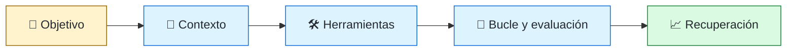
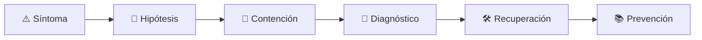

# 🦺 Agentic Harness Engineer
<!-- role-visual:start -->

**La guía conecta trabajo real, decisiones, clases concretas y evidencia defendible.**

<!-- role-visual:end -->

> Diseña y opera el entorno que rodea a un agente de IA —contexto, herramientas,
> permisos, bucles, evaluación y recuperación— para que su trabajo sea verificable,
> acotado y reversible, en lugar de depender de que el modelo «se porte bien».
>
> **Entrada habitual:** semi-senior/senior · **Foco:** harness de agentes de ingeniería
> · **Evidencia central:** agente que completa tareas reales bajo límites, evaluado y recuperable

## 🧭 Qué es y por qué importa

Un agente no es sólo un modelo: es un modelo dentro de un **harness**. El harness decide
qué ve el modelo en cada paso (instrucciones del repositorio, archivos, resultados
previos), qué puede hacer (herramientas con esquema, permisos y efectos acotados),
cuándo termina (criterios de parada y presupuesto), cómo se comprueba su trabajo
(pruebas, linters y evaluaciones externas al propio agente) y cómo se vuelve atrás
cuando falla. Como el componente central es probabilístico, la fiabilidad no sale de
pedirle al modelo que sea cuidadoso: sale de andamiaje determinista alrededor de él.

El rol se distingue de dos vecinos. El [AI-Augmented Software Engineer](ai-augmented-software-engineer.md)
**usa** agentes para entregar software; el [AI Systems Engineer](ai-systems-engineer.md)
integra modelos en **productos** para personas usuarias. El Agentic Harness Engineer
construye y gobierna el **entorno de ejecución del agente**: lo que hace que un equipo
pueda delegar trabajo de ingeniería con riesgo conocido, y que un producto con agentes
tenga un runtime con límites y trazabilidad.

## 🗓️ Un día en el puesto

- revisar la traza de una ejecución fallida: contexto recibido, herramienta invocada,
  argumentos, resultado y decisión del bucle;
- ajustar el catálogo de herramientas: qué se expone, con qué esquema, qué errores
  devuelve y cuánto texto puede emitir;
- convertir un fallo repetido en una regla determinista (hook, linter, prueba) en vez
  de otra frase en el prompt;
- ampliar la suite de evaluación con una tarea real y un oráculo que el agente no pueda
  manipular;
- revisar permisos, aislamiento y presupuestos antes de dar más autonomía.

## ✅ Responsabilidades y límites

- Responde por el comportamiento observable del conjunto agente + entorno, no por la
  calidad intrínseca del modelo.
- Diseña herramientas para que el error sea recuperable: salidas acotadas, mensajes
  accionables, efectos idempotentes o reversibles.
- Separa quien produce un cambio de quien lo verifica: el éxito declarado por el agente
  no cuenta como evidencia.
- No concede autoridad por defecto; cada permiso es una decisión con dueño y expiración.
- No sustituye la revisión humana en acciones irreversibles ni decide el producto que
  el agente construye.

## 🧠 Qué necesitas saber

Gestión de contexto (ventana limitada, qué incluir, resúmenes, resets y handoffs entre
sesiones); diseño de herramientas y protocolos como MCP; permisos, sandboxes y mínimo
privilegio; bucles de planificar-actuar-observar con límites de pasos, detección de
repetición y checkpoints; evaluación con oráculos externos y pruebas de regresión;
observabilidad de trazas de agente; seguridad frente a inyección de instrucciones
indirecta, exfiltración y *confused deputy*; coste por tarea resuelta; y lo básico de
procesos de larga duración: idempotencia, reanudación y apagado ordenado.

## 📚 Tu ruta en el programa

1. Partes 18 y 20 para automatización idempotente, reanudable y servicios con
   permisos, trabajos y reintentos: la base operativa de un harness.
2. [Parte 38 — Desarrollo asistido por IA](../classes/part-38-desarrollo-de-software-asistido-por-ia/README.md)
   para contexto, *context engineering* y evaluaciones.
3. [Parte 39 — SPEC y agentes](../classes/part-39-spec-agentes-y-ciclo-de-vida-agentic/README.md)
   para herramientas, aprobación humana, seguridad agentic y recuperación.
4. Las Partes 41 y 42 (harness y agentic engineering, patrones agénticos) están
   **planificadas**; la sección «Ampliación planificada» indica su alcance previsto.

<!-- role-depth:start -->
## 🗺️ Sistema profesional del rol

El gráfico no representa una cascada rígida. Muestra el bucle profesional que este rol
debe poder recorrer: comprender el contexto, tomar una decisión, intervenir, observar
el efecto y convertir lo aprendido en una mejora. En **🦺 Agentic Harness Engineer**, saltar directamente a
la herramienta suele ocultar el problema, mientras que terminar sin evidencia deja la
decisión en una opinión. La misión concreta es: Diseña y opera el entorno que rodea a un agente de IA —contexto, herramientas, permisos, bucles, evaluación y recuperación— para que su trabajo sea verificable, acotado y reversible, en lugar de depender de que el modelo «se porte bien». Cada transición
debe conservar supuestos, responsables y una forma de volver atrás.

<table>
<tr>
<td valign="top" width="50%">

### 🎯 Responde por

- decisiones propias de la familia **Ingeniería agentic**;
- el resultado observable, no sólo la actividad ejecutada;
- límites, riesgos, operación y deuda residual de su intervención;
- evidencia que otra persona pueda revisar o reproducir.

</td>
<td valign="top" width="50%">

### 🤝 Coordina con

- [🤖 AI-Augmented Software Engineer](ai-augmented-software-engineer.md); [🧠 AI Systems Engineer](ai-systems-engineer.md); [🛤️ Platform Engineer](platform-engineer.md);
- producto y personas usuarias cuando cambia una tarea o outcome;
- seguridad, privacidad, accesibilidad y operación según el riesgo;
- quienes mantendrán el sistema después de la entrega.

</td>
</tr>
</table>

El título no concede autoridad automática. El alcance real depende del equipo, la
industria y la criticidad. Esta guía describe un recorrido desde **semi-senior → principal**, pero una
vacante se evalúa por las decisiones que permite tomar, los sistemas que pone bajo
responsabilidad y la evidencia exigida, no por el nombre del cargo.

## 🧱 Partes y clases asociadas

La ruta distingue **parte** —unidad curricular con una capacidad acumulativa— de
**clase asociada** —punto concreto donde se estudia un mecanismo o una decisión. Las
clases siguientes forman el núcleo; no eliminan los prerrequisitos indicados en sus
propias páginas ni convierten en opcional la base común.

| Orden | Parte del programa | Estado | Clases clave | Por qué entra en esta ruta | Evidencia de transferencia |
| ---: | --- | --- | --- | --- | --- |
| 1 | [Parte 18 · CLI, TUI, servicios y automatización](../classes/part-18-cli-tui-servicios-y-automatizacion/README.md) | desarrollada | [SE-222 · Daemons, servicios y ciclo de vida](../classes/part-18-cli-tui-servicios-y-automatizacion/se-222-daemons-servicios-y-ciclo-de-vida/README.md) [SE-224 · Automatización idempotente y reanudable](../classes/part-18-cli-tui-servicios-y-automatizacion/se-224-automatizacion-idempotente-y-reanudable/README.md) [SE-228 · Proyecto: herramienta operable multiplataforma](../classes/part-18-cli-tui-servicios-y-automatizacion/se-228-proyecto-herramienta-operable-multiplataforma/README.md) | Profundiza **interfaces de automatización y procesos durables** desde la responsabilidad del rol. | Herramienta operable e idempotente. |
| 2 | [Parte 20 · Backend, APIs y procesamiento asíncrono](../classes/part-20-backend-apis-y-procesamiento-asincrono/README.md) | desarrollada | [SE-245 · Autenticación, autorización y contexto](../classes/part-20-backend-apis-y-procesamiento-asincrono/se-245-autenticacion-autorizacion-y-contexto/README.md) [SE-246 · Idempotencia, reintentos y deduplicación](../classes/part-20-backend-apis-y-procesamiento-asincrono/se-246-idempotencia-reintentos-y-deduplicacion/README.md) [SE-247 · Jobs, colas y procesamiento diferido](../classes/part-20-backend-apis-y-procesamiento-asincrono/se-247-jobs-colas-y-procesamiento-diferido/README.md) | Profundiza **servicios, APIs y procesamiento asíncrono** desde la responsabilidad del rol. | Servicio contractual operable. |
| 3 | [Parte 35 · Observabilidad, SRE e incidentes](../classes/part-35-observabilidad-sre-e-incidentes/README.md) | estructura | [SE-424 · Trazas distribuidas y contexto](../classes/part-35-observabilidad-sre-e-incidentes/se-424-trazas-distribuidas-y-contexto/README.md) [SE-426 · Alertas accionables y fatiga](../classes/part-35-observabilidad-sre-e-incidentes/se-426-alertas-accionables-y-fatiga/README.md) [SE-431 · Taller: diagnosticar con telemetría incompleta](../classes/part-35-observabilidad-sre-e-incidentes/se-431-taller-diagnosticar-con-telemetria-incompleta/README.md) | Profundiza **observabilidad, SRE e incidentes** desde la responsabilidad del rol. | Incidente diagnosticado y recuperado. |
| 4 | [Parte 38 · Desarrollo de software asistido por IA](../classes/part-38-desarrollo-de-software-asistido-por-ia/README.md) | estructura | [SE-459 · Contexto, archivos, memoria y recuperación](../classes/part-38-desarrollo-de-software-asistido-por-ia/se-459-contexto-archivos-memoria-y-recuperacion/README.md) [SE-464 · Context engineering y reducción de ambigüedad](../classes/part-38-desarrollo-de-software-asistido-por-ia/se-464-context-engineering-y-reduccion-de-ambiguedad/README.md) [SE-465 · Evals de exactitud, utilidad, costo y latencia](../classes/part-38-desarrollo-de-software-asistido-por-ia/se-465-evals-de-exactitud-utilidad-costo-y-latencia/README.md) | Profundiza **ingeniería asistida por IA y evaluaciones** desde la responsabilidad del rol. | Cambio asistido con trazabilidad. |
| 5 | [Parte 39 · SPEC, agentes y ciclo de vida agentic](../classes/part-39-spec-agentes-y-ciclo-de-vida-agentic/README.md) | estructura | [SE-473 · Agentes, herramientas, permisos y límites de autoridad](../classes/part-39-spec-agentes-y-ciclo-de-vida-agentic/se-473-agentes-herramientas-permisos-y-limites-de-autoridad/README.md) [SE-474 · Skills, plugins, hooks y entornos aislados](../classes/part-39-spec-agentes-y-ciclo-de-vida-agentic/se-474-skills-plugins-hooks-y-entornos-aislados/README.md) [SE-477 · Human-in-the-loop, aprobación y acciones reversibles](../classes/part-39-spec-agentes-y-ciclo-de-vida-agentic/se-477-human-in-the-loop-aprobacion-y-acciones-reversibles/README.md) [SE-478 · Seguridad agentic, prompt injection y auditoría](../classes/part-39-spec-agentes-y-ciclo-de-vida-agentic/se-478-seguridad-agentic-prompt-injection-y-auditoria/README.md) [SE-479 · Taller: detener, recuperar y evaluar un agente](../classes/part-39-spec-agentes-y-ciclo-de-vida-agentic/se-479-taller-detener-recuperar-y-evaluar-un-agente/README.md) | Profundiza **SPEC, agentes, herramientas y guardrails** desde la responsabilidad del rol. | Flujo agentic controlado. |

### ✅ Clases ya desarrolladas que sostienen la ruta hoy

El núcleo anterior apunta a la capacidad profesional completa y puede incluir partes
en borrador o estructura. Estas clases, de las Partes 00–22 (`SE-001`–`SE-276`), ya
tienen contenido desarrollado y permiten empezar a practicar el rol sin esperar al
resto del currículo:

| Clase desarrollada | Parte |
| --- | --- |
| [SE-027 · Usuarios, grupos, permisos y elevación de privilegios](../classes/part-02-sistemas-operativos-terminal-y-automatizacion-base/se-027-usuarios-grupos-permisos-y-elevacion-de-privilegios/README.md) | Parte 02 |
| [SE-031 · Variables de entorno, configuración y secretos](../classes/part-02-sistemas-operativos-terminal-y-automatizacion-base/se-031-variables-de-entorno-configuracion-y-secretos/README.md) | Parte 02 |
| [SE-104 · Dev Containers y entornos desechables](../classes/part-08-entornos-herramientas-y-depuracion/se-104-dev-containers-y-entornos-desechables/README.md) | Parte 08 |
| [SE-105 · Reproducción de errores y reducción de casos](../classes/part-08-entornos-herramientas-y-depuracion/se-105-reproduccion-de-errores-y-reduccion-de-casos/README.md) | Parte 08 |
| [SE-214 · Documentación para humanos, máquinas y LLM](../classes/part-17-documentacion-y-conocimiento-tecnico/se-214-documentacion-para-humanos-maquinas-y-llm/README.md) | Parte 17 |

**Cómo recorrerla.** Empieza por [SE-222](../classes/part-18-cli-tui-servicios-y-automatizacion/se-222-daemons-servicios-y-ciclo-de-vida/README.md) para fijar el
primer mecanismo, usa [SE-431](../classes/part-35-observabilidad-sre-e-incidentes/se-431-taller-diagnosticar-con-telemetria-incompleta/README.md) para integrar el
centro de la especialidad y llega a [SE-479](../classes/part-39-spec-agentes-y-ciclo-de-vida-agentic/se-479-taller-detener-recuperar-y-evaluar-un-agente/README.md) cuando ya
puedas explicar cómo detectar y recuperar un fallo. Una clase se considera estudiada
sólo cuando su concepto cambia una decisión y deja evidencia; abrir todos los enlaces
no constituye competencia.

> [!IMPORTANT]
> El mapa expresa el currículo previsto. Las Partes 00–22 (`SE-001`–`SE-276`) están
> desarrolladas; las Partes 23–29 son borradores y las Partes 30–39 conservan sólo
> estructura, y deben superar revisión cualitativa. Esta ruta no declara terminadas
> esas clases ni reemplaza el [roadmap](../ROADMAP.md).

## 🔭 Ampliación planificada: Partes 40–44 (sin clases publicadas)

> [!NOTE]
> Las Partes 40–44 (`SE-481`–`SE-540`) están **planificadas** desde el 13 de noviembre
> de 2026 ([ADR-004](../docs/adr/ADR-004-expand-to-540-class-scope.md) y
> [auditoría de brechas](../docs/METHODOLOGY-GAP-AUDIT-2026-11-13.md)). Todavía no
> tienen clases ni README, por lo que no se enlazan aquí y ninguna de sus clases debe
> considerarse disponible.

| Parte planificada | Rango previsto | Qué cambiará para este rol |
| --- | --- | --- |
| **Parte 41 · Harness y agentic engineering** | `SE-493`–`SE-504` | Es la parte central del rol: anatomía del harness, contexto, herramientas, bucles, permisos, evaluación y recuperación. |
| **Parte 42 · Patrones agénticos y sistemas con LLM** | `SE-505`–`SE-516` | Aporta los patrones (encadenado, enrutamiento, orquestador-trabajadores, evaluador-optimizador) que el harness ejecuta. |

Hasta que esas partes se publiquen, el rol se apoya en el núcleo y en las clases
desarrolladas de arriba. La planificación indica hacia dónde crecerá la ruta; no es
evidencia de que el contenido exista ni de que su alcance final coincida con esta
descripción.

## ⚖️ Decisiones y trade-offs que debes defender

| Decisión recurrente | Criterio profesional | Evidencia mínima antes de defenderla |
| --- | --- | --- |
| **Más contexto o contexto curado** | Incluir sólo lo que cambia la decisión y medir el coste de atención y de filtración. | Ablación de contexto con tasa de éxito y tokens. |
| **Herramienta amplia o estrecha** | Preferir herramientas con efectos acotados entradas validables y salidas verificables. | Prueba de permisos y registro de cada invocación. |
| **Bucle libre o con puntos de control** | Insertar checkpoints límites de pasos y aprobación donde la acción no es reversible. | Simulación de bucle atascado y reanudación desde checkpoint. |

La calidad de una decisión no se juzga porque coincida con una herramienta popular.
Debe hacer explícitos contexto, restricciones, alternativas descartadas, coste de
cambio y condición de revisión. En especial, **Más contexto o contexto curado**, **Herramienta amplia o estrecha**
y **Bucle libre o con puntos de control** cambian de respuesta cuando cambia el riesgo. Una solución
correcta en un prototipo puede ser irresponsable en un sistema regulado; una solución
robusta para un servicio crítico puede ser desperdicio en una herramienta interna.

## 🚨 Escenario profesional: Agente en bucle que agota presupuesto y repite una acción destructiva

**Síntoma.** El agente reintenta una herramienta que falla parcialmente y el harness no detecta la repetición ni limita el efecto. La respuesta madura evita convertir la primera
correlación en causa y conserva evidencia antes de modificar el sistema.

1. **Detectar y delimitar:** identifica quién o qué está afectado, desde cuándo y qué
   cambió. Conserva timestamps, versiones, entradas y señales suficientes para no
   destruir la escena al intentar arreglarla.
2. **Investigar:** Reconstruir la traza paso a paso con contexto herramienta argumentos resultado y decisión del bucle y formular hipótesis rivales sobre prompt herramienta y política. Formula al menos dos hipótesis rivales
   y define qué observación refutaría cada una.
3. **Contener:** reduce blast radius y daño sin prometer una corrección todavía. La
   contención debe ser reversible, visible y compatible con las obligaciones del
   sistema.
4. **Recuperar:** Activar el límite de pasos revocar el permiso restaurar desde checkpoint y añadir una evaluación y una política que cubran la repetición. Verifica la tarea completa, no sólo que un
   proceso volvió a estar verde.
5. **Aprender:** añade una regresión, señal o control que detecte la misma clase de
   fallo. Documenta qué deuda permanece y quién revisará la acción.

El escenario evalúa método además de resultado. Una recuperación rápida que borra la
causa, oculta pérdida de datos o deja al equipo sin mecanismo preventivo no demuestra
dominio del rol.

## 📊 Señales útiles y límites de las métricas

| Señal | Qué ayuda a observar | Trampa que debe evitarse |
| --- | --- | --- |
| **Éxito de tarea verificado** | Tareas cuyo resultado pasa oráculos externos al agente. | Contar finales declarados por el propio agente. |
| **Coste y pasos por tarea resuelta** | Tokens llamadas y tiempo hasta un resultado aceptado. | Comparar sólo el precio por llamada. |
| **Intervenciones humanas útiles** | Aprobaciones que detienen daño frente a las que sólo interrumpen. | Premiar autonomía sin medir incidentes. |

Ninguna señal debe convertirse en ranking individual. Combina tendencia cuantitativa,
muestreo de casos, feedback cualitativo y contexto de carga. Declara ventana,
denominador, fuente, exclusiones y quién puede actuar sobre el resultado. Si una
métrica mejora mientras el outcome o el riesgo empeoran, el sistema está optimizando
el indicador y no el trabajo.

## 🧩 Proyecto integrador del rol: Harness mínimo evaluado y recuperable

**Propósito:** construir un harness con contexto herramientas permisos bucle evaluaciones y reanudación para una tarea real de ingeniería. El resultado esperado es **especificación del harness catálogo de herramientas con permisos suite de evaluación trazas política de aprobación checkpoint y runbook de recuperación**.

Entrega un expediente revisable con estas piezas:

1. **Contexto y alcance:** usuario, sistema, restricción, supuestos, fuera de alcance y
   criterio de no éxito.
2. **Decisión:** al menos dos alternativas reales, trade-offs, coste de reversión y un
   ADR o memo que indique cuándo revisar la elección.
3. **Artefacto principal:** una implementación, modelo, flujo o política coherente con
   las clases núcleo; no una captura aislada ni una presentación sin mecanismo.
4. **Fallo controlado:** introduce una condición adversa relacionada con el escenario
   anterior y conserva el resultado observado, sin inventar una ejecución.
5. **Verificación:** prueba, rúbrica, revisión o medición que pueda fallar y que conecte
   directamente con el resultado profesional.
6. **Operación y salida:** telemetría, recuperación, mantenimiento, deprecación o retiro
   según corresponda; incluye límites y deuda residual.

**Criterio de aceptación:** otra persona puede reconstruir el razonamiento, reproducir
la comprobación y distinguir claramente qué quedó demostrado de lo que sólo se propone.
El proyecto no se aprueba por cantidad de archivos ni por utilizar una marca concreta.

## 📈 Dominio esperado por alcance

| Alcance | Qué resuelve | Qué evidencia su autonomía |
| --- | --- | --- |
| **Inicial** | ejecuta una tarea acotada con criterios y acompañamiento | reproduce el caso, pregunta por supuestos y entrega evidencia legible |
| **Intermedio** | decide dentro de un componente o flujo conocido | compara alternativas, prueba fallos previsibles y coordina dependencias |
| **Senior** | conduce problemas ambiguos que cruzan sistemas o equipos | hace explícito el riesgo, diseña recuperación y mejora el mecanismo de trabajo |
| **Staff / Lead** | cambia capacidades compartidas y decisiones de largo plazo | multiplica criterio, define guardrails, mide adopción y conserva opciones futuras |

Progresar no significa alejarse de la práctica. Significa aumentar ambigüedad, horizonte,
blast radius y responsabilidad por consecuencias. La persona senior todavía debe poder
explicar el mecanismo; la persona Staff además crea condiciones para que otros lo
operen sin depender de ella.

## 🗓️ Plan de práctica 30 · 60 · 90 días

- **Días 1–30 — comprender y reproducir.** Estudia las primeras clases de cada parte,
  reproduce un caso pequeño y escribe un mapa de responsabilidades. El entregable es
  una baseline con preguntas abiertas, no una transformación prematura.
- **Días 31–60 — intervenir y fallar con control.** Construye el artefacto central,
  introduce el escenario de fallo y mide el comportamiento. Revisa el trabajo con una
  persona de una ruta vecina para descubrir supuestos de frontera.
- **Días 61–90 — operar y transferir.** Ejecuta recuperación, corrige la causa, publica
  runbook o guía de uso y presenta la decisión con trade-offs. Termina con una
  retrospectiva que separe resultado, evidencia, límites y siguiente inversión.

Este plan es una secuencia de práctica, no una promesa de empleabilidad en noventa días.
La experiencia previa, el dominio y el acceso a sistemas reales cambian el tiempo
necesario.

## 🎤 Preguntas para revisión o entrevista

1. ¿En qué contexto elegirías **Más contexto o contexto curado** y qué evidencia te haría cambiar?
2. ¿Cómo distinguirías síntoma, causa y daño en el escenario **Agente en bucle que agota presupuesto y repite una acción destructiva**?
3. ¿Qué clase asociada usarías para diseñar el mecanismo y cuál para verificarlo?
4. ¿Qué parte de **Harness mínimo evaluado y recuperable** no automatizarías todavía y por qué?
5. ¿Qué métrica podría mejorar mientras el sistema empeora y qué guardrail añadirías?
6. ¿Dónde termina la autoridad de este rol y cuándo debe escalar o pedir revisión?

Una respuesta fuerte usa un caso, reconoce incertidumbre y propone una comprobación.
Nombrar una herramienta sin explicar mecanismo, fallo y límite no demuestra la
competencia.

## 🔗 Fuentes primarias y oficiales

- [Building effective agents](https://www.anthropic.com/research/building-effective-agents) — **Anthropic**. Se usa como referencia primaria u oficial; la guía no sustituye la fuente.
- [Effective context engineering for AI agents](https://www.anthropic.com/research/effective-context-engineering-for-ai-agents) — **Anthropic**. Se usa como referencia primaria u oficial; la guía no sustituye la fuente.
- [Model Context Protocol](https://modelcontextprotocol.io/specification/) — **MCP maintainers**. Se usa como referencia primaria u oficial; la guía no sustituye la fuente.
- [OWASP Top 10 for LLM Applications](https://genai.owasp.org/llm-top-10/) — **OWASP GenAI Security Project**. Se usa como referencia primaria u oficial; la guía no sustituye la fuente.
- [Semantic conventions for generative AI](https://opentelemetry.io/docs/specs/semconv/gen-ai/) — **CNCF / OpenTelemetry**. Se usa como referencia primaria u oficial; la guía no sustituye la fuente.

Las fuentes orientan principios, vocabulario y prácticas; no convierten la guía en una
certificación ni sustituyen la documentación específica del sistema, la jurisdicción
o la tecnología utilizada.
<!-- role-depth:end -->

## 🧪 Evidencia de portafolio

- especificación del harness: instrucciones, catálogo de herramientas y permisos;
- suite de evaluación con tareas reales, oráculos externos y resultado por segmento;
- trazas de al menos un bucle que falló y la corrección determinista que lo cubre;
- política de aprobación y checkpoint que permita reanudar tras una interrupción;
- registro de coste y pasos por tarea resuelta, con su ventana y denominador.

## 📈 Progresión

Software Engineer → AI-Augmented Engineer → Agentic Harness Engineer → Staff de
plataforma de agentes o AI Platform / Architect.

## ⚠️ Mitos frecuentes

- “Un prompt mejor arregla la fiabilidad.” Las reglas que importan deben ser
  comprobables fuera del modelo.
- “Más herramientas hacen al agente más capaz.” Un catálogo amplio aumenta la
  superficie de error, el contexto consumido y el riesgo.
- “Si el agente dice que terminó, terminó.” Sólo cuenta lo que verifica un oráculo
  independiente.
- “Autonomía total es el objetivo.” El objetivo es autonomía proporcional al riesgo y
  a la capacidad de revertir.

## 🚀 Siguientes pasos

1. Elige una tarea real y define su oráculo antes de dar herramientas al agente.
2. Reduce el catálogo al mínimo necesario y registra cada invocación.
3. Introduce un fallo controlado (herramienta lenta, resultado parcial, bucle) y
   comprueba que el harness lo detiene y se recupera.

---

[⬅️ Volver a las rutas](README.md) · [🏠 Inicio del programa](../README.md)
