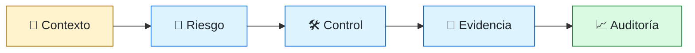
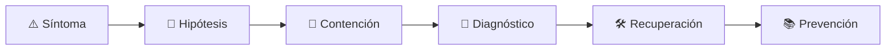

# 🛂 AI Governance & Responsible AI Engineer
<!-- role-visual:start -->

**La guía conecta trabajo real, decisiones, clases concretas y evidencia defendible.**

<!-- role-visual:end -->

> Convierte los principios de uso responsable y las obligaciones regulatorias sobre IA en
> controles técnicos, evidencia revisable y decisiones documentadas durante todo el ciclo de
> vida de un sistema.
>
> **Entrada habitual:** semi-senior · **Foco:** riesgo, equidad, supervisión humana y
> regulación de IA · **Evidencia central:** dossier de un sistema con clasificación de riesgo,
> evaluación y controles trazables

## 🧭 Qué es y por qué importa

Los sistemas con modelos toman o influyen decisiones sobre personas, con comportamiento
probabilístico y con datos que cambian. Marcos como la ley de IA de la Unión Europea, la
norma ISO/IEC 42001 y el marco de gestión de riesgos de NIST piden clasificar el riesgo,
documentar, evaluar, supervisar y responder a incidentes. Una política en un documento no
cumple ninguna de esas cosas: hace falta ingeniería que las vuelva comprobables.

Este rol trabaja en la frontera entre ingeniería, riesgo y derecho. No reemplaza a un asesor
jurídico, pero traduce una obligación en un control medible, una prueba y un registro.

## 🗓️ Un día en el puesto

- mantener el inventario de sistemas de IA con propietario, propósito y nivel de riesgo;
- revisar una ficha de modelo y comprobar que los usos excluidos están declarados;
- decidir con el equipo qué métrica de equidad corresponde al daño posible;
- diseñar la supervisión humana de una decisión automatizada y medir si funciona;
- responder a un incidente: contener, notificar y corregir el control que falló;
- preparar la evidencia para una auditoría interna o de un tercero.

## ✅ Responsabilidades y límites

- Responde por que el inventario, la clasificación de riesgo y la evidencia estén vigentes.
- Distingue riesgo técnico, riesgo para las personas y obligación legal.
- No emite dictámenes legales ni sustituye la decisión de una autoridad o del equipo jurídico.
- No promete que un sistema esté libre de sesgo: documenta qué se midió, con qué incertidumbre y qué se aceptó.

## 🧠 Qué necesitas saber

Evaluación de modelos por segmento, nociones de equidad y sus tensiones, documentación de modelos
y datos, privacidad y minimización, supervisión humana y su diseño, seguridad de sistemas de IA
(inyección de instrucciones, envenenamiento), gestión de incidentes, y lectura de marcos como
EU AI Act, ISO/IEC 42001 y NIST AI RMF sin confundir el marco con su cumplimiento.

## 📚 Tu ruta en el programa

1. [Parte 00 — Ingeniería de software como profesión](../classes/part-00-ingenieria-de-software-como-profesion/README.md)
   para ética, interés público y evidencia.
2. [Parte 32 — Seguridad, privacidad y cumplimiento](../classes/part-32-seguridad-privacidad-y-cumplimiento/README.md).
3. Partes 38–39 para asistencia con IA, supervisión humana y seguridad agentic.
4. [Parte 42 — Patrones agénticos y sistemas con LLM](../classes/part-42-patrones-agenticos-y-sistemas-con-llm/README.md)
   para evaluación, costo y seguridad.
5. Parte 46: gobierno de IA y regulación dentro del ciclo de ML en producción.

<!-- role-depth:start -->
## 🗺️ Sistema profesional del rol

El gráfico no representa una cascada rígida. Muestra el bucle profesional que este rol
debe poder recorrer: comprender el contexto, tomar una decisión, intervenir, observar
el efecto y convertir lo aprendido en una mejora. En **🛂 AI Governance & Responsible AI Engineer**, saltar directamente a
la herramienta suele ocultar el problema, mientras que terminar sin evidencia deja la
decisión en una opinión. La misión concreta es: Convierte los principios de uso responsable y las obligaciones regulatorias sobre IA en controles técnicos, evidencia revisable y decisiones documentadas durante todo el ciclo de vida de un sistema. Cada transición
debe conservar supuestos, responsables y una forma de volver atrás.

<table>
<tr>
<td valign="top" width="50%">

### 🎯 Responde por

- decisiones propias de la familia **Gobierno de IA**;
- el resultado observable, no sólo la actividad ejecutada;
- límites, riesgos, operación y deuda residual de su intervención;
- evidencia que otra persona pueda revisar o reproducir.

</td>
<td valign="top" width="50%">

### 🤝 Coordina con

- [⚖️ Compliance Engineer](compliance-engineer.md); [🧠 AI Systems Engineer](ai-systems-engineer.md); [🔐 Security Engineer](security-engineer.md);
- producto y personas usuarias cuando cambia una tarea o outcome;
- seguridad, privacidad, accesibilidad y operación según el riesgo;
- quienes mantendrán el sistema después de la entrega.

</td>
</tr>
</table>

El título no concede autoridad automática. El alcance real depende del equipo, la
industria y la criticidad. Esta guía describe un recorrido desde **semi-senior → principal**, pero una
vacante se evalúa por las decisiones que permite tomar, los sistemas que pone bajo
responsabilidad y la evidencia exigida, no por el nombre del cargo.

## 🧱 Partes y clases asociadas

La ruta distingue **parte** —unidad curricular con una capacidad acumulativa— de
**clase asociada** —punto concreto donde se estudia un mecanismo o una decisión. Las
clases siguientes forman el núcleo; no eliminan los prerrequisitos indicados en sus
propias páginas ni convierten en opcional la base común.

| Orden | Parte del programa | Estado | Clases clave | Por qué entra en esta ruta | Evidencia de transferencia |
| ---: | --- | --- | --- | --- | --- |
| 1 | [Parte 00 · Ingeniería de software como profesión](../classes/part-00-ingenieria-de-software-como-profesion/README.md) | desarrollada | [SE-004 · Ética, interés público y consecuencias de las decisiones técnicas](../classes/part-00-ingenieria-de-software-como-profesion/se-004-etica-interes-publico-y-consecuencias-de-las-decisiones-tecnicas/README.md) [SE-006 · Evidencia, incertidumbre y pensamiento crítico en ingeniería](../classes/part-00-ingenieria-de-software-como-profesion/se-006-evidencia-incertidumbre-y-pensamiento-critico-en-ingenieria/README.md) [SE-008 · Restricciones, riesgos y compromisos entre atributos](../classes/part-00-ingenieria-de-software-como-profesion/se-008-restricciones-riesgos-y-compromisos-entre-atributos/README.md) [SE-009 · Sostenibilidad, inclusión y responsabilidad social](../classes/part-00-ingenieria-de-software-como-profesion/se-009-sostenibilidad-inclusion-y-responsabilidad-social/README.md) | Profundiza **criterio profesional, ética y lectura de evidencia** desde la responsabilidad del rol. | Contrato de responsabilidad y límites. |
| 2 | [Parte 32 · Seguridad, privacidad y cumplimiento](../classes/part-32-seguridad-privacidad-y-cumplimiento/README.md) | desarrollada | [SE-385 · Principios de seguridad y modelos de amenaza](../classes/part-32-seguridad-privacidad-y-cumplimiento/se-385-principios-de-seguridad-y-modelos-de-amenaza/README.md) [SE-391 · Privacidad por diseño y minimización](../classes/part-32-seguridad-privacidad-y-cumplimiento/se-391-privacidad-por-diseno-y-minimizacion/README.md) [SE-392 · Secure SDLC, abuso y pruebas negativas](../classes/part-32-seguridad-privacidad-y-cumplimiento/se-392-secure-sdlc-abuso-y-pruebas-negativas/README.md) [SE-393 · Vulnerabilidades, divulgación y respuesta](../classes/part-32-seguridad-privacidad-y-cumplimiento/se-393-vulnerabilidades-divulgacion-y-respuesta/README.md) [SE-394 · Cumplimiento, evidencia y límites legales](../classes/part-32-seguridad-privacidad-y-cumplimiento/se-394-cumplimiento-evidencia-y-limites-legales/README.md) | Profundiza **seguridad, privacidad y cumplimiento** desde la responsabilidad del rol. | Controles con pruebas y evidencia. |
| 3 | [Parte 38 · Desarrollo de software asistido por IA](../classes/part-38-desarrollo-de-software-asistido-por-ia/README.md) | desarrollada | [SE-457 · Capacidades y límites de los modelos generativos](../classes/part-38-desarrollo-de-software-asistido-por-ia/se-457-capacidades-y-limites-de-los-modelos-generativos/README.md) [SE-465 · Evals de exactitud, utilidad, costo y latencia](../classes/part-38-desarrollo-de-software-asistido-por-ia/se-465-evals-de-exactitud-utilidad-costo-y-latencia/README.md) [SE-466 · Privacidad, propiedad intelectual y código inseguro](../classes/part-38-desarrollo-de-software-asistido-por-ia/se-466-privacidad-propiedad-intelectual-y-codigo-inseguro/README.md) [SE-468 · Proyecto: cambio real con trazabilidad y revisión humana](../classes/part-38-desarrollo-de-software-asistido-por-ia/se-468-proyecto-cambio-real-con-trazabilidad-y-revision-humana/README.md) | Profundiza **ingeniería asistida por IA y evaluaciones** desde la responsabilidad del rol. | Cambio asistido con trazabilidad. |
| 4 | [Parte 39 · SPEC, agentes y ciclo de vida agentic](../classes/part-39-spec-agentes-y-ciclo-de-vida-agentic/README.md) | desarrollada | [SE-473 · Agentes, herramientas, permisos y límites de autoridad](../classes/part-39-spec-agentes-y-ciclo-de-vida-agentic/se-473-agentes-herramientas-permisos-y-limites-de-autoridad/README.md) [SE-477 · Human-in-the-loop, aprobación y acciones reversibles](../classes/part-39-spec-agentes-y-ciclo-de-vida-agentic/se-477-human-in-the-loop-aprobacion-y-acciones-reversibles/README.md) [SE-478 · Seguridad agentic, prompt injection y auditoría](../classes/part-39-spec-agentes-y-ciclo-de-vida-agentic/se-478-seguridad-agentic-prompt-injection-y-auditoria/README.md) [SE-479 · Taller: detener, recuperar y evaluar un agente](../classes/part-39-spec-agentes-y-ciclo-de-vida-agentic/se-479-taller-detener-recuperar-y-evaluar-un-agente/README.md) | Profundiza **SPEC, agentes, herramientas y guardrails** desde la responsabilidad del rol. | Flujo agentic controlado. |
| 5 | [Parte 41 · Harness y agentic engineering](../classes/part-41-harness-y-agentic-engineering/README.md) | desarrollada | [SE-494 · Instrucciones de repositorio y cumplimiento determinista](../classes/part-41-harness-y-agentic-engineering/se-494-instrucciones-de-repositorio-y-cumplimiento-determinista/README.md) [SE-498 · Sandboxes, reversibilidad y control de daño](../classes/part-41-harness-y-agentic-engineering/se-498-sandboxes-reversibilidad-y-control-de-dano/README.md) [SE-499 · Verificación, gates y menú único de validación](../classes/part-41-harness-y-agentic-engineering/se-499-verificacion-gates-y-menu-unico-de-validacion/README.md) [SE-501 · Observabilidad y evals del propio harness](../classes/part-41-harness-y-agentic-engineering/se-501-observabilidad-y-evals-del-propio-harness/README.md) [SE-502 · AI-DLC, gobierno y vibe coding frente a agentic engineering](../classes/part-41-harness-y-agentic-engineering/se-502-ai-dlc-gobierno-y-vibe-coding-frente-a-agentic-engineering/README.md) | Profundiza **harness, contexto, herramientas y bucles de agentes** desde la responsabilidad del rol. | Harness mínimo gobernado y evaluado. |
| 6 | [Parte 42 · Patrones agénticos y sistemas con LLM](../classes/part-42-patrones-agenticos-y-sistemas-con-llm/README.md) | desarrollada | [SE-505 · Workflows frente a agentes: cuándo no usar un agente](../classes/part-42-patrones-agenticos-y-sistemas-con-llm/se-505-workflows-frente-a-agentes-cuando-no-usar-un-agente/README.md) [SE-513 · Evals y LLMOps de sistemas con LLM](../classes/part-42-patrones-agenticos-y-sistemas-con-llm/se-513-evals-y-llmops-de-sistemas-con-llm/README.md) [SE-514 · Costo, latencia y seguridad en sistemas con LLM](../classes/part-42-patrones-agenticos-y-sistemas-con-llm/se-514-costo-latencia-y-seguridad-en-sistemas-con-llm/README.md) [SE-516 · Proyecto: sistema con LLM evaluado y operable](../classes/part-42-patrones-agenticos-y-sistemas-con-llm/se-516-proyecto-sistema-con-llm-evaluado-y-operable/README.md) | Profundiza **patrones agénticos, evaluación y operación de sistemas con LLM** desde la responsabilidad del rol. | Sistema con LLM evaluado y operable. |
| 7 | [Parte 45 · Ingeniería de datos y plataformas de datos](../classes/part-45-ingenieria-de-datos-y-plataformas-de-datos/README.md) | desarrollada | [SE-545 · Calidad y observabilidad de datos](../classes/part-45-ingenieria-de-datos-y-plataformas-de-datos/se-545-calidad-y-observabilidad-de-datos/README.md) [SE-546 · Contratos de datos y evolución de esquemas](../classes/part-45-ingenieria-de-datos-y-plataformas-de-datos/se-546-contratos-de-datos-y-evolucion-de-esquemas/README.md) [SE-547 · Linaje, catálogo y metadatos](../classes/part-45-ingenieria-de-datos-y-plataformas-de-datos/se-547-linaje-catalogo-y-metadatos/README.md) [SE-549 · Gobierno, privacidad y retención de datos](../classes/part-45-ingenieria-de-datos-y-plataformas-de-datos/se-549-gobierno-privacidad-y-retencion-de-datos/README.md) | Profundiza **plataformas de datos, calidad, contratos y gobierno** desde la responsabilidad del rol. | Plataforma de datos mínima gobernada. |
| 8 | [Parte 46 · Machine learning en producción y MLOps](../classes/part-46-machine-learning-en-produccion-y-mlops/README.md) | desarrollada | [SE-553 · Ciclo de vida de ML y por qué falla en producción](../classes/part-46-machine-learning-en-produccion-y-mlops/se-553-ciclo-de-vida-de-ml-y-por-que-falla-en-produccion/README.md) [SE-556 · Evaluación, sesgos y validación de modelos](../classes/part-46-machine-learning-en-produccion-y-mlops/se-556-evaluacion-sesgos-y-validacion-de-modelos/README.md) [SE-560 · Monitoreo, deriva y reentrenamiento](../classes/part-46-machine-learning-en-produccion-y-mlops/se-560-monitoreo-deriva-y-reentrenamiento/README.md) [SE-561 · Seguridad y robustez de sistemas de ML](../classes/part-46-machine-learning-en-produccion-y-mlops/se-561-seguridad-y-robustez-de-sistemas-de-ml/README.md) [SE-562 · Gobierno de IA y regulación: EU AI Act, ISO 42001 y NIST AI RMF](../classes/part-46-machine-learning-en-produccion-y-mlops/se-562-gobierno-de-ia-y-regulacion-eu-ai-act-iso-42001-y-nist-ai-rmf/README.md) [SE-564 · Proyecto: sistema de ML operable con evidencia](../classes/part-46-machine-learning-en-produccion-y-mlops/se-564-proyecto-sistema-de-ml-operable-con-evidencia/README.md) | Profundiza **machine learning en producción, MLOps y gobierno de IA** desde la responsabilidad del rol. | Sistema de ML operable con evidencia. |
| 9 | [Parte 47 · Sistemas críticos, tiempo real y normas de seguridad](../classes/part-47-sistemas-criticos-tiempo-real-y-normas-de-seguridad/README.md) | desarrollada | [SE-565 · Riesgo, peligro y seguridad funcional: HARA, FMEA, FTA y STPA](../classes/part-47-sistemas-criticos-tiempo-real-y-normas-de-seguridad/se-565-riesgo-peligro-y-seguridad-funcional-hara-fmea-fta-y-stpa/README.md) [SE-566 · IEC 61508 y niveles de integridad de seguridad](../classes/part-47-sistemas-criticos-tiempo-real-y-normas-de-seguridad/se-566-iec-61508-y-niveles-de-integridad-de-seguridad/README.md) [SE-570 · Casos de seguridad y trazabilidad](../classes/part-47-sistemas-criticos-tiempo-real-y-normas-de-seguridad/se-570-casos-de-seguridad-y-trazabilidad/README.md) [SE-575 · Taller: analizar un fallo real frente a las normas](../classes/part-47-sistemas-criticos-tiempo-real-y-normas-de-seguridad/se-575-taller-analizar-un-fallo-real-frente-a-las-normas/README.md) | Profundiza **sistemas críticos, tiempo real y normas de seguridad** desde la responsabilidad del rol. | Paquete de aseguramiento de un controlador. |

### ✅ Clases ya desarrolladas que sostienen la ruta hoy

El núcleo anterior apunta a la capacidad profesional completa. Estas clases de apoyo,
de las Partes 00–48 (`SE-001`–`SE-588`), también tienen contenido desarrollado y
permiten practicar el rol desde otros ángulos:

| Clase desarrollada | Parte |
| --- | --- |
| [SE-117 · Licencias, procedencia y reutilización](../classes/part-09-bibliotecas-paquetes-sdk-y-automatizacion/se-117-licencias-procedencia-y-reutilizacion/README.md) | Parte 09 |
| [SE-129 · Ética del descubrimiento y protección de participantes](../classes/part-10-descubrimiento-y-estrategia-de-producto/se-129-etica-del-descubrimiento-y-proteccion-de-participantes/README.md) | Parte 10 |
| [SE-153 · Gestión de cambios y líneas base](../classes/part-12-ingenieria-de-requisitos/se-153-gestion-de-cambios-y-lineas-base/README.md) | Parte 12 |
| [SE-226 · Telemetría opt-in y privacidad en herramientas](../classes/part-18-cli-tui-servicios-y-automatizacion/se-226-telemetria-opt-in-y-privacidad-en-herramientas/README.md) | Parte 18 |
| [SE-279 · Machine learning como componente de producto](../classes/part-23-software-especializado-y-dominios/se-279-machine-learning-como-componente-de-producto/README.md) | Parte 23 |
| [SE-283 · Salud, datos sensibles y sistemas regulados](../classes/part-23-software-especializado-y-dominios/se-283-salud-datos-sensibles-y-sistemas-regulados/README.md) | Parte 23 |
| [SE-322 · Privacidad, retención y ciclo de vida del dato](../classes/part-26-datos-persistencia-y-recuperacion/se-322-privacidad-retencion-y-ciclo-de-vida-del-dato/README.md) | Parte 26 |
| [SE-400 · SBOM, procedencia y atestaciones](../classes/part-33-build-release-y-cadena-de-suministro/se-400-sbom-procedencia-y-atestaciones/README.md) | Parte 33 |
| [SE-425 · SLI, SLO, SLA y presupuestos de error](../classes/part-35-observabilidad-sre-e-incidentes/se-425-sli-slo-sla-y-presupuestos-de-error/README.md) | Parte 35 |
| [SE-428 · Gestión de incidentes y comunicación](../classes/part-35-observabilidad-sre-e-incidentes/se-428-gestion-de-incidentes-y-comunicacion/README.md) | Parte 35 |
| [SE-429 · Postmortems sin culpa y aprendizaje](../classes/part-35-observabilidad-sre-e-incidentes/se-429-postmortems-sin-culpa-y-aprendizaje/README.md) | Parte 35 |

**Cómo recorrerla.** Empieza por [SE-004](../classes/part-00-ingenieria-de-software-como-profesion/se-004-etica-interes-publico-y-consecuencias-de-las-decisiones-tecnicas/README.md) para fijar el
primer mecanismo, usa [SE-501](../classes/part-41-harness-y-agentic-engineering/se-501-observabilidad-y-evals-del-propio-harness/README.md) para integrar el
centro de la especialidad y llega a [SE-575](../classes/part-47-sistemas-criticos-tiempo-real-y-normas-de-seguridad/se-575-taller-analizar-un-fallo-real-frente-a-las-normas/README.md) cuando ya
puedas explicar cómo detectar y recuperar un fallo. Una clase se considera estudiada
sólo cuando su concepto cambia una decisión y deja evidencia; abrir todos los enlaces
no constituye competencia.

> [!IMPORTANT]
> El mapa expresa el currículo vigente. Las Partes 00–48 (`SE-001`–`SE-588`) están
> desarrolladas, a falta de una revisión editorial humana independiente. Esta ruta no
> declara aprobadas esas clases ni reemplaza el [roadmap](../ROADMAP.md).

## ✅ Ampliación completada: Partes 40–48

> [!NOTE]
> Las Partes 40–48 (`SE-481`–`SE-588`) ya están desarrolladas ([ADR-004](../docs/adr/ADR-004-expand-to-540-class-scope.md) y [ADR-006](../docs/adr/ADR-006-extend-program-parts-45-48-and-roles.md)); sus clases figuran en el núcleo y en las clases de apoyo de esta guía.

## ⚖️ Decisiones y trade-offs que debes defender

| Decisión recurrente | Criterio profesional | Evidencia mínima antes de defenderla |
| --- | --- | --- |
| **Cuánta supervisión humana** | Graduar la intervención humana según el daño posible y la reversibilidad de la decisión. | Registro de decisiones revisadas con tasa de anulación y tiempo de revisión. |
| **Qué definición de equidad medir** | Elegir y justificar la métrica según el daño y declarar las que se descartan. | Evaluación por segmentos con intervalos y decisión documentada. |
| **Documentar o restringir un uso** | Decidir qué uso queda fuera del alcance y declararlo en la ficha del sistema. | Tarjeta de modelo y registro de usos excluidos con responsable. |

La calidad de una decisión no se juzga porque coincida con una herramienta popular.
Debe hacer explícitos contexto, restricciones, alternativas descartadas, coste de
cambio y condición de revisión. En especial, **Cuánta supervisión humana**, **Qué definición de equidad medir**
y **Documentar o restringir un uso** cambian de respuesta cuando cambia el riesgo. Una solución
correcta en un prototipo puede ser irresponsable en un sistema regulado; una solución
robusta para un servicio crítico puede ser desperdicio en una herramienta interna.

## 🚨 Escenario profesional: Sistema de IA usado fuera de su propósito

**Síntoma.** Un modelo de priorización se reutiliza para decidir sobre personas sin una nueva evaluación de riesgo. La respuesta madura evita convertir la primera
correlación en causa y conserva evidencia antes de modificar el sistema.

1. **Detectar y delimitar:** identifica quién o qué está afectado, desde cuándo y qué
   cambió. Conserva timestamps, versiones, entradas y señales suficientes para no
   destruir la escena al intentar arreglarla.
2. **Investigar:** Reconstruir inventario clasificación de riesgo ficha del modelo y registros de decisión humana para ese uso. Formula al menos dos hipótesis rivales
   y define qué observación refutaría cada una.
3. **Contener:** reduce blast radius y daño sin prometer una corrección todavía. La
   contención debe ser reversible, visible y compatible con las obligaciones del
   sistema.
4. **Recuperar:** Suspender el uso no evaluado reclasificar el riesgo reevaluar con datos del nuevo contexto y registrar el cambio de propósito. Verifica la tarea completa, no sólo que un
   proceso volvió a estar verde.
5. **Aprender:** añade una regresión, señal o control que detecte la misma clase de
   fallo. Documenta qué deuda permanece y quién revisará la acción.

El escenario evalúa método además de resultado. Una recuperación rápida que borra la
causa, oculta pérdida de datos o deja al equipo sin mecanismo preventivo no demuestra
dominio del rol.

## 📊 Señales útiles y límites de las métricas

| Señal | Qué ayuda a observar | Trampa que debe evitarse |
| --- | --- | --- |
| **Cobertura del inventario de IA** | Proporción de sistemas con propietario clasificación de riesgo y evidencia vigente. | Declarar completo un inventario hecho una sola vez. |
| **Brecha de equidad por segmento** | Diferencia de tasas de error entre grupos con su incertidumbre. | Promediar el error y ocultar el segmento peor tratado. |
| **Tiempo de respuesta a un incidente de IA** | Desde la detección hasta la contención y la notificación debida. | Cerrar el ticket sin corregir el control que falló. |

Ninguna señal debe convertirse en ranking individual. Combina tendencia cuantitativa,
muestreo de casos, feedback cualitativo y contexto de carga. Declara ventana,
denominador, fuente, exclusiones y quién puede actuar sobre el resultado. Si una
métrica mejora mientras el outcome o el riesgo empeoran, el sistema está optimizando
el indicador y no el trabajo.

## 🧩 Proyecto integrador del rol: Dossier de gobierno de un sistema de IA

**Propósito:** clasificar un sistema por riesgo y reunir la evidencia que el marco aplicable exige. El resultado esperado es **inventario clasificación de riesgo tarjeta de modelo evaluación de sesgos plan de supervisión humana registro de incidentes y mapa de controles a ISO 42001 y NIST AI RMF**.

Entrega un expediente revisable con estas piezas:

1. **Contexto y alcance:** usuario, sistema, restricción, supuestos, fuera de alcance y
   criterio de no éxito.
2. **Decisión:** al menos dos alternativas reales, trade-offs, coste de reversión y un
   ADR o memo que indique cuándo revisar la elección.
3. **Artefacto principal:** una implementación, modelo, flujo o política coherente con
   las clases núcleo; no una captura aislada ni una presentación sin mecanismo.
4. **Fallo controlado:** introduce una condición adversa relacionada con el escenario
   anterior y conserva el resultado observado, sin inventar una ejecución.
5. **Verificación:** prueba, rúbrica, revisión o medición que pueda fallar y que conecte
   directamente con el resultado profesional.
6. **Operación y salida:** telemetría, recuperación, mantenimiento, deprecación o retiro
   según corresponda; incluye límites y deuda residual.

**Criterio de aceptación:** otra persona puede reconstruir el razonamiento, reproducir
la comprobación y distinguir claramente qué quedó demostrado de lo que sólo se propone.
El proyecto no se aprueba por cantidad de archivos ni por utilizar una marca concreta.

## 📈 Dominio esperado por alcance

| Alcance | Qué resuelve | Qué evidencia su autonomía |
| --- | --- | --- |
| **Inicial** | ejecuta una tarea acotada con criterios y acompañamiento | reproduce el caso, pregunta por supuestos y entrega evidencia legible |
| **Intermedio** | decide dentro de un componente o flujo conocido | compara alternativas, prueba fallos previsibles y coordina dependencias |
| **Senior** | conduce problemas ambiguos que cruzan sistemas o equipos | hace explícito el riesgo, diseña recuperación y mejora el mecanismo de trabajo |
| **Staff / Lead** | cambia capacidades compartidas y decisiones de largo plazo | multiplica criterio, define guardrails, mide adopción y conserva opciones futuras |

Progresar no significa alejarse de la práctica. Significa aumentar ambigüedad, horizonte,
blast radius y responsabilidad por consecuencias. La persona senior todavía debe poder
explicar el mecanismo; la persona Staff además crea condiciones para que otros lo
operen sin depender de ella.

## 🗓️ Plan de práctica 30 · 60 · 90 días

- **Días 1–30 — comprender y reproducir.** Estudia las primeras clases de cada parte,
  reproduce un caso pequeño y escribe un mapa de responsabilidades. El entregable es
  una baseline con preguntas abiertas, no una transformación prematura.
- **Días 31–60 — intervenir y fallar con control.** Construye el artefacto central,
  introduce el escenario de fallo y mide el comportamiento. Revisa el trabajo con una
  persona de una ruta vecina para descubrir supuestos de frontera.
- **Días 61–90 — operar y transferir.** Ejecuta recuperación, corrige la causa, publica
  runbook o guía de uso y presenta la decisión con trade-offs. Termina con una
  retrospectiva que separe resultado, evidencia, límites y siguiente inversión.

Este plan es una secuencia de práctica, no una promesa de empleabilidad en noventa días.
La experiencia previa, el dominio y el acceso a sistemas reales cambian el tiempo
necesario.

## 🎤 Preguntas para revisión o entrevista

1. ¿En qué contexto elegirías **Cuánta supervisión humana** y qué evidencia te haría cambiar?
2. ¿Cómo distinguirías síntoma, causa y daño en el escenario **Sistema de IA usado fuera de su propósito**?
3. ¿Qué clase asociada usarías para diseñar el mecanismo y cuál para verificarlo?
4. ¿Qué parte de **Dossier de gobierno de un sistema de IA** no automatizarías todavía y por qué?
5. ¿Qué métrica podría mejorar mientras el sistema empeora y qué guardrail añadirías?
6. ¿Dónde termina la autoridad de este rol y cuándo debe escalar o pedir revisión?

Una respuesta fuerte usa un caso, reconoce incertidumbre y propone una comprobación.
Nombrar una herramienta sin explicar mecanismo, fallo y límite no demuestra la
competencia.

## 🔗 Fuentes primarias y oficiales

- [AI Risk Management Framework](https://www.nist.gov/itl/ai-risk-management-framework) — **NIST**. Se usa como referencia primaria u oficial; la guía no sustituye la fuente.
- [ISO/IEC 42001:2023](https://www.iso.org/standard/81230.html) — **ISO**. Se usa como referencia primaria u oficial; la guía no sustituye la fuente.
- [Regulation (EU) 2024/1689 (Artificial Intelligence Act)](https://eur-lex.europa.eu/eli/reg/2024/1689/oj) — **Unión Europea / EUR-Lex**. Se usa como referencia primaria u oficial; la guía no sustituye la fuente.
- [OWASP Top 10 for LLM Applications](https://genai.owasp.org/llm-top-10/) — **OWASP GenAI Security Project**. Se usa como referencia primaria u oficial; la guía no sustituye la fuente.
- [Model Cards for Model Reporting](https://arxiv.org/abs/1810.03993) — **Mitchell et al. / arXiv**. Se usa como referencia primaria u oficial; la guía no sustituye la fuente.
- [ACM Code of Ethics and Professional Conduct](https://www.acm.org/code-of-ethics) — **ACM**. Se usa como referencia primaria u oficial; la guía no sustituye la fuente.

Las fuentes orientan principios, vocabulario y prácticas; no convierten la guía en una
certificación ni sustituyen la documentación específica del sistema, la jurisdicción
o la tecnología utilizada.
<!-- role-depth:end -->

## 🧪 Evidencia de portafolio

- inventario de sistemas de IA con clasificación de riesgo y propietario;
- tarjeta de modelo con usos excluidos y evaluación por segmentos;
- plan de supervisión humana con una medición de su eficacia;
- mapa de controles a ISO/IEC 42001 y NIST AI RMF con evidencia enlazada.

## 📈 Progresión

Compliance, Security o ML Engineer → AI Governance Engineer → Staff Responsible AI o Head of AI Risk.

## ⚠️ Mitos frecuentes

- “Cumplir el marco es cumplir la ley.” Un marco guía; la obligación depende de la jurisdicción.
- “Un modelo justo lo es en todos los contextos.” La equidad se mide por uso y por segmento.
- “La supervisión humana siempre corrige.” Puede convertirse en un sello si nadie la revisa.

## 🚀 Siguientes pasos

1. Inventaría tres sistemas con modelos y clasifica su riesgo con un criterio escrito.
2. Escribe los usos excluidos de un modelo y quién los vigila.
3. Mide si la supervisión humana de una decisión cambia alguna vez el resultado.

---

[⬅️ Volver a las rutas](README.md) · [🏠 Inicio del programa](../README.md)
