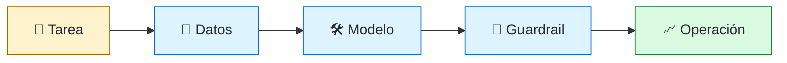
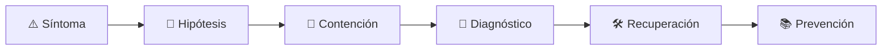

# 🧠 AI Systems Engineer
<!-- role-visual:start -->

**La guía conecta trabajo real, decisiones, clases concretas y evidencia defendible.**

<!-- role-visual:end -->

> Integra modelos en productos mediante datos, evaluaciones, guardrails y operación,
> sin confundir una demo probabilística con una capacidad confiable.
>
> **Entrada habitual:** semi-senior/senior · **Foco:** sistemas con modelos y evals
> · **Evidencia central:** capacidad de IA evaluada contra baseline, coste y riesgo

## 🧭 Qué es y por qué importa

Este rol construye el sistema alrededor del modelo: contrato, recuperación de contexto,
herramientas, seguridad, evaluación, fallback, observabilidad y revisión humana. No es
investigación de modelos fundacionales; integra capacidades probabilísticas en software.

## 🗓️ Un día en el puesto

- convertir un caso de uso en dataset y criterios de evaluación;
- comparar prompt, modelo, recuperación o herramienta;
- investigar alucinación, fuga de datos o regresión;
- revisar latencia, tokens, coste y fallback;
- desplegar un cambio controlado y analizar resultados.

## ✅ Responsabilidades y límites

- Responde por comportamiento del sistema completo, no sólo del modelo.
- Separa evaluación offline, online y revisión humana.
- No usa output del modelo como autorización o evidencia por sí solo.
- No promete determinismo donde el componente es probabilístico.
- Cuando el agente es una herramienta interna de ingeniería y no parte del producto, el entorno de ejecución (contexto, herramientas, permisos, bucle y recuperación) lo gobierna el [Agentic Harness Engineer](agentic-harness-engineer.md); este rol conserva la integración del modelo en el producto y su evaluación.

## 🧠 Qué necesitas saber

APIs y datos, prompts, embeddings y recuperación según caso, tool use, agentes, MCP,
datasets, evals, model grading con límites, seguridad, privacidad, provenance,
observabilidad, experimentación, coste, latencia y fallback.

## 📚 Tu ruta en el programa

1. Partes 00–13 para ingeniería, datos, contratos y evaluación de decisiones.
2. Partes 20 y 25–41 para integración, arquitectura, pruebas, seguridad y operación.
3. [Parte 46 — Desarrollo asistido por IA](../classes/part-46-desarrollo-de-software-asistido-por-ia/README.md).
4. [Parte 47 — SPEC y agentes](../classes/part-47-spec-agentes-y-ciclo-de-vida-agentic/README.md).

<!-- role-depth:start -->
## 🗺️ Sistema profesional del rol

El gráfico no representa una cascada rígida. Muestra el bucle profesional que este rol
debe poder recorrer: comprender el contexto, tomar una decisión, intervenir, observar
el efecto y convertir lo aprendido en una mejora. En **🧠 AI Systems Engineer**, saltar directamente a
la herramienta suele ocultar el problema, mientras que terminar sin evidencia deja la
decisión en una opinión. La misión concreta es: Integra modelos en productos mediante datos, evaluaciones, guardrails y operación, sin confundir una demo probabilística con una capacidad confiable. Cada transición
debe conservar supuestos, responsables y una forma de volver atrás.

<table>
<tr>
<td valign="top" width="50%">

### 🎯 Responde por

- decisiones propias de la familia **Sistemas con IA**;
- el resultado observable, no sólo la actividad ejecutada;
- límites, riesgos, operación y deuda residual de su intervención;
- evidencia que otra persona pueda revisar o reproducir.

</td>
<td valign="top" width="50%">

### 🤝 Coordina con

- [🤖 AI-Augmented Software Engineer](ai-augmented-software-engineer.md); [🧱 Data Engineer](data-engineer.md); [🔐 Security Engineer](security-engineer.md); [🧬 MLOps / ML Platform Engineer](mlops-ml-platform-engineer.md); [🛂 AI Governance & Responsible AI Engineer](ai-governance-responsible-ai-engineer.md);
- producto y personas usuarias cuando cambia una tarea o outcome;
- seguridad, privacidad, accesibilidad y operación según el riesgo;
- quienes mantendrán el sistema después de la entrega.

</td>
</tr>
</table>

El título no concede autoridad automática. El alcance real depende del equipo, la
industria y la criticidad. Esta guía describe un recorrido desde **semi-senior → principal**, pero una
vacante se evalúa por las decisiones que permite tomar, los sistemas que pone bajo
responsabilidad y la evidencia exigida, no por el nombre del cargo.

## 🧱 Partes y clases asociadas

La ruta distingue **parte** —unidad curricular con una capacidad acumulativa— de
**clase asociada** —punto concreto donde se estudia un mecanismo o una decisión. Las
clases siguientes forman el núcleo; no eliminan los prerrequisitos indicados en sus
propias páginas ni convierten en opcional la base común.

| Orden | Parte del programa | Estado | Clases clave | Por qué entra en esta ruta | Evidencia de transferencia |
| ---: | --- | --- | --- | --- | --- |
| 1 | [Parte 20 · Backend, APIs y procesamiento asíncrono](../classes/part-20-backend-apis-y-procesamiento-asincrono/README.md) | desarrollada | [SE-244 · Validación, errores y contratos consistentes](../classes/part-20-backend-apis-y-procesamiento-asincrono/se-244-validacion-errores-y-contratos-consistentes/README.md) [SE-246 · Idempotencia, reintentos y deduplicación](../classes/part-20-backend-apis-y-procesamiento-asincrono/se-246-idempotencia-reintentos-y-deduplicacion/README.md) [SE-249 · Caching, rate limiting y protección](../classes/part-20-backend-apis-y-procesamiento-asincrono/se-249-caching-rate-limiting-y-proteccion/README.md) [SE-250 · Health, readiness y shutdown ordenado](../classes/part-20-backend-apis-y-procesamiento-asincrono/se-250-health-readiness-y-shutdown-ordenado/README.md) | Profundiza **servicios, APIs y procesamiento asíncrono** desde la responsabilidad del rol. | Servicio contractual operable. |
| 2 | [Parte 24 · Software especializado y dominios](../classes/part-24-software-especializado-y-dominios/README.md) | desarrollada | [SE-290 · Ingeniería de datos y procesamiento analítico](../classes/part-24-software-especializado-y-dominios/se-290-ingenieria-de-datos-y-procesamiento-analitico/README.md) [SE-291 · Machine learning como componente de producto](../classes/part-24-software-especializado-y-dominios/se-291-machine-learning-como-componente-de-producto/README.md) [SE-299 · Taller: comparar riesgos entre dominios](../classes/part-24-software-especializado-y-dominios/se-299-taller-comparar-riesgos-entre-dominios/README.md) [SE-300 · Proyecto: diseño profundo de un dominio elegido](../classes/part-24-software-especializado-y-dominios/se-300-proyecto-diseno-profundo-de-un-dominio-elegido/README.md) | Profundiza **dominios especializados, regulación y safety** desde la responsabilidad del rol. | Análisis de riesgo de dominio. |
| 3 | [Parte 30 · Ingeniería de datos y plataformas de datos](../classes/part-30-ingenieria-de-datos-y-plataformas-de-datos/README.md) | desarrollada | [SE-365 · Calidad y observabilidad de datos](../classes/part-30-ingenieria-de-datos-y-plataformas-de-datos/se-365-calidad-y-observabilidad-de-datos/README.md) [SE-366 · Contratos de datos y evolución de esquemas](../classes/part-30-ingenieria-de-datos-y-plataformas-de-datos/se-366-contratos-de-datos-y-evolucion-de-esquemas/README.md) [SE-367 · Linaje, catálogo y metadatos](../classes/part-30-ingenieria-de-datos-y-plataformas-de-datos/se-367-linaje-catalogo-y-metadatos/README.md) [SE-369 · Gobierno, privacidad y retención de datos](../classes/part-30-ingenieria-de-datos-y-plataformas-de-datos/se-369-gobierno-privacidad-y-retencion-de-datos/README.md) | Profundiza **plataformas de datos, calidad, contratos y gobierno** desde la responsabilidad del rol. | Plataforma de datos mínima gobernada. |
| 4 | [Parte 36 · Calidad, rendimiento y resiliencia](../classes/part-36-calidad-rendimiento-y-resiliencia/README.md) | desarrollada | [SE-436 · Latencia, throughput, saturación y capacidad](../classes/part-36-calidad-rendimiento-y-resiliencia/se-436-latencia-throughput-saturacion-y-capacidad/README.md) [SE-438 · Timeouts, retries, backoff y jitter](../classes/part-36-calidad-rendimiento-y-resiliencia/se-438-timeouts-retries-backoff-y-jitter/README.md) [SE-439 · Circuit breakers, bulkheads y degradación](../classes/part-36-calidad-rendimiento-y-resiliencia/se-439-circuit-breakers-bulkheads-y-degradacion/README.md) [SE-442 · Calidad de experiencia y presupuestos](../classes/part-36-calidad-rendimiento-y-resiliencia/se-442-calidad-de-experiencia-y-presupuestos/README.md) | Profundiza **calidad, rendimiento y resiliencia** desde la responsabilidad del rol. | Informe medido y game day. |
| 5 | [Parte 41 · Observabilidad, SRE e incidentes](../classes/part-41-observabilidad-sre-e-incidentes/README.md) | desarrollada | [SE-493 · Señales, eventos y observabilidad útil](../classes/part-41-observabilidad-sre-e-incidentes/se-493-senales-eventos-y-observabilidad-util/README.md) [SE-496 · Trazas distribuidas y contexto](../classes/part-41-observabilidad-sre-e-incidentes/se-496-trazas-distribuidas-y-contexto/README.md) [SE-497 · SLI, SLO, SLA y presupuestos de error](../classes/part-41-observabilidad-sre-e-incidentes/se-497-sli-slo-sla-y-presupuestos-de-error/README.md) [SE-498 · Alertas accionables y fatiga](../classes/part-41-observabilidad-sre-e-incidentes/se-498-alertas-accionables-y-fatiga/README.md) | Profundiza **observabilidad, SRE e incidentes** desde la responsabilidad del rol. | Incidente diagnosticado y recuperado. |
| 6 | [Parte 46 · Desarrollo de software asistido por IA](../classes/part-46-desarrollo-de-software-asistido-por-ia/README.md) | desarrollada | [SE-553 · Capacidades y límites de los modelos generativos](../classes/part-46-desarrollo-de-software-asistido-por-ia/se-553-capacidades-y-limites-de-los-modelos-generativos/README.md) [SE-554 · Prompting, instrucciones y criterios de salida](../classes/part-46-desarrollo-de-software-asistido-por-ia/se-554-prompting-instrucciones-y-criterios-de-salida/README.md) [SE-555 · Contexto, archivos, memoria y recuperación](../classes/part-46-desarrollo-de-software-asistido-por-ia/se-555-contexto-archivos-memoria-y-recuperacion/README.md) [SE-560 · Context engineering y reducción de ambigüedad](../classes/part-46-desarrollo-de-software-asistido-por-ia/se-560-context-engineering-y-reduccion-de-ambiguedad/README.md) [SE-561 · Evals de exactitud, utilidad, costo y latencia](../classes/part-46-desarrollo-de-software-asistido-por-ia/se-561-evals-de-exactitud-utilidad-costo-y-latencia/README.md) [SE-562 · Privacidad, propiedad intelectual y código inseguro](../classes/part-46-desarrollo-de-software-asistido-por-ia/se-562-privacidad-propiedad-intelectual-y-codigo-inseguro/README.md) | Profundiza **ingeniería asistida por IA y evaluaciones** desde la responsabilidad del rol. | Cambio asistido con trazabilidad. |
| 7 | [Parte 47 · SPEC, agentes y ciclo de vida agentic](../classes/part-47-spec-agentes-y-ciclo-de-vida-agentic/README.md) | desarrollada | [SE-569 · Agentes, herramientas, permisos y límites de autoridad](../classes/part-47-spec-agentes-y-ciclo-de-vida-agentic/se-569-agentes-herramientas-permisos-y-limites-de-autoridad/README.md) [SE-571 · MCP, recursos, prompts, tools y confianza](../classes/part-47-spec-agentes-y-ciclo-de-vida-agentic/se-571-mcp-recursos-prompts-tools-y-confianza/README.md) [SE-572 · Delegación, subagentes y sistemas multiagente](../classes/part-47-spec-agentes-y-ciclo-de-vida-agentic/se-572-delegacion-subagentes-y-sistemas-multiagente/README.md) [SE-573 · Human-in-the-loop, aprobación y acciones reversibles](../classes/part-47-spec-agentes-y-ciclo-de-vida-agentic/se-573-human-in-the-loop-aprobacion-y-acciones-reversibles/README.md) [SE-574 · Seguridad agentic, prompt injection y auditoría](../classes/part-47-spec-agentes-y-ciclo-de-vida-agentic/se-574-seguridad-agentic-prompt-injection-y-auditoria/README.md) | Profundiza **SPEC, agentes, herramientas y guardrails** desde la responsabilidad del rol. | Flujo agentic controlado. |
| 8 | [Parte 49 · Patrones agénticos y sistemas con LLM](../classes/part-49-patrones-agenticos-y-sistemas-con-llm/README.md) | desarrollada | [SE-589 · Workflows frente a agentes: cuándo no usar un agente](../classes/part-49-patrones-agenticos-y-sistemas-con-llm/se-589-workflows-frente-a-agentes-cuando-no-usar-un-agente/README.md) [SE-593 · Memoria y gestión de estado de agentes](../classes/part-49-patrones-agenticos-y-sistemas-con-llm/se-593-memoria-y-gestion-de-estado-de-agentes/README.md) [SE-594 · Embeddings, recuperación y agentic RAG](../classes/part-49-patrones-agenticos-y-sistemas-con-llm/se-594-embeddings-recuperacion-y-agentic-rag/README.md) [SE-596 · Ejecución durable, reintentos e idempotencia](../classes/part-49-patrones-agenticos-y-sistemas-con-llm/se-596-ejecucion-durable-reintentos-e-idempotencia/README.md) [SE-597 · Evals y LLMOps de sistemas con LLM](../classes/part-49-patrones-agenticos-y-sistemas-con-llm/se-597-evals-y-llmops-de-sistemas-con-llm/README.md) [SE-598 · Costo, latencia y seguridad en sistemas con LLM](../classes/part-49-patrones-agenticos-y-sistemas-con-llm/se-598-costo-latencia-y-seguridad-en-sistemas-con-llm/README.md) | Profundiza **patrones agénticos, evaluación y operación de sistemas con LLM** desde la responsabilidad del rol. | Sistema con LLM evaluado y operable. |
| 9 | [Parte 50 · Machine learning en producción y MLOps](../classes/part-50-machine-learning-en-produccion-y-mlops/README.md) | desarrollada | [SE-601 · Ciclo de vida de ML y por qué falla en producción](../classes/part-50-machine-learning-en-produccion-y-mlops/se-601-ciclo-de-vida-de-ml-y-por-que-falla-en-produccion/README.md) [SE-604 · Evaluación, sesgos y validación de modelos](../classes/part-50-machine-learning-en-produccion-y-mlops/se-604-evaluacion-sesgos-y-validacion-de-modelos/README.md) [SE-606 · Servir modelos: latencia, lotes y GPU](../classes/part-50-machine-learning-en-produccion-y-mlops/se-606-servir-modelos-latencia-lotes-y-gpu/README.md) [SE-607 · Despliegue seguro de modelos: shadow, canary y rollback](../classes/part-50-machine-learning-en-produccion-y-mlops/se-607-despliegue-seguro-de-modelos-shadow-canary-y-rollback/README.md) [SE-608 · Monitoreo, deriva y reentrenamiento](../classes/part-50-machine-learning-en-produccion-y-mlops/se-608-monitoreo-deriva-y-reentrenamiento/README.md) [SE-609 · Seguridad y robustez de sistemas de ML](../classes/part-50-machine-learning-en-produccion-y-mlops/se-609-seguridad-y-robustez-de-sistemas-de-ml/README.md) | Profundiza **machine learning en producción, MLOps y gobierno de IA** desde la responsabilidad del rol. | Sistema de ML operable con evidencia. |

### ✅ Clases ya desarrolladas que sostienen la ruta hoy

El núcleo anterior apunta a la capacidad profesional completa. Estas clases de apoyo,
de las Partes 00–50 (`SE-001`–`SE-612`), también tienen contenido desarrollado y
permiten practicar el rol desde otros ángulos:

| Clase desarrollada | Parte |
| --- | --- |
| [SE-006 · Evidencia, incertidumbre y pensamiento crítico en ingeniería](../classes/part-00-ingenieria-de-software-como-profesion/se-006-evidencia-incertidumbre-y-pensamiento-critico-en-ingenieria/README.md) | Parte 00 |
| [SE-137 · Telemetría de producto y consentimiento](../classes/part-11-economia-metricas-y-decisiones-de-producto/se-137-telemetria-de-producto-y-consentimiento/README.md) | Parte 11 |
| [SE-138 · Experimentos, sesgos y causalidad básica](../classes/part-11-economia-metricas-y-decisiones-de-producto/se-138-experimentos-sesgos-y-causalidad-basica/README.md) | Parte 11 |
| [SE-139 · North Star, guardrails y métricas contrarias](../classes/part-11-economia-metricas-y-decisiones-de-producto/se-139-north-star-guardrails-y-metricas-contrarias/README.md) | Parte 11 |
| [SE-214 · Documentación para humanos, máquinas y LLM](../classes/part-17-documentacion-y-conocimiento-tecnico/se-214-documentacion-para-humanos-maquinas-y-llm/README.md) | Parte 17 |
| [SE-245 · Autenticación, autorización y contexto](../classes/part-20-backend-apis-y-procesamiento-asincrono/se-245-autenticacion-autorizacion-y-contexto/README.md) | Parte 20 |
| [SE-595 · Interoperabilidad entre agentes: MCP y A2A](../classes/part-49-patrones-agenticos-y-sistemas-con-llm/se-595-interoperabilidad-entre-agentes-mcp-y-a2a/README.md) | Parte 49 |
| [SE-600 · Proyecto: sistema con LLM evaluado y operable](../classes/part-49-patrones-agenticos-y-sistemas-con-llm/se-600-proyecto-sistema-con-llm-evaluado-y-operable/README.md) | Parte 49 |

**Cómo recorrerla.** Empieza por [SE-244](../classes/part-20-backend-apis-y-procesamiento-asincrono/se-244-validacion-errores-y-contratos-consistentes/README.md) para fijar el
primer mecanismo, usa [SE-554](../classes/part-46-desarrollo-de-software-asistido-por-ia/se-554-prompting-instrucciones-y-criterios-de-salida/README.md) para integrar el
centro de la especialidad y llega a [SE-609](../classes/part-50-machine-learning-en-produccion-y-mlops/se-609-seguridad-y-robustez-de-sistemas-de-ml/README.md) cuando ya
puedas explicar cómo detectar y recuperar un fallo. Una clase se considera estudiada
sólo cuando su concepto cambia una decisión y deja evidencia; abrir todos los enlaces
no constituye competencia.

> [!IMPORTANT]
> El mapa expresa el currículo vigente. Las Partes 00–50 (`SE-001`–`SE-612`) están
> desarrolladas, a falta de una revisión editorial humana independiente. Esta ruta no
> declara aprobadas esas clases ni reemplaza el [roadmap](../ROADMAP.md).

## ✅ Ampliación completada: todas las partes del alcance

> [!NOTE]
> Todas las partes del alcance ya están desarrolladas ([ADR-007](../docs/adr/ADR-007-pedagogical-renumbering-and-new-parts.md)); sus clases figuran en el núcleo y en las clases de apoyo de esta guía.

## ⚖️ Decisiones y trade-offs que debes defender

| Decisión recurrente | Criterio profesional | Evidencia mínima antes de defenderla |
| --- | --- | --- |
| **Modelo grande o pequeño** | Comparar calidad latencia coste privacidad y control. | Eval por segmento y presupuesto. |
| **Prompt o ajuste** | Elegir intervención por estabilidad datos y mantenimiento. | Baseline versionado y conjunto de regresión. |
| **Responder o abstener** | Definir incertidumbre daño fallback y escalamiento humano. | Pruebas de negativa y recuperación. |

La calidad de una decisión no se juzga porque coincida con una herramienta popular.
Debe hacer explícitos contexto, restricciones, alternativas descartadas, coste de
cambio y condición de revisión. En especial, **Modelo grande o pequeño**, **Prompt o ajuste**
y **Responder o abstener** cambian de respuesta cuando cambia el riesgo. Una solución
correcta en un prototipo puede ser irresponsable en un sistema regulado; una solución
robusta para un servicio crítico puede ser desperdicio en una herramienta interna.

## 🚨 Escenario profesional: Modelo responde con seguridad aparente pero dato falso en flujo crítico

**Síntoma.** El sistema carece de grounding cita umbral o fallback adecuado. La respuesta madura evita convertir la primera
correlación en causa y conserva evidencia antes de modificar el sistema.

1. **Detectar y delimitar:** identifica quién o qué está afectado, desde cuándo y qué
   cambió. Conserva timestamps, versiones, entradas y señales suficientes para no
   destruir la escena al intentar arreglarla.
2. **Investigar:** Rastrear entrada contexto retrieval modelo versión salida guardrail y decisión. Formula al menos dos hipótesis rivales
   y define qué observación refutaría cada una.
3. **Contener:** reduce blast radius y daño sin prometer una corrección todavía. La
   contención debe ser reversible, visible y compatible con las obligaciones del
   sistema.
4. **Recuperar:** Contener bajar autoridad activar fallback revisar dataset y añadir eval adversarial. Verifica la tarea completa, no sólo que un
   proceso volvió a estar verde.
5. **Aprender:** añade una regresión, señal o control que detecte la misma clase de
   fallo. Documenta qué deuda permanece y quién revisará la acción.

El escenario evalúa método además de resultado. Una recuperación rápida que borra la
causa, oculta pérdida de datos o deja al equipo sin mecanismo preventivo no demuestra
dominio del rol.

## 📊 Señales útiles y límites de las métricas

| Señal | Qué ayuda a observar | Trampa que debe evitarse |
| --- | --- | --- |
| **Calidad por segmento** | Resultado útil y daño para grupos y casos distintos. | Publicar un promedio global. |
| **Costo y latencia por tarea** | Recursos desde entrada hasta decisión útil. | Medir sólo inferencia. |
| **Tasa de fallback** | Veces que el sistema se abstiene deriva o escala. | Tratar toda abstención como fracaso. |

Ninguna señal debe convertirse en ranking individual. Combina tendencia cuantitativa,
muestreo de casos, feedback cualitativo y contexto de carga. Declara ventana,
denominador, fuente, exclusiones y quién puede actuar sobre el resultado. Si una
métrica mejora mientras el outcome o el riesgo empeoran, el sistema está optimizando
el indicador y no el trabajo.

## 🧩 Proyecto integrador del rol: Capacidad de IA operable y reversible

**Propósito:** integrar un modelo con evaluación guardrails observabilidad privacidad y fallback. El resultado esperado es **dataset card evals baseline contrato de modelo threat model trazas control humano y runbook**.

Entrega un expediente revisable con estas piezas:

1. **Contexto y alcance:** usuario, sistema, restricción, supuestos, fuera de alcance y
   criterio de no éxito.
2. **Decisión:** al menos dos alternativas reales, trade-offs, coste de reversión y un
   ADR o memo que indique cuándo revisar la elección.
3. **Artefacto principal:** una implementación, modelo, flujo o política coherente con
   las clases núcleo; no una captura aislada ni una presentación sin mecanismo.
4. **Fallo controlado:** introduce una condición adversa relacionada con el escenario
   anterior y conserva el resultado observado, sin inventar una ejecución.
5. **Verificación:** prueba, rúbrica, revisión o medición que pueda fallar y que conecte
   directamente con el resultado profesional.
6. **Operación y salida:** telemetría, recuperación, mantenimiento, deprecación o retiro
   según corresponda; incluye límites y deuda residual.

**Criterio de aceptación:** otra persona puede reconstruir el razonamiento, reproducir
la comprobación y distinguir claramente qué quedó demostrado de lo que sólo se propone.
El proyecto no se aprueba por cantidad de archivos ni por utilizar una marca concreta.

## 📈 Dominio esperado por alcance

| Alcance | Qué resuelve | Qué evidencia su autonomía |
| --- | --- | --- |
| **Inicial** | ejecuta una tarea acotada con criterios y acompañamiento | reproduce el caso, pregunta por supuestos y entrega evidencia legible |
| **Intermedio** | decide dentro de un componente o flujo conocido | compara alternativas, prueba fallos previsibles y coordina dependencias |
| **Senior** | conduce problemas ambiguos que cruzan sistemas o equipos | hace explícito el riesgo, diseña recuperación y mejora el mecanismo de trabajo |
| **Staff / Lead** | cambia capacidades compartidas y decisiones de largo plazo | multiplica criterio, define guardrails, mide adopción y conserva opciones futuras |

Progresar no significa alejarse de la práctica. Significa aumentar ambigüedad, horizonte,
blast radius y responsabilidad por consecuencias. La persona senior todavía debe poder
explicar el mecanismo; la persona Staff además crea condiciones para que otros lo
operen sin depender de ella.

## 🗓️ Plan de práctica 30 · 60 · 90 días

- **Días 1–30 — comprender y reproducir.** Estudia las primeras clases de cada parte,
  reproduce un caso pequeño y escribe un mapa de responsabilidades. El entregable es
  una baseline con preguntas abiertas, no una transformación prematura.
- **Días 31–60 — intervenir y fallar con control.** Construye el artefacto central,
  introduce el escenario de fallo y mide el comportamiento. Revisa el trabajo con una
  persona de una ruta vecina para descubrir supuestos de frontera.
- **Días 61–90 — operar y transferir.** Ejecuta recuperación, corrige la causa, publica
  runbook o guía de uso y presenta la decisión con trade-offs. Termina con una
  retrospectiva que separe resultado, evidencia, límites y siguiente inversión.

Este plan es una secuencia de práctica, no una promesa de empleabilidad en noventa días.
La experiencia previa, el dominio y el acceso a sistemas reales cambian el tiempo
necesario.

## 🎤 Preguntas para revisión o entrevista

1. ¿En qué contexto elegirías **Modelo grande o pequeño** y qué evidencia te haría cambiar?
2. ¿Cómo distinguirías síntoma, causa y daño en el escenario **Modelo responde con seguridad aparente pero dato falso en flujo crítico**?
3. ¿Qué clase asociada usarías para diseñar el mecanismo y cuál para verificarlo?
4. ¿Qué parte de **Capacidad de IA operable y reversible** no automatizarías todavía y por qué?
5. ¿Qué métrica podría mejorar mientras el sistema empeora y qué guardrail añadirías?
6. ¿Dónde termina la autoridad de este rol y cuándo debe escalar o pedir revisión?

Una respuesta fuerte usa un caso, reconoce incertidumbre y propone una comprobación.
Nombrar una herramienta sin explicar mecanismo, fallo y límite no demuestra la
competencia.

## 🔗 Fuentes primarias y oficiales

- [AI Risk Management Framework](https://www.nist.gov/itl/ai-risk-management-framework) — **NIST**. Se usa como referencia primaria u oficial; la guía no sustituye la fuente.
- [Model Context Protocol](https://modelcontextprotocol.io/specification/) — **MCP maintainers**. Se usa como referencia primaria u oficial; la guía no sustituye la fuente.
- [ISO/IEC 25010:2023](https://www.iso.org/standard/78176.html) — **ISO**. Se usa como referencia primaria u oficial; la guía no sustituye la fuente.

Las fuentes orientan principios, vocabulario y prácticas; no convierten la guía en una
certificación ni sustituyen la documentación específica del sistema, la jurisdicción
o la tecnología utilizada.
<!-- role-depth:end -->

## 🧪 Evidencia de portafolio

- dataset versionado con criterios y casos adversos;
- baseline sin IA y comparación de calidad/coste/latencia;
- pruebas deterministas alrededor de herramientas y permisos;
- rollout, fallback y registro de revisión humana.

## 📈 Progresión

Software/Data Engineer → AI Systems Engineer → Senior/Staff AI Platform o Architect.

## ⚠️ Mitos frecuentes

- “Una demo buena demuestra producción.” No cubre distribución ni fallos reales.
- “El modelo grande resuelve contexto.” También puede amplificar coste y datos irrelevantes.
- “El agente terminó.” El sistema debe verificar artefactos y comportamiento.

## 🚀 Siguientes pasos

1. Define baseline, dataset y fallo inaceptable antes del prompt.
2. Encierra herramientas con permisos mínimos y salidas verificables.
3. Mide regresión, coste y latencia al cambiar cualquier componente.

---

[⬅️ Volver a las rutas](README.md) · [🏠 Inicio del programa](../README.md)
