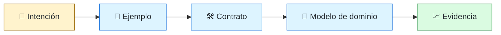
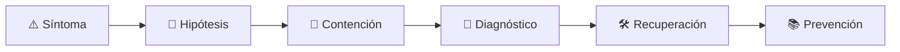

# 📐 Domain & Methodology Engineer
<!-- role-visual:start -->

**La guía conecta trabajo real, decisiones, clases concretas y evidencia defendible.**

<!-- role-visual:end -->

> Convierte metodologías de desarrollo —TDD, BDD, ATDD, DDD, diseño por contrato y
> especificación guiada por spec— en prácticas de equipo con evidencia, sin tratarlas
> como rituales ni como etiquetas intercambiables.
>
> **Entrada habitual:** semi-senior/senior · **Foco:** prácticas de especificación y prueba
> · **Evidencia central:** ejemplos, contratos y modelo de dominio que detectan reglas mal entendidas

## 🧭 Qué es y por qué importa

Las metodologías responden a preguntas distintas. **TDD** usa una prueba que falla para
guiar el diseño en ciclos cortos. **BDD** y **ATDD** anclan el comportamiento en
ejemplos que negocio y desarrollo comprenden por igual, a menudo escritos en Gherkin.
**DDD** da un lenguaje ubicuo y contextos delimitados para que el modelo del código no
se desvíe del dominio. El **diseño por contrato** hace explícitas pre y poscondiciones
e invariantes. La **especificación guiada por spec (SDD)** convierte la intención en un
artefacto vivo del que se derivan código y pruebas, cada vez más importante cuando
quien implementa puede ser un agente.

Este rol decide **cuál práctica aplicar, dónde y con qué evidencia**, y la sostiene
como práctica de equipo: acuerdos, ejemplos revisables, pruebas que fallan por la
razón correcta y un glosario que el código realmente usa. No es un coach de ceremonias:
si un ciclo no reduce defectos de reglas ni acorta el feedback, se cambia.

## 🗓️ Un día en el puesto

- facilitar una conversación de ejemplos con negocio y convertir los acuerdos en
  escenarios verificables;
- revisar una prueba y comprobar que falla por la razón esperada antes de aceptar el
  código que la hace pasar;
- detectar un término del dominio usado con dos significados y proponer un contexto
  delimitado o un cambio de nombre;
- vincular una especificación con sus contratos y sus pruebas, y señalar la deriva;
- medir el tiempo de feedback del equipo y descartar prácticas que sólo añaden ritual.

## ✅ Responsabilidades y límites

- Responde por la coherencia entre intención, ejemplos, contratos, código y modelo.
- Elige la práctica por el tipo de incertidumbre (diseño, regla de negocio, integración),
  no por preferencia de escuela.
- No mide el éxito por cobertura de líneas ni por cantidad de escenarios.
- No impone una metodología a todo el sistema: un CRUD simple no necesita un modelo de
  dominio rico, y un algoritmo numérico se beneficia más de propiedades que de Gherkin.
- No sustituye al [QA / Test Automation Engineer](qa-test-engineer.md) ni al
  [Software Architect](software-architect.md): coordina prácticas y deja a cada rol su
  decisión de estrategia de prueba y de arquitectura.

## 🧠 Qué necesitas saber

Ciclo rojo-verde-refactor y sus límites; dobles de prueba y su coste de acoplamiento;
escritura de ejemplos y Gherkin sin convertirlo en scripts de interfaz; criterios de
aceptación y reglas; lenguaje ubicuo, contextos delimitados, agregados e invariantes;
pre y poscondiciones, pruebas de contrato y de propiedades; versionado de contratos;
especificaciones como fuente en proyectos con agentes; y cómo medir feedback y defectos
de regla sin gamificar la métrica.

## 📚 Tu ruta en el programa

1. [Parte 05 — Fundamentos de programación](../classes/part-05-fundamentos-de-programacion/README.md)
   para pruebas tempranas y diseño por ejemplos.
2. [Parte 12 — Ingeniería de requisitos](../classes/part-12-ingenieria-de-requisitos/README.md)
   y [Parte 13 — Especificaciones, contratos y modelos](../classes/part-13-especificaciones-contratos-y-modelos/README.md)
   para criterios de aceptación, BDD, contratos y spec-first.
3. Partes 24, 25 y 30 para refactorización, dominio y pruebas: son borradores o
   estructura, por lo que el mapa distingue su estado.
4. La Parte 40 (metodologías de TDD a ODD) y la 43 (patrones) están **planificadas**;
   la sección «Ampliación planificada» indica el alcance previsto.

<!-- role-depth:start -->
## 🗺️ Sistema profesional del rol

El gráfico no representa una cascada rígida. Muestra el bucle profesional que este rol
debe poder recorrer: comprender el contexto, tomar una decisión, intervenir, observar
el efecto y convertir lo aprendido en una mejora. En **📐 Domain & Methodology Engineer**, saltar directamente a
la herramienta suele ocultar el problema, mientras que terminar sin evidencia deja la
decisión en una opinión. La misión concreta es: Convierte metodologías de desarrollo —TDD, BDD, ATDD, DDD, diseño por contrato y especificación guiada por spec— en prácticas de equipo con evidencia, sin tratarlas como rituales ni como etiquetas intercambiables. Cada transición
debe conservar supuestos, responsables y una forma de volver atrás.

<table>
<tr>
<td valign="top" width="50%">

### 🎯 Responde por

- decisiones propias de la familia **Metodología y dominio**;
- el resultado observable, no sólo la actividad ejecutada;
- límites, riesgos, operación y deuda residual de su intervención;
- evidencia que otra persona pueda revisar o reproducir.

</td>
<td valign="top" width="50%">

### 🤝 Coordina con

- [🧪 QA / Test Automation Engineer](qa-test-engineer.md); [🏛️ Software Architect](software-architect.md); [🧾 Requirements Engineer / Business Systems Analyst](requirements-engineer.md);
- producto y personas usuarias cuando cambia una tarea o outcome;
- seguridad, privacidad, accesibilidad y operación según el riesgo;
- quienes mantendrán el sistema después de la entrega.

</td>
</tr>
</table>

El título no concede autoridad automática. El alcance real depende del equipo, la
industria y la criticidad. Esta guía describe un recorrido desde **semi-senior → principal**, pero una
vacante se evalúa por las decisiones que permite tomar, los sistemas que pone bajo
responsabilidad y la evidencia exigida, no por el nombre del cargo.

## 🧱 Partes y clases asociadas

La ruta distingue **parte** —unidad curricular con una capacidad acumulativa— de
**clase asociada** —punto concreto donde se estudia un mecanismo o una decisión. Las
clases siguientes forman el núcleo; no eliminan los prerrequisitos indicados en sus
propias páginas ni convierten en opcional la base común.

| Orden | Parte del programa | Estado | Clases clave | Por qué entra en esta ruta | Evidencia de transferencia |
| ---: | --- | --- | --- | --- | --- |
| 1 | [Parte 05 · Fundamentos de programación](../classes/part-05-fundamentos-de-programacion/README.md) | desarrollada | [SE-069 · Pruebas tempranas y diseño por ejemplos](../classes/part-05-fundamentos-de-programacion/se-069-pruebas-tempranas-y-diseno-por-ejemplos/README.md) | Profundiza **programación modular, errores y pruebas tempranas** desde la responsabilidad del rol. | Herramienta probada y mantenible. |
| 2 | [Parte 12 · Ingeniería de requisitos](../classes/part-12-ingenieria-de-requisitos/README.md) | desarrollada | [SE-149 · Criterios de aceptación y ejemplos](../classes/part-12-ingenieria-de-requisitos/se-149-criterios-de-aceptacion-y-ejemplos/README.md) [SE-155 · Taller: reparar requisitos no verificables](../classes/part-12-ingenieria-de-requisitos/se-155-taller-reparar-requisitos-no-verificables/README.md) | Profundiza **requisitos, restricciones y trazabilidad** desde la responsabilidad del rol. | Baseline de requisitos revisable. |
| 3 | [Parte 13 · Especificaciones, contratos y modelos](../classes/part-13-especificaciones-contratos-y-modelos/README.md) | desarrollada | [SE-158 · Specification by Example y BDD](../classes/part-13-especificaciones-contratos-y-modelos/se-158-specification-by-example-y-bdd/README.md) [SE-159 · Contratos, invariantes y diseño por contrato](../classes/part-13-especificaciones-contratos-y-modelos/se-159-contratos-invariantes-y-diseno-por-contrato/README.md) [SE-165 · Spec-first, spec-anchored y spec-as-source](../classes/part-13-especificaciones-contratos-y-modelos/se-165-spec-first-spec-anchored-y-spec-as-source/README.md) [SE-166 · Especificaciones ejecutables y pruebas contractuales](../classes/part-13-especificaciones-contratos-y-modelos/se-166-especificaciones-ejecutables-y-pruebas-contractuales/README.md) [SE-167 · Taller: convertir intención en contrato comprobable](../classes/part-13-especificaciones-contratos-y-modelos/se-167-taller-convertir-intencion-en-contrato-comprobable/README.md) | Profundiza **contratos, modelos e invariantes verificables** desde la responsabilidad del rol. | Especificación trazable. |
| 4 | [Parte 24 · Diseño, patrones y refactorización](../classes/part-24-diseno-patrones-y-refactorizacion/README.md) | desarrollada | [SE-295 · Refactorización segura apoyada por pruebas](../classes/part-24-diseno-patrones-y-refactorizacion/se-295-refactorizacion-segura-apoyada-por-pruebas/README.md) [SE-296 · Diseño para cambio, prueba y operación](../classes/part-24-diseno-patrones-y-refactorizacion/se-296-diseno-para-cambio-prueba-y-operacion/README.md) | Profundiza **diseño, patrones y refactorización segura** desde la responsabilidad del rol. | Evolución compatible protegida por pruebas. |
| 5 | [Parte 25 · Arquitectura de software y dominio](../classes/part-25-arquitectura-de-software-y-dominio/README.md) | desarrollada | [SE-305 · Domain-Driven Design estratégico y táctico](../classes/part-25-arquitectura-de-software-y-dominio/se-305-domain-driven-design-estrategico-y-tactico/README.md) [SE-308 · Fitness functions y arquitectura evolutiva](../classes/part-25-arquitectura-de-software-y-dominio/se-308-fitness-functions-y-arquitectura-evolutiva/README.md) | Profundiza **arquitectura, dominio y atributos de calidad** desde la responsabilidad del rol. | Arquitectura defendible con ADR. |
| 6 | [Parte 30 · Estrategia y técnicas de prueba](../classes/part-30-estrategia-y-tecnicas-de-prueba/README.md) | estructura | [SE-362 · Pruebas unitarias y diseño testable](../classes/part-30-estrategia-y-tecnicas-de-prueba/se-362-pruebas-unitarias-y-diseno-testable/README.md) [SE-363 · Integración, componentes y contratos](../classes/part-30-estrategia-y-tecnicas-de-prueba/se-363-integracion-componentes-y-contratos/README.md) | Profundiza **estrategia de pruebas guiada por riesgo** desde la responsabilidad del rol. | Suite que demuestra detección de defectos. |

### ✅ Clases ya desarrolladas que sostienen la ruta hoy

El núcleo anterior apunta a la capacidad profesional completa y puede incluir partes
en borrador o estructura. Estas clases, de las Partes 00–26 (`SE-001`–`SE-324`), ya
tienen contenido desarrollado y permiten empezar a practicar el rol sin esperar al
resto del currículo:

| Clase desarrollada | Parte |
| --- | --- |
| [SE-052 · Invariantes, precondiciones y poscondiciones](../classes/part-04-pensamiento-computacional-y-resolucion-de-problemas/se-052-invariantes-precondiciones-y-poscondiciones/README.md) | Parte 04 |
| [SE-057 · Modelado de estado, transiciones y eventos](../classes/part-04-pensamiento-computacional-y-resolucion-de-problemas/se-057-modelado-de-estado-transiciones-y-eventos/README.md) | Parte 04 |
| [SE-060 · Proyecto: especificación y solución contrastable](../classes/part-04-pensamiento-computacional-y-resolucion-de-problemas/se-060-proyecto-especificacion-y-solucion-contrastable/README.md) | Parte 04 |
| [SE-146 · Requisitos funcionales y reglas de negocio](../classes/part-12-ingenieria-de-requisitos/se-146-requisitos-funcionales-y-reglas-de-negocio/README.md) | Parte 12 |
| [SE-153 · Gestión de cambios y líneas base](../classes/part-12-ingenieria-de-requisitos/se-153-gestion-de-cambios-y-lineas-base/README.md) | Parte 12 |
| [SE-208 · ADRs, RFCs y registro de decisiones](../classes/part-17-documentacion-y-conocimiento-tecnico/se-208-adrs-rfcs-y-registro-de-decisiones/README.md) | Parte 17 |

**Cómo recorrerla.** Empieza por [SE-069](../classes/part-05-fundamentos-de-programacion/se-069-pruebas-tempranas-y-diseno-por-ejemplos/README.md) para fijar el
primer mecanismo, usa [SE-167](../classes/part-13-especificaciones-contratos-y-modelos/se-167-taller-convertir-intencion-en-contrato-comprobable/README.md) para integrar el
centro de la especialidad y llega a [SE-363](../classes/part-30-estrategia-y-tecnicas-de-prueba/se-363-integracion-componentes-y-contratos/README.md) cuando ya
puedas explicar cómo detectar y recuperar un fallo. Una clase se considera estudiada
sólo cuando su concepto cambia una decisión y deja evidencia; abrir todos los enlaces
no constituye competencia.

> [!IMPORTANT]
> El mapa expresa el currículo previsto. Las Partes 00–26 (`SE-001`–`SE-324`) están
> desarrolladas; las Partes 27–29 son borradores y las Partes 30–39 conservan sólo
> estructura, y deben superar revisión cualitativa. Esta ruta no declara terminadas
> esas clases ni reemplaza el [roadmap](../ROADMAP.md).

## 🔭 Ampliación planificada: Partes 40–44 (sin clases publicadas)

> [!NOTE]
> Las Partes 40–44 (`SE-481`–`SE-540`) están **planificadas** desde el 13 de noviembre
> de 2026 ([ADR-004](../docs/adr/ADR-004-expand-to-540-class-scope.md) y
> [auditoría de brechas](../docs/METHODOLOGY-GAP-AUDIT-2026-11-13.md)). Todavía no
> tienen clases ni README, por lo que no se enlazan aquí y ninguna de sus clases debe
> considerarse disponible.

| Parte planificada | Rango previsto | Qué cambiará para este rol |
| --- | --- | --- |
| **Parte 40 · Metodologías de desarrollo: de TDD a ODD** | `SE-481`–`SE-492` | Es la parte central del rol: TDD, BDD, ATDD, DDD, contratos, SDD, EDD y ODD como prácticas de equipo con evidencia. |
| **Parte 43 · Patrones de diseño, empresariales y de resiliencia** | `SE-517`–`SE-528` | Conecta el modelo de dominio con patrones de persistencia (Repository, Unit of Work, Active Record) y sus antipatrones. |

Hasta que esas partes se publiquen, el rol se apoya en el núcleo y en las clases
desarrolladas de arriba. La planificación indica hacia dónde crecerá la ruta; no es
evidencia de que el contenido exista ni de que su alcance final coincida con esta
descripción.

## ⚖️ Decisiones y trade-offs que debes defender

| Decisión recurrente | Criterio profesional | Evidencia mínima antes de defenderla |
| --- | --- | --- |
| **Prueba primero o prueba después** | Usar prueba primero cuando el diseño es incierto y el feedback rápido y después cuando un contrato ya fija el comportamiento. | Historial de ciclos rojo verde refactor con una prueba que falla por la razón correcta. |
| **Ejemplos ejecutables o especificación narrativa** | Elegir un lenguaje ejecutable cuando el ejemplo debe sobrevivir al cambio y ser leído por negocio. | Escenarios vinculados a automatización y a la regla que ilustran. |
| **Modelo de dominio rico o transaccional simple** | Invertir en límites y lenguaje ubicuo sólo donde la complejidad esencial lo justifica. | Mapa de contextos y pruebas de invariantes. |

La calidad de una decisión no se juzga porque coincida con una herramienta popular.
Debe hacer explícitos contexto, restricciones, alternativas descartadas, coste de
cambio y condición de revisión. En especial, **Prueba primero o prueba después**, **Ejemplos ejecutables o especificación narrativa**
y **Modelo de dominio rico o transaccional simple** cambian de respuesta cuando cambia el riesgo. Una solución
correcta en un prototipo puede ser irresponsable en un sistema regulado; una solución
robusta para un servicio crítico puede ser desperdicio en una herramienta interna.

## 🚨 Escenario profesional: Escenarios verdes que no capturan la regla de negocio real

**Síntoma.** Las pruebas ejercen un camino feliz mientras negocio y desarrollo usan el mismo término con significados distintos. La respuesta madura evita convertir la primera
correlación en causa y conserva evidencia antes de modificar el sistema.

1. **Detectar y delimitar:** identifica quién o qué está afectado, desde cuándo y qué
   cambió. Conserva timestamps, versiones, entradas y señales suficientes para no
   destruir la escena al intentar arreglarla.
2. **Investigar:** Contrastar ejemplos con la regla escrita y las conversaciones e identificar el término ambiguo y el contexto delimitado. Formula al menos dos hipótesis rivales
   y define qué observación refutaría cada una.
3. **Contener:** reduce blast radius y daño sin prometer una corrección todavía. La
   contención debe ser reversible, visible y compatible con las obligaciones del
   sistema.
4. **Recuperar:** Corregir el lenguaje ubicuo reescribir los ejemplos en la frontera correcta y añadir una prueba de contrato que falle ante la regresión semántica. Verifica la tarea completa, no sólo que un
   proceso volvió a estar verde.
5. **Aprender:** añade una regresión, señal o control que detecte la misma clase de
   fallo. Documenta qué deuda permanece y quién revisará la acción.

El escenario evalúa método además de resultado. Una recuperación rápida que borra la
causa, oculta pérdida de datos o deja al equipo sin mecanismo preventivo no demuestra
dominio del rol.

## 📊 Señales útiles y límites de las métricas

| Señal | Qué ayuda a observar | Trampa que debe evitarse |
| --- | --- | --- |
| **Defectos de regla de negocio escapados** | Reglas mal entendidas que llegan a producción. | Usar la cobertura de líneas como sustituto. |
| **Estabilidad del lenguaje ubicuo** | Términos del dominio coincidentes entre código pruebas y conversaciones. | Contar glosarios que nadie usa. |
| **Tiempo de feedback de la práctica** | Minutos entre un cambio y una señal fiable de pruebas o contratos. | Ganar velocidad con pruebas frágiles. |

Ninguna señal debe convertirse en ranking individual. Combina tendencia cuantitativa,
muestreo de casos, feedback cualitativo y contexto de carga. Declara ventana,
denominador, fuente, exclusiones y quién puede actuar sobre el resultado. Si una
métrica mejora mientras el outcome o el riesgo empeoran, el sistema está optimizando
el indicador y no el trabajo.

## 🧩 Proyecto integrador del rol: Práctica de equipo verificable

**Propósito:** introducir una práctica que conecte ejemplos de negocio pruebas contratos y modelo de dominio en un flujo real de entrega. El resultado esperado es **acuerdo de equipo mapa de contextos ejemplos ejecutables pruebas de contrato SPEC trazable y métricas de feedback**.

Entrega un expediente revisable con estas piezas:

1. **Contexto y alcance:** usuario, sistema, restricción, supuestos, fuera de alcance y
   criterio de no éxito.
2. **Decisión:** al menos dos alternativas reales, trade-offs, coste de reversión y un
   ADR o memo que indique cuándo revisar la elección.
3. **Artefacto principal:** una implementación, modelo, flujo o política coherente con
   las clases núcleo; no una captura aislada ni una presentación sin mecanismo.
4. **Fallo controlado:** introduce una condición adversa relacionada con el escenario
   anterior y conserva el resultado observado, sin inventar una ejecución.
5. **Verificación:** prueba, rúbrica, revisión o medición que pueda fallar y que conecte
   directamente con el resultado profesional.
6. **Operación y salida:** telemetría, recuperación, mantenimiento, deprecación o retiro
   según corresponda; incluye límites y deuda residual.

**Criterio de aceptación:** otra persona puede reconstruir el razonamiento, reproducir
la comprobación y distinguir claramente qué quedó demostrado de lo que sólo se propone.
El proyecto no se aprueba por cantidad de archivos ni por utilizar una marca concreta.

## 📈 Dominio esperado por alcance

| Alcance | Qué resuelve | Qué evidencia su autonomía |
| --- | --- | --- |
| **Inicial** | ejecuta una tarea acotada con criterios y acompañamiento | reproduce el caso, pregunta por supuestos y entrega evidencia legible |
| **Intermedio** | decide dentro de un componente o flujo conocido | compara alternativas, prueba fallos previsibles y coordina dependencias |
| **Senior** | conduce problemas ambiguos que cruzan sistemas o equipos | hace explícito el riesgo, diseña recuperación y mejora el mecanismo de trabajo |
| **Staff / Lead** | cambia capacidades compartidas y decisiones de largo plazo | multiplica criterio, define guardrails, mide adopción y conserva opciones futuras |

Progresar no significa alejarse de la práctica. Significa aumentar ambigüedad, horizonte,
blast radius y responsabilidad por consecuencias. La persona senior todavía debe poder
explicar el mecanismo; la persona Staff además crea condiciones para que otros lo
operen sin depender de ella.

## 🗓️ Plan de práctica 30 · 60 · 90 días

- **Días 1–30 — comprender y reproducir.** Estudia las primeras clases de cada parte,
  reproduce un caso pequeño y escribe un mapa de responsabilidades. El entregable es
  una baseline con preguntas abiertas, no una transformación prematura.
- **Días 31–60 — intervenir y fallar con control.** Construye el artefacto central,
  introduce el escenario de fallo y mide el comportamiento. Revisa el trabajo con una
  persona de una ruta vecina para descubrir supuestos de frontera.
- **Días 61–90 — operar y transferir.** Ejecuta recuperación, corrige la causa, publica
  runbook o guía de uso y presenta la decisión con trade-offs. Termina con una
  retrospectiva que separe resultado, evidencia, límites y siguiente inversión.

Este plan es una secuencia de práctica, no una promesa de empleabilidad en noventa días.
La experiencia previa, el dominio y el acceso a sistemas reales cambian el tiempo
necesario.

## 🎤 Preguntas para revisión o entrevista

1. ¿En qué contexto elegirías **Prueba primero o prueba después** y qué evidencia te haría cambiar?
2. ¿Cómo distinguirías síntoma, causa y daño en el escenario **Escenarios verdes que no capturan la regla de negocio real**?
3. ¿Qué clase asociada usarías para diseñar el mecanismo y cuál para verificarlo?
4. ¿Qué parte de **Práctica de equipo verificable** no automatizarías todavía y por qué?
5. ¿Qué métrica podría mejorar mientras el sistema empeora y qué guardrail añadirías?
6. ¿Dónde termina la autoridad de este rol y cuándo debe escalar o pedir revisión?

Una respuesta fuerte usa un caso, reconoce incertidumbre y propone una comprobación.
Nombrar una herramienta sin explicar mecanismo, fallo y límite no demuestra la
competencia.

## 🔗 Fuentes primarias y oficiales

- [SWEBOK Guide v4.0a](https://www.computer.org/education/bodies-of-knowledge/software-engineering) — **IEEE Computer Society**. Se usa como referencia primaria u oficial; la guía no sustituye la fuente.
- [Test-Driven Development](https://martinfowler.com/bliki/TestDrivenDevelopment.html) — **Martin Fowler**. Se usa como referencia primaria u oficial; la guía no sustituye la fuente.
- [Introducing BDD](https://dannorth.net/introducing-bdd/) — **Dan North**. Se usa como referencia primaria u oficial; la guía no sustituye la fuente.
- [Gherkin reference](https://cucumber.io/docs/gherkin/reference/) — **Cucumber**. Se usa como referencia primaria u oficial; la guía no sustituye la fuente.
- [Specification by Example](https://gojko.net/books/specification-by-example/) — **Gojko Adzic**. Se usa como referencia primaria u oficial; la guía no sustituye la fuente.
- [Domain-Driven Design Reference](https://www.domainlanguage.com/ddd/reference/) — **Eric Evans / Domain Language**. Se usa como referencia primaria u oficial; la guía no sustituye la fuente.
- [Pact documentation: consumer-driven contract testing](https://docs.pact.io/) — **Pact Foundation**. Se usa como referencia primaria u oficial; la guía no sustituye la fuente.

Las fuentes orientan principios, vocabulario y prácticas; no convierten la guía en una
certificación ni sustituyen la documentación específica del sistema, la jurisdicción
o la tecnología utilizada.
<!-- role-depth:end -->

## 🧪 Evidencia de portafolio

- historial de ciclos TDD con pruebas que fallan por la razón correcta;
- conjunto de escenarios BDD ligado a reglas escritas y a pruebas automatizadas;
- mapa de contextos con glosario y términos ambiguos resueltos;
- contrato versionado con prueba de compatibilidad entre consumidor y proveedor;
- comparación del mismo cambio con dos prácticas y su efecto en feedback y defectos.

## 📈 Progresión

Software Engineer → Domain & Methodology Engineer → Staff / Technical Lead de prácticas
de ingeniería o Software Architect con foco en dominio.

## ⚠️ Mitos frecuentes

- “TDD garantiza buen diseño.” Guía el diseño sólo si el refactor ocurre y las
  pruebas describen comportamiento, no implementación.
- “BDD es automatizar con Gherkin.” Su valor está en la conversación y el ejemplo
  compartido; la automatización es una consecuencia.
- “DDD es usar agregados y repositorios.” Empieza por el lenguaje y los límites.
- “La especificación reemplaza a las pruebas.” Una spec sin comprobación ejecutable
  deriva.

## 🚀 Siguientes pasos

1. Elige una regla de negocio ambigua y redáctala con ejemplos que dos personas
   interpreten igual.
2. Escribe la prueba, confirma que falla por la razón esperada y refactoriza.
3. Registra qué término cambió de significado entre contextos y qué prueba lo protege.

---

[⬅️ Volver a las rutas](README.md) · [🏠 Inicio del programa](../README.md)
