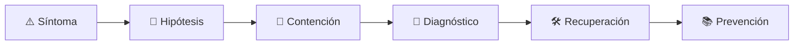

# 🧬 MLOps / ML Platform Engineer
<!-- role-visual:start -->

**La guía conecta trabajo real, decisiones, clases concretas y evidencia defendible.**

<!-- role-visual:end -->

> Convierte un modelo entrenado en un servicio que puede reproducirse, desplegarse,
> observarse, degradarse con control y revertirse, y ofrece a otros equipos esa capacidad
> como plataforma.
>
> **Entrada habitual:** semi-senior · **Foco:** ciclo de vida de ML, servicio y monitoreo
> · **Evidencia central:** modelo reproducible con evaluación, despliegue gradual, deriva
> medida y reversión probada

## 🧭 Qué es y por qué importa

Un modelo de aprendizaje automático no es un artefacto estático: su comportamiento depende
de los datos con los que se entrenó, de las características que recibe en producción y del
código que las calcula. Cuando cualquiera de esos tres cambia, el modelo puede empeorar sin
lanzar una sola excepción. MLOps es la práctica que trata esa dependencia como ingeniería:
versiona datos, código y modelos, hace reproducible el entrenamiento, evalúa antes de
desplegar y vigila después.

El rol de plataforma añade una segunda mitad: construir las capacidades comunes (registro de
experimentos y de modelos, pipelines de entrenamiento, servicio, monitoreo) para que los
equipos de producto no reinventen cada una con garantías distintas.

## 🗓️ Un día en el puesto

- revisar por qué un entrenamiento no se reproduce con los mismos datos y la misma semilla;
- comparar un modelo candidato con el vigente por segmentos, no solo en promedio;
- preparar un despliegue en sombra o canary y definir el criterio de reversión;
- investigar una alerta de deriva y decidir si exige reentrenar, recalibrar o no hacer nada;
- negociar con el equipo de datos el contrato de una característica que cambió de semántica;
- medir latencia y costo por mil predicciones antes de elegir lotes o servicio en línea.

## ✅ Responsabilidades y límites

- Responde por la reproducibilidad, el despliegue seguro, el monitoreo y la reversión de los modelos
  que opera su plataforma.
- Distingue deriva de datos, deriva de concepto y fallo de ingeniería (esquema, preprocesamiento).
- No decide qué problema de negocio merece un modelo ni valida por sí solo la ética de su uso;
  eso se comparte con producto y con gobierno de IA.
- No sustituye al equipo de datos: consume sus contratos y señala cuándo se rompen.

## 🧠 Qué necesitas saber

Conceptos de entrenamiento y evaluación (partición, fuga de datos, métricas por segmento),
versionado de datos y modelos, feature stores y consistencia entrenamiento-servicio,
orquestación idempotente, servicio en línea y por lotes, aceleradores y su costo, despliegue
progresivo y rollback, observabilidad de modelos, seguridad de la cadena de suministro de
modelos, y regulación y gestión de riesgos de IA.

## 📚 Tu ruta en el programa

1. Partes 01–09 para representación, memoria y programación reproducible.
2. [Parte 23 — Software especializado y dominios](../classes/part-23-software-especializado-y-dominios/README.md)
   para ingeniería de datos y ML como componente de producto.
3. Partes 26–27 para datos, esquemas, eventos y sincronización.
4. Partes 34–35 para pipelines, entrega y observabilidad.
5. Partes 38 y 42 para evaluación y operación de sistemas con LLM.
6. Partes 45–46 (planificadas): plataformas de datos y ML en producción con MLOps.

<!-- role-depth:start -->
## 🗺️ Sistema profesional del rol

El gráfico no representa una cascada rígida. Muestra el bucle profesional que este rol
debe poder recorrer: comprender el contexto, tomar una decisión, intervenir, observar
el efecto y convertir lo aprendido en una mejora. En **🧬 MLOps / ML Platform Engineer**, saltar directamente a
la herramienta suele ocultar el problema, mientras que terminar sin evidencia deja la
decisión en una opinión. La misión concreta es: Convierte un modelo entrenado en un servicio que puede reproducirse, desplegarse, observarse, degradarse con control y revertirse, y ofrece a otros equipos esa capacidad como plataforma. Cada transición
debe conservar supuestos, responsables y una forma de volver atrás.

<table>
<tr>
<td valign="top" width="50%">

### 🎯 Responde por

- decisiones propias de la familia **MLOps y plataforma de ML**;
- el resultado observable, no sólo la actividad ejecutada;
- límites, riesgos, operación y deuda residual de su intervención;
- evidencia que otra persona pueda revisar o reproducir.

</td>
<td valign="top" width="50%">

### 🤝 Coordina con

- [🧠 AI Systems Engineer](ai-systems-engineer.md); [🧱 Data Engineer](data-engineer.md); [🛤️ Platform Engineer](platform-engineer.md);
- producto y personas usuarias cuando cambia una tarea o outcome;
- seguridad, privacidad, accesibilidad y operación según el riesgo;
- quienes mantendrán el sistema después de la entrega.

</td>
</tr>
</table>

El título no concede autoridad automática. El alcance real depende del equipo, la
industria y la criticidad. Esta guía describe un recorrido desde **semi-senior → principal**, pero una
vacante se evalúa por las decisiones que permite tomar, los sistemas que pone bajo
responsabilidad y la evidencia exigida, no por el nombre del cargo.

## 🧱 Partes y clases asociadas

La ruta distingue **parte** —unidad curricular con una capacidad acumulativa— de
**clase asociada** —punto concreto donde se estudia un mecanismo o una decisión. Las
clases siguientes forman el núcleo; no eliminan los prerrequisitos indicados en sus
propias páginas ni convierten en opcional la base común.

| Orden | Parte del programa | Estado | Clases clave | Por qué entra en esta ruta | Evidencia de transferencia |
| ---: | --- | --- | --- | --- | --- |
| 1 | [Parte 23 · Software especializado y dominios](../classes/part-23-software-especializado-y-dominios/README.md) | desarrollada | [SE-278 · Ingeniería de datos y procesamiento analítico](../classes/part-23-software-especializado-y-dominios/se-278-ingenieria-de-datos-y-procesamiento-analitico/README.md) [SE-279 · Machine learning como componente de producto](../classes/part-23-software-especializado-y-dominios/se-279-machine-learning-como-componente-de-producto/README.md) | Profundiza **dominios especializados, regulación y safety** desde la responsabilidad del rol. | Análisis de riesgo de dominio. |
| 2 | [Parte 27 · Integración, eventos y mensajería](../classes/part-27-integracion-eventos-y-mensajeria/README.md) | desarrollada | [SE-330 · CDC, ETL, ELT y sincronización](../classes/part-27-integracion-eventos-y-mensajeria/se-330-cdc-etl-elt-y-sincronizacion/README.md) [SE-332 · Compatibilidad de esquemas y registros](../classes/part-27-integracion-eventos-y-mensajeria/se-332-compatibilidad-de-esquemas-y-registros/README.md) | Profundiza **eventos, mensajería y compatibilidad** desde la responsabilidad del rol. | Flujo tolerante a duplicados. |
| 3 | [Parte 34 · CI/CD, IaC y platform engineering](../classes/part-34-ci-cd-iac-y-platform-engineering/README.md) | desarrollada | [SE-410 · Pipelines, jobs, matrices y cachés](../classes/part-34-ci-cd-iac-y-platform-engineering/se-410-pipelines-jobs-matrices-y-caches/README.md) [SE-413 · Entrega y despliegue continuos](../classes/part-34-ci-cd-iac-y-platform-engineering/se-413-entrega-y-despliegue-continuos/README.md) [SE-415 · GitOps y reconciliación](../classes/part-34-ci-cd-iac-y-platform-engineering/se-415-gitops-y-reconciliacion/README.md) | Profundiza **CI/CD, IaC, plataforma y DevEx** desde la responsabilidad del rol. | Camino autoservicio con rollback. |
| 4 | [Parte 35 · Observabilidad, SRE e incidentes](../classes/part-35-observabilidad-sre-e-incidentes/README.md) | desarrollada | [SE-421 · Señales, eventos y observabilidad útil](../classes/part-35-observabilidad-sre-e-incidentes/se-421-senales-eventos-y-observabilidad-util/README.md) [SE-424 · Trazas distribuidas y contexto](../classes/part-35-observabilidad-sre-e-incidentes/se-424-trazas-distribuidas-y-contexto/README.md) [SE-425 · SLI, SLO, SLA y presupuestos de error](../classes/part-35-observabilidad-sre-e-incidentes/se-425-sli-slo-sla-y-presupuestos-de-error/README.md) | Profundiza **observabilidad, SRE e incidentes** desde la responsabilidad del rol. | Incidente diagnosticado y recuperado. |
| 5 | [Parte 42 · Patrones agénticos y sistemas con LLM](../classes/part-42-patrones-agenticos-y-sistemas-con-llm/README.md) | desarrollada | [SE-510 · Embeddings, recuperación y agentic RAG](../classes/part-42-patrones-agenticos-y-sistemas-con-llm/se-510-embeddings-recuperacion-y-agentic-rag/README.md) [SE-513 · Evals y LLMOps de sistemas con LLM](../classes/part-42-patrones-agenticos-y-sistemas-con-llm/se-513-evals-y-llmops-de-sistemas-con-llm/README.md) [SE-514 · Costo, latencia y seguridad en sistemas con LLM](../classes/part-42-patrones-agenticos-y-sistemas-con-llm/se-514-costo-latencia-y-seguridad-en-sistemas-con-llm/README.md) | Profundiza **patrones agénticos, evaluación y operación de sistemas con LLM** desde la responsabilidad del rol. | Sistema con LLM evaluado y operable. |

### ✅ Clases ya desarrolladas que sostienen la ruta hoy

El núcleo anterior apunta a la capacidad profesional completa. Estas clases de apoyo,
de las Partes 00–44 (`SE-001`–`SE-540`), también tienen contenido desarrollado y
permiten practicar el rol desde otros ángulos:

| Clase desarrollada | Parte |
| --- | --- |
| [SE-313 · Modelado conceptual, lógico y físico](../classes/part-26-datos-persistencia-y-recuperacion/se-313-modelado-conceptual-logico-y-fisico/README.md) | Parte 26 |
| [SE-318 · Migraciones compatibles y evolución de esquema](../classes/part-26-datos-persistencia-y-recuperacion/se-318-migraciones-compatibles-y-evolucion-de-esquema/README.md) | Parte 26 |
| [SE-321 · Backups, restauración y pruebas de recuperación](../classes/part-26-datos-persistencia-y-recuperacion/se-321-backups-restauracion-y-pruebas-de-recuperacion/README.md) | Parte 26 |
| [SE-351 · Orquestación y scheduling](../classes/part-29-cloud-plataforma-e-infraestructura/se-351-orquestacion-y-scheduling/README.md) | Parte 29 |
| [SE-356 · Escalado, capacidad y costos](../classes/part-29-cloud-plataforma-e-infraestructura/se-356-escalado-capacidad-y-costos/README.md) | Parte 29 |
| [SE-400 · SBOM, procedencia y atestaciones](../classes/part-33-build-release-y-cadena-de-suministro/se-400-sbom-procedencia-y-atestaciones/README.md) | Parte 33 |
| [SE-404 · Canary, blue-green y rollback](../classes/part-33-build-release-y-cadena-de-suministro/se-404-canary-blue-green-y-rollback/README.md) | Parte 33 |
| [SE-457 · Capacidades y límites de los modelos generativos](../classes/part-38-desarrollo-de-software-asistido-por-ia/se-457-capacidades-y-limites-de-los-modelos-generativos/README.md) | Parte 38 |
| [SE-465 · Evals de exactitud, utilidad, costo y latencia](../classes/part-38-desarrollo-de-software-asistido-por-ia/se-465-evals-de-exactitud-utilidad-costo-y-latencia/README.md) | Parte 38 |
| [SE-466 · Privacidad, propiedad intelectual y código inseguro](../classes/part-38-desarrollo-de-software-asistido-por-ia/se-466-privacidad-propiedad-intelectual-y-codigo-inseguro/README.md) | Parte 38 |

**Cómo recorrerla.** Empieza por [SE-278](../classes/part-23-software-especializado-y-dominios/se-278-ingenieria-de-datos-y-procesamiento-analitico/README.md) para fijar el
primer mecanismo, usa [SE-415](../classes/part-34-ci-cd-iac-y-platform-engineering/se-415-gitops-y-reconciliacion/README.md) para integrar el
centro de la especialidad y llega a [SE-514](../classes/part-42-patrones-agenticos-y-sistemas-con-llm/se-514-costo-latencia-y-seguridad-en-sistemas-con-llm/README.md) cuando ya
puedas explicar cómo detectar y recuperar un fallo. Una clase se considera estudiada
sólo cuando su concepto cambia una decisión y deja evidencia; abrir todos los enlaces
no constituye competencia.

> [!IMPORTANT]
> El mapa expresa el currículo vigente. Las Partes 00–44 (`SE-001`–`SE-540`) están
> desarrolladas, a falta de una revisión editorial humana independiente. Esta ruta no
> declara aprobadas esas clases ni reemplaza el [roadmap](../ROADMAP.md).

## 🔭 Ampliación planificada: Partes 45–48 (sin clases publicadas)

> [!NOTE]
> Las Partes 45–48 (`SE-541`–`SE-588`) están **planificadas** desde el 17 de noviembre
> de 2026 ([ADR-006](../docs/adr/ADR-006-extend-program-parts-45-48-and-roles.md)). Todavía no
> tienen clases ni README, por lo que no se enlazan aquí y ninguna de sus clases debe
> considerarse disponible.

| Parte planificada | Rango previsto | Qué cambiará para este rol |
| --- | --- | --- |
| **Parte 45 · Ingeniería de datos y plataformas de datos** | `SE-541`–`SE-552` | Aporta la plataforma de datos de la que dependen las características y las etiquetas, con contratos y linaje. |
| **Parte 46 · Machine learning en producción y MLOps** | `SE-553`–`SE-564` | Es la parte central del rol: ciclo de vida de ML, entrenamiento reproducible, evaluación, servicio, despliegue seguro, deriva y gobierno. |
| **Parte 48 · Runtimes y plataformas modernas** | `SE-577`–`SE-588` | Aporta el modelo de ejecución en GPU y aceleradores y el costo de servir modelos. |

Hasta que esas partes se publiquen, el rol se apoya en el núcleo y en las clases
desarrolladas de arriba. La planificación indica hacia dónde crecerá la ruta; no es
evidencia de que el contenido exista ni de que su alcance final coincida con esta
descripción.

## ⚖️ Decisiones y trade-offs que debes defender

| Decisión recurrente | Criterio profesional | Evidencia mínima antes de defenderla |
| --- | --- | --- |
| **Reentrenar o recalibrar** | Reentrenar sólo cuando la deriva medida degrada una métrica de negocio y el costo está justificado. | Comparación del modelo vigente y el candidato sobre datos recientes con intervalo de confianza. |
| **Servir en línea o por lotes** | Decidir según la latencia exigida la frescura de las características y el costo de capacidad. | Prueba de carga con tráfico real o reproducido y costo por mil predicciones. |
| **Plataforma propia o gestionada** | Evaluar portabilidad costo de operación y dependencia del registro y del servicio. | ADR con escenario de salida y costo comparado. |

La calidad de una decisión no se juzga porque coincida con una herramienta popular.
Debe hacer explícitos contexto, restricciones, alternativas descartadas, coste de
cambio y condición de revisión. En especial, **Reentrenar o recalibrar**, **Servir en línea o por lotes**
y **Plataforma propia o gestionada** cambian de respuesta cuando cambia el riesgo. Una solución
correcta en un prototipo puede ser irresponsable en un sistema regulado; una solución
robusta para un servicio crítico puede ser desperdicio en una herramienta interna.

## 🚨 Escenario profesional: Modelo que se degrada en silencio

**Síntoma.** Las decisiones apoyadas en un modelo empeoran durante semanas sin una sola alerta técnica. La respuesta madura evita convertir la primera
correlación en causa y conserva evidencia antes de modificar el sistema.

1. **Detectar y delimitar:** identifica quién o qué está afectado, desde cuándo y qué
   cambió. Conserva timestamps, versiones, entradas y señales suficientes para no
   destruir la escena al intentar arreglarla.
2. **Investigar:** Comparar las distribuciones de características de entrenamiento y producción revisar cambios de esquema aguas arriba y reproducir la predicción con el mismo dato y la misma versión. Formula al menos dos hipótesis rivales
   y define qué observación refutaría cada una.
3. **Contener:** reduce blast radius y daño sin prometer una corrección todavía. La
   contención debe ser reversible, visible y compatible con las obligaciones del
   sistema.
4. **Recuperar:** Volver al modelo anterior con el registro de versiones corregir el contrato de la característica y añadir un monitor de deriva con umbral acordado. Verifica la tarea completa, no sólo que un
   proceso volvió a estar verde.
5. **Aprender:** añade una regresión, señal o control que detecte la misma clase de
   fallo. Documenta qué deuda permanece y quién revisará la acción.

El escenario evalúa método además de resultado. Una recuperación rápida que borra la
causa, oculta pérdida de datos o deja al equipo sin mecanismo preventivo no demuestra
dominio del rol.

## 📊 Señales útiles y límites de las métricas

| Señal | Qué ayuda a observar | Trampa que debe evitarse |
| --- | --- | --- |
| **Deriva de datos y de predicción** | Distancia entre la distribución de entrenamiento y la de producción por característica. | Alertar por cualquier cambio estadístico sin vincularlo a una métrica de negocio. |
| **Latencia de predicción p95** | Cola de la inferencia por modelo y tamaño de lote. | Reportar la media o medir sólo el modelo sin el preprocesamiento. |
| **Tiempo de recuperación de un modelo** | Minutos desde la detección hasta volver a un modelo previo conocido. | Medir el reentrenamiento y olvidar el rollback. |

Ninguna señal debe convertirse en ranking individual. Combina tendencia cuantitativa,
muestreo de casos, feedback cualitativo y contexto de carga. Declara ventana,
denominador, fuente, exclusiones y quién puede actuar sobre el resultado. Si una
métrica mejora mientras el outcome o el riesgo empeoran, el sistema está optimizando
el indicador y no el trabajo.

## 🧩 Proyecto integrador del rol: Sistema de ML operable

**Propósito:** entregar un modelo con datos versionados entrenamiento reproducible evaluación servicio despliegue gradual y monitoreo. El resultado esperado es **registro de experimentos tarjeta de modelo evaluación por segmentos pipeline de entrenamiento servicio con canary monitor de deriva y runbook de rollback**.

Entrega un expediente revisable con estas piezas:

1. **Contexto y alcance:** usuario, sistema, restricción, supuestos, fuera de alcance y
   criterio de no éxito.
2. **Decisión:** al menos dos alternativas reales, trade-offs, coste de reversión y un
   ADR o memo que indique cuándo revisar la elección.
3. **Artefacto principal:** una implementación, modelo, flujo o política coherente con
   las clases núcleo; no una captura aislada ni una presentación sin mecanismo.
4. **Fallo controlado:** introduce una condición adversa relacionada con el escenario
   anterior y conserva el resultado observado, sin inventar una ejecución.
5. **Verificación:** prueba, rúbrica, revisión o medición que pueda fallar y que conecte
   directamente con el resultado profesional.
6. **Operación y salida:** telemetría, recuperación, mantenimiento, deprecación o retiro
   según corresponda; incluye límites y deuda residual.

**Criterio de aceptación:** otra persona puede reconstruir el razonamiento, reproducir
la comprobación y distinguir claramente qué quedó demostrado de lo que sólo se propone.
El proyecto no se aprueba por cantidad de archivos ni por utilizar una marca concreta.

## 📈 Dominio esperado por alcance

| Alcance | Qué resuelve | Qué evidencia su autonomía |
| --- | --- | --- |
| **Inicial** | ejecuta una tarea acotada con criterios y acompañamiento | reproduce el caso, pregunta por supuestos y entrega evidencia legible |
| **Intermedio** | decide dentro de un componente o flujo conocido | compara alternativas, prueba fallos previsibles y coordina dependencias |
| **Senior** | conduce problemas ambiguos que cruzan sistemas o equipos | hace explícito el riesgo, diseña recuperación y mejora el mecanismo de trabajo |
| **Staff / Lead** | cambia capacidades compartidas y decisiones de largo plazo | multiplica criterio, define guardrails, mide adopción y conserva opciones futuras |

Progresar no significa alejarse de la práctica. Significa aumentar ambigüedad, horizonte,
blast radius y responsabilidad por consecuencias. La persona senior todavía debe poder
explicar el mecanismo; la persona Staff además crea condiciones para que otros lo
operen sin depender de ella.

## 🗓️ Plan de práctica 30 · 60 · 90 días

- **Días 1–30 — comprender y reproducir.** Estudia las primeras clases de cada parte,
  reproduce un caso pequeño y escribe un mapa de responsabilidades. El entregable es
  una baseline con preguntas abiertas, no una transformación prematura.
- **Días 31–60 — intervenir y fallar con control.** Construye el artefacto central,
  introduce el escenario de fallo y mide el comportamiento. Revisa el trabajo con una
  persona de una ruta vecina para descubrir supuestos de frontera.
- **Días 61–90 — operar y transferir.** Ejecuta recuperación, corrige la causa, publica
  runbook o guía de uso y presenta la decisión con trade-offs. Termina con una
  retrospectiva que separe resultado, evidencia, límites y siguiente inversión.

Este plan es una secuencia de práctica, no una promesa de empleabilidad en noventa días.
La experiencia previa, el dominio y el acceso a sistemas reales cambian el tiempo
necesario.

## 🎤 Preguntas para revisión o entrevista

1. ¿En qué contexto elegirías **Reentrenar o recalibrar** y qué evidencia te haría cambiar?
2. ¿Cómo distinguirías síntoma, causa y daño en el escenario **Modelo que se degrada en silencio**?
3. ¿Qué clase asociada usarías para diseñar el mecanismo y cuál para verificarlo?
4. ¿Qué parte de **Sistema de ML operable** no automatizarías todavía y por qué?
5. ¿Qué métrica podría mejorar mientras el sistema empeora y qué guardrail añadirías?
6. ¿Dónde termina la autoridad de este rol y cuándo debe escalar o pedir revisión?

Una respuesta fuerte usa un caso, reconoce incertidumbre y propone una comprobación.
Nombrar una herramienta sin explicar mecanismo, fallo y límite no demuestra la
competencia.

## 🔗 Fuentes primarias y oficiales

- [Hidden Technical Debt in Machine Learning Systems](https://papers.nips.cc/paper_files/paper/2015/hash/86df7dcfd896fcaf2674f757a2463eba-Abstract.html) — **Sculley et al. / NeurIPS 2015**. Se usa como referencia primaria u oficial; la guía no sustituye la fuente.
- [MLflow Documentation](https://mlflow.org/docs/latest/) — **MLflow project**. Se usa como referencia primaria u oficial; la guía no sustituye la fuente.
- [AI Risk Management Framework](https://www.nist.gov/itl/ai-risk-management-framework) — **NIST**. Se usa como referencia primaria u oficial; la guía no sustituye la fuente.
- [ISO/IEC 42001:2023](https://www.iso.org/standard/81230.html) — **ISO**. Se usa como referencia primaria u oficial; la guía no sustituye la fuente.
- [OpenTelemetry Documentation](https://opentelemetry.io/docs/) — **CNCF / OpenTelemetry**. Se usa como referencia primaria u oficial; la guía no sustituye la fuente.
- [Site Reliability Engineering](https://sre.google/books/) — **Google**. Se usa como referencia primaria u oficial; la guía no sustituye la fuente.

Las fuentes orientan principios, vocabulario y prácticas; no convierten la guía en una
certificación ni sustituyen la documentación específica del sistema, la jurisdicción
o la tecnología utilizada.
<!-- role-depth:end -->

## 🧪 Evidencia de portafolio

- registro de experimentos con datos, código y semilla que reproduce un resultado;
- tarjeta de modelo con evaluación por segmentos y límites de uso;
- pipeline de entrenamiento idempotente y servicio con despliegue gradual;
- monitor de deriva con umbral acordado y runbook de reversión ejercitado.

## 📈 Progresión

ML Engineer o Data Engineer → MLOps Engineer → Staff ML Platform Engineer o Head of ML Platform.

## ⚠️ Mitos frecuentes

- “Un buen modelo se despliega una vez.” Un modelo se opera: sus datos y su entorno cambian.
- “Más reentrenamiento arregla la deriva.” Reentrenar sin diagnóstico puede fijar el error.
- “La exactitud global basta.” Un promedio puede ocultar el segmento que falla.

## 🚀 Siguientes pasos

1. Reproduce un entrenamiento desde cero y documenta qué faltó para lograrlo.
2. Define el criterio de reversión antes de desplegar un modelo nuevo.
3. Provoca una deriva controlada y comprueba que el monitor la detecta antes que un usuario.

---

[⬅️ Volver a las rutas](README.md) · [🏠 Inicio del programa](../README.md)
