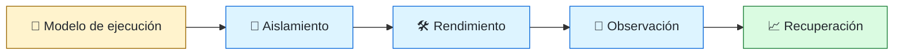
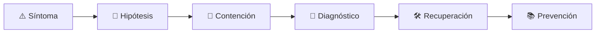

# 🧮 Runtime & Systems Engineer
<!-- role-visual:start -->

**La guía conecta trabajo real, decisiones, clases concretas y evidencia defendible.**

<!-- role-visual:end -->

> Diseña y opera los entornos de ejecución sobre los que corre el software moderno:
> módulos aislados, kernels instrumentables, aceleradores y límites de confianza, con
> rendimiento y aislamiento medidos.
>
> **Entrada habitual:** semi-senior · **Foco:** runtimes, aislamiento y aceleradores
> · **Evidencia central:** carga no confiable ejecutada con límites, capacidades mínimas y
> medición de arranque, densidad y costo

## 🧭 Qué es y por qué importa

El software ya no se ejecuta solo como un proceso nativo en una máquina propia. Corre en
módulos WebAssembly, en contenedores y microVM, junto a programas eBPF dentro del kernel,
sobre GPU y aceleradores, y a veces dentro de enclaves de hardware con atestación. Cada
entorno ofrece una promesa distinta de aislamiento, rendimiento y costo, y cada promesa tiene
un límite: una frontera de confianza que alguien debe diseñar, medir y vigilar.

Este rol decide qué entorno usa cada carga, qué capacidades recibe y cómo se detecta que el
aislamiento o el rendimiento prometidos dejaron de cumplirse.

## 🗓️ Un día en el puesto

- comparar el costo de arranque y la densidad de contenedores, microVM y módulos aislados;
- revisar qué capacidades concede una política de ejecución a una extensión de terceros;
- perfilar una carga en GPU y separar trabajo útil de espera de datos;
- instrumentar un servicio con eBPF sin degradar el host;
- evaluar si una carga sensible justifica hardware seguro con atestación;
- planificar la migración criptográfica ante la amenaza poscuántica.

## ✅ Responsabilidades y límites

- Responde por el modelo de ejecución, el aislamiento y su medición, no por la lógica de negocio que corre dentro.
- Distingue aislamiento de seguridad, de rendimiento y de fallo, que no son la misma garantía.
- No asume que un sandbox sea inviolable: declara su modelo de amenaza y sus límites.
- No sustituye al equipo de seguridad ni al de plataforma: define el contrato de ejecución que ambos usan.

## 🧠 Qué necesitas saber

Procesos, memoria virtual, llamadas al sistema y planificación, contenedores y espacios de
nombres, virtualización y microVM, WebAssembly y su modelo de capacidades, eBPF y su
verificador, modelo de ejecución de GPU, enclaves y atestación, criptografía poscuántica, y
medición con percentiles y perfiles.

## 📚 Tu ruta en el programa

1. [Parte 01 — Computadores y representación de información](../classes/part-01-computadores-y-representacion-de-informacion/README.md).
2. [Parte 33 — Cloud, plataforma e infraestructura](../classes/part-33-cloud-plataforma-e-infraestructura/README.md)
   para aislamiento, contenedores y orquestación.
3. Parte 36 para latencia, capacidad y resiliencia, y Parte 38 para criptografía y secretos.
4. Parte 32 para concurrencia y fallos parciales.
5. Parte 23: WebAssembly, eBPF, GPU, sandboxes, hardware seguro, cuántica y confianza cero.

<!-- role-depth:start -->
## 🗺️ Sistema profesional del rol

El gráfico no representa una cascada rígida. Muestra el bucle profesional que este rol
debe poder recorrer: comprender el contexto, tomar una decisión, intervenir, observar
el efecto y convertir lo aprendido en una mejora. En **🧮 Runtime & Systems Engineer**, saltar directamente a
la herramienta suele ocultar el problema, mientras que terminar sin evidencia deja la
decisión en una opinión. La misión concreta es: Diseña y opera los entornos de ejecución sobre los que corre el software moderno: módulos aislados, kernels instrumentables, aceleradores y límites de confianza, con rendimiento y aislamiento medidos. Cada transición
debe conservar supuestos, responsables y una forma de volver atrás.

<table>
<tr>
<td valign="top" width="50%">

### 🎯 Responde por

- decisiones propias de la familia **Runtimes y plataformas**;
- el resultado observable, no sólo la actividad ejecutada;
- límites, riesgos, operación y deuda residual de su intervención;
- evidencia que otra persona pueda revisar o reproducir.

</td>
<td valign="top" width="50%">

### 🤝 Coordina con

- [⚙️ Systems Programmer](systems-programmer.md); [🔐 Security Engineer](security-engineer.md); [⏱️ Performance Engineer](performance-engineer.md);
- producto y personas usuarias cuando cambia una tarea o outcome;
- seguridad, privacidad, accesibilidad y operación según el riesgo;
- quienes mantendrán el sistema después de la entrega.

</td>
</tr>
</table>

El título no concede autoridad automática. El alcance real depende del equipo, la
industria y la criticidad. Esta guía describe un recorrido desde **semi-senior → principal**, pero una
vacante se evalúa por las decisiones que permite tomar, los sistemas que pone bajo
responsabilidad y la evidencia exigida, no por el nombre del cargo.

## 🧱 Partes y clases asociadas

La ruta distingue **parte** —unidad curricular con una capacidad acumulativa— de
**clase asociada** —punto concreto donde se estudia un mecanismo o una decisión. Las
clases siguientes forman el núcleo; no eliminan los prerrequisitos indicados en sus
propias páginas ni convierten en opcional la base común.

| Orden | Parte del programa | Estado | Clases clave | Por qué entra en esta ruta | Evidencia de transferencia |
| ---: | --- | --- | --- | --- | --- |
| 1 | [Parte 01 · Computadores y representación de información](../classes/part-01-computadores-y-representacion-de-informacion/README.md) | desarrollada | [SE-017 · CPU, instrucciones, registros y ciclos de ejecución](../classes/part-01-computadores-y-representacion-de-informacion/se-017-cpu-instrucciones-registros-y-ciclos-de-ejecucion/README.md) [SE-018 · Memoria, cachés, almacenamiento y jerarquías](../classes/part-01-computadores-y-representacion-de-informacion/se-018-memoria-caches-almacenamiento-y-jerarquias/README.md) [SE-019 · Procesos, hilos, interrupciones y entrada/salida](../classes/part-01-computadores-y-representacion-de-informacion/se-019-procesos-hilos-interrupciones-y-entrada-salida/README.md) [SE-020 · Compilación, interpretación, bytecode y JIT](../classes/part-01-computadores-y-representacion-de-informacion/se-020-compilacion-interpretacion-bytecode-y-jit/README.md) [SE-021 · Runtimes, máquinas virtuales y recolección de basura](../classes/part-01-computadores-y-representacion-de-informacion/se-021-runtimes-maquinas-virtuales-y-recoleccion-de-basura/README.md) [SE-022 · Rendimiento, consumo energético y límites físicos](../classes/part-01-computadores-y-representacion-de-informacion/se-022-rendimiento-consumo-energetico-y-limites-fisicos/README.md) | Profundiza **máquina, memoria, representación y coste físico** desde la responsabilidad del rol. | Experimento reproducible de recursos. |
| 2 | [Parte 22 · Embedded, IoT y tiempo real](../classes/part-22-embedded-iot-y-tiempo-real/README.md) | desarrollada | [SE-267 · Restricciones de memoria, energía y cómputo](../classes/part-22-embedded-iot-y-tiempo-real/se-267-restricciones-de-memoria-energia-y-computo/README.md) [SE-268 · Sistemas de tiempo real y deadlines](../classes/part-22-embedded-iot-y-tiempo-real/se-268-sistemas-de-tiempo-real-y-deadlines/README.md) [SE-269 · Interrupciones, concurrencia y estado compartido](../classes/part-22-embedded-iot-y-tiempo-real/se-269-interrupciones-concurrencia-y-estado-compartido/README.md) [SE-271 · Actualizaciones OTA y recuperación](../classes/part-22-embedded-iot-y-tiempo-real/se-271-actualizaciones-ota-y-recuperacion/README.md) | Profundiza **firmware, tiempo real, OTA y dispositivo** desde la responsabilidad del rol. | Sistema simulado recuperable. |
| 3 | [Parte 23 · Runtimes y plataformas modernas](../classes/part-23-runtimes-y-plataformas-modernas/README.md) | desarrollada | [SE-277 · WebAssembly y WASI](../classes/part-23-runtimes-y-plataformas-modernas/se-277-webassembly-y-wasi/README.md) [SE-278 · WebAssembly en servidor y borde: component model](../classes/part-23-runtimes-y-plataformas-modernas/se-278-webassembly-en-servidor-y-borde-component-model/README.md) [SE-279 · eBPF: observabilidad, red y seguridad en el kernel](../classes/part-23-runtimes-y-plataformas-modernas/se-279-ebpf-observabilidad-red-y-seguridad-en-el-kernel/README.md) [SE-280 · GPU y aceleradores: modelo de ejecución](../classes/part-23-runtimes-y-plataformas-modernas/se-280-gpu-y-aceleradores-modelo-de-ejecucion/README.md) [SE-282 · Contenedores, microVM y sandboxes](../classes/part-23-runtimes-y-plataformas-modernas/se-282-contenedores-microvm-y-sandboxes/README.md) [SE-283 · Hardware seguro: TEE y atestación](../classes/part-23-runtimes-y-plataformas-modernas/se-283-hardware-seguro-tee-y-atestacion/README.md) | Profundiza **runtimes, aislamiento, aceleradores y confianza** desde la responsabilidad del rol. | Plataforma de ejecución aislada con evidencia. |
| 4 | [Parte 32 · Concurrencia y sistemas distribuidos](../classes/part-32-concurrencia-y-sistemas-distribuidos/README.md) | desarrollada | [SE-385 · Concurrencia, paralelismo y asincronía](../classes/part-32-concurrencia-y-sistemas-distribuidos/se-385-concurrencia-paralelismo-y-asincronia/README.md) [SE-386 · Memoria compartida, locks y condiciones de carrera](../classes/part-32-concurrencia-y-sistemas-distribuidos/se-386-memoria-compartida-locks-y-condiciones-de-carrera/README.md) [SE-387 · Actores, canales y structured concurrency](../classes/part-32-concurrencia-y-sistemas-distribuidos/se-387-actores-canales-y-structured-concurrency/README.md) [SE-389 · Fallos parciales y modelos de red](../classes/part-32-concurrencia-y-sistemas-distribuidos/se-389-fallos-parciales-y-modelos-de-red/README.md) | Profundiza **concurrencia, coordinación y fallos parciales** desde la responsabilidad del rol. | Experimento distribuido de degradación. |
| 5 | [Parte 33 · Cloud, plataforma e infraestructura](../classes/part-33-cloud-plataforma-e-infraestructura/README.md) | desarrollada | [SE-398 · Máquinas virtuales, contenedores y aislamiento](../classes/part-33-cloud-plataforma-e-infraestructura/se-398-maquinas-virtuales-contenedores-y-aislamiento/README.md) [SE-399 · Orquestación y scheduling](../classes/part-33-cloud-plataforma-e-infraestructura/se-399-orquestacion-y-scheduling/README.md) [SE-400 · Serverless y ejecución gestionada](../classes/part-33-cloud-plataforma-e-infraestructura/se-400-serverless-y-ejecucion-gestionada/README.md) [SE-404 · Escalado, capacidad y costos](../classes/part-33-cloud-plataforma-e-infraestructura/se-404-escalado-capacidad-y-costos/README.md) | Profundiza **cloud, infraestructura y plataformas** desde la responsabilidad del rol. | Entorno reproducible y eliminable. |
| 6 | [Parte 36 · Calidad, rendimiento y resiliencia](../classes/part-36-calidad-rendimiento-y-resiliencia/README.md) | desarrollada | [SE-435 · Carga, estrés, picos y endurance](../classes/part-36-calidad-rendimiento-y-resiliencia/se-435-carga-estres-picos-y-endurance/README.md) [SE-436 · Latencia, throughput, saturación y capacidad](../classes/part-36-calidad-rendimiento-y-resiliencia/se-436-latencia-throughput-saturacion-y-capacidad/README.md) [SE-437 · Perfiles, benchmarks y errores de medición](../classes/part-36-calidad-rendimiento-y-resiliencia/se-437-perfiles-benchmarks-y-errores-de-medicion/README.md) [SE-439 · Circuit breakers, bulkheads y degradación](../classes/part-36-calidad-rendimiento-y-resiliencia/se-439-circuit-breakers-bulkheads-y-degradacion/README.md) [SE-440 · Disponibilidad, durabilidad y recuperación](../classes/part-36-calidad-rendimiento-y-resiliencia/se-440-disponibilidad-durabilidad-y-recuperacion/README.md) | Profundiza **calidad, rendimiento y resiliencia** desde la responsabilidad del rol. | Informe medido y game day. |
| 7 | [Parte 37 · Sistemas críticos, tiempo real y normas de seguridad](../classes/part-37-sistemas-criticos-tiempo-real-y-normas-de-seguridad/README.md) | desarrollada | [SE-451 · RTOS y planificación de tiempo real](../classes/part-37-sistemas-criticos-tiempo-real-y-normas-de-seguridad/se-451-rtos-y-planificacion-de-tiempo-real/README.md) [SE-452 · Codificación segura: MISRA y CERT](../classes/part-37-sistemas-criticos-tiempo-real-y-normas-de-seguridad/se-452-codificacion-segura-misra-y-cert/README.md) [SE-453 · Verificación formal y model checking: TLA+, SPARK y Alloy](../classes/part-37-sistemas-criticos-tiempo-real-y-normas-de-seguridad/se-453-verificacion-formal-y-model-checking-tla-spark-y-alloy/README.md) [SE-454 · Verificación y cobertura: MC/DC, HIL y SIL](../classes/part-37-sistemas-criticos-tiempo-real-y-normas-de-seguridad/se-454-verificacion-y-cobertura-mc-dc-hil-y-sil/README.md) | Profundiza **sistemas críticos, tiempo real y normas de seguridad** desde la responsabilidad del rol. | Paquete de aseguramiento de un controlador. |
| 8 | [Parte 38 · Seguridad, privacidad y cumplimiento](../classes/part-38-seguridad-privacidad-y-cumplimiento/README.md) | desarrollada | [SE-457 · Principios de seguridad y modelos de amenaza](../classes/part-38-seguridad-privacidad-y-cumplimiento/se-457-principios-de-seguridad-y-modelos-de-amenaza/README.md) [SE-459 · Autorización, recursos y mínimo privilegio](../classes/part-38-seguridad-privacidad-y-cumplimiento/se-459-autorizacion-recursos-y-minimo-privilegio/README.md) [SE-461 · Criptografía aplicada y gestión de claves](../classes/part-38-seguridad-privacidad-y-cumplimiento/se-461-criptografia-aplicada-y-gestion-de-claves/README.md) [SE-462 · Secretos, configuración y separación de ambientes](../classes/part-38-seguridad-privacidad-y-cumplimiento/se-462-secretos-configuracion-y-separacion-de-ambientes/README.md) | Profundiza **seguridad, privacidad y cumplimiento** desde la responsabilidad del rol. | Controles con pruebas y evidencia. |
| 9 | [Parte 39 · Build, release y cadena de suministro](../classes/part-39-build-release-y-cadena-de-suministro/README.md) | desarrollada | [SE-469 · Build reproducible y hermético](../classes/part-39-build-release-y-cadena-de-suministro/se-469-build-reproducible-y-hermetico/README.md) [SE-470 · Artefactos, repositorios y promoción](../classes/part-39-build-release-y-cadena-de-suministro/se-470-artefactos-repositorios-y-promocion/README.md) [SE-472 · SBOM, procedencia y atestaciones](../classes/part-39-build-release-y-cadena-de-suministro/se-472-sbom-procedencia-y-atestaciones/README.md) [SE-473 · Firmas, checksums y verificación](../classes/part-39-build-release-y-cadena-de-suministro/se-473-firmas-checksums-y-verificacion/README.md) | Profundiza **build, release y cadena de suministro** desde la responsabilidad del rol. | Release firmado y verificable. |

### ✅ Clases ya desarrolladas que sostienen la ruta hoy

El núcleo anterior apunta a la capacidad profesional completa. Estas clases de apoyo,
de las Partes 00–33, 35–41 y 43–50 (`SE-001`–`SE-408`, `SE-421`–`SE-504` y `SE-517`–`SE-612`), también tienen contenido desarrollado y
permiten practicar el rol desde otros ángulos:

| Clase desarrollada | Parte |
| --- | --- |
| [SE-013 · Arquitectura básica de un computador moderno](../classes/part-01-computadores-y-representacion-de-informacion/se-013-arquitectura-basica-de-un-computador-moderno/README.md) | Parte 01 |
| [SE-099 · Profilers de CPU, memoria, I/O y red](../classes/part-08-entornos-herramientas-y-depuracion/se-099-profilers-de-cpu-memoria-i-o-y-red/README.md) | Parte 08 |
| [SE-401 · Redes, identidad y secretos en cloud](../classes/part-33-cloud-plataforma-e-infraestructura/se-401-redes-identidad-y-secretos-en-cloud/README.md) | Parte 33 |
| [SE-402 · Infraestructura como código y estado](../classes/part-33-cloud-plataforma-e-infraestructura/se-402-infraestructura-como-codigo-y-estado/README.md) | Parte 33 |
| [SE-281 · Rendimiento y costo en aceleradores](../classes/part-23-runtimes-y-plataformas-modernas/se-281-rendimiento-y-costo-en-aceleradores/README.md) | Parte 23 |
| [SE-285 · Criptografía poscuántica y migración](../classes/part-23-runtimes-y-plataformas-modernas/se-285-criptografia-poscuantica-y-migracion/README.md) | Parte 23 |
| [SE-286 · Confianza cero en la práctica](../classes/part-23-runtimes-y-plataformas-modernas/se-286-confianza-cero-en-la-practica/README.md) | Parte 23 |
| [SE-287 · Taller: elegir y aislar un runtime para una carga no confiable](../classes/part-23-runtimes-y-plataformas-modernas/se-287-taller-elegir-y-aislar-un-runtime-para-una-carga-no-confiable/README.md) | Parte 23 |
| [SE-288 · Proyecto: plataforma de ejecución aislada con evidencia](../classes/part-23-runtimes-y-plataformas-modernas/se-288-proyecto-plataforma-de-ejecucion-aislada-con-evidencia/README.md) | Parte 23 |

**Cómo recorrerla.** Empieza por [SE-017](../classes/part-01-computadores-y-representacion-de-informacion/se-017-cpu-instrucciones-registros-y-ciclos-de-ejecucion/README.md) para fijar el
primer mecanismo, usa [SE-398](../classes/part-33-cloud-plataforma-e-infraestructura/se-398-maquinas-virtuales-contenedores-y-aislamiento/README.md) para integrar el
centro de la especialidad y llega a [SE-473](../classes/part-39-build-release-y-cadena-de-suministro/se-473-firmas-checksums-y-verificacion/README.md) cuando ya
puedas explicar cómo detectar y recuperar un fallo. Una clase se considera estudiada
sólo cuando su concepto cambia una decisión y deja evidencia; abrir todos los enlaces
no constituye competencia.

> [!IMPORTANT]
> El mapa expresa el currículo vigente. Las Partes 00–33, 35–41 y 43–50 (`SE-001`–`SE-408`, `SE-421`–`SE-504` y `SE-517`–`SE-612`) están
> desarrolladas, a falta de una revisión editorial humana independiente. Esta ruta no
> declara aprobadas esas clases ni reemplaza el [roadmap](../ROADMAP.md).

## 🔭 Ampliación planificada: Partes 34 y 42 (sin clases publicadas)

> [!NOTE]
> Las Partes 34 y 42 (`SE-409`–`SE-420` y `SE-505`–`SE-516`) están **planificadas**; sus números están reservados desde el 23 de
> noviembre de 2026 ([ADR-007](../docs/adr/ADR-007-pedagogical-renumbering-and-new-parts.md)). Todavía no
> tienen clases ni README, por lo que no se enlazan aquí y ninguna de sus clases debe
> considerarse disponible.

| Parte planificada | Rango previsto | Qué cambiará para este rol |
| --- | --- | --- |
| — | — | Las partes que este rol esperaba ya están desarrolladas y figuran en el núcleo o en las clases de apoyo. |

Hasta que esas partes se publiquen, el rol se apoya en el núcleo y en las clases
desarrolladas de arriba. La planificación indica hacia dónde crecerá la ruta; no es
evidencia de que el contenido exista ni de que su alcance final coincida con esta
descripción.

## ⚖️ Decisiones y trade-offs que debes defender

| Decisión recurrente | Criterio profesional | Evidencia mínima antes de defenderla |
| --- | --- | --- |
| **Contenedor o microVM** | Elegir el límite de aislamiento según el modelo de amenaza de la carga y el costo de arranque. | Prueba de escape controlado y medición de arranque en frío y densidad. |
| **Código nativo o módulo aislado** | Usar un módulo WebAssembly cuando la carga no es confiable y el costo de la frontera es aceptable. | Benchmark del cruce de frontera y política de capacidades concedidas. |
| **CPU o acelerador** | Trasladar a GPU sólo cuando el trabajo es paralelo y el movimiento de datos no domina. | Perfil de utilización y costo por unidad de trabajo. |

La calidad de una decisión no se juzga porque coincida con una herramienta popular.
Debe hacer explícitos contexto, restricciones, alternativas descartadas, coste de
cambio y condición de revisión. En especial, **Contenedor o microVM**, **Código nativo o módulo aislado**
y **CPU o acelerador** cambian de respuesta cuando cambia el riesgo. Una solución
correcta en un prototipo puede ser irresponsable en un sistema regulado; una solución
robusta para un servicio crítico puede ser desperdicio en una herramienta interna.

## 🚨 Escenario profesional: Complemento no confiable que degrada el host

**Síntoma.** Una extensión de terceros agota memoria y descriptores y afecta a otros inquilinos. La respuesta madura evita convertir la primera
correlación en causa y conserva evidencia antes de modificar el sistema.

1. **Detectar y delimitar:** identifica quién o qué está afectado, desde cuándo y qué
   cambió. Conserva timestamps, versiones, entradas y señales suficientes para no
   destruir la escena al intentar arreglarla.
2. **Investigar:** Reproducir con límites de recursos perfilar llamadas al sistema y revisar qué capacidades tenía la extensión. Formula al menos dos hipótesis rivales
   y define qué observación refutaría cada una.
3. **Contener:** reduce blast radius y daño sin prometer una corrección todavía. La
   contención debe ser reversible, visible y compatible con las obligaciones del
   sistema.
4. **Recuperar:** Aislar la extensión en un sandbox con cuotas y capacidades mínimas y añadir una prueba de agotamiento. Verifica la tarea completa, no sólo que un
   proceso volvió a estar verde.
5. **Aprender:** añade una regresión, señal o control que detecte la misma clase de
   fallo. Documenta qué deuda permanece y quién revisará la acción.

El escenario evalúa método además de resultado. Una recuperación rápida que borra la
causa, oculta pérdida de datos o deja al equipo sin mecanismo preventivo no demuestra
dominio del rol.

## 📊 Señales útiles y límites de las métricas

| Señal | Qué ayuda a observar | Trampa que debe evitarse |
| --- | --- | --- |
| **Tiempo de arranque en frío** | Latencia desde la petición hasta la primera instrucción útil del runtime. | Medir sólo con la caché caliente. |
| **Densidad por host** | Cargas aisladas por unidad de memoria con el aislamiento exigido. | Ganar densidad relajando el aislamiento sin declararlo. |
| **Utilización del acelerador** | Fracción del tiempo con trabajo útil frente a esperas de datos. | Celebrar alta utilización con trabajo redundante. |

Ninguna señal debe convertirse en ranking individual. Combina tendencia cuantitativa,
muestreo de casos, feedback cualitativo y contexto de carga. Declara ventana,
denominador, fuente, exclusiones y quién puede actuar sobre el resultado. Si una
métrica mejora mientras el outcome o el riesgo empeoran, el sistema está optimizando
el indicador y no el trabajo.

## 🧩 Proyecto integrador del rol: Plataforma de ejecución aislada

**Propósito:** ejecutar una carga no confiable con aislamiento cuotas y observabilidad medidas. El resultado esperado es **comparación de tres runtimes con modelo de amenaza benchmark de arranque y densidad política de capacidades y runbook de contención**.

Entrega un expediente revisable con estas piezas:

1. **Contexto y alcance:** usuario, sistema, restricción, supuestos, fuera de alcance y
   criterio de no éxito.
2. **Decisión:** al menos dos alternativas reales, trade-offs, coste de reversión y un
   ADR o memo que indique cuándo revisar la elección.
3. **Artefacto principal:** una implementación, modelo, flujo o política coherente con
   las clases núcleo; no una captura aislada ni una presentación sin mecanismo.
4. **Fallo controlado:** introduce una condición adversa relacionada con el escenario
   anterior y conserva el resultado observado, sin inventar una ejecución.
5. **Verificación:** prueba, rúbrica, revisión o medición que pueda fallar y que conecte
   directamente con el resultado profesional.
6. **Operación y salida:** telemetría, recuperación, mantenimiento, deprecación o retiro
   según corresponda; incluye límites y deuda residual.

**Criterio de aceptación:** otra persona puede reconstruir el razonamiento, reproducir
la comprobación y distinguir claramente qué quedó demostrado de lo que sólo se propone.
El proyecto no se aprueba por cantidad de archivos ni por utilizar una marca concreta.

## 📈 Dominio esperado por alcance

| Alcance | Qué resuelve | Qué evidencia su autonomía |
| --- | --- | --- |
| **Inicial** | ejecuta una tarea acotada con criterios y acompañamiento | reproduce el caso, pregunta por supuestos y entrega evidencia legible |
| **Intermedio** | decide dentro de un componente o flujo conocido | compara alternativas, prueba fallos previsibles y coordina dependencias |
| **Senior** | conduce problemas ambiguos que cruzan sistemas o equipos | hace explícito el riesgo, diseña recuperación y mejora el mecanismo de trabajo |
| **Staff / Lead** | cambia capacidades compartidas y decisiones de largo plazo | multiplica criterio, define guardrails, mide adopción y conserva opciones futuras |

Progresar no significa alejarse de la práctica. Significa aumentar ambigüedad, horizonte,
blast radius y responsabilidad por consecuencias. La persona senior todavía debe poder
explicar el mecanismo; la persona Staff además crea condiciones para que otros lo
operen sin depender de ella.

## 🗓️ Plan de práctica 30 · 60 · 90 días

- **Días 1–30 — comprender y reproducir.** Estudia las primeras clases de cada parte,
  reproduce un caso pequeño y escribe un mapa de responsabilidades. El entregable es
  una baseline con preguntas abiertas, no una transformación prematura.
- **Días 31–60 — intervenir y fallar con control.** Construye el artefacto central,
  introduce el escenario de fallo y mide el comportamiento. Revisa el trabajo con una
  persona de una ruta vecina para descubrir supuestos de frontera.
- **Días 61–90 — operar y transferir.** Ejecuta recuperación, corrige la causa, publica
  runbook o guía de uso y presenta la decisión con trade-offs. Termina con una
  retrospectiva que separe resultado, evidencia, límites y siguiente inversión.

Este plan es una secuencia de práctica, no una promesa de empleabilidad en noventa días.
La experiencia previa, el dominio y el acceso a sistemas reales cambian el tiempo
necesario.

## 🎤 Preguntas para revisión o entrevista

1. ¿En qué contexto elegirías **Contenedor o microVM** y qué evidencia te haría cambiar?
2. ¿Cómo distinguirías síntoma, causa y daño en el escenario **Complemento no confiable que degrada el host**?
3. ¿Qué clase asociada usarías para diseñar el mecanismo y cuál para verificarlo?
4. ¿Qué parte de **Plataforma de ejecución aislada** no automatizarías todavía y por qué?
5. ¿Qué métrica podría mejorar mientras el sistema empeora y qué guardrail añadirías?
6. ¿Dónde termina la autoridad de este rol y cuándo debe escalar o pedir revisión?

Una respuesta fuerte usa un caso, reconoce incertidumbre y propone una comprobación.
Nombrar una herramienta sin explicar mecanismo, fallo y límite no demuestra la
competencia.

## 🔗 Fuentes primarias y oficiales

- [The Open Group Base Specifications, Issue 8](https://pubs.opengroup.org/onlinepubs/9799919799/) — **The Open Group / IEEE**. Se usa como referencia primaria u oficial; la guía no sustituye la fuente.
- [WebAssembly Core Specification](https://webassembly.github.io/spec/core/) — **W3C WebAssembly Working Group**. Se usa como referencia primaria u oficial; la guía no sustituye la fuente.
- [What is eBPF?](https://ebpf.io/what-is-ebpf/) — **eBPF Foundation**. Se usa como referencia primaria u oficial; la guía no sustituye la fuente.
- [Firecracker microVM](https://firecracker-microvm.github.io/) — **Firecracker project**. Se usa como referencia primaria u oficial; la guía no sustituye la fuente.
- [Confidential Computing Consortium](https://confidentialcomputing.io/) — **Linux Foundation**. Se usa como referencia primaria u oficial; la guía no sustituye la fuente.
- [Site Reliability Engineering](https://sre.google/books/) — **Google**. Se usa como referencia primaria u oficial; la guía no sustituye la fuente.

Las fuentes orientan principios, vocabulario y prácticas; no convierten la guía en una
certificación ni sustituyen la documentación específica del sistema, la jurisdicción
o la tecnología utilizada.
<!-- role-depth:end -->

## 🧪 Evidencia de portafolio

- comparación de tres runtimes con modelo de amenaza y benchmark de arranque y densidad;
- política de capacidades mínimas para una carga no confiable, con una prueba de agotamiento;
- perfil de una carga en acelerador con costo por unidad de trabajo;
- runbook de contención ante un escape o un agotamiento de recursos.

## 📈 Progresión

Systems, Backend o Platform Engineer → Runtime Engineer → Staff Runtime o Principal Systems Engineer.

## ⚠️ Mitos frecuentes

- “Un contenedor es un sandbox.” Comparte kernel: su aislamiento es más débil que el de una microVM.
- “WebAssembly es siempre más rápido.” Reduce confianza necesaria, no garantiza velocidad.
- “La GPU acelera todo.” Si el movimiento de datos domina, la CPU puede ganar.

## 🚀 Siguientes pasos

1. Mide el arranque en frío de una misma carga en tres entornos de ejecución.
2. Escribe el modelo de amenaza de una extensión de terceros y las capacidades que necesita.
3. Provoca un agotamiento de memoria y comprueba que el aislamiento contiene el efecto.

---

[⬅️ Volver a las rutas](README.md) · [🏠 Inicio del programa](../README.md)
