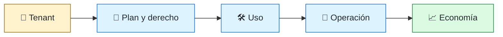
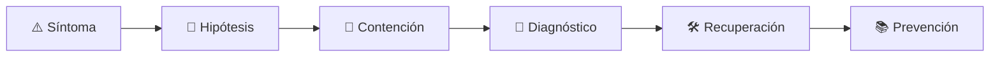

# 🏢 SaaS / Product Platform Engineer
<!-- role-visual:start -->

**La guía conecta trabajo real, decisiones, clases concretas y evidencia defendible.**

<!-- role-visual:end -->

> Convierte un servicio en un producto que muchos clientes comparten sin molestarse
> entre sí: tenencia aislada, planes con derechos medibles, uso facturable, operación
> confiable y un costo de servir que deja margen.
>
> **Entrada habitual:** semi-senior · **Foco:** tenencia, planes, medición de uso y
> economía unitaria · **Evidencia central:** un núcleo multi-tenant con aislamiento
> demostrado, uso reconciliado con la facturación y margen por plan calculado

## 🧭 Qué es y por qué importa

En un SaaS, el mismo código y la misma infraestructura atienden a decenas, miles o millones
de clientes con contratos, volúmenes y expectativas distintas. Eso crea problemas que un
backend corriente no tiene: un cliente puede degradar a los demás, un cambio de esquema
afecta a todos a la vez, un error de medición se convierte en una factura equivocada y un
plan mal diseñado hace perder dinero con cada uso adicional.

Este rol se ocupa de la plataforma de producto: cómo se crea, aísla, mide, limita, cobra,
opera y retira un tenant. No es solo backend ni solo plataforma interna: sus clientes son
personas que pagan y sus decisiones tocan al mismo tiempo la arquitectura, los datos, la
seguridad, la confiabilidad y la economía del negocio.

## 🗓️ Un día en el puesto

- revisar qué tenants consumen más recursos que su plan y si el límite aplicado fue el correcto;
- diseñar el aprovisionamiento y la baja de un tenant sin pasos manuales ni datos huérfanos;
- conciliar los eventos de uso medidos con lo que facturó el proveedor de pagos;
- planificar una migración de esquema por cohortes con compatibilidad entre versiones;
- discutir con producto un cambio de plan y estimar su efecto sobre el costo de servir;
- participar en un incidente donde un cliente concentra la carga y pedir evidencia por tenant.

## ✅ Responsabilidades y límites

- Responde por el modelo de tenencia, el ciclo de vida del tenant y la medición del uso que sustenta la facturación.
- Hace que cada límite, cuota y derecho de un plan sea observable, probado y comunicable al cliente.
- Conecta costo de servir con precio: ningún plan se aprueba sin una estimación de margen.
- No decide la estrategia comercial ni los precios: aporta el costo real y los límites técnicos que esas decisiones deben respetar.
- No sustituye a seguridad, a SRE ni a datos: define los contratos de tenencia que esas disciplinas verifican.

## 🧠 Qué necesitas saber

Modelos de tenencia (silo, pool y puente), identidad de organización y autorización por
recurso, límites y cuotas por plan, colas y trabajos diferidos, idempotencia y
reintentos en cobros y webhooks, migraciones compatibles y replicación de datos,
observabilidad con dimensión de tenant y cardinalidad controlada, SLO por segmento de
cliente, privacidad y retención por contrato, y economía unitaria: costo de servir, margen
por plan y retención.

## 📚 Tu ruta en el programa

1. [Parte 11 — Economía, métricas y decisiones de producto](../classes/part-11-economia-metricas-y-decisiones-de-producto/README.md) para modelos de negocio, costos, retención y decisiones reversibles.
2. [Parte 20 — Backend, APIs y procesamiento asíncrono](../classes/part-20-backend-apis-y-procesamiento-asincrono/README.md) para identidad, contratos, idempotencia, jobs y protección de servicios.
3. [Parte 29 — Datos, persistencia y recuperación](../classes/part-29-datos-persistencia-y-recuperacion/README.md) para migraciones compatibles, replicación, recuperación y ciclo de vida del dato.
4. [Parte 31 — Integración, eventos y mensajería](../classes/part-31-integracion-eventos-y-mensajeria/README.md) para webhooks, semánticas de entrega, sagas y compatibilidad de esquemas.
5. [Parte 33 — Cloud, plataforma e infraestructura](../classes/part-33-cloud-plataforma-e-infraestructura/README.md) para responsabilidad compartida, aislamiento, escalado, costo y plataformas internas.
6. [Parte 28 — Estilos arquitectónicos](../classes/part-28-estilos-arquitectonicos/README.md) para multi-tenancy y arquitectura celular como radio de impacto.
7. [Parte 36 — Calidad, rendimiento y resiliencia](../classes/part-36-calidad-rendimiento-y-resiliencia/README.md) para latencia de cola, timeouts, degradación y recuperación bajo carga.
8. [Parte 38 — Seguridad, privacidad y cumplimiento](../classes/part-38-seguridad-privacidad-y-cumplimiento/README.md) para autorización, secretos, privacidad y evidencia de cumplimiento.
9. [Parte 41 — Observabilidad, SRE e incidentes](../classes/part-41-observabilidad-sre-e-incidentes/README.md) para SLI y SLO, alertas y gestión de incidentes con dimensión de cliente.
10. Parte 34 (SaaS y plataformas de producto): el estado de sus clases se declara en la sección de ampliación de más abajo.

<!-- role-depth:start -->
## 🗺️ Sistema profesional del rol

El gráfico no representa una cascada rígida. Muestra el bucle profesional que este rol
debe poder recorrer: comprender el contexto, tomar una decisión, intervenir, observar
el efecto y convertir lo aprendido en una mejora. En **🏢 SaaS / Product Platform Engineer**, saltar directamente a
la herramienta suele ocultar el problema, mientras que terminar sin evidencia deja la
decisión en una opinión. La misión concreta es: Convierte un servicio en un producto que muchos clientes comparten sin molestarse entre sí: tenencia aislada, planes con derechos medibles, uso facturable, operación confiable y un costo de servir que deja margen. Cada transición
debe conservar supuestos, responsables y una forma de volver atrás.

<table>
<tr>
<td valign="top" width="50%">

### 🎯 Responde por

- decisiones propias de la familia **Producto digital**;
- el resultado observable, no sólo la actividad ejecutada;
- límites, riesgos, operación y deuda residual de su intervención;
- evidencia que otra persona pueda revisar o reproducir.

</td>
<td valign="top" width="50%">

### 🤝 Coordina con

- [⚙️ Backend Engineer](backend-engineer.md); [🛤️ Platform Engineer](platform-engineer.md); [💸 FinOps Engineer](finops-engineer.md);
- producto y personas usuarias cuando cambia una tarea o outcome;
- seguridad, privacidad, accesibilidad y operación según el riesgo;
- quienes mantendrán el sistema después de la entrega.

</td>
</tr>
</table>

El título no concede autoridad automática. El alcance real depende del equipo, la
industria y la criticidad. Esta guía describe un recorrido desde **semi-senior → principal**, pero una
vacante se evalúa por las decisiones que permite tomar, los sistemas que pone bajo
responsabilidad y la evidencia exigida, no por el nombre del cargo.

## 🧱 Partes y clases asociadas

La ruta distingue **parte** —unidad curricular con una capacidad acumulativa— de
**clase asociada** —punto concreto donde se estudia un mecanismo o una decisión. Las
clases siguientes forman el núcleo; no eliminan los prerrequisitos indicados en sus
propias páginas ni convierten en opcional la base común.

| Orden | Parte del programa | Estado | Clases clave | Por qué entra en esta ruta | Evidencia de transferencia |
| ---: | --- | --- | --- | --- | --- |
| 1 | [Parte 11 · Economía, métricas y decisiones de producto](../classes/part-11-economia-metricas-y-decisiones-de-producto/README.md) | desarrollada | [SE-133 · Modelos de negocio y sostenibilidad](../classes/part-11-economia-metricas-y-decisiones-de-producto/se-133-modelos-de-negocio-y-sostenibilidad/README.md) [SE-134 · Costos de construcción, operación y oportunidad](../classes/part-11-economia-metricas-y-decisiones-de-producto/se-134-costos-de-construccion-operacion-y-oportunidad/README.md) [SE-136 · Métricas de adopción, retención y tarea útil](../classes/part-11-economia-metricas-y-decisiones-de-producto/se-136-metricas-de-adopcion-retencion-y-tarea-util/README.md) [SE-140 · FinOps de producto y costo por resultado](../classes/part-11-economia-metricas-y-decisiones-de-producto/se-140-finops-de-producto-y-costo-por-resultado/README.md) [SE-142 · Decisiones reversibles e irreversibles](../classes/part-11-economia-metricas-y-decisiones-de-producto/se-142-decisiones-reversibles-e-irreversibles/README.md) | Profundiza **economía, métricas y experimentación** desde la responsabilidad del rol. | Caso económico con sensibilidad. |
| 2 | [Parte 20 · Backend, APIs y procesamiento asíncrono](../classes/part-20-backend-apis-y-procesamiento-asincrono/README.md) | desarrollada | [SE-241 · Responsabilidades y fronteras del backend](../classes/part-20-backend-apis-y-procesamiento-asincrono/se-241-responsabilidades-y-fronteras-del-backend/README.md) [SE-244 · Validación, errores y contratos consistentes](../classes/part-20-backend-apis-y-procesamiento-asincrono/se-244-validacion-errores-y-contratos-consistentes/README.md) [SE-245 · Autenticación, autorización y contexto](../classes/part-20-backend-apis-y-procesamiento-asincrono/se-245-autenticacion-autorizacion-y-contexto/README.md) [SE-246 · Idempotencia, reintentos y deduplicación](../classes/part-20-backend-apis-y-procesamiento-asincrono/se-246-idempotencia-reintentos-y-deduplicacion/README.md) [SE-247 · Jobs, colas y procesamiento diferido](../classes/part-20-backend-apis-y-procesamiento-asincrono/se-247-jobs-colas-y-procesamiento-diferido/README.md) [SE-249 · Caching, rate limiting y protección](../classes/part-20-backend-apis-y-procesamiento-asincrono/se-249-caching-rate-limiting-y-proteccion/README.md) | Profundiza **servicios, APIs y procesamiento asíncrono** desde la responsabilidad del rol. | Servicio contractual operable. |
| 3 | [Parte 28 · Estilos arquitectónicos](../classes/part-28-estilos-arquitectonicos/README.md) | desarrollada | [SE-342 · Multi-tenancy y aislamiento](../classes/part-28-estilos-arquitectonicos/se-342-multi-tenancy-y-aislamiento/README.md) [SE-344 · Arquitectura celular y radio de impacto](../classes/part-28-estilos-arquitectonicos/se-344-arquitectura-celular-y-radio-de-impacto/README.md) | Profundiza **estilos arquitectónicos y sus fuerzas de calidad** desde la responsabilidad del rol. | Decisión arquitectónica defendida con ADR. |
| 4 | [Parte 29 · Datos, persistencia y recuperación](../classes/part-29-datos-persistencia-y-recuperacion/README.md) | desarrollada | [SE-351 · Transacciones, aislamiento y concurrencia](../classes/part-29-datos-persistencia-y-recuperacion/se-351-transacciones-aislamiento-y-concurrencia/README.md) [SE-354 · Migraciones compatibles y evolución de esquema](../classes/part-29-datos-persistencia-y-recuperacion/se-354-migraciones-compatibles-y-evolucion-de-esquema/README.md) [SE-355 · Replicación, partición y distribución](../classes/part-29-datos-persistencia-y-recuperacion/se-355-replicacion-particion-y-distribucion/README.md) [SE-357 · Backups, restauración y pruebas de recuperación](../classes/part-29-datos-persistencia-y-recuperacion/se-357-backups-restauracion-y-pruebas-de-recuperacion/README.md) [SE-358 · Privacidad, retención y ciclo de vida del dato](../classes/part-29-datos-persistencia-y-recuperacion/se-358-privacidad-retencion-y-ciclo-de-vida-del-dato/README.md) | Profundiza **persistencia, transacciones y recuperación** desde la responsabilidad del rol. | Capa de datos restaurable. |
| 5 | [Parte 31 · Integración, eventos y mensajería](../classes/part-31-integracion-eventos-y-mensajeria/README.md) | desarrollada | [SE-376 · Entrega, orden, duplicación y semánticas](../classes/part-31-integracion-eventos-y-mensajeria/se-376-entrega-orden-duplicacion-y-semanticas/README.md) [SE-377 · Outbox, inbox, sagas y compensación](../classes/part-31-integracion-eventos-y-mensajeria/se-377-outbox-inbox-sagas-y-compensacion/README.md) [SE-379 · Webhooks, polling y suscripciones](../classes/part-31-integracion-eventos-y-mensajeria/se-379-webhooks-polling-y-suscripciones/README.md) [SE-380 · Compatibilidad de esquemas y registros](../classes/part-31-integracion-eventos-y-mensajeria/se-380-compatibilidad-de-esquemas-y-registros/README.md) | Profundiza **eventos, mensajería y compatibilidad** desde la responsabilidad del rol. | Flujo tolerante a duplicados. |
| 6 | [Parte 33 · Cloud, plataforma e infraestructura](../classes/part-33-cloud-plataforma-e-infraestructura/README.md) | desarrollada | [SE-397 · IaaS, PaaS, SaaS y responsabilidad compartida](../classes/part-33-cloud-plataforma-e-infraestructura/se-397-iaas-paas-saas-y-responsabilidad-compartida/README.md) [SE-401 · Redes, identidad y secretos en cloud](../classes/part-33-cloud-plataforma-e-infraestructura/se-401-redes-identidad-y-secretos-en-cloud/README.md) [SE-404 · Escalado, capacidad y costos](../classes/part-33-cloud-plataforma-e-infraestructura/se-404-escalado-capacidad-y-costos/README.md) [SE-406 · Plataformas internas y golden paths](../classes/part-33-cloud-plataforma-e-infraestructura/se-406-plataformas-internas-y-golden-paths/README.md) | Profundiza **cloud, infraestructura y plataformas** desde la responsabilidad del rol. | Entorno reproducible y eliminable. |
| 7 | [Parte 36 · Calidad, rendimiento y resiliencia](../classes/part-36-calidad-rendimiento-y-resiliencia/README.md) | desarrollada | [SE-436 · Latencia, throughput, saturación y capacidad](../classes/part-36-calidad-rendimiento-y-resiliencia/se-436-latencia-throughput-saturacion-y-capacidad/README.md) [SE-438 · Timeouts, retries, backoff y jitter](../classes/part-36-calidad-rendimiento-y-resiliencia/se-438-timeouts-retries-backoff-y-jitter/README.md) [SE-439 · Circuit breakers, bulkheads y degradación](../classes/part-36-calidad-rendimiento-y-resiliencia/se-439-circuit-breakers-bulkheads-y-degradacion/README.md) [SE-440 · Disponibilidad, durabilidad y recuperación](../classes/part-36-calidad-rendimiento-y-resiliencia/se-440-disponibilidad-durabilidad-y-recuperacion/README.md) | Profundiza **calidad, rendimiento y resiliencia** desde la responsabilidad del rol. | Informe medido y game day. |
| 8 | [Parte 38 · Seguridad, privacidad y cumplimiento](../classes/part-38-seguridad-privacidad-y-cumplimiento/README.md) | desarrollada | [SE-459 · Autorización, recursos y mínimo privilegio](../classes/part-38-seguridad-privacidad-y-cumplimiento/se-459-autorizacion-recursos-y-minimo-privilegio/README.md) [SE-462 · Secretos, configuración y separación de ambientes](../classes/part-38-seguridad-privacidad-y-cumplimiento/se-462-secretos-configuracion-y-separacion-de-ambientes/README.md) [SE-463 · Privacidad por diseño y minimización](../classes/part-38-seguridad-privacidad-y-cumplimiento/se-463-privacidad-por-diseno-y-minimizacion/README.md) [SE-466 · Cumplimiento, evidencia y límites legales](../classes/part-38-seguridad-privacidad-y-cumplimiento/se-466-cumplimiento-evidencia-y-limites-legales/README.md) | Profundiza **seguridad, privacidad y cumplimiento** desde la responsabilidad del rol. | Controles con pruebas y evidencia. |
| 9 | [Parte 41 · Observabilidad, SRE e incidentes](../classes/part-41-observabilidad-sre-e-incidentes/README.md) | desarrollada | [SE-495 · Métricas, dimensiones y cardinalidad](../classes/part-41-observabilidad-sre-e-incidentes/se-495-metricas-dimensiones-y-cardinalidad/README.md) [SE-497 · SLI, SLO, SLA y presupuestos de error](../classes/part-41-observabilidad-sre-e-incidentes/se-497-sli-slo-sla-y-presupuestos-de-error/README.md) [SE-498 · Alertas accionables y fatiga](../classes/part-41-observabilidad-sre-e-incidentes/se-498-alertas-accionables-y-fatiga/README.md) [SE-500 · Gestión de incidentes y comunicación](../classes/part-41-observabilidad-sre-e-incidentes/se-500-gestion-de-incidentes-y-comunicacion/README.md) | Profundiza **observabilidad, SRE e incidentes** desde la responsabilidad del rol. | Incidente diagnosticado y recuperado. |

### ✅ Clases ya desarrolladas que sostienen la ruta hoy

El núcleo anterior apunta a la capacidad profesional completa. Estas clases de apoyo,
de las Partes 00–41 y 43–50 (`SE-001`–`SE-504` y `SE-517`–`SE-612`), también tienen contenido desarrollado y
permiten practicar el rol desde otros ángulos:

| Clase desarrollada | Parte |
| --- | --- |
| [SE-138 · Experimentos, sesgos y causalidad básica](../classes/part-11-economia-metricas-y-decisiones-de-producto/se-138-experimentos-sesgos-y-causalidad-basica/README.md) | Parte 11 |
| [SE-143 · Taller: diseñar un árbol de métricas](../classes/part-11-economia-metricas-y-decisiones-de-producto/se-143-taller-disenar-un-arbol-de-metricas/README.md) | Parte 11 |
| [SE-144 · Proyecto: caso de viabilidad técnico-económica](../classes/part-11-economia-metricas-y-decisiones-de-producto/se-144-proyecto-caso-de-viabilidad-tecnico-economica/README.md) | Parte 11 |
| [SE-252 · Proyecto: servicio contractual operable](../classes/part-20-backend-apis-y-procesamiento-asincrono/se-252-proyecto-servicio-contractual-operable/README.md) | Parte 20 |
| [SE-360 · Proyecto: capa de datos recuperable](../classes/part-29-datos-persistencia-y-recuperacion/se-360-proyecto-capa-de-datos-recuperable/README.md) | Parte 29 |
| [SE-384 · Proyecto: flujo integrado tolerante a reintentos](../classes/part-31-integracion-eventos-y-mensajeria/se-384-proyecto-flujo-integrado-tolerante-a-reintentos/README.md) | Parte 31 |
| [SE-408 · Proyecto: plataforma mínima reproducible](../classes/part-33-cloud-plataforma-e-infraestructura/se-408-proyecto-plataforma-minima-reproducible/README.md) | Parte 33 |
| [SE-468 · Proyecto: producto con seguridad verificable](../classes/part-38-seguridad-privacidad-y-cumplimiento/se-468-proyecto-producto-con-seguridad-verificable/README.md) | Parte 38 |
| [SE-504 · Proyecto: operación observable y recuperable](../classes/part-41-observabilidad-sre-e-incidentes/se-504-proyecto-operacion-observable-y-recuperable/README.md) | Parte 41 |
| [SE-409 · Qué hace distinto a un producto SaaS](../classes/part-34-saas-y-plataformas-de-producto/se-409-que-hace-distinto-a-un-producto-saas/README.md) | Parte 34 |
| [SE-414 · Planes, derechos de uso y banderas de funcionalidad](../classes/part-34-saas-y-plataformas-de-producto/se-414-planes-derechos-de-uso-y-banderas-de-funcionalidad/README.md) | Parte 34 |
| [SE-420 · Taller y proyecto integrador: producto SaaS mínimo con evidencia](../classes/part-34-saas-y-plataformas-de-producto/se-420-taller-y-proyecto-integrador-producto-saas-minimo-con-evidencia/README.md) | Parte 34 |

**Cómo recorrerla.** Empieza por [SE-133](../classes/part-11-economia-metricas-y-decisiones-de-producto/se-133-modelos-de-negocio-y-sostenibilidad/README.md) para fijar el
primer mecanismo, usa [SE-377](../classes/part-31-integracion-eventos-y-mensajeria/se-377-outbox-inbox-sagas-y-compensacion/README.md) para integrar el
centro de la especialidad y llega a [SE-500](../classes/part-41-observabilidad-sre-e-incidentes/se-500-gestion-de-incidentes-y-comunicacion/README.md) cuando ya
puedas explicar cómo detectar y recuperar un fallo. Una clase se considera estudiada
sólo cuando su concepto cambia una decisión y deja evidencia; abrir todos los enlaces
no constituye competencia.

> [!IMPORTANT]
> El mapa expresa el currículo vigente. Las Partes 00–41 y 43–50 (`SE-001`–`SE-504` y `SE-517`–`SE-612`) están
> desarrolladas, a falta de una revisión editorial humana independiente. Esta ruta no
> declara aprobadas esas clases ni reemplaza el [roadmap](../ROADMAP.md).

## 🔭 Ampliación planificada: Parte 42 (sin clases publicadas)

> [!NOTE]
> La Parte 42 (`SE-505`–`SE-516`) está **planificada**; sus números están reservados desde el 23 de
> noviembre de 2026 ([ADR-007](../docs/adr/ADR-007-pedagogical-renumbering-and-new-parts.md)). Todavía no
> tienen clases ni README, por lo que no se enlazan aquí y ninguna de sus clases debe
> considerarse disponible.

| Parte planificada | Rango previsto | Qué cambiará para este rol |
| --- | --- | --- |
| — | — | Las partes que este rol esperaba ya están desarrolladas y figuran en el núcleo o en las clases de apoyo. |

Hasta que esas partes se publiquen, el rol se apoya en el núcleo y en las clases
desarrolladas de arriba. La planificación indica hacia dónde crecerá la ruta; no es
evidencia de que el contenido exista ni de que su alcance final coincida con esta
descripción.

## ⚖️ Decisiones y trade-offs que debes defender

| Decisión recurrente | Criterio profesional | Evidencia mínima antes de defenderla |
| --- | --- | --- |
| **Aislamiento o densidad** | Elegir silo pool o modelo híbrido según riesgo de vecino ruidoso cumplimiento y costo de servir. | Prueba de aislamiento entre tenants y costo por tenant medido. |
| **Facturar por uso o por plan** | Decidir qué evento medible se cobra y con qué tolerancia a duplicados y retrasos. | Conciliación entre medición facturación y datos de producto. |
| **Migración global o por oleadas** | Cambiar esquema o plan sin detener a todos los clientes a la vez. | Despliegue por cohortes con compatibilidad entre versiones y reversión. |

La calidad de una decisión no se juzga porque coincida con una herramienta popular.
Debe hacer explícitos contexto, restricciones, alternativas descartadas, coste de
cambio y condición de revisión. En especial, **Aislamiento o densidad**, **Facturar por uso o por plan**
y **Migración global o por oleadas** cambian de respuesta cuando cambia el riesgo. Una solución
correcta en un prototipo puede ser irresponsable en un sistema regulado; una solución
robusta para un servicio crítico puede ser desperdicio en una herramienta interna.

## 🚨 Escenario profesional: Tenant ruidoso degrada a los demás

**Síntoma.** Un cliente grande lanza una importación masiva y el resto sufre latencia y errores. La respuesta madura evita convertir la primera
correlación en causa y conserva evidencia antes de modificar el sistema.

1. **Detectar y delimitar:** identifica quién o qué está afectado, desde cuándo y qué
   cambió. Conserva timestamps, versiones, entradas y señales suficientes para no
   destruir la escena al intentar arreglarla.
2. **Investigar:** Aislar por tenant y correlacionar cuota cola y consumo de la base compartida. Formula al menos dos hipótesis rivales
   y define qué observación refutaría cada una.
3. **Contener:** reduce blast radius y daño sin prometer una corrección todavía. La
   contención debe ser reversible, visible y compatible con las obligaciones del
   sistema.
4. **Recuperar:** Aplicar límite por plan mover la carga a una cola dedicada y comunicar con evidencia. Verifica la tarea completa, no sólo que un
   proceso volvió a estar verde.
5. **Aprender:** añade una regresión, señal o control que detecte la misma clase de
   fallo. Documenta qué deuda permanece y quién revisará la acción.

El escenario evalúa método además de resultado. Una recuperación rápida que borra la
causa, oculta pérdida de datos o deja al equipo sin mecanismo preventivo no demuestra
dominio del rol.

## 📊 Señales útiles y límites de las métricas

| Señal | Qué ayuda a observar | Trampa que debe evitarse |
| --- | --- | --- |
| **Costo de servir por tenant** | Recursos y operación atribuibles a un cliente. | Prorratear a ojo y esconder tenants deficitarios. |
| **Margen por plan** | Diferencia entre precio efectivo y costo de servir. | Celebrar ingresos sin descontar soporte y excepciones. |
| **Retención neta de uso** | Continuidad y expansión del uso real tras la activación. | Confundir cuentas creadas con tenants activos. |

Ninguna señal debe convertirse en ranking individual. Combina tendencia cuantitativa,
muestreo de casos, feedback cualitativo y contexto de carga. Declara ventana,
denominador, fuente, exclusiones y quién puede actuar sobre el resultado. Si una
métrica mejora mientras el outcome o el riesgo empeoran, el sistema está optimizando
el indicador y no el trabajo.

## 🧩 Proyecto integrador del rol: Núcleo SaaS multi-tenant medido

**Propósito:** construir aprovisionamiento medición de uso facturación y límites por plan con aislamiento verificable. El resultado esperado es **modelo de tenencia pruebas de aislamiento eventos de uso reconciliados informe de margen por plan y runbook de tenant**.

Entrega un expediente revisable con estas piezas:

1. **Contexto y alcance:** usuario, sistema, restricción, supuestos, fuera de alcance y
   criterio de no éxito.
2. **Decisión:** al menos dos alternativas reales, trade-offs, coste de reversión y un
   ADR o memo que indique cuándo revisar la elección.
3. **Artefacto principal:** una implementación, modelo, flujo o política coherente con
   las clases núcleo; no una captura aislada ni una presentación sin mecanismo.
4. **Fallo controlado:** introduce una condición adversa relacionada con el escenario
   anterior y conserva el resultado observado, sin inventar una ejecución.
5. **Verificación:** prueba, rúbrica, revisión o medición que pueda fallar y que conecte
   directamente con el resultado profesional.
6. **Operación y salida:** telemetría, recuperación, mantenimiento, deprecación o retiro
   según corresponda; incluye límites y deuda residual.

**Criterio de aceptación:** otra persona puede reconstruir el razonamiento, reproducir
la comprobación y distinguir claramente qué quedó demostrado de lo que sólo se propone.
El proyecto no se aprueba por cantidad de archivos ni por utilizar una marca concreta.

## 📈 Dominio esperado por alcance

| Alcance | Qué resuelve | Qué evidencia su autonomía |
| --- | --- | --- |
| **Inicial** | ejecuta una tarea acotada con criterios y acompañamiento | reproduce el caso, pregunta por supuestos y entrega evidencia legible |
| **Intermedio** | decide dentro de un componente o flujo conocido | compara alternativas, prueba fallos previsibles y coordina dependencias |
| **Senior** | conduce problemas ambiguos que cruzan sistemas o equipos | hace explícito el riesgo, diseña recuperación y mejora el mecanismo de trabajo |
| **Staff / Lead** | cambia capacidades compartidas y decisiones de largo plazo | multiplica criterio, define guardrails, mide adopción y conserva opciones futuras |

Progresar no significa alejarse de la práctica. Significa aumentar ambigüedad, horizonte,
blast radius y responsabilidad por consecuencias. La persona senior todavía debe poder
explicar el mecanismo; la persona Staff además crea condiciones para que otros lo
operen sin depender de ella.

## 🗓️ Plan de práctica 30 · 60 · 90 días

- **Días 1–30 — comprender y reproducir.** Estudia las primeras clases de cada parte,
  reproduce un caso pequeño y escribe un mapa de responsabilidades. El entregable es
  una baseline con preguntas abiertas, no una transformación prematura.
- **Días 31–60 — intervenir y fallar con control.** Construye el artefacto central,
  introduce el escenario de fallo y mide el comportamiento. Revisa el trabajo con una
  persona de una ruta vecina para descubrir supuestos de frontera.
- **Días 61–90 — operar y transferir.** Ejecuta recuperación, corrige la causa, publica
  runbook o guía de uso y presenta la decisión con trade-offs. Termina con una
  retrospectiva que separe resultado, evidencia, límites y siguiente inversión.

Este plan es una secuencia de práctica, no una promesa de empleabilidad en noventa días.
La experiencia previa, el dominio y el acceso a sistemas reales cambian el tiempo
necesario.

## 🎤 Preguntas para revisión o entrevista

1. ¿En qué contexto elegirías **Aislamiento o densidad** y qué evidencia te haría cambiar?
2. ¿Cómo distinguirías síntoma, causa y daño en el escenario **Tenant ruidoso degrada a los demás**?
3. ¿Qué clase asociada usarías para diseñar el mecanismo y cuál para verificarlo?
4. ¿Qué parte de **Núcleo SaaS multi-tenant medido** no automatizarías todavía y por qué?
5. ¿Qué métrica podría mejorar mientras el sistema empeora y qué guardrail añadirías?
6. ¿Dónde termina la autoridad de este rol y cuándo debe escalar o pedir revisión?

Una respuesta fuerte usa un caso, reconoce incertidumbre y propone una comprobación.
Nombrar una herramienta sin explicar mecanismo, fallo y límite no demuestra la
competencia.

## 🔗 Fuentes primarias y oficiales

- [SaaS Lens, AWS Well-Architected Framework](https://docs.aws.amazon.com/wellarchitected/latest/saas-lens/saas-lens.html) — **Amazon Web Services**. Se usa como referencia primaria u oficial; la guía no sustituye la fuente.
- [Idempotent requests](https://docs.stripe.com/api/idempotent_requests) — **Stripe**. Se usa como referencia primaria u oficial; la guía no sustituye la fuente.
- [The Twelve-Factor App](https://12factor.net/) — **Adam Wiggins**. Se usa como referencia primaria u oficial; la guía no sustituye la fuente.
- [Site Reliability Engineering](https://sre.google/books/) — **Google**. Se usa como referencia primaria u oficial; la guía no sustituye la fuente.

Las fuentes orientan principios, vocabulario y prácticas; no convierten la guía en una
certificación ni sustituyen la documentación específica del sistema, la jurisdicción
o la tecnología utilizada.
<!-- role-depth:end -->

## 🧪 Evidencia de portafolio

- modelo de tenencia justificado con una prueba que demuestre que un tenant no lee ni degrada a otro;
- registro de eventos de uso con conciliación contra una factura simulada y tratamiento de duplicados;
- tabla de costo de servir y margen por plan, con supuestos y sensibilidad explícitos;
- procedimiento de alta, suspensión y baja de un tenant con retención y borrado verificables;
- runbook de tenant ruidoso con límites, comunicación al cliente y revisión posterior.

## 📈 Progresión

Backend, Platform o Technical Product Engineer → SaaS / Product Platform Engineer → Staff Platform Engineer, Principal de Producto Técnico o Dirección de Plataforma.

## ⚠️ Mitos frecuentes

- “Multi-tenant es poner una columna `tenant_id`.” Sin autorización por recurso, límites y pruebas de aislamiento, esa columna es una promesa sin control.
- “Facturar por uso es contar peticiones.” Lo medible debe corresponder a valor para el cliente y tolerar duplicados, retrasos y correcciones.
- “Un tenant grande es un buen cliente.” Puede tener margen negativo si su costo de servir supera lo que paga.
- “La plataforma interna y la de producto son lo mismo.” Cambian los clientes, los contratos y las consecuencias de un fallo.

## 🚀 Siguientes pasos

1. Modela tres planes y calcula su margen con un costo de servir estimado por unidad de uso.
2. Escribe una prueba que intente leer datos de otro tenant por cada punto de entrada de un servicio.
3. Reproduce un evento de uso duplicado y comprueba que la factura simulada no cambia.

---

[⬅️ Volver a las rutas](README.md) · [🏠 Inicio del programa](../README.md)
