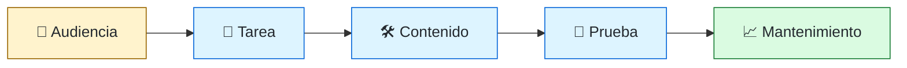
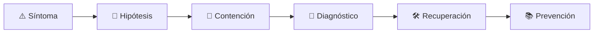

# ✍️ Technical Writer / Documentation Engineer
<!-- role-visual:start -->

**La guía conecta trabajo real, decisiones, clases concretas y evidencia defendible.**

<!-- role-visual:end -->

> Diseña conocimiento técnico encontrable, verificable y mantenible para que otras
> personas puedan usar, operar y cambiar sistemas sin depender de memoria tácita.
>
> **Entrada habitual:** junior/semi-senior · **Foco:** arquitectura de información y docs-as-code
> · **Evidencia central:** documentación probada mediante tareas reales

## 🧭 Qué es y por qué importa

La documentación es una interfaz del sistema. Este rol investiga audiencias y tareas,
separa tutorial, how-to, explicación y referencia, y conecta cambios de código con la
actualización del conocimiento, incluyendo límites y fecha de validez.

## 🗓️ Un día en el puesto

- observar dónde una persona no encuentra o interpreta información;
- probar instrucciones en un entorno limpio;
- editar API reference, tutorial, runbook o ADR;
- mejorar navegación, glosario y accesibilidad;
- automatizar enlaces, ejemplos y ownership.

## ✅ Responsabilidades y límites

- Responde por utilidad, precisión, estructura y mantenimiento documental.
- Trabaja con especialistas; no inventa comportamiento ausente.
- No mide calidad por cantidad de páginas.
- No trata un texto generado como correcto sin validación técnica y de tarea.

## 🧠 Qué necesitas saber

Análisis de audiencia y tareas, escritura técnica, arquitectura de información,
docs-as-code, Markdown, diagramas, ejemplos, APIs, control de versiones, búsqueda,
accesibilidad, localización, testing documental y gobierno de conocimiento.

## 📚 Tu ruta en el programa

1. Partes 00, 04–05 y 08–10 para sistemas y usuarios.
2. Partes 12–14 y 16 para requisitos, claridad e inclusión.
3. [Parte 17 — Documentación y conocimiento técnico](../classes/part-17-documentacion-y-conocimiento-tecnico/README.md).
4. Partes 20, 39–47 para API docs, runbooks, releases, incidentes e IA.

<!-- role-depth:start -->
## 🗺️ Sistema profesional del rol

El gráfico no representa una cascada rígida. Muestra el bucle profesional que este rol
debe poder recorrer: comprender el contexto, tomar una decisión, intervenir, observar
el efecto y convertir lo aprendido en una mejora. En **✍️ Technical Writer / Documentation Engineer**, saltar directamente a
la herramienta suele ocultar el problema, mientras que terminar sin evidencia deja la
decisión en una opinión. La misión concreta es: Diseña conocimiento técnico encontrable, verificable y mantenible para que otras personas puedan usar, operar y cambiar sistemas sin depender de memoria tácita. Cada transición
debe conservar supuestos, responsables y una forma de volver atrás.

<table>
<tr>
<td valign="top" width="50%">

### 🎯 Responde por

- decisiones propias de la familia **Conocimiento**;
- el resultado observable, no sólo la actividad ejecutada;
- límites, riesgos, operación y deuda residual de su intervención;
- evidencia que otra persona pueda revisar o reproducir.

</td>
<td valign="top" width="50%">

### 🤝 Coordina con

- [🧰 Developer Experience Engineer](developer-experience-engineer.md); [🔗 API Engineer](api-engineer.md); [🔭 Observability Engineer](observability-engineer.md);
- producto y personas usuarias cuando cambia una tarea o outcome;
- seguridad, privacidad, accesibilidad y operación según el riesgo;
- quienes mantendrán el sistema después de la entrega.

</td>
</tr>
</table>

El título no concede autoridad automática. El alcance real depende del equipo, la
industria y la criticidad. Esta guía describe un recorrido desde **junior → principal**, pero una
vacante se evalúa por las decisiones que permite tomar, los sistemas que pone bajo
responsabilidad y la evidencia exigida, no por el nombre del cargo.

## 🧱 Partes y clases asociadas

La ruta distingue **parte** —unidad curricular con una capacidad acumulativa— de
**clase asociada** —punto concreto donde se estudia un mecanismo o una decisión. Las
clases siguientes forman el núcleo; no eliminan los prerrequisitos indicados en sus
propias páginas ni convierten en opcional la base común.

| Orden | Parte del programa | Estado | Clases clave | Por qué entra en esta ruta | Evidencia de transferencia |
| ---: | --- | --- | --- | --- | --- |
| 1 | [Parte 09 · Bibliotecas, paquetes, SDK y automatización](../classes/part-09-bibliotecas-paquetes-sdk-y-automatizacion/README.md) | desarrollada | [SE-110 · SemVer, compatibilidad y contratos públicos](../classes/part-09-bibliotecas-paquetes-sdk-y-automatizacion/se-110-semver-compatibilidad-y-contratos-publicos/README.md) [SE-113 · CLI, flags, configuración y códigos de salida](../classes/part-09-bibliotecas-paquetes-sdk-y-automatizacion/se-113-cli-flags-configuracion-y-codigos-de-salida/README.md) [SE-118 · Diseño de experiencia para desarrolladores](../classes/part-09-bibliotecas-paquetes-sdk-y-automatizacion/se-118-diseno-de-experiencia-para-desarrolladores/README.md) [SE-120 · Proyecto: SDK y CLI con compatibilidad verificada](../classes/part-09-bibliotecas-paquetes-sdk-y-automatizacion/se-120-proyecto-sdk-y-cli-con-compatibilidad-verificada/README.md) | Profundiza **paquetes, SDK, dependencias y compatibilidad** desde la responsabilidad del rol. | Paquete versionado y consumible. |
| 2 | [Parte 13 · Especificaciones, contratos y modelos](../classes/part-13-especificaciones-contratos-y-modelos/README.md) | desarrollada | [SE-157 · Especificación informal, semiformal y formal](../classes/part-13-especificaciones-contratos-y-modelos/se-157-especificacion-informal-semiformal-y-formal/README.md) [SE-158 · Specification by Example y BDD](../classes/part-13-especificaciones-contratos-y-modelos/se-158-specification-by-example-y-bdd/README.md) [SE-163 · OpenAPI, AsyncAPI, GraphQL y contratos de eventos](../classes/part-13-especificaciones-contratos-y-modelos/se-163-openapi-asyncapi-graphql-y-contratos-de-eventos/README.md) [SE-164 · Compatibilidad, versionado y evolución de contratos](../classes/part-13-especificaciones-contratos-y-modelos/se-164-compatibilidad-versionado-y-evolucion-de-contratos/README.md) [SE-166 · Especificaciones ejecutables y pruebas contractuales](../classes/part-13-especificaciones-contratos-y-modelos/se-166-especificaciones-ejecutables-y-pruebas-contractuales/README.md) [SE-167 · Taller: convertir intención en contrato comprobable](../classes/part-13-especificaciones-contratos-y-modelos/se-167-taller-convertir-intencion-en-contrato-comprobable/README.md) | Profundiza **contratos, modelos e invariantes verificables** desde la responsabilidad del rol. | Especificación trazable. |
| 3 | [Parte 14 · Experiencia, accesibilidad e internacionalización](../classes/part-14-experiencia-accesibilidad-e-internacionalizacion/README.md) | desarrollada | [SE-169 · Diseño centrado en personas y tareas](../classes/part-14-experiencia-accesibilidad-e-internacionalizacion/se-169-diseno-centrado-en-personas-y-tareas/README.md) [SE-170 · Arquitectura de información y navegación](../classes/part-14-experiencia-accesibilidad-e-internacionalizacion/se-170-arquitectura-de-informacion-y-navegacion/README.md) [SE-172 · Estados vacíos, carga, error y recuperación](../classes/part-14-experiencia-accesibilidad-e-internacionalizacion/se-172-estados-vacios-carga-error-y-recuperacion/README.md) [SE-173 · Accesibilidad perceptible, operable y comprensible](../classes/part-14-experiencia-accesibilidad-e-internacionalizacion/se-173-accesibilidad-perceptible-operable-y-comprensible/README.md) [SE-177 · Internacionalización, localización y formatos culturales](../classes/part-14-experiencia-accesibilidad-e-internacionalizacion/se-177-internacionalizacion-localizacion-y-formatos-culturales/README.md) | Profundiza **experiencia, accesibilidad e internacionalización** desde la responsabilidad del rol. | Flujo inclusivo evaluado. |
| 4 | [Parte 17 · Documentación y conocimiento técnico](../classes/part-17-documentacion-y-conocimiento-tecnico/README.md) | desarrollada | [SE-205 · Documentación orientada a tareas y audiencias](../classes/part-17-documentacion-y-conocimiento-tecnico/se-205-documentacion-orientada-a-tareas-y-audiencias/README.md) [SE-206 · Tutoriales, how-to, referencia y explicación](../classes/part-17-documentacion-y-conocimiento-tecnico/se-206-tutoriales-how-to-referencia-y-explicacion/README.md) [SE-207 · README, instalación y primer éxito](../classes/part-17-documentacion-y-conocimiento-tecnico/se-207-readme-instalacion-y-primer-exito/README.md) [SE-210 · API docs, ejemplos y contratos publicados](../classes/part-17-documentacion-y-conocimiento-tecnico/se-210-api-docs-ejemplos-y-contratos-publicados/README.md) [SE-211 · Runbooks, playbooks y documentación operacional](../classes/part-17-documentacion-y-conocimiento-tecnico/se-211-runbooks-playbooks-y-documentacion-operacional/README.md) [SE-212 · Docs as code, revisión y publicación](../classes/part-17-documentacion-y-conocimiento-tecnico/se-212-docs-as-code-revision-y-publicacion/README.md) | Profundiza **documentación, decisiones y conocimiento operativo** desde la responsabilidad del rol. | Paquete documental probado por terceros. |
| 5 | [Parte 41 · Observabilidad, SRE e incidentes](../classes/part-41-observabilidad-sre-e-incidentes/README.md) | desarrollada | [SE-499 · Runbooks, on-call y escalamiento](../classes/part-41-observabilidad-sre-e-incidentes/se-499-runbooks-on-call-y-escalamiento/README.md) [SE-500 · Gestión de incidentes y comunicación](../classes/part-41-observabilidad-sre-e-incidentes/se-500-gestion-de-incidentes-y-comunicacion/README.md) [SE-501 · Postmortems sin culpa y aprendizaje](../classes/part-41-observabilidad-sre-e-incidentes/se-501-postmortems-sin-culpa-y-aprendizaje/README.md) [SE-504 · Proyecto: operación observable y recuperable](../classes/part-41-observabilidad-sre-e-incidentes/se-504-proyecto-operacion-observable-y-recuperable/README.md) | Profundiza **observabilidad, SRE e incidentes** desde la responsabilidad del rol. | Incidente diagnosticado y recuperado. |
| 6 | [Parte 45 · Metodologías de desarrollo: de TDD a ODD](../classes/part-45-metodologias-de-desarrollo-de-tdd-a-odd/README.md) | desarrollada | [SE-544 · BDD: ejemplos, conversación y lenguaje compartido](../classes/part-45-metodologias-de-desarrollo-de-tdd-a-odd/se-544-bdd-ejemplos-conversacion-y-lenguaje-compartido/README.md) [SE-545 · ATDD y Specification by Example: aceptación ejecutable](../classes/part-45-metodologias-de-desarrollo-de-tdd-a-odd/se-545-atdd-y-specification-by-example-aceptacion-ejecutable/README.md) [SE-546 · DDD como lenguaje ubicuo y contexto para agentes](../classes/part-45-metodologias-de-desarrollo-de-tdd-a-odd/se-546-ddd-como-lenguaje-ubicuo-y-contexto-para-agentes/README.md) [SE-547 · Diseño por contrato y pruebas de contrato como oráculo](../classes/part-45-metodologias-de-desarrollo-de-tdd-a-odd/se-547-diseno-por-contrato-y-pruebas-de-contrato-como-oraculo/README.md) [SE-548 · SDD: spec-first, spec-anchored y spec-as-source](../classes/part-45-metodologias-de-desarrollo-de-tdd-a-odd/se-548-sdd-spec-first-spec-anchored-y-spec-as-source/README.md) | Profundiza **metodologías de desarrollo con evidencia de equipo** desde la responsabilidad del rol. | Política metodológica con evidencia. |
| 7 | [Parte 46 · Desarrollo de software asistido por IA](../classes/part-46-desarrollo-de-software-asistido-por-ia/README.md) | desarrollada | [SE-554 · Prompting, instrucciones y criterios de salida](../classes/part-46-desarrollo-de-software-asistido-por-ia/se-554-prompting-instrucciones-y-criterios-de-salida/README.md) [SE-558 · Generación de pruebas, documentación y migraciones](../classes/part-46-desarrollo-de-software-asistido-por-ia/se-558-generacion-de-pruebas-documentacion-y-migraciones/README.md) [SE-560 · Context engineering y reducción de ambigüedad](../classes/part-46-desarrollo-de-software-asistido-por-ia/se-560-context-engineering-y-reduccion-de-ambiguedad/README.md) [SE-562 · Privacidad, propiedad intelectual y código inseguro](../classes/part-46-desarrollo-de-software-asistido-por-ia/se-562-privacidad-propiedad-intelectual-y-codigo-inseguro/README.md) | Profundiza **ingeniería asistida por IA y evaluaciones** desde la responsabilidad del rol. | Cambio asistido con trazabilidad. |
| 8 | [Parte 47 · SPEC, agentes y ciclo de vida agentic](../classes/part-47-spec-agentes-y-ciclo-de-vida-agentic/README.md) | desarrollada | [SE-565 · De la intención a la especificación durable](../classes/part-47-spec-agentes-y-ciclo-de-vida-agentic/se-565-de-la-intencion-a-la-especificacion-durable/README.md) [SE-566 · Constitución, specify, clarify, plan y tasks](../classes/part-47-spec-agentes-y-ciclo-de-vida-agentic/se-566-constitucion-specify-clarify-plan-y-tasks/README.md) [SE-567 · Implementación, análisis y convergencia contra SPEC](../classes/part-47-spec-agentes-y-ciclo-de-vida-agentic/se-567-implementacion-analisis-y-convergencia-contra-spec/README.md) [SE-568 · Greenfield, brownfield, bug fixing e idea assessment](../classes/part-47-spec-agentes-y-ciclo-de-vida-agentic/se-568-greenfield-brownfield-bug-fixing-e-idea-assessment/README.md) | Profundiza **SPEC, agentes, herramientas y guardrails** desde la responsabilidad del rol. | Flujo agentic controlado. |

### ✅ Clases ya desarrolladas que sostienen la ruta hoy

El núcleo anterior apunta a la capacidad profesional completa. Estas clases de apoyo,
de las Partes 00–41 y 43–50 (`SE-001`–`SE-504` y `SE-517`–`SE-612`), también tienen contenido desarrollado y
permiten practicar el rol desde otros ángulos:

| Clase desarrollada | Parte |
| --- | --- |
| [SE-208 · ADRs, RFCs y registro de decisiones](../classes/part-17-documentacion-y-conocimiento-tecnico/se-208-adrs-rfcs-y-registro-de-decisiones/README.md) | Parte 17 |
| [SE-214 · Documentación para humanos, máquinas y LLM](../classes/part-17-documentacion-y-conocimiento-tecnico/se-214-documentacion-para-humanos-maquinas-y-llm/README.md) | Parte 17 |
| [SE-333 · Trade-offs, ADR y evaluación de alternativas](../classes/part-27-arquitectura-de-software-y-dominio/se-333-trade-offs-adr-y-evaluacion-de-alternativas/README.md) | Parte 27 |
| [SE-010 · Cómo leer estándares, documentación y literatura técnica](../classes/part-00-ingenieria-de-software-como-profesion/se-010-como-leer-estandares-documentacion-y-literatura-tecnica/README.md) | Parte 00 |
| [SE-154 · Ambigüedad, contradicción e incompletitud](../classes/part-12-ingenieria-de-requisitos/se-154-ambiguedad-contradiccion-e-incompletitud/README.md) | Parte 12 |
| [SE-209 · Diagramas, modelos y documentación visual](../classes/part-17-documentacion-y-conocimiento-tecnico/se-209-diagramas-modelos-y-documentacion-visual/README.md) | Parte 17 |
| [SE-213 · Búsqueda, glosarios y arquitectura de conocimiento](../classes/part-17-documentacion-y-conocimiento-tecnico/se-213-busqueda-glosarios-y-arquitectura-de-conocimiento/README.md) | Parte 17 |
| [SE-215 · Taller: reconstruir conocimiento perdido](../classes/part-17-documentacion-y-conocimiento-tecnico/se-215-taller-reconstruir-conocimiento-perdido/README.md) | Parte 17 |
| [SE-216 · Proyecto: portal documental versionado](../classes/part-17-documentacion-y-conocimiento-tecnico/se-216-proyecto-portal-documental-versionado/README.md) | Parte 17 |
| [SE-518 · Arqueología de código y recuperación de conocimiento](../classes/part-43-mantenimiento-y-modernizacion-legacy/se-518-arqueologia-de-codigo-y-recuperacion-de-conocimiento/README.md) | Parte 43 |
| [SE-525 · Retiro, archivado y disposición de sistemas](../classes/part-43-mantenimiento-y-modernizacion-legacy/se-525-retiro-archivado-y-disposicion-de-sistemas/README.md) | Parte 43 |
| [SE-578 · Instrucciones de repositorio y cumplimiento determinista](../classes/part-48-harness-y-agentic-engineering/se-578-instrucciones-de-repositorio-y-cumplimiento-determinista/README.md) | Parte 48 |
| [SE-580 · Gestión de contexto, resets y handoffs](../classes/part-48-harness-y-agentic-engineering/se-580-gestion-de-contexto-resets-y-handoffs/README.md) | Parte 48 |
| [SE-348 · Proyecto: decisión arquitectónica defendida con ADR](../classes/part-28-estilos-arquitectonicos/se-348-proyecto-decision-arquitectonica-defendida-con-adr/README.md) | Parte 28 |

**Cómo recorrerla.** Empieza por [SE-110](../classes/part-09-bibliotecas-paquetes-sdk-y-automatizacion/se-110-semver-compatibilidad-y-contratos-publicos/README.md) para fijar el
primer mecanismo, usa [SE-211](../classes/part-17-documentacion-y-conocimiento-tecnico/se-211-runbooks-playbooks-y-documentacion-operacional/README.md) para integrar el
centro de la especialidad y llega a [SE-568](../classes/part-47-spec-agentes-y-ciclo-de-vida-agentic/se-568-greenfield-brownfield-bug-fixing-e-idea-assessment/README.md) cuando ya
puedas explicar cómo detectar y recuperar un fallo. Una clase se considera estudiada
sólo cuando su concepto cambia una decisión y deja evidencia; abrir todos los enlaces
no constituye competencia.

> [!IMPORTANT]
> El mapa expresa el currículo vigente. Las Partes 00–41 y 43–50 (`SE-001`–`SE-504` y `SE-517`–`SE-612`) están
> desarrolladas, a falta de una revisión editorial humana independiente. Esta ruta no
> declara aprobadas esas clases ni reemplaza el [roadmap](../ROADMAP.md).

## 🔭 Ampliación planificada: Parte 42 (sin clases publicadas)

> [!NOTE]
> La Parte 42 (`SE-505`–`SE-516`) está **planificada**; sus números están reservados desde el 23 de
> noviembre de 2026 ([ADR-007](../docs/adr/ADR-007-pedagogical-renumbering-and-new-parts.md)). Todavía no
> tienen clases ni README, por lo que no se enlazan aquí y ninguna de sus clases debe
> considerarse disponible.

| Parte planificada | Rango previsto | Qué cambiará para este rol |
| --- | --- | --- |
| — | — | Las partes que este rol esperaba ya están desarrolladas y figuran en el núcleo o en las clases de apoyo. |

Hasta que esas partes se publiquen, el rol se apoya en el núcleo y en las clases
desarrolladas de arriba. La planificación indica hacia dónde crecerá la ruta; no es
evidencia de que el contenido exista ni de que su alcance final coincida con esta
descripción.

## ⚖️ Decisiones y trade-offs que debes defender

| Decisión recurrente | Criterio profesional | Evidencia mínima antes de defenderla |
| --- | --- | --- |
| **Tutorial o referencia** | Elegir forma por necesidad y experiencia previa. | Prueba de tarea con persona objetivo. |
| **Precisión o descubribilidad** | Preservar exactitud sin esconder la respuesta. | Búsqueda y éxito de tarea. |
| **Documento o fuente ejecutable** | Derivar cuando sea posible y declarar ownership del resto. | Drift check y fecha de revisión. |

La calidad de una decisión no se juzga porque coincida con una herramienta popular.
Debe hacer explícitos contexto, restricciones, alternativas descartadas, coste de
cambio y condición de revisión. En especial, **Tutorial o referencia**, **Precisión o descubribilidad**
y **Documento o fuente ejecutable** cambian de respuesta cuando cambia el riesgo. Una solución
correcta en un prototipo puede ser irresponsable en un sistema regulado; una solución
robusta para un servicio crítico puede ser desperdicio en una herramienta interna.

## 🚨 Escenario profesional: Runbook indica una acción que ya no existe

**Síntoma.** El sistema cambió pero el documento no tiene owner ni prueba. La respuesta madura evita convertir la primera
correlación en causa y conserva evidencia antes de modificar el sistema.

1. **Detectar y delimitar:** identifica quién o qué está afectado, desde cuándo y qué
   cambió. Conserva timestamps, versiones, entradas y señales suficientes para no
   destruir la escena al intentar arreglarla.
2. **Investigar:** Reproducir tarea comparar interfaz historial fuente y audiencia. Formula al menos dos hipótesis rivales
   y define qué observación refutaría cada una.
3. **Contener:** reduce blast radius y daño sin prometer una corrección todavía. La
   contención debe ser reversible, visible y compatible con las obligaciones del
   sistema.
4. **Recuperar:** Corregir bloquear deriva y documentar límite y revisión. Verifica la tarea completa, no sólo que un
   proceso volvió a estar verde.
5. **Aprender:** añade una regresión, señal o control que detecte la misma clase de
   fallo. Documenta qué deuda permanece y quién revisará la acción.

El escenario evalúa método además de resultado. Una recuperación rápida que borra la
causa, oculta pérdida de datos o deja al equipo sin mecanismo preventivo no demuestra
dominio del rol.

## 📊 Señales útiles y límites de las métricas

| Señal | Qué ayuda a observar | Trampa que debe evitarse |
| --- | --- | --- |
| **Éxito de tarea documental** | Persona completa operación sin conocimiento tácito. | Medir visitas. |
| **Tiempo hasta primera respuesta** | Facilidad para encontrar y aplicar información correcta. | Optimizar SEO sin resolución. |
| **Drift detectado** | Diferencias entre producto contrato y documentación. | Contar cambios de palabras. |

Ninguna señal debe convertirse en ranking individual. Combina tendencia cuantitativa,
muestreo de casos, feedback cualitativo y contexto de carga. Declara ventana,
denominador, fuente, exclusiones y quién puede actuar sobre el resultado. Si una
métrica mejora mientras el outcome o el riesgo empeoran, el sistema está optimizando
el indicador y no el trabajo.

## 🧩 Proyecto integrador del rol: Portal técnico probado por usuarios

**Propósito:** convertir conocimiento disperso en tutorial how-to referencia explicación y operación coherentes. El resultado esperado es **mapa de audiencia arquitectura de información docs-as-code pruebas de tareas búsqueda y política de vigencia**.

Entrega un expediente revisable con estas piezas:

1. **Contexto y alcance:** usuario, sistema, restricción, supuestos, fuera de alcance y
   criterio de no éxito.
2. **Decisión:** al menos dos alternativas reales, trade-offs, coste de reversión y un
   ADR o memo que indique cuándo revisar la elección.
3. **Artefacto principal:** una implementación, modelo, flujo o política coherente con
   las clases núcleo; no una captura aislada ni una presentación sin mecanismo.
4. **Fallo controlado:** introduce una condición adversa relacionada con el escenario
   anterior y conserva el resultado observado, sin inventar una ejecución.
5. **Verificación:** prueba, rúbrica, revisión o medición que pueda fallar y que conecte
   directamente con el resultado profesional.
6. **Operación y salida:** telemetría, recuperación, mantenimiento, deprecación o retiro
   según corresponda; incluye límites y deuda residual.

**Criterio de aceptación:** otra persona puede reconstruir el razonamiento, reproducir
la comprobación y distinguir claramente qué quedó demostrado de lo que sólo se propone.
El proyecto no se aprueba por cantidad de archivos ni por utilizar una marca concreta.

## 📈 Dominio esperado por alcance

| Alcance | Qué resuelve | Qué evidencia su autonomía |
| --- | --- | --- |
| **Inicial** | ejecuta una tarea acotada con criterios y acompañamiento | reproduce el caso, pregunta por supuestos y entrega evidencia legible |
| **Intermedio** | decide dentro de un componente o flujo conocido | compara alternativas, prueba fallos previsibles y coordina dependencias |
| **Senior** | conduce problemas ambiguos que cruzan sistemas o equipos | hace explícito el riesgo, diseña recuperación y mejora el mecanismo de trabajo |
| **Staff / Lead** | cambia capacidades compartidas y decisiones de largo plazo | multiplica criterio, define guardrails, mide adopción y conserva opciones futuras |

Progresar no significa alejarse de la práctica. Significa aumentar ambigüedad, horizonte,
blast radius y responsabilidad por consecuencias. La persona senior todavía debe poder
explicar el mecanismo; la persona Staff además crea condiciones para que otros lo
operen sin depender de ella.

## 🗓️ Plan de práctica 30 · 60 · 90 días

- **Días 1–30 — comprender y reproducir.** Estudia las primeras clases de cada parte,
  reproduce un caso pequeño y escribe un mapa de responsabilidades. El entregable es
  una baseline con preguntas abiertas, no una transformación prematura.
- **Días 31–60 — intervenir y fallar con control.** Construye el artefacto central,
  introduce el escenario de fallo y mide el comportamiento. Revisa el trabajo con una
  persona de una ruta vecina para descubrir supuestos de frontera.
- **Días 61–90 — operar y transferir.** Ejecuta recuperación, corrige la causa, publica
  runbook o guía de uso y presenta la decisión con trade-offs. Termina con una
  retrospectiva que separe resultado, evidencia, límites y siguiente inversión.

Este plan es una secuencia de práctica, no una promesa de empleabilidad en noventa días.
La experiencia previa, el dominio y el acceso a sistemas reales cambian el tiempo
necesario.

## 🎤 Preguntas para revisión o entrevista

1. ¿En qué contexto elegirías **Tutorial o referencia** y qué evidencia te haría cambiar?
2. ¿Cómo distinguirías síntoma, causa y daño en el escenario **Runbook indica una acción que ya no existe**?
3. ¿Qué clase asociada usarías para diseñar el mecanismo y cuál para verificarlo?
4. ¿Qué parte de **Portal técnico probado por usuarios** no automatizarías todavía y por qué?
5. ¿Qué métrica podría mejorar mientras el sistema empeora y qué guardrail añadirías?
6. ¿Dónde termina la autoridad de este rol y cuándo debe escalar o pedir revisión?

Una respuesta fuerte usa un caso, reconoce incertidumbre y propone una comprobación.
Nombrar una herramienta sin explicar mecanismo, fallo y límite no demuestra la
competencia.

## 🔗 Fuentes primarias y oficiales

- [Diátaxis documentation framework](https://diataxis.fr/) — **Diátaxis**. Se usa como referencia primaria u oficial; la guía no sustituye la fuente.
- [OpenAPI Specification](https://spec.openapis.org/oas/latest.html) — **OpenAPI Initiative**. Se usa como referencia primaria u oficial; la guía no sustituye la fuente.
- [SWEBOK Guide v4.0a](https://www.computer.org/education/bodies-of-knowledge/software-engineering) — **IEEE Computer Society**. Se usa como referencia primaria u oficial; la guía no sustituye la fuente.

Las fuentes orientan principios, vocabulario y prácticas; no convierten la guía en una
certificación ni sustituyen la documentación específica del sistema, la jurisdicción
o la tecnología utilizada.
<!-- role-depth:end -->

## 🧪 Evidencia de portafolio

- mapa de audiencia, tareas y contenido;
- tutorial ejecutado desde cero por otra persona;
- referencia contractual con ejemplos validados;
- política de ownership, caducidad y prueba de enlaces.

## 📈 Progresión

Technical Writer → Senior Writer/Documentation Engineer → Docs Lead o Content Architect.

## ⚠️ Mitos frecuentes

- “Documentar es escribir bien.” También exige probar el sistema y su información.
- “El código es la documentación.” No explica intención, tarea ni operación.
- “La IA mantiene docs sola.” Puede perpetuar APIs falsas y contexto vencido.

## 🚀 Siguientes pasos

1. Elige una tarea y observa a otra persona realizarla.
2. Corrige la ruta, no sólo la prosa.
3. Automatiza ejemplos y enlaces que puedan comprobarse.

---

[⬅️ Volver a las rutas](README.md) · [🏠 Inicio del programa](../README.md)
